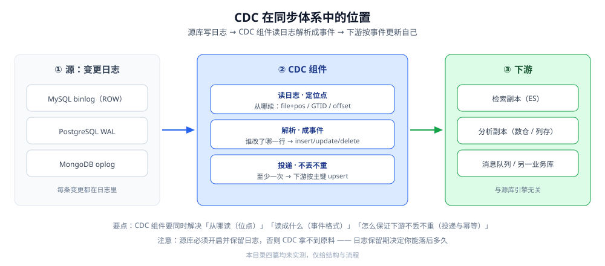

# CDC（本目录导读）

> 本目录回答「**怎么把数据库的变更日志变成一条条事件、可靠地喂给下游**」。
> CDC（Change Data Capture，变更数据捕获）是数据同步三条路线里**延迟最低、侵入最小**的一条，代价是要开日志、维护位点、处理 schema 演进。
> 三条路线的横评与「怎么组合」在上一层的 [数据同步方式选型对比.md](../数据同步方式选型对比.md)，本目录把它往下拆成四篇零件。
>
> 内容整理自个人学习笔记，并参考各家官方文档。**本文件只给阅读顺序与依赖关系**——每篇的知识点描述见 [全仓知识点目录](../../../../目录.md)，本目录不重复描述；与其它篇的分工见「四」。
>
> ⚠️ 实测口径：**本目录四篇均未做容器实测**（需要真实源库开日志、多进程消费与宕机/丢包对抗环境）。代码一律标 ⚠️ 未实测，不引用任何第三方吞吐或延迟数字。

---

## 一、CDC 在同步体系里站在哪？



一次 CDC 同步就三段：**源库写日志 → CDC 组件读日志并解析成事件 → 下游按事件更新自己**。组件要解决的三件事是「从哪读（位点）」「读成什么（事件格式）」「怎么保证下游不丢不重（投递与幂等）」。

## 二、先读哪几篇

| 顺序 | 篇 | 视角 | 一句话 |
|---|---|---|---|
| ① | [CDC原理.md](CDC原理.md) | ⭐ **地基** | 变更日志（binlog / WAL / oplog）长什么样、为什么读日志优于轮询、位点与一致性快照 |
| ② | [CDC工具选型.md](CDC工具选型.md) | ⭐ **选型** | Debezium / Canal / Maxwell / Flink CDC / SeaTunnel 五条路线对照与选择线 |
| ③ | [全量与增量一体化.md](全量与增量一体化.md) | **落地难点** | 初始全量快照与增量日志怎么无缝衔接、断点续传、幂等写入与冲突 |
| ④ | [FlinkCDC.md](FlinkCDC.md) | **一种具体形态** | Flink CDC 如何把「全量 + 增量」压进一个作业、checkpoint 与 exactly-once |

## 三、四篇的依赖关系

```text
① CDC原理            ← 入口：日志是原料，位点是抓手
        ↓
② CDC工具选型        ← 选型：拿到同类工具，先按「数据源 / 部署 / 语义」三条线砍
        ↓
③ 全量与增量一体化    ← 落地第一难：快照与增量怎么接上（位点是接缝）
        ↓
④ FlinkCDC           ← 一种把上面三件事打包的形态（含顺带讲 checkpoint 语义）
```

本目录篇目（与上面 ①~④ 一一对应）：[CDC原理.md](CDC原理.md) → [CDC工具选型.md](CDC工具选型.md) → [全量与增量一体化.md](全量与增量一体化.md) → [FlinkCDC.md](FlinkCDC.md)

## 四、与其它篇的分工（不重复）

| 想搞清楚 | 去哪 |
|---|---|
| 三种同步方式怎么比、怎么组合 | [数据同步方式选型对比.md](../数据同步方式选型对比.md) |
| 数据库**同构**主从复制（不是 CDC） | [复制与高可用.md](../../关系型/MySQL/复制与高可用.md) |
| binlog 本身怎么记、怎么持久化 | [日志与持久化.md](../../关系型/MySQL/日志与持久化.md) |
| 同步之后怎么证明两边一致、不一致怎么补 | [数据对比与对账/README.md](../数据对比与对账/README.md) |
| 「不读日志、定期批量捞」那条路线 | [定时同步/README.md](../定时同步/README.md) |
| 一个系统里为什么要同步多份、数据有哪几种角色 | [存储选型与组合.md](../../../../04-架构与系统/系统设计/存储选型与组合.md) |
| 订阅 binlog 做**缓存失效**（不是为了同步） | [缓存一致性.md](../../缓存/缓存一致性.md) |

## 关联

- [数据同步方式选型对比.md](../数据同步方式选型对比.md) — 上位：三条同步路线的族级横评与组合范式
- [CDC原理.md](CDC原理.md) — 变更日志格式、位点、一致性快照
- [CDC工具选型.md](CDC工具选型.md) — 五条工具路线对照与选择线
- [全量与增量一体化.md](全量与增量一体化.md) — 全量快照与增量日志的位点衔接
- [FlinkCDC.md](FlinkCDC.md) — Flink CDC 的一体化作业与 checkpoint 语义
- [数据对比与对账/README.md](../数据对比与对账/README.md) — CDC 之后的「一致性证明」环节
