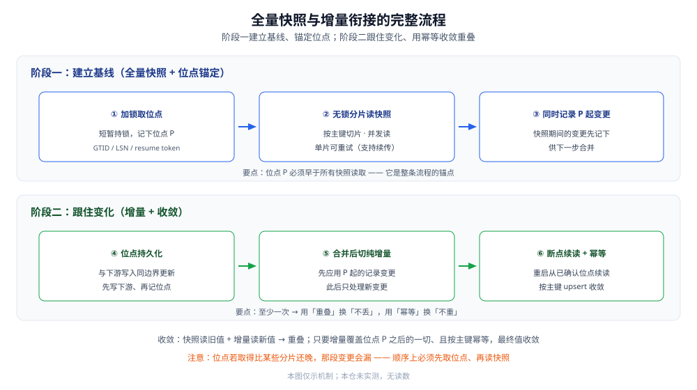
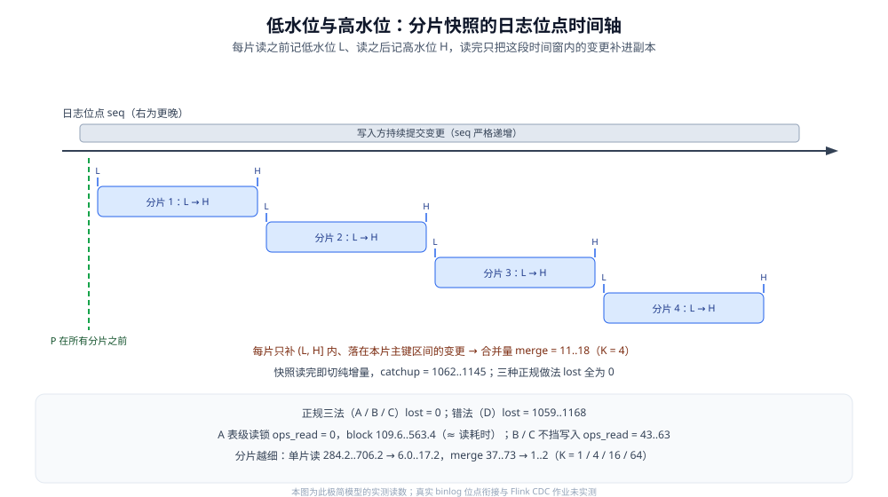

# 全量与增量一体化

> 覆盖：CDC 落地第一难 —— 冷启动时的**初始全量快照**与随后的**增量日志**怎么严丝合缝地接上。本篇展开一致性位点怎么取、**低水位与高水位**怎么把「同步读日志」变成「异步读」、无锁快照怎么读、断点续传与幂等写入，以及大事务、schema 变更、重叠覆盖这些边界怎么收敛；末节用一个极简模型把三种快照做法与一个错法各跑 3 遍做对比。
>
> 不覆盖：CDC 的通用原理（变更日志、位点、投递语义、before/after 镜像）见 [CDC原理.md](CDC原理.md)；五条工具路线的横评见 [CDC工具选型.md](CDC工具选型.md)；把「全量 + 增量」压进一个 Flink 作业的**具体形态**见 [FlinkCDC.md](FlinkCDC.md)；Canal 偏增量那条路线见 [CanalCDC.md](CanalCDC.md)；数据角色与副本分工的上位视角见 [存储选型与组合.md](../../存储架构与场景/存储选型与组合.md)。
>
> 内容整理自个人学习笔记，并参考各家官方文档；素材见 [素材清单](../../../../素材清单.md)。
>
> 📎 实测口径：**第 8 节为容器实测** —— 用「变更日志 + 副本表」的极简模型实跑 ①表级读锁 ②一致性快照 ③不开锁分片 + 低/高水位 三种做法，外加一个错法对照，各跑 3 遍，读数取 3 遍的 min..max，环境与版本见 8.1；**其余各节未实测**：真实 MySQL binlog 的 GTID / 位点衔接、跨行事务、DDL、跨机房网络都**未在本仓运行**。第十节「具体使用」的 SQL 骨架**未建那两张示例表**，但**同一种分批幂等 upsert 形式已在第 8 节实跑**；文中官方默认值与版本号**随文标注出处**。

---

## 一、为什么「全量 + 增量」的接缝是 CDC 第一难？

**本节要点**：全量快照是「某一时点的照片」，增量是「之后的录像」。两段各自都不难，难点全在**接缝**——照片拍完到录像开机之间不能有空档，而快照又不可能瞬间读完。

### 1.1 两段各自不难，接缝才难

- **全量快照**：把存量数据搬一遍，本质是一次数据迁移，已经有成熟做法。
- **增量**：从某个位点起读日志、投给下游，规则清楚。
- **接缝**：快照**不是一个瞬时动作**——它可能持续很久。在这段时间里源库一直在变，于是「快照读到的行」与「日志里的变更」会**重叠**（同一行先后被读到两次）甚至**冲突**（快照读到的是旧值）。

⭐ 一句话：**快照与增量如果各取各的「当前时点」，中间必有一段既不在快照、也不在增量的空白。** 收敛这件事的关键，就落在下面两件事上：**位点锚在同一时点**、**目标侧幂等**。

### 1.2 位点是唯一的接缝坐标

接缝处需要一个「坐标」来表示「快照对应到日志的哪个位置」，这个坐标就是**位点**（原理见 [CDC原理.md](CDC原理.md) 2.3）。规则只有一条：

> **位点必须在「读快照之前」就取好，代表快照所见的那个一致性时点。**

如果反过来——先读完快照，再随便取一个「当前位点」当增量起点，那么「快照读完 → 取位点」之间发生的变更，**既不在快照里（快照取的是更早的值）也不在增量里（增量从那之后才开始）**，永久丢失。



图注：这条流程把「接缝」拆成了可执行的六步。前半段（取位点、读快照）建立**基线**，后半段（持久化、切增量、续读）保证**跟住变化**，最后靠幂等把重叠部分**收敛**掉。

### 1.3 三类典型的「接缝错误」

工程上翻车几乎都落在下面三类，认出来就能提前防：

| 错误 | 怎么发生的 | 后果 |
|---|---|---|
| **先读快照、后取位点** | 快照读完后才去取「当前位点」当增量起点 | 两次动作之间的变更**既不在快照也不在增量**，永久漏 |
| **位点取晚于部分分片** | 分片是并发/先后读的，位点却取在中间某个时刻 | 「位点之后、早于该分片读取」的变更被跳过 |
| **快照期间不记录变更** | 只读了快照，没有并行记录位点 P 起的日志 | 快照读完时的「新增/更新」全部丢失 |

⭐ 三类错误的解药只有一条：**把位点 P 钉在「所有快照读取之前」，并让它之后的一切变更都进入增量。** 只要这条成立，快照与增量之间的重叠就是无害的。

---

## 二、一致性位点怎么取？

**本节要点**：位点要代表「快照所见的时刻」，所以必须**在读快照之前**取。MySQL 用 GTID、PostgreSQL 用 LSN、MongoDB 用 resume token；「加锁的瞬间」往往就是取位点的那个锚点。

### 2.1 三种取位点的做法

| 做法 | 怎么取 | 特点 |
|---|---|---|
| **短暂加锁取位点** | 加一把**全局读锁**（或对相关表加锁）→ 记录当前位点 → 立刻释放锁 → 再不加锁读快照 | 位点确定、逻辑简单；代价是**有一瞬间的锁**，大库上要控制锁的持续时间 |
| **用全局事务标识关联** | 直接取 **GTID**（MySQL）作为位点，快照读与 GTID 集合关联 | 跨主从切换仍可比，无需依赖物理偏移 |
| **用一致性读 / 复制槽** | 在 PostgreSQL 上创建**逻辑复制槽**，取 **LSN**；快照用一致性快照读 | 服务端会帮你保留未消费的日志，但要小心撑大 WAL |

⭐ 判据：**优先取「全局可比较」的位点（GTID / LSN / token），而不是本地物理偏移。** 物理偏移只在同一个实例的同一条日志链上有意义，主库一切换就失义。

### 2.2 「加锁瞬间」为什么是锚点

加锁的目的**不是**为了把整张表锁住读完，而是为了**拿到一个确定的位点并保证它之后所有的变更都不丢**：

- 加锁时，源库的写入被短暂挡住，此刻的位点 P 就代表「此刻之前的一切都已落盘进日志」。
- 释放锁后，快照虽然要读很久，但**P 之后的所有变更都会进日志**，增量从 P 起读就能全拿到。
- 于是「快照读到的旧值」和「增量里的新值」会重叠，但重叠部分由目标侧按主键覆盖，最终收敛到正确值。

> ⚠️ 加锁会短暂影响源库写入，生产上要评估锁的粒度与时长；很多工具用「一致性快照 + 无锁读」的方式避免长时间持锁，具体实现**以各工具官方文档为准**。

### 2.3 位点「取太晚」与「取太早」的两种偏差

位点只在「正确的那一瞬」才有意义，早一点晚一点各有一种偏差：

| 偏差 | 表现 | 后果 |
|---|---|---|
| **取太晚** | 位点在快照读取之后才拿到 | 中间那段变更**漏**（既不在快照也不在增量） |
| **取太早** | 位点在快照开始之前就取好 | 只会让重叠**更多**（同一行被重复读到），但**不会漏** |

⭐ 判据：**宁可位点取早，不要取晚。** 取早了最多重复投递，重复由幂等消化；取晚了就是永久丢数，而丢数是**事后很难发现**的。

---

## 三、快照怎么读才不锁库？

**本节要点**：生产库不能为了做快照长时间加锁。**无锁快照**用「一致性读快照 + 按主键分片」把一个长读拆成多个短读，既不长时间阻塞写入，又能拿到一致性基线。

### 3.1 有锁快照 vs 无锁快照

| 方式 | 做法 | 优点 | 代价 |
|---|---|---|---|
| **有锁快照** | 加锁 → 取位点 → 持锁读完 → 释放 | 实现简单、一致性最直观 | 长读期间阻塞写入，**生产库不可接受** |
| **无锁快照** | 取位点并释放锁 → 用一致性快照读 / 分片并行读 | 对源库写入影响小 | 需要分片键与一致性读能力；读到的行可能与增量重叠 |

### 3.2 并发快照分片

一个「把长读拆短」的常见做法，是**按主键把表切成若干个片（chunk）**：

- 选定一个**分片键**（通常是主键或唯一索引列），把整个主键空间切成多段。
- 每个片由**一个独立的短查询**读取（`WHERE pk BETWEEN ... AND ...`），可以**并发**执行。
- 每一片读完后**记录自己的进度**，因此**单片中断可以单片重试**，不必整表重来。

⭐ 好处有三：**并发提速**、**缩短单次持锁 / 事务时长**、**天然支持断点续传**（下次从没读完的片继续）。分片的大小与并发度是**调优参数**，与源库压力直接相关，要按实际情况定。

### 3.3 读一致性怎么保证

- **单表 / 单分片内**：一次查询本身就是一致的（同一个读快照）。
- **跨分片 / 跨表之间**：由于分片是先后读的，**不同片可能对应不同的时点**。这点不用怕——因为**增量会把这些片之后的变更补齐**，片与增量之间的差异最终被对齐。
- 关键在于**位点 P 早于所有分片的读取**：只要增量覆盖了 P 之后的一切，任何片读到的旧值都会被后来的变更覆盖成新值。

> ⚠️ 反过来说：如果位点取得比某些分片还晚，那些分片读到的值就可能**夹在两段之间**而漏掉更新。**位点必须早于所有快照读取**，这是顺序上的硬要求。

### 3.4 分片键怎么选

分片切得好不好，直接决定快照的体验：

| 分片键候选 | 优点 | 风险 |
|---|---|---|
| **自增主键** | 区间均匀、天然有序、切分简单 | 主键有空洞时片大小不均 |
| **单调递增的业务列（如时间）** | 与业务相关、便于按范围切 | 有热点时某些片极大 |
| **哈希后的键** | 分布均匀 | 失去有序性，范围查询意义变小 |
| **无合适键** | —— | 只能整表读，回到长读的老问题 |

⭐ 判据：**优先用「有序且分布相对均匀」的列做分片键**，通常就是自增主键或含时间的有序列。片大小要**有上限**——太大的片会让单次读取重新变成「长读」。

---

## 四、低水位和高水位是怎么把「同步读日志」变成「异步读」的？

**本节要点**：分片快照读的是「存量」，可读取期间源库还在不停变。**低水位 / 高水位**（low / high watermark）给每个分片框出一个日志区间：读该片之前记下低水位 L、读完之后记下高水位 H，读完再把这段区间里、落在本片主键空间的变更**补进**结果——于是「读快照」与「跟日志」不必同步进行，也就不必长时间锁库。

### 4.1 为什么「同步读」在工程上不成立

最直觉的做法是「读快照的同时，把变更也一并收下」，让两条流同步推进。但它要求**读快照期间一直持有那份一致性视图或那把锁**——快照读得越久，锁 / 长事务拖得越久。上一节说过，生产库不能这么干。

⭐ 出路是**把两件事解耦**：快照读它的，日志按「位置」先记下来；等快照读完，再按位置把该补的变更补上。这个「位置」就是水位。

### 4.2 一条变更的两种来源，谁说了算

同一行在快照与增量里可能各出现一次，得先定一条仲裁规则：

| 行的来源 | 它给的值 | 冲突时谁赢 |
|---|---|---|
| 快照读到的 | 读取那一刻的值（可能是旧值） | —— |
| 水位区间内的日志事件 | 更容易是较新的值 | ✅ **窗口内的日志事件赢** |

⭐ 规则的理由很直白：**快照是「时点照片」，日志是「之后的录像」**。只要日志覆盖了低水位之后的一切，快照里的旧值就会被同行的日志事件盖成新值。这就是「用重叠换不丢」在算法层面的落地——不是靠锁，而是靠**重放窗口**。

### 4.3 低水位和高水位怎么取

以本仓实测那套模型（见第 8 节）为例：用一张单调递增的变更表 `changelog(seq ...)` 当「日志」，`MAX(seq)` 就是「当前位点」。

| 水位 | 什么时候取 | 代表什么 |
|---|---|---|
| **低水位 L** | 读这个分片**之前** | 这片结果对应的起点位点 |
| **高水位 H** | 读这个分片**之后** | 这片读完后日志推进到的位置 |

读完后，把满足 `seq > L AND seq <= H`、且**落在本片主键区间**的变更补进结果即可。左右边界不对称，理由见下一节。

### 4.4 为什么区间必须是「左开右闭」

- **左端 `L` 不含**：L 是「读之前」的位点。若把 L 也算进来，就与快照本身（或上一片的重放）**重复**；重复虽可由幂等消化，却白白放大了合并量。
- **右端 `H` 要含**：H 是「读之后」的位点。若不含 H，恰好在读期间落到 H 的那条变更就**两边都不收**，直接漏。

⭐ 判据：**区间写成左开右闭 `(L, H]`——左开避免重复、右闭避免漏。** 这条边界一旦写反，要么多算、要么丢数，而且**两种错都不报错**，只能靠对账发现。

### 4.5 三个水位与前面那个「位点 P」是什么关系

- **P 是整条快照链的锚点**：它在**所有分片之前**取，代表「快照所见的那个一致性时点」。
- **L 与 H 是逐片的**：每个分片各有一组 `(L, H]`，且都晚于 P。
- 因为每片只补**自己窗口内**的变更，所以**分片之间不必同步**——谁先读完谁先合并，互不阻塞。这就是「把长读拆短」在算法上的另一半。

> ⚠️ 水位机制不是本仓凭空设计的。把它作为**日志型增量快照**的正式做法，公开可见于 DBLog 论文（arXiv 2010.12597，2020 年）与 Debezium 的增量快照（Debezium 1.6 起提供，官方博客《Incremental Snapshots in Debezium》，2021-10-07）：Debezium 同样用**低水位 / 高水位**框住重放区间，默认分片大小 `incremental.snapshot.chunk.size` 为 1024。Flink CDC 一脉的 `chunk.size`（Flink CDC 3.5.0 官方默认 8096）是同一思路的调优旋钮。

---

## 五、断点续传怎么实现？

**本节要点**：位点必须**持久化**，且最好与「下游写入」在同一边界更新；进程重启时从**已确认位点**续读，重复的部分交给幂等消化。

### 5.1 位点持久化的三个位置

| 位置 | 说明 | 适用 |
|---|---|---|
| **位点与下游数据同库同事务** | 写下游数据与写位点在同一个事务里提交 | ✅ 一致性最强，前提是下游支持事务 |
| **交给中间层管理** | Kafka offset / Flink checkpoint 代管位点 | ✅ 常见，重放语义由中间层保证 |
| **单独位点表 / 外部存储** | 位点单独存，要自己保证「两件事都成功」 | ⚠️ 复杂易错，需两阶段思想 |

> ⚠️ **不能只存在内存里**——进程一重启位点就没了，只能从头重放。对已经很大的库，这等于重做一次全量。

### 5.2 重启续读的流程

1. 进程启动，**读取上次持久化的位点 P′**（没有则视为需要做初始快照）。
2. 从 P′ 起向源库发**增量读**请求（MySQL 上是带 GTID / 位点发 dump，PG 上是复制槽续读）。
3. 每处理成功一批变更、并**确认下游写入成功后**，再持久化新位点。
4. 崩溃重启后回到第 1 步，从**最后一次成功持久化的位点**继续。

⭐ 这里藏着投递语义的关键：**先写下游再记位点** → 崩溃会重复（至少一次）；**先记位点再写下游** → 崩溃会丢失（至多一次）。工程上选**至少一次**，把去重交给下一步的幂等。

### 5.3 位点管理的两个常见坑

| 坑 | 现象 | 对策 |
|---|---|---|
| **位点更新过于频繁** | 每来一条变更就写一次位点，位点存储成为瓶颈 | **批量确认**：一批处理完再统一记一次位点 |
| **位点与数据不同步更新** | 记了位点但下游没写成功，重启后**跳过**了没写成的数据 | 位点与下游写入放在**同一边界**（同事务 / 同 checkpoint） |

> ⚠️ 还有一个隐蔽的坑：位点持久化成功、但下游写入其实是**异步**的（缓冲没刷出去）。此时「已确认」是假的。**要么让下游写入同步可见，要么用带确认的异步写。**

---

## 六、幂等写入怎么保证不重？

**本节要点**：在「至少一次」的现实下，重复不可避免；去重只能靠**目标侧按主键 upsert**，`delete` 天生幂等，而**累加类操作必须改成覆盖**。

### 6.1 三种操作的幂等写法

| 操作 | 幂等写法 | 说明 |
|---|---|---|
| `INSERT` / `UPDATE` | **按主键 upsert** | 同一条变更投递多次，结果都是「这一行等于后镜像」 |
| `DELETE` | **按主键 delete** | 删一条不存在的行是空操作，天然幂等 |
| 软删（`is_deleted=1`） | 由下游把 `UPDATE` 翻译成删除 | 业务是软删时，日志里是 UPDATE，需要显式翻译 |

- **关系库**：`INSERT ... ON DUPLICATE KEY UPDATE`（MySQL）或 `INSERT ... ON CONFLICT ... DO UPDATE`（PostgreSQL）。
- **检索 / 文档库**：按文档 `_id` 覆盖写。
- **KV**：直接 `SET`（幂等）。

### 6.2 为什么不能累加

- 后镜像里带的是**整行的新值**，按主键覆盖天然幂等。
- 但如果下游把变更翻译成 `counter = counter + 1` 这类**增量累加**，重复投递就会**多加**。
- ⭐ 判据：**计数 / 求和类字段，要么直接用后镜像里的全量值覆盖，要么在目标侧按主键去重后再累加。** 单纯累加在至少一次语义下是不安全的。

---

## 七、边界情况怎么收敛？

**本节要点**：真正的工程量都在边界——大事务 / 长事务、schema 变更、快照与增量的重叠、读一致性，每种都要有明确的收敛策略，否则平时没事、一出事就是线上数据错。

### 7.1 大事务与长事务

- **大事务**：一个事务改了海量行，日志里会形成一大段事件，内存与下游都会承压。常见对策是**增大缓冲 / 分批下游写入**，或把「一条大事务」拆开逐步消化（**以工具官方文档为准**）。
- **长事务**：长时间不提交的事务会**拖住日志推进**（尤其是逻辑复制槽 / 未提交事务），导致日志堆积。要**监控长事务**并及时处理。
- **对快照的影响**：快照期间若有长事务持续改动，接缝处的重叠会更多，但**只要幂等就仍会收敛**。

### 7.2 schema 变更期间

- 源表**加列 / 改类型 / 改名**会改变事件的形状，下游可能来不及跟上。
- 常见策略：**先在源库做变更 → 工具捕获 DDL 事件 → 下游跟随调整**；期间旧形状的事件仍需能被处理。
- ⚠️ 具体支持程度与配置**以各工具官方文档为准**；工程上要预留「**源先改、下游随后跟上**」的窗口，并保证**未识别的新列不会把下游写崩**。

### 7.3 重叠覆盖怎么收敛

前面反复出现「重叠」这个词，这里把它收口成一句话：

> **快照读到旧值、增量读到新值，两者重叠是正常的；只要增量覆盖了位点 P 之后的一切、且下游按主键幂等覆盖，最终值一定收敛到源库当前值。**

于是「一致性」不靠「绝不重复」实现，而靠「**重复也无害**」实现：

| 现象 | 后果 | 收敛方式 |
|---|---|---|
| 快照与增量读到同一行（旧→新） | 该行被写两次 | 后写的新值覆盖旧值，收敛 |
| 片与片之间时点不同 | 不同片基线略有差异 | 增量补齐差异，收敛 |
| 崩溃导致重复投递同一批变更 | 目标侧重复写 | 按主键 upsert，收敛 |
| `MINIMAL` 行镜像导致整行覆盖丢列 | ⚠️ 会把未改列写成空 | 保证 `binlog_row_image=FULL`（见 [CDC原理.md](CDC原理.md) 3.2） |

⭐ 收口：**「全量 + 增量」的一体化，本质是「用重叠换不丢，用幂等换不重」。**

### 7.4 上线前后的自检清单

接缝是否正确，很难靠「看着没报错」判断，要靠主动核对：

| 阶段 | 检查什么 |
|---|---|
| **上线前** | 位点是否在快照前取好；分片是否可重试；下游是否幂等；`binlog_row_image` 是否 `FULL` |
| **快照中** | 分片是否在推进；是否有超大的片；源库是否有长事务堆积 |
| **切换时** | 快照记录与增量是否已合并；切换后是否只处理新变更 |
| **上线后** | 抽查几行与源库比对；主动制造一次 `insert/update/delete` 看是否透传；重启一次看是否从正确位点续读 |
| **长期** | 监控滞后；监控日志保留期是否将过期；定期对账（见 [数据同步方式选型对比.md](../数据同步方式选型对比.md) 4.1） |

⭐ 判据：**「重启一次」和「制造一条 delete」是最便宜的两项验收**——前者验续传，后者验删除是否被捕获（delete 是轮询路线天然做不到的）。

---

## 八、三种快照做法到底差在哪？（实测）

**本节要点**：把「变更日志 + 副本表」缩成一个极简模型，让三种正规快照做法各跑 3 遍，再故意跑一个错法对照。结论：**三种正规做法都不丢行**，差别在**读快照时挡不挡写入**（`ops_read` / `block_ms`）与**要不要合并**（`merge`）；**错法则丢掉约 97%** 的变更。



图注：横轴是**日志位点**（`seq`，右为更晚）。每个分片读之前记低水位 L、读之后记高水位 H，读完只把 `(L, H]` 内、落在本片主键区间的变更补进副本；下方面板是四种做法与分片数的实测读数。**错法**（先读快照后取位点）的 `lost` 正是从这条时间轴上「漏掉」的那一段。

### 8.1 实验怎么搭

用一张自增表当「日志」，一个写入协程不停提交变更，副本写成真表：

- **日志表** `changelog(seq AUTO_INCREMENT, id, val)`：`MAX(seq)` 就代表「当前日志位点」。
- **写入协程**：一条变更一个事务 —— `UPDATE src SET val = val + 1 WHERE id = ?` → `SELECT val` → `INSERT INTO changelog(...)` → `COMMIT`。因为一个事务一次提交，**`seq` 的顺序就是提交顺序**。
- **副本写入**：按主键分批 `INSERT ... ON DUPLICATE KEY UPDATE`，批大小 `BATCH = 1000`。
- **「流一直在跑」**：副本写完后停掉写入协程，再补 `seq > P` 的尾巴，模拟「快照与切换」这一段。
- **四种做法**（`N = 200000` 行，各 3 遍）：
    - **A 表级读锁**：`LOCK TABLES src READ, changelog READ` 后读快照。
    - **B 一致性快照**：`START TRANSACTION WITH CONSISTENT SNAPSHOT` 后读快照，不挡写入。
    - **C 不开锁分片 + 低/高水位**（`K = 4`）：每片先记 `L = MAX(seq)`，读该片，再记 `H = MAX(seq)`，读完把 `seq > L AND seq <= H` 且落在该片主键区间的变更补进副本。
    - **D 对照错法**：先读完快照（一致性快照），**读完之后才取** `P`，等价于第二节说的「先读快照、后取位点」。

环境与版本：

| 项 | 值 |
|---|---|
| 源库 | MySQL 8.0.46（容器镜像 `mysql:8.0`，镜像 id 以 `sha256:7dcddc01f13bab2f15cde676d44d01f61fc9f99fe7785e86196dfc07d358ae2b` 为准） |
| 客户端 | go1.26.8 linux/amd64 + `go-sql-driver/mysql` v1.9.3 |
| 规模 | `N = 200000` 行，`BATCH = 1000` |
| 日志与隔离 | `binlog_format = ROW`、`binlog_row_image = FULL`、隔离级别 `REPEATABLE-READ` |
| 刷盘调参 | `innodb_flush_log_at_trx_commit = 2`、`sync_binlog = 0`（仅为去掉副本写入的固定刷盘开销，**与本组对比无关**） |

> 说明：源表、日志表、副本表都在**同一个 MySQL 实例**里，这是为「可复现」做的简化；真实 CDC 的源库与目标库是两套。调 `innodb_flush_log_at_trx_commit` 与 `sync_binlog` 只影响写入耗时，不影响「丢 / 不丢」的判定。

### 8.2 四种做法的读数（3 遍，min..max）

| 做法 | 读到并发写 `ops_read` | 阻塞写入 `block_ms` | 合并变更 `merge` | 变化补齐 `catchup` | 重复 `dup` | 丢失 `lost` | 写方总变更 `writer_ops` |
|---|---|---|---|---|---|---|---|
| **A** 表级读锁 | 0 | 109.6..563.4 | 0 | 1027..1178 | 1025..1178 | 0 | 1027..1178 |
| **B** 一致性快照 | 43..48 | 53.4..71.1 | 0 | 1089..1190 | 1088..1190 | 0 | 1090..1190 |
| **C** 不开锁分片+水位 | 58..63 | 36.0..267.7 | 11..18 | 1062..1145 | 1059..1140 | 0 | 1062..1145 |
| **D** 错法（先读快照后取位点） | 45..62 | 28.4..251.8 | 0 | 21..35 | 21..35 | **1059..1168** | 1082..1207 |

（`ops_read` = 读快照期间被挡住的并发写次数；`block_ms` = 写入被挡的累计毫秒；`catchup` = 副本补齐阶段应用的变更数；`dup` = 被重复应用的逻辑写次数；`lost` = 源副本比对不一致的行数。）

### 8.3 三个站得住的结论

1. **A 确实会挡住写入**：`ops_read = 0`，而 `block_ms`（109.6..563.4）与它的读耗时 `read_ms`（106.5..369.3）几乎同量级——**读多久就挡多久**。这就是「有锁快照」不能上生产的原因。
2. **B / C 不挡写入，差别只在一次合并**：两者 `ops_read` 都是几十（43..63），`block_ms` 明显小于读耗时；C 比 B 多花一次「按窗口补变更」，即 `merge = 11..18`。
3. **D 错法丢得触目惊心**：`lost = 1059..1168`，而同期写方一共产生了 `1082..1207` 条变更——**丢了约 97%**（1059/1082 ≈ 97.9%，1168/1207 ≈ 96.8%）。它的 `dup` 只有 21..35，恰恰因为**该补的那批变更根本没读到**。

> 附带读数：InnoDB history list length（`hist_max`）四种做法都在数百量级（最低 316、最高 626），**未形成区分度**——本模型里读快照只持续数百毫秒，读视图远不足以积累成长历史。所以**不能**用 `hist_max` 支撑任何结论，如实记录在此。

### 8.4 分片数 K 的影响（C 做法）

| `K` | 单片平均读耗时 `chunk_read_avg_ms` | 单片最大读耗时 `chunk_read_max_ms` | 合并变更 `merge` |
|---|---|---|---|
| 1 | 284.2..706.2 | 284.2..706.2 | 37..73 |
| 4 | 54.1..263.2 | 89.6..395.2 | 11..18 |
| 16 | 14.6..52.1 | 33.0..100.3 | 2..6 |
| 64 | 6.0..17.2 | 17.1..162.3 | 1..2 |

⭐ 两条**趋势**清楚：`K` 越大，**单片读耗时越小**（284.2..706.2 → 6.0..17.2）、**合并量越小**（37..73 → 1..2）。但**总快照耗时 `read_ms` 并不随 `K` 单调**（`K = 4` 时 216.4..1052.9、`K = 64` 时 386.9..1098.1，被噪声主导），所以只能断言「**片更细 → 单片更短、合并更少**」，不能断言「整表更快」。分片大小是**调优旋钮**，与第三节的判断一致。

### 8.5 这套模型能说明什么、不能说明什么

- **能说明**：位点取早取晚的后果（D 的丢数）、有锁与无锁的差别（A 的 `ops_read = 0`）、低/高水位机制本身（C 的 `merge` 是真实的、可数的补变更）。
- **不能说明**：本模型把源表、日志表、副本表放在**同一个 MySQL 实例**，且变更按 `id` 分片、`seq` 单列单调、没有跨行事务、没有 DDL；真实工具的并行度、网络往返、事务边界都要另算。
- **真实工具的对应**：C 的做法就是 Debezium 式增量快照的机制（低 / 高水位见第四节）；Flink CDC 的 `chunk.size`（Flink CDC 3.5.0 官方默认 8096）是同一思路的调优旋钮。
- ⚠️ **未实测**：真实 MySQL binlog 的 GTID / 位点衔接、Flink CDC 作业、跨机房网络都**未在本仓运行**；本节读数是**单机容器内的同库模型**，**不能用来推断生产吞吐或延迟**。

---

## 九、应用场景

**本节要点**：全量 + 增量这套接缝机制从不出现在前台，它藏在「一份权威数据要变成多份可查询副本」的每一条链路里 —— 落点按**同步到谁**分六类。

| 场景 | 同步到谁 | 用什么做法 | 对应本篇哪一节 |
|---|---|---|---|
| **实时数仓 / 宽表** | 列式分析库（[定位与适用场景.md](../../列式数据库/ClickHouse/定位与适用场景.md)） | 冷启动跑一次全量快照建基线，之后按位点灌增量，末端按主键 upsert 成行表 | 第 2、3、6 节 |
| **搜索索引** | 检索库（[写入流程.md](../../搜索与分析/Elasticsearch/写入流程.md)） | 初次重建索引走无锁分片快照，之后订阅日志近实时写入，按文档 `_id` 覆盖 | 第 3、6 节 |
| **缓存预热 / 失效** | KV（[缓存一致性.md](../../缓存/缓存一致性.md)） | 冷启动全量刷一遍（预热）；运行期只订阅日志做失效或覆盖，不重灌全量 | 第 1、6 节 |
| **替代服务双写** | 下游库 / 另一个服务（[数据同步方式选型对比.md](../数据同步方式选型对比.md)） | 用订阅日志替掉业务代码里的「写两遍」，把一致性责任从业务收回到同步链路 | 第 1、5 节 |
| **异地多活 / 只读副本** | 异地另一套库（[跨地域多活.md](../../../../04-架构与系统/系统设计/IM系统/跨地域多活.md)） | 只读副本靠日志复制；跨机房链路抖动时靠位点续读与幂等重放补齐 | 第 5、7 节 |
| **审计 / 归档** | 对象存储 / 归档库（[数据迁移与备份恢复.md](../../关系型/MySQL/数据迁移与备份恢复.md)） | 全量拍一次存档基线，增量按窗口批量落归档，删除靠日志里的 delete 事件捕获 | 第 3、7 节 |

⭐ **四条最容易踩的工程判据**（把上表读薄）：

1. **先分清「补基线」和「跟变化」是两件事**：全量快照只负责给一个基线，之后的正确性全靠增量覆盖位点 P 之后的一切（1.2、4.5）。**只在快照上做对账、不验增量透传**，等于没验 —— 7.4 的自检清单就是为这个写的。
2. **下游是不是天然幂等，决定你要不要额外投入**：关系库 / 文档库按主键 upsert 就够（6.1），KV 直接 `SET` 也够；**累加类字段是唯一的例外** —— 必须改成覆盖全量值，否则重复投递会多加（6.2）。
3. **「同步到谁」决定「快照能不能拆」**：只读分析 / 检索副本允许分片并发读、允许中途重试（3.2）；若下游要求「先清空再灌」的严格基线，就得退回有锁快照或一次一致性快照读（3.1）。
4. **上线顺序永远是「先建基线、再开增量、最后割读」**：先让增量跑起来、确认位点已在前进，再把读流量切到副本 —— 反过来会在接缝处读到一个还没补齐的基线（7.4）。

---

## 十、具体使用

**本节要点**：全量 + 增量落地到最后就三样东西 —— **目标侧的幂等 upsert**、**位点的持久化**、**无锁分片读取的分页 SQL**；下面的骨架都**未单独编译 / 未执行**（第 8 节实跑的是它们背后同一种分批 upsert 的形式）。

下面给出两段 **SQL 骨架**，分别对应「目标侧幂等写入」与「位点持久化」。⚠️ **未实测**：**这两张示例表（`orders_replica` / `cdc_position`）未建、未连库运行**，仅示意写法；不过**同一种分批幂等 upsert 形式已在第 8 节实跑**。

### 10.1 目标侧：按主键幂等 upsert

第一段：目标侧按主键幂等 upsert（MySQL 语法）。

```sql
-- 目标表与源表结构对齐，主键与源库一致。
INSERT INTO orders_replica (id, user_id, amount, status, updated_at)
VALUES (?, ?, ?, ?, ?)
ON DUPLICATE KEY UPDATE
  user_id   = VALUES(user_id),
  amount    = VALUES(amount),
  status    = VALUES(status),
  updated_at = VALUES(updated_at);
-- 同一条变更重复投递多次，结果都等价于「这一行 = 后镜像」，天然幂等。
```

### 10.2 位点持久化：表 DDL 与「与数据同事务」

第二段：位点表与「位点随数据同事务提交」的骨架（示意）。

先建位点表（一个消费组一行）：

```sql
-- 位点表：一个消费组一行，记录已确认处理到的位点。
CREATE TABLE cdc_position (
  consumer_group VARCHAR(64)  NOT NULL,
  gtid_set       TEXT,
  binlog_file    VARCHAR(128),
  binlog_pos     BIGINT UNSIGNED,
  updated_at     DATETIME(3),
  PRIMARY KEY (consumer_group)
);
```

再把这条 `UPDATE` 与业务写入放进同一个事务：

```sql
-- 生产上把这条 UPDATE 与上面的业务写入放进同一个事务，保证「数据与位点同进同退」。
START TRANSACTION;

  INSERT INTO orders_replica (id, user_id, amount, status, updated_at)
  VALUES (?, ?, ?, ?, ?)
  ON DUPLICATE KEY UPDATE
    amount = VALUES(amount),
    status = VALUES(status),
    updated_at = VALUES(updated_at);

  UPDATE cdc_position
     SET gtid_set = ?, binlog_file = ?, binlog_pos = ?
   WHERE consumer_group = ?;

COMMIT;
-- 提交成功后，这个位点才是「已确认」的；崩溃重启从这个位点续读。
```

### 10.3 无锁分片读取：按主键分页

分片快照的读法就是「先切片、再按主键游标分页」，全程不锁行：

```sql
-- ① 先按主键把表切成 K 片，只读主键边界，不锁行（第 3 节的无锁分片）
SELECT MIN(id) AS lo, MAX(id) AS hi FROM orders;

-- ② 每片内按主键游标分页，读者只持有一个短事务
SELECT id, user_id, amount, status, updated_at
  FROM orders
 WHERE id > ? AND id <= ?          -- 本片主键区间 (lo, hi]
 ORDER BY id
 LIMIT 1000;

-- ③ 读该片之前记低水位 L、读完之后记高水位 H（第 4 节）
--    再把 seq > L AND seq <= H、且落在本片区间内的变更补进副本
```

### 10.4 取一致性位点与切换增量（命令）

位点必须在读快照**之前**取，取完立刻解锁；顺手确认行镜像完整：

```bash
# 取一致性位点：短暂加锁 → 记位点 → 立刻释放
FLUSH TABLES WITH READ LOCK;
SHOW MASTER STATUS;                       # 记下 File / Position / Executed_Gtid_Set
UNLOCK TABLES;

# 行镜像必须是 FULL，否则整行覆盖会把未改列写成空（见 7.3）
SHOW VARIABLES LIKE 'binlog_row_image';
```

⚠️ **未实测**：以上 SQL 本身未在本仓执行（第 8 节实跑的是同一种 upsert 的批量形式，但用的是实验自己的表结构）。要真跑需要：一个开启 `ROW` 格式 binlog 的 MySQL、一张目标表与一张位点表。生产化还差：**分片快照的调度、位点与下游写入的原子性、DDL 事件处理、监控长事务** —— 这些才是「全量 + 增量一体化」的真正工程量。

---

## 延伸追问

- **为什么位点一定要在读快照之前取？** → 因为位点要代表「快照所见的时点」。取在位点之后读快照，会让「快照读完 → 取位点」之间的变更既不在快照也不在增量里，永久丢。
- **无锁快照不会读到不一致的数据吗？** → 单次查询是一致的；跨分片可能对应不同时点，但**增量会覆盖位点 P 之后的一切**，重叠部分靠幂等收敛，所以最终一致。
- **快照分片有什么好处？** → 把一次长读拆成多个可并发、可单独重试的短读，既提速又支持断点续传，还缩短了单次事务时长。
- **「至少一次」为什么要选它，而不是「至多一次」？** → 丢数据比重复更难发现、更难补救；重复投递只要下游幂等就无害，所以工程上普遍选「先处理、后记位点」的至少一次。
- **软删怎么处理？** → 日志里看到的是 `UPDATE`（`is_deleted` 从 0 变 1），下游要显式把这种更新翻译成「删除该文档 / 该行」，否则检索副本里会留下本该消失的数据。
- **长事务为什么危险？** → 它会拖住日志推进，导致日志堆积、占用上涨；对复制槽这类机制尤其明显。要监控长事务。

## 关联

- **上游/总纲**：[CDC原理.md](CDC原理.md) — 上游地基：日志、位点、投递语义与 before/after 镜像
- **上游/总纲**：[CDC工具选型.md](CDC工具选型.md) — 工具选择：哪些工具内置全量+增量一体，哪些要自己做衔接
- **对照/互补**：[FlinkCDC.md](FlinkCDC.md) — 一种把「全量 + 增量」压进一个作业的形态，位点交给 checkpoint
- **对照/互补**：[CanalCDC.md](CanalCDC.md) — Canal 偏增量，全量基线要自己另做，本篇的衔接流程正是它的前置
- **上游/总纲**：[README.md](README.md) — 本目录导读：CDC 五篇的阅读顺序
- **上游/总纲**：[数据同步方式选型对比.md](../数据同步方式选型对比.md) — 上位：三条同步路线的族级横评与组合范式
- **下游机制**：[README.md](../数据对比与对账/README.md) — 快照与增量之后的一致性证明与回补
- **下游机制**：[日志与持久化.md](../../关系型/MySQL/日志与持久化.md) — binlog 怎么记、怎么刷盘，是位点续读的物理基础
- **对照/互补**：[复制与高可用.md](../../关系型/MySQL/复制与高可用.md) — GTID、复制位点这些概念与主从复制同源
- **对照/互补**：[数据迁移与备份恢复.md](../../关系型/MySQL/数据迁移与备份恢复.md) — 初始全量快照与一次性迁移做法相通
- **下游机制**：[缓存一致性.md](../../缓存/缓存一致性.md) — 「订阅 binlog 异步失效」同样面对重复投递与幂等的问题
