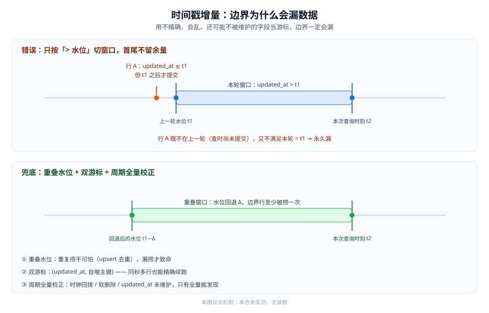

# 定时同步

> 本篇讲三条同步路线里的「**定期批量捞**」：什么时候只能走它、它有两种形态（全量覆盖 / 按 `updated_at` 增量）、⭐ 增量拉取的时间戳边界为什么一定会漏、怎么调度、怎么保证幂等与断点，以及它和 CDC 怎么组合。
>
> 内容整理自个人学习笔记，并参考各家官方文档；素材见 [素材清单](../../../../素材清单.md)。
>
> ⚠️ 实测口径：本篇未做容器实测。原因：时间戳边界的漏数据要在真实事务并发、跨机时钟差异下才复现得出来，且调度器与水位表的配合需要长期运行的调度环境才有观测意义。**本篇不引用任何第三方吞吐、延迟或数据量数字**；文中 SQL、cron 为形状示例，**未在本仓运行**。

---

## 一、定时同步在什么时候适用？

**本节要点**：定时同步是三条路线里**链路最简单、侵入最低、时效最差**的一条。当「源库不允许开日志」「只要 T+1」「云托管拿不到 binlog」三条里命中任意一条时，它往往就是唯一可选项。

### 1.1 三个典型触发场景

| 场景 | 为什么落到定时同步 |
|---|---|
| **源库不允许开日志** | 拿不到 binlog / WAL，CDC 没有原料；双写又要改业务代码 |
| **只要 T+1** | 报表、数仓离线加工本身就不要求秒级，链路越简单越稳 |
| **云托管拿不到 binlog** | 部分托管库不向用户开放变更日志或权限受限，读日志这条路直接不通 |

> ⭐ 判据：**先问延迟要求**。要秒级 → 直接排除定时同步；能接受小时级 / 天级 → 定时同步是性价比最高的一条。选型的完整对照见 [数据同步方式选型对比.md](../数据同步方式选型对比.md)。

### 1.2 它在三条路线里的位置

- **读日志（CDC）**：延迟最低，但要开日志、维护位点 —— 见 [CDC/README.md](../CDC/README.md)。
- **应用双写**：不用开日志，但同步逻辑散落各处、天然易不一致。
- **定时同步（本篇）**：只读源库、不改业务代码、不用日志，代价是时效差、有边界漏数据。

三者的横评与「怎么组合」在 [数据同步方式选型对比.md](../数据同步方式选型对比.md) 第四节，本篇只把「定期批量」这条路线往下拆一层。

---

## 二、定时同步有哪两种形态？

**本节要点**：两种形态的差别是「**每次捞多少**」：全量覆盖每次把整表搬一遍（天然能发现删除），增量拉取只捞上次水位之后变化过的行（省资源但会漏）。生产上常见的是**增量为主、周期全量为校正**。

### 2.1 全量覆盖

每一轮都把源表整表读出来，覆盖目标。

- **优点**：逻辑最简单；**天然能发现删除**（源没有的行，覆盖后目标也没有了）。
- **代价**：每轮全表扫描 + 全量传输，大表压力大；只适合**小表**（维表、配置表）或低频。
- **实现**：常见是「写入临时表 → 原子替换」或按主键 upsert 全量行。

### 2.2 按 `updated_at` 增量拉取

只捞「上次之后改过的行」：

```sql
-- 增量拉取示例（⚠️ 未实测，仅示形状）
SELECT *
FROM   source_db.t_order
WHERE  updated_at > :last_watermark   -- 上次记录的水位
  AND  updated_at <= :now;
```

- **优点**：每轮只搬变化量，源库压力小、传输量小，可以跑得更频繁。
- **代价**：⭐ **时间戳边界一定会漏行** —— 这是本篇的核心难点，下一节展开。
- **删除问题**：增量式**捕获不到真删除**（被删的行没有 `updated_at` 可查），所以删除要么靠软删除标记、要么靠周期全量校正。

### 2.3 两种形态怎么选

| 判据 | 选全量覆盖 | 选增量拉取 |
|---|---|---|
| 表规模 | 小表 / 维表 / 配置表 | 大表 / 事实表 |
| 能不能接受全表扫 | 能（低频） | 不能（要跑得勤） |
| 删除要不要捕获 | 要（全量天然能发现） | 不直接支持（要软删除或全量校正） |
| 有无可靠时间戳 | 无所谓 | 要有被正确维护的 `updated_at` |

⭐ 常见做法是**两者叠加**：日常增量跑得勤，周期（典型 T+1）再用全量校正一次。

---

## 三、增量拉取的时间戳边界为什么会漏数据？

**本节要点**：`WHERE updated_at > 上次水位` 看起来无懈可击，实际有**五类漏行原因**。核心矛盾是：**你用一个「不精确、会乱、还可能不被维护」的字段，去当「精确的游标」**。解法不是让时间戳变准，而是**留重叠水位 + 双游标 + 周期全量校正**三层兜底。

### 3.1 五类漏行原因

| # | 原因 | 为什么会漏 |
|---|---|---|
| ① | **同秒内多次写入** | 水位精度到秒时，`> 上一秒` 会漏掉同一秒里晚提交的行；改用 `>=` 又会重复捞 |
| ② | **事务提交时间 ≠ 业务写入时间** | `updated_at` 取的是应用时间，而事务可能更晚才提交；按它切窗口，**提交落在窗口外的行被跳过** |
| ③ | **时钟漂移 / 回拨** | 多台机器时钟不一致或 NTP 回拨，会让「后写的行 `updated_at` 反而更小」，落进已扫过的窗口，永久漏 |
| ④ | **软删除** | 业务用 `is_deleted=1` 代替真删，如果增量条件没带上这一列，删除状态就传不过去 |
| ⑤ | **`updated_at` 未维护** | 某些写入口忘了更新 `updated_at`（或用了 `ON UPDATE` 却被显式赋值破坏），这行**永远不被增量查到** |

⭐ 一句话：这五类里 ①②③ 是**「窗口切不干净」**，④⑤ 是**「字段本身不可信」**。前者靠重叠与双游标缓解，后者只能靠**周期全量校正**发现。



图注：增量拉取的窗口若**首尾都不留余量**，边界处的行会同时漏在「上一轮已结束」和「下一轮未开始」之间。重叠水位的作用是让边界行**至少被捞一次**（重复由 upsert 消化），而不是靠精确的 `>` 去赌不重不漏。

### 3.2 三层解法

**① 留重叠水位**：每轮水位**往回退一点**（如退 N 秒 / 分钟，示意），让边界行至少被**多捞一次**。重复捞不可怕（目标侧按主键 upsert 会去重），**漏捞才致命**。

**② 双游标：自增主键 + 时间戳**

- 用「时间戳 + 自增主键」组成**复合游标**：`WHERE (updated_at > :ts) OR (updated_at = :ts AND id > :last_id)`。
- 好处：同一时间戳内多行也能靠主键**精确续上**，缓解释放 ①（同秒多次写入）的漏。
- 注意：主键得是**单调整体递增**的（自增 ID / 雪花），乱序主键（如随机 UUID）用不了这一招。

**③ 周期全量校正**：即使 ①② 都做了，③④⑤（时钟回拨、软删除、字段未维护）仍可能漏。所以还要有一个**低频全量对账 / 校正**（典型 T+1），把「增量窗口外的历史差异」扫出来 —— 这一层的做法见 [数据对比与对账/README.md](../数据对比与对账/README.md)。

| 解法 | 治哪几类 | 局限 |
|---|---|---|
| 重叠水位 | ① ② | 增大重复量，但不治字段不可信 |
| 双游标（时间戳 + 自增主键） | ①（同秒） | 依赖主键单调递增 |
| 周期全量校正 | ①~⑤ 全部 | 成本最高，只能低频 |

### 3.3 逐类漏行的一个示意

假设水位精度到秒、本轮窗口为 `(t1, t2]`（**示意**，不代表任何真实系统的值）：

| 行 | 写入时刻 | `updated_at` | 会不会被本轮捞到 |
|---|---|---|---|
| A | 略早于 t1 | ≤ t1 | ❌ 不满足 `> t1`；上一轮查时它可能还没提交 → 漏 |
| B | t1 与 t2 之间 | 落在窗口内 | ✅ 正常捞到 |
| C | 晚于 t2 | 因事务晚提交，仍 ≤ t2 | ✅ 本轮捞到（时间戳早于实际提交时刻） |
| D | 晚于 t2，且时钟回拨 | < t1 | ❌ 落进已扫过的区间 → 永久漏 |

> 说明：上表只为说明「时间戳早于提交」与「时钟回拨」两类边界，**是示意**，不是任何真实环境的读数。A 与 D 这两类，只能靠周期全量校正兜住。

---

## 四、怎么调度？

**本节要点**：定时同步的「定时」由调度器给：小规模用系统 `cron` 就够，需要可视化管理、重试、分片、依赖编排时上调度平台（xxl-job / Airflow）。调度器只管「什么时候跑」，**「跑到哪了」要由同步任务自己的水位表负责**，两者别混。

### 4.1 用 cron

- 适合**单机、单任务、低频**：一条 crontab 定时拉起同步脚本。
- 也适合**临时补数**：手动拉起一次任务回补某段缺失即可。
- 局限：没有可视化、没有失败重试与告警、多实例会重复触发，**水位与幂等要自己保证**。

### 4.2 用调度平台

- **xxl-job**：偏「分片 + 失败重试 + 日志可视化」的定时任务调度，适合把同步任务当普通定时任务管。
- **Airflow**：偏「DAG 依赖编排」，适合「多张表按依赖顺序同步、失败可回补」的场景。
- ⚠️ 定位说明：本节只讲**「调度器解决什么问题」**，不展开两个产品的安装、配置与 API 细节。

> ⭐ 分工判据：**调度器负责「按时触发」，任务内部负责「从哪个水位接着跑」**。如果把「跑到哪」也交给调度器（如用「上次成功时间」），一旦任务实际跑得比调度周期长，就会重叠或漏。

---

## 五、怎么保证幂等与断点续跑？

**本节要点**：定时任务**天然会重跑**（失败重试、补数、人为重放），所以「重跑安全」是硬要求。两个抓手：**写入按主键 upsert**（重复写不产生重复行），**水位只在成功后推进**（断了从上次水位续）。

### 5.1 幂等：按主键 upsert

- 目标侧写入一律 `INSERT ... ON DUPLICATE KEY UPDATE`（或等价 upsert），**只按主键去重**。
- 这样「重叠水位」带来的重复行会被自然消化，**重叠就不再是问题**。
- 全量覆盖形态同理：写入用 upsert 或整表替换，避免重复。

### 5.2 断点：水位只在成功后推进

- 每轮结束、**确认目标侧写入成功后**，才把新水位写进水位数（存库或文件）。
- 中途失败 → 水位不推进 → 下次从旧水位重跑（会重捞一批，靠 upsert 消化）。
- **禁止**「先推水位再写数据」：一旦之后写数据失败，这一段就永久漏了。

| 要点 | 做法 | 反例 |
|---|---|---|
| 幂等写 | 按主键 upsert | 直接 `INSERT` → 重跑变重复行 |
| 水位推进时点 | 目标写成功后再推 | 先推水位 → 失败即漏 |
| 断点粒度 | 按表 / 按分片记录水位 | 全局一个水位 → 一表失败全表重来 |

### 5.3 水位记在哪儿

- 水位可以落**源库的一张水位表**、**目标库**、或**文件 / 配置**，关键是它要和「数据写入」处在同一套可信边界里。
- 多表 / 多分片同步时，**按表或按分片各记一个水位**，避免「一张表失败拖累全部重跑」。
- 水位表要能**原子更新**，避免并发任务读到一个写了一半的值。

---

## 六、定时同步怎么和 CDC 组合？

**本节要点**：生产上很少「纯定时」，更常见的是**两条路线分工**：CDC 做**增量主力**（跟得紧），定时全量做**基线（冷启动）+ 兜底（周期校正）**。定时的价值不是「快」，而是**「不依赖日志、能把增量漏掉的补回来」**。

### 6.1 分工：CDC 增量 + 定时全量基线 / 兜底

| 角色 | 谁来做 | 解决什么 |
|---|---|---|
| 初始基线 | 定时全量（或快照） | 冷启动时先把存量搬过去 |
| 持续增量 | CDC | 近实时跟上变化，含删除 |
| 周期校正 | 定时全量对账 / 覆盖 | 把增量漏掉的行补回来 |
| 一致性证明 | 对账 | 见 [数据对比与对账/README.md](../数据对比与对账/README.md) |

- **为什么还要定时全量**：CDC 可能因为位点回退、日志回收、解析漏事件而缺行；定时全量是**独立于日志的第二条路径**，能兜住 CDC 自身的故障。
- **为什么不让定时全量当主力**：它的时效与成本决定了它只能低频；天天全量扫大表既慢又贵，还抢源库资源。

⭐ 组合判据：**增量通道负责「跟住」，批量通道负责「兜底」，对账负责「证明」** —— 三者的分工与选型见 [数据同步方式选型对比.md](../数据同步方式选型对比.md) 第四节。

### 6.2 组合的时序（示意）

1. **建基线**：先用一次定时全量把存量搬到目标。
2. **开增量**：从基线对应的位点起，用 CDC 跟上变化。
3. **周期校正**：定时全量 / 对账周期性跑一遍，补 CDC 漏的行。

> ⭐ 顺序别反：**先有基线、再开增量**。否则增量期间的删除会「去删一个目标里还不存在的行」，而随后的基线又把它带回目标，反而制造差异。位点如何锚定基线，见 [CDC/README.md](../CDC/README.md)。

---

## 使用：按场景查定时同步配置

| 场景 | 形态 | 水位 / 增量键 | 校正 |
|---|---|---|---|
| 小维表 / 配置表 | 全量覆盖 | 无 | 无需（每轮即全量） |
| 大表 T+1 到数仓 | 增量 + 周期全量校正 | `updated_at` + 自增主键双游标 | T+1 全量 |
| 业务用软删除 | 增量 | `updated_at` + `is_deleted` | 周期全量比对 |
| 源库不开日志的检索副本 | 增量为主 | 双游标 + 重叠水位 | 定时对账 + 修复 |

```cron
# 每 5 分钟拉一次增量（示意）
*/5 * * * *  /opt/sync/run.sh --table t_order --mode=incremental
# 每天凌晨 2 点做一次全量校正（示意）
0 2 * * *    /opt/sync/run.sh --table t_order --mode=full
```

```sql
-- 双游标增量（⚠️ 未实测，仅示形状）：同秒多行靠自增主键续上
SELECT *
FROM   source_db.t_order
WHERE  updated_at > :last_ts
   OR (updated_at = :last_ts AND id > :last_id)
ORDER  BY updated_at, id
LIMIT  :batch;
```

---

## 延伸追问

- **`updated_at > 水位` 换成 `>=` 会不会不漏？** → 换 `>=` 能少漏「同秒晚提交」的行，但会**重复捞**边界行。重复靠 upsert 消化，所以实践中常用「`>=` + 重叠水位」，而不是赌 `>` 不重不漏。
- **为什么必须有周期全量校正？** → 因为时钟回拨、软删除、`updated_at` 没维护这三类问题，**增量条件本身看不见**：无论窗口怎么切都捞不到。只有全量比对能发现它们。
- **增量拉取怎么处理删除？** → 真删除在源侧不留 `updated_at`，增量捞不到；要么业务改成**软删除**（`is_deleted`，并纳入增量条件），要么靠**周期全量比对**发现「源没了目标还在」。比对方法见 [数据对比与对账/README.md](../数据对比与对账/README.md) 的主键集合差。
- **调度周期越短越好吗？** → 不是。周期越短，越可能「上一轮没跑完下一轮又起」，还会持续给源库压力。周期应**大于单轮最坏耗时**，并给水位与幂等留出余量。
- **定时同步和「数据库定时备份」是一回事吗？** → 不是。备份是**为了恢复**，产出的是整库快照；定时同步是**为了让另一个存储跟上**，产出的是可用副本。两者的目标与产物都不同，见 [数据迁移与备份恢复.md](../../关系型/MySQL/数据迁移与备份恢复.md)。

## 关联

- [数据同步方式选型对比.md](../数据同步方式选型对比.md) — 上位：三条路线横评与组合范式，本篇是其中的「定期批量」路线
- [CDC/README.md](../CDC/README.md) — 互补路线：读日志做增量，与定时全量组成「增量 + 兜底」
- [数据对比与对账/README.md](../数据对比与对账/README.md) — 周期全量校正与「差异修复」的下游方法
- [数据迁移与备份恢复.md](../../关系型/MySQL/数据迁移与备份恢复.md) — 一次性迁移 / 备份：与「持续同步」的目标不同
- [数据库选型对比.md](../../数据库选型对比.md) — 选型视角：源库能不能开日志，直接决定要不要走定时同步
- [存储选型与组合.md](../../../../04-架构与系统/系统设计/存储选型与组合.md) — 上位视角：副本与权威源、多存储间同步
- [数据导入导出设计.md](../../../../04-架构与系统/系统设计/数据导入导出设计.md) — 业务侧离线导入导出，与基础设施侧定时同步的分工
