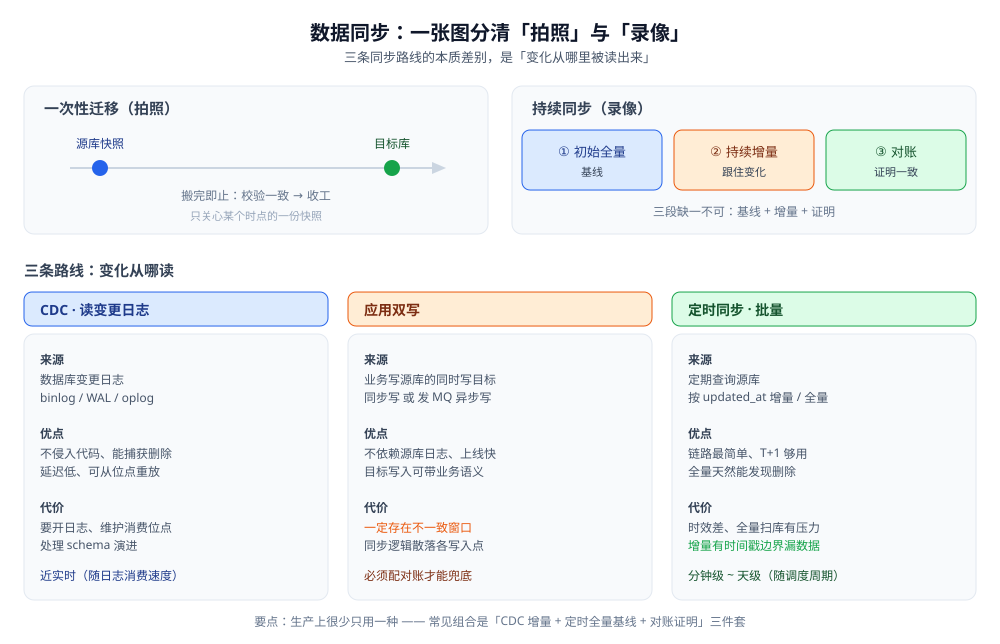
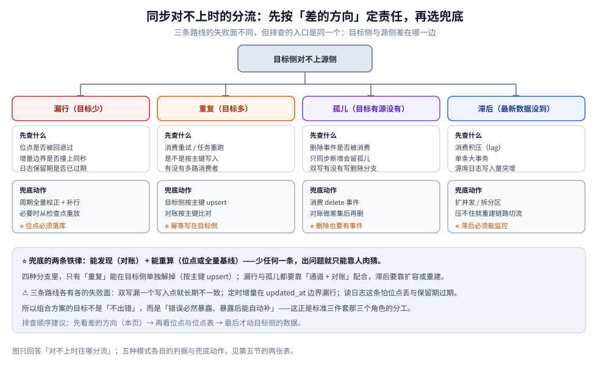

# 数据同步方式选型对比

> 覆盖：把一份数据从「源」持续搬到「目标」，工程上只有三条路线：**读日志（CDC）**、**应用双写**、**定时批量**。本篇把三条路线拉平对照，先立「选型前必须量化的五个数」，再按起点资产给三条决策线，最后给「三条路线怎么组合」的常见范式，以及保证正确性必须一直盯住的三件事（顺序性 / 幂等 / 位点）。
>
> 不覆盖：⭐ 边界先说清：本篇是**同步方式的族级横评**，只做「三种方式怎么比、怎么组合」这一层。多存储为什么要同步、五种数据角色、冷热分层的总览已在 [存储选型与组合.md](../存储架构与场景/存储选型与组合.md) 第六节，本篇**不重抄**，只把它往下拆一层：那里的「CDC / 双写 + 对账 / 全量 + 增量」三条路线各自内部长什么样、怎么选、怎么兜底。
> 三条路线各自展开成零件篇：[CDC/README.md](CDC/README.md)（读变更日志）与 [定时同步/README.md](定时同步/README.md)；「同步之后怎么证明两边一致」单独成篇 [数据对比与对账/README.md](数据对比与对账/README.md)。
> 同构主从复制看 [复制与高可用.md](../关系型/MySQL/复制与高可用.md)，一次性搬迁看 [数据迁移与备份恢复.md](../关系型/MySQL/数据迁移与备份恢复.md)，业务侧的离线导入导出看 [数据导入导出设计.md](../../../04-架构与系统/系统设计/数据导入导出设计.md) —— 本篇不越界。
>
> 内容整理自个人学习笔记，并参考各家官方文档；素材见 [素材清单.md](../../../素材清单.md)。
>
> 📎 **实测口径**：⚠️ **本仓未对任何一种同步方式做过容器实测**（需要真实源库、开启日志、多进程消费与丢包 / 宕机对抗环境）。所以本篇只给**结构与流程的定性对照 + 判据**，⭐ **不引用任何第三方吞吐或延迟数字当结论**；凡涉及具体读数处一律指向本仓已有的实测出处，或明确标注「示意」。第七节的 SQL 与配置片段是**落地写法骨架，未执行**（本机未起源库、未开 binlog，只作形态示意）。

---

## 一、数据同步到底在解决什么问题？

**本节要点**：数据同步的本质是「让目标侧长期跟上源侧的变化」，难点不在「搬一次」，而在「持续地、可证明地跟住」。先把问题的形状和它与相邻概念的边界说清，后面三条路线才站得住。

### 1.1 问题的形状：源 → 目标 的持续复制

一次性把数据搬过去叫**迁移**，搬完就结束；数据同步要回答的是**搬完之后**的问题：

| 维度 | 一次性迁移 | 持续同步 |
|---|---|---|
| 时间视角 | 某个时点的一份快照 | 从某个位点起，源变目标跟着变 |
| 核心难点 | 搬得动、搬得完、停机窗口 | **不丢、不重、不乱序、可续传** |
| 结束后 | 校验一致即可收工 | 要能持续证明一致（对账） |

⭐ 一句话：**迁移是「拍照」，同步是「录像」**。录像断一秒就是缺一帧，而这一帧何时缺、缺了谁，必须能被发现。



图注：左边是「一次性迁移」的时间线，右边是「持续同步」的三段——**初始全量**（基线）+ **持续增量**（跟住变化）+ **对账**（证明一致）。三条同步路线（CDC / 双写 / 定时）的差别，全在「持续增量」这一段用什么机制实现。

### 1.2 与相邻概念的边界

这是本仓最容易重复的几处，先划清：

| 概念 | 讲什么 | 本仓篇目 |
|---|---|---|
| **数据库主从复制** | **同构**引擎之间，源库自带的复制通道 | [复制与高可用.md](../关系型/MySQL/复制与高可用.md) |
| **一次性数据迁移** | 停机窗口内把库搬走，搬完切换 | [数据迁移与备份恢复.md](../关系型/MySQL/数据迁移与备份恢复.md) |
| **业务导入导出** | 面向用户的功能：上传表格、导出报表 | [数据导入导出设计.md](../../../04-架构与系统/系统设计/数据导入导出设计.md) |
| **多存储同步（总览）** | 一个系统里多个存储之间怎么保持一致 | [存储选型与组合.md](../存储架构与场景/存储选型与组合.md) 第六节 |
| **同步方式选型（本篇）** | 跨（异构）存储持续复制的三种机制怎么选、怎么组合 | 本篇 |

⭐ 判据：**同源同引擎、且只要主备** → 用数据库自带复制；**跨引擎、要搬去 ES / 数仓 / 另一个业务库** → 才是本篇的问题域。

---

## 二、三种同步方式分别是什么？

**本节要点**：三条路线的本质差别是**「变化从哪里被读出来」**——从数据库日志里读（CDC）、从应用写入的地方同时写两份（双写）、还是根本不管变化、定期按时间戳批量捞（定时）。这个源头决定了各自的延迟、侵入性和可靠性上限。

### 2.1 三种方式一览

| 维度 | CDC（读变更日志） | 应用双写 | 定时同步（批量） |
|---|---|---|---|
| 变化从哪里来 | 数据库的变更日志（binlog / WAL / oplog） | 业务代码在写源库的同时写目标 | 定期查询源库（按时间戳 / 全量） |
| 延迟量级 | 近实时（随日志消费速度） | 近实时（同一请求内或紧跟其后） | 分钟级 ~ 天级（取决于调度周期） |
| 对源系统的侵入 | **低**（通常不用改业务代码） | **高**（要改代码、加分支） | 低（只读查询，但可能给源库压力） |
| 能否捕获删除 | ✅ 日志里有 delete | 要显式写删除逻辑，容易漏 | ✅ 全量可比对出删除；增量式**不能** |
| 一致性保证 | 取决于位点与幂等，可做到不丢不重 | 靠事务 / 本地消息表 / 对账，**天然易不一致** | 最终一致，窗口由周期决定 |
| 主要代价 | 要开日志、要维护消费位点、schema 演进 | 代码到处是同步逻辑、耦合两个系统 | 时效差、全量扫库有压力、增量有边界漏数据 |
| 典型工具 | Debezium、Canal、Flink CDC | 无（自己写） | DataX、SeaTunnel、调度平台 |

> ⭐ 三种没有「最好」，只有「这条路线能不能满足你的延迟与一致性要求，且代价你付得起」。

### 2.2 CDC：把数据库日志当成变更流

数据库为了保证崩溃恢复与复制，本就会把每次变更写进**日志**（MySQL 的 binlog、PostgreSQL 的 WAL、MongoDB 的 oplog）。CDC 做的事就是**以另一个消费者的身份去读这份日志**，把「谁改了哪一行」还原成一条条变更事件。

- **优点**：完全不侵入业务代码、天然捕获增删改、延迟低、可从任意位点重放。
- **代价**：要开日志并配好格式、要维护消费位点（断了从哪续）、要处理 schema 演进、日志保留期决定你能落后多久。

展开见 [CDC/README.md](CDC/README.md)。

### 2.3 应用双写：在写的地方同时写两份

最直觉的做法：业务写源库成功后，紧接着写目标库（同步写）/ 发一条消息让下游写（异步写）。

- **同步双写**：两个写在同一事务里最好——但**跨库没有共同事务**，于是必然出现「一个成功一个失败」的窗口。
- **异步双写**：先写源、再发 MQ，下游消费写目标；比同步双写少一个阻塞点，但 MQ 消费失败照样漏。
- ⚠️ **核心结论**：双写**一定存在不一致窗口**，所以双写**必须配一个对账来兜底**，否则你只是把问题藏起来了。四种写顺序与各自的不一致窗口，见 [缓存一致性.md](../缓存/缓存一致性.md)（虽讲缓存，判据通用：**设想第二步失败后落到哪个状态**）。

### 2.4 定时同步：定期批量捞一遍

不关心「变化」，只关心「现在两边差多少」：每隔一段时间跑一个任务，要么**全量覆盖**，要么**按更新时间戳增量拉**。

- **全量覆盖**：简单、天然能发现删除，但每次全量扫库、传输量大，只适合小表或低频。
- **增量拉取**：`WHERE updated_at > 上次水位`，但要小心**时间戳边界**（同秒写入、时钟漂移、软删除），很容易漏数据 —— 详见 [定时同步/README.md](定时同步/README.md)。

展开见 [定时同步/README.md](定时同步/README.md)。

---

## 三、选型前必须量化的五个数？

**本节要点**：五个数先定下来，三条路线会自动砍掉两条，比任何功能对照表都有效；最关键的两个是**能容忍多旧的延迟**和**目标是强一致还是最终一致**。

### 3.1 五个输入

| # | 量什么 | 怎么量 | 为什么它决定选型 |
|---|---|---|---|
| ① | **可容忍滞后（延迟）** | 目标侧最旧能接受多长时间前的数据：秒级 / 分钟级 / T+1 | 要秒级 → 排除定时同步；要 T+1 → 定时同步最省事 |
| ② | **数据量与日变更量** | 现有条数 × 平均行大小；日增 / 日改条数 | 决定全量基线可行性、增量通道吞吐要求 |
| ③ | **一致性要求** | 目标是「终将一致」还是「必须立刻一致」 | 强一致只能走同源事务或数据库原生复制，跨库双写做不到 |
| ④ | **源库能不能改 / 能不能开日志** | 业务代码是否受控；DBA 是否允许开 binlog（ROW）并调大 `binlog_row_image` 与保留期 | 不允许改代码 → 排除双写；不允许开日志 → 只剩定时同步 |
| ⑤ | **能不能接受运维复杂度** | 团队是否愿意维护 CDC 消费链路 / Kafka / Flink 集群 | 运维能力决定上面「理论上可行」的路线是否真的落地 |

### 3.2 三条硬判据

按顺序问，先答「是」的直接定路线：

| # | 判据 | 指向 |
|---|---|---|
| ① | 目标是**同引擎主备**、只要高可用？ | 用数据库原生复制，**别自己造**（见 [复制与高可用.md](../关系型/MySQL/复制与高可用.md)） |
| ② | 需要**秒级/分钟级**、且**能开源库日志**？ | 走 **CDC** |
| ③ | 只要 **T+1 / 小时级**、且源库不允许开日志或不想维护链路？ | 走 **定时同步** |

> ⭐ 双写不是「独立第三条路线」，而是「源侧业务顺手写一份」的临时手段——除非你有明确理由（如目标库写入需要业务语义），否则**能用 CDC 就别用双写**：双写的同步逻辑会散落在每一个写入点，漏一个就长期不一致。

---

## 四、三条路线怎么组合？（不是三选一）

**本节要点**：生产上几乎不会只用一种。最常见的是「CDC 做增量主力 + 定时全量做冷启动与修复 + 对账做一致性证明」三件套；组合的目标是让「丢了能发现、发现能补」。

### 4.1 常见组合范式

| 组合 | 组成 | 解决什么 | 何时用 |
|---|---|---|---|
| **标准三件套** | CDC（增量）+ 定时全量（基线/修复）+ 对账（证明） | 冷启动有基线、增量跟得住、不一致能发现并回补 | 跨异构存储的检索副本 / 分析副本（如 MySQL → ES / 数仓） |
| **双写 + 对账** | 应用双写 + 定时对账修复 | 无法开日志、但业务代码受控 | 源库是云托管、不给 binlog 的场景 |
| **纯定时全量** | 定时全量覆盖 | 小表、低频、能接受天级延迟 | 维表、配置表、T+1 报表 |
| **原生复制 + CDC** | 数据库主从（高可用）+ 从只读库上跑 CDC | 不打扰主库、把日志消费压力挪到从库 | 主库压力敏感的生产库 |

⭐ 组合的通用形态：**一个「增量通道」负责跟住变化，一个「批量通道」负责兜底与基线，一个「对账」负责证明一致**。

### 4.2 三条决策线（按起点资产）

| 起点 | 推荐路线 | 理由 |
|---|---|---|
| 全新搭建、源库受控 | **CDC 为主** + 对账 | 延迟最低、侵入最小，一次投入长期受益 |
| 源库是云托管 / 不给日志 | **双写 + 对账** 或 **定时增量** | 拿不到日志就没有 CDC 的原料 |
| 只要 T+1 报表 / 数仓离线 | **定时同步（增量 + 周期全量校正）** | 时效要求低，链路越简单越好 |

### 4.3 什么时候三条都不够

- **要求强一致、且写入方要求「目标没成功就不算成功」** → 别做跨库同步，把目标收进同一个事务域，或改架构（如双读、路由）。
- **要双向同步 / 多活** → 已经不是「同步」而是**冲突解决**问题（谁赢、时间戳还是向量钟），需要专门的冲突处理策略，超出本篇范围。

---

## 五、不丢、不重、不乱序靠什么保证？

**本节要点**：三条路线的实现差别很大，但「结果对不对」只取决于**三件事**：顺序性、幂等、位点。把它们当成一张检查表 —— 选路线之前先确认这三件事各自由谁负责。

### 5.1 三大约束：判据汇总

| 约束 | 它保证什么 | 判据（满足即算有） | 不满足时看到的现象 |
|---|---|---|---|
| **顺序性** | 同一主键的变更按发生顺序落到目标 | 同一主键的变更走同一条通道（同一分区 / 同一队列 / 同一消费者） | 目标侧把新值改回旧值，出现「回退」 |
| **幂等** | 重复投递同一条变更不改变结果 | 目标侧按主键 `upsert`，而不是 `insert` | 目标侧行数比源侧多 |
| **位点** | 断了以后从「已经处理到哪」续上 | 位点落库，或交给 Kafka offset / Flink checkpoint 托管 | 重启后要么丢一段，要么整段重放 |

⭐ 责任划分：**顺序性与幂等是通道侧与目标侧的责任**，**位点是消费侧的责任**；三者缺一，另一条路线的复杂度就会回到你身上。

### 5.2 三种失败模式与兜底



图怎么读：从「目标侧对不上源侧」这一个现象出发，先按**差的方向**分流 —— 目标少是漏行、目标多是重复、目标有源没有是孤儿、两边条数差不多但最新数据没到是滞后。每个分支的「先查什么」用来定位责任方，「兜底动作」才是最终必须存在的那一层；最下面那条横带是无论走哪个分支都不能省的三件事。

| 失败模式 | 先查什么 | 兜底动作 |
|---|---|---|
| **漏行**（目标少） | 位点是否被回退过；定时增量的 `updated_at` 是否撞上同秒边界；日志保留期是否把没消费的段丢掉了 | 周期全量校正（对账发现 + 补行）；必要时从上一个 checkpoint 重放 |
| **重复**（目标多） | 消费失败重试、任务重跑是否造成重复投递 | 目标侧按主键 `upsert`；对账脚本按主键比对 |
| **孤儿**（目标有源没有） | 删除事件有没有被消费（只有读日志这条路线才天然带 delete） | 消费删除事件；对账按主键做差集后再删 |
| **长时间滞后** | 消费积压（lag）、单条大事务、源库日志写入量突增 | 扩消费并发 / 拆分区；压不住就用「全量重建一条新链路再切流量」 |
| **顺序错乱** | 同一主键是否被两个消费者并行处理 | 按主键分流到同一分区；目标侧用版本号 / 时间戳拒旧写 |

⭐ 兜底的两条铁律：**能发现**（对账）+ **能重算**（位点或全量基线）。少任何一条，出问题时就只能靠人肉猜。

## 六、应用场景

**本节要点**：同一个系统里往往同时存在好几条同步链路，各自服务不同的消费方；先给宏观落点，再给按场景的查表。

| 场景 | 用到本篇哪一部分 | 说明 |
|---|---|---|
| **检索副本**（MySQL → Elasticsearch） | 二、四、五 | 增量走 CDC、删除事件必须消费、周期全量兜底；下游消费侧见 [CDC/README.md](CDC/README.md) 与 [数据对比与对账/README.md](数据对比与对账/README.md) |
| **分析副本 / 数仓离线** | 二、四 | T+1 用定时同步（增量 + 周期全量校正），链路越简单越好 |
| **缓存一致性** | 三、5.2 | 双写顺序的判据与「订阅 binlog 异步失效」见 [缓存一致性.md](../缓存/缓存一致性.md) |
| **异构库搬迁 + 持续跟随** | 二、5.1 | 全量快照给基线、CDC 从位点续增量，衔接见 [CDC/全量与增量一体化.md](CDC/全量与增量一体化.md) |
| **多云 / 异地只读副本** | 三 3.2 判据 ① | 同引擎优先数据库原生复制，异构才上 CDC（[复制与高可用.md](../关系型/MySQL/复制与高可用.md)） |
| **数据质量与对账** | 四 4.1、五 | 独立对账任务是「能发现」那一层（[数据对比与对账/README.md](数据对比与对账/README.md)） |

规模与形态差异：**单表几十万行**以内，定时全量覆盖就够，不值得上链路；**亿级、且目标侧是在线检索**，增量通道的延迟与积压监控成为核心，必须有对账兜底；**跨机房 / 多云**，网络抖动是常态，位点与重放能力比「延迟低」更重要。

按场景查：

| 场景 | 推荐方式 | 关键点 |
|---|---|---|
| MySQL → Elasticsearch 检索副本 | CDC + 对账 | 只同步需要的字段；删除事件必须消费，否则 ES 里留孤儿文档 |
| MySQL → 数仓 / 列存（T+1） | 定时同步（增量 + 周期全量校正） | 时间戳边界与全量校正见 [定时同步/README.md](定时同步/README.md) |
| 缓存失效（写库后清缓存） | 异步双写（订阅 binlog 失效） | 见 [缓存一致性.md](../缓存/缓存一致性.md) 的「订阅 binlog 异步失效」 |
| 异构库一次性搬迁 + 持续增量 | 全量快照 + CDC 续增量 | 全量与增量的位点衔接见 [CDC/全量与增量一体化.md](CDC/全量与增量一体化.md) |
| 多云 / 异地只读副本 | 数据库原生复制 或 CDC | 同引擎优先原生复制，异构才上 CDC |
| 对账 / 数据质量 | 独立对账任务 | 见 [数据对比与对账/README.md](数据对比与对账/README.md) |

## 七、具体使用

**本节要点**：这一节把前六节的判据落成可执行的片段：五个数怎么量（7.1）、源库要开什么（7.2）、目标侧的幂等与对账（7.3）、定时增量的边界怎么写（7.4）。全部为**落地写法骨架，未执行**（本机未起源库、未开 binlog）。

### 7.1 量那五个数：三个能查、两个要问

```sql
-- ① 数据量与平均行大小（MySQL 为例；本篇未执行）
SELECT COUNT(*) FROM orders;                     -- 精确条数（大表代价高，可抽样后外推）
SELECT table_rows, avg_row_length, data_length
FROM information_schema.tables
WHERE table_schema = 'shop' AND table_name = 'orders';   -- ⚠️ table_rows 对 InnoDB 是估算值
```

```sql
-- ② 日变更量：两种口径，任选其一并写进选型记录（本篇未执行）
SHOW BINARY LOGS;                                -- 日志文件列表与大小：看每天新增多少字节
-- 或者用增量任务自己的计数：每次运行记录「本次捞到多少行、水位到了哪里」
```

```text
③ 可容忍滞后：问业务 —— 秒级 / 分钟级 / T+1（这三个答案对应完全不同的路线）
④ 一致性要求：问业务 —— 终将一致 / 必须立刻一致（后者不该做跨库同步）
⑤ 运维复杂度：问团队 —— 有没有人守消费链路、守积压告警、守对账任务
```

### 7.2 源库侧要开什么（读日志这条路线的原料）

```ini
# my.cnf（源库；本篇未执行，参数以官方文档为准）
[mysqld]
binlog_format = ROW               # 行格式才能还原「哪一行变了」
binlog_row_image = FULL           # 完整前后像，否则拿不到被改前的值
binlog_expire_logs_seconds = 604800   # 保留期决定「最多能落后多久还能续上」
```

⭐ 保留期是**隐性 SLA**：消费链路停摆超过保留期，位点就失效，只能重做全量基线 —— 这条要把告警和保留期放在一起设计。

### 7.3 目标侧：位点、幂等、对账

```sql
-- 位点表：位点落库是「断了能续」的前提（本篇未执行）
CREATE TABLE sync_checkpoint (
  task       VARCHAR(64)  NOT NULL,
  source     VARCHAR(64)  NOT NULL,
  position   VARCHAR(128) NOT NULL,   -- binlog file + pos / GTID / LSN / oplog ts
  updated_at DATETIME     NOT NULL,
  PRIMARY KEY (task, source)
);
```

```sql
-- 幂等写入：按主键 upsert，重复投递不产生第二行（本篇未执行）
INSERT INTO dst_orders (id, title, updated_at)
VALUES (?, ?, ?)
ON DUPLICATE KEY UPDATE title = VALUES(title), updated_at = VALUES(updated_at);
```

```sql
-- 对账：先比条数，再比主键集合，最后抽样比字段（本篇未执行）
-- 差集要在同一实例内比对，或把两侧导出成文件再比；跨实例直接在库间 JOIN 不现实
SELECT s.id FROM src_orders s LEFT JOIN dst_orders d ON d.id = s.id WHERE d.id IS NULL
UNION ALL
SELECT d.id FROM dst_orders d LEFT JOIN src_orders s ON s.id = d.id WHERE s.id IS NULL
LIMIT 100;   -- 前一组 = 漏行，后一组 = 孤儿
```

### 7.4 定时增量的边界怎么写才不漏

```sql
-- 增量拉取：左闭右开 + 同一时间戳内按主键排序（本篇未执行）
SELECT * FROM orders
WHERE updated_at > ?            -- 上次水位（左开，避免重复搬运同一批）
  AND updated_at <= ?           -- 本次快照水位（右闭）
ORDER BY updated_at, id;        -- ⭐ 同一 updated_at 内按主键排序，跨批才不漏行
```

⚠️ 时间戳边界是这类路线最常见的漏行来源：**同秒写入、事务提交时间与业务时间不一致、时钟回拨**都会让某几行落在两次水位之间。所以定时增量必须配一条**周期全量校正**（见 [定时同步/README.md](定时同步/README.md)），不要指望边界写得完美。

---

## 延伸追问

- **CDC 和「数据库自带复制」都能读日志，有什么区别？** → 自带复制是引擎自己把日志重放到同构从库；CDC 是把日志**解析成事件**给任意下游（异构库、消息队列、检索/分析引擎），下游与源库引擎无关。
- **为什么双写一定不一致，还这么多人在用？** → 因为它**不需要源库开日志**、上线快。代价是把一致性责任交给了业务代码和对账，所以要问「有没有对账」而不是「双写可不可靠」。
- **目标侧为什么要幂等写入？** → 因为任何一条路线都可能**重复投递**（消费失败重试、任务重跑）：至少一次语义下，去重只能靠目标侧按主键 `upsert`。
- **CDC 消费位点丢了怎么办？** → 位点代表「已经处理到哪」，丢了就只能重放（回到上一次 checkpoint），所以位点要么落库、要么交给 Kafka offset / Flink checkpoint 管理。
- **定时同步的增量一定安全吗？** → 不安全，`updated_at` 边界处会漏：同秒写入、事务提交时间与写入时间不一致、时钟回拨都可能漏行，需要「周期全量校正」补齐。
- **三大约束里，哪一条最容易在线上被破坏？** → **顺序性**。位点与幂等都有明确的落点（位点表、主键 `upsert`），而顺序性是「默默丢掉的」：一旦为了让消费跑快而把同一主键的变更分给两个消费者，目标侧就会出现旧值覆盖新值，且**不报错**。判据是「同一主键的变更是否走同一条通道」，而不是「消费者有几个」。
- **为什么「有对账」比「延迟低」更值得优先投入？** → 因为延迟高是**可观测**的（滞后监控能看见），而不一致是**沉默**的：没有对账，你只能等到业务方来报「这条数据不对」才发现，且发现时已经不知道错了多久、错了多少。所以兜底能力（能发现 + 能重算）的优先级高于把延迟从分钟级压到秒级。
- **选型前那五个数，只量得出三个，另外两个怎么定？** → ①② 能从库里查（条数、平均行大小、日志增长），③④⑤ 是**要向业务与团队确认的口径**，不能靠猜：可容忍滞后与一致性要求决定路线，运维复杂度决定「理论上可行的路线是否真能落地」。把它们写进选型记录，后续架构变更时才有对照基线。

## 关联

- **对照/互补**：[CDC/README.md](CDC/README.md) — 三条路线中的「读变更日志」，含原理 / 工具 / 全量与增量 / Flink CDC 四篇
- **下游机制**：[数据对比与对账/README.md](数据对比与对账/README.md) — 同步之后怎么证明两边一致，以及不一致怎么补
- **对照/互补**：[定时同步/README.md](定时同步/README.md) — 三条路线中的「定期批量」，含时间戳增量边界与全量校正
- **上游/总纲**：[存储选型与组合.md](../存储架构与场景/存储选型与组合.md) — 上位视角：数据角色、权威源与副本、冷热分层、多存储同步三路线总览
- **对照/互补**：[缓存一致性.md](../缓存/缓存一致性.md) — 双写顺序的通用判据与「订阅 binlog 异步失效」
- **对照/互补**：[复制与高可用.md](../关系型/MySQL/复制与高可用.md) — 同构主从复制：什么时候该用数据库自带通道而不是自己同步
- **对照/互补**：[数据迁移与备份恢复.md](../关系型/MySQL/数据迁移与备份恢复.md) — 一次性迁移：与本篇「持续同步」互补
- **对照/互补**：[数据导入导出设计.md](../../../04-架构与系统/系统设计/数据导入导出设计.md) — 业务侧离线导入导出：与基础设施侧同步的分工
- **对照/互补**：[数据库选型对比.md](../数据库选型对比.md) — 选型退路里要评的「CDC 工具是否成熟」在此展开
- **对照/互补**：[NoSQL选型对比.md](../NoSQL/NoSQL选型对比.md) — 异构目标侧（NoSQL / KV / 文档库）怎么选
> 反向引用（本篇被下列文档引到）：[中间件选型.md](../../中间件/中间件选型.md)、[列式数据库选型对比.md](../列式数据库/列式数据库选型对比.md)、[CDC原理.md](CDC/CDC原理.md)、[CDC工具选型.md](CDC/CDC工具选型.md)、[FlinkCDC.md](CDC/FlinkCDC.md)、[全量与增量一体化.md](CDC/全量与增量一体化.md)、[跨地域多活.md](../../../04-架构与系统/系统设计/IM系统/跨地域多活.md)
