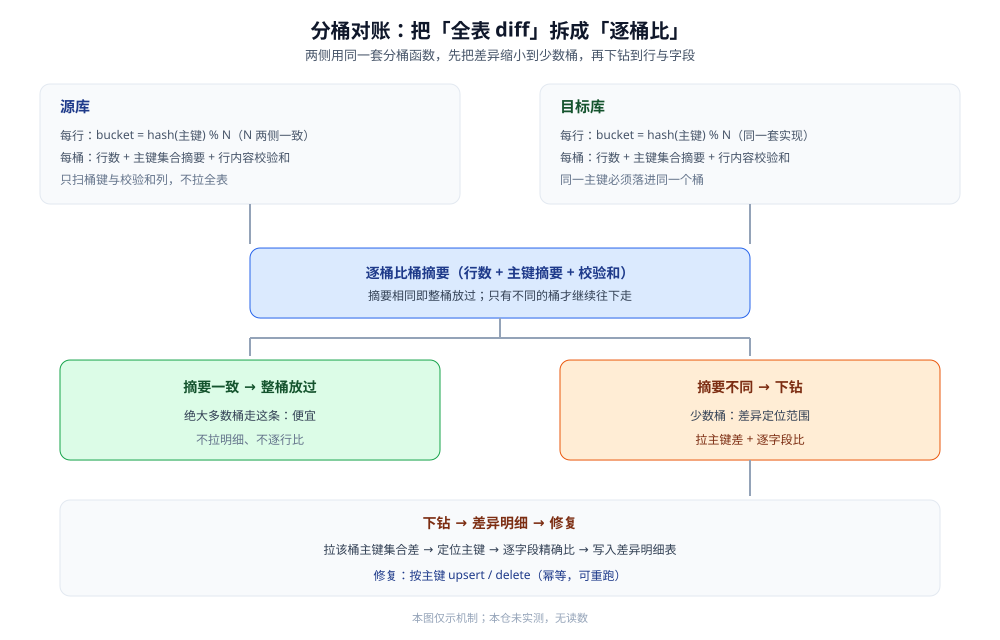

# 数据对比与对账

> 本篇讲「**同步之后怎么证明两边一致、不一致怎么补**」：为什么任何同步路线都可能漏或重，对账分哪三个层次，分桶算法怎么把差异缩小到可定位的范围，checksum 用什么算，发现差异后以谁为准、怎么补。
>
> 内容整理自个人学习笔记，并参考各家官方文档；素材见 [素材清单](../../../../素材清单.md)。
>
> ⚠️ 实测口径：本篇未做容器实测。原因：对账要在真实的双库环境里制造可控差异（漏投、重复投递、只改一个字段）再验证发现率与修复结果，且分桶对账的成本依赖真实数据量与索引形态，属于多库对接才有意义的实验。**本篇不引用任何第三方吞吐、延迟或数据量数字**；凡出现的条数、桶数一律标注「示意」，不代表任何真实系统读数。

---

## 一、为什么同步之后还需要「对账」？

**本节要点**：对账不是同步的重复劳动，而是**同步的正确性证明**。CDC 与双写都可能漏或重，区别只在于「漏了之后有没有人知道」。

### 1.1 三条路线都可能不一致

| 路线 | 会漏 / 会重的环节 | 漏了之后 |
|---|---|---|
| **CDC** | 消费失败重试（重）、位点回退（重）、日志被回收前没跟上（漏）、未知事件类型没解析（漏） | 位点在，可重放补齐；但**没人知道该补哪一段** |
| **应用双写** | 第二个写失败、MQ 消费失败、异步写丢失、代码漏改一个写入入口 | 无从重放，**只能靠对账发现** |
| **定时同步** | 时间戳边界漏行（见 [定时同步/README.md](../定时同步/README.md)） | 下一轮全量校正能补，但窗口内目标就是错的 |

⭐ 一句话：**同步负责「搬」，对账负责「证明搬对了」**。只有搬、没有证明，一致就只是一句没人验证过的假设。

### 1.2 对账不是「再同步一遍」

一个常见误解是「再跑一次全量就一致了」。对账和同步的分工其实不同：

- **同步**是**写**：把变化推给目标，目标被动接收。
- **对账**是**读 + 比**：只读两边、算出差异，**不改数据**（差异交给一个独立的修复动作）。
- 分开的理由：对账要**可反复跑、可只读、可限流**；如果它顺手改数据，就同时背上了「写正确」的责任，反而更难保证。

> ⭐ 判据：**对账只产出「差异清单」，修复是清单之后的另一个动作**。这样「发现」与「修复」各自可监控、可重试。

---

## 二、对账要分哪三个层次？

**本节要点**：三个层次是**由粗到细、成本递增**的关系：行数对账最便宜但最不灵敏，主键集合差能定位到「哪一行多了 / 少了」，逐字段校验和才能发现「同一行内容不同」。生产上通常**三层都跑，但频率递减**。

### 2.1 层次①：行数对账

最简单的一层：`SELECT COUNT(*)` 两边各算一次，比总数。

- **能发现**：整体少了 / 多了若干行。
- **发现不了**：一多一少相互抵消（两边都是 N 行但内容不同）；同一行字段改了而行数没变。
- **成本**：低，但大表 `COUNT(*)` 在多数存储上仍要扫索引，不能无条件频繁跑。

### 2.2 层次②：主键集合差（差集）

算出「源有目标没有」和「目标有源没有」两组主键：

- **能发现**：具体哪几个主键缺失 / 多余 —— 也就是漏投与多投的**行定位**。
- **发现不了**：主键都在，但某个字段的值不同（这是最隐蔽的一类）。
- **做法**：两侧只取主键列，做 `EXCEPT` / `NOT EXISTS`，或在两侧各算一个主键集合的摘要再做对称差。

### 2.3 层次③：逐字段校验和 / 抽样

把一行（或一桶）的所有字段拼起来算一个摘要值，两边对比：

- **能发现**：内容级差异（同主键、不同字段值）。
- **定位范围**：摘要只能告诉你「这一桶 / 这一行不一致」，**要定位到字段还得再往下钻**。
- **代价**：要对每个字段做类型归一化（小数位数、时间精度、字符集、`NULL` 表示），否则会**误报** —— 明明数据一致，只是两边序列化方式不同。

| 层次 | 比什么 | 灵敏度 | 成本 | 输出 |
|---|---|---|---|---|
| ① 行数 | 总条数 | 低 | 低 | 一致 / 不一致 |
| ② 主键集合差 | 主键集合 | 中 | 中 | 多了 / 少了哪些主键 |
| ③ 逐字段校验和 | 行内容摘要 | 高 | 高 | 哪些桶 / 行内容不同 |

⭐ 三层的关系：**① 当哨兵、② 定行、③ 定内容**。只跑 ① 发现不了「同数不同值」，只跑 ③ 又太贵，所以按频率叠加。

---

## 三、为什么不能「一次全量 diff」，要分桶对账？

**本节要点**：一次全量 diff 意味着把两边所有行拉到一起比，代价是**全表扫描 + 大结果集 + 内存 / 网络压力**，而且一旦不一致你只知道「这张表不一致」，**不知道哪里不一致**。分桶对账把「全表比一次」拆成「逐桶比多次」，用**桶摘要**先把差异缩小到少数桶，再往下钻。

### 3.1 分桶（分片）对账算法

核心思路：**给每行算一个桶号，保证同一主键在两边落进同一个桶**，然后逐桶比摘要。

1. **选桶键**：通常是主键（或主键的摘要）。
2. **分桶**：`bucket = hash(主键) % N`，N 是桶数（如 64 / 256，示意）。
3. **两边各按桶聚合**：每桶算「行数 + 主键集合摘要 + 行内容校验和」。
4. **逐桶对比**：摘要相同的桶直接放过；不同的桶才**下钻** —— 拉出该桶的主键做集合差，再对差异行做逐字段比。
5. **下钻定位**：差异最终落到「某个主键的某个字段」，交修复环节。

关键点：**分桶函数必须在两侧用同一套实现**（同一种摘要、同一个 N），否则同一行会被分到不同桶，对账从第一步就错了。



图注：对比的粒度是**从粗到细收窄**的 —— 先比桶摘要（便宜），只有不一致的桶才拉明细（贵）。桶数越大、每桶越小，差异定位越准，但桶级对比的次数也越多。

### 3.2 为什么不能「一次全量 diff」

| 问题 | 一次全量 diff | 分桶对账 |
|---|---|---|
| 扫描范围 | 两边全表所有列 | 可只扫桶键 + 校验和列，下钻才拉明细 |
| 结果集 | 可能非常大，传输 / 内存压力大 | 逐桶处理，单桶结果可控 |
| 定位能力 | 只知道「表不一致」 | 知道「哪个桶、哪个主键、哪个字段」 |
| 可中断 / 续跑 | 一次性大任务，中断要重来 | 天然按桶推进，**记到第几桶就能续跑** |
| 并发 / 限流 | 难切分 | 每个桶是独立单元，可并发、可限流 |

⭐ 一句话：分桶不是为了算得更快，而是为了**把「不可定位的大问题」变成「可定位的小问题」，并让任务可切分、可并发、可续跑**。

---

## 四、checksum 用哪些手段算？

**本节要点**：checksum 可以交给数据库算（`CHECKSUM TABLE` / `CRC32`），也可以在聚合时自己拼（分组求和、摘要聚合）。选哪种取决于**能不能改 SQL、目标库支不支持同一函数、以及要不要跨不同类型的目标库**。

### 4.1 交给数据库算

- **`CHECKSUM TABLE`**（MySQL）：一条命令给出整表校验和，最省事；但它算的是存储层面的行内容，**受存储引擎与行格式影响**，两侧表结构 / 引擎不一致时不可直接比。
- **`CRC32(...)` / `MD5(...)`**：对拼接后的字段串算摘要，能落到**行级或桶级**，比整表 `CHECKSUM TABLE` 更可控。
- 注意点：`CRC32` 有碰撞概率，对账通常只把它当**「疑似不一致」的筛选**，下钻时才做精确比。

### 4.2 自己拼聚合

当两侧是不同引擎（如 MySQL 与某分析库），没有同一个 `CHECKSUM` 函数时，用**通用 SQL 聚合**自己算：

- **分组求和**：`SUM(CRC32(拼接列))`，按桶分组，得到桶级摘要。
- **摘要聚合**：把一桶内所有行的摘要值再按确定顺序合并一次，得到「桶指纹」。

| 手段 | 粒度 | 优点 | 注意 |
|---|---|---|---|
| `CHECKSUM TABLE` | 整表 | 一条命令 | 受引擎 / 行格式影响，跨库不可比 |
| `CRC32` / `MD5` | 行级 | 通用、可控 | 拼接顺序与类型归一化要两侧一致 |
| 分组求和 | 桶级 | 跨引擎通用 | 求和可能因大数溢出 / 精度失真 |
| 摘要聚合 | 桶级 | 桶指纹稳定 | **必须按确定顺序拼接**，否则行序不同 → 指纹不同 |

> ⚠️ **类型归一化是对账误报的最大来源**：时间精度（秒 vs 毫秒）、小数位数、字符集与大小写、`NULL` 与空串，任一处两侧不一致，就会把「一致」报成「不一致」。对账 SQL 里的拼接表达式，两侧必须逐字段对齐。

---

## 五、发现差异之后怎么补？

**本节要点**：修复的第一步不是「怎么改」，而是**「以谁为准」** —— 必须先定权威源（通常就是源库）。定完权威源后，修复动作很小：**按主键把这一行重新同步过去，存在就覆盖（upsert），权威源没有就删除**。

### 5.1 先定「以谁为准」

| 差异类型 | 通常的处理 |
|---|---|
| 主键只在一侧存在 | 以源库为准：源有目标无 → 补写；目标有源无 → 删掉（可能是源删了没同步过来） |
| 两行主键都在、内容不同 | 以源库为准：用源行覆盖目标行 |
| 目标侧是可写副本（被业务直接写过） | ⚠️ 需要业务确认，不能默认源赢 —— 这类副本本身就不该直接写 |

⭐ 判据：**跨库同步里，源库默认是权威源**；如果目标被允许独立写入，那它就不是「同步副本」而是「双主」，已经超出对账能解决的范围（属于冲突解决问题）。

### 5.2 修复动作：按主键 upsert 或 delete

差异清单的每一行，落到目标侧只有一个动作：

- **该行应存在** → `INSERT ... ON DUPLICATE KEY UPDATE`（或等价 upsert），**只写这一行**。
- **该行不应存在** → `DELETE WHERE 主键 = ?`。
- **批量修复**时按主键分批，**单条失败不影响其它**，失败的行留在清单里重试。

为什么用 upsert 而不是 insert：因为对账与修复之间源库可能又改了，目标可能已经有这一行 —— upsert 天然幂等，重跑安全。

```sql
-- 修复示例（MySQL 方言；⚠️ 未实测，仅示形状）
-- ① 目标侧缺少或内容不同 → 用源行覆盖
INSERT INTO target_db.t_order (id, user_id, amount, status, updated_at)
SELECT id, user_id, amount, status, updated_at
FROM   source_db.t_order
WHERE  id = ?                      -- 差异清单里的一条主键
ON DUPLICATE KEY UPDATE
  user_id    = VALUES(user_id),
  amount     = VALUES(amount),
  status     = VALUES(status),
  updated_at = VALUES(updated_at);

-- ② 目标多余（源已删除）→ 删掉
DELETE FROM target_db.t_order WHERE id = ?;
```

> ⚠️ 软删除要区分：如果业务是**软删除**（`is_deleted=1`）而不是真删，那修复动作不是 `DELETE`，而是把 `is_deleted` 同步过去 —— 见 [定时同步/README.md](../定时同步/README.md) 里对软删除的说明。

---

## 六、对账的成本与频率怎么控？

**本节要点**：对账是**全表级的重活**，不能和同步抢资源。三个控制手段：**异步跑、限流、只对增量窗口**；再加一个兜底：**T+1 全量对账**。工程化上，没有「告警 + 差异明细 + 断点续跑」的对账，等于没做对账。

### 6.1 异步、限流、只对增量窗口

- **异步**：对账是独立任务，不和同步在同一时间抢源库 / 目标库资源（避开业务高峰）。
- **限流**：对账 SQL 加 `LIMIT` 分批、按桶推进，控制单次扫描量；分桶让「限流」变成「每轮只跑几个桶」。
- **只对增量窗口**：日常只对「上次对账之后变化过」的数据（源侧有 `updated_at` 就按它取窗口），全量留给低频兜底。这样日常成本可控，又能在窗口内及时发现漏投。

### 6.2 T+1 全量对账

增量窗口对账有个盲区：**如果某行在窗口外就已经不一致了，窗口内它没变化，就永远对不到**。所以还要有一个**低频的全量对账**（典型是 T+1 夜里跑一遍），把「历史遗留差异」也扫出来。频率不必高，但它是对「增量窗口盲区」的唯一兜底。

### 6.3 工程化三件套

| 组件 | 作用 | 没有它会怎样 |
|---|---|---|
| **告警** | 差异条数 / 比例超阈值就报警 | 不一致长期存在却没人知道 |
| **差异明细表** | 把「哪个主键、哪个字段、源值、目标值」落库 | 报告说「不一致」却无从下手，修复无输入 |
| **断点续跑** | 记录对账跑到第几桶 | 大表跑一半中断就要从头再来 |

> ⭐ 对账三件套的顺序：**先能发现（告警）→ 能定位（明细表）→ 能补上（修复 + 续跑）**。只做「发现」不做「明细」和「修复」，对账就只是制造焦虑。

---

## 使用：按场景查对账策略

| 场景 | 对账层次 | 频率 | 修复动作 |
|---|---|---|---|
| CDC 持续同步的检索副本 | ② 主键集合差 + ③ 桶校验和 | 频繁（增量窗口）+ T+1 全量 | 按主键 upsert |
| 双写 + 兜底 | ③ 逐字段校验和（双写差异多在内容） | 定期全量 | 以源为准 upsert |
| 定时同步到数仓（T+1） | ① 行数 + ② 主键差 | 与同步同频 | 下轮全量覆盖或按主键补 |
| 只关心「有没有丢行」 | ② 主键集合差 | 频繁 | 补主键 |
| 大表、资源敏感 | 分桶对账，逐桶跑 | 异步、限流 | 按桶下钻后逐行补 |

```sql
-- 三层对账的 SQL 形状（⚠️ 未实测，仅示形状）
-- ① 行数
SELECT COUNT(*) FROM source_db.t_order;
SELECT COUNT(*) FROM target_db.t_order;

-- ② 主键集合差：源有目标没有（目标有源没有则反向写）
SELECT s.id FROM source_db.t_order s
LEFT JOIN target_db.t_order t ON t.id = s.id
WHERE t.id IS NULL;

-- ③ 按桶（主键 % N）比行内容摘要
SELECT MOD(id, 64) AS bucket, COUNT(*) AS cnt, SUM(CRC32(CONCAT_WS('#', id, user_id, amount, status))) AS sig
FROM   source_db.t_order
GROUP  BY bucket;
```

---

## 延伸追问

- **对账一定要对全表吗？** → 不必。日常只对**增量窗口**（上次对账后变化过的数据），全量对账降频到 T+1 兜底；否则对账自己就成了对源库的压力源。
- **为什么差异定位要「分桶」而不是直接拉主键差？** → 直接拉两边全量主键做差，同样是**大结果集**；分桶先用摘要把范围缩到少数桶，才拉明细，把「全表 diff」降成「局部 diff」。
- **checksum 相等就能保证数据一致吗？** → 不能**绝对**保证：摘要会有碰撞，且两侧序列化不同会误报。所以 checksum 用于**筛选疑似不一致**，下钻时还要做精确比。
- **对账发现「目标多了一行」，一定要删吗？** → 先问这行为什么多：可能是源删了没同步（该删），也可能是目标被业务直接写过（不该删，得改设计）。**先定位来源再动手**。
- **对账和「数据质量校验」是一回事吗？** → 不是。对账比的是**两个副本之间是否一致**；数据质量校验比的是**单份数据是否满足业务规则**（非空、枚举、范围）。两者可共用一套调度，但比的对象不同。
- **修复期间数据又被改了怎么办？** → 修复动作本身是 upsert / delete，天然幂等；对账与修复的窗口内即使发生改动，下一轮对账会重新发现并再修一次，最终收敛。

## 关联

- [数据同步方式选型对比.md](../数据同步方式选型对比.md) — 上位：三条同步路线的族级横评，把「对账」定位为组合里的一个角色
- [CDC/README.md](../CDC/README.md) — 上游：CDC 负责搬，本篇负责证明搬对了
- [CDC/CDC原理.md](../CDC/CDC原理.md) — 为什么 CDC 也做不到恰好一次（这正是需要对账的原因）
- [定时同步/README.md](../定时同步/README.md) — 时间戳增量边界为什么会漏行，以及周期全量校正
- [缓存一致性.md](../../缓存/缓存一致性.md) — 双写顺序的通用判据，不一致窗口与对账的由来
- [复制与高可用.md](../../关系型/MySQL/复制与高可用.md) — 同构主从自带复制，不需要自己写对账的场景
- [存储选型与组合.md](../../存储架构与场景/存储选型与组合.md) — 上位视角：为什么要有副本，副本与权威源的关系
- [数据导入导出设计.md](../../../../04-架构与系统/系统设计/数据导入导出设计.md) — 业务侧离线导入导出，与对账的分工
