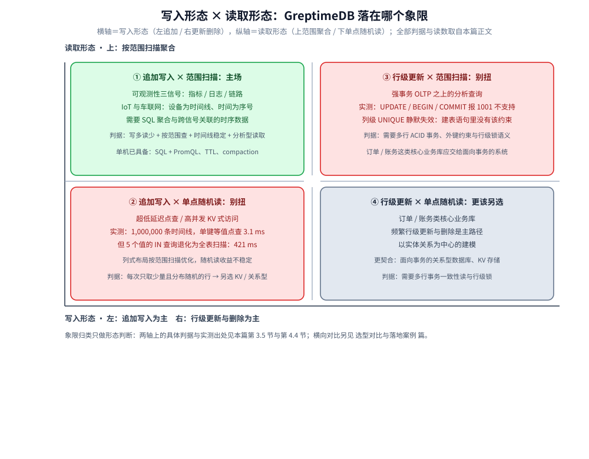
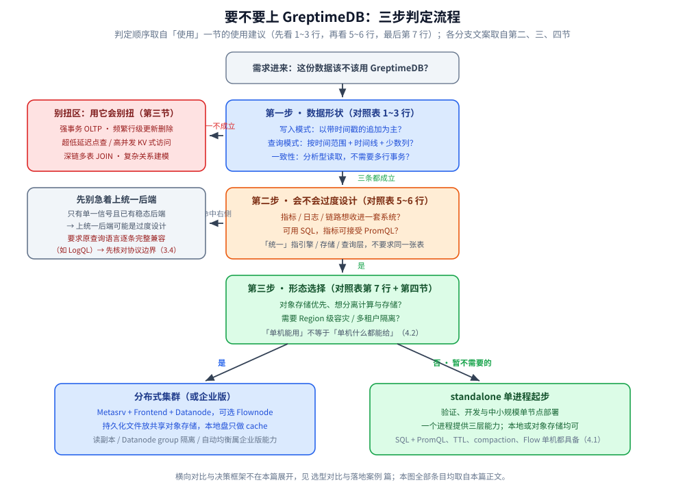

# 定位与适用场景

> 从单机能力边界出发，回答 GreptimeDB 是什么、它擅长哪些负载、以及什么场景不适合用它；
> 横向对比（vs 其他时序 / 可观测后端）另有专篇，本文只给链接。
>
> 内容整理自个人学习笔记，并参考官方文档与 Release Notes；素材见 [素材清单](../../../../素材清单.md)。
>
> 实测口径：第 4.3 节的单机形态读数是本机 standalone（version 1.2.1）上 `information_schema` 视图的查询输出原文；
> 第一、二、三节与「使用」一节是官方文档口径的能力边界描述，本机未逐项复现，也不涉及性能数字。
>
> 📎 **实测口径**：3.5 节与 4.4 节的读数是本机 standalone（容器 `w11g-a` 单进程，映射 HTTP 14002 / MySQL 14004 / gRPC 14000，数据卷 `w11g-data`）
> 的真实版本 **1.2.1** 上的原始响应原文；其中 SQL / PromQL / `SHOW CREATE TABLE` / `information_schema` 的返回逐条存证。
> 写入与查询属**时序类读数**，连跑 3～5 轮并报区间（轮次在表内标注），只断言趋势；行数、条数、文件字节数等确定性读数直接引用。
> 未实测的部分：分布式 / 对象存储后端、WAL 三模式的取舍、跨机房与 TLS / SASL 链路，以及依赖多节点才有的 Region 迁移与故障切换，均未复现。

---

## 一、GreptimeDB 是什么？它和通用数据库的根本差别在哪

**本节要点**：先把定位钉死——它是一个**面向追加写入的时间索引数据**的可观测性数据库，不是通用事务数据库；
后面所有「适合 / 不适合」的判断都从这条定位推出。

### 1.1 一句话定位

据官方文档《为什么选择 GreptimeDB》：

> GreptimeDB 是开源的可观测性数据库。它用同一个列式引擎存储和查询 metrics、logs、traces，
> 并提供统一的 SQL 查询层。GreptimeDB 既可以使用本地存储以单机模式运行，
> 也可以组成以对象存储为持久化存储的分布式集群。

拆开看四个关键词：

| 关键词 | 含义 |
|---|---|
| **统一引擎** | 同一套列式引擎 + 同一套存储与生命周期机制承载 metrics / logs / traces，而不是三套后端拼起来 |
| **统一查询层** | 所有信号都能用 SQL 查；指标还能用 PromQL；链路还能用 Jaeger 兼容接口 |
| **对象存储优先** | 分布式下持久化数据文件放共享对象存储，本地磁盘只做 cache |
| **云原生** | standalone 单进程可跑，也能组成 Metasrv / Frontend / Datanode 的分布式集群 |

⭐ 官方文档还有一句必须记住的边界：

> GreptimeDB 不是通用事务数据库。它的存储、索引、留存和查询路径面向以追加写入为主的时间索引数据，
> 例如可观测数据和 IoT 数据。

### 1.2 三条与通用数据库的分野

| 分野 | 通用事务数据库 | GreptimeDB |
|---|---|---|
| **数据形态** | 行式、面向随机读写与更新删除 | 列式、面向按时间追加与范围扫描 |
| **时间维度** | 时间是普通列 | 时间索引是一等概念，是数据组织与剪枝的主维度 |
| **系统数量** | 指标 / 日志 / 链路各一套后端 | 一个引擎 + 一套存储 + 一套查询层覆盖三类信号 |
| **扩展方式** | 垂直扩展 + 分库分表 | 计算与对象存储容量分别调整，持久化文件不必在节点间全量复制 |

⚠️ **不要把「统一」理解成「同一张表」**：官方文档明确，「统一」指引擎、存储和查询层，
不要求 metrics、logs、traces 使用同一张表、同一套 schema。每类 workload 各用适合自己的表——
指标常用主键列存 labels 并用 PromQL 查，日志常用 append-only 表并按查询方式选索引。

## 二、它擅长哪些负载？

**本节要点**：三类负载的共同点是「写多读少、按时间范围查、按时间线筛、只读少数列」。
符合这个形状的数据，GreptimeDB 的设计才发挥得出来。

### 2.1 可观测性数据（Metrics / Logs / Traces）

这是它的**主场**，也是官方文档反复强调的定位。三类信号各取所需：

| 信号 | 典型用法 | 为什么能共用一套系统 |
|---|---|---|
| **Metrics** | 用 PromQL 查指标、用 SQL 做聚合分析 | 主键列存 labels，时间索引即采样时刻；PromQL 与 SQL 共享同一份存储 |
| **Logs** | append-only 表 + 全文索引 / 倒排索引 | 日志是典型的只追加、不可变记录，天然契合 append-only |
| **Traces** | 保留 trace / span 标识，用 SQL 或 Jaeger 兼容接口查 | Trace 写入、存储、查询都是一等能力 |

⭐ 官方文档讲它的价值在于**减少系统数量**：三类信号分散在不同数据库时，每套系统都有自己的
容量模型、生命周期策略、查询方式和故障边界，排障要么搬数据、要么在几套系统之间来回查。
GreptimeDB 用**同一个列式引擎**处理三类信号，并采用共同的 Tag / Timestamp / Field 列语义。

**实时监控与历史分析共用一套系统**是另一个卖点：近期数据通过内存和本地 cache 加速，
持久化数据放对象存储供更长范围查询；长期分析不需要另建分析数据库和数据复制链路。

### 2.2 IoT / 车联网

设备上报的时间戳数据是第二个典型场景：设备数量大、写入持续、查询多以「某设备 / 某设备组在某时间段」为主。
这与它的存储布局天然对齐——官方博客与文档都以主机指标、设备指标类的表为例来说明主键与时间索引的组织方式。

判断要点：数据是否「以设备 / 对象为时间线、以时间为序号」在增长？若是，则建表时可把设备标识等放进主键（Tag）列。

### 2.3 需要 SQL 分析能力的时序数据

这是它区别于「纯 PromQL 指标库」的地方：指标之外还想做 SQL 层面的聚合、过滤与关联。

- 同一份指标数据，既能用 PromQL 查询，也能用 SQL 做 `GROUP BY`、窗口聚合；
- 不同信号之间，只要 instrumentation 记录了共同标识，就能**通过 SQL 关联**；
- 宽事件（wide events）场景下，一行携带更多上下文，事后分析时可用 SQL 展开。

⚠️ 与「重事务」无关：这里的 SQL 能力指的是**分析型查询**，不是事务与约束。

### 2.4 三类负载的共同形状

把上面三类负载抽象一下，它们的共同点就是**适合用 GreptimeDB 的判据**：

- **写多读少**：绝大多数操作是带时间戳的追加写入，更新删除远不如插入常见；
- **按范围查**：查询只关心某个时间范围、部分时间线、少数几列；
- **时间线稳定**：数据以「某个对象（设备 / 服务 / 主机）」为一条时间线在增长；
- **分析型读取**：读取用于聚合、趋势与排障，而不是要求多行事务一致性。

⭐ 如果你的数据形状与上面四条**高度重合**，那么它的存储布局（region 分片 + 列式 SST + 时间范围剪枝）
就是在为你优化；反之，若四条里有两条以上不成立，先回到第三节重新评估。

## 三、哪些场景不适合用 GreptimeDB？

**本节要点**：以下场景不是「做不到」，而是**用它会别扭**——它不为这些负载设计。
如果需求主要落在这些点上，应优先考虑别的系统（横向对比见 [选型对比与落地案例.md](选型对比与落地案例.md)）。

### 3.1 强事务的 OLTP

- 需要多行 / 多表 ACID 事务、外键约束、行级锁语义的业务库；
- 频繁的**行级更新与删除**是主路径（官方文档明确：它面向以追加写入为主的负载）。

⭐ 官方定位已经写明「不是通用事务数据库」，把订单、账务这类核心业务库放在它是错配。

### 3.2 超低延迟点查

- 按主键做单点随机读、要求极低延迟的高并发 KV 式访问；
- 每次请求只取一行 / 少量且分布随机。

这类访问命中的是**面向范围扫描优化的列式存储**，不是它的目标形态；`tag` / `field` 的列式布局
是为「按时间线 + 时间范围 + 少数列」的批量扫描准备的。

### 3.3 关系复杂的查询

- 深链多表 JOIN、复杂子查询、需要事务隔离级别保证的一致性读；
- 以实体关系为中心的建模（那更接近图数据库或关系型的领域）。

它的 SQL 层面向**分析型**场景；把复杂关系建模塞进时序表会让 schema 与查询都变难写。

### 3.4 需要「完整兼容」某系统查询语言的场景

⚠️ 这一点最容易被忽视。官方文档明确提醒：GreptimeDB 支持通过多种现有协议**写入**数据，
但**这些集成只覆盖对应的写入或客户端接口，不代表完整兼容原系统**：

- Loki 写入不包含 LogQL；
- 开源版 Elasticsearch 集成支持 Bulk API，不等于完整支持 Query DSL。

因此，如果迁移的硬约束是「原查询语言必须逐条兼容」，需要先核对该语言在 GreptimeDB 上的支持边界，
而不是假定「能写入就能原样查询」。

### 3.5 三条「别扭」的实测证据

**本节要点**：3.1～3.3 不是只从文档读出来的判断，在本机 1.2.1 上都能用一两条语句直接复现——
把需求往这三条上对之前，先跑一遍最省事。

| 别扭点 | 本机复现方式 | 原文响应 | 读法 |
|---|---|---|---|
| 行级更新是主路径（3.1） | `UPDATE ... SET ... WHERE ...` | `{"code":1001,"error":"SQL statement is not supported, keyword: UPDATE"}` | `UPDATE` 直接不支持；`BEGIN` / `COMMIT` / `ROLLBACK` 同样报 `1001`。**`DELETE` 才可用** |
| 约束由引擎保证（3.1 / 3.3） | 带列级 `UNIQUE` 的建表语句 | 建表成功，但 `SHOW CREATE TABLE` 里**没有该约束**，重复值照写 | DDL 解析通过 ≠ 约束生效；完整性校验只能放在应用层 |
| 单点随机读（3.2） | 在 1,000,000 条时间线的表上，比 `WHERE host = 'h500000'` 与 `WHERE host IN (5 个值)` | 前者 `finish_time: 3.1ms`；后者退化为 `FilterExec: host@0 IN (SET)` + 顺序扫描，`finish_time: 421ms` | 等值单键能走裁剪，多值随机读塌成全表扫描，收益不稳定 |

- ⚠️ **「能用 DELETE」也不等于「更新删除该当主路径」**：本机 10 万行表上删 1 行服务端 4 ms、
  按时间范围删 43,200 行服务端 39 ms，执行本身不慢；慢的是这条路径不符合它的存储与索引假设。
- 三条合起来，就是第一节那句定位的落地形态：**写入路径为「追加」优化、读取路径为「范围扫描」优化**，
  事务与点查都不在优化方向上。
- 某条判断拿不准时，复现成本很低——上面第一条就是一条 SQL；这类语句的完整清单见
  [写入协议与数据接入.md](写入协议与数据接入.md) 与 [数据模型与写入路径.md](数据模型与写入路径.md)。

## 四、单机（standalone）的能力边界在哪里？

**本节要点**：standalone 用**一个进程**提供数据库能力，适合本地开发与单机部署。
但「单机能用」不等于「单机什么都能给」——要分清哪些是单机自带的、哪些是集群 / 企业版才有的。

### 4.1 单机能给你什么

| 能力 | 单机是否具备 | 说明 |
|---|---|---|
| 完整数据库功能 | ✅ | 据官方文档，standalone 由**一个 GreptimeDB 进程**提供 Metasrv / Frontend / Datanode 的数据库能力，不需要分别部署各组件 |
| 本地存储 | ✅ | 持久化数据文件放在配置的 `data_home` 下，适合 standalone |
| 对象存储 | ✅ | standalone 也可使用配置的本地**或**对象存储作为后端 |
| SQL + PromQL 查询 | ✅ | 查询语言与集群一致 |
| 数据保留（TTL）与 compaction | ✅ | 表级 TTL、TWCS compaction 属于引擎能力 |
| Flow 持续聚合 | ✅ | Flow 在 standalone 下同样可用 |

### 4.2 单机不承诺什么

- **计算与存储独立扩缩**：这是**分布式 + 共享对象存储**才有的特性；单机的文件与所在主机绑定，
  备份恢复方案需要覆盖该目录（官方文档《存储位置》）。
- **Region 迁移与故障切换**：`Region Migration`、`Region Failover` 属于集群运维能力；
  本地 WAL 与 Datanode 进程紧密耦合，仅支持单个消费者访问，限制了这些能力的实现。
- **读副本 / 负载隔离 / 自动均衡**：据官方文档《为什么选择 GreptimeDB》，这些是
  **GreptimeDB Enterprise** 另行提供的能力（读副本、Datanode group 隔离 workload、
  自动 Region 均衡与重分区等），开源集群不默认包含。
- **零 RPO 的持久性承诺**：可用性与持久性取决于 **WAL 模式**。本地 WAL 在云环境中可结合
  EBS 类云块存储实现零 RPO，但 RTO 较高（重启需重放 WAL）；Remote WAL 低 RTO 但依赖外部 Kafka。
  ⚠️ Noop WAL 不存任何数据，会改变数据持久性边界，需单独评估。

⭐ 结论：**单机适合验证、开发与中小规模单节点部署**；一旦需求变成「存算独立扩展 / Region 级容灾 / 多租户隔离」，
就要转向分布式或企业版，对应细节见 [部署与集群运维.md](部署与集群运维.md)。

### 4.3 单机在集群视图里长什么样（实测）

**本节要点**：`information_schema.cluster_info` 在 standalone 下**只有 1 行**，`peer_type` 直接是 `STANDALONE`——
「一个进程提供 Metasrv / Frontend / Datanode 的能力」这句话在集群视图里的表现，就是**根本没有三类角色各一行的结构可看**。

本机查询与输出原文（`SELECT peer_id, peer_type, peer_addr, version, total_cpu_millicores, total_memory_bytes FROM information_schema.cluster_info`）：

| 字段 | 实测值 | 与第四节的对应关系 |
|---|---|---|
| 行数 | 1 | 只有一个进程，没有「哪个组件在几台机上」可讨论 |
| `peer_type` | `STANDALONE` | 呼应 4.1：三种角色被一个进程提供，不是三套部署 |
| `peer_addr` | 空字符串 | 呼应 4.2：没有可寻址的对等节点，Region 迁移与故障切换没有对象 |
| `version` | 1.2.1 | 与 `information_schema.build_info` 的 `pkg_version` 一致 |
| `total_cpu_millicores` | 4000 | 单机的第一条容量边界：进程可见 4 核（4000 毫核） |
| `total_memory_bytes` | 6216564736 | 第二条边界：可见内存在 6 GB 量级 |

- 读法：这两条资源读数**就是 4.2「单机不承诺独立扩缩」的具体含义**——CPU 与内存上限由这台机器给出，
  要抬边界只能换更大的单机，或者换成把持久文件放到共享对象存储上的分布式形态；
- ⚠️ 这两个值是**运行环境可见的资源量**，不是 GreptimeDB 的配置项，也不代表引擎能吃满；
  换一台机器或换一个资源限制，读数就变，只有「1 行 / `STANDALONE` / `peer_addr` 为空」这三条是形态决定的；
- ⚠️ 想核对默认参数别用 `SHOW CONFIG`：该接口下报 `Unsupported show variable: CONFIG`，
  `SHOW VARIABLES` 不带变量名也报 `Expected: identifier, found: EOF`——**集群视图与 `information_schema` 才是可直接查的入口**。

### 4.4 单机的写入与查询读数量级（实测）

**本节要点**：4.1 与 4.2 回答的是「单机能给你什么、不承诺什么」；这一节补的是**量级**——
一条语句一次能写多少行、一次范围查询大概多少毫秒、一行数据在内存与磁盘上各占多少字节。
⚠️ 这些都是**这台 4 核单机的数**，不是引擎上限，也不是压测结论。

**先把表结构钉住**：下面是一张典型的指标表（`SHOW CREATE TABLE w11g_metrics` 输出原文）：

```sql
CREATE TABLE IF NOT EXISTS "w11g_metrics" (
  "host" STRING NULL,
  "dc" STRING NULL,
  "cpu" DOUBLE NULL,
  "mem" DOUBLE NULL,
  "ts" TIMESTAMP(3) NOT NULL,
  TIME INDEX ("ts"),
  PRIMARY KEY ("host", "dc")
)
ENGINE=mito
WITH(
  ttl = '7days'
)
```

- 列语义在 `DESCRIBE TABLE` 的 `Semantic Type` 列里直接可见：`host` / `dc` 是 `TAG`，`cpu` / `mem` 是 `FIELD`，`ts` 是 `TIMESTAMP`；
- 建表时写的 `WITH ('ttl'='7d')` 会被规范化成 `ttl = '7days'`（`SHOW CREATE TABLE` 里就是这么回的）；
- 三个容易撞的建表口径：`region`、`ref`、`owner` 都是保留字，当列名会报 `Cannot use keyword 'X' as column name`；
  漏掉 `TIME INDEX` 报 `Missing time index constraint`；`ttl` 值非法报 `Failed to parse table option, key: ttl, value: abc`。

**① 写入：单条 `INSERT ... SELECT` 一次能写多少行**

在一张 `PRIMARY KEY(host, dc)` + `TIME INDEX(ts)` 的表上，用一条 `INSERT ... SELECT ... FROM generate_series(1, N)` 写入并计时：

| 单次写入行数 | 轮 1（wall） | 轮 2（wall） | 轮 3（wall） |
|---|---|---|---|
| 10,000 | 48 ms | 36 ms | 169 ms |
| 100,000 | 156 ms | 134 ms | 172 ms |
| 1,000,000 | 1256 ms | 1213 ms | 1144 ms |
| 5,000,000 | 6350 ms | 6348 ms | 6453 ms |

- 换算口径是 `行数 ÷ wall 秒数`。1,000,000 行按最快轮 **1.144 s** 算约 **874,000 rows/s**，按最慢轮 **1.256 s** 算约 **796,000 rows/s**；
  5,000,000 行按 **6.350 s** 算约 **787,000 rows/s**，按 **6.453 s** 算约 **775,000 rows/s**；
- ⭐ 读法是**「约 80 万行/秒量级」**，不是精确值：4.3 已经列了可见 CPU 只有 4000 毫核，换机器这个数就变；
  而且 10,000 行那一档的固定开销（HTTP + 查询规划）占比明显，所以**小批量下吞吐读数会被拉低**——这也说明调大批次是写入侧的第一个旋钮；
- ⚠️ 这里**没有**并发压测：全程单条语句串行发出，因此它是「单连接顺序写」的上限，不是这台机器的写入上限。

**② 查询：一次范围扫描大概多少毫秒**

在 1,000,000 行 / 12 条时间线 / 跨 1 天的表上，5 轮读数的区间（wall 时间，含 HTTP 往返）：

| 查询 | 未 flush（数据在 memtable） | 已 flush（数据在 SST） |
|---|---|---|
| 全表 `count(*)`（1,000,000 行） | 28 ~ 28 ms | 36 ~ 62 ms |
| 1 小时范围 `count(*)`（43,200 行） | 27 ~ 29 ms | 28 ~ 98 ms |
| 无谓词 `GROUP BY dc`（1,000,000 行） | 49 ~ 52 ms | 70 ~ 108 ms |
| 单时间线 `host='h5'`（86,400 行） | 24 ~ 27 ms | 26 ~ 30 ms |

- ⭐ 一行最该记住的对照：**时间范围查询返回 43,200 行、全表返回 1,000,000 行，两者 wall 时间同量级**——
  因为 `count(*)` 只读时间列，且 `EXPLAIN ANALYZE` 里可见 `SeqScan output_rows` 从 `1000000` 降到 `43200`，剪枝确实发生了；
- ⚠️ **落盘后普遍变慢**（无谓词 `GROUP BY` 从 49 ~ 52 ms 变到 70 ~ 108 ms），原因是内存态扫描走 memtable，
  落盘后要读 SST：`EXPLAIN ANALYZE` 的 `scan_cost` 从 **6.5 ms** 涨到 **44 ms**。缓存对小规模查询的影响比算法更大；
- ⚠️ ⭐ **单点随机读不是它的目标形态**：同一批数据换成 1,000,000 条**互不相同**的时间线，
  `WHERE host = 'h500000'`（等值单键）`finish_time` 只有 **3.1 ms**，但 `WHERE host IN (5 个值)` 会退化成全表扫描、
  `finish_time` 变成 **421 ms**——差约 136 倍。3.5 节把这条列成了「不该选它」的实证依据。

**③ 存储：一行数据在内存与磁盘上各占多少**

`information_schema.region_statistics` 对同一张 1,000,000 行的表给出的读数：

| 时点 | `region_rows` | `memtable_size` | `sst_size` | `sst_num` |
|---|---|---|---|---|
| `ADMIN FLUSH_TABLE` 之前 | 1000000 | 37005168 | 0 | 0 |
| flush 之后（该语句本身耗时 659 ms） | 1000000 | 0 | 2890962 | 1 |

- 磁盘侧：1,000,000 行落成 1 个 SST 文件共 **2,890,962 字节**（约 **2.76 MiB**），折合约 **2.89 B/行**；
  磁盘现场也能直接看到这个文件（`/greptimedb_data/data/greptime/public/1040/1040_0000000000/*.parquet`，大小 `2,890,962`）；
- 内存侧：同样的 1,000,000 行在 memtable 里占 **37,005,168 字节**，折合约 **37.0 B/行**——
  **内存态约是压缩后磁盘态的 12.8 倍**，这个比例决定了 flush 频率该盯什么；
- ⚠️ 同一时刻 WAL 的 `raftlog` 是 **52,428,869 字节**，比压缩后的 SST 大一个数量级；
  这解释了 4.2 里「本地 WAL 重启需重放、RTO 较高」为什么是一条容量与恢复时间都要算进去的约束。

⭐ **把三条串起来的判据**：单机形态下，写侧看**批次大小**（批次小则固定开销占比高），
读侧看**是否落在时间范围上**（落上就能把扫描行数砍下来，落不上就退化成全表扫描），
存储侧看**内存态与磁盘态之比**（决定 flush 与 WAL 的容量规划）。三条合起来就是 2.4 那四条形状判据的读数版。

⚠️ 本节未实测的部分：并发写入与并发查询、多节点 / 对象存储后端、TTL 到期回收、compaction 的吞吐影响；
这些需要压测或多节点环境，本篇不给数字。



**图怎么读**：横轴是写入形态（左端追加为主，右端行级更新与删除为主），纵轴是读取形态（上端范围扫描与聚合，下端单点随机读）。
四格的位置就是第一、三、四节结论的可视化：只有**「追加写入 + 范围扫描」这一格**是它的主场（2.1～2.4）；
左边下半格（追加 + 单点随机读）是 3.2 的超低延迟点查，格内写了本节 ② 的实测读数（单键 3.1 ms 对多值 421 ms）；
右边上半格（更新删除 + 范围扫描）是 3.1 与 3.3，格内是 3.5 的 `UPDATE` / `BEGIN` 报 1001；
右下角（更新删除 + 单点随机读）已不在它的能力半径内，属于关系型与 KV 的地盘。

## 使用：用一张表判断一个需求该不该上 GreptimeDB

把需求逐条对照下表。**同一列里出现太多「右」**时，说明它不是你该选的第一个系统。

| 判断问题 | 更契合 GreptimeDB | 更该另选系统 |
|---|---|---|
| 数据的写入模式 | 以带时间戳的追加写入为主 | 频繁行级更新 / 删除是主路径 |
| 查询模式 | 按时间范围 + 时间线 + 少数列 | 单点随机读、极低延迟 KV 访问 |
| 一致性诉求 | 分析型读取即可，不需要多行事务 | 需要强 ACID 事务与外键约束 |
| 建模中心 | 时间与对象（设备 / 服务 / 主机） | 实体之间的复杂关系 |
| 信号种类 | 指标 / 日志 / 链路想收进一套系统 | 只需要单一信号且已有稳态后端 |
| 查询语言约束 | 可用 SQL，指标可接受 PromQL | 要求原系统查询语言（如 LogQL）逐条完整兼容 |
| 扩展诉求 | 对象存储优先、想分离计算与存储 | 需要单机垂直堆资源、不打算上对象存储 |

使用建议：

1. **先看第 1~3 行**——写入模式、查询模式、一致性诉求决定了大方向，这三条不对先别往下看。
2. **再看第 5~6 行**——如果只是指标一个信号、且已有满足需求的后端，上统一后端可能是过度设计。
3. **最后看第 7 行**——如果明确要存算分离与对象存储，才值得规划分布式形态。



**图怎么读**：图中三步就是上面三条使用建议的顺序——第一步过「数据形状」（对照表第 1~3 行），任一条不成立就落入第三节的别扭区（强事务 OLTP、超低延迟点查、复杂关系建模）；第二步过「信号种类与查询语言约束」（第 5~6 行），避开过度设计；第三步才谈形态（第 7 行 + 第四节）：要存算独立扩缩、Region 级容灾或多租户隔离就走分布式 / 企业版，否则从 standalone 起步。总判据只有一句：2.4 的四条形状判据里有两条以上不成立，先回到第三节重新评估。

## 延伸追问

- **它和「通用时序数据库」的区别到底在哪？** → 关键在**统一引擎承载三类信号**与**统一 SQL 查询层**。
  很多时序库只服务指标；GreptimeDB 的定位是把 metrics / logs / traces 放进同一套存储与查询基础，
  且不要求它们共用同一张表。
- **「统一」是不是意味着三类信号必须用同一张宽表？** → 不是。官方文档明确，「统一」指引擎、存储和查询层；
  每类 workload 应使用适合自己的表，分别配置 schema、索引、TTL、compaction 与存储后端。
- **单机能不能用对象存储？** → 能。据官方文档《存储位置》，standalone 使用配置的本地**或**对象存储后端；
  「存算分离」的价值主要体现在分布式，因为本地存储的文件与主机绑定。
- **为什么说它不适合超低延迟点查？** → 它的存储与索引面向「时间范围 + 时间线 + 少数列」的扫描优化，
  列式布局的收益来自批量扫描与裁剪，而非单键随机读。
- **能改日志 / 事件吗？** → 日志与事件通常用 append-only 表，官方文档明确 append-only 会**关闭去重和删除**，
  适合不可变记录，不适合需要更新或删除行的 workload。
- **迁移时最容易踩的坑是什么？** → 把「协议可写」当成「查询语言完整兼容」。官方文档点名：Loki 写入不含 LogQL，
  ES Bulk 不等于完整 Query DSL；迁移前应逐项核对协议边界。
- **横向到底该怎么选？** → 本文不展开；横向对比与决策框架统一放在
  [选型对比与落地案例.md](选型对比与落地案例.md)，此处只给链接。
- **它能当主业务库吗？** → 不建议。官方定位是「不是通用事务数据库」，面向以追加写入为主的
  时间索引数据；订单、账务这类核心业务库应交给面向事务的系统。
- **怎么在库里自证「我现在是单机还是集群」？** → 查 `information_schema.cluster_info`：单机只有 1 行且 `peer_type` 是 `STANDALONE`、
  `peer_addr` 为空（实测读数见第 4.3 节）；集群才会按角色与节点展开成多行。
- **单机能扛多少？** → 上限由进程可见资源给出，本机实测 `total_cpu_millicores` 为 4000、`total_memory_bytes` 为 6216564736；
  这两个数是**环境量**而不是引擎配额，压测口径与调优参数见 [性能调优与基准测试.md](性能调优与基准测试.md)。
- **它的可观测性栈整体该怎么搭？** → 那属于可观测性选型层面，见
  [可观测性选型对比.md](../../../中间件/可观测性/可观测性选型对比.md)。
- **单机一条语句最多能写多少行？** → 本机 1.2.1 上一条 `INSERT ... SELECT` 写到 **5,000,000 行**（约 6.4 s）都成功；
  吞吐在 1,000,000 行这一档稳定在**约 80 万行/秒量级**（算式、轮次与完整表格见第 4.4 节）。
  ⚠️ 那是单连接顺序写的读数，不是并发压测结果。
- **它为什么不支持 UPDATE？** → `UPDATE` / `BEGIN` / `COMMIT` 在 1.2.1 上都直接报 `1001` 不支持。
  这不是「还没做」，而是它的存储与索引为追加写入优化：同一主键再写一次即表达更新
  （本机实测同一 `(host, ts)` 写两次，`count(*)=1`、读到的是后写的那次）。
- **那要怎么改一条已写入的数据？** → 语言层没有 `UPDATE`，它只提供 `DELETE`
  （本机实测：按时间范围删 43,200 行，服务端 39 ms）。更细的建表与写入语义见
  [数据模型与写入路径.md](数据模型与写入路径.md)。

## 关联

- [README.md](README.md) — 本目录导读与版本坐标
- [架构与存储引擎.md](架构与存储引擎.md) — 上面每条「为什么」的底层依据：三层组件与 Mito 存储引擎
- [数据模型与写入路径.md](数据模型与写入路径.md) — 把「擅长什么负载」落到建表与写入语义上
- [部署与集群运维.md](部署与集群运维.md) — standalone 与 distributed 的取舍、WAL 模式选择
- [选型对比与落地案例.md](选型对比与落地案例.md) — 横向对比、决策框架与落地案例
- [数据库选型对比.md](../../数据库选型对比.md) — 时序存储在整个存储版图中的位置
- [可观测性选型对比.md](../../../中间件/可观测性/可观测性选型对比.md) — 可观测性栈层面的三支柱选型
> 反向引用（本篇被下列文档引到）：[定位与适用场景.md](../../列式数据库/ClickHouse/定位与适用场景.md)
