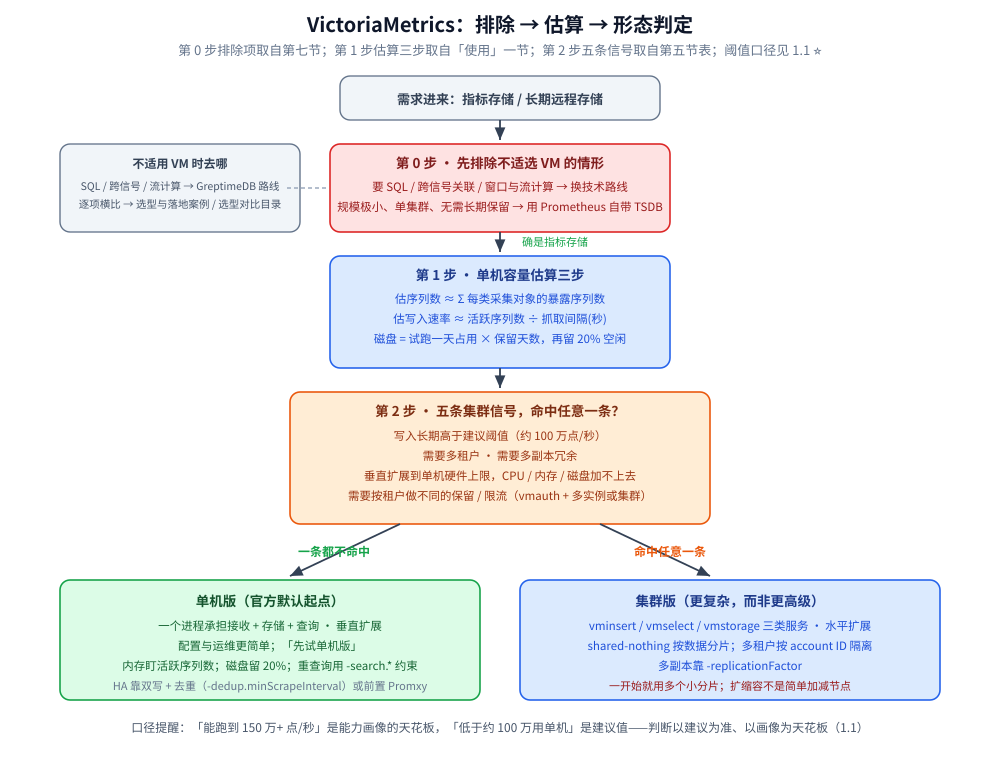
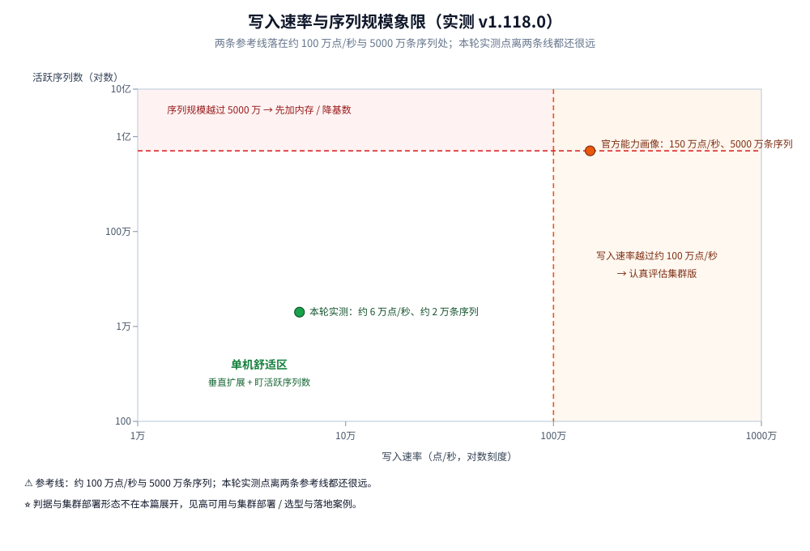

# 定位与适用场景

> 只讲一件事：VictoriaMetrics 单机版在什么负载下够用、边界在哪里、什么时候必须换集群版。
> 覆盖活跃时间序列数、写入速率、保留期与磁盘、内存开销、单节点上限，
> 以及它最擅长的三类负载（高基数、长保留、多集群汇聚）。
>
> 内容整理自个人学习笔记，并参考官方文档与 Release Notes；素材见 [素材清单](../../../../素材清单.md)。
>
> 📎 **实测口径**：第八节的读数取自容器 `w10vm-a`（宿主端口 18428，镜像 `quay.io/victoriametrics/victoria-metrics:stable`，`app_version` 为 `victoria-metrics-20250523-133235-tags-v1.118.0-0-gaa3171cf4b`），启动时只显式指定 `-retentionPeriod=1y`（默认 1 个月）。查询缓存读数固定求值时刻、连跑 3 轮；保留期回读把求值时刻放到每条探针自己的时间戳附近。

---

## 一、VictoriaMetrics 是什么、解决什么问题？

**本节要点**：先明确 VM 在指标存储里的定位——它是 Prometheus 生态的"长期远程存储 + 兼容查询"层，而不是替代采集端。

VictoriaMetrics（下称 VM）是一个时序数据库，最常被当作 Prometheus 的长期远程存储使用：它实现 Prometheus 的 remote write 写入协议与 PromQL 兼容的查询 API（MetricsQL），因此可以直接接在现有 Prometheus / vmagent 采集链路后面，Grafana 面板无需改动。

VM 有两种形态，这也是理解后续所有边界的前提：

| 形态 | 结构 | 扩展方式 | 多租户 |
| --- | --- | --- | --- |
| **单机版** | 一个进程同时承担采集接收、存储、查询 | 垂直扩展（加 CPU / 内存 / 磁盘 / IO） | ❌ 不支持 |
| **集群版** | 拆成 vminsert / vmselect / vmstorage 三类服务 | 水平扩展 | ✅ 按 account ID 命名空间 |

⚠️ 官方对选型的默认建议是：**先试单机版**——单机版配置与运维都更简单，只有在垂直扩展真的顶不住时才上集群。集群不是"更高级"，而是"更复杂"。

VM 与 Prometheus 生态的分工、以及它相对 Thanos / Mimir / InfluxDB 的横向对比，见 [选型与落地案例.md](选型与落地案例.md) 与 [可观测性选型对比.md](../../../中间件/可观测性/可观测性选型对比.md)；本篇只谈"单机能力边界"。

### 1.1 官方给的单机容量画像

**本节要点**：下面这组数字来自官方 case study（"单机版可完美处理的工作负载"），是判断"要不要上集群"的起点。

| 维度 | 官方 case study 中的单机能力 |
| --- | --- |
| 写入速率 | 150 万+ 样本/秒 |
| 活跃时间序列 | 5000 万+ |
| 时间序列总量 | 50 亿+ |
| 序列替换率（churn） | 每天 1.5 亿+ 新序列 |
| 样本总量 | 10 万亿+ |
| 查询 | 200+ qps |
| 查询延迟（P99） | 1 秒 |

⭐ 这组数字回答的是"单机能跑多大"，而"官方建议什么时候用集群"回答的是"什么规模该换形态"——后者更保守：集群版文档建议**写入速率低于约 100 万数据点/秒时用单机版**。两者并不矛盾：**"能跑到 150 万"是压测画像的上限，"低于 100 万老老实实用单机"是运维复杂度权衡后的建议**。判断时以建议为准，以能力画像为天花板。

---

## 二、单机版的能力边界在哪里？

**本节要点**：四条边界——写入速率、活跃序列数、序列替换率、查询负载。它们不是独立的，往往由"基数"一个变量同时决定。

### 2.1 写入速率

写入是 VM 的优先项：官方明确说明"VM 优先保证写入，当资源不足以同时服务读写时，查询会显著变慢"。所以容量规划时**先保证写入余量，再谈查询性能**。

### 2.2 活跃时间序列数

这是最重要的一个数。VM 的内存开销主要由**活跃时间序列（最近一小时内有数据点的序列）**驱动，而不是由样本总量驱动。同样的样本量，序列数越多越吃内存。

⚠️ 一条可操作的判据（官方 troubleshooting 经验）：**如果 VM 平均每 10 万点/秒的写入就要吃掉 1 个以上 CPU 核，通常说明当前活跃序列数相对内存太多了**——此时应优先加内存，或降低基数，而不是加 CPU。

### 2.3 序列替换率（churn）

每天新增多少条"从未出现过"的序列，决定倒排索引的增长速度。churn 高的典型来源是"标签里带会频繁变化的维度"（如 Pod 名、容器 ID）。高 churn 会让索引持续膨胀，即使保留期很短也一样——这一点在 [架构与存储引擎.md](架构与存储引擎.md) 会从索引轮换的角度解释。

### 2.4 查询负载

查询与写入共享资源。单机版适合的查询画像大致是"中低 QPS + 可接受秒级 P99"；重查询（一次扫大量序列、大时间跨度）必须用 `-search.*` 系列参数加以约束，否则单个大查询就能拖垮整个实例。

---

## 三、保留期与磁盘容量怎么估？

**本节要点**：保留期决定"能查多久"，磁盘决定"装不装得下"；两者与写入速率一起构成成本三角。

### 3.1 保留期规则

- 由 `-retentionPeriod` 控制，取值＝数字 + 单位（`h`/`d`/`w`/`y`），**不带单位默认按"月"**。
- 默认保留 1 个月；**最小可用保留期为 24h / 1d**。
- 数据按月分区；超出保留期的分区在**每月 1 日**开始删除，未完全过期的 part 不会被删。
- 磁盘峰值用量约为 **(保留期 + 1) 个月的量**——因为当月数据要完整保留。
- VM **不支持无限保留**，只能给一个极大值（如 `-retentionPeriod=100y`）。

### 3.2 磁盘怎么估

官方给的估算方法很直接，用一天的试跑外推：

```text
需要的磁盘 ≈ （试跑一天的磁盘占用） × （保留天数）
例：一天跑出 10GB，则 100 天保留至少需要 10GB × 100 = 1TB
```

另一个官方（Cloud 容量模型）的经验值是**每个数据点约 0.8 字节**，可用来做数量级估算；但高基数会推高单点字节数，实际要留余量。

⚠️ **磁盘必须留 20% 以上的空闲**：VM 的后台合并（compaction）需要临时空间，空闲不足时合并会被暂停，导致 part 数量膨胀、查询变慢；极端情况下 vmstorage 会进入**只读模式**（由 `-storage.minFreeDiskSpaceBytes` 触发），此时仍能查询，但**不再接受新写入**。

---

## 四、内存开销由什么决定？

**本节要点**：内存 ≈ f（活跃序列数、churn、并发查询）。它不是一个可以被"保留期"单独定价的量。

三条经验：

1. **缓存上限由 `-memory.allowedPercent`（默认 60）或 `-memory.allowedBytes` 控制**——限制的是 VM 内部各类缓存可占用的比例，不包含每条查询额外申请的内存。
2. **单查询内存由 `-search.maxMemoryPerQuery` 控制**，并发上限由 `-search.maxConcurrentRequests` 控制；两者的乘积近似等于并发查询的内存上界。
3. **`-search.maxUniqueTimeseries` 限制单个查询能定位的序列数**——定位到的序列越多，查询的内存与 CPU 开销越大，这也从侧面说明"基数即成本"。

⭐ 一句话：**内存的定价单位是"活跃序列数"，不是"样本数"，也不是"磁盘大小"**。所以降内存最有效的手段是降基数（减少标签维度，或用 recording rule / 流聚合预先合并），而不是单纯加机器。

---

## 五、什么时候单机版不够、必须上集群？

**本节要点**：给出可判定的切换信号，而不是"感觉大了就上集群"。

出现下列任一条，就该认真评估集群版：

| 信号 | 说明 |
| --- | --- |
| 写入速率长期高于单机建议阈值 | 官方建议低于约 100 万点/秒用单机；持续超过就该横向扩展 |
| 需要**多租户** | 单机版不支持多租户，集群版按 account ID 隔离 |
| 需要**多副本冗余** | 集群版支持 `-replicationFactor`，单机版靠外部 HA 方案 |
| 垂直扩展到单机硬件上限 | CPU / 内存 / 磁盘单机加不上去时，只能横向扩 |
| 需要按租户做不同的保留 / 限流 | 由 vmauth + 多实例或集群多租户实现 |

⚠️ 上集群的代价也要说清楚：集群版是 **shared-nothing** 架构，vmstorage 之间按数据分片，**扩缩容不是简单地加减节点**——vmstorage 是有状态的，官方建议"一开始就用多个小分片"，后续再垂直加资源。把"要不要上集群"当成一次性决策，比当成"随时能加机器"更稳妥。



**图怎么读**：三步顺序在前文都有出处——第 0 步排除项取自第七节；第 1 步估算三步取自「使用」一节（序列数 → 写入速率 → 磁盘）；第 2 步就是本节表格里的五条集群信号，命中任意一条再谈集群。判定时写入速率以**建议阈值（约 100 万点/秒）**为准，能力画像的 150 万+ 只是天花板，不是目标值。

---

## 六、VM 特别擅长哪几类负载？

**本节要点**：三类负载是 VM 的舒适区，判断"该不该选它"主要看是否命中这三类。

### 6.1 高基数

VM 的存储格式对"序列多、每条样本少"的负载（典型是 Kubernetes 指标）做了优化：标签集合通过 TSID 间接寻址、索引按标签倒排，重复的标签组合不会在每条样本上重复存储。因此相比按标签组合逐条建索引的方案，同样的基数下 VM 的内存与磁盘更省。K8s 场景（高 churn、高基数）是它的主战场。

### 6.2 长保留

按月分区 + 列式压缩 + 后台合并，让"数据越老压缩越好、查询扫的 part 越少"。配合企业版的降采样与保留过滤器（见 [架构与存储引擎.md](架构与存储引擎.md)），可以做到"近期全精度、远期降精度、不同数据不同保留期"。

### 6.3 多集群汇聚

VM 天然适合当多个 Prometheus / 集群的**汇聚层**：采集端仍用 Prometheus 或 vmagent，写入统一 remote write 到 VM，查询在 VM 侧统一。这正是"长期远程存储 + 兼容查询"定位的落地形态。

---

## 七、哪些场景不适合选 VictoriaMetrics？

**本节要点**：本篇刻意不做横向对比；这里只给"什么情况下别选 VM"的边界，细节见给出的链接。

- **要和 Prometheus / Thanos / Mimir / InfluxDB 逐项比** → 见 [选型与落地案例.md](选型与落地案例.md)（本目录）与 [可观测性选型对比.md](../../../中间件/可观测性/可观测性选型对比.md)（指标/日志/链路三支柱与栈层面选型）。
- **要 SQL、要跨指标/日志/链路关联、要窗口与流计算** → VM 的查询语言是 MetricsQL（PromQL 系），不做通用 SQL 与跨信号关联；这类需求看 [../GreptimeDB/README.md](../GreptimeDB/README.md) 与 [../../数据库选型对比.md](../../数据库选型对比.md)。
- **规模极小、单集群、无需长期保留** → 直接用 Prometheus 自带 TSDB 即可，引入 VM 只是多一个组件。

---

## 使用：单机版容量估算与关键启动参数

**本节要点**：给一套可以照着做的估算步骤与几个必调参数。

### 容量估算三步

```text
1. 估序列数：  序列数 ≈ Σ(每类采集对象的暴露序列数)
   例：node exporter 单实例约 1000 条序列 → 50 台 ≈ 5 万条活跃序列
2. 估写入速率：写入点数/秒 ≈ 活跃序列数 ÷ 抓取间隔(秒)
   例：5 万序列 ÷ 30s ≈ 1667 点/秒
3. 估磁盘：    先跑一天看 -storageDataPath 占用，再 × 保留天数，最后留 20% 余量
```

### 关键启动参数（示例值，仅示位置）

```bash
# 单机版关键参数示意（默认值已在括号中标注）
./victoria-metrics-prod \
  -storageDataPath=/var/lib/victoria-metrics-data \
  -retentionPeriod=12 \
  -dedup.minScrapeInterval=30s \
  -memory.allowedPercent=60
```

| 参数 | 默认 | 作用 |
| --- | --- | --- |
| `-retentionPeriod` | 1 个月 | 保留期；最小 24h/1d |
| `-dedup.minScrapeInterval` | 未设置 | 去重间隔，建议等于抓取间隔 |
| `-memory.allowedPercent` | 60 | VM 缓存可用内存上限占比 |
| `-search.maxUniqueTimeseries` | 见官方文档 | 单查询可定位的最大序列数 |
| `-search.maxMemoryPerQuery` | 见官方文档 | 单查询内存上限 |
| `-storage.minFreeDiskSpaceBytes` | 见官方文档 | 低于此值进入只读模式 |

⚠️ 上表未给出确切默认值的项，请以你所装版本的 `-help` 输出或官方文档为准；版本间默认值可能调整。

---

## 八、实测：保留期行为、查询缓存与形态判据

**本节要点**：把第三节的保留期规则、第五节的上集群信号都换成可读的读数——超出保留期的点会以哪个 `reason` 丢、同一条查询连跑两次缓存省下什么、判「要不要上集群」时该盯哪几个指标。



### 8.1 超出保留期的点会怎样？

容器以 `-retentionPeriod=1y` 启动，写入 5 个探针（同一条 `w10_ret_probe`，靠 `case` 标签区分），时间戳分别落在超出与未超出保留期处，再在**每条探针自己的时间戳之后 60 秒**求值：

| 探针时间戳 | 距运行时刻 | HTTP | 丢弃 `reason` | 在 t=ts+60s 求值 |
| --- | --- | --- | --- | --- |
| 1757591158000 | 400 天前 | 204 | `small_timestamp` +1 | 0 条 |
| 1760528758000 | 366 天前 | 204 | `small_timestamp` +1 | 0 条 |
| 1761047158000 | 360 天前 | 204 | 无 | 1 条（值 102） |
| 1789559158000 | 30 天前 | 204 | 无 | 1 条（值 103） |
| 1792147558000 | 1 小时前 | 204 | 无 | 1 条（值 104） |

两条容易误判的点：

- **超出保留期不会报错**：两个探针都回 `HTTP 204`，只把 `vm_rows_ignored_total{reason="small_timestamp"}` 各加 1。这是 3.1 节「过老的数据进不来」的实测形态——**它根本不会落盘**，不是落盘后再删。
- **拿当前时刻查旧点必然查不到**：瞬时查询默认只回看 **5 分钟**，所以这 5 个探针在「此刻」求值全是 0 条；必须把求值时刻放到探针自己的时间戳附近才能读到。用 `query_range` 或显式带上 `time` 参数可以避开这个坑。

### 8.2 同一条查询连跑两次，缓存省了什么？

固定求值时刻，查 `count(w10_card2_total{job="w10"})`（命中 10000 条序列），同一查询连跑两次、连做 3 轮，看 `vm_cache_requests_total` / `vm_cache_misses_total` 的增量：

| 缓存 | 每次调用的 `requests` 增量 | 第二次调用的 `misses` 增量 |
| --- | --- | --- |
| `storage/metricIDs` | +10000 | 预热后为 0 |
| `storage/metricName` | +10000 | 预热后为 0 |
| `storage/indexBlocks` | +19 | 轮 1 仍 +16、轮 2 起降为 0 |
| `indexdb/dataBlocks` | 轮 1 +18、此后 0 | 轮 1 +1 → +0 |
| `indexdb/indexBlocks` | 轮 1 +17、此后 0 | — |
| `indexdb/tagFiltersToMetricIDs` | 轮 1 +4、此后 +2 | 轮 1 +2 → +0 |
| `promql/parse` | +3 | 0 |

两点结论：**① 请求数不降**（`storage/metricIDs` / `metricName` 每次调用照样 +10000，一条序列一次查询），省下来的是**第二次调用的未命中数**——命中的是解码与查找结果；**② 命中的是「热点」而非整个结果**：`storage/indexBlocks` 在轮 1 的第二次调用里 misses 仍 +16，到轮 2 才降到 0，说明书级 / 块级缓存需要预热。

各项 cache 的实际上限与本轮占用（`vm_cache_size_bytes` / `vm_cache_size_max_bytes`，单位字节）：

| 缓存 | 本轮占用 | 上限 |
| --- | --- | --- |
| `storage/tsid` | 33554432 | 1409286144 |
| `storage/metricIDs` | 33554432 | 268435456 |
| `storage/metricName` | 33554432 | 402653184 |
| `indexdb/dataBlocks` | 2740865 | 932484704 |
| `storage/indexBlocks` | 914496 | 372993872 |
| `indexdb/tagFiltersToMetricIDs` | 2162688 | 201326592 |

⭐ 上限不是每类缓存单独配的，而是统一由 `-memory.allowedPercent`（默认 60）按比例分配——调参口径见 [性能调优与基准测试.md](性能调优与基准测试.md) 第四节，本篇只给「读哪几个指标」的实测占用。

### 8.3 判「要不要上集群」时该读哪几个指标？

第五节的五条信号是定性的，落到单机上可以按一组**唯一口径**的指标来读：

| 判据 | 该读的指标 | 本轮实测（近空载） | 越过判据后去哪 |
| --- | --- | --- | --- |
| 写入速率 | `vm_rows_added_to_storage_total` 的时间导数 | 本轮一次性灌入累计 484806 行 | 长期高于约 100 万点/秒 时认真评估集群版 |
| 序列总量（基数） | `tsdb.totalSeries` / vmui 基数浏览器 | 20034 | 活跃序列逼近 5000 万量级 → 先加内存并降基数 |
| 活跃序列（内存定价单位） | `vm_cache_entries{type="storage/hour_metric_ids"}` | `vm_cache_size_bytes{type="storage/hour_metric_ids"}` 为 8466 | 内存见顶 → 降基数优先于加 CPU |
| 写 / 查并发上界 | `vm_concurrent_insert_capacity` / `vm_concurrent_select_capacity` | 8 / 8 | 用 `-search.maxConcurrentRequests` 约束重查询 |
| 磁盘余量 | `vm_free_disk_space_bytes` 与下限 `vm_free_disk_space_limit_bytes` | 966318694400 / 10000000 | 低于下限转只读（`vm_storage_is_read_only` 变 1，只可查不可写） |
| 多租户 / 多副本 | 单机版不支持 | — | 只能换集群版 |

这张图与表的用法是「**写入速率 × 序列规模**两个轴一起看」：图里 X 轴上限取 1000 万点/秒、Y 轴上限取 1 亿条序列，两条参考线分别落在约 100 万点/秒与 5000 万条序列处，官方能力画像的（150 万点/秒，5000 万序列）落在参考线交点上；本轮实测的那一点（约 6 万点/秒、约 2 万条序列）离两条参考线都还很远。⚠️ 阈值本身、集群的部署形态与扩缩容代价不在本篇展开——见 [高可用与集群部署.md](高可用与集群部署.md)（分片、副本与容量规划）与 [选型与落地案例.md](选型与落地案例.md)（横比与落地案例）；单机与集群的取舍流程另见第五节。

---

## 延伸追问

- **单机能到 150 万样本/秒，为什么还建议 100 万以下用单机？** → "能力画像"是压测上限，"建议阈值"还要算上运维复杂度、余量与突发。留 50% CPU / 内存余量才能扛住尖峰，所以可用建议值比理论能力低一档。
- **内存不够时该先加内存还是先降基数？** → 先降基数（收益立竿见影且成本最低），再考虑加内存。降基数的手段：去掉高基数标签、用 recording rule / 流聚合预聚合、只采关键维度。
- **保留期设长一点就是多花磁盘吗？** → 不完全是。磁盘峰值约 (保留期 + 1) 个月；但 churn 高时索引仍会拖累查询。企业版的保留过滤器可按标签设不同保留期，让"值钱的数据留久、噪声数据留短"。
- **单机版能不能做 HA？** → 单机版本身无内建多副本。常见做法是双写 + 去重（配置 `-dedup.minScrapeInterval`），或在前面加 Promxy 做查询聚合；需要原生多副本则用集群版的 `-replicationFactor`。
- **churn 高为什么比"序列总量大"更麻烦？** → 序列总量大但不怎么新增，索引稳定；churn 高意味着索引持续写入与轮换，单机磁盘与 CPU 会被索引操作吃掉一部分。控制 churn 的关键是别让标签值频繁变化。

---

## 关联

- [README.md](README.md) — 本目录导读：四个主题域、阅读顺序与版本坐标
- [架构与存储引擎.md](架构与存储引擎.md) — 单机架构与 mergeset / 倒排索引 / 分区 part 的组织
- [数据模型与写入路径.md](数据模型与写入路径.md) — 数据模型、标签基数为什么是成本核心、写入路径与边界
- [选型与落地案例.md](选型与落地案例.md) — VM 与 Prometheus / Thanos / Mimir / InfluxDB 的横向对比与落地案例
- [../../数据库选型对比.md](../../数据库选型对比.md) — 关系型 / 文档 / 搜索 / KV / 列式 / 时序 / 图 七类存储的横向定位
- [可观测性选型对比.md](../../../中间件/可观测性/可观测性选型对比.md) — 指标 / 日志 / 链路三支柱与可观测性栈层面选型
- [../GreptimeDB/README.md](../GreptimeDB/README.md) — 另一条"SQL + 多信号"时序技术路线的目录导读
> 反向引用（本篇被下列文档引到）：[与Prometheus生态的关系.md](与Prometheus生态的关系.md)、[高可用与集群部署.md](高可用与集群部署.md)
