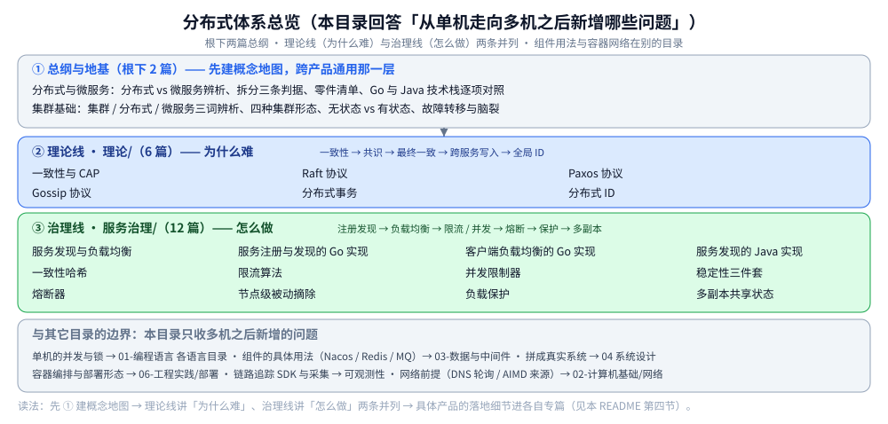

# 分布式笔记索引（本目录导读）

> 本目录回答的是「**从单机走向多机之后，新增了哪些问题**」，按一条从理论到落地的链组织：
> 
> **理论基础**（一致性 / CAP / 故障 / 时钟）回答「为什么难」；
> 
> **数据分布**（复制 / 分区）与 **共识协议**（Paxos / Raft / ZAB / Gossip）回答「多机怎么达成一致」；
> 
> **分布式事务 / 分布式ID** 是两个跨服务应用问题；
> 
> **服务治理**（发现 / 负载均衡）回答「怎么找到彼此」；
> 
> **稳定性**（限流 / 并发 / 熔断 / 降级 / 重试 / 摘除）回答「怎么不被拖垮」。
> 根目录的 [分布式与微服务.md](分布式与微服务.md) 是全目录的总纲。
>
> 内容整理自个人学习笔记。**本文件只给阅读顺序与依赖关系**——每篇的知识点描述见
> [全仓知识点目录](../../目录.md)，本目录**不重复描述**；跨目录的延伸见「四、与其它目录的分工」。
>
> ⭐ **目录实数**：根下总纲 2 篇（[分布式与微服务.md](分布式与微服务.md)、[集群基础.md](集群基础.md)）· 七个方向零件共 **27 篇**（`理论基础/` 4 · `数据分布/` 3 · `共识协议/` 4 · `分布式事务/` 4 · `分布式ID/` 2 · `服务治理/` 2 · `稳定性/` 8）；各目录另有 `README.md` 导读，不计入。

---

## 一、先读哪几篇（总纲，互不重复）

| 顺序 | 篇 | 视角 | 一句话 |
|---|---|---|---|
| ① | [分布式与微服务.md](分布式与微服务.md) | ⭐ **总纲** | 分布式（部署形态）vs 微服务（组织边界）的辨析、拆分的三条判据、**零件清单**（必需 / 增强 / 可选）、Go 与 Java 技术栈逐项对照 |
| ② | [README.md](服务治理/README.md) | ⭐ **治理线入口** | 服务发现 / 负载均衡两篇的分工与阅读顺序，以及「为什么用注册中心而不用配置文件」 |
| ③ | [集群基础.md](集群基础.md) | ⭐ **概念地基（跨产品通用）** | 集群 / 分布式 / 微服务的辨析、四种集群形态、无状态 vs 有状态、副本一致性、故障转移与脑裂 —— **横跨数据库 / 缓存 / MQ / 编排的通用那一层** |

> ⭐ **这三篇怎么配合**：
> 
> ① 先建立概念地图（有哪些零件、每个零件解决什么问题、什么时候才需要它），
> 
> ② 是零件清单里**第一个必需件**的展开——`README.md` 是 `服务治理/` 子目录的入口。
> 
> ③ 是**跨产品的通用层**：先把「集群为什么难」（有状态、副本一致、故障判定、脑裂）讲透，
> 之后看任何具体产品（MySQL / Redis / Kafka / K8s）都能直接对上号，细节再进各自的专篇。

## 二、各层的阅读顺序

### 2.1 理论、数据分布、共识与两个应用问题

```text
⓪ 故障模型 / 时钟与顺序   ← 为什么难：超时 ≠ 宕机、部分失效，顺序只能自己造
        ↓
① 一致性模型 / CAP 与 PACELC  ← 入口：强度阶梯、会话保证，以及分区与平时的取舍
        ↓
② Raft协议           ← 共识怎么落地：三种角色、日志复制、选主（客户端与三节点实验见接入篇）
        ↓
③ Paxos协议 / ZAB协议 ← 共识的源头（Prepare / Accept）与 ZooKeeper 的工程变体（zxid 定序 + 换主恢复）
        ↓
④ Gossip协议         ← 最终一致的信息扩散：反熵 / 谣言传播 / SWIM
        ↓
⑤ 分布式事务         ← 跨服务写入：2PC/3PC → TCC → Saga → 最终一致方案（Outbox / 事务消息 / CDC / 通知）
⑥ 分布式ID           ← 拆库之后自增主键没了：雪花 / 号段 / Leaf
```

本线篇目（与上面 ⓪~⑥ 一一对应）：[故障模型与分布式谬误.md](理论基础/故障模型与分布式谬误.md) → [时钟与顺序.md](理论基础/时钟与顺序.md) → [一致性模型.md](理论基础/一致性模型.md) → [CAP与PACELC.md](理论基础/CAP与PACELC.md) → [Raft协议.md](共识协议/Raft协议.md) → [Paxos协议.md](共识协议/Paxos协议.md) → [ZAB协议.md](共识协议/ZAB协议.md) → [Gossip协议.md](共识协议/Gossip协议.md) → 事务（README + 4 篇正文）：[README.md](分布式事务/README.md) → [2PC与3PC.md](分布式事务/2PC与3PC.md) → [TCC.md](分布式事务/TCC.md) → [Saga.md](分布式事务/Saga.md) → [最终一致方案.md](分布式事务/最终一致方案.md)；ID（README + 2 篇正文）：[README.md](分布式ID/README.md) → [雪花算法.md](分布式ID/雪花算法.md) → [号段模式与Leaf.md](分布式ID/号段模式与Leaf.md)

### 2.2 服务治理与稳定性：`服务治理/` → `稳定性/`

```text
① 服务发现 / 负载均衡      ← 入口：注册 / 发现 / 健康检查，与 LB 的分层和选型
        ↓
② 接入（按手上的语言挑，已迁到 01-编程语言/）
     接入etcd                 ← Go / Java：客户端单例、Txn / Watch / Election、三节点实验
     服务注册与发现的Go实现   ← Go：租约注册 + KeepAlive + Watch 增量
     客户端负载均衡的Go实现   ← Go：轮询 / 平滑加权 / 一致性哈希与实测
     服务发现的Java实现      ← Java：Spring Cloud + Nacos 的对应词汇
     一致性哈希             ← 算法本体已迁到 数据分布/（环 / 虚拟节点 / 建环代价）
        ↓
③ 限流算法               ← 速率限制的算法层（令牌桶 / 漏桶 / 四种窗口算法）
        ↓
④ 并发限制器             ← 在途数限制 + 自适应（AIMD / Vegas / Gradient2）
        ↓
⑤ 负载保护               ← 把 ③④ 落成入口闸门（有界排队与准入）
        ↓
⑥ 熔断器                 ← 从「限自己」转向「判断下游是否已经坏了」（三态机 / 窗口 / 调参）
        ↓
⑦ 节点级被动摘除          ← 比熔断更细一级：先摘坏节点，整片不行才轮到熔断
        ↓
⑧ 重试与超时             ← 失败后的再试与时间预算；重试必须被熔断短路
        ↓
⑨ 降级                   ← 所有拒绝与失败最终要给业务一个答案
        ↓
⑩ 多副本共享状态          ← 多副本下 ③⑥ 的判定依据怎么统一（扩容后阈值被放大 N 倍）
```

本线篇目（与上面 ①~⑩ 一一对应）：[服务发现.md](服务治理/服务发现.md) / [负载均衡.md](服务治理/负载均衡.md) →
[接入etcd.md](../../01-编程语言/go/工程实践/接入etcd.md) / [接入etcd.md](../../01-编程语言/java/工程实践/接入etcd.md) /
[服务注册与发现的Go实现.md](../../01-编程语言/go/工程实践/服务注册与发现的Go实现.md) / [客户端负载均衡的Go实现.md](../../01-编程语言/go/工程实践/客户端负载均衡的Go实现.md) /
[服务发现的Java实现.md](../../01-编程语言/java/工程实践/服务发现的Java实现.md)（② 按语言挑，配合 [一致性哈希.md](数据分布/一致性哈希.md) 读）→
[限流算法.md](稳定性/限流算法.md) → [并发限制器.md](稳定性/并发限制器.md) → [负载保护.md](稳定性/负载保护.md) →
[熔断器.md](稳定性/熔断器.md) → [节点级被动摘除.md](稳定性/节点级被动摘除.md) → [重试与超时.md](稳定性/重试与超时.md) →
[降级.md](稳定性/降级.md) → [多副本共享状态.md](稳定性/多副本共享状态.md)

> ⚠️ **③④⑤ 的分工最容易混**，一句话记住：[限流算法.md](稳定性/限流算法.md) 限**速率**（进多快）、
> [并发限制器.md](稳定性/并发限制器.md) 限**在途数**（积多少）、[负载保护.md](稳定性/负载保护.md) 把两者落成入口闸门；
> 六层防线的关系与上线顺序见 [稳定性/README.md](稳定性/README.md)。

### 2.3 依赖关系（谁要前置）

| 本篇 | 建议先读 | 为什么 |
|---|---|---|
| [集群基础.md](集群基础.md) | [分布式与微服务.md](分布式与微服务.md) | 先把三个词（集群 / 分布式 / 微服务）分清，再谈集群的形态与代价 |
| [故障模型与分布式谬误.md](理论基础/故障模型与分布式谬误.md) | [分布式与微服务.md](分布式与微服务.md) | 先知道多机新增了哪些故障形态，才谈得上「怎么检测、怎么防」 |
| [时钟与顺序.md](理论基础/时钟与顺序.md) | [故障模型与分布式谬误.md](理论基础/故障模型与分布式谬误.md) | 先分清「超时」与「宕机」，再看物理时钟为什么不能直接排序 |
| [一致性模型.md](理论基础/一致性模型.md) | [故障模型与分布式谬误.md](理论基础/故障模型与分布式谬误.md)、[时钟与顺序.md](理论基础/时钟与顺序.md) | 一致性等级建立在「故障与顺序」的假设之上 |
| [复制与Quorum.md](数据分布/复制与Quorum.md) | [集群基础.md](集群基础.md)、[一致性模型.md](理论基础/一致性模型.md) | 先懂集群形态与「一致性有几种强度」，再看副本与读写交集 |
| [分区与再平衡.md](数据分布/分区与再平衡.md) | [集群基础.md](集群基础.md)、[复制与Quorum.md](数据分布/复制与Quorum.md) | 先懂分片与副本的分工，再看迁移与跨分片查询 |
| [Raft协议.md](共识协议/Raft协议.md) | [一致性模型.md](理论基础/一致性模型.md) | 先知道「一致性有几种强度」，才看得懂多数派在保什么 |
| [Paxos协议.md](共识协议/Paxos协议.md) | [一致性模型.md](理论基础/一致性模型.md) | 先懂「一致性有几种强度」，再看多数派怎么保证「不选错」 |
| [ZAB协议.md](共识协议/ZAB协议.md) | [Raft协议.md](共识协议/Raft协议.md) | ZAB 的恢复阶段只有跟 Raft 的日志对齐放在一起看，才看得出差别在哪 |
| [Gossip协议.md](共识协议/Gossip协议.md) | [一致性模型.md](理论基础/一致性模型.md) | Gossip 是「最终一致」的一种实现手段，先分清它属于哪种强度 |
| [README.md](分布式事务/README.md) | [CAP与PACELC.md](理论基础/CAP与PACELC.md) | BASE 是 CAP 取舍的产物；这里给出三族路线与选型决策 |
| [2PC与3PC.md](分布式事务/2PC与3PC.md) | [README.md](分布式事务/README.md) | 先知道七种方案的分组，再看「强一致倾向」这一族的协议代价 |
| [TCC.md](分布式事务/TCC.md) | [2PC与3PC.md](分布式事务/2PC与3PC.md) | TCC 是 2PC 的业务层改写，先懂二阶段的持锁与决议，才看得出 Try 预留省掉了什么 |
| [Saga.md](分布式事务/Saga.md) | [TCC.md](分布式事务/TCC.md) | 先懂「预留 + 确认」的隔离思路，再看 Saga 为什么放弃隔离、改用补偿 |
| [最终一致方案.md](分布式事务/最终一致方案.md) | [README.md](分布式事务/README.md) | 先分清强一致倾向与最终一致的边界，再谈 Outbox / 事务消息 / CDC 怎么落地 |
| [README.md](分布式ID/README.md) | — | 先看方案全景与选型，再决定深入雪花还是号段 |
| [雪花算法.md](分布式ID/雪花算法.md) | [README.md](分布式ID/README.md) | 选了雪花再深入位结构、回拨与 workerId |
| [号段模式与Leaf.md](分布式ID/号段模式与Leaf.md) | [README.md](分布式ID/README.md) | 选了号段再深入双 buffer 与 Leaf |
| [接入etcd.md](../../01-编程语言/go/工程实践/接入etcd.md) | [服务发现.md](服务治理/服务发现.md) | 先懂发现机制，再看客户端每个动作落在哪个 API |
| [接入etcd.md](../../01-编程语言/java/工程实践/接入etcd.md) | [接入etcd.md](../../01-编程语言/go/工程实践/接入etcd.md) | 同一套语义的 jetcd 写法与 ZooKeeper / Curator 对照 |
| [服务注册与发现的Go实现.md](../../01-编程语言/go/工程实践/服务注册与发现的Go实现.md) | [服务发现.md](服务治理/服务发现.md) | 那是机制层，这是把它写成**能跑**的东西 |
| [客户端负载均衡的Go实现.md](../../01-编程语言/go/工程实践/客户端负载均衡的Go实现.md) | [服务注册与发现的Go实现.md](../../01-编程语言/go/工程实践/服务注册与发现的Go实现.md)、[负载均衡.md](服务治理/负载均衡.md) | 先有实例列表，才谈从里面怎么挑 |
| [服务发现的Java实现.md](../../01-编程语言/java/工程实践/服务发现的Java实现.md) | [服务发现.md](服务治理/服务发现.md) | 同一套语义在 Spring Cloud 里的词汇对照 |
| [一致性哈希.md](数据分布/一致性哈希.md) | [客户端负载均衡的Go实现.md](../../01-编程语言/go/工程实践/客户端负载均衡的Go实现.md) | 那里是「轮询 / 加权 / 一致性哈希」三种策略的对照，这篇讲一致性哈希自己的环与虚拟节点 |
| [并发限制器.md](稳定性/并发限制器.md) | [限流算法.md](稳定性/限流算法.md) | 先有「限速率」的模型，才看得出「限在途数」差在哪 |
| [稳定性/README.md](稳定性/README.md) | [限流算法.md](稳定性/限流算法.md) | 先看清六层防线与分流顺序，再看各组件怎么落地 |
| [熔断器.md](稳定性/熔断器.md) | [稳定性/README.md](稳定性/README.md) | 先有整条防线的关系，再看熔断器**这一个组件**的展开 |
| [节点级被动摘除.md](稳定性/节点级被动摘除.md) | [熔断器.md](稳定性/熔断器.md) | 先有「按服务熔断粒度太粗」的认知，才看得出节点级摘除补了什么 |
| [负载保护.md](稳定性/负载保护.md) | [并发限制器.md](稳定性/并发限制器.md) | 那一篇讲「在途数」的理论与自适应算法，这篇讲网关入口的闸门实现 |
| [重试与超时.md](稳定性/重试与超时.md) | [熔断器.md](稳定性/熔断器.md) | 重试必须包在熔断内部，否则会把故障放大成重试风暴 |
| [降级.md](稳定性/降级.md) | [熔断器.md](稳定性/熔断器.md)、[限流算法.md](稳定性/限流算法.md) | 两类触发源决定降级什么时候发生 |
| [多副本共享状态.md](稳定性/多副本共享状态.md) | [熔断器.md](稳定性/熔断器.md)、[限流算法.md](稳定性/限流算法.md) | 先有单副本的判定逻辑，才谈得上「多副本怎么统一」 |



## 三、专题线：只想补某一块

| 目的 | 按这个顺序读 |
|---|---|
| **只想搞懂「为什么要把系统拆开」** | [分布式与微服务.md](分布式与微服务.md)（第一、二节）→ [服务发现.md](服务治理/服务发现.md)（拆开之后多出来的事） |
| **搞不清集群 / 分布式 / 微服务的区别** | [集群基础.md](集群基础.md)（三词对照 + 形态与代价）→ [分布式与微服务.md](分布式与微服务.md)（拆分判据与零件清单） |
| **要上集群 / 做高可用选型** | [集群基础.md](集群基础.md)（形态、复制模式、故障转移）→ 对应产品专篇（见该篇「使用」节索引） |
| **搞懂「一致性」到底是什么** | [一致性模型.md](理论基础/一致性模型.md)（强度阶梯与会话保证）→ [CAP与PACELC.md](理论基础/CAP与PACELC.md)（分区与平时的取舍）→ [Raft协议.md](共识协议/Raft协议.md)（多数派怎么保强一致）→ [README.md](分布式事务/README.md)（跨服务怎么补） |
| **搞懂「共识协议」的源头与对照** | [一致性模型.md](理论基础/一致性模型.md) → [Paxos协议.md](共识协议/Paxos协议.md) → [Raft协议.md](共识协议/Raft协议.md) → [ZAB协议.md](共识协议/ZAB协议.md)（三种写法的逐点差异） |
| **搞懂「为什么故障判不准」** | [故障模型与分布式谬误.md](理论基础/故障模型与分布式谬误.md)（超时 ≠ 宕机、故障域）→ [时钟与顺序.md](理论基础/时钟与顺序.md)（租约与定序对时间的依赖） |
| **搞懂「最终一致」怎么实现** | [一致性模型.md](理论基础/一致性模型.md) → [Gossip协议.md](共识协议/Gossip协议.md) |
| **服务治理从零入门** | [服务发现.md](服务治理/服务发现.md) → [负载均衡.md](服务治理/负载均衡.md) → 接入按语言挑一篇读透（[接入etcd.md](../../01-编程语言/go/工程实践/接入etcd.md) / [服务注册与发现的Go实现.md](../../01-编程语言/go/工程实践/服务注册与发现的Go实现.md) / [客户端负载均衡的Go实现.md](../../01-编程语言/go/工程实践/客户端负载均衡的Go实现.md) / [服务发现的Java实现.md](../../01-编程语言/java/工程实践/服务发现的Java实现.md)）→ [限流算法.md](稳定性/限流算法.md) |
| **防止被流量打穿** | [限流算法.md](稳定性/限流算法.md) → [并发限制器.md](稳定性/并发限制器.md) → [负载保护.md](稳定性/负载保护.md) → [熔断器.md](稳定性/熔断器.md) → [节点级被动摘除.md](稳定性/节点级被动摘除.md) → [重试与超时.md](稳定性/重试与超时.md) → [降级.md](稳定性/降级.md) → [多副本共享状态.md](稳定性/多副本共享状态.md) |
| **上线多副本之前** | [多副本共享状态.md](稳定性/多副本共享状态.md)（限流阈值被放大 `副本数` 倍，且没有任何报错） |
| **要在 Go 里落地** | [接入etcd.md](../../01-编程语言/go/工程实践/接入etcd.md) → [服务注册与发现的Go实现.md](../../01-编程语言/go/工程实践/服务注册与发现的Go实现.md) → [客户端负载均衡的Go实现.md](../../01-编程语言/go/工程实践/客户端负载均衡的Go实现.md) |
| **要在 Java 里落地** | [接入etcd.md](../../01-编程语言/java/工程实践/接入etcd.md) → [服务发现的Java实现.md](../../01-编程语言/java/工程实践/服务发现的Java实现.md) → [接入Seata.md](../../01-编程语言/java/工程实践/接入Seata.md) |
| **排查「偶发不一致 / 脏读」** | [一致性模型.md](理论基础/一致性模型.md)（先分清是哪一种一致性被破坏）→ [Raft协议.md](共识协议/Raft协议.md)（脑裂与多数派）→ [README.md](分布式事务/README.md) |

## 四、与其它目录的分工

| 相关目录 | 关系 |
|---|---|
| [系统设计/](../系统设计/) | 把这些零件**拼成真实系统**：弹幕系统的接入层就用了限流与注册发现 |
| [go/](../../01-编程语言/go/) | Go 侧实现：[限流器.md](../../01-编程语言/go/并发编程/限流器.md)（单机令牌桶）、[稳定性组件的Go实现.md](../../01-编程语言/go/工程实践/稳定性组件的Go实现.md)（Sentinel / gobreaker / Redis 限流 / 手写三件套）、[从零实现网关.md](../../01-编程语言/go/网络编程/从零实现网关.md)（网关自己的限流与上游发现）、[接入DTM.md](../../01-编程语言/go/工程实践/接入DTM.md)（Saga / TCC / 二阶段消息 / XA 四套骨架与容器实测） |
| [java/](../../01-编程语言/java/) | Java 侧实现：[稳定性组件的Java实现.md](../../01-编程语言/java/工程实践/稳定性组件的Java实现.md)（Sentinel / Resilience4j）、[接入Seata.md](../../01-编程语言/java/工程实践/接入Seata.md)（AT / TCC / XA 与 XID 传播）、[Spring-boot核心.md](../../01-编程语言/java/Spring-boot核心.md)、[锁与AQS.md](../../01-编程语言/java/并发/锁与AQS.md) 都引了 [服务发现的Java实现.md](../../01-编程语言/java/工程实践/服务发现的Java实现.md) |
| [网络/](../../02-计算机基础/网络/) | 分布式的前提是网络：[DNS解析.md](../../02-计算机基础/网络/网络层与寻址/DNS解析.md)（DNS 轮询与服务发现的边界）、[TCP拥塞控制算法.md](../../02-计算机基础/网络/传输层/tcp/TCP拥塞控制算法.md)（AIMD 的来源） |
| [中间件/](../../03-数据与中间件/中间件/) | 注册中心 / 配置中心的**具体组件**：[Nacos.md](../../03-数据与中间件/中间件/注册与配置中心/Nacos.md)（五种注册中心对比）、[网关选型对比.md](../../03-数据与中间件/中间件/网关与代理/网关选型对比.md)、[RPC框架选型对比.md](../../03-数据与中间件/中间件/RPC框架/RPC框架选型对比.md)；分布式事务的**产品粒度**选型见 [分布式事务选型对比.md](../../03-数据与中间件/中间件/分布式事务/分布式事务选型对比.md)；族与子类级的选型总纲见 [中间件选型.md](../../03-数据与中间件/中间件/中间件选型.md) |
| [mysql/](../../03-数据与中间件/数据存储/关系型/MySQL/) | [复制与高可用.md](../../03-数据与中间件/数据存储/关系型/MySQL/复制与高可用.md)（MGR 与 Raft 同源）、[分表与路由.md](../../03-数据与中间件/数据存储/关系型/MySQL/分表与路由.md)（一致性哈希见 [一致性哈希.md](数据分布/一致性哈希.md)、ID 生成） |
| [分布式锁.md](../../03-数据与中间件/数据存储/NoSQL/Redis/分布式锁.md) | 互斥的另一条路——只解决互斥，**不解决原子提交与回滚** |
| [可观测性/](../../03-数据与中间件/中间件/可观测性/) | 拆开之后「看不见调用链」的问题：[Skywalking.md](../../03-数据与中间件/中间件/可观测性/Skywalking.md)、[Jaeger.md](../../03-数据与中间件/中间件/可观测性/Jaeger.md) |

## 五、本目录的边界与缺口

**边界**：本目录只收**多机之后新增的问题**——从「为什么要拆、拆完多出什么」到
「服务之间怎么找到彼此、怎么不被对方拖垮」为止。

| 本目录收 | 不收（在哪） |
|---|---|
| 一致性模型、共识协议、跨服务事务、全局 ID | **单机的并发与锁** → [并发编程/](../../01-编程语言/go/并发编程/)、[并发/](../../01-编程语言/java/并发/) |
| 服务注册发现、负载均衡、限流与过载保护 | **组件的具体用法**（Nacos / Redis / MQ）→ [03-数据与中间件/](../../03-数据与中间件/) |
| 分布式系统的**理论取舍** | **容器编排与部署形态** → [部署/](../../06-工程实践/部署/) |
| | **链路追踪的实现**（SDK 接入、采集链路）→ [可观测性/](../../03-数据与中间件/中间件/可观测性/) |

**已知缺口**（2026-10-02 按主题全仓 grep 实测，不是凭印象列）：

| 缺口 | 实测现状 | 结论 |
|---|---|---|
| **逻辑时钟**（Lamport / 向量时钟 / HLC） | ✅ 已补（[时钟与顺序.md](理论基础/时钟与顺序.md)，2026-10-19） | 物理时钟、happens-before、Lamport / 向量时钟、HLC、TrueTime / TSO |
| **Paxos** | ✅ 已补（[Paxos协议.md](共识协议/Paxos协议.md)，2026-10-10） | 覆盖 Basic + Multi-Paxos 与 Raft 逐点对照；含 Acceptor/Proposer Go 骨架（未实测） |
| **Gossip** | ✅ 已补（[Gossip协议.md](共识协议/Gossip协议.md)，2026-10-10） | 反熵 / 谣言传播 / SWIM / 收敛性；落点：Redis Cluster、Nacos Distro、Consul、Cassandra |
| **ZAB**（ZooKeeper 的共识） | ✅ 已补（[ZAB协议.md](共识协议/ZAB协议.md)，2026-10-19） | 此前只在 Raft / Paxos 篇里作为对照行出现，无独立篇；现补 `zxid` 结构、两阶段广播、换主恢复与同步、Observer |
| **PACELC** | ✅ 已补（[CAP与PACELC.md](理论基础/CAP与PACELC.md)，2026-10-19） | CAP 的分区维度 + 平时的延迟 / 一致性维度；含四象限与按操作选型 |
| **拜占庭容错**（PBFT） | **全仓 0 次** | 暂不补：属区块链领域，与后端服务主线较远 |
| **CRDT** | **全仓 0 次** | 暂不补：协同编辑场景，本仓库暂无对应落点 |
| **分布式快照**（Chandy-Lamport） | **全仓 0 次** | 暂不补：Flink checkpoint 用的，本仓库未做流处理 |
| **选主算法**（Bully / Ring） | **全仓 0 次** | 暂不补：Raft 选主已覆盖工程实际用法 |

> ⭐ 缺口是**按主题 grep 实测**得出的（含「全仓 0 次」这类硬结论）——
> 写阅读顺序时顺手把缺口查出来，是加目录导读的意外收获。
