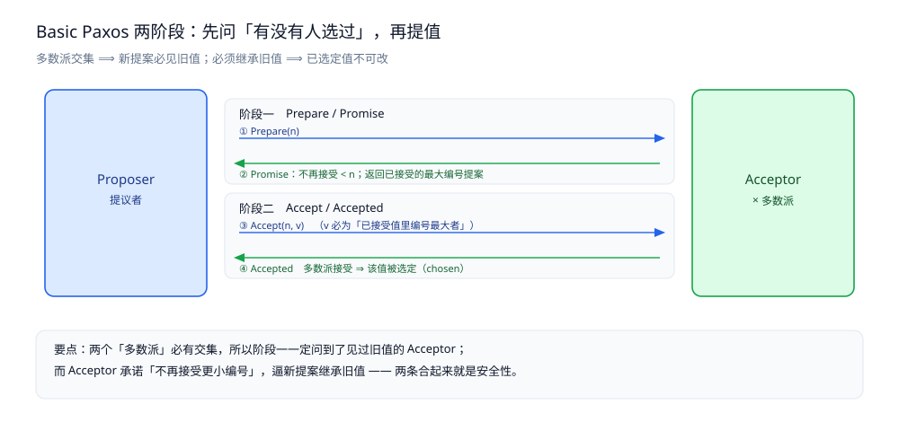
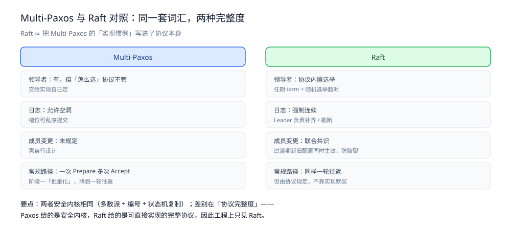

# Paxos 协议

> **Basic Paxos** 的两阶段（Prepare / Accept）与「已选定值不可改」的安全性推导、活锁与随机退避，
> **Multi-Paxos** 怎么用一个领导者把多轮实例压成一条日志，以及它与 Raft 的逐点对照和工程映射。
>
> 内容整理自个人学习笔记，并参考《凤凰架构：构建可靠的大型分布式系统》（周志明）；参考资料与原始素材见 [素材清单](../../../素材清单.md)。

---

## 一、Paxos 到底在解决什么问题？

**本节要点**：Paxos 解决的是一句话——**一群会宕机、消息会丢会乱的节点，怎么对「一个值」达成一致，而且一旦达成就不许反悔**。先把角色和「安全性要求」定清楚，才看得懂后面两个阶段为什么缺一不可。

### 1.1 三个角色（以及它们各自不负责什么）

| 角色 | 职责 | 不负责 |
|---|---|---|
| **Proposer**（提议者） | 提出提案（编号 + 值），推动它被选定 | 不决定结果；可以有多个、可以互相竞争 |
| **Acceptor**（接受者） | 对提案投票（Promise / Accept），是「记忆」的持有者 | 不主动提议；只按规则应答 |
| **Learner**（学习者） | 从 Acceptor 处得知「哪个值被选定了」 | 不参与投票 |

⭐ 关键：**「谁提议」和「谁记着」是分开的**。Proposer 可以随时崩溃、重试、互相抢，真正决定「值有没有被定下来」的是**多数派 Acceptor 的投票记录**。

> 工程里三个角色常在同一台机器上（一个进程既当 Proposer 又当 Acceptor 又当 Learner），但**逻辑上必须分开看**，否则「多数派」这个概念就散了。

### 1.2 要保证的三条安全性

Paxos 常被简称「一致性协议」，但它真正承诺的只有三条（Safety）：

| # | 要求 | 一句话 |
|---|---|---|
| **①** | **只有被提出的值才可能被选定** | 不会凭空冒出一个值 |
| **②** | **最多只有一个值被选定** | 不会出现两个客户端都被告知「写成功」却看到不同的值 |
| **③** | **值一旦被选定，学习者最终能学到它** | 不许「定了但没人知道」 |

⚠️ 注意：**Paxos 不承诺「一定能选定」** —— 那是 Liveness。多个 Proposer 互相抢时可能一直定不下来，这就是第三节要讲的**活锁**。

> 把 Safety 与 Liveness 分开记：**「不选错」是 Paxos 保证的，「总能选出来」不是**。

### 1.3 它和「复制状态机」是什么关系

共识协议在工程里几乎只服务于一件事：**复制状态机**（Replicated State Machine）。

```text
一个状态机 = 初始状态 + 一串按顺序应用的命令
要让 N 台机器状态一致 → 只要保证它们的命令序列一致
命令序列的第 i 位填什么 → 就是一个「共识问题」
```

于是有这条映射：

- **Basic Paxos** 解决「**一个**日志槽填什么」；
- **Multi-Paxos** 解决「**一串**日志槽分别填什么」；
- **Raft** 也是后者，只是换了实现路线（见第四节对照）。

> ⭐ 记住：**共识协议 = 给日志槽（log slot）投票**。后面看到的「实例（instance）」「回合（round）」，都是指「某个槽位的一次决议」。

---

## 二、Basic Paxos 的两阶段是怎么走的？

**本节要点**：两个阶段、四个消息。**阶段一只问「有没有人选过」，阶段二才真正提值**。理解的关键在于——**为什么必须先问再提**。

### 2.1 提案编号：整个协议的「时间刻度」

每个提案有一个**全局唯一且单调递增**的编号 `n`（工程里常用「轮次 + 节点 ID」拼出来，保证唯一）。

- Acceptor 记住两样东西：**已承诺的最小编号** `promisedN`、**已接受的最大编号提案** `(acceptedN, acceptedV)`。
- 编号只有大小之分，**它不是时钟** —— 唯一作用是「让后来的提案看起来更新」。

### 2.2 阶段一：Prepare / Promise

```text
Proposer                                Acceptor（多数派）
   |   Prepare(n)   ------------------->   |
   |                                        | 收到 n 后：
   |                                        |   if n > promisedN:
   |                                        |       promisedN = n            ← 承诺
   |                                        |       reply(ok, acceptedN, acceptedV)
   |                                        |   else:
   |                                        |       reply(reject)            ← 拒绝
   |   <---- Promise / Reject ------------  |
```

⭐ **Promise 承诺了两件事**：

1. **不再接受任何编号 < n 的提案**（把更旧的挡在门外）；
2. **返回自己已经接受过的、编号最大的那个提案**（`acceptedN, acceptedV`）—— 这一条是安全性的命根子。

### 2.3 阶段二：Accept / Accepted

拿到多数派 Promise 后，Proposer 才决定提什么值：

```text
① 若多数派的回复里「没有任何已接受的值」 → 可以自由提自己的值 v
② 若其中有已接受的值 → 必须提「已接受值里编号最大的那一个」   ← ★
```

然后发 `Accept(n, v)`：

```text
Proposer                                Acceptor（多数派）
   |   Accept(n, v)  ------------------->   |
   |                                        | 收到后：
   |                                        |   if n >= promisedN:
   |                                        |       acceptedN, acceptedV = n, v
   |                                        |       reply(accepted)
   |   <---- Accepted --------------------  |
   多数派 Accepted → 该值被「选定」（chosen）
```

**规则②就是「已选定值不可改」的全部秘密**：若上一轮已经选定过 `v`，本轮 Proposer 在阶段一**一定会从多数派里至少一台 Acceptor 那里看到 `v`**（多数派必有交集），于是它**只能继续提 `v`**。

### 2.4 为什么「两个阶段」就够？（四步推导）

| 步 | 断言 | 理由 |
|---|---|---|
| 1 | 任意两个多数派**必有交集** | 多数派 = 超过半数，两个过半集合不可能不相交 |
| 2 | 所以新提案的阶段一**一定问到了见过旧值的 Acceptor** | 交集里那一台 |
| 3 | 所以 Proposer 拿到了 `acceptedV`，并**被迫继承** | 规则② |
| 4 | 所以新提案的值 = 旧提案的值 | 归纳可得：**任意一轮选定的值都等于第一轮选定的值** |

> ⭐ 一句话：**「多数派交集」保证新提案看见旧值，「必须继承旧值」保证它不敢改** —— 两条合起来就是 Paxos 的安全性。

### 2.5 完整时序



---

## 三、Basic Paxos 的坑：为什么它「很难用」？

**本节要点**：Basic Paxos 只解决「一个值」，而且**多个 Proposer 会互相打断**（活锁）。这两点决定了它几乎从不被直接用于工程。

### 3.1 活锁：两个 Proposer 互相「顶号」

```text
P1 发 Prepare(1) → 拿到多数派 Promise，准备发 Accept(1, v1)
P2 同时发 Prepare(2) → 多数派把 promisedN 抬到 2，P1 的 Accept(1, ·) 被拒
P1 重试 Prepare(3) → P2 的 Accept(2, ·) 又被拒
P2 重试 Prepare(4) → ...
两人无限互相打断，**永远选不出值**（Liveness 失败）
```

⚠️ 注意：**这里并没有破坏 Safety** —— 只是「谁也定不下来」。所以围观者常误以为「Paxos 出 bug 了」，其实它只是不保证 Liveness。

### 3.2 解法：随机退避 + 选出「唯一的 Proposer」

| 手段 | 做法 |
|---|---|
| **随机退避** | 被拒后**随机等一段时间**再重试，降低撞号概率 |
| **Leader（Multi-Paxos 的核心）** | 全集群**只让一个 Proposer 提号**，从根上消灭竞争 |

> 随机退避只是「降低概率」，**真正的解法是选一个 Leader** —— 这正是 Multi-Paxos 存在的理由。

### 3.3 它只解决「一个值」，不是「一串值」

日志要填的是**连续的一串槽位**。Basic Paxos 对每个槽位都独立跑一遍，问题是：

- 每个槽位都要**两轮往返**（Prepare + Accept）；
- 多个槽位的提案会**互相打断**；
- 性能与实现复杂度都不可接受。

> 所以工程上要的从来不是 Basic Paxos，而是 **Multi-Paxos**。

---

## 四、Multi-Paxos：怎么把多轮压成一条日志？

**本节要点**：Multi-Paxos 不是新协议，而是**对 Basic Paxos 的两个工程优化** —— 选出唯一 Leader + 阶段一「一次批准、多次复用」。

### 4.1 优化一：唯一 Leader 承担连续提案编号

选定一个 Leader 后：

- **只有 Leader 有资格提号**，编号由它**连续分配**（`n, n+1, n+2, ...`）；
- 其他节点平时是跟随者，只在 Leader 失联后才发起新的选举。

这直接消灭了 3.1 的活锁。

### 4.2 优化二：阶段一可以「一次批准、多次使用」

⭐ 核心直觉：**既然只有 Leader 提号，阶段一的「承诺」就可以一次性买断**。

```text
Leader 就位后，先对「编号 n」跑一次完整的阶段一
  → 拿到多数派「不再接受 < n 的任何提案」的承诺
此后每个日志槽（i, i+1, i+2 ...）：
  直接发 Accept(n, v) —— **跳过 Prepare**（因为承诺已经拿过了）
只有当 Leader 换人、或收到更高编号的 Prepare 时，才需要重新跑阶段一
```

效果：**常规路径从「两轮往返」降到「一轮往返」**（一次 Accept 广播），吞吐大幅提升。

> ⭐ 一句话：**Multi-Paxos = 选一个 Leader，把阶段一「批量化」**。多个槽位共享同一次 Prepare 的成果，这就是「Multi」的含义。

### 4.3 与 Raft 的逐点对照

| 维度 | **Multi-Paxos** | **Raft** |
|---|---|---|
| 领导者 | 有，但**协议本身没规定怎么选**，交给实现 | 有，**协议内置选举**（任期 + 随机超时） |
| 日志连续性 | 允许**空洞**（槽位可乱序提交） | **强制连续**，Leader 负责补齐 / 截断 |
| 安全性的表述 | 靠「提案编号 + 多数派交集」 | 靠「任期 + 日志新旧校验」 |
| 成员变更 | 未规定 | **联合共识**（Joint Consensus） |
| 可理解性 | 出了名的难讲清 | ⭐ **以可理解性为第一设计目标** |
| 工程实现 | Chubby、Spanner（早期）、ZAB（Paxos 系变体） | etcd、Consul、TiKV、Kafka KRaft |

⭐ **一句话对照**：**Raft ≈ 把 Multi-Paxos 的「实现惯例」写成了协议本身** —— 选主、日志连续、成员变更全都规定死，代价是灵活性换来，但正因为规定死，才**好懂、好实现**。

> 详见 [Raft协议.md](Raft协议.md) 的选举与日志复制两节。



### 4.4 那为什么工程里几乎只见 Raft？

| 原因 | 说明 |
|---|---|
| **可理解性** | Raft 论文直接以「容易理解」为卖点；Paxos 的原始描述与工程实现之间隔着一层「默会知识」 |
| **协议完整** | Raft 把选举、日志、成员变更、快照都规定了；Multi-Paxos 的「怎么选主、怎么处理空洞」得自己定 |
| **生态** | etcd / TiKV / Consul 都基于 Raft，周边工具与资料多 |
| **但 Paxos 的贡献仍在** | 它是**思想源头**：多数派、提案编号、状态机复制，这些概念全部来自 Paxos |

---

## 五、工程里谁在用 Paxos？

**本节要点**：直接以「Basic Paxos」命名的产品几乎没有，但**大量系统在用它的变体或它的思想**。

### 5.1 三个「Paxos 系」代表

| 系统 | 与 Paxos 的关系 |
|---|---|
| **Chubby**（Google 锁服务） | 用 Multi-Paxos 做日志复制；论文里明确说「Paxos 太难实现」，因此给了一套工程化描述 |
| **ZAB**（ZooKeeper 原子广播） | **Paxos 系变体**，换成「主备 + epoch（任期）」，与 Raft 更接近；详见 [ZAB协议.md](ZAB协议.md) |
| **Spanner** | 每个 Paxos group 用 Multi-Paxos 复制；跨 group 靠 TrueTime 做外部一致性 |

### 5.2 更常见的：它的**思想**被到处复制

| 概念 | 出自 Paxos | 现在到处可见 |
|---|---|---|
| 多数派（Quorum） | ✅ | [集群基础.md](../集群基础.md) 里的 `W + R > N` |
| 提案编号 + 承诺更高编号 | ✅ | Raft 的任期、ZAB 的 epoch |
| 复制状态机 | ✅ | 一切「日志复制」型系统 |
| 领导者 + 批量化 | Multi-Paxos | Raft 的 Leader、Kafka 的 controller |

> ⭐ 收口：**Paxos 的价值不在于「有多少系统直接跑 Basic Paxos」，而在于它把「多数派 + 编号 + 状态机复制」这套词汇定了下来** —— 后面所有共识协议（含 Raft）都是在这套词汇上做工程改写。

---

## 使用：Paxos 的 Acceptor 与 Proposer 骨架（Go）

> ⚠️ **未实测**：本节代码**按 Paxos 的公开协议语义书写，未在本机编译运行**。
> 原因：真正验证 Paxos 需要「消息可丢、节点会宕机、多 Proposer 并发」的对抗环境，单进程骨架只能表达**逻辑**，给不出可靠性结论。
> 下面刻意**省略了网络与持久化**，只保留 Acceptor 的两条状态规则 —— 这两条读懂，协议就读懂了一半。

### 1. Acceptor：整个协议里唯一有「记忆」的角色

```go
package paxos

import "sync"

// Acceptor 保存两条状态。
// ⚠️ 持久化是真实系统的硬要求：崩溃重启后若 promisedN 丢了，
// 就可能接受一个更小编号的提案 → 破坏 Safety（已选定值被覆盖）。
type Acceptor struct {
	mu        sync.Mutex
	promisedN uint64 // 已承诺的最小编号：不再接受 < promisedN 的提案
	acceptedN uint64 // 已接受的最大编号提案
	acceptedV any
}

// Promise 处理阶段一。ok=false 表示拒绝（编号不够新）。
// 注意：**先持久化再回复**，否则「承诺」在崩溃后就失效了。
func (a *Acceptor) Promise(n uint64) (ok bool, acceptedN uint64, acceptedV any) {
	a.mu.Lock()
	defer a.mu.Unlock()
	if n <= a.promisedN {
		return false, 0, nil // 已有更（或同样）新的承诺，拒绝
	}
	a.promisedN = n // ★ 承诺：从此不再接受 < n 的提案
	return true, a.acceptedN, a.acceptedV
}

// Accept 处理阶段二。
func (a *Acceptor) Accept(n uint64, v any) bool {
	a.mu.Lock()
	defer a.mu.Unlock()
	if n < a.promisedN {
		return false // 已承诺过更高的编号，拒绝
	}
	a.acceptedN, a.acceptedV = n, v
	return true
}
```

### 2. Proposer：阶段一拿值，阶段二提值

```go
package paxos

// Proposal 是阶段一的回复：某个 Acceptor 已接受过的提案。
type Proposal struct {
	OK        bool
	AcceptedN uint64
	AcceptedV any
}

// ChooseValue 是**安全性最关键的一步**：决定本轮到底提什么值。
// 规则：多数派回复里若有已接受的值，必须继承「编号最大」的那个；否则才能提自己的值。
// 少了这一步，Paxos 就退化成「谁都能改」，已选定的值会被覆盖。
func ChooseValue(mine any, replies []Proposal) any {
	var bestN uint64
	var bestV any
	seen := false
	for _, r := range replies {
		if !r.OK || r.AcceptedV == nil {
			continue
		}
		if !seen || r.AcceptedN > bestN {
			bestN, bestV, seen = r.AcceptedN, r.AcceptedV, true
		}
	}
	if seen {
		return bestV // ★ 必须继承，不能用自己的 mine
	}
	return mine
}
```

> 把这三十来行读透，再看第四节：**Multi-Paxos 的「跳过 Prepare」，跳过的正是 Proposer 里那一轮多余的 Prepare**，
> 但 `promisedN` 的承诺与 `ChooseValue` 的继承规则**一个都不能省** —— 那是安全性的全部。

---

## 延伸追问

- **Paxos 和 Raft 是什么关系？** → Raft 可以看作 Multi-Paxos 的「可理解性重写」：把「怎么选主、日志怎么连续、成员怎么变」这些 Multi-Paxos 留给实现的问题写进协议，代价是灵活性。
- **为什么 Acceptor 只返回「已接受的最大编号提案」而不是全部？** → 只返回最新那一个就够了：编号最大者蕴含了「之前选定过什么」，返回全部只会增加消息体积。
- **Paxos 能保证一定选出值吗？** → 不能。**Safety（不选错）是保证的，Liveness（总能选出来）不是** —— 活锁就是反例，要靠随机退避或选 Leader 来救。
- **Acceptor 的状态丢了会怎样？** → 可能违反 Safety：它可能接受更小编号的提案，把已选定的值覆盖掉。**所以 `promisedN` 必须持久化**。
- **Basic Paxos 能不能直接用来复制日志？** → 能，但**代价不可接受**：每个槽位两轮往返，且互相打断。这正是 Multi-Paxos 出现的原因。
- **「Paxos 系」和「Raft 系」的界线在哪？** → 不在机制，而在**协议完整度**：Paxos 给的是安全内核，Raft 给的是可直接实现的完整协议。

## 关联

- [Raft协议.md](Raft协议.md) — Multi-Paxos 的「可理解性重写」：选主、日志复制与三节点实验
- [ZAB协议.md](ZAB协议.md) — Paxos 系的另一支工程实现：`zxid` 定序与换主后的恢复阶段
- [一致性模型.md](../理论基础/一致性模型.md)、[CAP与PACELC.md](../理论基础/CAP与PACELC.md) — 一致性强度与 CAP 取舍，看 Paxos 到底在保什么
- [集群基础.md](../集群基础.md) — 多数派、`W + R > N`，以及「共识 ≠ 复制」的分野
- [README.md](../分布式事务/README.md) — 跨服务一致性：共识之上的另一层
- [Nacos.md](../../../03-数据与中间件/中间件/注册与配置中心/Nacos.md) — 另一套一致性路线（Distro + JRaft）
- [复制与高可用.md](../../../03-数据与中间件/数据存储/关系型/MySQL/复制与高可用.md) — 主从复制与 MGR（多数派提交在数据库侧的形态）
> 反向引用（本篇被下列文档引到）：[Gossip协议.md](Gossip协议.md)
