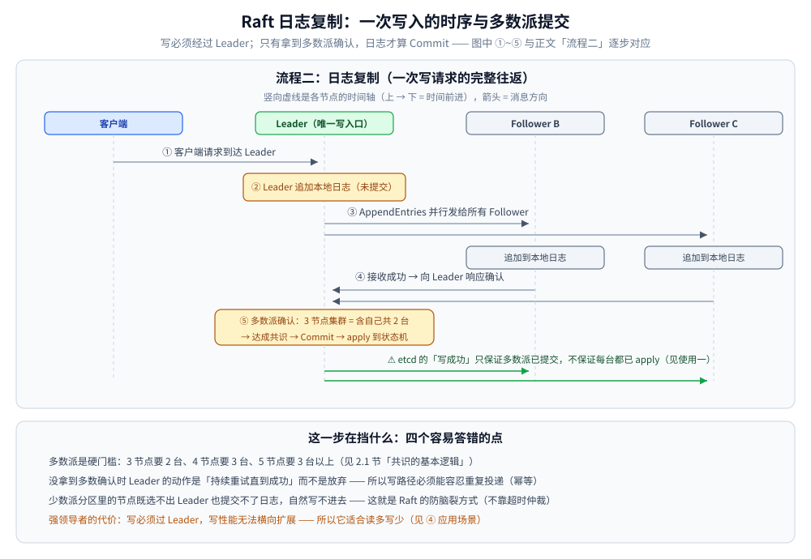
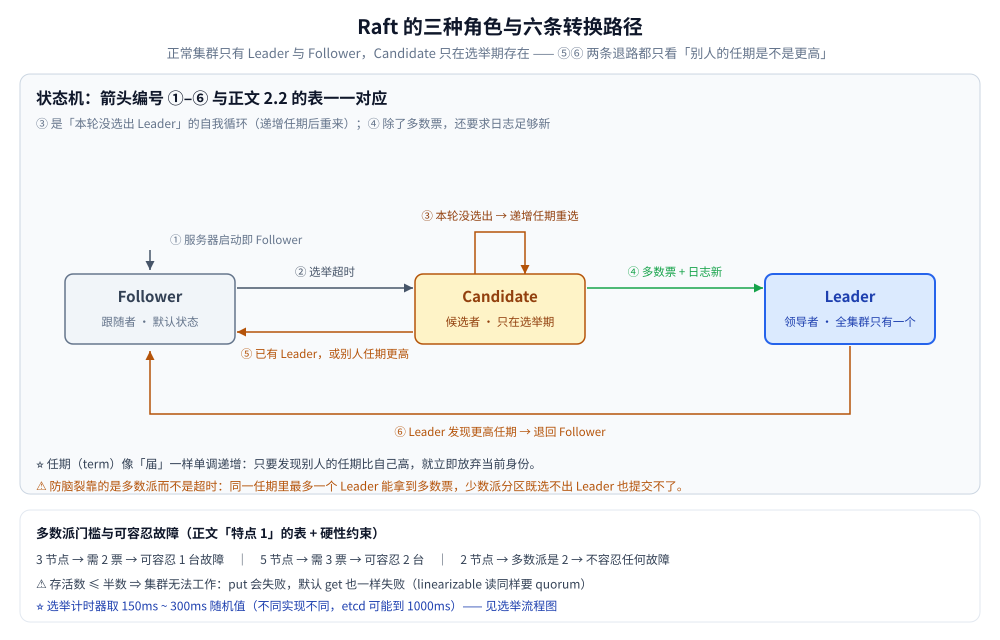
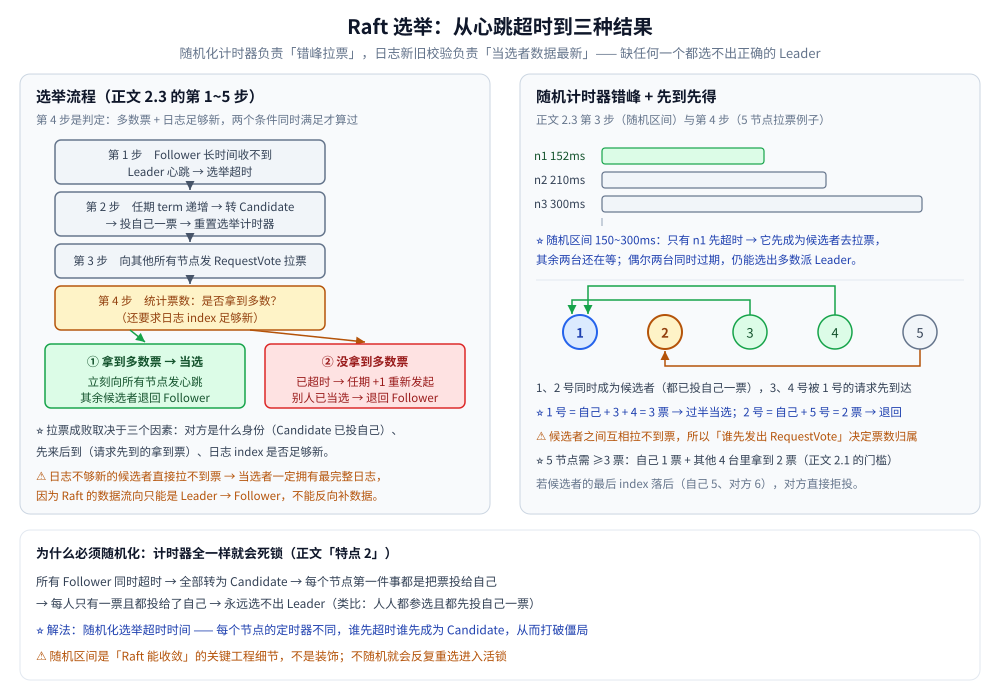

# Raft 协议

> Raft 的角色、任期与日志复制，以及选主流程的逐步拆解；结尾给出落地动作、验证判据与常见误说。etcd 客户端的 Txn / Election / Watch 代码与三节点实验见 Go / Java 接入篇。
>
> 内容整理自个人学习笔记，并参考《大型网站技术架构：核心原理与案例分析》（李智慧）；参考资料与原始素材见 [素材清单](../../../素材清单.md)。

---

## 一、介绍一下 Raft 协议

**本节要点**：从**项目经历**里的分布式组件往回追，就是这一串问题。下面先给一个**回答任何技术题的通用模板**，
非常值得学。

### 讲解任何技术题的通用模板（先掌握这个）

```text
① 它是什么？有什么作用？
② 它有什么特点和优势？（与同类技术相比，优劣势）
③ 核心流程是怎样的？（关键机制的理解）
④ 应用场景有哪些？
```

### ① 是什么 / 作用

> **Raft 是一种分布式一致性算法**，用于确保分布式系统中**多个节点在数据一致性上达成共识**。

### ② 特点与优势

#### 核心特点：半数以上节点达成共识

这意味着**集群能容忍几台故障是可以算出来的**：

| 集群节点数 | 半数以上 | 可容忍故障 |
|---|---|---|
| 3 | 2 | **1 台** |
| 5 | 3 | **2 台** |

> ⚠️ **硬性约束**：集群**存活节点数必须超过半数**，
> 一旦**小于等于半数**，集群**就无法工作**。
> 这是所有多数派共识算法的共同要求。

#### 为什么会出现 Raft？

> **因为其他共识算法（如 Paxos）太难理解了。**
> Raft 诞生的初衷就是 **"可理解性"**——让共识算法**容易理解和实现**。
> 这也直接决定了它后面三个区别于其他算法的设计。

#### Raft 的三大设计特点

**特点 1：强领导者（Strong Leader）**

- 集群中**只存在一个 Leader**；
- **所有写操作都必须经过 Leader**，数据流向**只能从 Leader → Follower**。

⚠️ **副作用（要主动讲）**：

> **不论集群规模多大，只有 Leader 能处理写请求**——
> 所以**无法通过扩展集群来提升写并发能力**。
> （读可以通过 Follower 分担，写不行。）

**特点 2：随机化选举定时器**

**问题**：如果所有 Follower 的选举超时时间相同会怎样？

```text
所有 Follower 同时超时 → 全部转为 Candidate
→ 每个节点的第一件事都是把票投给自己
→ 每人只有一票且都投给了自己 → 永远选不出 Leader
```

> 类比干部选举：如果每个人都可以参选、且都先投自己一票，那就永远选不出人。

**解法**：**随机化选举超时时间**——每个节点的定时器不同，**谁先超时谁先成为 Candidate**，
从而打破僵局。

**特点 3：成员变更采用联合共识（Joint Consensus）**

**类比配置/版本上线**（这个类比很好用）：

> 旧版本有字段 A，新版本删掉了 A 并加了字段 B。
> **不能**"先删 A 再上新版"——删了 A 旧版立刻就不能用了，而新版还没部署完。
> **正确做法**：先**加上新版需要的字段**（此时新旧版都能跑）→ 部署新版 →
> 逐步下线旧版 → **最后再删旧字段**。**中间需要一个过渡期**。

**Raft 的成员变更同理**：过渡期间**新旧两套配置同时生效**。
如果不这么做，新旧配置**各自选出一个 Leader**，集群就出现**脑裂**（一个集群两个 Leader）。
联合共识的作用就是**保证始终只有一个 Leader**。

### ③ 核心流程

#### 三类角色

| 角色 | 说明 |
|---|---|
| **Leader** | 领导者 |
| **Candidate** | 候选者，参与选举、可能成为 Leader |
| **Follower** | 跟随者 |

> **正常情况下集群只有 Leader 和 Follower**；
> 只有**收不到 Leader 通讯（心跳超时**）时，Follower 才会转为 Candidate。

#### 流程一：Leader 选举

```text
① 初始状态：所有节点都是 Follower（Leader 故障后也是这个状态）
② Follower 长时间收不到 Leader 心跳 → 选举超时 → 转为 Candidate
   （超时时间随机，谁先超时谁先转，避免同时选举）
③ 递增任期（term），第一件事：投自己一票；重置选举计时器
④ 向其他节点发送投票请求（RequestVote）
   - 发到 Follower：通常立刻把票投给它（先到先得）
   - 发到另一个 Candidate：对方已投给自己，不会给你
⑤ 统计票数：是否获得「大多数」？
   - 5 节点集群需要 ≥3 票（自己 1 票 + 其他 4 台中拿到 2 票）
   - ✅ 获得多数 → 成为 Leader → 向其他节点发送心跳/日志复制
   -    其他节点若自己是 Candidate，收到更高任期的 Leader 消息后转为 Follower
   - ❌ 未获得多数：
       a) 选举超时（整个周期都没选出结果）→ 任期 +1，重新发起选举
       b) 未超时但别人成了 Leader → 自己转为 Follower
```

#### 流程二：日志复制

```text
① 客户端请求到达 Leader
② Leader 把日志追加到本地
③ Leader 通过 AppendEntries 请求把日志发送给所有 Follower
④ Follower 接收成功 → 向 Leader 响应确认
⑤ Leader 判断：是否「大多数」Follower 确认成功？
   - ✅ 是 → 认为该日志已达成共识 → 提交（Commit）该日志
           → 应用到状态机（执行日志里的命令）
   - ❌ 否 → Leader 持续重试发送，直到 Follower 接收成功
```

> ⚠️ **重试不是"重试几次就放弃"**，而是**不断重试直到成功为止**——
> 这是 Raft 保证一致性的关键（所以需要处理重试上限和幂等）。



### ④ 应用场景

**典型使用者**：分布式数据库、**etcd**、**Kubernetes**（K8s 的元数据存在 etcd 里）。

**共同特点：读多写少。**

> 比如 K8s，只有**应用资源和修改配置时才会写**，平时绝大多数操作都是读。
> 这恰好规避了"强领导者导致写性能无法横向扩展"这个短板。

---

---

## 二、Raft 的三种角色如何转换？选举的详细流程是怎样的？

**本节要点**：第一节讲的是 Raft 的"是什么"，这一节进入 **"过程细节"**——
也就是"项目里用了 etcd / 强一致性"之后必然会撞上的那些点。

### 2.1 三种角色

| 角色 | 说明 |
|---|---|
| **Follower（跟随者）** | 节点的**默认状态**，服务器启动时就是这个 |
| **Candidate（候选者）** | **中间状态**，只在"没有 Leader、需要重新选举"时出现 |
| **Leader（领导者）** | 通过多数票当选 |

> **正常情况下集群只有 Follower 和 Leader**；
> Candidate 是选举期间的临时身份。
>
> **共识的基本逻辑**：**超过半数以上节点认可才算有效**——
> 写数据要**半数以上节点写入**才算成功；选 Leader 也要**超过半数节点同意**才能当选。
> （3 节点需 2 票，4 节点需 3 票，5 节点需 3 票以上）

### 2.2 角色转换的六条路径

| # | 转换 | 触发条件 |
|---|---|---|
| **①** | **启动 → Follower** | 服务器启动即 Follower |
| **②** | **Follower → Candidate** | **在选举周期内没有收到 Leader 的心跳/任何数据** → 选举超时，转为候选者 |
| **③** | **Candidate → Candidate（新一轮）** | 选举超时时间内没选出 Leader → **重新选举**（新任期、重置计时器） |
| **④** | **Candidate → Leader** | **拿到多数节点的投票** |
| **⑤** | **Candidate → Follower**（两条路径） | a) 发现集群**已存在 Leader**；<br>b) 发现**其他节点的任期（term）比自己更高** → 竞选已无意义，立刻退回 Follower |
| **⑥** | **Leader → Follower** | 发现集群中**存在更高任期**的节点 |

> **⑤b 和 ⑥ 的关键就是「任期（term）」**：任期像"届"一样单调递增。
> **只要发现别人的任期比自己高，就立即放弃当前身份。**



### 2.3 选举详细流程

#### 第 1 步：Follower 靠心跳维持

```text
Follower 能收到 Leader 的心跳 → 不转换，一直保持 Follower
Follower 收不到心跳（超时）  → 进入选举流程
```

> **Leader 就是靠持续发心跳来维护自己的地位。**

#### 第 2 步：递增任期 + 转为候选者 + 投自己一票

```text
① 递增自己的任期（term）
② 身份转为 Candidate（候选者）
③ 为自己投票 ← ★ 关键
④ 重置选举计时器
```

**⚠️ 为什么"为自己投票"这一步会导致死锁风险（这是随机化的动机）**：

> **任何节点在一个选举周期内只有一票的投票权，投给自己就不能投给别人。**
>
> 如果所有节点的选举计时器**都一样**（比如都是 150ms 过期）：
> 三个节点同时超时 → 全都变成 Candidate → **每人都把唯一一票投给自己**
> → **永远选不出 Leader**。
>
> 这和"干部选举中每个人都参选且都先投自己一票"是一模一样的问题。

#### 第 3 步：随机化选举计时器（Raft 的关键设计）

> **选举计时器取 150ms ~ 300ms 之间的随机值**（不同实现不同，
> 例如 etcd 可能到 1000ms）。

**效果**：
- 各节点过期时间不同（有的 152ms、有的 300ms）；
- **绝大多数情况下只有一个节点先过期** → 它先成为候选者并拉票，其他节点还在等；
- 偶尔有两个同时过期，也仍能选出多数派 Leader。

**这就是"随机化"存在的全部意义——避免选票碰撞。**

#### 第 4 步：向其他所有节点拉票（RequestVote）

**拉票结果取决于三个因素**：

| 因素 | 说明 |
|---|---|
| **① 对方是什么身份** | 如果对方也是 Candidate，它**已经投给自己了，拉不到票**；<br>是 Follower 则有投票权 |
| **② 先来后到** | 5 节点集群中 1 号和 2 号同时成为候选者：<br>谁的请求**先到达** 3、4 号节点，谁就能拿到那两票。<br>如 1 号先到 → **1 号得 3 票当选**，2 号只得自己 + 5 号共 2 票 |
| **③ 日志索引（log index）必须足够新** ⭐ | 见下方说明 |

**⭐ 为什么"日志不够新"会拉不到票（Raft 安全性的核心）**：

> 每个日志都有**任期（term）和索引位置（index）**。
> 候选者拉票时，其他节点会**比较最后一条日志的 index**：
>
> - 如果候选者的最后 index **落后于**对方（如候选者 5、对方 6），
>   对方**拒绝投票**；
> - 因为如果让它当选，**它的数据就不是最新的**，
>   而 **Raft 的数据流向只能是 Leader → Follower**——
>   它**没办法从 Follower 反向把数据拉回来**。

**所以规则是**：

> **日志不是最新的候选者，直接拉不到票 → 败选 → 退回 Follower。**
> 这保证了**当选 Leader 一定拥有最完整的日志**，从而保证已提交的数据不丢。

#### 第 5 步：三种结果

```text
① 发现已有 Leader → 转为 Follower
② 拿到多数票     → 当选 Leader → 向所有节点发心跳，
                    其他节点收到更高任期的 Leader 后全部转为 Follower
③ 没拿到多数票   → 判断是否选举超时：
     ├─ 已超时 → 递增任期、重置选举计时器、再投自己、重新走流程
     └─ 未超时 → 竞选失败（败选）→ 转为 Follower
                  → 回到最初：等心跳、重置计时器，循环
```



### 一句话总结

> Raft 选举 = **心跳保位 → 超时转候选 → 递增任期投自己 → 随机计时器错峰** →
> **拉票（需多数票 + 日志足够新）→ 当选发心跳 / 失败退 Follower**。
> **两个关键设计**：**随机化计时器**（避免选票碰撞）、
> **日志新旧校验**（保证当选者数据最新，数据只能从 Leader 流向 Follower）。

---

## 三、Raft 的结论怎么在工程里验证与落地？

**本节要点**：协议本身只有「选举」「日志复制」「安全性」三条线，落到客户端代码上是三个动作——**一条 Txn 就是一次多数派提交**、**Election 就是应用层单写者**、**Watch 就是增量维护的本地视图**。这一节只留结论与判据；完整可运行代码在 [接入etcd.md](../../../01-编程语言/go/工程实践/接入etcd.md)（Go）与 [接入etcd.md](../../../01-编程语言/java/工程实践/接入etcd.md)（Java），三节点实验的完整命令也移到了 Go 篇第十二节。

### 3.1 三个客户端动作分别对应协议的哪一段

| 客户端动作 | 对应正文阶段 | 为什么可信 / 要注意什么 |
|---|---|---|
| `Txn`（If / Then / Else） | 日志复制：Leader 追加 → 多数派落盘 → 提交 | If 的判断和 Then 的写入是**同一条日志**，不会在中间被插队；`Succeeded=true` 只代表「已提交」，不代表「每个 Follower 都已 apply」 |
| `Election.Campaign` | 强领导者选举 | 选出来的位置可以直接当**全局单写者**（定时任务、对账、清理），比自己写锁可靠 |
| `Watch` | 日志从 Leader 流向 Follower | 只是「变更通知」，**不保证不丢**：全量 Get 与订阅之间要用 `WithRev(getRev+1)` 接缝，压缩后要能回退成全量重拉 |

> 三个动作的完整实现（Txn 的 CAS / register-if-absent / delete-if-matches、Election 交接、带 `WithPrevKV` 的 Watch）见 Go 篇第八~十节与 Java 篇第八~十节，本篇不再重复贴代码。

### 3.2 四条正文结论的验证判据

三节点集群是验证 Raft 的最小成本拓扑；起停命令与 `etcdctl` 用法见 [接入etcd.md](../../../01-编程语言/go/工程实践/接入etcd.md) 第 12.2 节。

| # | 正文结论 | 怎么验 | 该看到什么 |
|---|---|---|---|
| A | Leader 靠心跳维护地位 | 停掉当前 Leader | 选举超时（150~300 ms 量级）后另一台升为 Leader |
| B | 任期单调递增 | 连续停 / 换三次 Leader | `RAFT TERM` 只增不减，且常一次跳好几格 |
| C | 存活不过半就无法工作 | 三台停两台后写入 | `put` 失败（拿不到多数派）；默认 `get` 也失败（linearizable 读同样要 quorum） |
| D | CP 牺牲的是 A | 在 C 的状态下对存活节点做本地读 | 能读到旧数据——**同一套 etcd，C 与 A 的差别只在一行读选项** |

### 3.3 三个最容易说错的地方

1. **「挂一台就写不进去」是错的**：3 节点挂 1 台仍有 2/3，照常可写；写不进去发生在**挂 ≥ 半数**时。所以集群规模取奇数，`n` 台容忍 `floor((n-1)/2)` 台。
2. **「Leader 退出后立刻切换」只在主动 `Resign` 时成立**：进程崩溃或只关 Session 时，要等租约 TTL 到期，这段时间业务要么写失败、要么阻塞——这就是「Leader 挂了服务卡十几秒」的根因。
3. **Watch 不是「订阅了就一定不丢」**：删除事件的 `kv.Value` 为空，要看 `PrevKV`；全量与订阅之间有窗口，要用 revision 接缝；掉线太久收到 `ErrCompacted` 时**没有增量可补**，只能丢弃缓存重新全量拉。

> 延伸：etcd 写成功只保证「日志被多数派接受并已提交」，这正是 [一致性模型.md](../理论基础/一致性模型.md) 所说「半数以上同步成功就返回」的准确含义，也是 linearizable 读需要额外一轮确认的原因。

---

## 延伸追问

- **Raft 和 Paxos 是什么关系？** → Raft 可以看成 Multi-Paxos 的「可理解性重写」：用强领导者 + 日志连续性 + 任期把协议拆成选举/复制/安全三条线，代价是**写必须过 Leader**。
- **怎么防脑裂？** → 不是靠超时，而是靠**多数派**：一个任期内最多一个 Leader 能拿到多数票；少数派分区既选不出 Leader 也提交不了，自然写不进去。
- **选举超时为什么要随机？** → 避免所有 Follower 同时超时、选票被均分导致反复重选（活锁）；随机区间是 Raft 能收敛的关键工程细节。
- **日志不一致怎么修？** → Leader 强制以自己为准：从尾部往前找到最后一个匹配的 index，把 Follower 后面的**全部截断再补发**。
- **集群能不能只有 2 个节点？** → 不能容忍任何一台故障（2 的多数派是 2），所以 Raft 集群要 3/5/7 这类奇数；扩容要按「容忍 N 台故障」反推节点数。
- **为什么不直接从 Follower 读？** → 可能读到落后数据；要强一致读必须走 Leader，或加 ReadIndex / 租约机制（见 [一致性模型.md](../理论基础/一致性模型.md)）。

## 关联

- [一致性模型.md](../理论基础/一致性模型.md) — 为什么要强一致，linearizable 读的由来
- [服务发现.md](../服务治理/服务发现.md) — 租约注册与 Watch 在服务发现里的用法
- [接入etcd.md](../../../01-编程语言/go/工程实践/接入etcd.md)（Go） — Txn / Election / Watch 与三节点实验的可运行实现
- [接入etcd.md](../../../01-编程语言/java/工程实践/接入etcd.md)（Java） — jetcd 写法与 ZooKeeper / Curator 对照
- [Nacos.md](../../../03-数据与中间件/中间件/注册与配置中心/Nacos.md) — 另一套一致性协议（Distro + JRaft）
- [ZAB协议.md](ZAB协议.md) — ZooKeeper 的同族实现：`zxid` 定序、换主后必须先恢复再同步，与本篇的日志对齐放在一起才看得出差别
- [雪花算法.md](../分布式ID/雪花算法.md) — 多节点下的单调与唯一
- [分布式锁.md](../../../03-数据与中间件/数据存储/NoSQL/Redis/分布式锁.md) — RedLock 的多数派思路与共识算法的边界

> 反向引用（本篇被下列文档引到）：[DHCP.md](../../../02-计算机基础/网络/网络层与寻址/DHCP.md)、[中间件选型.md](../../../03-数据与中间件/中间件/中间件选型.md)、[分布式协调选型对比.md](../../../03-数据与中间件/中间件/分布式协调/分布式协调选型对比.md)、[核心概念与架构.md](../../../03-数据与中间件/中间件/消息队列/RocketMQ/核心概念与架构.md)、[副本集与选举.md](../../../03-数据与中间件/数据存储/NoSQL/MongoDB/副本集与选举.md)、[复制与高可用.md](../../../03-数据与中间件/数据存储/关系型/MySQL/复制与高可用.md)、[因果集群与高可用.md](../../../03-数据与中间件/数据存储/图数据库/Neo4j/因果集群与高可用.md)、[写入流程.md](../../../03-数据与中间件/数据存储/搜索与分析/Elasticsearch/写入流程.md)、[集群与运维.md](../../../03-数据与中间件/数据存储/搜索与分析/Elasticsearch/集群与运维.md)、[Gossip协议.md](Gossip协议.md)、[Paxos协议.md](Paxos协议.md)、[复制与Quorum.md](../数据分布/复制与Quorum.md)、[CAP与PACELC.md](../理论基础/CAP与PACELC.md)、[故障模型与分布式谬误.md](../理论基础/故障模型与分布式谬误.md)、[时钟与顺序.md](../理论基础/时钟与顺序.md)、[并发限制器.md](../稳定性/并发限制器.md)、[集群基础.md](../集群基础.md)
