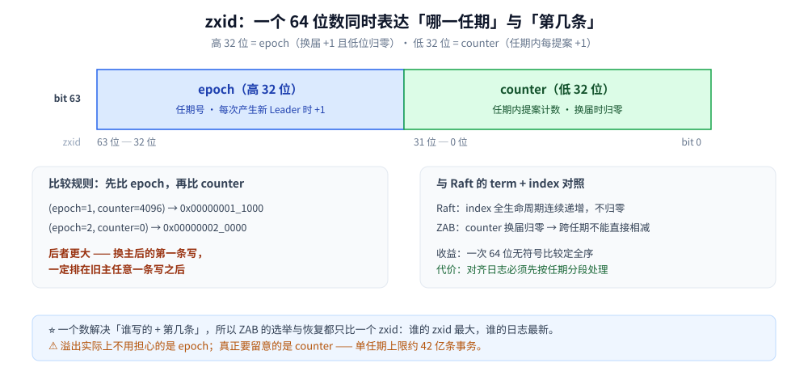
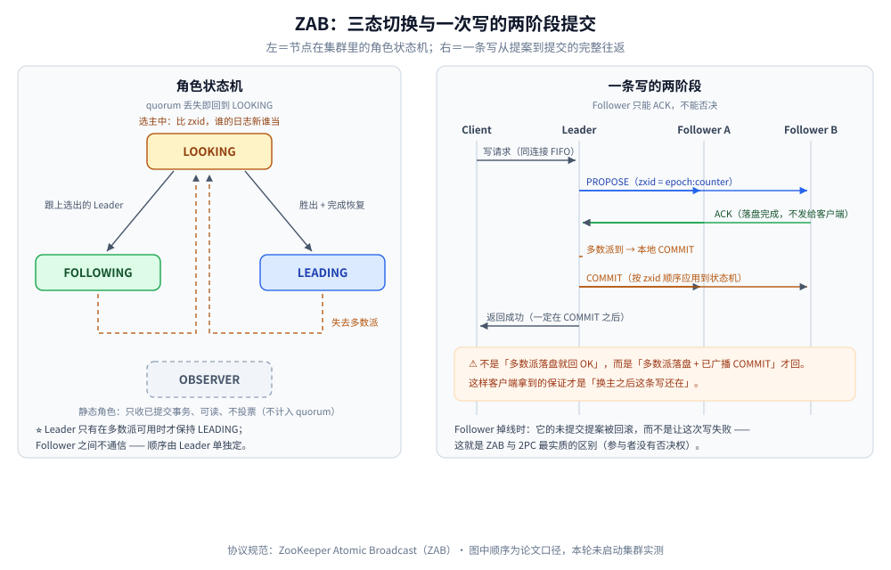
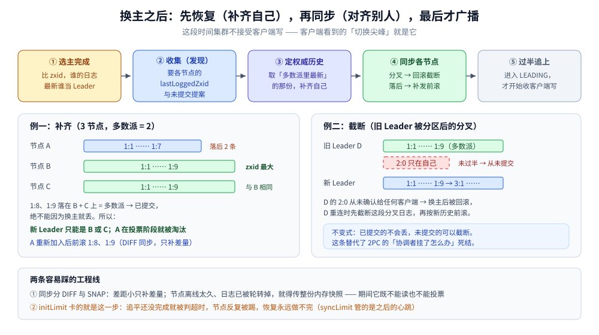

# ZAB 协议

> 覆盖：ZooKeeper 用的 ZAB —— `zxid` 的两段结构、两阶段原子广播、换主后的恢复与同步、Observer 的定位，
> 以及它与 Raft / Paxos 的逐点对照。
>
> 不覆盖：Raft 的三种角色与日志复制见 [Raft协议.md](Raft协议.md)；Paxos 的两阶段与「多数派交集」推导见
> [Paxos协议.md](Paxos协议.md)；组件层面的选型（ZooKeeper / Nacos / etcd 谁来做注册中心）见
> [分布式协调选型对比.md](../../../03-数据与中间件/中间件/分布式协调/分布式协调选型对比.md)。
>
> 内容整理自个人学习笔记，并参考 ZooKeeper 官方 ZAB 规范（见 [素材清单](../../../素材清单.md)）。
> ⚠️ 本篇是原理整理：第三节的配置项与第九节的四字命令**未在本轮启动 ZooKeeper 集群实测**，只写「该看哪个字段」，不给输出样例。

---

## 一、ZAB 解决的是「共识」还是「顺序」？

**本节要点**：ZAB 的目标不是「让一群机器对某个值达成一致」这么抽象，而是很具体的
**全序广播（total order broadcast）** —— 所有节点以**完全相同的顺序**收到同一批消息。

ZooKeeper 本质是一台**复制状态机**：内存里一棵树 + 一份按顺序执行的写请求日志。

> 只要每个节点**应用写请求的顺序相同**，初始状态又相同，那么各节点的状态必然相同。

所以 ZooKeeper 需要的共识能力只有一条：**给所有写请求定一个全序**，并且这个顺序
**不会因为换主而改变**。这就是 ZAB（ZooKeeper Atomic Broadcast）在做的事。

| 要什么 | 靠什么保证 | 坏了会怎样 |
|---|---|---|
| 同一个 leader 内的顺序 | 按 TCP 连接的 FIFO 生成提案编号 | 同一会话里的两次写可能乱序 |
| 不同 leader 之间的顺序 | `epoch` 单调递增，旧任期的编号永远比新任期小 | 旧主的写「复活」，覆盖新主已提交的值 |
| 顺序不丢 | 多数派落盘后才提交；换主时先恢复再服务 | 已确认给客户端的写在换主后消失 |

> ⭐ 这三行就是 ZAB 的全部动机。第三行最难，也是 ZAB 与 Raft 花最多篇幅的地方（第四节）。

## 二、`zxid` 为什么是一个 64 位数、还要拆成两段？

**本节要点**：`zxid` = **高 32 位 `epoch`（任期）+ 低 32 位 `counter`（任期内的提案计数）**，
一个数同时表达「谁写的」和「第几条」，所以任意两个 `zxid` 可直接比较出全序。



- **epoch**：每次产生新 leader 就 +1，并且**低位归零**；
- **counter**：同一任期内每提一条事务 +1；
- **比较规则**：先比高 32 位，高位相等再比低 32 位 —— 于是 `(2, 0)` 一定大于 `(1, 4096)`。

### 2.1 和 Raft 的 `term` + `index` 差在哪

| | ZAB | Raft |
|---|---|---|
| 任期 | `epoch`，**打包进同一个 64 位数的高 32 位** | `term`，独立字段 |
| 日志位置 | `counter`，**换届归零** | `index`，**全生命周期连续递增，不归零** |
| 「谁的日志更新」 | 比 `epoch`，再比 `counter` | 比 `term`，再比 `index`；还要看日志是否匹配 |
| 换主后对齐日志 | 先确定唯一历史，再把落后节点**前滚**、把多余节点**回滚** | 靠 `nextIndex` 回退找到匹配点，然后**强制覆盖** follower 的后续日志 |

> `counter` 归零这个设计看着省事（比较只需一条 64 位无符号比较），但代价是
> **「不同任期的日志序号没法直接相减」** —— 不能说「差 5 条要补」，必须先按任期分段。
> Raft 用连续 `index` 换来了「日志后缀可比较、可截断」的直观实现。

## 三、一次写在广播阶段怎么走？

**本节要点**：Follower 只把 ACK 发给 Leader，Leader 收到多数派 ACK 后**先广播 COMMIT、再回客户端**；
所以「客户端看到成功」时，多数派都已落盘，并且 COMMIT 决议已经广播。



```text
客户端 → Leader：按该连接的 FIFO 顺序生成提案，编号 = 下一个 zxid
Leader → Followers：PROPOSE(zxid, 变更)
Followers：本地写事务日志并落盘 → ACK(zxid)
Leader：集齐多数派 ACK → 本地 COMMIT → 广播 COMMIT(zxid)
Followers：按 zxid 顺序应用到状态机（提交阶段不再回 ACK）
Leader：把 COMMIT 结果返回客户端
```

**四个容易记错的点**：

1. **ACK 只从 Follower 发给 Leader**：Follower 之间不互相通信，这是「主备式」共识与 Paxos 式多方提案的关键差别 ——
   代价是 Leader 是写路径的单点（吞吐瓶颈），收益是**顺序由一个节点定，不必再协商**。
2. **先 COMMIT 再响应客户端**：不是「多数派落盘就回 OK」。因为客户端要的保证是
   「这条写在换主后还在」，而「还在」的含义是「多数派都知道它可以提交」。
3. **同一连接的 FIFO 是协议的一部分**：不是 TCP 的巧合。会话内顺序（同一客户端的两条写不互换）
   靠它，跨客户端的全序靠 `zxid`。
4. **客户端可以连任意节点**：连到 Follower 时写请求转发给 Leader，读在本地完成 ——
   所以「写成功后立刻从另一个 Follower 读」可能读到旧值（见 [一致性模型.md](../理论基础/一致性模型.md)）。

### 3.1 广播阶段的配置项

| 配置 | 作用 | 写错的后果 |
|---|---|---|
| `initLimit` | Follower 与 Leader **建立连接并完成同步**的时限（单位 = tickTime 的倍数） | 设太短，节点刚重启还没追平日志就被判失败 |
| `syncLimit` | 同步完成之后，Follower 与 Leader **心跳与 ACK** 的时限 | 设太短 → 网络抖动就丢 quorum；设太长 → 真挂了要等很久才切 |
| `tickTime` | 上面两个时限的时间单位基数 | 前两项是「多少个 tick」，改了 `tickTime` 等于同时改了两者 |
| `maxClientCnxns` | 单客户端 IP 的连接数上限 | 影响的是客户端侧公平性，与共识无关 |

> ⭐ 判据：**`initLimit` 按「最坏情况下追平日志要多久」定，`syncLimit` 按「能容忍多久的网络抖动」定**，
> 两个数字的来源完全不同，不能图省事写成同一个值。

## 四、换主之后为什么必须先恢复、再同步？

**本节要点**：新 Leader 上任时**不接受客户端写**，先完成**恢复（Recovery）**的两个子阶段 ——
**发现（Discovery）**：把自己的日志补成「多数派里最新的那份」；
**同步（Synchronization）**：把其他节点对齐到自己确定的历史。做完才进入广播。

> ZAB 论文把这段统称**恢复（recovery）**，内部按三步走：**选主（election）** →
> **发现（discovery）**：新 Leader 收集各节点的 `lastLoggedZxid` 与未提交提案、
> 定下权威历史并补齐自己 → **同步（synchronization）**：把其余节点对齐到这份历史。
> 下面 4.1 对应「发现」，4.2 对应「同步」。



### 4.1 恢复：谁也不能带着「已提交但没同步」的日志上岗

```text
1. 新 Leader 向各 Follower 要：它的 lastLoggedZxid + 仍处于「已收但未提交」的事务
2. 选出「日志最新」的那个版本（zxid 最大）作为权威历史
3. Leader 用这份历史补齐 / 修正自己，再据此算出每个 Follower 要回滚或补发什么
4. 只有当**多数派**完成同步，Leader 才开始服务
```

这条设计保证的是 ZAB 唯一的硬要求：**已提交的写不会因换主而丢**。
未提交的提案可以被截断 —— 它从没被确认给客户端，所以不算违约。

**三个游标别混用**（排障时最常见的看错值）：

| 游标 | 含义 | 恢复时用它干什么 |
|---|---|---|
| `lastLoggedZxid` | 最后一条**已落盘**日志的 zxid（可能尚未提交） | 发现阶段收集的就是它，用来判「谁的日志最新」 |
| `lastCommittedZxid` | 最后一个**已提交**事务的 zxid | 划出「绝不能回滚」的边界 |
| `lastProcessedZxid` | 最后一条**已应用到内存**的 zxid | 本机重启后的重放进度；不用于决定 Leader 从哪补发 |

> 与 Raft 同源的那一条规则：**能当 Leader 的节点，日志必须不旧于多数派**。
> ZAB 在选举阶段就用 `zxid` 比较，Raft 用投票时的 `lastLogTerm / lastLogIndex` 限制。
> 展开见 [Raft协议.md](Raft协议.md) 的投票限制一节。

### 4.2 同步：落后就前滚，分叉就回滚

| 节点状态 | Leader 怎么处理 | 客户端感知 |
|---|---|---|
| 日志比权威历史**落后** | 从它的 `lastLoggedZxid` 之后**补发**缺失事务 | 无感，只是它这段时间不能提供一致读 |
| 日志里有**权威历史中没有**的提案 | **回滚（截断）**掉那段分叉日志，再前滚 | 无感 —— 这些提案从未提交 |
| 同步超时（超过 `initLimit`） | 踢出集群，重新加入时走完整恢复 | 若因此不足多数派，集群**整体不可写** |

> ⚠️ 「Follower 掉线后重连」和「新节点首次加入」是两条路径：
> 前者可能只需要补一小段增量（DIFF / TRUNC），后者要传**整份内存快照**（SNAP）。
> 一个长期掉线、日志差距太大的节点，往往会退化成 SNAP —— 这就是「别把节点关机太久再拉回来」的原因。

## 五、Observer 为什么不投票？

**本节要点**：Observer **把写请求转发给 Leader、只接收已提交事务，不参与投票也不回 ACK**；
它换来的是「读扩展 + 跨地域部署」，代价是**它不参与安全性决策** ——
挂掉几个 Observer 不影响可用性判定，但加多少个 Observer 也**不会**让集群更能容忍 Participant 故障。

| | Participant（Leader / Follower） | Observer |
|---|---|---|
| 投票（选主） | ✅ 计入 quorum | ❌ 不计入 |
| 提案 ACK | ✅ | ❌（只收已提交的 COMMIT） |
| 提供读 | ✅ | ✅ |
| 转发写 | — | ✅ 转给 Leader |
| 是否影响 `N/2+1` | ✅ 增加 `N` 就抬高 quorum | ❌ 加多少个都不改变 quorum 大小 |
| 典型用途 | 同城多数派 | 异地只读扩展、提高读吞吐 |

> ⭐ 一句话记住：**Observer 扩的是读，不是容错**。
> 想让集群多容忍一台，只能加 Participant（并把 `N` 变成更大的奇数）。

与 Raft 一侧的对照：etcd 的 **learner** 是同一类角色 —— 同步日志、可读、不计入 quorum。
MongoDB 的 hidden 成员（`votes=0` 时）与 Kafka 的 follower 副本只做数据冗余，
它们没有「定序权」这个概念，不要拿来类比成 ZAB 的投票者。

## 六、ZAB 与 Raft / Paxos 是同一件事的三种写法吗？

**本节要点**：把 Multi-Paxos 算进来时，**能力等价（都能做全序广播 / 状态机复制），设计目标不同**。
把它们排成一条线：Paxos 证明「多数派交集就够了」，Multi-Paxos 与 ZAB 都改成「一个 Leader + 顺序日志」，
Raft 再把这件事拆成三个可以分别讲清楚的子问题。

| 维度 | Basic Paxos | ZAB | Raft |
|---|---|---|---|
| 原始目标 | 单值共识的形式化证明 | 为 ZooKeeper 的**崩溃恢复**定制 | **可理解性**优先 |
| 是否有稳定 Leader | ❌（提案者可以多个） | ✅ | ✅ |
| 定序方式 | 提案编号（`ballot`, `seq`） | `zxid`（epoch + counter） | `term` + `index` |
| 换主后的日志对齐 | 由「继承已批准值」的规则保证 | 恢复阶段显式补齐 / 回滚 | `nextIndex` 回退后强制覆盖 |
| 成员变更 | 需另加一层（如 Multi-Paxos + 联合共识） | 特殊广播：暂停新请求 → 提交在途 → 新 epoch | 联合共识 / 单节点两步变更 |
| 读优化 | 无（协议不管读） | 可读 Follower，但默认非线性一致 | ReadIndex / LeaseRead |

> ⚠️ 「ZAB 是 Paxos 的变体」这句要谨慎讲。
> 准确的说法是：**ZAB 与 Multi-Paxos 属于同一个思路**（先选主、再按顺序提日志），
> 但 **ZAB 的恢复阶段设计是自己的** —— 论文里明确说它不是 Paxos 的直接实现。
> 对照见 [Paxos协议.md](Paxos协议.md) 的 Multi-Paxos 一节。

## 七、成员变更为什么要「新旧多数派有交集」？

**本节要点**：任何时刻只能有**一个**被多数派支持的配置在提交，靠的是
**旧配置的多数派与新配置的多数派必然相交** —— 交集里那个节点同时知道两边的状态。

ZooKeeper 把换配置实现成一次**特殊的广播**：Leader **暂停接收新请求 → 等在途提案全部提交 →
以新配置开启新 `epoch`**。它够用是因为 ZooKeeper 的运维模式本就是「一次改一个集群」，
代价是**变更窗口内不接受写**。早期版本靠「逐台重启」完成，3.5 起才提供动态 reconfig
（既可整组替换，也可逐台变更）。

| 做法 | 谁用 | 代价 |
|---|---|---|
| 暂停接收新请求再换配置 | ZooKeeper（特殊广播） | 变更窗口内整体不可写 |
| 联合共识（`C_old ∪ C_new` 都要多数派） | Raft 论文原版 | 过渡期要维护两套 quorum |
| 一次只改一个节点 | etcd / TiKV 等工程实现 | 只能逐台滚，改大配置很慢 |

> 判据与 Paxos 完全同源：**两个多数派必相交**。
> 这也是「节点数要取奇数」和「跨可用区要算清楚哪个 AZ 掉线后仍过半」的根因，
> 见 [集群基础.md](../集群基础.md) 第四节与 [故障模型与分布式谬误.md](../理论基础/故障模型与分布式谬误.md) 第五节。

## 八、应用场景

**本节要点**：ZAB 出现在「已经装了 ZooKeeper 的地方」—— 它不是一个可以独立选择的库，
而是 ZooKeeper 的内部机制。工程上真正会遇到的三个问题：**它在哪、要不要继续用、换掉的理由是什么**。

| 落点 | ZAB 在其中的角色 | 本仓对应篇目 |
|---|---|---|
| Kafka（旧版本） | Broker 注册、Controller 选举、ISR 与 topic 元数据的权威副本 | [核心概念与架构.md](../../../03-数据与中间件/中间件/消息队列/Kafka/核心概念与架构.md) |
| Dubbo / 服务治理 | 注册中心的服务列表与临时节点（会话断开即摘除） | [中间件选型.md](../../../03-数据与中间件/中间件/中间件选型.md) |
| HBase / 各类选主 | RegionServer 存活判定、Master 选举 | [集群基础.md](../集群基础.md) 第五节 |
| Nacos 的 AP / CP 分档 | 它的 CP 模式（持久实例）走的就是 Raft 系协议，不是 ZAB | [Nacos.md](../../../03-数据与中间件/中间件/注册与配置中心/Nacos.md) |
| Kafka KRaft | **把 ZAB 换成 Raft** 的那次迁移：不再依赖 ZK，元数据日志直接走 Raft | [核心概念与架构.md](../../../03-数据与中间件/中间件/消息队列/Kafka/核心概念与架构.md) |

> **换成 Raft 的真实理由**（不是「Raft 更先进」这种空话）：
> ZooKeeper 的对外模型是「一棵树 + 会话 + Watch」，而 Kafka 要的只是「一份可追加的元数据日志」。
> 用一个状态机模型去承载另一个状态机模型，中间只能靠一堆映射代码缝合 —— 换成日志型的 Raft，
> 元数据就是日志本身。这与 [分区与再平衡.md](../数据分布/分区与再平衡.md) 里「元数据也是要迁移的状态」是同一类问题。

## 九、具体使用

**本节要点**：三节点最小配置 + 两个观测点（**谁在什么角色**、**它处理到哪个 `zxid`**）。
以下配置与命令为语义示例，**本轮未启动集群实测**。

### 9.1 三节点最小配置

```ini
# zoo.cfg（三个节点内容一致，只有 server.N 后面的编号不同）
tickTime=2000
initLimit=10
syncLimit=5
dataDir=/var/lib/zookeeper
clientPort=2181
maxClientCnxns=60
# 集群地址：Participant 都写在这里；Observer 追加 `:observer` 后缀，并在它自己的配置里设 peerType=observer
server.1=zk-1:2888:3888
server.2=zk-2:2888:3888
server.3=zk-3:2888:3888
```

```text
# 每个节点 dataDir 下写自己的编号，文件名固定 myid，内容就是一个数字
/data/zk1/myid -> 1
/data/zk2/myid -> 2
/data/zk3/myid -> 3
```

`myid` 必须与 `server.N` 的 `N` 对得上；对不上时节点会拒绝加入 quorum，
这是新手最常见的「集群起不来但配置看着没错」的原因。

### 9.2 观测：角色与日志位置

| 要看什么 | 看哪里 | 判据 |
|---|---|---|
| 当前角色 | `zkServer.sh status` 的 `Mode:` | `leader` / `follower` / `observer`；出现 `looking` 说明还在选主 |
| 已处理进度 | `srvr`（或 `stat`）的 `Zxid:` | 形如 `0x100000001` 的 64 位数（高 32 位 = epoch、低 32 位 = counter），**同一时刻多数派应相近** |
| 落后是否追上 | 对比各节点 `srvr` 的 `Zxid:` 与 Leader 的差 | 差值长期不缩小 = 同步卡住，先查 `initLimit` / `syncLimit` 与网络 |
| 是否过半 | `zk_synced_followers`（Leader 侧） | 3 节点集群该值应为 2；掉到 1 仍满足多数派（Leader + 1），**掉到 0 才写不进去** |
| 客户端 `sync()` 积压 | `zk_pending_syncs`（`mntr`） | 长期非 0 说明 `sync()` 请求在排队；它是客户端请求，**不是** Follower 追日志的进度 |
| 会话与写延迟 | `zk_avg_latency` / `zk_max_latency` | 换主后出现一个尖峰属正常（恢复 + 同步期间不接受写） |

```bash
# 四字命令默认可能被白名单限制，需要在 zoo.cfg 里放行 4lw.commands.whitelist
echo mntr | nc 127.0.0.1 2181
echo srvr | nc 127.0.0.1 2181   # 只看角色与 Zxid 两行，排障时最快
```

> ⚠️ **不要在 Leader 上测「读一定读到刚写的值」**：Follower 读不保证线性一致，
> 写返回成功后立刻读 Follower，可能读到旧值 —— 这正是
> [一致性模型.md](../理论基础/一致性模型.md) 里「读己之写」的会话保证问题，
> 不是 ZAB 的 bug。

---

## 延伸追问

- **ZAB 和 2PC 有什么区别？** → 形似而神不同。都是「先问一圈再定」，
  但 2PC 的参与者**可以否决**（回滚），ZAB 的 Follower **不能否决已收到提案**，只能 ACK 或掉线；
  掉线的代价是被回滚，而不是让这次写失败。这让它不需要「协调者挂了阻塞」那个死结 —— 见 [2PC与3PC.md](../分布式事务/2PC与3PC.md)。
- **为什么 ZAB 要求节点数取奇数？** → 不是为了「好看」。偶数时可能裂成两个对等的一半，
  两边都不过半 → **全不可写**；奇数时任何对半分都必有一侧过半。见 [集群基础.md](../集群基础.md)。
- **Observer 挂了会影响写吗？** → 不会。它不计入 quorum；但 Observer 数量多到占据连接与转发带宽时，
  Leader 的写吞吐会实际下降 —— 「不影响安全性」不等于「不影响性能」。
- **`epoch` 32 位会溢出吗？** → 理论上会：按每毫秒换一次主算，要连续换约 **50 天**（`2^32` 毫秒）才用完，
  真实系统在此之前早已经历过多次重启。工程上更该关心的是 **counter 溢出会让单任期最多约 42 亿条事务**。
- **ZAB 能保证读也是线性一致的吗？** → 默认不。Follower 读可能读到旧值；
  要「读到自己刚写的值」得走 Leader，或先调客户端的 `sync(path, cb, ctx)` 让该连接所在的服务器追上 Leader，
  代价是 Leader 单点承压、`sync` 本身也要一次往返。
- **为什么 Kafka 要弃用 ZooKeeper？** → 不是因为 ZAB 不好，而是**元数据模型错配**：
  ZAB 复制的是「状态机的变更」，Kafka 想要的是「一份可追加的日志」。见第八节末段。

## 关联

- **上游/同层**：[Raft协议.md](Raft协议.md) — 同为「先选主再顺序写日志」，看恢复阶段的两种做法
- **上游/同层**：[Paxos协议.md](Paxos协议.md) — Multi-Paxos 是 ZAB 思路的来源，多数派交集是共同的根
- **对照/互补**：[Gossip协议.md](Gossip协议.md) — 放弃多数派、换可用性的另一条路线
- **下游机制**：[一致性模型.md](../理论基础/一致性模型.md) — Follower 读到旧值属于哪一类一致性问题
- **下游机制**：[集群基础.md](../集群基础.md) — 故障转移四步（判定 / 选主 / 脑裂 / 旧主回归）的通用版
- **下游机制**：[复制与Quorum.md](../数据分布/复制与Quorum.md) — `W + R > N` 与多数派提交的算术
- **下游机制**：[故障模型与分布式谬误.md](../理论基础/故障模型与分布式谬误.md) — `syncLimit` 之所以是两难的原因
- **组件侧**：[Nacos.md](../../../03-数据与中间件/中间件/注册与配置中心/Nacos.md) — 五种注册中心横评里 ZAB 所在的那一列（会话与 Watch 的压力来源）
- **组件侧**：[分布式协调选型对比.md](../../../03-数据与中间件/中间件/分布式协调/分布式协调选型对比.md) — ZooKeeper / etcd / Nacos 的协议与语义差异
- **组件侧**：[核心概念与架构.md](../../../03-数据与中间件/中间件/消息队列/Kafka/核心概念与架构.md) — ZAB 与 KRaft 两次选型的具体代价
