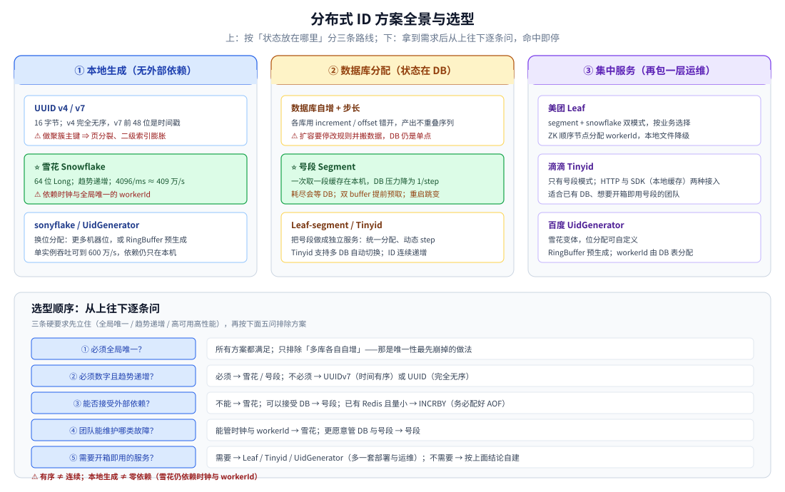

# 分布式ID

> 覆盖：分库分表之后主键怎么生成——三条硬要求、方案全景与代价对照、选型顺序、生产底线，以及本目录两篇深入篇的阅读入口。
>
> 不覆盖：雪花的位结构、时钟回拨、workerId 与语言实现见 [雪花算法.md](雪花算法.md)；数据库号段、双 buffer 与 Leaf 见 [号段模式与Leaf.md](号段模式与Leaf.md)；分片键与路由见 [分表与路由.md](../../../03-数据与中间件/数据存储/关系型/MySQL/分表与路由.md)。
>
> 内容整理自个人学习笔记，并参考《大型网站技术架构：核心原理与案例分析》（李智慧）。素材见 [素材清单.md](../../../素材清单.md)。

---

## 一、为什么单库自增不够？

**本节要点**：`AUTO_INCREMENT` 只在一个数据库内核里成立；一旦数据被拆到多个库、多张表，唯一性、有序性与可用性会同时被打破。

单机时代自增主键简单、连续、索引友好；分库分表之后，每个库都从 1 开始，问题才暴露：

| 问题 | 具体表现 |
|---|---|
| **多库会冲突** | `user_0` 与 `user_1` 都生成 `id=1`，合并后不再唯一 |
| **写入前拿不到 ID** | 必须先 INSERT 才能拿到库返回的主键，明细行、消息、缓存 key 无法提前写入 |
| **单库成为写瓶颈与单点** | 所有写请求都等同一个库分配 ID，主库故障会拖住整条写链路 |
| **连续 ID 可被遍历** | `/order/10001`、`/order/10002` 能被顺序爬取，还会暴露业务量 |
| **扩容要改规则** | 数据库步长法从 2 库扩到 3 库，要改 `auto_increment_increment` 与 offset，通常还要搬数据 |

> 分布式 ID 生成器就是为了把「分配唯一编号」这件事，从单个数据库内核里拿出来，变成可水平扩展、可在写入前调用的基础能力。

## 二、三条硬要求是什么？

**本节要点**：全局唯一是底线，趋势递增决定 InnoDB 的写入形态，高可用高性能决定它不能成为新的单点。

| 要求 | 为什么 | 不达标的代价 |
|---|---|---|
| ⭐ **全局唯一** | 主键的底线 | 主键冲突、数据覆盖、分表路由错乱 |
| ⭐ **趋势递增** | InnoDB 主键是聚簇索引，B+ 树按主键有序组织；递增写入只在最右页追加 | 无序写入触发随机 IO、页分裂，吞吐下降、碎片增加 |
| ⭐ **高可用高性能** | ID 生成位于所有写请求的主链路上 | 生成器抖动一次，全站写入一起抖动 |

在此之上才是「理想特性」：同一节点内单调递增（便于增量拉取）、含时间信息（可反解生成时刻）、不泄露业务量、长度短（索引占用小）。这些特性彼此冲突，选型就是在它们之间取舍。

## 三、有哪些方案，各自代价是什么？

**本节要点**：方案没有绝对优劣，差别集中在三处——是否依赖外部组件、是否有序、以及故障时是「继续发号」还是「直接拒绝」。

| 方案 | ID 形态 | 有序性 | 吞吐上限 | 依赖组件 | 主要缺点 | 适用场景 |
|---|---|---|---|---|---|---|
| ⭐ **雪花 Snowflake** | 64 位 Long | 趋势递增、单节点单调 | 单节点 4096/ms ≈ 409 万/s | 无（纯内存），只需分配 workerId | 依赖时钟，回拨会重号；workerId 易冲突 | 大规模、要求趋势递增的主链路 |
| **UUID v4** | 36 字符串 / 16 字节 | 完全无序 | 本地生成无上限 | 无 | 做主键导致页分裂；16 字节让二级索引膨胀 | 允许无序的非主键（traceId、临时凭证） |
| **UUID v7** | 36 字符串（前 48 位为时间戳） | 时间有序 | 本地生成无上限 | 无 | 仍 16 字节，索引比 BIGINT 大 | 要「本地生成 + 有序 + 无需 workerId」 |
| **数据库自增 + 步长** | Long（递增不连续） | 递增 | 受单库写能力限制，几千/s | MySQL | 扩容要停机改步长并搬数据；DB 单点 | 小系统、库数量固定 |
| **数据库号段（Segment）** | Long（连续号段） | 递增 | 号段长度 × 取号 QPS，百万级 | MySQL + 本地缓存 | 号段耗尽瞬间阻塞；重启后 ID 跳变 | 中小规模、不想处理时钟问题 |
| **Redis INCR / INCRBY** | Long | 递增 | 单 key 5~10 万/s（批量更高） | Redis | 持久化没配好会重发号；Redis 不可用即阻塞 | 已有 Redis 集群、量不大 |
| **美团 Leaf** | Long（segment / snowflake 双模式） | 递增 / 趋势递增 | 号段模式十万级 | Leaf Server + MySQL + ZK | 需独立部署运维一套服务 | 想直接用成熟开源方案 |
| **百度 UidGenerator** | Long（位分配可配） | 趋势递增 | 600 万/s（RingBuffer 预生成） | MySQL + ZK（可选） | 依赖较重，自定义位分配要慎用 | 超高吞吐 |
| **滴滴 Tinyid** | Long（号段） | 递增 | 号段模式，可水平扩展 | Tinyid Server + MySQL | 只有号段模式、无雪花 | 号段方案要开箱即用 |



**图怎么读**：先看三条路线——本地生成（UUID / 雪花）不依赖外部组件，数据库分配（自增 / 号段）把状态放在 DB，集中服务（Leaf / Tinyid / UidGenerator）再包一层运维接口；选型时从「要不要数字、要不要有序、能不能运维 workerId 或 DB」逐条往下问。

### 3.1 UUID 与 UUIDv7

- **v4**：122 位随机数，本地生成、零协调、天然全球唯一。
- ⚠️ **无序是致命伤**：作为聚簇主键时落点随机，B+ 树频繁页分裂、碎片多；每个二级索引都要存一份 16 字节主键，索引体积暴涨。
- **v7**：把 **48 位毫秒时间戳放在最高位**，跨毫秒有序，解决页分裂（MySQL 8.4 内置 `UUID_V7()`）；折中做法是「对外用 UUID、对内有 BIGINT 主键」，UUID 只作业务标识列 + 唯一索引。

### 3.2 数据库自增与号段

数据库自增分两种：单点自增和「多库步长错开」。单点自增靠一张只有一行的表取号：

```sql
-- id_gen: id BIGINT AUTO_INCREMENT PRIMARY KEY + stub CHAR(1) UNIQUE
REPLACE INTO id_gen (stub) VALUES ('a');  -- REPLACE 保证表里始终只有一行
SELECT LAST_INSERT_ID();                  -- 拿到本次分配的 ID
```

步长法用 `auto_increment_increment` 与 `auto_increment_offset` 让各库产出不重叠的序列（2 个库设 increment=2、offset 分别 1 和 2 → 产出 1,3,5 与 2,4,6），但扩容要改规则并搬数据，DB 仍是单点瓶颈与单点故障。

号段模式把「一次取一个」改成「一次取一段」：本机缓存 `[max_id-step+1, max_id]`，用完再取，DB 压力被 `step` 摊薄。代价是号段耗尽时会同步等 DB、重启会丢弃未用完的号段。完整机制、双 buffer 与 Leaf 的落地见 [号段模式与Leaf.md](号段模式与Leaf.md)。

### 3.3 Redis INCR / INCRBY

```bash
INCR   global:order:id        # 每次取一个：一次网络往返换一个号
INCRBY global:order:id 1000   # 一次取 1000：退化为「号段模式」，本地分配
```

`INCR` 是单线程原子操作，天然无并发冲突。⚠️ **持久化必须配好**：RDB 是分钟级快照，宕机丢一大段后重启会从旧值继续发号，导致 ID 重复；AOF `everysec` 仍可能丢 1 秒，同样会重复。要么 `appendfsync always`，要么启动后用 `INCRBY` 跳一段安全距离；同时需要哨兵 / Cluster 保证高可用，并考虑主从切换期间的数据丢失。

### 3.4 雪花与成熟实现

雪花是纯内存位运算，不依赖任何中间件，吞吐与有序性都最好；代价是必须管理 workerId 与时钟。位结构、回拨处理与 Go / Java 写法见 [雪花算法.md](雪花算法.md)。

成熟实现可以省掉自建成本，但要接受多一套部署与运维：

| 项目 | 模式 | 要点 |
|---|---|---|
| **美团 Leaf** | segment + snowflake 双模式 | 号段模式用 DB + 双 buffer；雪花模式靠 ZK 顺序节点自动分配 workerId（本地缓存 `workerID` 文件降级），并做时钟回拨告警 |
| **百度 UidGenerator** | snowflake 变体 | 位分配可自定义；用 RingBuffer 预生成缓存 ID，单实例约 600 万/s；workerId 默认由 DB `WORKER_NODE` 表分配 |
| **滴滴 Tinyid** | segment（双 buffer） | 支持多 DB（`tinyid.primary.db` / `secondary.db`）自动切换；提供 HTTP 与 SDK（本地缓存）两种接入 |

## 四、怎么选？

**本节要点**：先问业务是否真的需要「数字 + 有序」，再问团队愿意维护哪一类故障——时钟与 workerId，还是数据库与号段。

### 4.1 决策清单

| 你的情况 | 建议 |
|---|---|
| 小规模、允许无序（内部后台、日志追踪） | **UUID** 对外标识；主键可用 UUIDv7 |
| 中小规模、要数字、想简单、不想处理时钟 | **号段模式**（DB + 双 buffer，或直接用 Tinyid） |
| 大规模、要求趋势递增、能运维 workerId | ⭐ **雪花算法**（自建或 Leaf-snowflake） |
| 已有 Redis 集群且量不大 / 不想自建 | `INCRBY` 批量取号（务必配好 AOF）/ Leaf / Tinyid / UidGenerator |

> ⭐ 决策口诀：**要数字 + 趋势递增 + 高吞吐 → 雪花；不想管时钟和 workerId → 号段；不在意顺序 → UUID。**

### 4.2 推荐判断顺序

1. **是否必须全局唯一**：所有方案都满足，只排除「多库各自自增」。
2. **是否必须数字且趋势递增**：必须 → 雪花 / 号段；不必须 → UUIDv7 或 UUID。
3. **能否接受外部依赖**：不想依赖 DB / Redis → 雪花；可以接受 DB → 号段；已有 Redis 且量小 → INCRBY。
4. **团队能维护哪类故障**：能管时钟与 workerId → 雪花；更愿意管 DB 与号段 → 号段。
5. **是否需要开箱即用的运维界面**：需要 → Leaf / Tinyid / UidGenerator；不需要 → 自建。

### 4.3 三条容易踩的判据

- **「有序」不等于「连续」**：雪花趋势递增但同毫秒内按 workerId 定序，号段连续但重启会跳变；不要把连续当成唯一性之外的需求。
- **「本地生成」不等于「零依赖」**：雪花不依赖中间件，但依赖时钟与 workerId 分配；这两样坏了同样会重号。
- **「高吞吐」不等于「业务需要」**：409 万/s 远超大多数业务，先确认 DB、网络与下游能承受同样的量级。

## 五、本目录怎么读？

```text
① README.md（本篇）        ← 问题域、方案全景、选型与生产底线
        ↓
② 雪花算法.md              ← 位结构、时钟回拨、workerId、JS 精度、Go / Java 实现
        ↓
③ 号段模式与Leaf.md        ← 号段取号、双 buffer、Leaf 双模式与表设计
```

| 想解决 | 先读 | 再读 |
|---|---|---|
| 判断该不该引入分布式 ID | 本篇第一、二节 | 本篇第四节 |
| 在雪花与号段之间选 | 本篇第四节 | [雪花算法.md](雪花算法.md)、[号段模式与Leaf.md](号段模式与Leaf.md) |
| 排查雪花重号 / 回拨 | [雪花算法.md](雪花算法.md) 第三节 | 本篇第七节 |
| 号段耗尽导致 RT 尖刺 | [号段模式与Leaf.md](号段模式与Leaf.md) 第三节 | 本篇第七节 |
| 直接用 Leaf / Tinyid | [号段模式与Leaf.md](号段模式与Leaf.md) 第四节 | [中间件选型.md](../../../03-数据与中间件/中间件/中间件选型.md) |
| ID 与分片键一起设计 | 本篇第七节 | [分表与路由.md](../../../03-数据与中间件/数据存储/关系型/MySQL/分表与路由.md) |

## 六、应用场景

| 场景 | 首选方案 | 为什么 |
|---|---|---|
| 订单、支付、库存等核心写链路 | 雪花 / Leaf-snowflake | 写入前就要拿到 ID，要求趋势递增与高吞吐 |
| 分库分表后的业务主键 | 雪花或号段 | 必须全局唯一；分片键还要不可变 |
| 中小系统、团队不想维护时钟 | 号段 / Tinyid | 不依赖时钟，DB 压力被 step 摊薄 |
| 日志 traceId、临时凭证 | UUID / UUIDv7 | 允许无序，本地生成最省事 |
| 已有 Redis 且写入量不大 | INCRBY 批量取号 | 复用现有组件，注意持久化 |
| 需要开箱即用的 ID 服务 | Leaf / Tinyid / UidGenerator | 自带 workerId 分配、监控与运维接口 |

## 七、生产上还要守哪些底线？

**本节要点**：方案选对只是一半，另一半是 workerId、分片键、序列化、字段类型与监控这些「选型之后才会爆」的问题。

| 坑 | 说明与应对 |
|---|---|
| **⚠️ 容器环境 workerId 冲突（高频）** | Deployment 所有 Pod 环境一致，走 IP 哈希就可能撞号。对策：StatefulSet 取 Pod 序号 / ZK 顺序节点 / 启动向 DB 申请并落库，并在启动时做一次占用自检 |
| **⚠️ ID 作分片键的热点** | `id % N` 分布均匀（低位是 workerId + 序列）；若按时间高位分片（`(id >> 22) % N`），同一时间窗全落一个分片，形成写热点。分片位应取自低位，或用基因法把分表位编进 ID 低位 |
| **ID 与时间换算** | `timestamp = epoch + (id >> 22)`；反过来可由时间范围算出 ID 区间，用于按时间范围分页扫描 |
| **⚠️ ID 泄露业务量** | 连续 ID 可被遍历、可推算日单量。对策：对外再映射一层（内部 BIGINT → 哈希 / 加密字符串），或对外直接用 UUID |
| **⚠️ 测试环境与生产冲突** | 测试库同步了生产数据、两边各用一套 workerId → 合并时主键冲突。对策：epoch 错开 + workerId 段隔离（生产 0~511、测试 512~1023） |
| **生成器可用性监控** | 号段模式 DB 挂了还能撑一段；雪花模式纯本地，唯一外部依赖是时钟与 workerId。都要监控回拨次数、号段耗尽次数与 QPS |
| **字段类型 / 批量插入** | 雪花 ID 远超 `INT` 上限，MySQL 必须是 `BIGINT`；批量 INSERT 前先一次性生成 ID 列表，别在循环里反复取号 |
| **返回前端的精度** | 64 位 ID 超过 JS 的安全整数范围，必须序列化成字符串，见 [雪花算法.md](雪花算法.md) 第五节 |

## 延伸追问

- **分布式 ID 的三条硬要求是什么？** → 全局唯一、趋势递增、高可用高性能；前者是正确性底线，后两者分别决定索引写入形态与链路可用性。
- **为什么 UUID 不适合做数据库主键？** → 无序会导致聚簇索引频繁页分裂、随机 IO 与碎片；16 字节还会让二级索引膨胀。要用就选 UUIDv7，或只做业务标识列、主键仍用 BIGINT。
- **雪花与号段怎么选？** → 要纯本地、高吞吐、趋势递增，且能管理 workerId 与时钟 → 雪花；不想处理时钟、能接受 DB 依赖与号段耗尽 → 号段。
- **Redis INCR 能直接当 ID 生成器吗？** → 能，但必须解决持久化丢号与高可用问题；批量 `INCRBY` 本质上就是号段模式。
- **数据库自增 + 步长法有什么缺点？** → 扩容要改 `increment` / `offset`，通常需要停机 + 数据搬迁；DB 是单点瓶颈与单点故障；ID 连续、易被遍历。
- **为什么需要「趋势递增」而不是「严格递增」？** → 聚簇索引只要求写入大致有序以减少页分裂；严格全局递增需要额外协调，代价远高于收益。
- **ID 生成器要不要做成独立服务？** → 本地库（雪花）延迟最低；号段可以库内实现，也可以像 Leaf / Tinyid 一样集中部署，换取统一分配与运维界面。

## 关联

- **上游/总纲**：[分布式与微服务.md](../分布式与微服务.md) — 拆分之后为什么会出现全局 ID 问题
- **下游深入**：[雪花算法.md](雪花算法.md) — 位结构、时钟回拨、workerId 与语言实现
- **下游深入**：[号段模式与Leaf.md](号段模式与Leaf.md) — 数据库号段、双 buffer 与 Leaf 双模式
- **对照/互补**：[分表与路由.md](../../../03-数据与中间件/数据存储/关系型/MySQL/分表与路由.md) — 分片键与 ID 生成必须一起设计
- **对照/互补**：[数据建模.md](../../../03-数据与中间件/数据存储/关系型/MySQL/数据建模.md) — BIGINT 与时间列的口径
- **基础概念**：[集群基础.md](../集群基础.md) — 多节点下的唯一性与单点故障
- **基础概念**：[一致性模型.md](../理论基础/一致性模型.md) — 为什么本地 ID 生成敢不加锁

> 反向引用（本篇被下列文档引到）：[中间件选型.md](../../../03-数据与中间件/中间件/中间件选型.md)、[xxl-job.md](../../../03-数据与中间件/中间件/任务调度/xxl-job.md)、[分布式协调选型对比.md](../../../03-数据与中间件/中间件/分布式协调/分布式协调选型对比.md)、[缓存应用场景.md](../../../03-数据与中间件/数据存储/缓存/缓存应用场景.md)、[分布式与微服务.md](../分布式与微服务.md)、[集群基础.md](../集群基础.md)、[跨地域多活.md](../../系统设计/IM系统/跨地域多活.md)、[关注粉丝设计.md](../../系统设计/社交互动系统/关注粉丝设计.md)、[朋友圈骨架.md](../../系统设计/社交互动系统/朋友圈骨架.md)、[订单系统设计.md](../../系统设计/秒杀系统/订单系统设计.md)
