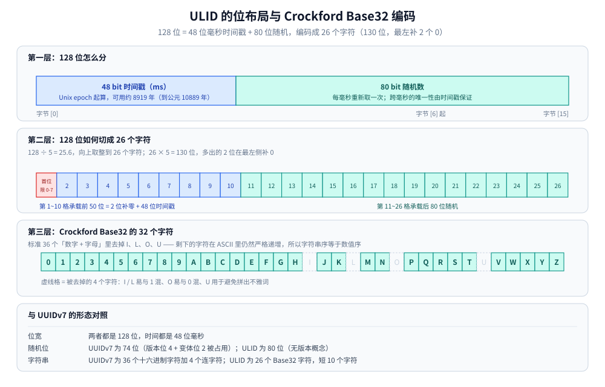
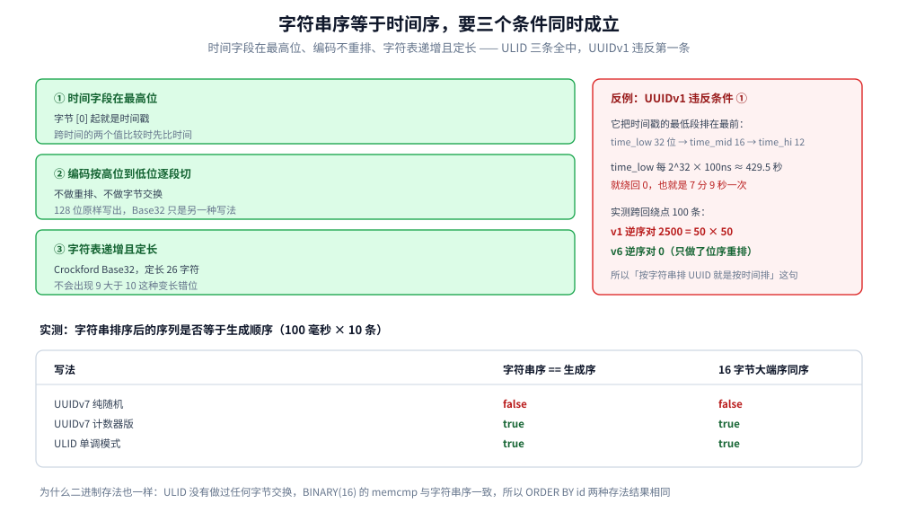

# ULID

> 覆盖：ULID 的 48 + 80 位结构、Crockford Base32 如何把 128 位压成 26 个字符、为什么字符串排序就等于时间排序、单调模式与 80 位随机耗尽的实测、与 UUIDv7 的逐项对照、落地时的坑。
>
> 不覆盖：UUID 的八个版本、版本位与变体位、MySQL `BINARY(16)` 存法见 [UUID.md](UUID.md)；雪花与号段见 [雪花算法.md](雪花算法.md)、[号段模式与Leaf.md](号段模式与Leaf.md)；方案全景与选型顺序见 [README.md](README.md)。
>
> ✅ 实测口径：第 3.2 节、第 4 节的读数来自本机 `go1.26.5 windows/amd64` 位运算实验（固定种子 LCG，两遍运行逐行一致），程序在 `.workbuddy/tmp/uuid-lab/`。⚠️ 未实测：Go / Java / JS 第三方 ULID 库的 API 与行为（本机网络受限，未 `go get` 验证）；MySQL 中 `BINARY(16)` 存 ULID 的页分裂读数（Docker Desktop 未启动）。
>
> 内容整理自个人学习笔记，并参考 ULID 规范（`github.com/ulid/spec`）与 Crockford Base32 编码说明。素材见 [素材清单.md](../../../素材清单.md)。

---

## 一、ULID 想解决 UUID 的什么问题？

**本节要点**：它要的是「UUIDv4 的本地生成 + 不依赖中心节点」，同时补上 v4 缺的两样东西——**按时间可排序**和**短到能放进 URL 与日志**。

UUIDv4 有两个务实层面的缺点，与正确性无关：

| 缺点 | 具体影响 |
|---|---|
| **36 个字符太长** | 放进 URL、二维码、日志前缀、前端列表 key 都嫌臃肿；`CHAR(36)` 存进 MySQL 更胖 |
| **完全无序** | 作聚簇主键时插入点随机，页分裂与随机 IO；按 ID 分页也只能依赖额外的 `created_at` 列 |

ULID 的定位就是「把时间放最高位、再用更紧凑的字符集编码」：**128 位一个不少**，仍然是本地生成、零协调，但生成出来的值天然按时间排序，字符串还短了 10 个字符。

> 一句话概括取舍：ULID 拿 UUID 的**版本号位与变体位**（共 6 位）换成了随机位和时间编码的余量——它没有版本概念，也不区分变体，因此 128 位里 80 位全归随机。

## 二、128 位怎么摆成 26 个字符？

**本节要点**：`48 位毫秒时间戳 + 80 位随机`；编码用 Crockford Base32，`128 / 5 = 25.6`，向上取整到 **26 个字符**（130 位，最左补 2 个 0）。

### 2.1 位布局

```text
 0                    47 48                                              127
 ├──────────────────────┬────────────────────────────────────────────────────┤
 │  48 bit 时间戳(ms)   │              80 bit 随机数（crypto/rand）          │
 │   Unix epoch 起算     │                                                    │
 └──────────────────────┴────────────────────────────────────────────────────┘
```

| 段 | 位数 | 取值范围 | 说明 |
|---|---|---|---|
| **时间戳** | 48 | `2^48` ms ≈ **8919 年** | Unix 毫秒；从 1970 起算可用到约公元 10889 年 |
| **随机数** | 80 | `2^80` ≈ `1.2 × 10^24` | 每毫秒重新取一次；跨毫秒的唯一性由时间戳保证 |

对比 [UUID.md](UUID.md) 的 v7：v7 也是 48 位毫秒时间戳打头，但中间被版本位（4）和变体位（2）挖走 6 位，实际随机只有 74 位；ULID 是 80 位。



**图怎么读**：第一层看「时间在最高位」，这决定了它能按时间排序；第二层看 26 个格子——第 1~10 格承载前 50 位（2 位补零 + 48 位时间戳），所以只看前 10 个字符就能反解出毫秒时间戳；第三层看字母表里那 4 个虚线格，去掉它们之后剩下的字符在 ASCII 里仍然严格递增，这才是「字符串排序等于时间排序」的根据。

### 2.2 编码：26 个字符怎么来的

Crockford Base32 每字符表示 5 位，`128 ÷ 5 = 25.6`，所以需要 26 个字符；`26 × 5 = 130` 位，比 128 位多出 2 位，**在最左侧补 0**。

由此得到一条硬判据：**合法 ULID 的第一个字符只能是 `0`~`7`**（前 2 位恒为 0，第一个字符只剩 3 位有效）。看到 `8`/`9`/`A` 开头就说明越界或数据有问题。

```text
26 字符 × 5 位 = 130 位
┌──┬────────────────────────────────────────────────────────────┐
│00│                    128 位 ULID                              │
└──┴────────────────────────────────────────────────────────────┘
 ↑ 补的 2 位 0
```

实测（当前毫秒时间戳渲染出来的值）：

```text
=== E. ULID Crockford Base32 编码 ===
示例 ULID             : 01HF7YAT00Z0VR51AMTRDTC4GN
字符数                : 26
前 10 位（时间戳部分）: 01HF7YAT00
1000 条往返编解码不一致数 : 0
字母表                : 0123456789ABCDEFGHJKMNPQRSTVWXYZ
```

26 个字符里，前 10 个字符正好承载 50 位（48 位时间戳 + 2 位补零），所以**只看前 10 个字符就能反解出毫秒时间戳**。

### 2.3 Crockford Base32 的字母表为什么缺了四个字母

`0123456789ABCDEFGHJKMNPQRSTVWXYZ` 只有 32 个字符，比标准 36 进制少了 `I`、`L`、`O`、`U`：

| 去掉 | 原因 |
|---|---|
| `I`、`L` | 容易与数字 `1` 混淆 |
| `O` | 容易与数字 `0` 混淆 |
| `U` | 避免随机组合拼出不雅单词 |

关键性质：**去掉这四个字母后，剩下的字符在 ASCII 里仍然是严格递增的**（`0`<`1`<…<`9`<`A`<`B`<…<`Z`）。这一条直接决定了第 3 节「字符串排序就等于时间排序」。

> Crockford 规范还允许**宽容解码**：把 `I`/`L` 读成 `1`、`O` 读成 `0`，大小写不敏感。这对手工抄写、人工输入的场景很有用，但不要依赖它在程序间传值。

## 三、为什么字符串排序就等于时间排序？

**本节要点**：时间戳在最高位、编码从高位往低位切、字符集自身递增——三个条件同时成立，字典序才会与数值序一致。

字符串序 == 时间序需要三个条件同时满足，缺一不可：

1. **时间字段在最高位**（字节 `[0]` 起）：跨时间的两个值比较时，先比的就是时间；
2. **编码按高位到低位逐段切分**：不做任何重排或字节交换；
3. **字符表自身递增且定长**：Crockford Base32 满足，定长 26 字符也满足，不会出现 `"9" > "10"` 那种变长错位。

三个条件都满足，`sort.Strings()` 的结果就是时间序，不需要解析、不需要额外索引列。对照 [UUID.md](UUID.md) 第 4 节：v1 违反条件 1（时间低位排在最前），v7 用十六进制也满足三个条件。



三个条件是「缺一不可」的与关系，不是三条可以挑着做的优化项：图右侧那个反例说明违反第一条的代价——v1 把 `time_low` 放在最前，每 7 分 9 秒回绕一次，跨回绕点的 100 条记录逆序对恰为 2500（等于 50 × 50），字符串排序在那一瞬间从最大跳到最小。

实测（100 毫秒 × 10 条，检查「字符串排序后的序列是否等于生成顺序」）：

```text
=== C. 字典序 == 时间序（100 毫秒 × 10 条）===
UUIDv7 纯随机   字符串排序等于生成顺序 : false
UUIDv7 计数器版 字符串排序等于生成顺序 : true
ULID   单调模式 字符串排序等于生成顺序 : true
```

### 3.1 二进制存法同样有序

很多团队会把 ULID 存成 `BINARY(16)` 而不是字符串。此时排序走的是 16 字节的大端 memcmp，与字符串序是否一致？实测：

```text
=== C2. 16 字节大端字节序 == 字符串字典序 ===
ULID   单调模式 二进制序==字符串序 : true
```

一致。原因是 ULID 编码没有做过任何字节交换，128 位原封不动地按大端写出，Base32 只是同一串位的另一种写法。所以 `BINARY(16)` 存储 + `ORDER BY id` 与按字符串排序结果相同。

### 3.2 单毫秒内的乱序窗口

上面 C 段的 ULID 之所以是 `true`，是因为用了**单调模式**。默认模式下同毫秒内 80 位随机每次重新取，同毫秒的几条之间是乱序的——这与 UUIDv7 纯随机版完全一样：

```text
=== A. UUIDv7 同毫秒内顺序性（固定 ms=1700000000000，1000 条）===
纯随机 rand_a+rand_b : 严格递增=false  逆序对数=249312
rand_a 用 12 位计数器 : 严格递增=true  逆序对数=0
```

1000 条同毫秒随机值的逆序对是 249312，而完全随机序列的期望值是 `n(n-1)/4 = 249750`——几乎就是纯乱序。ULID 默认模式同理；要消掉这个窗口只能开单调模式（第 4 节）。

## 四、同一毫秒内怎么保证单调？

**本节要点**：把 80 位随机部分当**计数器**用——新毫秒重新取随机值，同毫秒内自增。80 位上限是 `2^80-1`，耗尽时按实现约定进位到下一毫秒。

### 4.1 单调模式的规则

```text
新毫秒：  rand = crypto/rand(80 bit)     ← 重新随机
同毫秒：  rand = rand + 1                ← 自增
上一毫秒（时钟回拨）：沿用上次的 ms，rand = rand + 1
rand > 2^80 - 1：   rand = 0，ms = ms + 1   ← 进位到下一毫秒
```

代价与 UUIDv7 的 12 位计数器不同：ULID 有 **80 位**可用，同一毫秒内理论能发 `2^80 ≈ 1.2 × 10^24` 条，实际上永远碰不到上限。所以 ULID 的单调模式在工程上几乎没有性能代价——这也是它比 v7 的 4096/ms 上限更宽的地方。

### 4.2 实测：单调性与溢出

```text
=== B. ULID 单调模式（固定 ms=1700000000000，1000 条）===
严格递增=true  逆序对数=0
首条 : 01HF7YAT00Z0VR51AMTRDTC4GN
末条 : 01HF7YAT00Z0VR51AMTRDTC5FW
```

首末条的前 20 个字符完全相同——因为它们在同一毫秒内，时间戳与随机值的高位都没变，只有最末几位在自增。这正是「同毫秒内单调」的形态。

把随机部分手工置成上限 `2^80 - 1` 再取一条，观察溢出行为：

```text
=== F. 同毫秒 80 位随机部分耗尽 ===
随机部分上限(2^80-1)   : 1208925819614629174706175
耗尽后再取一条是否进位  : true
进位后时间戳(ms)       : 1700000000001（原 1700000000000）
进位后 ULID            : 01HF7YAT010000000000000000
```

进位后时间戳 +1ms、随机部分归零（`01HF7YAT01` 后面 16 个 `0`）。⚠️ 注意：**ULID 规范没有强制规定溢出策略**，不同实现的处理可能是「进位」「抛错」或「阻塞到下一毫秒」，跨语言混用时要先确认。

### 4.3 单调模式的两个代价

| 代价 | 说明 |
|---|---|
| **状态变成进程内单点** | 需要维护 `lastMs` 与当前随机值，多协程调用必须加锁，否则两条并发调用可能取到同一个值 |
| **时钟回拨时不再「重新生成」** | 沿用上次毫秒会让 ID 不再反映真实时间；若回拨幅度大，ID 时间会与真实时间持续偏差 |

> 这也是「为什么 ULID 也不建议当严格时间戳用」的原因：它在回拨时选择保住单调性，牺牲时间准确性。

## 五、它和 UUIDv7 差在哪？

**本节要点**：位布局几乎同源，差别集中在**字符串长度（26 vs 36）、随机位宽（80 vs 74）、以及是否带版本标识**。

| 维度 | UUIDv7 | ULID |
|---|---|---|
| 总位宽 | 128 | 128 |
| 时间位 | 48 位毫秒 | 48 位毫秒 |
| 随机位 | 74（`rand_a` 12 + `rand_b` 62） | **80**（全部可用） |
| 版本位 / 变体位 | 有，6 位被占用 | 无 |
| 字符串长度 | **36**（32 个十六进制 + 4 个连字符） | **26**（无分隔符） |
| 字符集 | `0-9`、`a-f`（16 个） | `0-9`、`A-Z` 去 `ILOU`（32 个） |
| 大小写 | 通常小写 | 规范示例大写；解码应兼容小写 |
| 同毫秒单调 | 需计数器（12 位，4096/ms 上限） | 单调模式用得少，80 位几乎无上限 |
| 标准来源 | **RFC 9562**，IETF 正式标准 | 社区规范 `github.com/ulid/spec`，非 RFC |
| 可识别性 | 第 13 个字符就是版本号，肉眼可读 | 无版本概念，无法从值判断来源 |
| 生态 | 语言标准库 / 主流库普遍支持 | 需第三方库 |

### 5.1 长度差异的实际意义

| 场景 | 36 字符 | 26 字符 |
|---|---|---|
| 存 `CHAR(36)` vs `CHAR(26)` | 100 万行占 36 MB（不含索引） | 26 MB |
| 放进 URL 路径 | `/o/018bcfe5-6800-7e3f-b191-e903e814db76` | `/o/01HF7YAT00Z0VR51AMTRDTC4GN` |
| 日志前缀对齐 | 33 字符后还要 `-` | 26 字符整齐 |
| 转 `BINARY(16)` | 等价 | 等价 |

两者转二进制存储后都是 16 字节，**长度差异只在「必须用字符串」的地方才真正省空间**。

### 5.2 该选哪个

| 你的约束 | 选 |
|---|---|
| 需要跨语言 / 跨系统通用、能接受 36 字符 | **UUIDv7** |
| 要更好的可读性、更短的对外标识 | **ULID** |
| 需要从值判断「这是哪种 ID」 | UUIDv7（有版本位） |
| 已有 RFC 合规审计要求 | UUIDv7 |
| 已有 `BINARY(16)` 主键设计，只关心有序 | 两者皆可，注意别改存法 |

> ⚠️ 两者混用是常见事故：同一个表里既存 UUIDv7 又存 ULID，虽然都是 16 字节，但**时间戳区域的位置不同**（v7 在 `[0..5]`，ULID 也在 `[0..5]`）——这一处其实相同，真正冲突的是「字符串形态无法互换」且「两类值的排序混在一起时，字符串序与二进制序不再一致」。定一种，全链路统一。

## 六、应用场景

| 场景 | 为什么适合 ULID |
|---|---|
| 事件溯源 / 审计日志的事件 ID | 天然按发生时间排序，回放不需要额外时间列 |
| 订单、工单等对外可见的单据号 | 26 字符可直接放进 URL 与二维码，且不泄露业务量 |
| 日志与链路追踪的关联 ID | 短、可排序，按 ID 排序即按时间排序 |
| 分库分表后的业务主键 | 时间在最高位，插入点稳定在最右页（同 UUIDv7，见 [UUID.md](UUID.md) 第 3 节） |
| 前端列表 `key` / 临时文件名 | 无需中心协调、可按时间粗排 |
| 需要「按时间范围查」的表 | 时间范围可换算成 ULID 前缀范围，走索引范围扫描 |

⚠️ 不适合：要求严格递增且连续的编号（用 [号段模式与Leaf.md](号段模式与Leaf.md)）；要求在字符串里一眼看出类型的场景（用 [UUID.md](UUID.md) 的 v7）；需要极短数字 ID（用雪花或号段）。

## 七、具体使用

**本节要点**：优先用成熟库；手写时只需关心三件事——时间戳大端写入前 6 字节、编码按 5 位切、单调模式加锁。

### 7.1 Go：`github.com/oklog/ulid/v2`

```go
import (
	"time"

	"github.com/oklog/ulid/v2"
)

id := ulid.Make()                  // 默认：随机熵，非单调
id2, err := ulid.New(uint64(time.Now().UnixMilli()), ulid.DefaultEntropy())
if err != nil {
	return err
}
fmt.Println(id.String(), id.Time()) // 26 字符 + 反解出的时间
```

要单调，用 `ulid.Monotonic` 包装熵源（该熵源非并发安全，需要自己加锁）：

```go
entropy := ulid.Monotonic(rand.Reader, 0) // inc=0
var mu sync.Mutex
next := func() ulid.ULID {
	mu.Lock()
	defer mu.Unlock()
	return ulid.MustNew(ulid.Timestamp(time.Now()), entropy)
}
```

⚠️ 上述 API 未在本机 `go get` 验证（网络受限），以 `go doc github.com/oklog/ulid/v2` 为准。

### 7.2 Go：手写编码与解码（本篇实测代码）

128 位到 26 字符的映射可以直接用大整数做，不必手写位运算：

```go
const crockford = "0123456789ABCDEFGHJKMNPQRSTVWXYZ"

// 26 个字符 × 5 位 = 130 位，最左补 2 个 0
func ulidEncode(b [16]byte) string {
	v := new(big.Int).SetBytes(b[:])
	mask := big.NewInt(31)
	var out [26]byte
	for i := 25; i >= 0; i-- { // 从最低 5 位往上取
		out[i] = crockford[new(big.Int).And(v, mask).Int64()]
		v.Rsh(v, 5)
	}
	return string(out[:])
}

func ulidDecode(s string) ([16]byte, bool) {
	var b [16]byte
	v := new(big.Int)
	for _, c := range strings.ToUpper(s) {
		idx := strings.IndexRune(crockford, c)
		if idx < 0 {
			return b, false
		}
		v.Lsh(v, 5)
		v.Or(v, big.NewInt(int64(idx)))
	}
	if v.BitLen() > 128 { // 首位 >= 8 会落进这个分支
		return b, false
	}
	v.FillBytes(b[:])
	return b, true
}
```

`ulidDecode` 里的 `v.BitLen() > 128` 就是第 2.2 节那条「首位只能是 0~7」判据的代码落点。

### 7.3 Go：单调生成器（本篇实测代码）

```go
type ulidGen struct {
	lastMs int64
	rand   *big.Int // 80 位
	max    *big.Int
}

func (g *ulidGen) next(ms int64) ([16]byte, bool) {
	var b [16]byte
	carry := false
	switch {
	case ms > g.lastMs: // 新毫秒：重新取 80 位随机
		var raw [10]byte
		rand.Read(raw[:])
		g.rand.SetBytes(raw[:])
		g.lastMs = ms
	default: // 同毫秒或时钟回拨：沿用 ms，随机部分自增
		if ms < g.lastMs {
			ms = g.lastMs
		}
		g.rand.Add(g.rand, big.NewInt(1))
		if g.rand.Cmp(g.max) > 0 { // 2^80-1 耗尽 → 进位到下一毫秒
			g.rand.SetInt64(0)
			g.lastMs++
			ms = g.lastMs
			carry = true
		}
	}
	b[0] = byte(ms >> 40)
	b[1] = byte(ms >> 32)
	b[2] = byte(ms >> 24)
	b[3] = byte(ms >> 16)
	b[4] = byte(ms >> 8)
	b[5] = byte(ms)
	g.rand.FillBytes(b[6:16]) // 80 位写进后 10 字节
	return b, carry
}
```

生产者单例、消费者无状态的惯例在这里同样适用：生成器本身有 `lastMs` 状态，**必须一个进程一个实例并加锁**，不能每次调用都新建。

### 7.4 落地时的四个坑

| 坑 | 应对 |
|---|---|
| ⚠️ **当 `BIGINT` 存** | ULID 是 128 位，`BIGINT` 只有 64 位，塞不进去；必须 `BINARY(16)` 或 `CHAR(26)` |
| ⚠️ **大小写混用** | 规范示例是大写，但很多库输出小写。入库前统一，比较时不要依赖大小写敏感 |
| ⚠️ **把 26 字符当十进制数解析** | Crockford 里 `A`~`Z` 不是数字，用 `strconv.ParseInt` 必失败 |
| ⚠️ **多实例时钟不同步** | 各机器时间偏差会直接体现为 ID 乱序。集群里必须开 NTP，且不要假设「ID 大的生成时间一定更晚」 |

## 延伸追问

- **ULID 为什么不带版本位？** → 它把 128 位全用于「时间 + 随机」，认为版本信息属于元数据而非 ID 本身。代价是拿到一个 16 字节值无法判断来源，混用多种 ID 方案时只能靠外部字段区分。
- **26 个字符为什么不是 25 或 27？** → `128 / 5 = 25.6`，25 个字符只能装 125 位，不够；26 个字符装 130 位，多 2 位用补零填充。
- **ULID 会重复吗？** → 时间戳相同时靠 80 位随机区分，同毫秒内碰撞概率极低（需要约 `1.6 × 10^12` 条才到 50%）；跨毫秒由时间戳保证。真正会重复的是「同一毫秒内单调模式被多个进程各自使用」——那时计数器各算各的，碰撞要靠随机初值兜底。
- **ULID 与 UUIDv7 能互相转换吗？** → 不能直接转。两者都是 128 位、时间都在前 48 位，理论上可以拆位重组，但 v7 中间被版本位和变体位挖掉了 6 位，剩余位要重新分配，转完已不是原值。
- **为什么不用 Base64 而用 Base32？** → Base32 只用大写字母与数字，大小写不敏感、URL 安全、不需要转义，还能靠「去掉易混字符」提升人眼可读性；Base64 有 `+/=` 与大小写敏感问题。
- **时钟回拨时 ULID 怎么办？** → 单调模式沿用上次毫秒（第 4.3 节），牺牲时间准确性保住单调性；非单调模式会按真实时间生成，于是新 ID 可能小于旧 ID，排序错乱。

## 关联

- **上游/总纲**：[README.md](README.md) — 分布式 ID 的三条硬要求、九种方案全景与选型顺序
- **对照/互补**：[UUID.md](UUID.md) — 同为 48 位毫秒打头的 128 位方案，差在版本位、随机位宽与编码
- **对照/互补**：[雪花算法.md](雪花算法.md) — 64 位整数、需要 workerId，换来更短的数值与明确的吞吐上限
- **对照/互补**：[号段模式与Leaf.md](号段模式与Leaf.md) — 放弃时间位，换取严格递增与连续编号
- **下游机制**：[分表与路由.md](../../../03-数据与中间件/数据存储/关系型/MySQL/分表与路由.md) — `BINARY(16)` 主键与分片键的配合
- **下游机制**：[索引设计与EXPLAIN.md](../../../03-数据与中间件/数据存储/关系型/MySQL/索引设计与EXPLAIN.md) — 主键长度对二级索引的影响
- **基础概念**：[集群基础.md](../集群基础.md) — 多实例时钟同步与唯一性前提
