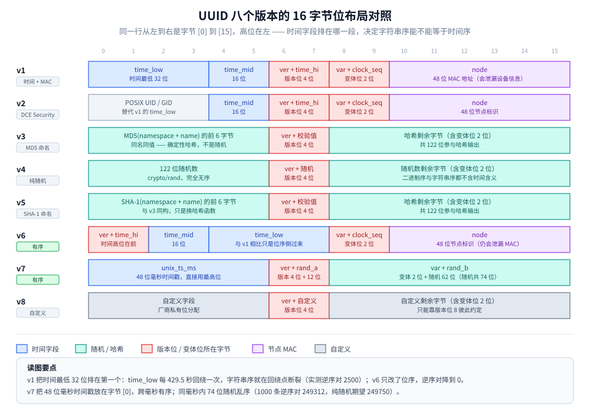

# UUID

> 覆盖：128 位里「版本位 + 变体位」怎么切、v1~v8 八代各自的位布局与取舍、v4 不能当聚簇主键的原因、v7 的 48 + 74 时间有序设计、v1/v6 字符串序在回绕点断裂的实测、MySQL 里 `BINARY(16)` 与 `UUID_TO_BIN` 的换算口径。
>
> 不覆盖：ULID 的 48 + 80 结构与 Crockford Base32 见 [ULID.md](ULID.md)；雪花与号段见 [雪花算法.md](雪花算法.md)、[号段模式与Leaf.md](号段模式与Leaf.md)；方案全景与选型顺序见 [README.md](README.md)。
>
> ✅ 实测口径：第 2.2 节、第 4.2 节、第 5.2 节的读数来自本机 `go1.26.5 windows/amd64` 位运算实验（固定种子 LCG，两遍运行逐行一致），程序在 `.workbuddy/tmp/uuid-lab/`。⚠️ 未实测：MySQL 页分裂与 `UUID_TO_BIN` 的实际存储开销（本机 Docker Desktop 未启动，不写推测读数）；Go / Java 第三方库的 API 未在本机 `go get` 验证。
>
> 内容整理自个人学习笔记，并参考 RFC 9562（2024-05，取代 RFC 4122）。素材见 [素材清单.md](../../../素材清单.md)。

---

## 一、128 位是怎么切的？

**本节要点**：16 字节里有 6 位被规范征用——4 位写版本号、2 位写变体号，剩下 122 位才是各版本自己支配的空间。

UUID 是定长 16 字节（128 位），字符串形态固定为 `8-4-4-4-12` 共 36 个字符（32 个十六进制 + 4 个连字符）。三段共用结构：

| 位置 | 字节下标 | 位数 | 含义 |
|---|---|---|---|
| 版本号 `version` | `[6]` 高 4 位 | 4 | 取值 1~8，标识这一版怎么生成 |
| 变体号 `variant` | `[8]` 高 2 位 | 2 | `10` = RFC 9562（本篇讨论的）；`0` = NCS 后向兼容；`110` = 微软 GUID；`111` = 保留 |

因为版本号固定落在第 7 字节的高 4 位，**任何 UUID 的第 13 个十六进制字符就是版本号**，肉眼可读：

```text
5e3f3191-e903-4814-9b76-03b34070dda2
              ↑ 这个 '4' 是版本号
018bcfe5-6800-7e3f-b191-e903e814db76
              ↑ 这个 '7' 是版本号
```

变体位同理：`[8]` 的高 2 位必须是 `10`，所以第 17 个十六进制字符只会是 `8`、`9`、`a`、`b` 之一。上例中 `9b76` 的 `9` 就是变体位的结果。

> 这也意味着**不同版本占用的随机位宽不同**：v4 有 122 位随机，v7 只有 74 位（版本位与变体位之外还要切出 48 位时间戳）。碰撞概率必须按各自实际位宽算，不能笼统说「UUID 都是 122 位随机」。

## 二、八个版本各自怎么摆位？

**本节要点**：v1/v6/v7 都带时间但有三种摆法，v3/v5 是「命名空间 + 名字」的确定性哈希，v4 是纯随机，v8 留给自定义；**选型实际只在 v4（随机）与 v7（时间有序）之间做**。

### 2.1 版本对照表

| 版本 | 生成方式 | 有序性 | 何时用 |
|---|---|---|---|
| **v1** | 60 位 100ns 时间戳 + 14 位 clock_seq + 48 位节点（MAC） | ⚠️ 字符串序约每 7 分钟断裂一次 | 需要反查设备、且能接受 MAC 泄漏 |
| **v2** | DCE Security：v1 的 time_low 换成 POSIX UID/GID | 无用 | 几乎不用 |
| **v3** | `MD5(namespace + name)` | 无（同名同值） | 由名字派生稳定 ID，不要求抗碰撞强度 |
| **v4** | 122 位随机 | 完全无序 | 幂等键、traceId、临时凭证等非主键标识 |
| **v5** | `SHA-1(namespace + name)` | 无（同名同值） | 同上，优先选 v5 |
| **v6** | v1 的位序重排（时间高位在前） | ✅ 字符串序 = 时间序 | 要兼容 v1 语义又要排序 |
| **v7** | 48 位毫秒时间戳 + 74 位随机 | ✅ 跨毫秒有序 | ⭐ 做聚簇主键的默认选择 |
| **v8** | 除版本位 / 变体位外全部自定义 | 自定义 | 厂商私有方案（如某些数据库的自定义序列） |



**图怎么读**：同一行从左到右是字节 `[0]`→`[15]`，高位在左。v1 把时间拆成 `time_low → time_mid → time_hi` 三段，**最低位反而排在最前面**；v6 只是把这三段倒过来；v7 干脆只留一段 48 位毫秒时间戳放在最前。字符串序能不能等于时间序，完全取决于「时间的高位是不是排在了字节 `[0]`」。

### 2.2 时间字段的实际量级

| 版本 | 时间位宽与单位 | 起点 | 可用到 | 回绕 / 断裂点 |
|---|---|---|---|---|
| v1 / v6 | 60 位 × 100ns | 1582-10-15（公历起点） | 约公元 5236 年 | `time_low` 只用 32 位，**每 2^32 × 100ns ≈ 429.5 秒（约 7.16 分钟）回绕一次** |
| v7 | 48 位 × 1ms | 1970-01-01（Unix） | 约公元 10889 年 | 无（`2^48` ms ≈ 8919 年） |

> ⚠️ v1 的「7 分钟断裂」是它不能直接当有序主键的根本原因，不是精度问题。第 4 节给实测。

### 2.3 v3 / v5 是确定性哈希，不是「随机 ID」

两者都是 `hash(namespace + name)`：同样的 namespace 与 name 永远得到同一个 UUID，因此天然幂等。RFC 预置了 4 个 namespace：DNS、URL、OID、X.500 DN。用途是从「名字」派生出全局稳定的标识，例如用 `v5(URL_NS, "https://example.com/order/42")` 得到幂等键。**它们不提供随机性**，也不是「唯一性」保证——唯一性来自名字本身唯一。

## 三、为什么 v4 不能当聚簇主键，v7 就可以？

**本节要点**：InnoDB 的主键是聚簇索引，数据行本身就按主键顺序存放在 B+ 树叶子页里；主键随机 → 每次插入都落在随机位置 → 页分裂与随机 IO。v7 把时间放最高位，让插入退化成「只在最右页追加」。

### 3.1 代价来自「插入位置」，不是「16 字节」

InnoDB 的聚簇索引把整行数据挂在主键 B+ 树的叶子上，叶子页按主键升序排列。主键是 UUIDv4（122 位随机）时，新插入的键落在 1~2 亿个叶子页中的**任意一个**：

| 后果 | 机制 |
|---|---|
| **页分裂** | 目标页已满时必须拆成两页并上提父节点；拆完后两页填充率各约 50%，空间与后续 IO 一起变差 |
| **随机 IO** | 每次插入要先把目标页从磁盘读进 Buffer Pool；热点集中在「最右页」时这一读可以省掉 |
| **缓存命中率下降** | 工作集是整棵树的叶子层，而不是最右侧的一小段 |
| **碎片** | 页内空洞累积，`OPTIMIZE TABLE` 才能回收 |

UUIDv7 把 48 位毫秒时间戳放在字节 `[0]`，生成顺序与大小顺序一致，插入点始终在最右页附近——这正是自增主键的写入形态。

> ⚠️ 但要区分清楚：v7 是**趋势递增**，不是严格单调。同一毫秒内 `rand_a` + `rand_b` 共 74 位随机，**这 74 位不保证递增**。第 3.3 节的实测给出量化：1000 条同毫秒 v7 的逆序对是 249312（纯随机期望 `n(n-1)/4 = 249750`），基本等于完全乱序。只是这种乱序局限在「同一毫秒的几十~几千条」这个小窗口内，对 B+ 树足够友好——和「整张表任意位置乱插」不是一回事。

### 3.2 16 字节还会被二级索引放大

InnoDB 的每个二级索引叶子节点都要存一份完整主键值用于回表。主键从 `BIGINT`（8 字节）换成 `BINARY(16)`，每条二级索引记录的键长直接 +8 字节；若表上有 4 个二级索引，主键膨胀被放大 5 倍（1 次聚簇 + 4 次二级）。这也是「对外 UUID、对内 BIGINT」折中方案的由来。

### 3.3 想要同毫秒内也单调：把 `rand_a` 变成计数器

RFC 9562 §6.2 给了三种单调化方法，最常用的是「`rand_a` 的 12 位当计数器」。实测（同一次运行的 A 段，两种写法各生成 1000 条）：

```text
=== A. UUIDv7 同毫秒内顺序性（固定 ms=1700000000000，1000 条）===
纯随机 rand_a+rand_b : 严格递增=false  逆序对数=249312
rand_a 用 12 位计数器 : 严格递增=true  逆序对数=0
```

代价是每毫秒最多 4096 条（12 位上限），超过就要等下一毫秒。对单机来说 409 万/s 够用，对多实例写同一张表则没意义——不同实例的 `rand_b` 仍然乱序。

## 四、v1 和 v6 的字符串序差在哪？

**本节要点**：v1 把时间戳的**低位**放在最前，`time_low` 32 位每 7.16 分钟回绕，字符串排序就在回绕点断裂；v6 只做了一次位序重排，就把「字符串序 = 时间序」修好了。

### 4.1 v1 的时间字段顺序是反的

v1 的时间戳是 60 位 100ns 计数，但拆成三段存放，且**最低段排在最前**：

```text
v1 布局： [ time_low 32 位 ][ time_mid 16 位 ][ ver(4) + time_hi 12 位 ] [ var + clock_seq ] [ node 48 位 ]
            ↑ 时间的最低 32 位排第一                                         ↑ MAC 地址
```

只要 `time_low` 不溢出，前 8 个十六进制字符随时间是递增的，字符串序看起来是对的——所以很多人以为 v1 有序。问题出在回绕：`time_low` 只有 32 位，`2^32 × 100ns ≈ 429.5 秒`，**每 7 分 9 秒它就绕回 0**。

### 4.2 实测：跨回绕点的字符串序

取 100 个连续的 100ns 时间片，起点设在 `2^32 - 50`，让第 50 条正好跨越回绕点，分别按 v1 与 v6 布局渲染后检查「字符串排序是否等于时间序」：

```text
=== D. v1 / v6 字符串字典序（99 个 100ns 时间片，跨 2^32 回绕点）===
UUIDv1 字符串排序等于时间序 : false   逆序对数=2500
UUIDv6 字符串排序等于时间序 : true   逆序对数=0
v1 第 49 条 : ffffffff-0000-1000-8000-000000000000
v1 第 50 条 : 00000000-0001-1000-8000-000000000000
v6 第 49 条 : 60000000-ffff-ffff-8000-000000000000
v6 第 50 条 : 60000001-0000-0000-8000-000000000000
```

`ffffffff-…` 的下一条是 `00000000-…`，字符串上从最大跳到最小。**逆序对数 2500 恰好等于 50 × 50**——回绕点前 50 条每一条都大于回绕点后 50 条的每一条，正好构成 2500 个逆序对。v6 把三段倒过来（`time_hi → time_mid → time_low`）后，整段 60 位时间单调，逆序对为 0。

> 推论：**任何「按字符串排 UUID 就等于按时间排」的说法，都必须指明是 v6/v7 还是 v1**。v1 的字符串序在一个 7 分钟的滑动窗口内成立，全局不成立。

### 4.3 v1 还有两个非顺序问题

- ⚠️ **泄漏 MAC 地址**：v1 的后 48 位是网卡 MAC（或随机生成的节点 ID）。它能定位设备、能跨数据集关联同一个人的记录，历史上有过用 v1 反查文档作者的案例。要么用 v6/v7，要么确保实现用的是随机 node。
- ⚠️ **可预测**：同一节点上，`clock_seq` 固定、时间递增，下一个 ID 可以被推算出来。任何把 UUID 当凭证用的场景都不能用 v1。

## 五、MySQL 里怎么存才不吃亏？

**本节要点**：字符串存法把索引撑到 36 字节且比较走字符串规则；`BINARY(16)` 降到 16 字节；`UUID_TO_BIN` 的 `swap_flag` 是给 v1 修的，**v7 不要开**。

### 5.1 三种存法

| 存法 | 占用 | 可读性 | 排序行为 |
|---|---|---|---|
| `CHAR(36)` | 36 字节（utf8mb4 下索引更胖） | ✅ 直接可读 | 字符串字典序 |
| `BINARY(16)` | 16 字节 | ❌ 需转换才能看 | 大端字节序 |
| 两个 `BIGINT`（拆高低 64 位） | 16 字节 | ❌ | 需按 `(hi, lo)` 复合排序 |

```sql
-- 写入：把字符串转成 16 字节
INSERT INTO t (id, ...) VALUES (UUID_TO_BIN('018bcfe5-6800-7e3f-b191-e903e814db76'), ...);
-- 读出：转回可读形式
SELECT BIN_TO_UUID(id) FROM t;
```

### 5.2 `swap_flag` 的适用边界

`UUID_TO_BIN(uuid, 1)` 里的 `swap_flag = 1` 会把 v1 的 `time_low`（前 4 字节）挪到后面，让「时间高位在前」，从而把 v1 修成索引友好形态。它**是为 v1 设计的**：

| 版本 | 该用哪个 | 原因 |
|---|---|---|
| v1 | `UUID_TO_BIN(uuid, 1)` | 重排后时间高位在前，插入点稳定在最右页 |
| v4 | 无所谓 | 没有时间字段，换什么顺序都还是随机 |
| **v7** | ⚠️ **`UUID_TO_BIN(uuid)`，不要加 1** | v7 的时间戳本来就在字节 `[0]`，再重排反而把有序性破坏掉 |
| v6 | `UUID_TO_BIN(uuid)`，不要加 1 | 同 v7，位序已经是对的 |

> ⚠️ 这一条最容易踩错：网上大量「UUID 做主键要加 swap_flag」的教程写于 v7 普及之前，直接照抄到 v7 上会把刚修好的顺序又打乱。落地前用 `BIN_TO_UUID(UUID_TO_BIN(x, 1))` 往返一次并检查 `ORDER BY id` 是否仍与生成时间一致。

### 5.3 本机实测覆盖到哪里

已验证的是**位运算层面**：v7 与 ULID 的「16 字节大端序 == 字符串字典序」为真，所以 `BINARY(16)` 存储 + 按字节排序是安全的（见第 4.2 节实验的 C2 段）。

```text
=== C2. 16 字节大端字节序 == 字符串字典序 ===
UUIDv7 纯随机   二进制序==字符串序 : false
UUIDv7 计数器版 二进制序==字符串序 : true
ULID   单调模式 二进制序==字符串序 : true
```

⚠️ 注意第一行：纯随机 v7 在**同一毫秒内**二进制序与字符串序并不一致（因为 74 位随机乱序），但两者都是「跨毫秒有序、同毫秒内乱序」，放在一起用不会互相矛盾。真正需要「同毫秒也单调」时，见第 3.3 节的计数器法。

⚠️ **未实测**：页分裂次数、Buffer Pool 命中率、索引文件大小这些需要真实 InnoDB 的读数，本篇不给数字。


## 六、应用场景

| 场景 | 选哪版 | 为什么 |
|---|---|---|
| 分库分表后的业务主键 | **v7** | 本地生成、无需 workerId、趋势递增对聚簇索引友好 |
| 幂等键、请求去重 | v4 / v5 | 不需要有序；v5 可以由业务键确定性派生 |
| traceId、spanId | v4 | 只要求唯一与低开销，36 字符略长但对日志无所谓 |
| 对外暴露的资源标识 | v4 | 不泄露业务量（对比自增 ID 可被遍历），也不含时间信息 |
| 临时上传凭证、一次性链接 | v4 | 不可预测性比有序性重要 |
| 内容寻址（同一内容同一 ID） | **v5** | 由 URL / 路径确定性派生，天然幂等 |
| 需要从 ID 反查生成时间 | **v7** / v6 | 时间戳在前 48 位，可直接解出毫秒 |
| 兼容已有 v1 系统的排序 | v6 | 只改位序、不改语义，存量可平滑过渡 |

⚠️ 不适合把 v4 直接当聚簇主键（第 3 节）；也不适合把任何 UUID 版本当「短 ID」用——26~36 字符在 URL 与二维码里都偏长，短标识应看 [号段模式与Leaf.md](号段模式与Leaf.md) 的号段方案或 Base62 压缩。

## 七、具体使用

**本节要点**：先确认库的 API 是不是 v7；只有需要控制位分配或自己做单调化时才手写，手写时版本位与变体位必须显式写死。

### 7.1 Go

```go
import "github.com/google/uuid"

v4 := uuid.New()        // v4：随机
v7, err := uuid.NewV7() // v7：时间有序（该库 v1.6 起提供，以 go doc 为准）
if err != nil {
    return err
}
fmt.Println(v4.String(), v7.String())
fmt.Println(v7.Time()) // v7 / v6 才能解出时间；v4 调用会返回零值
```

`github.com/google/uuid` 还提供 `uuid.NewMD5(ns, name)`（v3）、`uuid.NewSHA1(ns, name)`（v5）、`uuid.MustParse`（解析，非法串会 panic）、`uuid.Parse`（返回 error）。v3/v5 需要传入预置 namespace，DNS / URL / OID / X500 都有常量。

### 7.2 Go：手写 v4 与 v7（本篇实测代码）

不引第三方库时，v4 与 v7 各只有十几行；关键是**版本位与变体位用掩码写死**，不要指望随机数自己长出正确的位：

```go
func uuidV4() [16]byte {
	var b [16]byte
	rand.Read(b[:])
	b[6] = (b[6] & 0x0f) | 0x40 // version 4：清高 4 位再写 0100
	b[8] = (b[8] & 0x3f) | 0x80 // variant 10xx：清高 2 位再写 10
	return b
}

// v7：48 位毫秒时间戳 + 4 位版本 + 12 位 rand_a + 2 位变体 + 62 位 rand_b
func uuidV7(ms int64) [16]byte {
	var b [16]byte
	b[0] = byte(ms >> 40)
	b[1] = byte(ms >> 32)
	b[2] = byte(ms >> 24)
	b[3] = byte(ms >> 16)
	b[4] = byte(ms >> 8)
	b[5] = byte(ms)
	rand.Read(b[6:])            // 一次填满 rand_a 与 rand_b
	b[6] = (b[6] & 0x0f) | 0x70 // version 7
	b[8] = (b[8] & 0x3f) | 0x80 // variant 10xx
	return b
}
```

实测校验（同一次运行的 G 段）：

```text
=== G. 版本位与变体位 ===
UUIDv4 示例           : 5e3f3191-e903-4814-9b76-03b34070dda2
  第 7 字节高 4 位(版本): 4
  第 9 字节高 2 位(变体): 10
UUIDv7 示例           : 018bcfe5-6800-7e3f-b191-e903e814db76
  第 7 字节高 4 位(版本): 7
  第 9 字节高 2 位(变体): 10
```

### 7.3 Java

```java
import java.util.UUID;

UUID v4 = UUID.randomUUID(); // v4：JDK 内置只提供这一种

// v7：JDK 未内置，按位拼 msb / lsb
static UUID v7() {
    long ts    = System.currentTimeMillis() & 0xFFFFFFFFFFFFL; // 48 位
    long randA = ThreadLocalRandom.current().nextLong(1L << 12); // 12 位
    long randB = ThreadLocalRandom.current().nextLong() >>> 2;   // 62 位
    long msb   = (ts << 16) | 0x7000L | randA;                   // 时间 | 版本 7 | rand_a
    long lsb   = (0x8000L << 48) | randB;                        // 变体 10 | rand_b
    return new UUID(msb, lsb);
}
```

`msb` 的 `ts << 16` 把 48 位时间推到最高的 48 位，`0x7000` 占住随后的 4 位版本号，`randA` 落在最低 12 位——与 Go 版字节布局完全一致。`lsb` 的 `0x8000L << 48` 只把 bit 63 置 1，得到 `10` 开头的变体位。

⚠️ Java 代码本篇未编译（本机无 JDK 环境），按位布局人工核对。

### 7.4 存储与传输的两个配套

```sql
-- 表结构：BINARY(16) + 生成列，兼顾存储与可读性
CREATE TABLE t (
  id     BINARY(16)  NOT NULL,
  id_str CHAR(36) AS (BIN_TO_UUID(id)) STORED COMMENT '只读展示，不建索引',
  PRIMARY KEY (id)
);
```

```go
// 传输：UUID 是字符串，天然不受 JS 2^53 精度影响；但别偷偷转成 int64
type Order struct {
    ID string `json:"id"` // 保持字符串，不要 `json:"id,string"` 之外的数值化
}
```

## 延伸追问

- **为什么 v7 不改掉 v1 的 MAC 泄漏问题就够了？** → v7 的后 74 位是纯随机，不含节点信息；v6 仍然保留 48 位 node 字段，只是改了时间顺序。要彻底避免泄漏应选 v4 或 v7。
- **v7 同一毫秒内乱序，会影响主键唯一性吗？** → 不影响。唯一性靠 74 位随机，不靠顺序；顺序只影响插入位置的局部性，那个窗口极小。
- **`UUID_TO_BIN(uuid, 1)` 能在 v4 上「变有序」吗？** → 不能。`swap_flag` 重排的是 v1 的时间字段位置，v4 没有时间字段，换顺序还是随机。
- **v3 与 v5 该用哪个？** → 都用 SHA-1 的时代选 v5；只有必须与既有 v3 系统对齐时才用 v3。两者都不提供抗碰撞之外的保密性。
- **UUID 能不能当分片键？** → 能但要小心热点。v7 的高位是时间，按 `id % N` 取低位（随机部分）分布均匀；按时间高位取模会让同一时间窗全落一个分片，这与雪花的热点问题同源，见 [README.md](README.md) 第七节。
- **为什么规范里还有 v8？** → 给厂商留出「除版本位/变体位外完全自定义」的空间，避免各家用 v4 的名字装私货导致无法区分。

## 关联

- **上游/总纲**：[README.md](README.md) — 分布式 ID 的三条硬要求、九种方案全景与选型顺序
- **对照/互补**：[ULID.md](ULID.md) — 同样是「48 位毫秒 + 随机」，但用 Crockford Base32 压到 26 字符
- **对照/互补**：[雪花算法.md](雪花算法.md) — 另一种时间有序方案：64 位整数、需要 workerId、吞吐上限明确
- **对照/互补**：[号段模式与Leaf.md](号段模式与Leaf.md) — 完全放弃时间位、换取严格递增与更短的数值形态
- **下游机制**：[分表与路由.md](../../../03-数据与中间件/数据存储/关系型/MySQL/分表与路由.md) — 主键选型与分片键必须一起定
- **下游机制**：[索引设计与EXPLAIN.md](../../../03-数据与中间件/数据存储/关系型/MySQL/索引设计与EXPLAIN.md) — 聚簇索引与二级索引回表的存储代价
- **基础概念**：[一致性模型.md](../理论基础/一致性模型.md) — 为什么本地生成的 ID 敢不加锁
