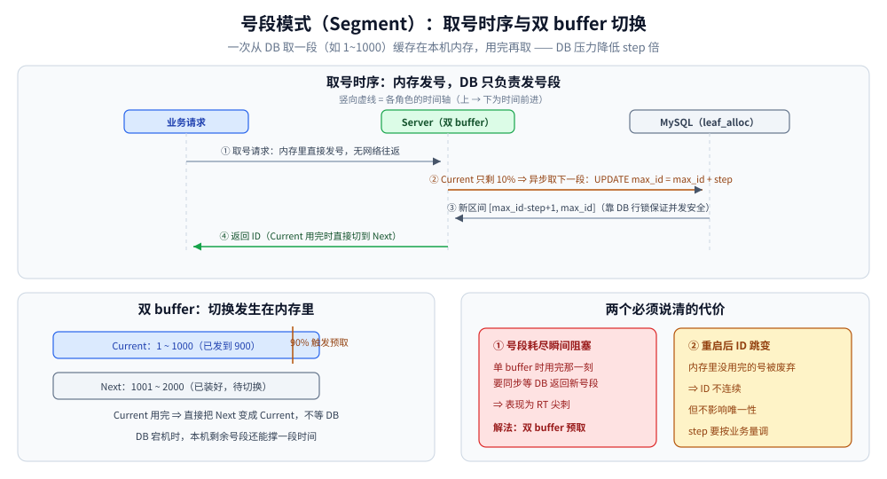

# 号段模式与 Leaf

> 覆盖：数据库号段（Segment）的取号原理、并发安全、双 buffer 削峰、重启跳变与 DB 故障边界，以及美团 Leaf 的 segment / snowflake 双模式、表设计与接入要点。
>
> 不覆盖：方案全景与选型见 [README.md](README.md)；雪花的位结构、时钟回拨与 workerId 见 [雪花算法.md](雪花算法.md)；分片键设计见 [分表与路由.md](../../../03-数据与中间件/数据存储/关系型/MySQL/分表与路由.md)。
>
> 内容整理自个人学习笔记，并参考《大型网站技术架构：核心原理与案例分析》（李智慧）。本篇 SQL 与代码为示例，未在本机连接数据库运行。

---

## 一、号段模式为什么能把 DB 压力摊薄？

**本节要点**：把「一次取一个号」改成「一次取一段号」，DB 只需要每 `step` 次发号参与一次，网络往返与行锁竞争都被摊薄。

数据库自增的瓶颈不在生成本身，而在**每次写都要访问同一个库、同一行**。号段模式把分配权下放到应用进程：

1. 应用启动或当前号段用完时，向 DB 申请一段，例如 `[1, 1000]`；
2. 号段缓存在本机内存，进程内直接用原子操作发号；
3. 本机号段用完，再向 DB 申请下一段。

DB 的参与频率从「每号一次」降到「每 `step` 个号一次」。以 `step=1000` 为例，DB 压力被摊薄约 1000 倍；同时 ID 仍然连续递增，对 B+ 树友好。

代价是三个新的边界：

| 边界 | 表现 |
|---|---|
| **号段耗尽** | 用完那一刻若下一段还没取回，发号线程要同步等 DB，形成 RT 尖刺 |
| **重启丢段** | 进程重启会丢弃内存中未用完的号，ID 出现跳变（不连续，但不影响唯一性） |
| **DB 仍是依赖源** | DB 长时间不可用时，本机只能靠剩余号段撑一段时间，用完即阻塞 |

## 二、取号段怎么保证并发安全？

**本节要点**：靠数据库行锁把「读当前值 + 加 step」做成一个事务；多个应用实例同时申请时，UPDATE 会在同一行上串行。

```sql
CREATE TABLE leaf_alloc (
  biz_tag     VARCHAR(128) NOT NULL PRIMARY KEY COMMENT '业务标识，如 order',
  max_id      BIGINT NOT NULL DEFAULT 1 COMMENT '已分配到的最大号',
  step        INT    NOT NULL COMMENT '号段长度',
  description VARCHAR(256) DEFAULT NULL,
  update_time DATETIME NOT NULL DEFAULT CURRENT_TIMESTAMP ON UPDATE CURRENT_TIMESTAMP
) ENGINE=InnoDB;
```

一次取号段：

```sql
BEGIN;
UPDATE leaf_alloc SET max_id = max_id + step WHERE biz_tag = 'order';
SELECT max_id, step FROM leaf_alloc WHERE biz_tag = 'order';
COMMIT;
```

- `UPDATE` 先拿 `biz_tag` 这一行的排他锁；并发的另一个实例会阻塞到当前事务提交，因此不会拿到重叠区间。
- 同一事务内的 `SELECT` 能看到自己刚更新的值，本次可用区间是 `[max_id - step + 1, max_id]`。
- `max_id` 必须在 DB 中持久化；不能只放在缓存里，否则多个实例会各自从同一值开始发号。

> ⚠️ 不要用「先 SELECT 再 UPDATE」的非原子流程：两个实例可能读到同一个 `max_id`，再各自加 `step`，区间重叠。

## 三、号段耗尽为什么会有 RT 尖刺？双 buffer 怎么削掉？

**本节要点**：单 buffer 在耗尽瞬间同步等 DB；双 buffer 提前异步预取下一段，耗尽时直接切换，把等待挪到发号路径之外。

**单 buffer 的问题**：当前号段用到最后一个号，下一次发号必须等 DB 返回新号段。这次等待落在业务请求的主链路上，表现为周期性 RT 尖刺；DB 抖动时尖刺会被放大。

**双 buffer 的做法**：

1. 内存里同时维护 `current` 与 `next` 两个号段；
2. 当前号段消费到一定比例（Leaf 默认约 10%）时，异步线程去 DB 取下一段；
3. 当前号段耗尽，若 `next` 已就绪，直接原子切换；未就绪才同步等待。



**图怎么读**：横轴是号段消费进度。`current` 走到 10% 时触发异步预取，预取在后台完成；`current` 耗尽时直接切到 `next`，发号线程不需要等 DB。预取失败则保留当前段并重试，直到真正耗尽才退化为同步等待。

**预取失败怎么办**：记录错误并重试；当前段仍可继续发号，直到耗尽。不要在预取失败时立刻阻塞，否则一次网络抖动会提前打断发号。

## 四、Leaf 的两种模式分别解决什么？

**本节要点**：Leaf-segment 把号段模式做成服务；Leaf-snowflake 用 ZK 解决 workerId 分配与时钟校验。两者共用一套 Leaf Server，按业务选择模式。

### 4.1 Leaf-segment

- **架构**：Leaf Server + MySQL。每个 `biz_tag` 在 `leaf_alloc` 中占一行，应用通过 HTTP / SDK 向 Leaf 取号，Leaf 在本机缓存号段。
- **动态 step**：根据当前 QPS 与号段消耗速度调整下一段长度——流量大时取更长，减少 DB 访问；流量小时取短一些，避免重启浪费。
- **多 DB**：`leaf_alloc` 可部署在多个库，Leaf 按配置切换；某个库不可用时切到备用库，但必须保证切换前后的 `max_id` 不重叠。
- **优点**：ID 连续递增、不依赖时钟、DB 故障后还能靠本地缓存撑一段。
- **缺点**：仍有 DB 依赖；号段耗尽时可能阻塞；重启会跳变。

### 4.2 Leaf-snowflake

- **workerId 分配**：启动时在 ZK 创建顺序节点，用节点序号作 workerId；本地缓存 `workerID` 文件，ZK 不可用时用缓存值启动（需配合校验，避免重复）。
- **时钟校验**：启动与运行中把时间戳上报 ZK，发现本机时间小于上次上报值时判定回拨；小幅回拨等待，大幅回拨告警并拒绝发号。
- **位分配**：与标准雪花一致（41 + 10 + 12），因此单节点吞吐与雪花相同。
- **优点**：workerId 自动分配，减少人工配置事故；适合节点较多、已有 ZK 的团队。
- **缺点**：多一套 ZK 依赖；ZK 故障时的降级策略必须提前设计。

### 4.3 两种模式怎么选

| 维度 | Leaf-segment | Leaf-snowflake |
|---|---|---|
| ID 形态 | 连续递增 | 趋势递增 |
| 外部依赖 | MySQL | MySQL（可选）+ ZK |
| 时钟敏感 | 否 | 是 |
| 重启影响 | 跳变（丢弃未用完号段） | 基本连续（仍受时钟影响） |
| 吞吐 | 号段长度 × 取号 QPS，十万级 | 单节点约 409 万/s |
| 适合 | 中小规模、不想处理时钟 | 大规模、已有 ZK、要求高吞吐 |

## 五、号段的 step 怎么定、表怎么设计？

**本节要点**：`step` 要覆盖「预取窗口内的峰值发号量」；太小会频繁访问 DB，太大会在重启时浪费大量 ID。

估算方法：

```text
step ≈ 峰值 QPS × 预取窗口（秒） × 安全系数
```

例如峰值 5,000/s、希望 10 秒预取一次、安全系数 2，则 `step ≈ 100,000`。实际还要结合重启频率与 ID 浪费的容忍度调整。

| 设计项 | 建议 |
|---|---|
| **主键** | `biz_tag`，按业务隔离号段，避免互相影响 |
| **step** | 按业务峰值配置；Leaf 可动态调整 |
| **max_id** | 必须持久化；更新与读取在同一事务 |
| **多库** | 各库 `max_id` 区间必须错开，切换前校验 |
| **监控** | 当前号段剩余比例、预取失败次数、发号 QPS、DB 取号耗时 |
| **告警** | 剩余号段低于阈值、预取连续失败、DB 不可用 |

## 六、号段、Redis 与数据库步长怎么选？

| 方案 | 依赖 | ID 连续性 | 故障边界 | 适合 |
|---|---|---|---|---|
| **数据库步长** | 单个 MySQL | 递增不连续 | DB 单点；扩容要改步长并搬数据 | 小系统、库数量固定 |
| **数据库号段** | MySQL + 本地缓存 | 段内连续、重启跳变 | DB 短暂不可用还能撑一段；耗尽阻塞 | 中小规模、不想处理时钟 |
| **Redis INCRBY** | Redis | 递增 | 持久化丢数据会重号；Redis 不可用即阻塞 | 已有 Redis、量不大 |
| **雪花** | 无（依赖时钟与 workerId） | 趋势递增 | 回拨与 workerId 冲突会重号 | 大规模、高吞吐 |

> ⭐ 判据：**能不能接受时钟风险**决定要不要排除雪花；**能不能接受 DB 依赖与重启跳变**决定号段是否合适；**已有 Redis 且写入量小**时，`INCRBY` 是最省事的选择。

## 七、应用场景

| 场景 | 为什么用号段 |
|---|---|
| 中小规模业务主键 | 不依赖时钟，ID 连续，索引友好 |
| 分库分表后的订单号 / 用户号 | 全局唯一，可在应用侧批量预取 |
| 不想维护 workerId 的团队 | 只需一张分配表，运维面小 |
| 已有 Leaf / Tinyid 基础设施 | 直接接入现成服务，省去自建 |
| 对 ID 连续性有要求（对账、排查） | 段内连续，便于按区间核对 |

⚠️ 不适合：无法接受 DB 依赖、或要求单节点千万级吞吐的场景——应评估 [雪花算法.md](雪花算法.md)。

## 八、具体使用

**本节要点**：最小落地是「一张分配表 + 一个带双 buffer 的本地分配器」；接入 Leaf 则把分配器换成 Leaf Server。

### 8.1 建表与初始化

```sql
CREATE TABLE leaf_alloc (
  biz_tag     VARCHAR(128) NOT NULL PRIMARY KEY,
  max_id      BIGINT NOT NULL DEFAULT 1,
  step        INT    NOT NULL,
  description VARCHAR(256) DEFAULT NULL,
  update_time DATETIME NOT NULL DEFAULT CURRENT_TIMESTAMP ON UPDATE CURRENT_TIMESTAMP
) ENGINE=InnoDB;

INSERT INTO leaf_alloc (biz_tag, max_id, step, description)
VALUES ('order', 1, 100000, '订单号');
```

### 8.2 取号段（同一事务）

```sql
BEGIN;
UPDATE leaf_alloc SET max_id = max_id + step WHERE biz_tag = 'order';
SELECT max_id, step FROM leaf_alloc WHERE biz_tag = 'order';
COMMIT;
```

应用拿到 `max_id` 与 `step` 后，本地可用区间是 `[max_id - step + 1, max_id]`，用原子计数器从区间起点递增发号。

### 8.3 带双 buffer 的分配器骨架（Go，示例未实测）

```go
type Segment struct {
    cur, next atomic.Int64 // 当前段与下一段的当前值
    end       atomic.Int64 // 当前段上界
}

type Allocator struct {
    db      *sql.DB
    bizTag  string
    step    int
    mu      sync.Mutex
    loading atomic.Bool
}

// Next 从当前段取号；接近段尾时触发异步预取
func (a *Allocator) Next(ctx context.Context) (int64, error) {
    for {
        cur := a.cur.Add(1)
        if cur <= a.end.Load() {
            if a.remaining() < a.step/10 {
                a.prefetch(ctx) // 异步；失败只记录，不阻塞发号
            }
            return cur, nil
        }
        // 当前段耗尽：等待或同步加载下一段
        if err := a.switchSegment(ctx); err != nil {
            return 0, err
        }
    }
}

func (a *Allocator) switchSegment(ctx context.Context) error {
    a.mu.Lock()
    defer a.mu.Unlock()
    if a.cur.Load() <= a.end.Load() { // 双检：别的协程已经切好
        return nil
    }
    maxID, step, err := a.fetchFromDB(ctx)
    if err != nil {
        return err
    }
    a.cur.Store(maxID - int64(step) + 1)
    a.end.Store(maxID)
    return nil
}
```

要点：

- 发号路径只做原子自增，DB 只出现在预取与切换路径；
- 预取失败不能阻塞发号，当前段还能继续用；
- 切换必须加锁并双检，避免多个协程同时向 DB 申请造成浪费；
- 进程重启会丢弃当前段剩余 ID，这是可接受的浪费，不是正确性问题。

### 8.4 接入 Leaf

Leaf 的部署、配置与接口以官方仓库为准。接入前确认：

- `leaf_alloc` 已在 Leaf 使用的库中建好，`biz_tag` 与业务一致；
- Leaf Server 与 DB 的网络、时区、连接池已配置；
- 选择 segment 还是 snowflake 模式，并确认 ZK（snowflake 模式）可用；
- 应用侧对「取号失败」有重试与降级，不要把 Leaf 当成永不可用的本地函数。

## 九、生产实践与坑

| 坑 | 说明与应对 |
|---|---|
| **⚠️ 号段耗尽时同步等 DB** | 单 buffer 会在耗尽瞬间产生 RT 尖刺；用双 buffer 提前预取，并监控剩余比例 |
| **⚠️ 重启丢段** | 内存中未用完的号被丢弃，ID 跳变；不影响唯一性，但对账与排查要能接受 |
| **⚠️ DB 单点** | 号段用完前必须恢复 DB；多库部署并校验 `max_id` 区间，避免切换后重叠 |
| **⚠️ step 过小 / 过大** | 过小导致频繁取号与行锁竞争；过大导致重启浪费、ID 增长过快 |
| **⚠️ 多业务共用一行** | 所有业务抢同一行会互相阻塞；按 `biz_tag` 隔离 |
| **⚠️ 先查后改** | 非原子流程会让并发实例拿到重叠区间；必须在一个事务内 UPDATE + SELECT |
| **⚠️ ID 泄露业务量** | 连续号段更容易被推算业务量；对外可再映射一层 |
| **⚠️ 分片热点** | 用连续 ID 做分片键时要确认分布均匀，避免按时间区间集中落一个分片 |

## 延伸追问

- **号段模式的优点？号段耗尽怎么办？** → 优点：ID 连续递增、DB 压力被 step 摊薄、DB 短暂不可用仍能发号；耗尽时会同步等 DB 产生 RT 尖刺，用双 buffer（消费到约 10% 时异步预取下一段）解决。
- **取号段为什么必须在一个事务里？** → UPDATE 取行锁、SELECT 读自己更新后的值；拆成两个事务会让并发实例读到同一个 `max_id`，区间重叠。
- **号段与雪花怎么选？** → 号段：ID 连续、不依赖时钟，但 DB 是依赖源，适合中小规模；雪花：纯本地、无中间件、吞吐高，但要管理 workerId 与时钟，适合大规模主链路。
- **Leaf-segment 与 Leaf-snowflake 有什么区别？** → segment 靠 MySQL 号段、ID 连续、不依赖时钟；snowflake 靠 ZK 分配 workerId、趋势递增、吞吐更高。
- **重启后 ID 为什么会跳变？** → 内存里未用完的号段被丢弃，下次从 DB 的新区间开始；跳变不影响唯一性。
- **step 设多大合适？** → 覆盖预取窗口内的峰值发号量，如峰值 QPS × 10 秒 × 安全系数；太小频繁访问 DB，太大重启浪费。
- **DB 挂了还能发号吗？** → 能撑到当前号段用完；之后必须等 DB 恢复或切备用库，否则发号阻塞。

## 关联

- **上游/总纲**：[README.md](README.md) — 方案全景、选型顺序与生产底线
- **对照/互补**：[雪花算法.md](雪花算法.md) — 纯本地生成、趋势递增的另一条路
- **对照/互补**：[分表与路由.md](../../../03-数据与中间件/数据存储/关系型/MySQL/分表与路由.md) — 分片键与 ID 生成必须一起设计
- **对照/互补**：[数据建模.md](../../../03-数据与中间件/数据存储/关系型/MySQL/数据建模.md) — BIGINT 与分配表的字段口径
- **基础概念**：[集群基础.md](../集群基础.md) — DB 单点与多副本切换
- **基础概念**：[CAP与PACELC.md](../理论基础/CAP与PACELC.md) — 号段分配的可用性取舍
