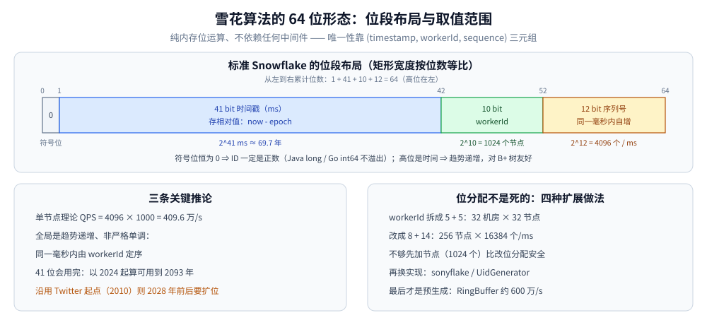
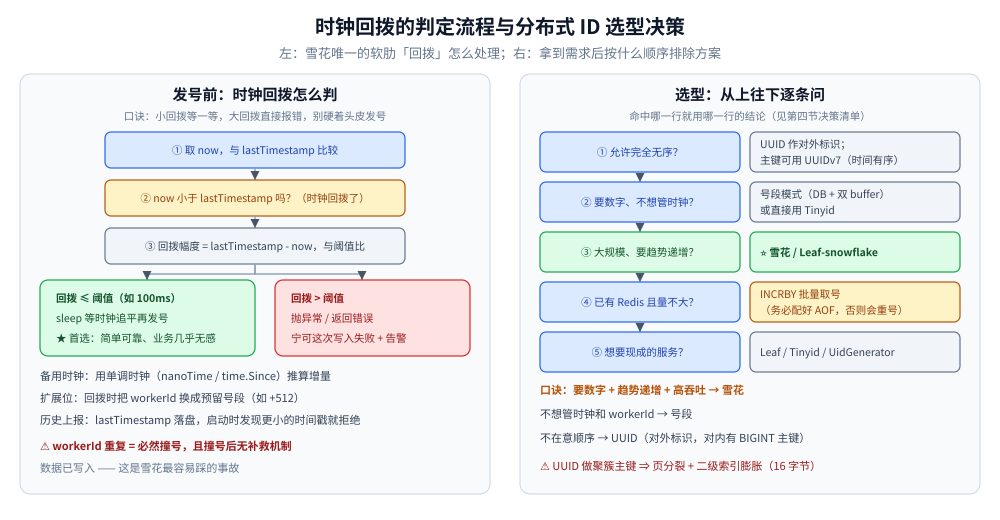

# 雪花算法

> 覆盖：Snowflake 的 64 位位结构、ID 的计算与反解、时钟回拨的判定与处理、workerId 分配、前端精度问题、吞吐扩展，以及 Go（bwmarrin/snowflake、sonyflake、手写）与 Java（Hutool、MyBatis-Plus、手写）的落地代码。
>
> 不覆盖：方案全景与选型见 [README.md](README.md)；数据库号段、双 buffer 与 Leaf 的号段模式见 [号段模式与Leaf.md](号段模式与Leaf.md)；分片键设计见 [分表与路由.md](../../../03-数据与中间件/数据存储/关系型/MySQL/分表与路由.md)。
>
> 内容整理自个人学习笔记，并参考《大型网站技术架构：核心原理与案例分析》（李智慧）。本篇代码为示例，未在本机逐段编译运行。

---

## 一、雪花为什么能只靠位运算生成唯一 ID？

**本节要点**：Snowflake 把「时间 + 机器 + 毫秒内序号」拼进一个 64 位整数，唯一性由这三段共同保证，生成过程不需要任何网络往返。

Twitter 的原始设计要解决的是「高并发下、写入前、跨节点生成有序 ID」。它把三个维度的信息放进同一个 Long：

- **时间戳**：保证整体随时间增长；
- **workerId**：区分不同节点，避免同一毫秒各节点发出相同序号；
- **序列号**：同一节点、同一毫秒内的自增计数。

因此唯一性不依赖数据库、不依赖锁，只依赖两个前提：**workerId 全局唯一**、**时钟不回拨**。这两条前提也正是它最主要的两类事故来源。

## 二、64 位怎么切、各段能用多久？

**本节要点**：标准位分配是 `1 + 41 + 10 + 12`；41 位决定能用多久，10 位决定能有多少节点，12 位决定单节点每毫秒能发多少。

```text
 0        1                          11       12                        63
 ├──┬────────────────────────────┬─────────┬────────────────────────────┤
 │0 │      41 bit 时间戳(ms)      │ 10 bit  │       12 bit 序列号        │
 │  │  (当前时间 - 起始时间戳)      │ workerId│        (毫秒内自增)         │
 └──┴────────────────────────────┴─────────┴────────────────────────────┘
```

| 段 | 位数 | 取值范围 | 说明 |
|---|---|---|---|
| 符号位 | 1 | 恒为 0 | 保证 ID 为正数（Java `long` / Go `int64` 不溢出） |
| **时间戳** | 41 | `2^41` ms ≈ **69.7 年** | 存相对值（`now - epoch`）；Twitter 用 `1288834974657`（2010-11-04），国内常用上线日（如 2024-01-01 = `1704067200000`） |
| **workerId** | 10 | `2^10` = **1024 个节点** | 可拆为 5 位 datacenterId + 5 位 workerId（32 × 32） |
| **序列号** | 12 | `2^12` = **4096** | 同一节点同一毫秒内自增 |



**关键推论**：

- 单节点理论 QPS = `4096 × 1000` = **409.6 万/s**，远超实际需求；
- 全局是**趋势递增**而非严格单调（同毫秒内由 workerId 定序），但对 B+ 树足够友好；
- 41 位会用完：以 2024 起算可用到 **2093 年**；沿用 Twitter 的 2010 起点则 **2028 年前后就要扩位**（workerId 缩到 8 位、时间戳扩到 43 位）。

### 2.1 ID 怎么算出来

```text
id = ((now - epoch) << 22) | (workerId << 12) | sequence
```

- `22 = 10 + 12`，即时间戳要左移到 workerId 与序列号之上；
- `12` 是序列号位数，workerId 左移 12 位后正好接在时间戳之后；
- 同一毫秒内 `sequence` 自增；满 4096 后自旋等到下一毫秒，再把序列号归零。

### 2.2 ID 怎么反解

```text
timestamp = epoch + (id >> 22)
workerId  = (id >> 12) & 0x3FF
sequence  = id & 0xFFF
```

反解能力带来两个实用价值：排查问题时能从 ID 还原生成时刻与节点；按时间范围分页扫描时，可以把时间区间换算成 ID 区间，避免全表扫描。

## 三、时钟回拨为什么会重号、怎么处理？

**本节要点**：唯一性依赖 `(timestamp, workerId, sequence)` 三元组；时间跳回过去时，同一毫秒的序列号会重新从 0 开始，于是撞上已经发过的号。

**为什么发生**：ID 高位取自 `System.currentTimeMillis()`，触发源包括 NTP 校时（时间偏快时被拉回）、运维手工改时间、虚拟机 / 容器挂起恢复与宿主机时钟漂移（云环境高频）、闰秒调整。

**为什么重复**：时间跳回「过去」的某一毫秒时，若该毫秒的 `sequence` 已发过，重新从 0 计数必然撞号；workerId 相同则冲突成立。

| 处理手段 | 做法 | 评价 |
|---|---|---|
| ⭐ **小回拨直接等待** | 回拨 ≤ 阈值（如 100ms）时 `sleep` 等时钟追平再发号 | 简单可靠，业务几乎无感，阈值内首选 |
| **大回拨直接拒绝** | 回拨 > 阈值 → 抛异常 / 返回错误，宁可这次写入失败 | 安全边界，配合告警人工介入 |
| **备用时钟** | 用单调时钟（`System.nanoTime` / `time.Since`）推算时间增量，或参考最近 N 次上报时间做平滑时钟 | 从根上降低回拨概率，实现较复杂 |
| **扩展位** | 回拨时把 workerId 换成预留号段（如 +512），或用 1 bit 标记「回拨代」 | 位分配变复杂，需保证预留号不冲突 |
| **历史上报** | 把 `lastTimestamp` 上报 / 落盘，启动或回拨时对比，发现更小的时间戳直接拒绝启动 | Leaf 采用类似思路（ZK + 本地缓存文件） |

> 口诀：**小回拨等一等，大回拨直接报错，别硬着头皮发号。**



**图怎么读**：左栏是回拨发生后的分流——先算回拨幅度，小回拨等待追平，大回拨直接拒绝并告警；右栏是选型顺序，先问要不要数字、要不要有序，再决定走雪花还是号段。

## 四、workerId 怎么分配才不会冲突？

**本节要点**：workerId 重复等于必然撞号，而且撞号后没有补救机制（数据已经写入）；分配方式要在「自动、稳定、无额外依赖」之间取舍。

| 方式 | 做法 | 优缺点 |
|---|---|---|
| **手动配置** | 写在配置文件 / 环境变量 | 最简单；节点多了易配重，容器重启 IP 会变 |
| **ZK / etcd 注册** | 启动创建顺序节点或抢锁拿编号（Leaf 做法），断线重连复用原号 | 自动不重复；依赖 ZK / etcd |
| **数据库分配** | 启动向 `worker_node` 表插一行拿自增 ID（UidGenerator 做法） | 依赖少；要注意回收，超过 1024 就满了 |
| ⭐ **K8s StatefulSet 序号** | Pod 名 `order-0/1/2`，取主机名末尾数字作 workerId | 天然稳定；⚠️ 仅适用于有状态服务，Deployment 不行 |
| **IP / MAC 哈希** | IP 后 8 位或 MAC 哈希取模 | 无需额外组件；可能碰撞（MyBatis-Plus 默认即此类） |

无论用哪种方式，启动时都应做一次**占用自检**：把自己的 workerId 与最近活跃节点比对，发现重复直接拒绝启动，而不是等到写库冲突才暴露。

## 五、为什么不能把 Long 直接返回前端？

**本节要点**：JS `Number` 的安全整数只到 `2^53-1`，而雪花 ID 常见值约 `1.7e18`，JSON 解析后低位会被舍入。

JS 的 `Number` 是 IEEE 754 双精度，精确整数范围仅 `±(2^53-1)`（`9007199254740991`）；雪花 ID 是 64 位、常见值远超该范围，`JSON.parse` 后末尾会变成 0，两个不同 ID 可能变成同一个。

```java
// Jackson：单个字段（全局则用 SimpleModule 注册 ToStringSerializer：Long.class / Long.TYPE）
@JsonSerialize(using = ToStringSerializer.class)
private Long orderId;
```

```go
// Go：struct tag 序列化为字符串
type Order struct {
    ID int64 `json:"id,string"`
}
```

> 同类问题也出现在 32 位 PHP、以及导出 Excel（长数字转科学计数法）时。对外传输一律用字符串，对内仍可用 `BIGINT` 参与索引与计算。

## 六、单节点每毫秒 4096 个够不够、怎么扩展？

**本节要点**：4096/ms = 409 万/s，绝大多数业务先撞到的是 DB 上限，而不是 ID 上限；真不够时优先加节点，其次调位分配。

扩展顺序：

1. **加节点**：workerId 有 1024 个，增加实例比改位分配安全；
2. **调位分配**：序列位调大、机器位调小，如 `8 + 14` = 256 节点 × 16384/ms；
3. **换实现**：sonyflake（机器位 16 位、时间单位 10ms）或 UidGenerator（RingBuffer 预生成）；
4. **预生成**：本地 RingBuffer 批量生成再取用，UidGenerator 单实例约 600 万/s。

## 七、应用场景

| 场景 | 为什么用雪花 |
|---|---|
| 订单、支付、库存等核心写链路 | 写入前就要拿到 ID，要求趋势递增与高吞吐 |
| 分库分表后的业务主键 | 全局唯一、可在应用侧生成、天然不可变 |
| 需要从 ID 反解时间的排查场景 | 高位是时间戳，可直接还原生成时刻 |
| 多节点容器集群 | 纯本地生成，不依赖中心化 ID 服务 |
| 按时间范围扫描的数据表 | 时间区间可换算成 ID 区间，缩小扫描范围 |

⚠️ 不适合：完全不能接受时钟风险、且团队无力维护 workerId 的场景——应改用 [号段模式与Leaf.md](号段模式与Leaf.md)。

## 八、具体使用

**本节要点**：优先用成熟库；只有在需要自定义位分配或回拨策略时才手写，并把 workerId 与回拨兜底一起封装。

### 8.1 Go：`github.com/bwmarrin/snowflake`

安装：`go get github.com/bwmarrin/snowflake`

```go
// ① 创建节点：workerId ∈ [0,1023]，必须全局唯一（起始时间戳可改 snowflake.Epoch）
node, err := snowflake.NewNode(1)
if err != nil {
	panic(err)
}
id := node.Generate() // ② 生成：类型 snowflake.ID，底层是 int64
fmt.Println(id.Int64(), id.String(), id.Base36(), id.Base64(), id.Bytes()) // 转各类型
fmt.Println(id.Time(), id.Node(), id.Step())                    // 反解：时间戳 / workerId / 序列号
fmt.Println(time.UnixMilli(id.Time()), snowflake.Decompose(id)) // 生成时刻 / map[msb time node step]
```

包内常量：`snowflake.NodeBits = 10`、`snowflake.StepBits = 12`，包变量 `snowflake.Epoch`（毫秒）可改。

### 8.2 Go：`github.com/sony/sonyflake`

安装：`go get github.com/sony/sonyflake`

```go
sf := sonyflake.NewSonyflake(sonyflake.Settings{
	StartTime:      time.Date(2024, 1, 1, 0, 0, 0, 0, time.UTC),
	MachineID:      func() (uint16, error) { return 3, nil }, // 必须全局唯一
	CheckMachineID: func(uint16) bool { return true },        // 启动自检，可接 etcd
})
if sf == nil {
	panic("sonyflake init failed")
}
id, err := sf.NextID() // uint64；返回 (uint64, error)
if err != nil {
	panic(err)
}
fmt.Println(id, sonyflake.Decompose(id)) // map[id:.. time:.. sequence:.. machine-id:..]
```

**位分配差异**（⚠️ 与标准雪花不同）：`0 | 39 bit 时间(单位 10ms) | 8 bit 序列号 | 16 bit 机器 ID`

- 机器位 **16 位 = 65536 个节点**；时间位 39 位、单位 10ms，覆盖约 **174 年**；
- 序列位仅 8 位 = **256/10ms ≈ 2.56 万/s**，低于标准雪花，耗尽时 sleep 到下一时间单元；
- ✅ 它用单调的 `elapsedTime` 计数，**轻微时钟回拨不会直接产生重复 ID**。

### 8.3 Go：可运行的封装示例（workerId 配置 + 回拨兜底）

```go
package main

import (
	"errors"
	"fmt"
	"os"
	"strconv"
	"sync"
	"time"
)

const (
	epoch         int64 = 1704067200000   // 2024-01-01 UTC，41 位可用到 2093 年
	maxWorkerID   int64 = -1 ^ (-1 << 10) // 1023
	maxSeq        int64 = -1 ^ (-1 << 12) // 4095
	workerShift   uint  = 12              // 序列号位数
	timeShift     uint  = 22              // 序列号 + workerId 位数
	maxBackwardMS int64 = 100             // 容忍的最大回拨幅度
)

var (
	ErrClockBackward = errors.New("idgen: clock moved backwards")
	ErrInvalidWorker = errors.New("idgen: workerId out of range")
)

// Generator 并发安全的雪花 ID 生成器
type Generator struct {
	mu                    sync.Mutex
	workerID, seq, lastMS int64
}

func New(workerID int64) (*Generator, error) {
	if workerID < 0 || workerID > maxWorkerID {
		return nil, fmt.Errorf("%w: %d not in [0,%d]", ErrInvalidWorker, workerID, maxWorkerID)
	}
	return &Generator{workerID: workerID, lastMS: -1}, nil
}

func (g *Generator) Next() (int64, error) {
	g.mu.Lock()
	defer g.mu.Unlock()
	now := time.Now().UnixMilli()
	switch {
	case now < g.lastMS: // ⚠️ 时钟回拨
		back := g.lastMS - now
		if back > maxBackwardMS { // 大回拨：直接拒绝，宁可失败也不发重号
			return 0, fmt.Errorf("%w: %dms, refuse to generate", ErrClockBackward, back)
		}
		time.Sleep(time.Duration(back) * time.Millisecond) // 小回拨：等时钟追平
		if now = time.Now().UnixMilli(); now < g.lastMS {
			return 0, fmt.Errorf("%w: still behind after wait", ErrClockBackward)
		}
		g.seq = 0
	case now == g.lastMS: // 同一毫秒，序列自增
		g.seq = (g.seq + 1) & maxSeq // 等价于 (seq+1) % 4096
		if g.seq == 0 {              // 本毫秒 4096 个用完，等到下一毫秒
			for now <= g.lastMS {
				now = time.Now().UnixMilli()
			}
		}
	default: g.seq = 0 // 新的毫秒
	}
	g.lastMS = now
	return (now-epoch)<<timeShift | g.workerID<<workerShift | g.seq, nil
}

// WorkerIDFromEnv：容器环境必须显式注入
// K8s StatefulSet 可用 downward API 把 Pod 序号注入 WORKER_ID
func WorkerIDFromEnv() (int64, error) {
	n, err := strconv.ParseInt(os.Getenv("WORKER_ID"), 10, 64)
	if err != nil || n < 0 || n > maxWorkerID {
		return 0, fmt.Errorf("%w: %q", ErrInvalidWorker, os.Getenv("WORKER_ID"))
	}
	return n, nil
}

func main() {
	workerID, err := WorkerIDFromEnv() // ⚠️ 不要给默认 workerId，否则多实例必冲突
	if err != nil {
		panic(err)
	}
	g, _ := New(workerID)
	id, err := g.Next() // 回拨兜底：err 时可切备用生成器或直接失败告警
	if err != nil {
		panic(err)
	}
	fmt.Println(id, time.UnixMilli(epoch+(id>>timeShift))) // 反解生成时刻
}
// 交给前端务必转字符串，避免 JS 53 位精度丢失：type Order struct { ID int64 `json:"id,string"` }
```

### 8.4 两个 Go 库怎么选

| 维度 | bwmarrin/snowflake | sony/sonyflake |
|---|---|---|
| 位分配 | 41 时间(1ms) + 10 机器 + 12 序列（约 69 年） | 39 时间(10ms) + 8 序列 + 16 机器（约 174 年） |
| 节点上限 | 1024 | ⭐ **65536** |
| 单节点 QPS | ⭐ **4096/ms ≈ 409 万/s** | 256/10ms ≈ 2.56 万/s |
| ID 类型 | `int64`（`snowflake.ID`） | `uint64` |
| 时钟回拨 | ⚠️ 直接 panic，需自行兜底 | 单调 `elapsedTime`，容忍轻微回拨 |
| 适合 | 节点 ≤ 1024、追求吞吐的常规业务 | ⭐ 节点很多（容器集群、边缘节点） |

### 8.5 Java：Hutool `Snowflake`

```xml
<dependency>
  <groupId>cn.hutool</groupId>
  <artifactId>hutool-all</artifactId>
  <version>5.8.32</version>
</dependency>
```

```java
// workerId(0~31) + datacenterId(0~31)，合计 1024 种组合
Snowflake snowflake = IdUtil.getSnowflake(1, 1); // cn.hutool.core.lang.Snowflake
long   id    = snowflake.nextId();     // 1735689600000000001
String idStr = snowflake.nextIdStr();  // 直接给字符串，前端不会精度丢失
```

⚠️ 建议按 `(workerId, datacenterId)` 建**静态单例**复用；Hutool 内部已做时钟回拨判断（超阈值等待 / 抛异常）。

### 8.6 Java：MyBatis-Plus `IdWorker`

```xml
<dependency>
  <groupId>com.baomidou</groupId>
  <artifactId>mybatis-plus-boot-starter</artifactId>
  <version>3.5.7</version>
</dependency>
```

```java
public class Order {
    @TableId(type = IdType.ASSIGN_ID)  // ⭐ 插入前就有 ID，无需等数据库回写
    private Long id;
}

long id = IdWorker.getId();      // 手动取号（com.baomidou.mybatisplus.core.toolkit.IdWorker）
String s = IdWorker.getIdStr();  // 字符串形式
```

```yaml
mybatis-plus:
  global-config:
    worker-id: 1          # ⚠️ 多实例必须显式配置，否则靠 MAC+进程号哈希，可能碰撞
    datacenter-id: 1
    db-config:
      id-type: assign_id  # 全局默认主键策略
```

`IdType`：`AUTO` 数据库自增（分库分表不适用）、`NONE` 跟随全局、`INPUT` 手动传入、⭐ `ASSIGN_ID` 雪花算法（`DefaultIdentifierGenerator`，Long / String 均可）、`ASSIGN_UUID` 无横线 UUID。主键用 `Long` 时，返回前端必须配 `ToStringSerializer`。

### 8.7 Java：手写雪花（关键位运算）

```java
public final class SnowflakeIdWorker {
    private static final long START_STAMP     = 1704067200000L;        // 2024-01-01
    private static final long SEQ_BITS        = 12L;
    private static final long WORKER_BITS     = 10L;
    private static final long MAX_SEQ         = ~(-1L << SEQ_BITS);    // 4095
    private static final long MAX_WORKER_ID   = ~(-1L << WORKER_BITS); // 1023
    private static final long WORKER_SHIFT    = SEQ_BITS;              // 12
    private static final long TIME_SHIFT      = SEQ_BITS + WORKER_BITS;// 22
    private static final long MAX_BACKWARD_MS = 100L;                  // 容忍的回拨幅度

    private final long workerId;
    private long sequence = 0L;
    private long lastStamp = -1L;

    public SnowflakeIdWorker(long workerId) {
        if (workerId < 0 || workerId > MAX_WORKER_ID) throw new IllegalArgumentException("bad workerId");
        this.workerId = workerId;
    }

    public synchronized long nextId() {
        long now = System.currentTimeMillis();
        // ⚠️ 时钟回拨：先等，等不平就拒绝发号
        if (now < lastStamp) {
            long backward = lastStamp - now;
            if (backward > MAX_BACKWARD_MS) throw new IllegalStateException("clock backwards " + backward + "ms");
            try {
                Thread.sleep(backward);
            } catch (InterruptedException e) {
                Thread.currentThread().interrupt();
                throw new IllegalStateException("interrupted while waiting for clock", e);
            }
            if ((now = System.currentTimeMillis()) < lastStamp) throw new IllegalStateException("still backwards");
        }
        if (now == lastStamp) { // 同一毫秒，序列自增
            sequence = (sequence + 1) & MAX_SEQ; // 等价于 (sequence + 1) % 4096
            if (sequence == 0L) { // 本毫秒 4096 个用完，自旋等到下一毫秒
                do { now = System.currentTimeMillis(); } while (now <= lastStamp);
            }
        } else {
            sequence = 0L; // 新的毫秒
        }
        lastStamp = now;
        return ((now - START_STAMP) << TIME_SHIFT) | (workerId << WORKER_SHIFT) | sequence; // 反解：START_STAMP + (id >> TIME_SHIFT)
    }
}
```

## 九、生产实践与坑

| 坑 | 说明与应对 |
|---|---|
| **⚠️ 容器环境 workerId 冲突（高频）** | Deployment 所有 Pod 环境一致，走 IP 哈希就可能撞号。对策：StatefulSet 取 Pod 序号 / ZK 顺序节点 / 启动向 DB 申请并落库，并在启动时做一次占用自检 |
| **⚠️ ID 作分片键的热点** | `id % N` 时分布均匀（低位是 workerId + 序列）；但若按时间高位分片（`(id >> 22) % N`），同一时间窗全落一个分片，形成写热点。分片位应取自低位，或用基因法把分表位编进 ID 低位 |
| **ID 与时间换算** | `timestamp = epoch + (id >> 22)`；反过来可由时间范围算出 ID 区间，用于按时间范围分页扫描 |
| **⚠️ ID 泄露业务量** | 连续 ID 可被遍历、可推算日单量。对策：对外再映射一层（内部 BIGINT → 哈希 / 加密字符串），或对外直接用 UUID |
| **⚠️ 测试环境与生产冲突** | 测试库同步了生产数据、两边各用一套 workerId → 合并时主键冲突。对策：epoch 错开 + workerId 段隔离（生产 0~511、测试 512~1023） |
| **生成器可用性监控** | 雪花模式纯本地，唯一外部依赖是时钟与 workerId。监控回拨次数、拒绝发号次数与 QPS |
| **字段类型 / 批量插入** | 雪花 ID 远超 `INT` 上限，MySQL 必须是 `BIGINT`；批量 INSERT 前先一次性生成 ID 列表，别在循环里反复取号 |
| **41 位用完** | 提前规划 epoch；空间不足时缩小 workerId、扩大时间戳，或改用其他位分配 |

## 延伸追问

- **雪花算法的位结构？各段取值范围？** → 1 符号位 + 41 时间戳(ms) + 10 workerId + 12 序列号；41 位约 69 年、10 位 1024 节点、12 位单毫秒 4096 个（约 409 万/s）。
- **时钟回拨为什么会导致 ID 重复？怎么解决？** → 唯一性依赖 `(timestamp, workerId, sequence)`，时间跳回会让同一毫秒的序列号重新从 0 开始，于是撞号。小回拨（≤100ms）sleep 等追平；大回拨直接抛错拒绝发号；Leaf 用 ZK 上报历史时间校验；更彻底的是用单调时钟或扩展「回拨代」位。
- **workerId 怎么分配才不会重复？** → 手动配置（易错）、ZK / etcd 顺序节点（Leaf）、DB 分配（UidGenerator）、K8s StatefulSet 序号、IP / MAC 哈希（可能碰撞，MyBatis-Plus 默认实现）。
- **Long 型 ID 返回前端为什么精度丢失？** → JS `Number` 是双精度浮点，安全整数只到 `2^53-1`，而雪花 ID 约 `1e18`；序列化成字符串（Jackson `ToStringSerializer` / Go `json:"id,string"`）。
- **怎么保证 ID 绝对不重复？** → 三层：① 位结构保证 `(time, workerId, seq)` 唯一；② workerId 全局唯一分配 + 启动自检；③ 时钟回拨防护；再加唯一索引兜底与定期对账。
- **41 位时间戳用完了怎么办？** → 以 2024 起算可用到 2093 年；Twitter 的 2010 起点约 2028 年耗尽。对策：自定义 epoch（最省事）、workerId 缩到 8 位 / 时间戳扩到 43 位，提前规划。
- **雪花 ID 适合做分片键吗？** → `id % N` 分布均匀（低位是 workerId + 序列），可以；但按时间高位分片会造成写热点；分表键还要求不可变，ID 天然满足。

## 关联

- **上游/总纲**：[README.md](README.md) — 方案全景、选型顺序与生产底线
- **对照/互补**：[号段模式与Leaf.md](号段模式与Leaf.md) — 不想管理时钟与 workerId 时的另一条路
- **对照/互补**：[分表与路由.md](../../../03-数据与中间件/数据存储/关系型/MySQL/分表与路由.md) — 分片键与 ID 生成必须一起设计
- **基础概念**：[一致性模型.md](../理论基础/一致性模型.md) — 为什么本地发号可以不加锁
- **对照/互补**：[Raft协议.md](../共识协议/Raft协议.md) — 另一条保证「多节点顺序」的路线：靠多数派日志而非本地时钟
- **基础概念**：[集群基础.md](../集群基础.md) — 多节点唯一性与节点身份

> 反向引用（本篇被下列文档引到）：[时钟与顺序.md](../理论基础/时钟与顺序.md)
