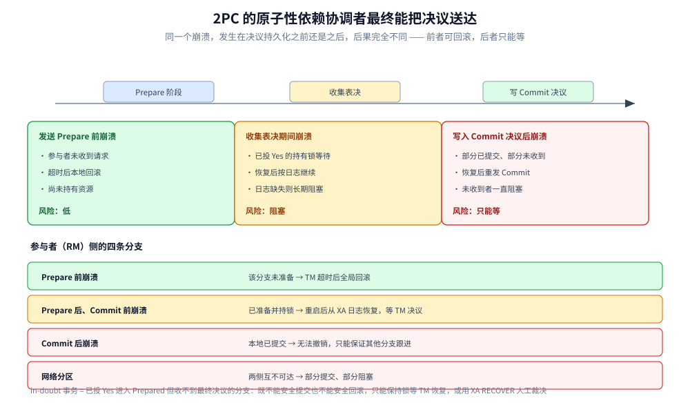
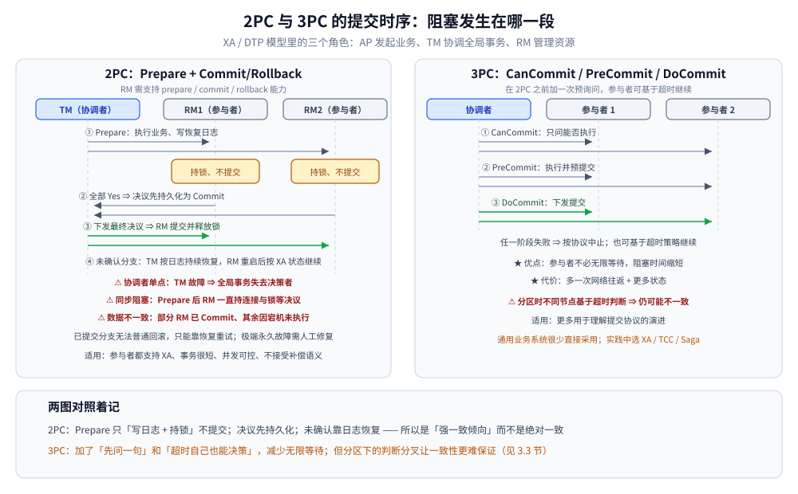

# 2PC 与 3PC

> 覆盖：XA / DTP 的角色模型、2PC 的提交与回滚路径、协调者/参与者/网络故障下的阻塞与不一致、3PC 的改进与残留问题，以及 Seata AT 与数据库 XA 的定位差别。
>
> 不覆盖：TCC、Saga 与消息最终一致见同目录各篇；Seata 的依赖、配置与代码写法见 [接入Seata.md](../../../01-编程语言/java/工程实践/接入Seata.md)；DTM 的 XA 骨架见 [接入DTM.md](../../../01-编程语言/go/工程实践/接入DTM.md)；产品级横评见 [分布式事务选型对比.md](../../../03-数据与中间件/中间件/分布式事务/分布式事务选型对比.md)。
>
> 内容整理自个人学习笔记，并参考《大型网站技术架构：核心原理与案例分析》（李智慧）相关章节。

---

## 一、XA / DTP 把角色分成了哪几方？

**本节要点**：XA 不是一种事务算法，而是一套**角色分工与接口标准**；2PC 是在这套接口上跑的两阶段提交协议。

X/Open DTP 把系统分为三个角色：

| 角色 | 全称 | 负责什么 | 典型实现 |
|---|---|---|---|
| **AP** | Application Program | 发起业务，定义全局事务边界 | 业务服务 |
| **TM** | Transaction Manager | 协调全局事务，决定提交或回滚 | Seata TC、DTM、JTA 事务管理器 |
| **RM** | Resource Manager | 管理数据库、消息系统等资源，执行分支事务 | MySQL、Oracle、MQ |

XA 是 TM 与 RM 之间的标准接口，RM 需要支持 `prepare`、`commit`、`rollback` 等能力；一个全局事务由多个 XA 分支组成，每个分支对应一个 RM。

> ⭐ 关键认知：**XA 解决的是协议与角色分工，不代表天然高可用**。协调者、网络和参与者故障仍需要日志恢复、超时与重试；标准只规定「怎么问、怎么答」，不保证「一定问得到」。

## 二、2PC 的两个阶段各做什么？

**本节要点**：第一阶段只做「能不能提交」的表决并**持有资源**，第二阶段才做最终决定；阻塞和锁都发生在两阶段之间。

### 2.1 提交路径

1. **Prepare 阶段**：TM 向所有 RM 发起准备请求；RM 执行业务、写入恢复日志并持有锁，但不最终提交。
2. 所有 RM 都返回 Yes，TM 将全局决议持久化为 Commit；任一 RM 返回 No 或超时，则决议为 Rollback。
3. **Commit / Rollback 阶段**：TM 向每个 RM 下发最终决议，RM 完成本地事务、释放锁并确认。
4. 未确认分支由 TM 根据持久化日志持续恢复，RM 重启后也根据 XA 状态继续完成。

```text
AP        TM                         RM1        RM2
 |         |                          |          |
 |--begin->|                          |          |
 |         |--prepare----------------->|          |
 |         |                          | 执行+日志+持锁
 |         |<---------yes-------------|          |
 |         |--prepare---------------------------->|
 |         |<-------------------------yes---------|
 |         | 持久化全局决议=Commit     |          |
 |         |--commit------------------>|          |
 |         |<---------ok---------------|          |
 |         |--commit---------------------------->|
 |         |<-------------------------ok----------|
 |<--done--|                          |          |
```

### 2.2 回滚路径

任一 RM 返回 No、超时或 TM 判定失败，全局决议为 Rollback：TM 向所有已 Prepare 的分支下发 `rollback`，RM 用恢复日志撤销本地修改并释放锁。**未 Prepare 成功的分支不需要回滚**，但 TM 仍要确保它们没有留下部分写入。

### 2.3 为什么 Prepare 之后必须持锁

RM 在 Prepare 阶段已经执行了业务修改，只是尚未提交。为了让其他事务看不到未提交数据、也为了能在第二阶段真正提交，RM 必须保留：

- **回滚日志 / 前镜像**：用于撤销；
- **行锁或其他并发控制资源**：防止其他事务修改同一行；
- **数据库连接**：XA 分支通常与连接绑定，等待期间连接不能归还池。

这三样合起来解释了 2PC 的性能特征：**事务越长、分支越多、热点行竞争越激烈，锁和连接被占用的时间就越长**。

## 三、协调者和参与者故障分别会怎样？

**本节要点**：2PC 的原子性依赖「协调者最终能把决议送达」；在决议持久化前后，故障后果完全不同。

| 故障时点 | 参与者状态 | 恢复方式 | 风险 |
|---|---|---|---|
| TM 在发送 Prepare 前崩溃 | 参与者未收到请求 | 超时后本地回滚 | 低，尚未持有资源 |
| TM 在收集表决期间崩溃 | 已投票 Yes 的参与者持锁等待 | TM 恢复后按日志继续；若日志缺失则长期阻塞 | ⚠️ 阻塞，可能人工介入 |
| TM 在写入 Commit 决议后崩溃 | 部分参与者已提交，部分未收到 | TM 恢复后重发 Commit | 未收到者阻塞，直到恢复 |
| RM 在 Prepare 前崩溃 | 该分支未准备 | TM 超时后全局回滚 | 低 |
| RM 在 Prepare 后、Commit 前崩溃 | 已准备并持锁 | 重启后从 XA 日志恢复，等待 TM 决议 | 日志丢失会导致不一致 |
| RM 在 Commit 后崩溃 | 本地已提交 | 重启后确认已提交 | 无法撤销，只能保证其他分支跟进 |
| 网络分区 | 两侧互相不可达 | 等待恢复或超时决策 | ⚠️ 部分提交、部分阻塞 |

### 3.1 什么是 in-doubt 事务？

参与者已经投票 Yes 并进入 Prepared 状态，但迟迟收不到 TM 的最终决议，这个分支称为 **in-doubt（悬挂/存疑）事务**。它既不能安全提交，也不能安全回滚，只能：

1. 保持锁，等待 TM 恢复；
2. 由运维通过 `XA RECOVER` 找到并联系 TM 或人工裁决；
3. 极端情况下，某些 RM 允许启发式提交/回滚（heuristic commit / rollback），这会直接破坏全局原子性，必须告警并人工修复。

> ⚠️ 「协调者做了高可用」只能降低 in-doubt 的出现概率，不能消除协议本身对协调者的依赖。



时间轴上一共三次崩溃机会，越往右代价越大：Prepare 之前崩，参与者什么都没拿到，超时回滚即可；表决期间崩，投了 Yes 的分支已经持锁在等，日志缺失就是长期阻塞；写完 Commit 决议之后崩，部分参与者已提交、部分还没收到，恢复前只能干等。下面那四条参与者分支是同一件事的另一面——`Commit 后崩溃` 那一行最需要注意，本地已提交就再也撤不回来了。

### 3.2 2PC 能保证隔离性吗？

不能完整保证。XA 标准主要定义**原子提交**，不定义全局隔离级别。参与者本地锁能在一定程度上阻止脏写，但跨资源的读写冲突、不可重复读等仍由各库的隔离级别决定；Seata AT 甚至默认表现为全局读未提交（见第六节）。

## 四、2PC 的三个必答问题是什么？

**本节要点**：2PC 的代价集中在三处——协调者单点、Prepare 后同步阻塞、二阶段部分成功导致的不一致。

- ⚠️ **协调者单点**：TM 故障会让全局事务失去决策者；集群和持久化日志能提高可用性，但不能消除协议依赖。
- ⚠️ **同步阻塞**：Prepare 成功后 RM 必须持有数据库连接和锁等待决议，慢分支会放大锁竞争并拖低吞吐。
- ⚠️ **数据不一致**：二阶段中部分 RM 已 Commit、另一些因网络或宕机未执行；已提交分支无法普通回滚，只能依赖恢复重试，极端永久故障需人工修复。

**适用**：参与者都支持 XA、事务很短、并发量可控、无法接受业务补偿语义的场景；不适合长流程和高峰交易链路。

## 五、3PC 改进了什么、又留下了什么问题？

**本节要点**：3PC 把 2PC 的 Prepare 拆成 CanCommit 与 PreCommit，并让参与者在超时后可以自主决策；它缩短了部分阻塞，但没有解决网络分区下的不一致。

### 5.1 三个阶段

1. **CanCommit**：协调者询问参与者是否具备执行条件，不持有最终资源。
2. **PreCommit**：全部同意后执行并预提交，参与者记录状态并应答。
3. **DoCommit**：协调者下发提交；任一阶段失败则按协议中止或基于超时策略继续。

### 5.2 超时决策改了什么

- 在 CanCommit 阶段等待超时：参与者可以安全中止，因为还没有真正准备。
- 在 PreCommit 之后等待 DoCommit 超时：参与者可以**假定所有人都同意过**，自行提交。
- 协调者在 PreCommit 超时：可以中止。

这套超时规则减少了「参与者无限等待协调者」的情况，但引入了新的假设：**超时等于对方崩溃**。网络分区不是崩溃——被分区隔开的子集可能各自做出不同决定，仍然出现一部分提交、一部分回滚。

### 5.3 为什么工程上很少用

- 多一次网络往返和更多状态，吞吐进一步下降；
- 网络分区下仍可能不一致，收益不足以抵消复杂度；
- 成熟数据库与中间件普遍只提供 XA（2PC），3PC 更多用于理解提交协议的演进。

> 实践中通常选择成熟 XA、TCC 或 Saga，而不是自己实现 3PC。



两种协议的差别集中在那段持锁窗口：2PC 在 Prepare 之后一直握锁等决议，3PC 多一次往返换来「超时后可自行决策」；但 TM 单点与二阶段部分提交这两个问题在 3PC 里只是被缩小，并没有被消掉。对照第三节那张故障时点表看，能看出多出来的那次往返买到的到底是什么。

## 六、Seata AT 与数据库 XA 是什么关系？

**本节要点**：Seata AT 也是「两阶段」，但第一阶段就提交了本地事务；它靠 `undo_log` 反向补偿和全局锁防脏写，不是数据库原生 XA。

| 维度 | 数据库 XA | Seata AT | Seata XA |
|---|---|---|---|
| **第一阶段** | Prepare，不提交，持有数据库锁 | 本地事务直接提交（业务 + `undo_log`），获取全局锁 | 数据库 XA Prepare |
| **第二阶段提交** | 数据库 Commit | 异步删除 `undo_log` | 数据库 XA Commit |
| **第二阶段回滚** | 数据库 Rollback | 按 `undo_log` 生成反向 SQL | 数据库 XA Rollback |
| **隔离性** | 由数据库锁与隔离级别决定 | 默认全局读未提交；靠全局锁防脏写 | 接近数据库 XA |
| **业务侵入** | 低 | 低（数据源代理） | 低 |
| **适用** | 短事务、数据库支持 XA | 关系型数据库、普通 CRUD | 短事务、需要原生 XA 语义 |

AT 的关键点：

- 一阶段提交后，其他事务可能已经读到未全局提交的数据，所以默认是**全局读未提交**；
- 全局锁只防「脏写」，不提供完整隔离；
- 回滚依赖 `undo_log` 的前后镜像，因此业务表必须有主键，且 SQL 要能被代理解析；
- 被调服务也要接入 Seata 并透传 XID，否则分支不在同一个全局事务里。

具体依赖、数据源代理、`undo_log` 建表与 TCC 注解写法见 [接入Seata.md](../../../01-编程语言/java/工程实践/接入Seata.md)；TCC 本身的语义见 [TCC.md](TCC.md)。

## 七、应用场景

| 场景 | 是否适合 | 原因 |
|---|---|---|
| 同构数据库之间的短事务（分库转账、跨库扣减） | ✅ | 都支持 XA，事务短，业务不想写补偿 |
| 分库分表中间件的跨片写入 | ✅ / ⚠️ | 取决于中间件是否内置 2PC；热点行仍是瓶颈 |
| 金融核心的强一致扣款 | ✅ | 可接受短时锁与较低吞吐，要求确定性 |
| 跨服务长流程（订单履约、旅行预订） | ❌ | 锁与连接占用时间不可控，应改用 Saga |
| 异构资源（数据库 + 缓存 + 外部支付） | ❌ | 外部系统不支持 XA，无法纳入同一提交 |
| 高并发热点行更新 | ❌ | Prepare 持锁会放大竞争，吞吐急剧下降 |

常见产品：MySQL / Oracle 的 XA、Seata AT 与 XA、DTM 的 XA 模式、JTA 事务管理器（Atomikos、Narayana）。

## 八、具体使用

**本节要点**：业务代码通常不直接写 XA 命令，而是由 TM 或框架生成；理解下面的 SQL 是为了排障时能看懂「分支停在哪一步」。

```sql
-- 分支 1
XA START 'tx-20261019-001';
UPDATE account SET balance = balance - 30 WHERE id = 1;
XA END 'tx-20261019-001';
XA PREPARE 'tx-20261019-001';

-- 分支 2
XA START 'tx-20261019-002';
UPDATE account SET balance = balance + 30 WHERE id = 2;
XA END 'tx-20261019-002';
XA PREPARE 'tx-20261019-002';

-- 全部分支 Prepare 成功
XA COMMIT 'tx-20261019-001';
XA COMMIT 'tx-20261019-002';

-- 任一分支失败
XA ROLLBACK 'tx-20261019-001';
XA ROLLBACK 'tx-20261019-002';
```

排障命令与判读：

| 命令 / 现象 | 说明 |
|---|---|
| `XA RECOVER;` | 列出当前处于 Prepared 状态的分支；大量记录说明有 in-doubt 事务 |
| 分支一直不返回 | 检查 TM 是否存活、网络是否可达、数据库连接池是否耗尽 |
| 部分分支已提交、部分未提交 | 按全局 XID 找 TM 日志，确认决议后重放；不要直接手工改余额 |
| `XA PREPARE` 很慢 | 检查热点行锁等待、磁盘刷盘与连接池配置 |

> ⚠️ 生产系统不要手工拼接 XA 语句来「修复」数据；优先通过 TM 的重试/恢复入口处理，并保留操作审计。

## 延伸追问

- **2PC 有什么问题？** → 协调者单点、Prepare 后同步阻塞、二阶段部分成功导致暂时或永久不一致；HA 和日志恢复只能缓解，不能消除协议代价。
- **3PC 为什么没有普及？** → 多一次往返与更多状态只能降低部分阻塞；网络分区下超时自主决策仍可能不一致，收益通常不如成熟 XA/TCC/Saga。
- **Prepare 成功后为什么不能单方面回滚？** → 其他分支可能已经收到 Commit 并提交；单方面回滚会破坏全局原子性，只能等待 TM 决议或人工裁决。
- **什么是 in-doubt 事务？** → 已 Prepare 但收不到最终决议的分支；它持锁等待，需通过 `XA RECOVER` 与 TM 日志定位。
- **2PC 能保证隔离性吗？** → 不能完整保证；XA 只定义原子提交，隔离性仍取决于各库的锁与隔离级别。
- **Seata AT 是 2PC 吗？** → 是两阶段形态，但一阶段已提交本地事务，二阶段用 `undo_log` 补偿，不是数据库原生 XA。
- **为什么 2PC 性能差？** → Prepare 后锁、日志与连接都被占用，等待决议的时间直接变成吞吐损失；分支越多、越慢，放大越明显。

## 关联

- **上游/总纲**：[README.md](README.md) — 七种方案的谱系与选型
- **下游机制**：[TCC.md](TCC.md) — 用业务预留替代数据库长锁
- **下游机制**：[Saga.md](Saga.md) — 长流程的补偿路线
- **下游机制**：[最终一致方案.md](最终一致方案.md) — 消息与通知路线
- **语言实现**：[接入Seata.md](../../../01-编程语言/java/工程实践/接入Seata.md) — AT / TCC 的依赖、配置与代码
- **语言实现**：[接入DTM.md](../../../01-编程语言/go/工程实践/接入DTM.md) — DTM 的 XA 骨架
- **产品选型**：[分布式事务选型对比.md](../../../03-数据与中间件/中间件/分布式事务/分布式事务选型对比.md) — DTM vs Seata
- **对照/互补**：[事务与隔离级别.md](../../../03-数据与中间件/数据存储/关系型/MySQL/事务与隔离级别.md) — 本地事务的锁与隔离级别
- **对照/互补**：[分布式锁.md](../../../03-数据与中间件/数据存储/NoSQL/Redis/分布式锁.md) — 只解决互斥，不解决原子提交
> 反向引用（本篇被下列文档引到）：[关系型选型对比.md](../../../03-数据与中间件/数据存储/关系型/关系型选型对比.md)
