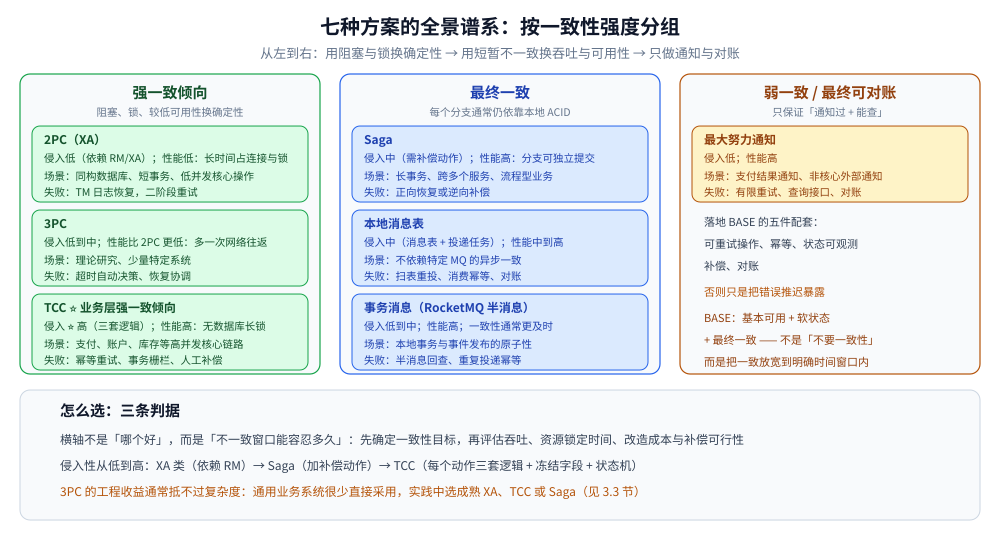

# 分布式事务

> 覆盖：跨服务、跨库的一组写入为什么不能靠本地事务解决；七种主流方案的谱系与选型判据；落地时共用的幂等、重试、补偿与对账能力；以及本目录五篇的分工与阅读顺序。
>
> 不覆盖：单机事务、隔离级别与 MVCC 见 [README.md](../../../03-数据与中间件/数据存储/并发控制/README.md) 与 [事务与隔离级别.md](../../../03-数据与中间件/数据存储/关系型/MySQL/事务与隔离级别.md)；中间件产品级横评见 [分布式事务选型对比.md](../../../03-数据与中间件/中间件/分布式事务/分布式事务选型对比.md)；Seata 与 DTM 的代码接入分别见 [接入Seata.md](../../../01-编程语言/java/工程实践/接入Seata.md) 与 [接入DTM.md](../../../01-编程语言/go/工程实践/接入DTM.md)。
>
> 内容整理自个人学习笔记，并参考《大型网站技术架构：核心原理与案例分析》（李智慧）相关章节；素材见 [素材清单.md](../../../素材清单.md)。

---

## 一、本地事务为什么不够？

**本节要点**：本地事务的原子性边界只覆盖**单个资源管理器**；跨库之后，每个数据库只能决定自己的本地事务，没有一个内核同时掌握所有参与者的提交点。

单机事务依靠同一个数据库内核管理日志、锁和提交点。跨库、跨服务后，这条边界被拆开了：

- 每个库只能保证自己的 `COMMIT` 或 `ROLLBACK`，无法天然感知其他参与者的结果；
- 网络可能超时、断开或重复传输，调用方看到的「失败」也可能只是响应丢失；
- 各参与者可能在不同时间提交，且不存在覆盖全部资源的全局数据库锁；
- 业务还要调用缓存、消息队列、外部支付等**不支持本地事务**的资源。

所以本地 ACID 不是失效了，而是它的原子性边界不够大。分布式事务是在多个本地事务之上，增加**协调、补偿、重试、幂等和对账**。

典型问题：订单创建成功但库存未扣减、支付扣款成功但商户入账失败、跨行转账只完成一边、业务落库成功但事件没有可靠发布。

> ⭐ 判断一个问题是不是分布式事务，只看两件事：**写入是否跨了多个资源**，以及**这些资源能不能一起提交或一起撤销**。同一个库里的多表写入仍然是本地事务。

## 二、跨服务一致性有哪几条路？

**本节要点**：所有方案可以归成三族——**原子提交**（用协议或锁换确定性）、**业务补偿**（用新的业务动作抵消旧动作）、**消息通知**（用可靠投递 + 幂等 + 对账逼近一致）。

| 族 | 代表方案 | 一致性形态 | 主要代价 | 典型场景 |
|---|---|---|---|---|
| **原子提交** | 2PC（XA）、3PC、Seata AT | 强一致倾向；故障恢复期可能阻塞 | 长时间持锁、占连接；协调者与网络依赖 | 同构数据库、短事务、低并发核心操作 |
| **业务补偿** | TCC、Saga | TCC 在业务层预留资源；Saga 最终一致 | 要写补偿逻辑；TCC 是三套接口 | 支付 / 账户 / 库存；跨服务长流程 |
| **消息通知** | 本地消息表、事务消息、最大努力通知 | 最终一致 | 允许中间态；要消费幂等与对账 | 落库后发事件、支付回调、跨系统通知 |

### 2.1 BASE 到底放宽了什么？

BASE 是 **Basically Available、Soft State、Eventually Consistent**：优先维持基本可用，允许短时间的中间状态，最终通过异步处理恢复一致。

它不是「不要一致性」，而是把一致性从「每次请求返回前立即完成」放宽为「在**明确的时间窗口**内最终完成」。落地 BASE 必须有四件配套：

1. 操作可重试，且重试不会产生额外副作用；
2. 每个写入口有幂等键；
3. 中间状态可查询、可观测；
4. 有补偿或对账兜底。

> ⚠️ 说不出收敛窗口的「最终一致」等于「不知道什么时候一致」。工程上要给出可度量的目标，例如「支付成功后 P99 在 1 秒内可查到订单状态」，并配监控。

### 2.2 与 ACID、CAP 是什么关系？

ACID 描述**事务边界内**的正确性，BASE 描述**跨边界**时常用的工程取舍，两者不是互斥关系——最终一致方案的每个分支，通常仍依靠本地 ACID。

强一致协议用阻塞、锁和较低可用性换确定性；业务补偿方案用短暂不一致换吞吐与可用性。CAP 只说明网络分区下的一致性与可用性取舍，定义与示例见 [CAP与PACELC.md](../理论基础/CAP与PACELC.md)。

## 三、七种方案怎么对照？

**本节要点**：七种方案的差别不在「谁更先进」，而在**一致性强度、锁窗口、业务侵入和失败处理**四个维度上的取舍。

| 方案 | 一致性强度 | 业务侵入性 | 性能 | 典型场景 | 典型失败处理 | 实现复杂度 |
| --- | --- | --- | --- | --- | --- | --- |
| **2PC（XA）** | 强一致倾向；故障恢复期间可能阻塞 | 低，依赖 RM/XA | 低，长时间占连接与锁 | 同构数据库、短事务、低并发核心操作 | TM 日志恢复，二阶段重试 | 中 |
| **3PC** | 强一致倾向；分区下仍非绝对 | 低到中 | 比 2PC 更低，多一次网络往返 | 理论研究、少量特定系统 | 超时自动决策、恢复协调 | 高 |
| **TCC** | 业务层强一致倾向，最终完成 Confirm/Cancel | ⭐ 高 | 高，无数据库长锁 | 支付、账户、库存等高并发核心链路 | 幂等重试、事务栅栏、人工补偿 | ⭐ 高 |
| **Saga** | 最终一致 | 中，需要补偿动作 | 高，分支可独立提交 | 长事务、跨多个服务、流程型业务 | 正向恢复或逆向补偿 | 中到高 |
| **本地消息表** | 最终一致 | 中，需要消息表与投递任务 | 中到高 | 不依赖特定 MQ 的异步一致 | 扫表重投、消费幂等、对账 | 中 |
| **事务消息** | 最终一致，通常更及时 | 低到中 | 高 | 本地事务与事件发布原子性 | 半消息回查、重复投递幂等 | 中 |
| **最大努力通知** | 弱一致 / 最终可对账 | 低 | 高 | 支付结果通知、非核心外部通知 | 有限重试、查询接口、对账 | 低到中 |



**一张图记住取舍**：从左往右，锁与阻塞在减少，业务补偿与对账责任在增加。越靠右，系统越能扛住长流程和异构资源，但越依赖「幂等 + 可观测 + 对账」这些工程能力。

## 四、怎么选？

### 4.1 决策清单

| 问题 | 选择倾向 |
| --- | --- |
| 必须强一致，参与数据库支持 XA，事务可在很短时间结束？ | **2PC / XA** |
| 核心链路高并发，资源能冻结/预留，团队能维护三阶段逻辑？ | **TCC** |
| 跨多个服务或第三方，流程持续时间长，每步可补偿？ | **Saga** |
| 只需保证「本地落库后一定发布事件」，允许短暂不一致？ | **本地消息表 / 事务消息** |
| 下游属于外部系统，只能重复通知并查询结果？ | **最大努力通知 + 对账** |
| 业务动作不可逆、没有补偿接口？ | 先重构边界：校验前置、不可逆动作后置；不要硬套 Saga |

### 4.2 推荐判断顺序

1. 写清楚一致性不变量，例如「总账恒等」「库存不能为负」，不要先选框架。
2. 明确最长可接受不一致窗口，以及失败时能否向用户展示「处理中」。
3. 判断资源是否支持 XA、能否冻结、能否补偿、是否允许重复执行。
4. 估算峰值吞吐、分支数量与最长耗时，排除会长期占锁/连接的方案。
5. 最后比较中间件成熟度、团队经验、监控与人工修复成本。

### 4.3 三条容易踩的判据

- **补偿不等于回滚**：Saga 的 `Ci` 是新的业务动作，可能受汇率、库存、外部状态影响，不能假设它能还原到字节级一致。
- **TCC 的隔离性要自己造**：TCC 不自动提供数据库隔离级别，预留资源、状态位与读接口过滤必须一起设计，详见 [TCC.md](TCC.md)。
- **消息方案不是「发出去就完了」**：至少一次投递必然带来重复，消费端幂等与对账才是闭环，详见 [最终一致方案.md](最终一致方案.md)。

## 五、本目录怎么读？

**本节要点**：先读本篇建立谱系，再按「协议 → 业务补偿 → 消息」的顺序读三篇零件；每篇都自带「应用场景」与「具体使用」，不需要按顺序背。

```text
① README.md（本篇）      ← 问题域、七方案谱系、选型决策与落地工程能力
        ↓
② 2PC与3PC.md            ← 原子提交：XA/DTP 角色、两阶段、故障与阻塞
        ↓
③ TCC.md                 ← 业务补偿（强隔离倾向）：Try / Confirm / Cancel 与三问题
        ↓
④ Saga.md                ← 业务补偿（最终一致）：长流程、正向/逆向恢复、子事务屏障
        ↓
⑤ 最终一致方案.md         ← 消息与通知：本地消息表 / 事务消息 / CDC / 最大努力通知
```

| 想解决 | 先读 | 再读 |
|---|---|---|
| 讲清「为什么本地事务不够」 | 本篇第一节 | 本篇第二节 |
| 判断该选哪一族方案 | 本篇第三、四节 | 对应零件的「适用与代价」 |
| 搞懂 XA / 2PC 的阻塞与故障 | [2PC与3PC.md](2PC与3PC.md) | [接入Seata.md](../../../01-编程语言/java/工程实践/接入Seata.md) |
| 设计支付、账户、库存的预留 | [TCC.md](TCC.md) | [转账场景.md](../../../03-数据与中间件/中间件/分布式事务/DTM/转账场景.md) |
| 设计跨服务长流程 | [Saga.md](Saga.md) | [接入DTM.md](../../../01-编程语言/go/工程实践/接入DTM.md) |
| 设计「落库后发事件」 | [最终一致方案.md](最终一致方案.md) | [消息队列选型对比.md](../../../03-数据与中间件/中间件/消息队列/消息队列选型对比.md) |
| 选具体中间件 | [分布式事务选型对比.md](../../../03-数据与中间件/中间件/分布式事务/分布式事务选型对比.md) | [DTM/README.md](../../../03-数据与中间件/中间件/分布式事务/DTM/README.md) |

## 六、应用场景

| 场景 | 首选方案 | 为什么 | 落地参考 |
|---|---|---|---|
| 同构数据库之间的短事务（如分库转账） | 2PC / XA | 各库都支持 XA，事务短，业务不想写补偿 | [2PC与3PC.md](2PC与3PC.md) |
| 支付扣款、账户余额、库存预占 | TCC | 高并发下不能长期持数据库锁，资源可以冻结 | [TCC.md](TCC.md)、[支付系统设计.md](../../系统设计/秒杀系统/支付系统设计.md) |
| 订单履约、旅行预订、跨组织审批 | Saga | 流程长、参与方多，每步都有可补偿动作 | [Saga.md](Saga.md)、[订单系统设计.md](../../系统设计/秒杀系统/订单系统设计.md) |
| 下单成功后扣减积分、发通知、更新索引 | 本地消息表 / 事务消息 | 只需保证「本地落库后一定发布事件」 | [最终一致方案.md](最终一致方案.md) |
| 支付结果回调给商户 | 最大努力通知 + 对账 | 外部系统只能重复通知并查询结果 | [最终一致方案.md](最终一致方案.md) |
| 秒杀扣库存与建订单 | 本地消息表 + 幂等消费（必要时 TCC） | 峰值高，跨服务，允许短暂不一致 | [总体设计.md](../../系统设计/秒杀系统/总体设计.md)、[优惠券系统设计.md](../../系统设计/秒杀系统/优惠券系统设计.md) |

## 七、落地要准备哪些工程能力？

**本节要点**：无论选哪种方案，生产上都要补齐同一组能力——幂等、全局事务 ID、超时重试、补偿可见性、告警与人工介入、对账。缺一项，方案就会在故障时退化成人工修数据。

### 7.1 必备能力清单

| 能力 | 落地要求 |
| --- | --- |
| **幂等设计** | 业务唯一键 + 数据库唯一索引优先；状态机使用带条件 `UPDATE`，幂等记录与业务写同事务 |
| **全局事务 ID 透传** | Seata 透传 XID，DTM 透传 gid；HTTP/RPC/MQ Header、日志、Trace 和业务流水统一关联 |
| **超时与重试** | 业务失败立即终止；网络异常按指数退避加抖动；每次重试有上限、截止时间和幂等保证 |
| **补偿可见性** | 展示全局/分支状态、重试次数、最后错误和下一次重试时间；禁止「后台悄悄重试但无人知道」 |
| **告警** | 补偿超过阈值、事务超时、积压增长、XA 悬挂、对账差异均需分级告警 |
| **人工介入** | 提供按 xid/gid 查询、重试、跳过、补偿和生成修复单的受控后台，操作必须审计 |
| **对账与兜底** | 定时按业务不变量核对上下游，以权威数据源为准生成差异单；自动修复失败后转人工 |

### 7.2 幂等键怎么选

- 用**业务唯一键**（订单号 + 动作、支付单号 + 事件类型），不要用请求时间或自增 ID。
- 唯一索引负责并发裁决；「先查有没有，再写入」在并发下必然漏判。
- 幂等记录与业务结果必须落在同一个本地事务里，否则会出现「记录成功、业务没做」或反过来。

具体建表与消费端写法见 [最终一致方案.md](最终一致方案.md) 第六节。

### 7.3 超时、重试与补偿的边界

- 区分**业务失败**与**技术失败**：余额不足不应重试，连接超时可以重试；未知结果先查询状态再决定。
- Try/正向操作设置较短超时；Confirm/Cancel/补偿以「最终成功」为目标持续恢复，但达到阈值必须告警。
- 重试使用指数退避和随机抖动，设置单分支超时、全局截止时间与熔断，避免故障服务被重试风暴压垮。
- 补偿接口也可能失败，必须和正向接口同等级监控；补偿参数要保留业务快照，不能依赖可能已变化的当前值。

### 7.4 长事务怎么拆

1. 按业务状态拆成可独立提交的小步骤，每一步都产生可查询的持久化状态。
2. 把校验和可回滚动作放前面，把发货、外部打款等不可逆动作后置。
3. 不在数据库事务内等待用户输入、第三方回调或慢 RPC；提交本地状态后异步推进。
4. 对外展示「处理中/补偿中」，不要为了伪装同步体验而长期持锁。
5. 为每一步定义成功、业务失败、技术失败、超时和人工接管路径，并用故障注入验证。

## 八、产品选型与语言接入在哪里？

**本节要点**：本目录只回答「用哪种方案、为什么」；「引哪个组件、代码怎么写」分属 03 中间件目录与 01 语言目录，避免方案说明和产品参数互相污染。

| 要看什么 | 去哪里 |
|---|---|
| DTM vs Seata 的能力对照与产品选型 | [分布式事务选型对比.md](../../../03-数据与中间件/中间件/分布式事务/分布式事务选型对比.md) |
| DTM 的原理、模式、部署与转账示例 | [README.md](../../../03-数据与中间件/中间件/分布式事务/DTM/README.md) |
| Go 侧接入 DTM（Saga / TCC / 二阶段消息 / XA） | [接入DTM.md](../../../01-编程语言/go/工程实践/接入DTM.md) |
| Java 侧接入 Seata（AT / TCC） | [接入Seata.md](../../../01-编程语言/java/工程实践/接入Seata.md) |
| 事务消息、本地消息表与各 MQ 的对照 | [消息队列选型对比.md](../../../03-数据与中间件/中间件/消息队列/消息队列选型对比.md) |

> ⚠️ 顺序不能反：先按业务不变量确定方案与最长可接受不一致窗口，再挑产品。先挑产品再想方案，通常会在补偿和幂等上返工。

## 延伸追问

- **分布式事务能做到强一致吗？** → XA/TCC 可提供强一致倾向，但网络分区、阻塞、恢复窗口和外部不可事务资源决定了绝对强一致的代价很高；需要先限定故障模型。
- **为什么大厂常选最终一致 + 对账？** → 它缩短锁时间、提升可用性和吞吐，适配异构资源；用幂等、补偿、监控和对账把风险变成可发现、可恢复的工程问题。
- **如何解决重复请求和重复补偿？** → 使用业务幂等键、数据库唯一索引、状态机条件更新或事务栅栏；幂等判定与业务结果必须位于同一本地事务。
- **锁能替代分布式事务吗？** → 不能。锁只解决互斥，不解决原子提交与回滚；跨服务的「要么都成功」仍要靠事务或补偿，见 [分布式锁.md](../../../03-数据与中间件/数据存储/NoSQL/Redis/分布式锁.md)。
- **没有补偿接口的业务怎么办？** → 先改流程：把不可逆动作后置、把校验前置；实在无法补偿，就不要把它纳入需要回滚的边界，改用「状态机 + 人工处理」。
- **方案选错会有什么表现？** → 长流程用了 2PC，表现为锁等待和连接耗尽；高并发核心链路用了 Saga，表现为中间态和补偿风暴；不可逆动作用了 TCC，表现为 Cancel 永远失败。

**一句话速记**：短而强一致看 XA，高并发核心资源看 TCC，长流程看 Saga，异步最终一致看消息方案，所有方案最后都要落到幂等、可观测、补偿和对账。

## 关联

- **上游/总纲**：[分布式与微服务.md](../分布式与微服务.md) — 拆库之后为什么多出跨服务一致性问题
- **上游/理论**：[一致性模型.md](../理论基础/一致性模型.md)、[CAP与PACELC.md](../理论基础/CAP与PACELC.md) — BASE、CAP 与一致性强度的上层定义
- **下游机制**：[2PC与3PC.md](2PC与3PC.md) — 原子提交协议与 XA 的阻塞代价
- **下游机制**：[TCC.md](TCC.md) — 业务层预留与三阶段接口
- **下游机制**：[Saga.md](Saga.md) — 长流程的补偿与子事务屏障
- **下游机制**：[最终一致方案.md](最终一致方案.md) — 消息、Outbox、CDC、通知与对账
- **产品选型**：[分布式事务选型对比.md](../../../03-数据与中间件/中间件/分布式事务/分布式事务选型对比.md) — DTM vs Seata 的产品级横评
- **语言实现**：[接入DTM.md](../../../01-编程语言/go/工程实践/接入DTM.md)（Go）、[接入Seata.md](../../../01-编程语言/java/工程实践/接入Seata.md)（Java）
- **对照/互补**：[事务与隔离级别.md](../../../03-数据与中间件/数据存储/关系型/MySQL/事务与隔离级别.md) — 单机 ACID 的边界
- **对照/互补**：[分布式锁.md](../../../03-数据与中间件/数据存储/NoSQL/Redis/分布式锁.md) — 只提供互斥，不提供原子提交
