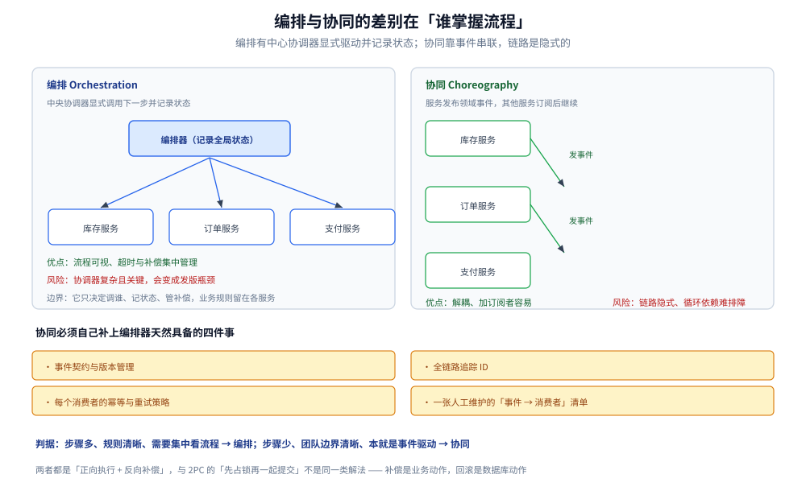
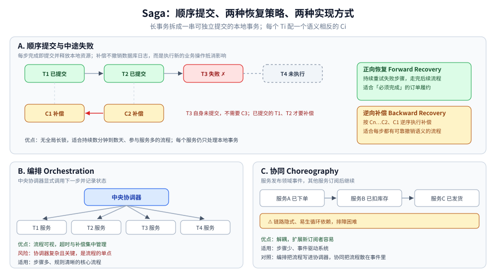

# Saga

> 覆盖：Saga 与数据库回滚的本质区别、正向恢复与逆向补偿的选择、编排与协同两种实现、无隔离性带来的中间态问题及缓解手段，以及子事务屏障如何一次处理幂等 / 空补偿 / 悬挂。
>
> 不覆盖：2PC / XA 的协议细节见 [2PC与3PC.md](2PC与3PC.md)；TCC 的资源预留见 [TCC.md](TCC.md)；消息与通知路线见 [最终一致方案.md](最终一致方案.md)；DTM 的完整接入代码见 [接入DTM.md](../../../01-编程语言/go/工程实践/接入DTM.md)。
>
> 内容整理自个人学习笔记，并参考《大型网站技术架构：核心原理与案例分析》（李智慧）相关章节。

---

## 一、Saga 与「回滚」有什么本质区别？

**本节要点**：Saga 不撤销数据库日志，而是为每个已完成的步骤执行一个**语义相反的业务动作**；它保证的是业务层面的最终一致，不是物理层面的原子回滚。

Saga 把长事务拆成一串可独立提交的本地事务 `T1、T2 ... Tn`，每个步骤配一个补偿 `C1、C2 ... Cn`：

```text
正向：T1 → T2 → T3 → ... → Tn
失败：Tn 失败 → Cn-1 → ... → C2 → C1
```

两个关键差别：

| 维度 | 数据库回滚 | Saga 补偿 |
|---|---|---|
| **作用对象** | 日志与数据页 | 业务状态与外部资源 |
| **语义** | 恢复到事务开始前 | 执行一个新动作抵消旧动作 |
| **是否总能做到** | 同一事务内可以 | 不一定；发货、外部打款等可能不可逆 |
| **隔离性** | 由数据库保证 | 基本没有，中间态对外可见 |

因此 Saga 的设计原则是：**把不可逆动作尽量后置**。前面多放校验、预占、可撤销的步骤，后面才放发货、出票、外部打款。

> ⚠️ 「补偿」不等于「撤销」。退款是补偿扣款，但不是让扣款从未发生；取消预订是补偿占位，但可能产生手续费。补偿的业务结果必须提前定义清楚。

## 二、正向恢复与逆向补偿怎么选？

**本节要点**：正向恢复适合「必须完成」的流程，逆向补偿适合「可以放弃」的流程；选择发生在失败那一刻，但可行性要在设计时就确定。

| 策略 | 何时选 | 做法 | 主要风险 |
|---|---|---|---|
| **正向恢复（Forward Recovery）** | 失败是暂时的，业务必须完成 | 持续重试失败步骤，成功后继续后续步骤 | 重试风暴；步骤不幂等会重复生效 |
| **逆向补偿（Backward Recovery）** | 失败不可恢复，或业务允许放弃 | 按 `Cn-1 ... C1` 逆序执行补偿 | 补偿失败；补偿参数已过期 |
| **混合策略** | 不同步骤语义不同 | 对可重试步骤正向恢复，对已不可逆步骤转人工 | 状态机复杂，需要人工入口 |

落地要求：

1. 每一步都要有**持久化状态**（待执行 / 成功 / 补偿中 / 已补偿 / 人工接管）；
2. 正向与补偿都必须**幂等**，因为重试不可避免；
3. 补偿要使用**业务快照**（当时扣了多少、冻结了哪个额度），不能读当前值反推；
4. 设置重试上限与告警阈值，超过后转人工，不要让事务无限挂起。

## 三、编排与协同怎么选？

**本节要点**：编排由中心协调器显式控制流程，适合步骤多、规则清晰的业务；协同靠事件驱动，适合步骤少、团队边界清晰的系统。

| 实现 | 工作方式 | 优点 | 风险与适用 |
| --- | --- | --- | --- |
| **编排 Orchestration** | 中央协调器显式调用下一步并记录状态 | 流程可视、超时补偿集中管理 | 协调器复杂且关键；适合步骤多、规则清晰的核心流程 |
| **协同 Choreography** | 服务发布领域事件，其他服务订阅后继续 | 解耦、扩展新订阅者容易 | 链路隐式、循环依赖与排障困难；适合步骤少、事件驱动系统 |



两种形态的差别不在技术，而在「谁能一眼看出流程长什么样」：编排的图本身就是一张可执行的流程图，协同的图是事后从事件契约里拼出来的。所以协同落地时必须自己补上编排器天然具备的四件事，否则新人接手时面对的是一组互相发事件的盒子，没有任何一处能回答「这个流程走到哪了」。

### 3.1 编排器的职责边界

编排器不是「把业务逻辑都写在一起」，它只负责：

- 决定下一步调用谁；
- 记录全局与分支状态；
- 处理超时、重试与补偿顺序；
- 暴露查询与人工干预入口。

业务规则仍应留在各参与服务里。否则编排器会退化成新的单体，并且成为所有团队的发版瓶颈。

### 3.2 协同的隐式依赖

协同模式下，没有一张全局流程图，链路靠事件串起来。上线新订阅者时容易形成隐式耦合：发布方不知道谁在消费，消费方也不知道事件顺序。至少要补：

- 事件契约与版本管理；
- 全链路追踪 ID；
- 每个消费者的幂等与失败重试策略；
- 一张人工维护的「事件 → 消费者」清单。

## 四、没有隔离性会看到什么、怎么缓解？

**本节要点**：Saga 的每一步提交后立即对其他事务可见，因此会出现中间态、脏读和覆盖；只能靠语义锁、预留、状态位和重试策略缓解，不能完全消除。

| 现象 | 例子 | 缓解手段 |
|---|---|---|
| **中间态可见** | 订单已创建、库存已扣，但支付尚未完成 | 对外展示「处理中」；查询接口按状态过滤 |
| **脏读** | 其他请求读到尚未最终确认的余额或库存 | 语义锁；读接口排除未确认数据 |
| **更新丢失** | 两个 Saga 同时修改同一资源，后写覆盖前写 | 版本号 / 条件更新；串行化关键步骤 |
| **补偿读到新值** | 补偿时按当前余额退款，而不是按扣款快照 | 补偿参数保存业务快照 |
| **重复消费** | 重试导致同一步骤执行两次 | 幂等键 + 唯一索引；状态机条件更新 |

常用模式：

- **语义锁（Semantic Lock）**：在业务记录上标记「处理中」，其他事务看到标记后拒绝或等待；
- **资源预留**：先冻结额度，Confirm 时才真正扣减（这是 TCC 的思路，Saga 也可以局部借用）；
- **可交换操作**：把「加/减」设计成可交换的增量，降低乱序影响；
- **重读与重试**：对冲突失败的操作重新读取状态再决定，而不是盲目覆盖。

> ⭐ Saga 是 BASE 的典型实现：接受中间态，换取无长锁与高吞吐。需要强隔离的短事务，应该选 [TCC.md](TCC.md) 或 2PC。

## 五、子事务屏障解决了哪三个问题？

**本节要点**：DTM 把「幂等 / 空补偿 / 悬挂」收进框架，靠业务库里的屏障表和唯一键裁决；理论上的三个问题，在代码里落到一张表和一个 `CallWithDB` 回调。

DTM 的子事务屏障（Sub-Transaction Barrier）机制如下：

1. 业务库建 `dtm_barrier.barrier` 表，唯一键 `(gid, branch_id, op, barrier_id)`；
2. 每个分支用 `BarrierFromQuery` 从请求参数构造屏障，再用 `CallWithDB(db, fn)` 包住业务逻辑；
3. 屏障插入与业务更新在**同一个本地事务**里提交；
4. 重复请求插入冲突 → 按幂等处理，不再执行业务；
5. 补偿先到、找不到正向记录 → 判为空补偿，写入回滚标记后跳过；
6. 回滚标记已存在时迟到的正向请求 → 判为悬挂，直接拒绝。

这三个判定不需要业务自己写「先查后改」，也不需要内存标志；唯一键和本地事务就是裁决者。完整代码、ORM 取 `*sql.Tx` 的方式与容器实测读数见 [接入DTM.md](../../../01-编程语言/go/工程实践/接入DTM.md) 第二节；屏障的判定流程与服务端配合见 [原理与架构.md](../../../03-数据与中间件/中间件/分布式事务/DTM/原理与架构.md) 第三节。

> ⚠️ 屏障不是「自动帮你重试」，它只保证重复与乱序请求不产生额外副作用；真正的正向推进仍由协调器负责。



左半边是两种恢复方向的选择——正向重试把流程推完、逆向补偿把已做的撤掉；右半边是两种实现形态的中心结构差异，编排有一个显式的中心，协同连一个能画出全流程的地方都没有。这张图画在应用场景之前，作用是把前面四节的机制收成一张总图。

## 六、应用场景

| 场景 | 是否适合 | 原因 |
|---|---|---|
| 旅行预订（机票 + 酒店 + 租车） | ✅ | 多个外部服务、流程长、每步都有取消语义 |
| 订单履约（扣库存 → 支付 → 发货） | ✅ | 发货前可补偿；发货后转人工或正向恢复 |
| 跨组织审批 / 开户 | ✅ | 步骤多、耗时长、允许中间态 |
| 数据迁移与批量修复 | ✅ | 可按批次提交，失败后按批次补偿 |
| 高并发短事务（支付扣款） | ❌ | 中间态与无隔离性不可接受，应选 TCC |
| 不可逆外部动作（已出票、已打款） | ⚠️ | 不能放在可回滚段；必须后置并设计人工兜底 |

落地参考：

- DTM 的 Saga / TCC 两条转账路线与实测，见 [转账场景.md](../../../03-数据与中间件/中间件/分布式事务/DTM/转账场景.md)；
- 订单状态机与超时关单，见 [订单系统设计.md](../../系统设计/秒杀系统/订单系统设计.md)；
- 支付链路的补偿与对账，见 [支付系统设计.md](../../系统设计/秒杀系统/支付系统设计.md)。

## 七、具体使用

**本节要点**：自建 Saga 的最小状态模型是「全局事务 + 步骤状态」两张表；每一步记录正向/补偿接口、幂等键与状态，协调器只按状态推进。

### 7.1 步骤设计表

| 步骤 | 正向动作 | 补偿动作 | 幂等键 | 是否可逆 |
|---|---|---|---|---|
| 1 | 创建订单（待支付） | 关闭订单 | `order_id` | ✅ |
| 2 | 冻结库存 | 释放库存 | `order_id + sku_id` | ✅ |
| 3 | 扣减余额 | 退款 | `order_id + payment_id` | ✅（有手续费风险） |
| 4 | 通知仓库发货 | 取消发货 / 拦截 | `order_id` | ⚠️ 发货后不可逆 |
| 5 | 推送外部履约系统 | 人工撤单 | `order_id` | ❌ 需人工 |

> 不可逆步骤放在最后，并在前面设置足够的校验与人工确认点。

### 7.2 状态表

```sql
CREATE TABLE saga_step (
  gid          VARCHAR(128) NOT NULL,
  step_no      INT NOT NULL,
  action       VARCHAR(64) NOT NULL,
  compensate   VARCHAR(64) NOT NULL,
  status       VARCHAR(16) NOT NULL, -- PENDING / DONE / COMPENSATING / COMPENSATED / MANUAL
  payload      JSON NOT NULL,        -- 补偿所需的业务快照
  retry_count  INT NOT NULL DEFAULT 0,
  last_error   VARCHAR(512) NULL,
  updated_at   DATETIME NOT NULL,
  PRIMARY KEY (gid, step_no)
) ENGINE=InnoDB DEFAULT CHARSET=utf8mb4;
```

协调器的推进逻辑：

```text
for step in steps:
    if step.status == DONE: continue
    call step.action(payload)
    if success: mark DONE
    elif business_failure: start backward compensation from previous step
    elif technical_failure: retry with backoff, then alert
```

### 7.3 接入现成框架

| 框架 | 表达方式 | 接入 |
|---|---|---|
| **DTM** | `NewSaga(...).Add(forward, compensate, req)` | [接入DTM.md](../../../01-编程语言/go/工程实践/接入DTM.md) |
| **Seata Saga** | 状态机定义（JSON）编排本地事务与补偿 | [接入Seata.md](../../../01-编程语言/java/工程实践/接入Seata.md) |
| **工作流引擎** | BPMN / 代码编排，适合人工审批与长流程 | 按具体引擎文档 |

> 无论用哪种框架，都要自己定义：每一步的幂等键、补偿快照、失败分类和人工接管条件。框架只提供推进与重试，不替业务定义语义。

## 延伸追问

- **Saga 能保证原子性吗？** → 能保证「语义上的最终一致」，不能保证物理原子性；中间态对外可见，补偿也可能失败。
- **补偿失败怎么办？** → 持续重试并告警；达到阈值后转人工。补偿接口要和正向接口同等级监控。
- **为什么补偿要逆序？** → 后续步骤可能依赖前面步骤的结果；逆序能先撤销依赖方，再撤销被依赖方。
- **Saga 与 TCC 怎么选？** → 短事务、高并发、资源可冻结且要求更强隔离选 TCC；长流程、多服务、允许中间态且动作可补偿选 Saga。
- **编排器会不会成为单点？** → 会。编排器需要多副本、状态持久化和故障恢复；它只做流程控制，不承载业务规则。
- **子事务屏障与 TCC 栅栏是一回事吗？** → 目标相同（幂等 / 空补偿 / 悬挂），实现不同：DTM 用业务库屏障表，Seata TCC 用 `tcc_fence_log`。
- **正向恢复什么时候用？** → 失败是暂时性的、业务必须完成时；前提是步骤幂等且重试有上限。
- **Saga 适合跨天流程吗？** → 可以，但状态要持久化、要有超时与人工接管；跨天流程通常更适合工作流引擎而不是手写协调器。

## 关联

- **上游/总纲**：[README.md](README.md) — 七种方案的谱系与选型
- **上游/理论**：[一致性模型.md](../理论基础/一致性模型.md) — BASE 与最终一致
- **对照/互补**：[2PC与3PC.md](2PC与3PC.md) — 原子提交与长锁
- **对照/互补**：[TCC.md](TCC.md) — 资源预留与更强隔离
- **对照/互补**：[最终一致方案.md](最终一致方案.md) — 消息驱动与通知
- **语言实现**：[接入DTM.md](../../../01-编程语言/go/工程实践/接入DTM.md) — Saga 骨架与子事务屏障
- **产品机制**：[原理与架构.md](../../../03-数据与中间件/中间件/分布式事务/DTM/原理与架构.md) — 屏障判定流程与分支结果语义
- **设计示例**：[转账场景.md](../../../03-数据与中间件/中间件/分布式事务/DTM/转账场景.md) — Saga 与 TCC 两条路线
- **场景**：[订单系统设计.md](../../系统设计/秒杀系统/订单系统设计.md)、[支付系统设计.md](../../系统设计/秒杀系统/支付系统设计.md)
- **产品选型**：[分布式事务选型对比.md](../../../03-数据与中间件/中间件/分布式事务/分布式事务选型对比.md)
