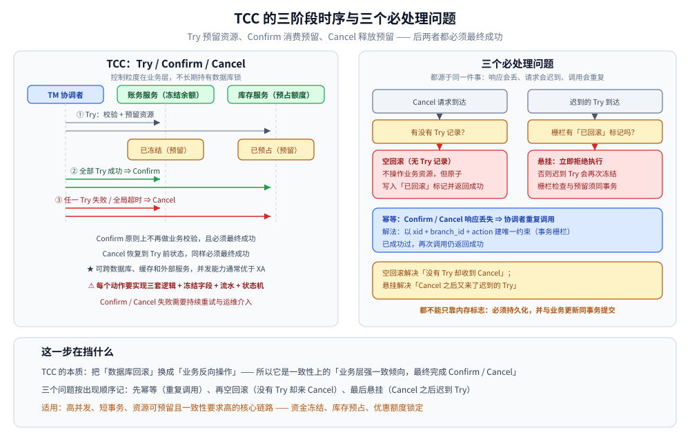

# TCC

> 覆盖：TCC 为什么把一次业务操作拆成 Try / Confirm / Cancel、三个动作各自的红线与禁止事项、空回滚 / 悬挂 / 幂等的统一解法、TCC 的隔离性来源，以及它与 2PC、Saga 的边界。
>
> 不覆盖：2PC / XA 的协议细节见 [2PC与3PC.md](2PC与3PC.md)；长流程补偿见 [Saga.md](Saga.md)；Seata 的注解、依赖与配置见 [接入Seata.md](../../../01-编程语言/java/工程实践/接入Seata.md)；DTM 的 TCC 接入与转账示例见 [接入DTM.md](../../../01-编程语言/go/工程实践/接入DTM.md) 与 [转账场景.md](../../../03-数据与中间件/中间件/分布式事务/DTM/转账场景.md)。
>
> 内容整理自个人学习笔记，并参考《大型网站技术架构：核心原理与案例分析》（李智慧）相关章节。

---

## 一、TCC 为什么要把一个操作拆成三个动作？

**本节要点**：TCC 把「占资源」和「用资源」分开——Try 先预留，Confirm 再消费，Cancel 释放预留；它用**业务层的资源冻结**替代数据库层的长事务锁。

2PC 的问题在于 Prepare 之后数据库锁和连接一直被占着。高并发核心链路上，这笔等待会直接变成锁竞争和吞吐下降。TCC 换了一个位置解决问题：

- **Try**：完成业务校验并**预留资源**，例如冻结余额、锁定库存额度、占用优惠券；
- **Confirm**：所有 Try 成功后执行确认，**消费预留资源**；
- **Cancel**：任一 Try 失败或全局事务超时后**释放预留资源**。

它不依赖数据库的 `ROLLBACK`，Confirm / Cancel 都是**新的业务操作**。因此 TCC 的能力边界由业务模型决定：资源必须能被「冻结」，冻结必须能被「解冻」，消费必须能被「确认」。

> ⭐ 一句话判别：**如果这个资源没法预留，就不要用 TCC**。例如已经发货的物流单、已经提交给外部银行的打款，都不具备可冻结语义。

## 二、Try / Confirm / Cancel 各自的红线是什么？

**本节要点**：Try 只预留不做不可逆副作用；Confirm / Cancel 不再做业务校验，且必须最终成功；三者都必须幂等。

| 动作 | 必须做 | 禁止做 | 失败后的后果 |
|---|---|---|---|
| **Try** | 校验业务规则、预留资源、写事务控制记录 | 直接扣款、发货、调用不可逆外部接口 | 资源未预留，全局事务应回滚 |
| **Confirm** | 消费预留、写确认状态、可重复执行 | 再做「余额是否足够」一类业务校验 | 资源已冻结但未消费，需持续重试并告警 |
| **Cancel** | 释放预留、写取消状态、允许空回滚 | 假设 Try 一定执行过 | 资源永久冻结，需人工介入 |

### 2.1 为什么 Confirm 不能再做业务校验

Try 成功意味着业务校验已经通过、资源已经预留。到了 Confirm 阶段，全局事务已经决定提交，此时再因为「余额不足」失败，会让协调者陷入两难：继续重试也不会成功，回滚又违背全局决议。

所以 Confirm 的原则是：**只做「把预留转为实际」这一件事，并且无条件最终成功**。如果确实需要二次校验，应该放在 Try。

### 2.2 为什么 Cancel 必须允许空回滚

Cancel 可能先于 Try 到达：Try 的请求在网络上丢失、超时，协调者判定失败并下发 Cancel。此时数据库里根本没有 Try 的记录。

如果 Cancel 因为「找不到记录」而报错，协调者会不断重试，资源状态也无法收敛。正确做法是：**没有 Try 记录时不做业务资源操作，但原子写入一条「已取消」标记并返回成功**。这条标记同时用于拦截之后迟到的 Try。

## 三、空回滚、悬挂、幂等怎么一次解决？

**本节要点**：三个问题都源于「请求乱序 + 重试」，靠内存标志无法解决；必须用**持久化事务记录 + 唯一键 + 同一本地事务**。

| 问题 | 发生方式 | 正确处理 |
| --- | --- | --- |
| **幂等** | Confirm / Cancel 的响应丢失，协调者重复调用 | 以 `xid + branch_id + action` 建唯一约束或事务栅栏；已成功再次调用仍返回成功 |
| **空回滚** | Try 未到达或未执行，Cancel 因超时先到 | Cancel 发现无 Try 记录时不操作业务资源，但原子写入「已回滚」标记并返回成功 |
| **悬挂** | Cancel 已完成，迟到的 Try 随后执行并再次冻结资源 | Try 先检查事务栅栏；发现「已回滚」标记立即拒绝，栅栏检查与资源预留必须在同一本地事务 |

> ⚠️ 空回滚解决「没有 Try 却收到 Cancel」，悬挂解决「Cancel 之后又来了迟到 Try」；二者都不能只靠内存标志，必须持久化并与业务更新同事务提交。

### 3.1 一张事务控制表怎么同时解决三件事

```sql
CREATE TABLE tcc_branch (
  xid          VARCHAR(128) NOT NULL,
  branch_id    VARCHAR(64)  NOT NULL,
  business_id  VARCHAR(128) NOT NULL,
  status       VARCHAR(16)  NOT NULL, -- TRYING / CONFIRMED / CANCELLED
  amount       DECIMAL(18,2) NOT NULL,
  created_at   DATETIME NOT NULL,
  updated_at   DATETIME NOT NULL,
  PRIMARY KEY (xid, branch_id),
  UNIQUE KEY uk_business (business_id)
) ENGINE=InnoDB DEFAULT CHARSET=utf8mb4;
```

三个动作的判定顺序：

| 动作 | 记录不存在 | 记录为 `TRYING` | 记录为 `CANCELLED` | 记录为 `CONFIRMED` |
|---|---|---|---|---|
| **Try** | 插入 `TRYING`，预留资源 | 视为重复 Try，返回成功 | **拒绝**（悬挂） | 视为重复 Try，返回成功 |
| **Confirm** | ⚠️ 协议异常，告警 | 消费预留，改为 `CONFIRMED` | 冲突，告警并人工处理 | 返回成功（幂等） |
| **Cancel** | 插入 `CANCELLED`，返回成功（空回滚） | 释放预留，改为 `CANCELLED` | 返回成功（幂等） | 冲突，告警并人工处理 |

关键约束：

1. **记录变更与业务资源变更在同一个本地事务里**。先写记录再改余额、或反过来，中间崩溃都会留下不一致。
2. **唯一键负责并发裁决**。两个重复 Try 同时到达时，只有一个能插入成功，另一个按幂等处理。
3. **状态只能单向流转**：`TRYING → CONFIRMED` 或 `TRYING → CANCELLED`，不允许反向。



## 四、TCC 的隔离性从哪里来？

**本节要点**：TCC 本身不提供数据库隔离级别；隔离性要靠**资源预留、状态位、读接口过滤和乐观锁**在业务层显式构造。

2PC 在 Prepare 后持锁，其他事务天然看不到中间状态。TCC 没有长事务锁，中间状态是暴露的，必须自己处理：

| 隔离手段 | 做法 | 代价 |
|---|---|---|
| **资源预留** | 余额拆成 `balance` 与 `frozen`，可用额度 = `balance - frozen` | 模型变复杂，所有读接口都要改 |
| **状态位** | 订单/支付单增加 `PENDING`、`CONFIRMING` 等状态，未确认前不对外展示成功 | 状态机变复杂，需要前端配合 |
| **读接口过滤** | 查询余额、库存、优惠券时排除已冻结部分 | 所有读路径都要遵守同一口径 |
| **语义锁** | 对业务键加「处理中」标记，阻止并发重复操作 | 需要额外的锁记录与超时清理 |
| **乐观锁** | 用版本号或条件更新防止覆盖 | 冲突时需重试，热点行仍会失败 |

> ⚠️ 最常见的漏洞是「写接口做了冻结，读接口仍然返回总余额」。用户看到可提现余额虚高，或者在冻结期间重复下单。TCC 的隔离性不是框架送的，是**整条读写路径一起改**换来的。

## 五、TCC 与 2PC、Saga 的边界在哪？

| 维度 | 2PC / XA | TCC | Saga |
|---|---|---|---|
| **一致性** | 强一致倾向，二阶段原子提交 | 业务层强一致倾向，Confirm 最终完成 | 最终一致 |
| **锁** | 数据库长锁，Prepare 后持锁 | 无数据库长锁，靠资源冻结 | 无全局长锁，每步本地提交 |
| **业务侵入** | 低 | ⭐ 高，三套接口 | 中，需要补偿动作 |
| **补偿语义** | 数据库回滚 | 释放预留，不是撤销已消费 | 执行反向业务动作 |
| **隔离性** | 由数据库锁保证 | 业务层自己构造 | 基本没有，靠语义锁缓解 |
| **适用** | 短事务、同构数据库 | 高并发、资源可预留、短事务 | 长流程、多服务、每步可补偿 |

**TCC vs 2PC**：TCC 把「准备」挪到业务层，换来更短的锁窗口和跨异构资源的能力，代价是三套逻辑和隔离性自理。

**TCC vs Saga**：TCC 的 Try 只是预留，Confirm 才真正生效，因此中间态对业务是「未完成」；Saga 的每一步都立即生效，失败后用补偿抵消。短事务、要求更强隔离选 TCC；长流程、允许中间态选 Saga。

## 六、应用场景

| 场景 | 是否适合 | 原因 |
|---|---|---|
| 支付扣款、账户余额 | ✅ | 余额可冻结，Confirm 消费冻结，Cancel 解冻 |
| 库存预占、秒杀扣减 | ✅ | 库存可锁定，未确认前不对外售卖 |
| 优惠券 / 权益占用 | ✅ | 券可锁定，失败可释放 |
| 跨行转账（两个账户服务） | ✅ | 两边都能冻结，短事务 |
| 已发货订单的取消 | ❌ | 物流不可逆，无法用 Cancel 抵消 |
| 调用外部支付渠道 | ❌ | 外部系统不提供预留/解冻接口 |
| 跨天审批、长流程 | ❌ | 三套接口长期挂起，运维成本高，应改用 Saga |

落地示例：

- DTM 的 `trading_balance` 双字段设计与四条乱序路径对账，见 [转账场景.md](../../../03-数据与中间件/中间件/分布式事务/DTM/转账场景.md)；
- 支付链路的幂等与异步通知，见 [支付系统设计.md](../../系统设计/秒杀系统/支付系统设计.md)；
- 秒杀库存预占与订单状态，见 [订单系统设计.md](../../系统设计/秒杀系统/订单系统设计.md)。

## 七、具体使用

**本节要点**：TCC 的代码形态是「一个业务动作对应三个接口」；接口内部用事务控制表 + 资源预留落库，框架负责重试与编排。

接口形状（语言无关）：

```java
public interface AccountTccAction {
    boolean tryFreeze(String xid, String branchId, String orderId, BigDecimal amount);
    boolean confirm(String xid, String branchId, String orderId);
    boolean cancel(String xid, String branchId, String orderId);
}
```

Try 的 SQL 形态（记录与冻结在同一本地事务）：

```sql
INSERT INTO tcc_branch (xid, branch_id, business_id, status, amount, created_at, updated_at)
VALUES (?, ?, ?, 'TRYING', ?, NOW(), NOW());

UPDATE account
SET frozen = frozen + ?
WHERE id = ? AND balance - frozen >= ?;
```

Confirm 与 Cancel：

```sql
-- Confirm：消费冻结，不再校验余额是否足够
UPDATE tcc_branch SET status = 'CONFIRMED', updated_at = NOW()
WHERE xid = ? AND branch_id = ? AND status = 'TRYING';

UPDATE account
SET balance = balance - ?, frozen = frozen - ?
WHERE id = ? AND frozen >= ?;

-- Cancel：释放冻结；没有 Try 记录时先插入 CANCELLED 作为空回滚标记
UPDATE tcc_branch SET status = 'CANCELLED', updated_at = NOW()
WHERE xid = ? AND branch_id = ? AND status = 'TRYING';

UPDATE account
SET frozen = frozen - ?
WHERE id = ? AND frozen >= ?;
```

注意事项：

| 事项 | 要求 |
|---|---|
| 事务边界 | 记录变更与账户变更必须在同一个 `@Transactional` / 本地事务内 |
| 并发裁决 | `(xid, branch_id)` 唯一键；`business_id` 唯一键防止同一订单重复预留 |
| 幂等返回 | 已 `CONFIRMED` 的 Confirm、已 `CANCELLED` 的 Cancel 直接返回成功 |
| 告警 | Confirm 遇到 `CANCELLED`、Cancel 遇到 `CONFIRMED`，都是协议异常，必须告警 |
| 人工入口 | 提供按 `xid` / `business_id` 查询冻结状态、重试、强制解冻的后台 |

Seata 的 `@LocalTCC` / `@TwoPhaseBusinessAction` 写法与 `tcc_fence_log` 建表见 [接入Seata.md](../../../01-编程语言/java/工程实践/接入Seata.md)；DTM 的 `CallBranch` 与子事务屏障写法见 [接入DTM.md](../../../01-编程语言/go/工程实践/接入DTM.md)。

## 延伸追问

- **Try 成功但 Confirm 一直失败怎么办？** → 持续重试并告警；Confirm 必须最终成功，必要时人工介入。不要让 Confirm 返回业务失败，否则全局事务无法收敛。
- **Cancel 为什么要允许空回滚？** → Try 可能根本没到达；Cancel 找不到记录时写入「已取消」标记并返回成功，既让协调者收敛，也拦截迟到的 Try。
- **为什么不能用内存标记防悬挂？** → 进程重启、多副本、请求落到另一台实例都会丢失内存状态；必须持久化，并与业务更新同事务。
- **TCC 一定要三张表吗？** → 不一定。最少要一张事务控制表；冻结字段可以在业务表上，也可以独立成冻结流水表，取决于查询与审计需求。
- **Confirm 能做校验吗？** → 不能做会导致失败的业务校验；Confirm 阶段全局已决定提交，校验失败只会让事务卡死。
- **TCC 和「冻结库存」是一回事吗？** → 冻结是 TCC 的一种资源预留实现；TCC 还要求 Confirm 消费、Cancel 释放，以及三者的幂等与乱序处理。
- **TCC 适合长流程吗？** → 不适合。三套接口长期挂起，补偿与人工成本高；长流程应改用 [Saga.md](Saga.md)。

## 关联

- **上游/总纲**：[README.md](README.md) — 七种方案的谱系与选型
- **上游/理论**：[一致性模型.md](../理论基础/一致性模型.md) — BASE 与一致性强度的取舍
- **对照/互补**：[2PC与3PC.md](2PC与3PC.md) — 数据库长锁与原子提交
- **对照/互补**：[Saga.md](Saga.md) — 长流程的补偿路线
- **语言实现**：[接入Seata.md](../../../01-编程语言/java/工程实践/接入Seata.md) — `@LocalTCC` 与 TCC 栅栏
- **语言实现**：[接入DTM.md](../../../01-编程语言/go/工程实践/接入DTM.md) — `CallBranch` 与子事务屏障
- **设计示例**：[转账场景.md](../../../03-数据与中间件/中间件/分布式事务/DTM/转账场景.md) — 冻结 / 消费 / 解冻与乱序对账
- **场景**：[支付系统设计.md](../../系统设计/秒杀系统/支付系统设计.md)、[订单系统设计.md](../../系统设计/秒杀系统/订单系统设计.md)
- **产品选型**：[分布式事务选型对比.md](../../../03-数据与中间件/中间件/分布式事务/分布式事务选型对比.md)
> 反向引用（本篇被下列文档引到）：[原理与架构.md](../../../03-数据与中间件/中间件/分布式事务/DTM/原理与架构.md)、[最终一致方案.md](最终一致方案.md)
