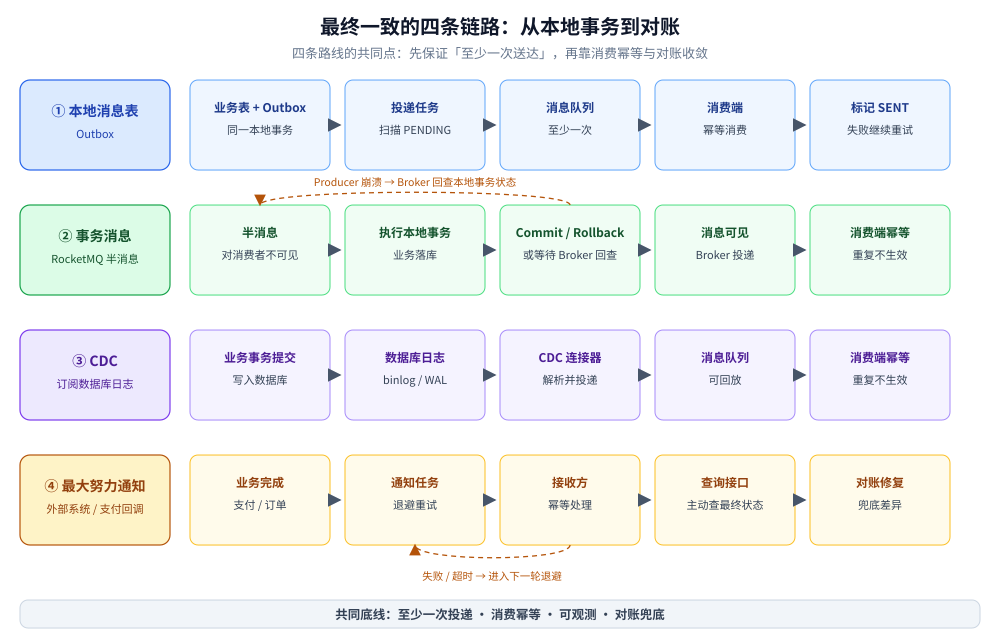

# 最终一致方案

> 覆盖：本地消息表（Outbox）、事务消息、CDC、最大努力通知四条链路各自怎么保证「最终一致」，消费端幂等与对账怎么闭环，以及四类方案的选型判据。
>
> 不覆盖：2PC / XA 见 [2PC与3PC.md](2PC与3PC.md)；TCC 见 [TCC.md](TCC.md)；Saga 的长流程补偿见 [Saga.md](Saga.md)；RocketMQ 事务消息的 Broker 侧机制见 [消息可靠性.md](../../../03-数据与中间件/中间件/消息队列/RocketMQ/消息可靠性.md) 与 [消息类型与语义.md](../../../03-数据与中间件/中间件/消息队列/RocketMQ/消息类型与语义.md)。
>
> 内容整理自个人学习笔记，并参考《大型网站技术架构：核心原理与案例分析》（李智慧）相关章节；素材见 [素材清单.md](../../../素材清单.md)。

---

## 一、为什么最终一致不是「不保证一致」？

**本节要点**：最终一致把「一次请求内完成」换成「在一个可度量的窗口内收敛」；它仍然要定义不变量，并且必须补齐**可靠投递、幂等消费、可观测、对账**四件事。

最终一致常被误解为「先返回成功，后面再说」。真正的工程含义是：

1. **不变量明确**：例如「订单支付成功后，库存必须扣减且只扣一次」「总账恒等」；
2. **收敛窗口可度量**：例如 P99 在 1 秒内可查到，而不是「最终会好的」；
3. **失败可发现**：有状态、有日志、有告警、有对账；
4. **失败可恢复**：重试、补偿、人工修复都有入口。

### 1.1 四块基石

| 基石 | 解决什么 | 缺了会怎样 |
|---|---|---|
| **本地事务** | 业务数据与待发事件同库同事务落盘 | 业务成功但事件丢失，或事件发出但业务回滚 |
| **可靠投递** | 至少一次把事件送到下游 | 消息丢失后无人知道，只能靠对账发现 |
| **幂等消费** | 重复投递不产生重复副作用 | 下游重复扣款、重复发货 |
| **对账兜底** | 发现并修复漏记、多记、金额不符 | 前三条都失效时没有最后一道防线 |

> ⭐ 端到端「恰好一次」不是靠某种神奇的传输协议实现的，而是 **至少一次投递 + 幂等消费 + 去重记录** 组合出来的效果。

### 1.2 至少一次、至多一次与恰好一次

| 语义 | 发送端行为 | 风险 | 适用 |
|---|---|---|---|
| **至多一次** | 发一次，不重试 | 可能丢 | 可丢的日志、指标 |
| **至少一次** | 失败重试直到确认 | 可能重复 | 绝大多数业务消息 |
| **恰好一次（效果）** | 至少一次 + 消费幂等 / 去重 | 实现复杂，仍有边界 | 资金、订单等核心链路 |

## 二、本地消息表（Outbox）怎么保证「落库即发布」？

**本节要点**：把业务数据和待发事件放进**同一个本地事务**，提交后由独立的投递任务扫描并发送；发送失败就重试，重复发送由消费端幂等兜住。

### 2.1 写路径

```text
本地事务开始
  ├─ 写业务表（订单 / 支付 / 库存）
  └─ 写 outbox_event（status = PENDING）
本地事务提交
        ↓
投递任务扫描 PENDING → 发送 MQ → 标记 SENT
        ↓
消费端幂等消费 → ACK
```

关键点：**业务写与事件写必须同事务**。如果先写业务、再单独发消息，中间崩溃就会出现「业务成功、事件丢失」；如果先发消息、再写业务，则可能出现「事件已发、业务回滚」。

### 2.2 崩溃点分析

| 崩溃时点 | 结果 | 恢复方式 |
|---|---|---|
| 本地事务提交前 | 业务与事件都没落库 | 请求失败，重试整个事务 |
| 提交后、发送前 | 业务与事件都在，事件为 PENDING | 投递任务继续扫描 |
| 发送后、标记 SENT 前 | 消息已到 MQ，事件仍为 PENDING | 会重复发送，消费端幂等 |
| 标记 SENT 后、消费前 | 事件已投递，等待消费 | 消费者重试 / 对账 |

### 2.3 投递任务的工程要求

- 按 `status + id` 建索引，避免全表扫描；
- 多实例部署时用 `FOR UPDATE SKIP LOCKED` 或分片领取，避免重复抢同一批；
- 发送成功后再标记 `SENT`；发送结果未知时宁可重发；
- 设置最大重试次数与告警，超过阈值转人工；
- 定期归档已发送记录，避免表无限膨胀；
- 记录 `event_id`、`aggregate_id`、`created_at`、`sent_at`，便于追踪。

**优点**：不绑定特定 MQ；实现简单；事件与业务强一致。

**缺点**：业务库多一张表与一个投递任务；轮询有延迟；高吞吐下扫表会成为压力点（可用 CDC 替代轮询）。

## 三、事务消息（RocketMQ 半消息）与本地消息表有什么差别？

**本节要点**：事务消息把「待发消息」放在 Broker 的半消息里，用本地事务结果决定提交或回滚，并用回查补齐未知结果；它解决的是「生产者本地事务与消息发送」的原子性，不是通用的跨服务事务协调。

### 3.1 流程

1. Producer 发送**半消息**到 Broker，消息对消费者不可见；
2. Broker 返回成功，Producer 执行本地事务；
3. 本地事务成功 → 发送 Commit，消息可见；失败 → 发送 Rollback，消息删除；
4. 如果 Producer 在本地事务后、发送决议前崩溃，Broker 会**回查** Producer 的本地事务状态；
5. 回查结果决定 Commit 或 Rollback。

### 3.2 与本地消息表的对照

| 维度 | 本地消息表 | 事务消息（RocketMQ） |
|---|---|---|
| **消息存放** | 业务库 `outbox_event` | Broker 半消息 |
| **原子对象** | 业务写 + 事件写，同一本地事务 | 本地事务结果 + 消息 Commit/Rollback |
| **投递触发** | 应用轮询或 CDC | Broker 在 Commit 后投递 |
| **延迟** | 取决于轮询间隔 | 通常更低 |
| **外部依赖** | 无特定 MQ | 绑定支持事务消息的 MQ |
| **回查** | 不需要 | 必须实现本地事务回查 |
| **重复风险** | 有，消费端幂等 | 有，消费端幂等 |
| **运维** | 多一张表与投递任务 | 多一套 Broker 事务状态与回查监控 |

### 3.3 常见误区

- **事务消息不是分布式事务框架**：它只保证「本地事务 + 消息发送」的原子性，不负责下游多个服务的提交或回滚；
- **Commit 后消息仍可能重复**：消费者必须幂等；
- **回查不是可选优化**：不实现回查，Producer 崩溃后的半消息会永远不可见或被丢弃；
- **回查可能落到另一台实例**：`checkLocalTransaction` 必须靠消息属性反查事务表 / 订单状态，不能依赖内存。

RocketMQ 的 Broker 侧两阶段、回查与消费重试细节见 [消息可靠性.md](../../../03-数据与中间件/中间件/消息队列/RocketMQ/消息可靠性.md)；本地消息表与事务消息的横向对比见 [消息队列选型对比.md](../../../03-数据与中间件/中间件/消息队列/消息队列选型对比.md)；代码接入见 [接入RocketMQ.md](../../../01-编程语言/go/工程实践/接入RocketMQ.md)（Go）与 [接入RocketMQ.md](../../../01-编程语言/java/工程实践/接入RocketMQ.md)（Java）。

## 四、最大努力通知适合什么边界？

**本节要点**：通知方按退避策略有限重试，接收方提供幂等处理与结果查询，最终由对账修复；它只承诺「尽力通知过」，不承诺「一定送达」或「只送一次」。

### 4.1 典型链路

```text
支付成功
   ↓
通知任务（退避重试）
   ↓  HTTP / MQ
商户接收端（幂等）
   ↓  返回 success / 失败
通知方停止或继续重试
   ↓
商户主动查询 / 双方对账
```

### 4.2 设计要点

| 要点 | 做法 |
|---|---|
| **重试策略** | 按 15s、30s、1m、5m、15m、1h、6h 逐级退避，设总窗口（如 24h）与最大次数 |
| **停止条件** | 接收方返回成功、达到最大次数、超过总窗口 |
| **幂等键** | 业务单号 + 事件类型；接收方用唯一索引裁决 |
| **查询接口** | 接收方必须能按业务单号主动查询最终状态，不能只依赖通知 |
| **对账** | 定时比对双方状态，修复漏通知、多通知、状态不一致 |
| **安全** | 签名、时间戳、重放防护；敏感字段脱敏 |

> ⚠️ 最大努力通知适合**外部系统**或**非核心通知**。内部核心链路如果只做通知、不做对账，等于把一致性交给运气。

## 五、CDC 与对账分别在链路里补什么？

**本节要点**：CDC 把「轮询业务表」换成「订阅数据库提交日志」，降低业务侵入与延迟；对账不是可选项，而是所有最终一致方案的最后一道防线。

### 5.1 CDC（Change Data Capture）

CDC 读取数据库的 binlog / WAL / redo，把已提交的数据变更转换成事件：

- **优点**：业务代码不用写 outbox；不额外扫表；能捕获所有已提交变更；
- **代价**：依赖数据库日志与连接器；事件顺序、重复、schema 变更要处理；业务语义转换（哪条变更该发什么事件）仍需设计；
- **适用**：已有成熟 CDC 平台、需要低侵入同步、日志保留与位点管理可运维的团队。

CDC 不是「零设计」：它保证的是「数据变更被捕获」，不保证「下游一定正确处理」。消费端幂等、事件版本、字段兼容仍要自己做。

### 5.2 对账

对账按业务不变量核对上下游，常见差异类型：

| 差异 | 含义 | 处理 |
|---|---|---|
| **漏记** | 上游有、下游无 | 补发 / 补记 |
| **多记** | 下游有、上游无 | 冲正 / 删除 |
| **金额不符** | 两边都有但数值不同 | 以权威源为准修复，追查原因 |
| **状态不符** | 金额相同但状态不同 | 按状态机推进或回退 |

支付系统的四类差异与实测口径见 [支付系统设计.md](../../系统设计/秒杀系统/支付系统设计.md)；订单侧的状态机与幂等见 [订单系统设计.md](../../系统设计/秒杀系统/订单系统设计.md)。

| 手段 | 解决 | 不解决 |
|---|---|---|
| 可靠投递 | 消息不丢 | 消费失败、业务处理错误 |
| 幂等消费 | 重复不生效 | 漏消费、数据错误 |
| CDC | 低侵入捕获变更 | 下游语义正确性 |
| 对账 | 发现并修复差异 | 实时性；差异原因仍需排查 |

## 六、消费端幂等与去重怎么做？

**本节要点**：幂等不是「查一下有没有」，而是用**唯一约束或条件更新**让重复请求在数据库层被裁决；幂等记录必须与业务结果同事务。

### 6.1 三种常用做法

| 做法 | 适用 | 注意 |
|---|---|---|
| **业务唯一键 + 唯一索引** | 有天然业务单号（订单号、支付号） | 冲突时捕获重复键，按成功返回 |
| **幂等表** | 没有天然唯一键，或需要记录处理结果 | 表要与业务表同库，插入与业务更新同事务 |
| **状态机条件更新** | 状态流转明确（待支付 → 已支付） | `UPDATE ... WHERE status = 旧状态`，用影响行数判断 |

### 6.2 幂等表

```sql
CREATE TABLE consumed_event (
  consumer     VARCHAR(64)  NOT NULL,
  event_id     VARCHAR(128) NOT NULL,
  status       VARCHAR(16)  NOT NULL, -- PROCESSING / DONE
  result_json  JSON NULL,
  consumed_at  DATETIME NOT NULL,
  PRIMARY KEY (consumer, event_id)
) ENGINE=InnoDB DEFAULT CHARSET=utf8mb4;
```

处理流程：

```text
开启本地事务
  ├─ INSERT INTO consumed_event (consumer, event_id, status) VALUES (?, ?, 'PROCESSING')
  │     └─ 唯一键冲突 → 已处理过，直接返回成功
  ├─ 执行业务更新
  └─ UPDATE consumed_event SET status = 'DONE'
提交
```

> ⚠️ 不要采用「先查有没有，再执行写入」的非原子流程；两个并发请求都可能查不到。应让唯一约束裁决，或使用带状态条件的单条更新。并发写的通用写法见 [写冲突控制的Go落地.md](../../../01-编程语言/go/工程实践/写冲突控制的Go落地.md) 与 [写冲突控制的Java落地.md](../../../01-编程语言/java/写冲突控制的Java落地.md)。

### 6.3 去重窗口

有些场景不需要永久幂等表，只需要一个时间窗口（如 24 小时）内的去重。可以用 Redis `SETNX + TTL` 或布隆过滤器降低存储，但要接受：

- Redis 数据丢失后会重复处理；
- 布隆过滤器有假阳性，可能误丢合法请求；
- 资金类操作仍建议落库，不要只依赖缓存。

## 七、四种方案怎么选？

| 维度 | 本地消息表 | 事务消息 | CDC | 最大努力通知 |
|---|---|---|---|---|
| **一致性** | 最终一致 | 最终一致，通常更及时 | 最终一致 | 弱一致 / 最终可对账 |
| **外部依赖** | 无特定 MQ | 支持事务消息的 MQ | 数据库日志 + CDC 平台 | HTTP / MQ + 对账 |
| **业务侵入** | 中（outbox 表 + 投递任务） | 低到中（实现回查） | 低（不改业务代码） | 低 |
| **延迟** | 取决于轮询间隔 | 低 | 低到中（取决于链路） | 中到高（退避重试） |
| **复杂度** | 中 | 中 | 高（运维与 schema 管理） | 低到中 |
| **典型场景** | 不绑定 MQ、需要完全可控 | 已用 RocketMQ、要低延迟 | 数据同步、低侵入 | 支付回调、外部通知 |

### 7.1 判断顺序

1. **下游是不是外部系统？** 是 → 最大努力通知 + 查询接口 + 对账；
2. **是否只要求「本地落库后可靠发布事件」？** 是 → 本地消息表 / 事务消息 / CDC；
3. **已有支持事务消息的 MQ 且能实现回查？** 是 → 事务消息；
4. **不想改业务代码、已有 CDC 平台？** 是 → CDC + Outbox 语义；
5. **团队没有 CDC 运维能力？** → 本地消息表，最简单可控。

### 7.2 一句话对照

- **本地消息表**：自己存、自己发，最通用；
- **事务消息**：Broker 帮你存半消息，回查换原子性；
- **CDC**：从日志里捞变更，侵入最低但要运维；
- **最大努力通知**：尽力喊你，最终靠查询与对账。

## 八、应用场景

| 场景 | 推荐方案 | 原因 |
|---|---|---|
| 下单成功后扣积分、发通知、更新搜索索引 | 本地消息表 / 事务消息 | 只需保证落库后可靠发布 |
| 支付成功后通知商户 | 最大努力通知 + 查询接口 + 对账 | 外部系统不可控，必须允许重复与延迟 |
| 订单与库存、订单与履约系统同步 | 本地消息表 / CDC | 跨服务、允许短暂不一致 |
| 缓存失效与数据同步 | CDC / 本地消息表 | 需要低侵入、可重放 |
| 跨库数据仓库同步 | CDC | 批量、低侵入、可回放 |
| 资金核心链路 | 本地消息表 + 强幂等 + 对账（必要时 TCC） | 不能只靠通知，必须有兜底 |

相关落点：

- 秒杀下单与库存： [总体设计.md](../../系统设计/秒杀系统/总体设计.md)；
- 订单状态机与幂等： [订单系统设计.md](../../系统设计/秒杀系统/订单系统设计.md)；
- 支付通知与对账： [支付系统设计.md](../../系统设计/秒杀系统/支付系统设计.md)；
- 缓存一致性： [缓存应用场景.md](../../../03-数据与中间件/数据存储/缓存/缓存应用场景.md)；
- 消息产品对比： [消息队列选型对比.md](../../../03-数据与中间件/中间件/消息队列/消息队列选型对比.md)。



## 九、具体使用

**本节要点**：本地消息表的最小落地是一张 outbox 表 + 一个可重入的投递任务；消费端再配一张幂等表，两边都用唯一键裁决。

### 9.1 Outbox 表

```sql
CREATE TABLE outbox_event (
  id           BIGINT NOT NULL AUTO_INCREMENT,
  event_id     VARCHAR(128) NOT NULL,
  aggregate_id VARCHAR(128) NOT NULL,
  event_type   VARCHAR(64)  NOT NULL,
  payload      JSON NOT NULL,
  status       VARCHAR(16)  NOT NULL, -- PENDING / SENT / FAILED
  retry_count  INT NOT NULL DEFAULT 0,
  created_at   DATETIME NOT NULL,
  sent_at      DATETIME NULL,
  PRIMARY KEY (id),
  UNIQUE KEY uk_event_id (event_id),
  KEY idx_status_id (status, id)
) ENGINE=InnoDB DEFAULT CHARSET=utf8mb4;
```

业务写与事件写：

```sql
START TRANSACTION;

INSERT INTO orders (order_no, user_id, amount, status)
VALUES (?, ?, ?, 'CREATED');

INSERT INTO outbox_event (event_id, aggregate_id, event_type, payload, status, created_at)
VALUES (?, ?, 'ORDER_CREATED', ?, 'PENDING', NOW());

COMMIT;
```

投递任务（多实例安全）：

```sql
SELECT id, event_id, event_type, payload
FROM outbox_event
WHERE status = 'PENDING'
ORDER BY id
LIMIT 100
FOR UPDATE SKIP LOCKED;
```

```text
for each event:
    send to MQ with event_id as key
    if send success:
        UPDATE outbox_event SET status='SENT', sent_at=NOW() WHERE id=?
    else:
        UPDATE outbox_event SET retry_count=retry_count+1 WHERE id=?
        if retry_count >= MAX: status='FAILED' and alert
```

### 9.2 消费端

消费逻辑只做三件事：**去重、执行业务、记录结果**。去重表与业务更新同事务；如果业务本身有天然唯一键，可以省掉去重表，直接让唯一索引裁决。

### 9.3 事务消息

RocketMQ 的 Producer、事务监听器、回查与消费幂等代码见 [接入RocketMQ.md](../../../01-编程语言/go/工程实践/接入RocketMQ.md)（Go）与 [接入RocketMQ.md](../../../01-编程语言/java/工程实践/接入RocketMQ.md)（Java）；Broker 侧的回查机制见 [消息类型与语义.md](../../../03-数据与中间件/中间件/消息队列/RocketMQ/消息类型与语义.md)。

## 延伸追问

- **最终一致窗口怎么定？** → 按业务可接受的最长延迟定，并给出 P99 指标；窗口内要允许「处理中」状态，窗口外要能告警与对账。
- **本地消息表和事务消息怎么选？** → 已有支持事务消息的 MQ、追求低延迟选事务消息；不想绑定 MQ、要求完全可控选本地消息表。
- **消息重复怎么办？** → 消费端幂等：唯一索引、幂等表或状态机条件更新；不要依赖 MQ 的「恰好一次」。
- **消息丢了怎么办？** → 可靠投递只能降低概率，最终要靠对账发现；核心链路必须有定时对账与补发入口。
- **对账能不能替代可靠投递？** → 不能。对账是兜底，实时性差、成本高；可靠投递 + 幂等才是主路径。
- **CDC 和本地消息表怎么选？** → 有 CDC 平台且不想改业务代码选 CDC；没有运维能力、要求简单可控选本地消息表。
- **最大努力通知为什么还要查询接口？** → 通知可能全部失败或延迟；接收方必须能主动查询最终状态，否则只能等对账。
- **端到端能做到 exactly-once 吗？** → 传输层通常只能做到至少一次；业务层通过幂等与去重达到「效果上恰好一次」，边界仍需对账兜底。

## 关联

- **上游/总纲**：[README.md](README.md) — 七种方案的谱系与选型
- **上游/理论**：[一致性模型.md](../理论基础/一致性模型.md) — BASE 与最终一致
- **对照/互补**：[2PC与3PC.md](2PC与3PC.md) — 强一致倾向的原子提交
- **对照/互补**：[TCC.md](TCC.md) — 资源预留与短事务
- **对照/互补**：[Saga.md](Saga.md) — 长流程补偿
- **产品/机制**：[消息队列选型对比.md](../../../03-数据与中间件/中间件/消息队列/消息队列选型对比.md) — 事务消息、本地消息表与各 MQ 的对照
- **产品/机制**：[消息可靠性.md](../../../03-数据与中间件/中间件/消息队列/RocketMQ/消息可靠性.md) — RocketMQ 事务消息与重试
- **语言实现**：[接入RocketMQ.md](../../../01-编程语言/go/工程实践/接入RocketMQ.md)（Go）、[接入RocketMQ.md](../../../01-编程语言/java/工程实践/接入RocketMQ.md)（Java）
- **幂等实现**：[写冲突控制的Go落地.md](../../../01-编程语言/go/工程实践/写冲突控制的Go落地.md)、[写冲突控制的Java落地.md](../../../01-编程语言/java/写冲突控制的Java落地.md)
- **场景**：[支付系统设计.md](../../系统设计/秒杀系统/支付系统设计.md)、[订单系统设计.md](../../系统设计/秒杀系统/订单系统设计.md)、[缓存应用场景.md](../../../03-数据与中间件/数据存储/缓存/缓存应用场景.md)
> 反向引用（本篇被下列文档引到）：[接入Seata.md](../../../01-编程语言/java/工程实践/接入Seata.md)、[README.md](../../../03-数据与中间件/中间件/消息队列/RabbitMQ/README.md)、[消息可靠性.md](../../../03-数据与中间件/中间件/消息队列/RabbitMQ/消息可靠性.md)、[消息类型与语义.md](../../../03-数据与中间件/中间件/消息队列/RocketMQ/消息类型与语义.md)、[事务与一致性.md](../../../03-数据与中间件/数据存储/NoSQL/MongoDB/事务与一致性.md)
