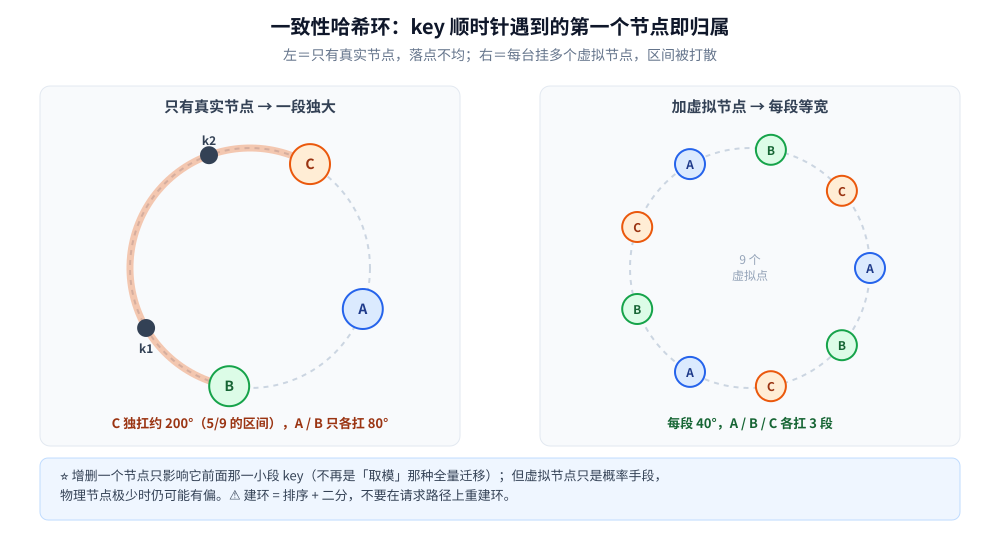
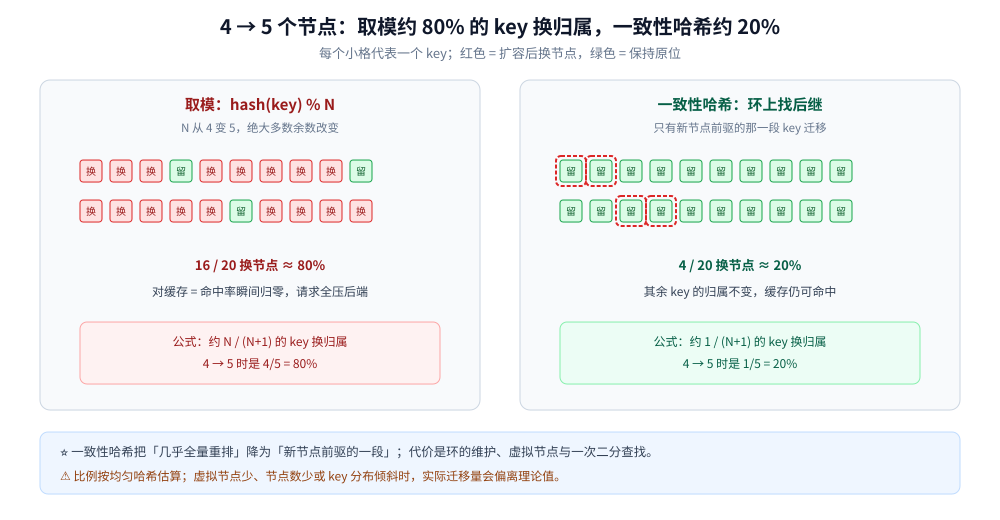

# 一致性哈希

> 覆盖一种把**节点和 key 映射到同一个环**上的分片算法：key 沿环顺时针遇到的第一个节点就是它的归属，
> 于是**增删一个节点只影响它前面那一小段 key**，不再是全量迁移。
>
> ⭐ 本篇是**算法与结构篇**：讲环的形态、虚拟节点的必要性、迁移量的计算、建环的代价，以及 Rendezvous / Jump / Maglev 等替代算法。
> 工程落点在两处 —— [负载均衡.md](../服务治理/负载均衡.md)（实例选择）与
> [分表与路由.md](../../../03-数据与中间件/数据存储/关系型/MySQL/分表与路由.md)（分库分表路由）。
>
> 素材来源：博客 [数据结构](https://blog.csdn.net/weixin_43837229/article/details/103222660)（2019-11-24）——
> 本篇取该文「补充结构」一节的一致性哈希部分；**工程动机、迁移量计算与替代算法**为本次整理补充。逐篇登记见 [素材清单](../../../素材清单.md)。
>
> 本目录（分布式）的阅读顺序见 [README.md](../README.md)。本篇代码为语义示例，未在本轮运行实测。

---

## 一、取模分片在扩容时为什么会「全乱」？

**本节要点**：取模的归属是 `hash(key) % N`，**N 一变，几乎所有 key 的余数都变**。分片数从 4 加到 5，约 `4/5 = 80%` 的 key 要换节点 —— 对缓存来说就是命中率瞬间塌掉。

**迁移比例**（从 `N` 个节点扩到 `N+1` 个，假设 key 均匀）：

```text
取模：        约 N / (N + 1) 的 key 换归属
一致性哈希：  约 1 / (N + 1) 的 key 换归属
```

| 扩容 | 取模需迁移 | 一致性哈希需迁移 | 差距 |
|---|---|---|---|
| 4 → 5 | 约 80% | 约 20% | 4 倍 |
| 10 → 11 | 约 90.9% | 约 9.1% | 10 倍 |
| 100 → 101 | 约 99% | 约 1% | 约 100 倍 |

> ⭐ 缓存分片最怕的不是「迁移慢」，而是**大量 key 同时失效 → 请求全部穿透到后端库**。
> 取模扩容会把这件事一次性放大到全量，一致性哈希把它压到「新增节点该接手的那一段」。

---

## 二、一致性哈希环为什么比「取模」更适合分片？

**本节要点**：把节点和 key 都映射到同一个环上，key 顺时针遇到第一个节点即归属——**增删节点只影响一小段 key**，不再是全量迁移。

**要解决的问题**：普通哈希取模在**增减节点**时几乎让所有 key 换归属（全量迁移 / 全量缓存失效）。一致性哈希把节点和 key 都映射到同一个 `[0, 2ⁿ)` 的**环**上，key 沿顺时针遇到的第一个节点就是它的归属节点——于是新增 / 摘除一个节点，**只影响它前面那一小段 key**（环就是「取模」的连续版：把 `hash % N` 换成「在有序数组里二分找第一个 ≥ hash 的节点」）。



### 2.1 环怎么建、怎么查

1. **建环**：对每个节点（或虚拟节点）的名字做哈希，得到一个 `[0, 2³²)` 的整数，作为它在环上的位置；
2. **排序**：把所有位置升序排成一个数组，每个位置记住它属于哪个节点；
3. **查 key**：对 key 做同样的哈希，在数组里二分找**第一个 ≥ hash 的位置**；找不到就回到数组第一个（环回绕）。

```text
环上位置（升序）：  10(A)   90(B)   200(C)   300(A)
key 的 hash = 150  → 第一个 ≥ 150 的是 200(C)  → 归属 C
key 的 hash = 350  → 没有 ≥ 350 的位置 → 回到 10(A) → 归属 A
```

### 2.2 增删一个节点，影响哪一段

- **新增节点 X**：X 落在环上某两个相邻节点之间，只接管「从上一个节点到 X」这一段 key；
- **摘除节点 X**：原本归 X 的那一段，顺时针交给它的下一个节点。

这就是「只影响一小段」的准确含义：**影响范围是该节点在环上的前驱区间，而不是全环**。

### 2.3 工程上必须补的三件事

① **虚拟节点**——真实节点太少时环上落点极不均匀，某台机器会白扛一大段流量，每台挂几十个虚拟点把区间打散（但这是概率手段，节点数极少时仍可能有偏）；② **建环不是 O(1)**——排序 + 二分定位，**不要在请求路径上重建环**（详见 [负载均衡.md](../服务治理/负载均衡.md)）；③ 本质仍是「有序数组 + 二分查找」，它的价值在**分布式分片**语境下：分片与迁移的取舍见 [海量数据存储设计.md](../../系统设计/海量数据存储设计.md)。

---

## 三、虚拟节点为什么必须加、加多少才够？

**本节要点**：节点少时，哈希环上的落点是**随机**的，区间长度天然不均。虚拟节点把一个物理节点拆成多个环上位置，让它的总区间更接近平均值 —— 但它是**概率手段**，不是严格均分。

### 3.1 不加虚拟节点会怎样

假设 3 个真实节点随机落在环上，三段弧长可能相差数倍。某台机器分到 50% 的 key，另外两台各 25% —— 它就会先被压垮，而扩容又解决不了「它那一段特别大」。

### 3.2 加虚拟节点后

每个物理节点挂 `K` 个虚拟节点（`node#0`、`node#1`、…），环上总位置数变成 `N × K`：

- 每个物理节点由 `K` 段小区间组成，总份额向 `1/N` 收敛；
- `K` 越大，单个节点份额的波动越小，但环上数组越大、建环与内存成本越高；
- 经验上每节点几十到几百个虚拟节点；节点数越少，需要的 `K` 越大。

| 每节点虚拟节点数 | 负载均衡效果 | 成本 |
|---|---|---|
| 1（不加） | 节点少时偏差很大 | 最低 |
| 几十 | 明显改善 | 环数组为节点数的几十倍 |
| 几百 | 更接近均分 | 建环与内存成本上升 |
| 权重不同 | 用虚拟节点数体现机器规格 | 要维护权重配置 |

> ⚠️ **虚拟节点只解决「区间划分不均」，不解决「单个 key 过热」**。
> 如果某个 key 本身是热点，它在环上的位置不变，仍然会打到同一台机器 —— 这要靠热点 key 拆分或本地缓存，见 [分区与再平衡.md](分区与再平衡.md) 第二节。

---

## 四、增删节点到底会搬多少数据？

**本节要点**：在理想均匀环上，新增一个节点只接管约 `1/(N+1)` 的 key；但真实系统还要考虑虚拟节点分布、副本数与迁移流程。



图怎么读：20 个 key 的示意。取模扩容后约 80% 的 key 换了归属（红色），一致性哈希只有约 20% 落到新节点（绿色），其余保持原位。<br>
⚠️ 图中比例按均匀哈希估算，真实分布会因虚拟节点与 key 分布而波动。

| 操作 | 理想迁移量 | 说明 |
|---|---|---|
| 4 → 5 个节点 | 约 20% | 新节点接管它前驱的那一段 |
| 10 → 11 个节点 | 约 9.1% | 节点越多，单次扩容搬得越少 |
| 摘除一个节点 | 约 `1/N` | 它的区间交给后继节点 |
| 副本数为 3 | 迁移量 × 3（按副本计） | 每个副本都要重新分布 |

> ⭐ 「只搬 `1/N`」是**归属层面的理论值**。实际迁移还要加上：副本复制、迁移期间的双写、校验与回滚窗口 ——
> 这些流程任何分片方案都躲不掉，见 [分区与再平衡.md](分区与再平衡.md) 第五节。

---

## 五、环在代码里怎么实现？

**本节要点**：数据结构就是「**有序数组 + 二分**」。建环是 `O(M log M)`（`M` 为虚拟节点总数），查环是 `O(log M)`；两者必须分离，重建只发生在节点变更时。

### 5.1 Go 实现

```go
type point struct {
    hash uint32
    node string
}

type Ring struct {
    points []point // 按 hash 升序
}

func NewRing(nodes map[string]int) *Ring {
    var ps []point
    for node, vnodes := range nodes {
        for i := 0; i < vnodes; i++ {
            h := fnv32a(node + "#" + strconv.Itoa(i))
            ps = append(ps, point{hash: h, node: node})
        }
    }
    sort.Slice(ps, func(i, j int) bool { return ps[i].hash < ps[j].hash })
    return &Ring{points: ps}
}

func (r *Ring) Get(key string) string {
    if len(r.points) == 0 {
        return ""
    }
    h := fnv32a(key)
    idx := sort.Search(len(r.points), func(i int) bool {
        return r.points[i].hash >= h
    })
    if idx == len(r.points) {
        idx = 0 // 环回绕
    }
    return r.points[idx].node
}

func fnv32a(s string) uint32 {
    const (
        offset32 = 2166136261
        prime32  = 16777619
    )
    h := uint32(offset32)
    for i := 0; i < len(s); i++ {
        h ^= uint32(s[i])
        h *= prime32
    }
    return h
}
```

### 5.2 并发与重建

- **读多写少**：用 `atomic.Value` 持有不可变的 `*Ring`，重建时构造新环再整体替换；
- **不要边读边改**：切片排序过程中被并发读会读到半成品；
- **重建时机**：节点加入 / 摘除 / 权重变更时重建一次，不要在请求路径上按需重建；
- **缓存热度**：重建后所有 key 的归属可能变化，要配合连接池与本地缓存的失效策略。

### 5.3 为什么说它只是「有序数组 + 二分」

环上找归属就是一次 `lowerBound`（找第一个 ≥ hash 的节点）；这也是为什么**建环（排序）与查环（二分）要分开放**——前者是启动时的一次性成本，后者才是请求路径上的成本（模板见 [二分查找.md](../../../02-计算机基础/算法/基础算法/查找/二分查找.md)）。

---

## 六、还有哪些「少搬数据」的替代算法？

**本节要点**：一致性哈希不是唯一解。Rendezvous 更简单且支持权重，Jump 查询更快但只能「在末尾加桶」，Maglev 用查表换极低延迟 —— 选型取决于节点变化模式与查询性能要求。

| 算法 | 归属怎么算 | 扩容迁移量 | 查询开销 | 支持任意删节点 | 典型使用 |
|---|---|---|---|---|---|
| **一致性哈希** | 环上二分找后继 | 约 `1/(N+1)` | `O(log M)` | 支持 | 缓存、分片路由 |
| **Rendezvous / HRW** | 对每个节点算 `hash(key, node)`，取最大 | 约 `1/(N+1)` | `O(N)` | 支持 | 节点数不多的服务发现、CDN |
| **Jump consistent hash** | 逐段跳桶，返回桶号 | 约 `1/(N+1)` | `O(log N)` | ⚠️ 只能从末尾加桶 | 分桶数只增不减的场景 |
| **Maglev** | 预生成查找表，按 key 查表 | 小且稳定 | `O(1)` | 支持（重建表） | 负载均衡器 |
| **取模** | `hash % N` | 约 `N/(N+1)` | `O(1)` | 支持但全量迁移 | 节点数固定的简单场景 |

> ⚠️ **Jump consistent hash 的「不能任意删节点」是硬限制**：它假设桶编号连续、只在末尾增加；
> 中间摘除一个桶会让后面的编号整体前移，归属大面积变化。节点会任意上下线的场景不要用它。

### 6.1 Rendezvous 的直觉

对每个候选节点计算 `score = hash(key, node)`，选分数最大的节点。新增一个节点时，只有「新节点分数超过原赢家」的 key 会迁移，比例约为 `1/(N+1)`；不需要环、不需要虚拟节点，权重可以通过给分数加系数实现。

### 6.2 Maglev 的直觉

预先为每个 key 位置生成一张查找表（表大小通常是质数），查表得到节点。表的生成保证「节点变化时大部分表项不变」，查询是 `O(1)`；代价是表的内存与重建成本。

---

## 七、一致性哈希不适合什么场景？

**本节要点**：它优化的是「节点变化时的迁移量」，不是「范围查询」「热点」「严格均衡」。用错场景，收益会被其他问题吃掉。

| 场景 | 为什么不合适 | 更好的选择 |
|---|---|---|
| **按范围扫描** | 相邻 key 散落在环上，范围查询要扫全环 | 范围分片 / 有序索引 |
| **单 key 热点** | 同一个 key 永远落同一节点 | 热点拆分、本地缓存、读副本 |
| **节点数极少** | 虚拟节点也只能概率打散，偏差仍可能很大 | 直接枚举 / 加权轮询 |
| **要求严格均分** | 哈希环是概率均衡，不保证每台 exactly 1/N | 槽位 + 显式分配（如 Redis Cluster） |
| **节点任意增删且要求 O(1) 查询** | 环查询是 `O(log M)` | Maglev 查表 |
| **需要强一致的分片事务** | 归属稳定不等于事务简单 | 单分片键设计 + 共识 / 事务方案 |

---

## 八、应用场景

**本节要点**：一致性哈希在你的系统里主要出现在三个位置 —— **实例选择、缓存分片、分库分表路由**；它们的共同需求是「同一个 key 稳定落到同一个节点，且扩缩容少搬数据」。

**第一层：客户端负载均衡的实例选择。** 需要「同一类请求总是打到同一台机器」时用它 —— 轮询做不到（每次都可能换台），取模做不到（扩缩容就全乱）。实现见 [客户端负载均衡的Go实现.md](../../../01-编程语言/go/工程实践/客户端负载均衡的Go实现.md)。

**第二层：缓存分片。** 缓存节点扩容时，取模会让**几乎所有 key 换机器 → 命中率瞬间归零 → 请求全压到后端库**。一致性哈希把迁移量压到「新增节点该接手的那一段」，这是它最被依赖的场景。

**第三层：分库分表的路由。** 分片键要稳定地把「同一个用户」路由到同一个分片，扩容时又要少搬数据 —— 判据与取舍见 [分表与路由.md](../../../03-数据与中间件/数据存储/关系型/MySQL/分表与路由.md)。

**第四层：消息队列 / 搜索的分区归属。** Kafka 按 key 选 partition、部分搜索系统按文档 ID 分片，本质都是「稳定映射 + 少迁移」；但很多系统用**固定槽位**而非环，见 [分区与再平衡.md](分区与再平衡.md)。

---

## 九、具体使用

**本节要点**：落地时先决定「虚拟节点数、哈希函数、重建方式」，再把它封成只读快照；不要在每次请求里 new 一个环。

```go
// 启动时建一次；节点变更时构造新环并原子替换
ring := NewRing(map[string]int{
    "cache-a": 150,
    "cache-b": 150,
    "cache-c": 150,
})

owner := ring.Get("user:1001")
```

| 决策 | 建议 | 原因 |
|---|---|---|
| **哈希函数** | 稳定、分布均匀（FNV、xxHash、Murmur） | 换函数会让全量 key 重新分布 |
| **虚拟节点数** | 每节点几十到几百，按节点数调 | 太少不均，太多占内存 |
| **权重** | 机器规格不同时用不同虚拟节点数 | 避免小机器被压垮 |
| **重建** | 节点变更时重建，读路径只读 | 建环 `O(M log M)`，不能放进请求 |
| **副本** | 环只决定「归属哪个分片」，副本另算 | 不要把「副本数」混进环的节点列表 |
| **监控** | 每节点 key 数、命中率、迁移量 | 发现倾斜与迁移风暴 |

> ⚠️ 如果使用 Redis Cluster 这类**自带槽位**的系统，不要自己在客户端再套一层一致性哈希：
> 槽位映射已经解决了归属与迁移，再套一层会让重定向与运维都变复杂。

---

## 延伸追问

- **一致性哈希为什么必须加虚拟节点？** → 真实节点数少时，哈希环上落点会很不均匀，某个节点白扛一大段流量；虚拟节点把每段打散，负载才平。⚠️ 它只是**概率手段**，节点数极少时仍可能有偏。
- **它比「取模」好在哪、代价是什么？** → 好在**增删节点只迁移一小段**；代价是**多了一次排序与二分查找**，而且实现要处理「环上找第一个 ≥ hash」的边界（找不到就回到最小节点）。
- **为什么不能在请求路径上重建环？** → 建环要对全部节点排序，是 `O(M log M)`；请求路径上每来一个请求就重建一次，等于把静态成本摊进了每个请求。正确做法是**节点变更时重建一次、之后只读**。
- **虚拟节点是不是越多越好？** → 不是。它让份额更均匀，但也让环数组更大、建环更慢、内存更多；按节点规模取几十到几百即可，并用实际 key 分布验证。
- **一致性哈希和一致性（Consensus）是一回事吗？** → 完全不是。它解决的是**分片归属的稳定性**（节点增减时少搬数据），与 [Raft协议.md](../共识协议/Raft协议.md)、[CAP与PACELC.md](../理论基础/CAP与PACELC.md) 讲的「多副本怎么达成一致」无关，只是中文名字撞了。
- **它和普通哈希在数据结构上是什么关系？** → 普通哈希是「桶数组 + 取模」，一致性哈希是「**有序数组 + 二分**」；前者改 N 就全乱，后者改 N 只影响一段（对照见 [散列表.md](../../../02-计算机基础/数据结构/哈希表/散列表.md)）。
- **一致性哈希能解决热点 key 吗？** → 不能。热点 key 的哈希值固定，永远落到同一节点；要拆 key、加缓存或做读写分离。
- **Redis Cluster 用的是哪种？** → 它用**固定 16384 个槽 + 槽分配**，可以看作「固定数量的虚拟节点」；扩缩容迁槽，而不是重算每个 key 的环归属。

---

## 关联

- **上游/总纲**：[README.md](../README.md) — 本目录（分布式）的导读：理论线与治理线的阅读顺序
- **对照/互补**：[分区与再平衡.md](分区与再平衡.md) — 四种分片切法、热点、迁移阶段与跨分片查询
- **对照/互补**：[复制与Quorum.md](复制与Quorum.md) — 分片之后的副本与一致性
- **对照/互补**：[负载均衡.md](../服务治理/负载均衡.md) — 实例选择的几种策略里，一致性哈希排在哪种场景
- **实现**：[客户端负载均衡的Go实现.md](../../../01-编程语言/go/工程实践/客户端负载均衡的Go实现.md) — 一致性哈希的 Go 实现与实测
- **实现**：[分表与路由.md](../../../03-数据与中间件/数据存储/关系型/MySQL/分表与路由.md) — 分片键怎么选、扩容怎么少搬数据
- **对照/互补**：[散列表.md](../../../02-计算机基础/数据结构/哈希表/散列表.md) — 它要替代的那个「取模」
- **对照/互补**：[二分查找.md](../../../02-计算机基础/算法/基础算法/查找/二分查找.md) — 环上定位 = `lowerBound`
- **案例**：[关注粉丝设计.md](../../系统设计/社交互动系统/关注粉丝设计.md)、[排行榜设计.md](../../系统设计/社交互动系统/排行榜设计.md) — 「同一个 uid 落到同一个分片」的两个真实落点
- **案例**：[海量数据存储设计.md](../../系统设计/海量数据存储设计.md) — 分片、迁移与容量的系统级取舍

> 反向引用（本篇被下列文档引到）：[哈希查找.md](../../../02-计算机基础/算法/基础算法/查找/哈希查找.md)、[关系数据存储.md](../../../03-数据与中间件/数据存储/存储架构与场景/形态篇/关系数据存储.md)、[跨地域多活.md](../../系统设计/IM系统/跨地域多活.md)
