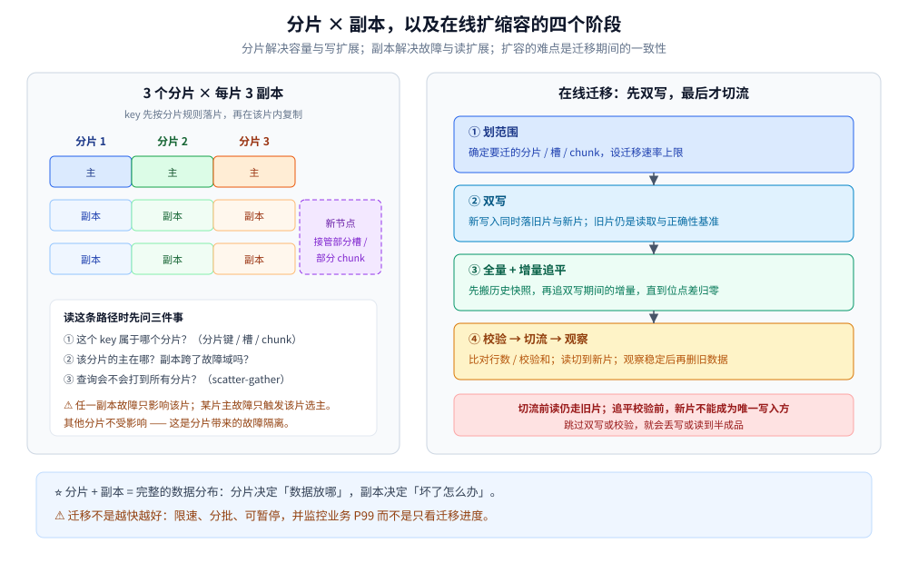
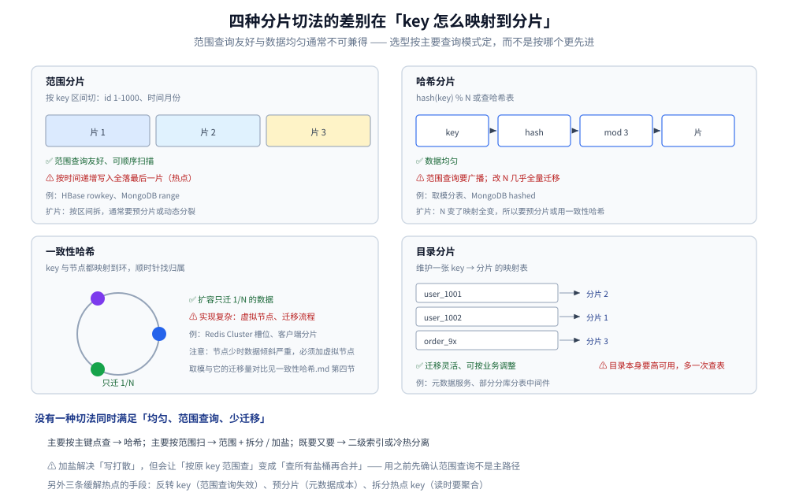

# 分区与再平衡

> 覆盖：分片与副本的关系、范围 / 哈希 / 一致性哈希 / 目录四种切法、热点处理、分片数的取舍、副本的故障域隔离、在线扩容的迁移阶段与跨分片查询。
>
> 不覆盖：一致性哈希环与虚拟节点的算法细节见 [一致性哈希.md](一致性哈希.md)；副本之间怎么复制见 [复制与Quorum.md](复制与Quorum.md)；分库分表的 SQL 落地见 [分表与路由.md](../../../03-数据与中间件/数据存储/关系型/MySQL/分表与路由.md)。
>
> 内容整理自个人学习笔记；参考资料与原始素材见 [素材清单](../../../素材清单.md)。本篇的命令与配置为语义示例，未在本轮启动集群实测。

---

## 一、分片与副本是什么关系？

**本节要点**：两者解决不同问题，必须组合使用 —— **分片解决「一份放不下 / 扛不住」，副本解决「一份丢了 / 挂了」**。完整的数据分布是「**先切片，每片再放多副本**」。

| 维度 | 解决什么 | 数据是否完整 | 扩容方式 |
|---|---|---|---|
| **分片（partition / shard）** | 单节点容量与吞吐上限 | 每个分片只有一部分数据 | 增加分片、迁移数据 |
| **副本（replica）** | 节点故障、读扩展、就近访问 | 每个副本都有该片的完整数据 | 增加副本、复制数据 |

**组合示例**：3 个分片 × 每片 3 副本 = 9 个数据节点。任一节点挂掉，只影响它持有的那一片的一个副本；某个分片的主挂了，该分片选主，其他分片不受影响。

> ⚠️ **分片 + 副本不是免费的**：副本数决定读扩展与可用性，分片数决定写扩展与单机容量。
> 两个数字要分开定，不能用一个「3 节点」笼统描述。

---

## 二、分片有哪几种切法？

**本节要点**：四种切法的差别在「**如何把 key 映射到分片**」。范围查询友好与数据均匀通常不可兼得，选型要按主要查询模式定。



图怎么读：左侧是「3 个分片 × 每片 3 副本」的分布，key 先按分片规则落到某一片，再在该片的副本之间复制；右侧是扩容时的迁移流程 —— 新分片先接双写，追平历史数据并校验后，才切读流。<br>
⚠️ 图中分片数、副本数与迁移阶段都是示意，实际系统可能是动态分裂而非一次性划片。

| 切法 | 怎么做 | 优点 | 缺点 | 例子 |
|---|---|---|---|---|
| **范围分片** | 按 key 区间切（如 `id 1–1000`、时间月份） | 范围查询友好、可顺序扫描 | 容易**热点**（如按时间递增写入全落在最后一片） | HBase rowkey、MongoDB range |
| **哈希分片** | `hash(key) % N` 或查哈希表 | 数据均匀 | 范围查询要广播到所有片；改 N 几乎全量迁移 | 取模分表、MongoDB hashed |
| **一致性哈希** | key 与节点映射到环，顺时针找归属 | 扩容时只迁 `1/N` 的数据 | 实现更复杂（虚拟节点、迁移流程） | Redis Cluster 槽位、客户端分片 |
| **目录分片** | 维护一张 `key → 分片` 的映射表 | 迁移灵活、可按业务调整 | 目录本身要高可用；多一次查表 | 元数据服务、部分分库分表中间件 |



四张示意图放在一起才能看出取舍：范围分片的片是一条连续区间，所以范围查询只碰相邻片；哈希分片的片是散点集合，所以范围查询必须广播；一致性哈希的片是一个环，扩一个节点只影响它逆时针那一段；目录分片的片由一张表决定，灵活性最高但多了查表与目录高可用这两个成本。

> ⭐ **没有一种切法同时满足「均匀、范围查询、少迁移」**。先确定最重要的查询模式：
> 主要按主键点查 → 哈希；主要按范围扫 → 范围 + 拆分 / 加盐；既要又要 → 二级索引或冷热分离。

### 2.1 热点与加盐

范围分片最常见的问题是**写热点**：按时间递增的日志、订单号、自增 ID，全部落到最后一个分片。

| 手段 | 做法 | 代价 |
|---|---|---|
| **加盐 / 前缀** | `hash(salt) + key` 打散到多个分片 | 范围查询要合并多个分片 |
| **反转 key** | 把时间戳等高位放到末尾 | 范围查询失效 |
| **预分片** | 一开始就建足够多的分片 / 槽 | 元数据与运维成本 |
| **拆分热点** | 把热点 key 拆成多个子 key（如计数器分桶） | 读时要聚合 |
| **缓存 / 读副本** | 热点读走缓存或只读副本 | 一致性变弱 |

> ⚠️ **加盐不是万能的**：它解决「写打散」，但会让「按原 key 范围查」变成「查所有盐桶再合并」。
> 用之前先确认范围查询是不是主路径。

---

## 三、分片数为什么「定下来就难改」？

**本节要点**：很多系统的分片数在**建库 / 建索引 / 建 topic 时**确定，之后改它意味着**重新分布全部数据**。所以预留原则是「**宁可先多、不要先少**」，但也不能无限多。

| 系统 | 分片数怎么定 | 后续能改吗 | 代价 |
|---|---|---|---|
| **Redis Cluster** | 固定 **16384 个槽**，槽分配到节点 | 能迁槽，不能改槽总数 | 迁槽要逐 key 搬 |
| **Kafka** | 建 topic 时指定 partition 数 | 只能增，不能减 | 增分区会破坏 key 的顺序保证 |
| **Elasticsearch** | 建索引时指定 `number_of_shards` | 需 reindex / split | 重建索引，成本高 |
| **MongoDB** | 按 chunk 动态分裂 | 能，均衡器自动迁 chunk | 迁移期间有网络与 IO 开销 |
| **HBase** | 按 region 动态分裂 | 能，split / merge | region 过多会拖慢 master |
| **TiKV** | 按 region 动态分裂 | 能，PD 调度 | 需要调度与限流 |

> ⭐ **分片太多**：元数据、连接、心跳、调度开销上升，小分片还容易造成资源浪费；
> **分片太少**：单分片成为瓶颈，后期只能重建或被迫做二级拆分。
> 经验上按「未来 1–2 年的数据量与吞吐」预留，并把「拆分方案」写进设计，而不是赌永远不拆。

---

## 四、副本放在哪里才算隔离？

**本节要点**：副本的价值来自**故障域隔离**。三个副本放在同一台宿主机、同一个机架或同一个 AZ，等于只有一个故障域。

- **机架感知**：副本分散到不同机架，避免一个机架断电全灭；
- **跨可用区（AZ）**：AZ 级故障时仍有多数派可用 —— ⭐ **但跨 AZ 写入要付额外的网络 RTT**，
  所以通常是「同城多 AZ 同步复制 + 异地异步复制」的组合；
- **跨地域**：多数用于容灾与就近读，写路径一般不同步（RTT 不允许）。

> ⚠️ 「三副本」不等于安全：**三个副本都在同一台宿主机/同一个机架/同一个 AZ 上，就只有一个故障域**。
> 副本的意义全部来自**故障域隔离**。

---

## 五、再平衡要经过哪些阶段？

**本节要点**：扩容的难点不在搬数据，而在**搬迁期间的一致性**。安全顺序是：**先双写、再追平、再校验、最后切流**，任何一步跳过都可能丢写或读到半成品。

1. **新节点加入 → 划分要迁走的分片**：确定迁移范围与速率上限；
2. **双写**：新写入同时落到旧分片与新分片（或写旧 + 记增量日志）；
3. **全量搬迁 + 增量追平**：先搬历史快照，再追双写期间的增量；
4. **校验**：对比行数、校验和、抽样内容，确认新旧一致；
5. **切流**：读请求切到新分片；观察错误率与延迟；
6. **观察期结束才删旧数据**：保留回滚窗口，确认稳定后再清理。

> ⭐ 一致性哈希之所以在扩容场景被偏爱，是因为它把「要搬多少」从
> **「几乎全部重排」**降到了 **`1/N`**；但搬迁期间的双写与切流逻辑，任何分片方案都躲不掉。

### 5.1 迁移期间的三类风险

| 风险 | 表现 | 控制手段 |
|---|---|---|
| **丢写** | 双写只写成功一边 | 双写要有失败补偿；以旧分片为准直到切流 |
| **读半成品** | 新分片还没追平就接读 | 读仍走旧分片，追平校验后再切 |
| **迁移风暴** | 一次搬太多，打满网络 / IO | 限速、分批、错峰、按优先级迁移 |

> ⚠️ **rebalance 不是「越快越好」**：迁移流量会和业务流量抢带宽与磁盘 IO。
> 生产上要设置迁移速率上限与暂停开关，并监控 P99 延迟而不是只看迁移进度。

---

## 六、跨分片查询和事务怎么办？

**本节要点**：分片之后，「一条 SQL 查所有数据」不再成立。跨分片的能力要么**在路由层聚合**，要么**用冗余索引**，要么**改成异步 / 最终一致**。

| 需求 | 做法 | 代价 |
|---|---|---|
| **跨分片列表 / 搜索** | scatter-gather：并发查所有分片再归并 | 延迟取最慢分片；分片多时放大明显 |
| **非分片键查询** | 建二级索引表 / 搜索引擎 / 冗余列 | 索引与主数据要同步 |
| **跨分片事务** | 尽量避免；必须时用 2PC / Saga / 本地消息表 | 性能与复杂度上升，见 [README.md](../分布式事务/README.md) |
| **全局排序 / 分页** | 各分片取前 N 再归并；或走离线 / 搜索引擎 | 深分页代价高 |
| **唯一约束** | 全局唯一 ID / 独立唯一性校验服务 | 多一次依赖 |

> ⭐ 分片键的选择原则：**让绝大多数请求只落一个分片**。
> 如果一条业务路径天然要跨所有分片，说明分片键选错了，或者这个查询应该走另一套存储（搜索、数仓）。

---

## 七、产品各自怎么分片？

**本节要点**：先认「分片单位」—— 槽、分区、分片、chunk、region —— 再看它是固定还是动态分裂。

| 产品 | 分片单位 | 固定 / 动态 | 路由方式 |
|---|---|---|---|
| **Redis Cluster** | 16384 个槽 | 固定 | `CRC16(key) % 16384`，客户端缓存槽映射 |
| **Kafka** | partition | 建 topic 时固定，只能增 | 生产者按 key 哈希或轮询选分区 |
| **Elasticsearch** | shard | 建索引时固定，可 split / reindex | 协调节点按 routing 转发 |
| **MongoDB** | chunk | 动态分裂 + 均衡器 | mongos 按 shard key 路由 |
| **HBase** | region | 动态分裂 | RegionServer 按 rowkey 范围服务 |
| **TiKV** | region | 动态分裂 | PD 调度，按 range 路由 |
| **MySQL 分库分表** | 库 / 表 | 业务定，改造成本高 | 中间件或应用按分片键路由 |

> ⚠️ **MySQL 单实例 + 主从不是分片**：数据仍在一个节点上，主从只是副本。
> 真正的分片是「3 个节点各存 1/3 数据」，节点故障后剩余节点只能提供部分数据，需要副本补齐。
> 这也是为什么单实例主从必须做全量 / 增量备份，而分片 + 副本系统更依赖副本重建。

> ⭐ **一致性哈希与槽位的关系**：Redis Cluster 的 16384 个槽可以理解为「固定数量的虚拟节点」，
> 槽再分配给物理节点；这样扩缩容只迁槽，不必重算每个 key 的归属。

---

## 八、应用场景

**本节要点**：分片键决定「哪些查询快、哪些查询贵」；扩容方案决定「未来能不能平滑增长」。两者要在建表 / 建索引时就一起定。

| 场景 | 分片键 | 理由 |
|---|---|---|
| 订单 | `user_id` 或 `order_id` | 用户维度查询多；按订单号查要全局 ID 或索引 |
| 聊天消息 | `conversation_id` | 会话内顺序与范围查询都落一片 |
| 用户资料 | `user_id` 哈希 | 点查为主，均匀分布 |
| 时序 / 日志 | 时间范围 + 设备 / 租户前缀 | 范围扫描友好，需防写热点 |
| 搜索索引 | 按文档 ID 哈希 | 查询走倒排，分片主要用于容量 |
| 计数 / 排行榜 | 按业务 key + 分桶 | 热点 key 拆分后再聚合 |

---

## 九、具体使用

**本节要点**：先确认「这个 key 会落到哪个分片」，再决定查询与迁移方案。

### 9.1 Redis Cluster 槽位

```bash
redis-cli -c -h 127.0.0.1 -p 7000 CLUSTER KEYSLOT user:1001   # 查看 key 的槽
redis-cli -c -h 127.0.0.1 -p 7000 CLUSTER SLOTS               # 查看槽到节点的映射
```

> `-c` 让客户端跟随 `MOVED` / `ASK` 重定向；生产客户端会缓存槽映射，避免每次问集群。

### 9.2 MongoDB 分片键

```javascript
sh.shardCollection("app.orders", { userId: "hashed" })
```

分片键一经选定很难修改；选错会导致大量跨分片查询或热点。

### 9.3 Elasticsearch 分片数

```json
PUT /orders
{
  "settings": { "number_of_shards": 6, "number_of_replicas": 1 }
}
```

分片数建索引时确定；后续调整通常要 reindex 或 split。

### 9.4 迁移限速的思路

```text
每轮迁移：最多 N 个分片 / 每秒最多 M 条记录
监控：迁移延迟、源 / 目标 IO、业务 P99
中止条件：业务错误率或延迟超过阈值 → 暂停迁移
```

---

## 延伸追问

- **分片数是不是越多越好？** → 不是。分片多能提升并行度，但元数据、心跳、连接与调度开销也上升；小分片还会造成资源碎片。按未来 1–2 年的规模预留。
- **一致性哈希能完全避免迁移吗？** → 不能。它只把迁移量从「几乎全部」降到 `1/N`；双写、追平、校验、切流仍然要做。
- **范围分片为什么容易热点？** → 递增 key（时间、自增 ID）总是写到最后一个分片；要靠加盐、预分片或拆分热点 key 解决。
- **跨分片事务能不能直接用 2PC？** → 可以，但性能与可用性代价高；多数业务优先用「分片键设计避免跨片」或 Saga / 本地消息表，见 [README.md](../分布式事务/README.md)。
- **副本数应该按什么定？** → 按「能容忍几个故障域同时失效」倒推，并确认副本真的跨了故障域；不是照抄别家的三副本。
- **扩容时先切读还是先切写？** → 先双写、追平、校验，再切读；写在新分片未追平前不能成为唯一写入方，否则会丢历史数据。

## 关联

- **上游/总纲**：[README.md](../README.md) — 分布式目录的阅读顺序与数据面定位
- **对照/互补**：[一致性哈希.md](一致性哈希.md) — 环、虚拟节点与迁移量计算
- **对照/互补**：[复制与Quorum.md](复制与Quorum.md) — 每个分片内部的副本与一致性
- **上游/总纲**：[集群基础.md](../集群基础.md) — 分片与副本在集群形态中的位置
- **下游机制**：[海量数据存储设计.md](../../系统设计/海量数据存储设计.md) — 容量、分片与迁移的系统级取舍
- **实现**：[分表与路由.md](../../../03-数据与中间件/数据存储/关系型/MySQL/分表与路由.md) — 分库分表的 SQL 与中间件落地
- **实现**：[分片基础.md](../../../03-数据与中间件/数据存储/NoSQL/MongoDB/分片基础.md) — chunk、均衡器与分片键
- **实现**：[高可用.md](../../../03-数据与中间件/数据存储/NoSQL/Redis/高可用.md) — Cluster 槽位与重定向
- **实现**：[核心概念与架构.md](../../../03-数据与中间件/中间件/消息队列/Kafka/核心概念与架构.md) — 分区、副本与 ISR
- **实现**：[集群与运维.md](../../../03-数据与中间件/数据存储/搜索与分析/Elasticsearch/集群与运维.md) — 分片、副本与 reindex
