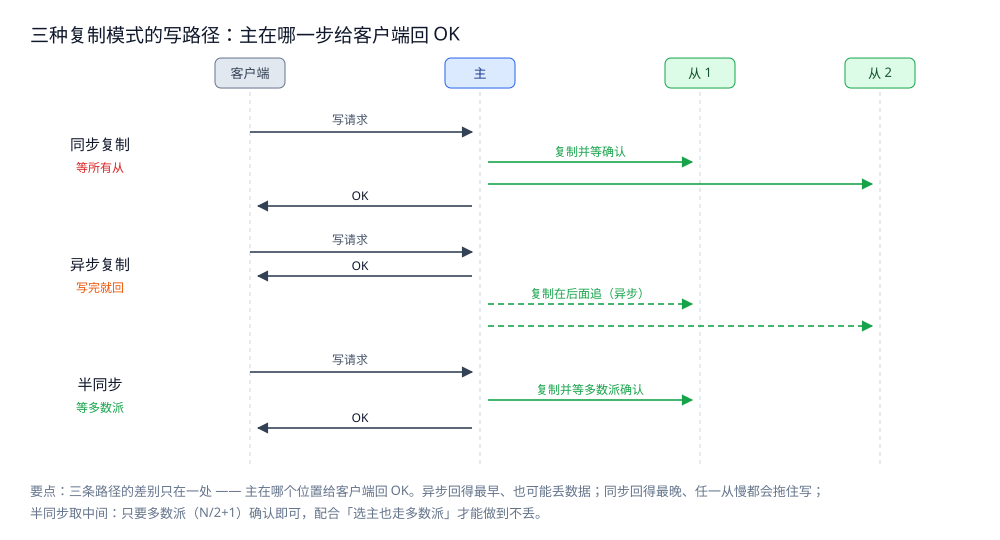
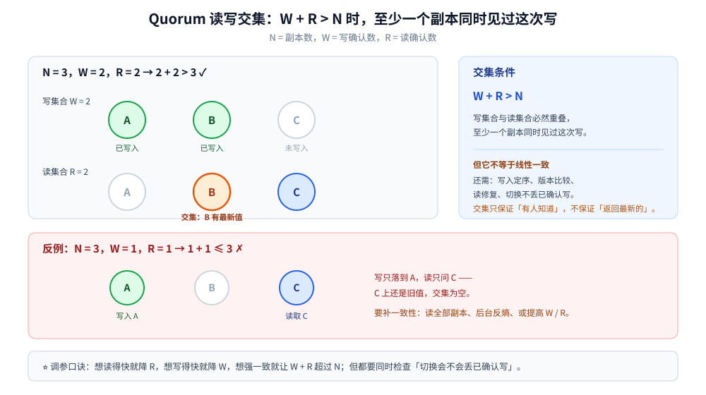

# 复制与 Quorum

> 覆盖：副本拓扑（单主 / 多主 / 无主）、同步 / 异步 / 半同步的代价、复制延迟带来的读异常、`W + R > N` 的读写交集、故障转移与多主冲突。
>
> 不覆盖：共识协议内部（选举、日志复制）见 [Raft协议.md](../共识协议/Raft协议.md)；分片与再平衡见 [分区与再平衡.md](分区与再平衡.md)；集群形态与脑裂防护见 [集群基础.md](../集群基础.md)。
>
> 内容整理自个人学习笔记；参考资料与原始素材见 [素材清单](../../../素材清单.md)。本篇的配置片段为语义示例，未在本轮启动数据库集群实测。

---

## 一、为什么需要复制？

**本节要点**：复制把同一份数据放到多个节点，同时解决四个问题 —— **故障不丢数据、读请求分摊、就近访问、故障后快速接管**。代价是写放大、网络流量与一致性难题。

| 目标 | 复制怎么帮上忙 | 代价 |
|---|---|---|
| **高可用** | 主节点挂了，副本可以接管 | 要选主、要追平日志 |
| **读扩展** | 多个副本都能回答读请求 | 复制延迟导致旧读 |
| **就近访问** | 用户读本地副本 | 跨地域复制要么慢、要么异步 |
| **数据冗余** | 磁盘 / 节点损坏仍有副本 | N 副本 = N 倍存储与写放大 |

两个常用指标先定义清楚：

- **RPO（Recovery Point Objective）**：能容忍丢多少数据，通常用时间衡量（如「最多丢 5 秒的写」）；
- **RTO（Recovery Time Objective）**：能容忍停多久，通常用切换与恢复时间衡量（如「5 分钟内恢复」）。

> ⭐ 复制模式的选择，本质就是在 **RPO、RTO、写延迟** 三者之间做取舍：
> 同步复制把 RPO 压到 0，但写延迟和可用性受影响；异步复制反过来。

---

## 二、副本拓扑有哪几种？

**本节要点**：拓扑的区别可以归结为一个问题 —— **谁决定写入的顺序**。有唯一主，就是单主；每个分片各有主，就是多主；没有主、靠客户端凑多数派，就是无主。

| 拓扑 | 怎么写 | 谁定序 | 优点 | 缺点 | 典型代表 |
|---|---|---|---|---|---|
| **单主**（single-leader） | 全部写走主，读可从从库分流 | 唯一主 | 冲突少、实现简单 | 主是写瓶颈；切换有窗口 | MySQL 主从、Redis 主从、MongoDB 副本集 |
| **多主**（multi-leader） | 每个分片 / 地域各有自己的主 | 每片一个主 | 写可本地化、跨地域延迟低 | 冲突合并复杂 | MySQL MGR、Redis Cluster、多活 |
| **无主**（leaderless） | 客户端直接写多份，写够 W 份即成功 | 没有主，靠 Quorum | 无单点、可用性高 | 客户端逻辑复杂、要读修复 | Cassandra、DynamoDB、Riak |

> **主备与主从的差别**：主备的备节点**不接流量**（只等待接管），主从的从节点**可以接读流量**。
> 主备浪费一台机器的算力，换来的是「切过去就是完整的」；主从用上从库的算力，代价是可能读到旧数据。

> ⚠️ **多主不等于多活**：多主首先要求「每个主都能独立接受写」，其次才谈跨地域；
> 如果多个主共享同一个存储或同一个序列，它们本质上仍是单主。

---

## 三、同步、异步、半同步各付出什么代价？

**本节要点**：复制模式决定了两件事 —— **写要多慢**（客户端等多久）和**主挂了会丢多少**（RPO）。
「快、不丢、一直可用」三者最多同时满足两个，这就是 CAP 在复制层的样子。



图怎么读：三条泳道把「客户端 → 主 → 从」的时序画在一起，关键看**主在哪个位置给客户端回 OK**——
同步要等所有从确认（最慢、不丢）、异步写完自己就回（最快、可能丢）、半同步等够多数派（折中）。<br>
⚠️ 图里 `W + R > N` 是 Quorum 读写的交集条件：只有读写集合**有交集**，才保证读到的那份至少包含最后一次写。

### 3.1 四种做法与各自的账

| 模式 | 主什么时候回 OK | 主挂了丢数据吗 | 代价 |
|---|---|---|---|
| **同步复制** | 等**所有**从确认 | 不丢 | 最慢；任一从慢或挂，写就被拖住 |
| **异步复制** | 写完本地日志就回 | **会丢**（差多少取决于延迟） | 最快；故障时可能丢掉一段 |
| **半同步 / Quorum** | 等**多数派**（`N/2+1`）确认 | 不丢（只要选主也走多数派） | 折中；仍需多数派可用 |
| **共识协议** | 日志被多数派**提交**后回 | 不丢 | 最复杂；换来的是「选主与提交用同一套规则」 |

> ⭐ **共识 ≠ 复制**，这是最容易混的一点：
> - **复制**回答「数据抄到几份」，是**数据面**的事；
> - **共识**回答「一群机器怎么对某个值达成一致、且事后不可反悔」，是**决策面**的事。
>
> Raft / Paxos / ZAB 做的是**后者**，只是它们顺手把日志复制也管了，所以常被当成「高级复制」。<br>
> Raft 的三种角色、日志复制与选主流程见 [Raft协议.md](../共识协议/Raft协议.md)，本篇只用到它的结论：
> **提交靠多数派、选主也靠多数派，两边用同一套规则才安全**。

### 3.2 副本读的一致性

写完的下一毫秒去读，读主库一定看到，读从库**可能看不到** —— 这就是读写分离的「读己之写」问题。
三种解法，按成本从低到高：

1. **会话粘滞**：同一用户的读全打到同一从库（缓解，不保证）；
2. **写后读主**：刚写过的那段时间（比如 1 秒）强制读主；
3. **记录位点**：客户端带上「我至少需要看到哪个位点/事务号」的读请求，从库跟不上就等或转主库。

> ⚠️ 单看「最终一致」四个字，判断不了业务能不能接受 —— 要问的是
> **「旧数据能被忍受多久、错多久会真的出事」**。对账、扣款这类场景不能只靠最终一致。

---

## 四、复制延迟会带来哪些读异常？

**本节要点**：异步复制下，从库是一条**落后的时间线**。读从库会违反「读己之写」「单调读」「因果顺序」这三类会话保证，而不是只有「数据旧」这么简单。

| 异常 | 表现 | 根因 | 修补 |
|---|---|---|---|
| **读己之写被违反** | 用户改完资料，刷新又看到旧值 | 读请求被路由到落后的从库 | 写后读主、会话粘滞、带版本号 |
| **单调读被违反** | 先看到新值，再刷新看到旧值 | 两次读落到不同延迟的从库 | 固定副本、按版本号拒绝回退 |
| **因果顺序被破坏** | 回复出现在原帖之前 | 读到了不同步的副本 | 因果一致、按版本向量校验 |
| **旧读放大** | 秒杀 / 大促时从库延迟飙升 | 写放大 + 从库回放慢 | 限流、读写分离降级、读主 |

**要监控的指标**：

- **复制延迟（lag）**：位点差 / 时间差，按 P99 而非平均值看；
- **从库回放线程状态**：是否卡在某一事务、是否频繁重试；
- **读旧值比例**：应用层带版本号时可直接统计；
- **切换时的位点差**：决定 RPO。

> ⭐ 复制延迟不是「偶发故障」，而是**异步复制的常态**。设计读写分离时，先假设从库永远落后几百毫秒到几秒，再决定哪些读可以走从库。

---

## 五、Quorum 的读写交集为什么能保证读到最新值？

**本节要点**：无主系统用 `N`（副本数）、`W`（写确认数）、`R`（读确认数）三个参数。只要 **`W + R > N`**，读集合与写集合必然有交集，至少有一个副本同时见过这次写。



图怎么读：三个副本排成一行，写选 `{A, B}`、读选 `{B, C}`，交集 `{B}` 里就有最新写；如果 `W=1、R=1`，写 `{A}`、读 `{C}` 没有交集，就可能读不到。<br>
⚠️ 交集只保证「至少一个副本有最新写」，**不自动保证返回的一定是最新值**，还要靠版本号比较与读修复。

### 5.1 参数怎么选

| 配置 | 写延迟 | 读延迟 | 一致性 | 典型场景 |
|---|---|---|---|---|
| `W=1, R=1` | 最低 | 最低 | 最弱，可能读旧 | 日志、缓存、可容忍旧读 |
| `W=QUORUM, R=QUORUM` | 中 | 中 | `W+R>N` 成立 | 通用默认 |
| `W=ALL, R=1` | 最高（任一副本挂就写不了） | 最低 | 读一定命中最新 | 写少读多、强一致读 |
| `W=1, R=ALL` | 最低 | 最高 | 读一定命中最新 | 写多读少 |
| `W=QUORUM, R=1` | 中 | 低 | 不保证 | 能容忍旧读的读路径 |

> ⭐ **`W + R > N` 只是必要条件，不是线性一致的充分条件**。要真正保证「读不返回旧值」，还需要：
> 写入有序（避免并发写互相覆盖）、读时比较版本、读修复把旧副本补齐、以及故障切换不丢失已确认的写。

### 5.2 读修复、hinted handoff 与 sloppy quorum

| 机制 | 做什么 | 解决什么 |
|---|---|---|
| **读修复（read repair）** | 读时发现副本版本不一致，把最新值写回旧副本 | 让旧副本逐步追上 |
| **hinted handoff** | 目标副本暂时不可用时，先写到其他节点并留下提示，恢复后转交 | 提高写可用性，避免因单副本故障写失败 |
| **sloppy quorum** | 允许写落到「不属于该 key 的 N 个节点」之外的临时节点 | 分区 / 故障时仍能凑够 W |
| **反熵（anti-entropy）** | 后台 Merkle 树 / 全量比对，修复长期不一致 | 读修复覆盖不到的冷数据 |

> ⚠️ **sloppy quorum 会削弱 `W + R > N` 的交集保证**：写到了临时节点，读的 N 个节点里可能没有它。
> 所以「用了 sloppy quorum 还算不算强一致」要看读路径是否等待 hinted handoff 完成。

---

## 六、故障转移时 RPO 和 RTO 怎么算？

**本节要点**：故障转移不是「检测到挂了就切」，而是 **检测 → 选主 → 追平 → 切流 → 观察** 五步。RPO 由复制模式决定，RTO 由检测与切换流程决定。

| 复制模式 | 已确认写的 RPO | 说明 |
|---|---|---|
| 同步复制 | 0 | 主返回前，所有从都已确认 |
| 半同步 / Quorum | 0（前提：选主也走多数派） | 已提交的写至少在多数派上 |
| 异步复制 | 复制延迟窗口内的写 | 主挂了，未复制的写丢失 |

**切换流程**（与 [集群基础.md](../集群基础.md) 第五节对应）：

1. **检测**：心跳超时只是候选证据，不能直接判死；
2. **选主**：协议内置选举 / 哨兵 / 外部协调服务 / 人工；
3. **追平**：新主与旧主的日志位点对齐，决定补齐还是回滚；
4. **切流**：把写请求指向新主，旧主降级；
5. **观察**：确认旧主不再以主身份写，再允许重新加入。

> ⚠️ 旧主回来时**不能直接当主**：它身上可能有分区期间未经确认的写，必须先降级、对位点、再决定去留。
> 脑裂的两种防法（多数派、fencing token）见 [集群基础.md](../集群基础.md) 第五节。

---

## 七、多主写入的冲突怎么收？

**本节要点**：多主 / 无主系统允许两个副本独立接受写，冲突不是异常而是常态。收敛规则必须在设计时定好，不能等线上出现分叉再补。

| 策略 | 怎么收敛 | 风险 |
|---|---|---|
| **LWW** | 时间戳大的赢 | 时钟偏差导致静默丢写，见 [时钟与顺序.md](../理论基础/时钟与顺序.md) |
| **版本向量** | 检测并发，交给上层合并 | 元数据随节点数增长 |
| **CRDT** | 用可交换、可合并的数据结构自动收敛 | 只适用于特定数据类型 |
| **业务合并** | 业务定义「两个版本怎么合」 | 需要领域知识，规则可能很复杂 |
| **避免多主** | 同一 key 固定一个写入方 | 写入方成为瓶颈或单点 |

> ⭐ 最常见的错误是「用数据库的 `updated_at` 做 LWW」—— 它依赖应用服务器时钟，
> 多台机器差几百毫秒就会让先发生的写赢掉后发生的写。

---

## 八、产品各自怎么复制？

**本节要点**：同一套复制理论，落到产品上是不同的默认值与可调参数。看产品时先问：**默认同步还是异步、写等几个副本、读走谁**。

| 产品 | 默认拓扑 | 默认复制 | 可调的一致性 |
|---|---|---|---|
| **MySQL** | 单主 | 异步（半同步需插件） | 半同步、强读主、GTID 位点 |
| **Redis** | 单主 + 哨兵 / Cluster 多主 | 异步 | `WAIT`（有限）、读主 |
| **MongoDB** | 副本集单主 | 异步 oplog | `w=majority` + `readConcern` |
| **Kafka** | 每分区一主 | ISR 同步复制 | `acks=all` + `min.insync.replicas` |
| **Cassandra / DynamoDB** | 无主 | Quorum 可调 | `CL=ONE/QUORUM/ALL` |
| **etcd / ZooKeeper** | 单主（共识） | 多数派日志复制 | 线性一致读 / 本地读 |

> ⚠️ 「产品支持强一致」不等于「默认就是强一致」。默认配置通常偏向可用性与延迟，
> 强一致往往要显式改副本数、写关注或读路径。

---

## 九、应用场景

**本节要点**：复制拓扑的选择，取决于「写在哪里发生、冲突能不能合并、旧读能不能忍」。

| 场景 | 推荐拓扑 | 理由 |
|---|---|---|
| 交易 / 账务 | 单主 + 半同步 / 共识 | 写集中，冲突不可接受 |
| 商品详情 / 内容 | 单主 + 异步从库 | 读多写少，旧读可接受 |
| 跨地域多活 | 多主或「会话 pin 地域」 | 降低写延迟，冲突按业务收敛 |
| 购物车 | 无主 / 多主 + CRDT / 业务合并 | 写不能失败，冲突可合并 |
| 时序 / 日志 | 无主 + Quorum | 写多，偶尔丢点可接受 |
| 配置 / 选主 | 共识复制 | 不能分叉，必须多数派 |

---

## 十、具体使用

**本节要点**：把复制模式落成配置，关键是同时改「写确认」与「读路径」，只改一边通常得不到想要的一致性。

### 10.1 MySQL 半同步（示意）

```sql
-- 主库安装并启用半同步插件后：
SET GLOBAL rpl_semi_sync_source_enabled = ON;
SET GLOBAL rpl_semi_sync_source_timeout = 1000;  -- 毫秒；超时后退化为异步
```

> ⚠️ 半同步在超时后会**退化为异步**：此时写仍返回成功，但 RPO 不再是 0。要监控退化次数。

### 10.2 Redis `WAIT`

```bash
WAIT 1 100   # 等待至少 1 个副本确认，最多 100 ms
```

`WAIT` 只保证「调用这一刻之前」的写到达了指定数量的副本，**不保证故障切换后不丢**；主从切换仍可能丢未复制的写。

### 10.3 Kafka 写确认

```properties
acks=all
min.insync.replicas=2
```

配合 `replication.factor=3`：至少 2 个 ISR 副本确认才返回；只剩 1 个 ISR 时写入失败，避免「确认了但副本不够」。

### 10.4 Cassandra 一致性级别

```sql
CONSISTENCY QUORUM;   -- 读写都过半数；N=3 时 W=2、R=2
```

> 读写都用 `QUORUM` 时 `W + R > N` 成立；但若读路径不做版本比较与读修复，仍可能返回旧值。

---

## 延伸追问

- **同步复制一定不丢数据吗？** → 在「主返回前所有从都确认」的前提下不丢，但任一从故障会拖住写；而且如果选主不走多数派，切换后仍可能回滚已确认的写。
- **半同步和 Quorum 是一回事吗？** → 思想上相近（都等一部分副本），但半同步通常指「至少一个从确认」，Quorum 指「多数派确认」，容错能力不同。
- **`W + R > N` 就能线性一致吗？** → 不能。它只保证读写集合有交集；还需要写入定序、版本比较、读修复，以及故障切换不丢已确认写。
- **读修复会不会把新值覆盖成旧值？** → 如果比较的是版本号 / 向量时钟，不会；如果盲目「后写覆盖」，就可能。修复逻辑必须能判断新旧。
- **多主系统为什么难？** → 因为冲突是常态，系统必须定义合并规则；而合并规则往往依赖业务语义，不能由数据库替业务决定。
- **复制延迟大时应该扩容从库吗？** → 先看瓶颈：是主库写入、从库回放、还是网络。盲目加从库可能让主库的复制压力更大。
- **RPO = 0 是不是就不用备份了？** → 不是。复制防的是节点故障，备份防的是误删、逻辑损坏、勒索软件；两者不能互相替代。

## 关联

- **上游/总纲**：[README.md](../README.md) — 分布式目录的阅读顺序与数据面定位
- **对照/互补**：[集群基础.md](../集群基础.md) — 四种集群形态、故障转移与脑裂
- **对照/互补**：[CAP与PACELC.md](../理论基础/CAP与PACELC.md) — 复制层的 C / A / L 取舍
- **对照/互补**：[一致性模型.md](../理论基础/一致性模型.md) — 副本读的可见性保证
- **下游机制**：[Raft协议.md](../共识协议/Raft协议.md) — 共识如何把「复制 + 选主」统一成一套规则
- **下游机制**：[分区与再平衡.md](分区与再平衡.md) — 分片之后，每个分片各自复制
- **下游机制**：[一致性哈希.md](一致性哈希.md) — 分片归属的稳定性
- **实现**：[复制与高可用.md](../../../03-数据与中间件/数据存储/关系型/MySQL/复制与高可用.md) — MySQL 的复制线程、拓扑与切换
- **实现**：[高可用.md](../../../03-数据与中间件/数据存储/NoSQL/Redis/高可用.md) — Redis 主从、哨兵与 Cluster
- **实现**：[副本集与选举.md](../../../03-数据与中间件/数据存储/NoSQL/MongoDB/副本集与选举.md) — oplog、写关注与选主
- **案例**：[跨地域多活.md](../../系统设计/IM系统/跨地域多活.md) — 跨地域复制与写路径取舍
> 反向引用（本篇被下列文档引到）：[核心概念与架构.md](../../../03-数据与中间件/中间件/消息队列/Kafka/核心概念与架构.md)、[消息可靠性.md](../../../03-数据与中间件/中间件/消息队列/Kafka/消息可靠性.md)、[消费者组与重平衡.md](../../../03-数据与中间件/中间件/消息队列/Kafka/消费者组与重平衡.md)、[Pulsar.md](../../../03-数据与中间件/中间件/消息队列/Pulsar.md)、[ZAB协议.md](../共识协议/ZAB协议.md)、[故障模型与分布式谬误.md](../理论基础/故障模型与分布式谬误.md)
