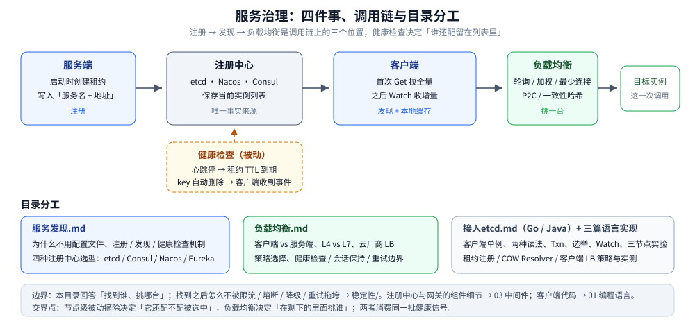

# 服务治理

> 覆盖：服务治理这条线的四件事——**注册、发现、健康检查、负载均衡**——各自回答什么问题、本目录怎么读，以及它与 `稳定性/`、`03-数据与中间件/`、`01-编程语言/` 的边界。
>
> 不覆盖：限流 / 熔断 / 降级 / 重试等过载保护见 [README.md](../稳定性/README.md)；注册中心与网关的**产品细节**见 03 中间件目录；Go / Java 接入代码见 01 编程语言目录。
>
> 内容整理自个人学习笔记，并参考《大型网站技术架构：核心原理与案例分析》（李智慧）；参考资料与原始素材见 [素材清单](../../../素材清单.md)。

## 一、服务治理到底解决哪几件事？

**本节要点**：一句话——**让调用方在实例动态变化时，仍然能找到并选对一个可用实例**。这件事只在「多机部署」之后才出现。

| 事 | 回答的问题 | 失败时的表现 | 本目录落点 |
|---|---|---|---|
| **注册** | 实例起来后，怎么让别人知道我在？ | 新实例一直没流量 | [服务发现.md](服务发现.md) |
| **发现** | 调用方怎么拿到当前实例列表？ | 拿到过期地址，或每次请求都查一次 | [服务发现.md](服务发现.md) |
| **健康检查** | 实例挂了，怎么自动从列表里消失？ | 请求持续打到死地址 | [服务发现.md](服务发现.md)、[节点级被动摘除.md](../稳定性/节点级被动摘除.md) |
| **负载均衡** | 拿到多台之后，这一次挑哪一台？ | 流量倾斜、长连接压死一台 | [负载均衡.md](负载均衡.md) |
| **路由 / 灰度** | 按版本、机房、用户切流量 | 灰度只能改代码或改配置 | 暂未独立成篇，见 [网关选型对比.md](../../../03-数据与中间件/中间件/网关与代理/网关选型对比.md) 与 K8s Ingress |

> ⭐ 前三件经常被合成一个词「服务发现」，但**健康检查是独立的一件**：注册只负责「写入」，健康检查负责「删除」，两者的失败模式完全不同——注册失败是新实例没流量，健康检查失败是死地址一直被调用。

## 二、本目录怎么读？

**本节要点**：先读两篇原理，再按手上的语言挑实现；`接入etcd.md` 是 **etcd 客户端手册**，不是第三篇治理原理。

```text
① 服务发现.md        ← 为什么不用配置文件、注册 / 发现 / 健康检查机制、注册中心选型
        ↓
② 负载均衡.md        ← 客户端 vs 服务端、L4 vs L7、策略与重试边界
        ↓
③ 实现（按语言挑）
     接入etcd.md（Go）        ← 客户端单例 / 两种读法 / Txn / 选举 / Watch / 三节点实验
     接入etcd.md（Java）      ← jetcd + Curator，与 ZooKeeper 的概念对照
     服务注册与发现的Go实现    ← 租约注册 + KeepAlive + 优雅下线 + COW Resolver
     客户端负载均衡的Go实现    ← 轮询 / 平滑加权 / 一致性哈希与实测
     服务发现的Java实现        ← Spring Cloud + Nacos 与 K8s 分层
```

| 想解决 | 先读 | 再读 |
|---|---|---|
| 讲清「为什么要注册中心」 | [服务发现.md](服务发现.md) 第一节 | [服务发现.md](服务发现.md) 第三、四节 |
| 在 Go 里接 etcd | [接入etcd.md](../../../01-编程语言/go/工程实践/接入etcd.md) | [服务注册与发现的Go实现.md](../../../01-编程语言/go/工程实践/服务注册与发现的Go实现.md) |
| 在 Java 里接 Nacos | [服务发现.md](服务发现.md) | [服务发现的Java实现.md](../../../01-编程语言/java/工程实践/服务发现的Java实现.md) |
| 选一个负载均衡策略 | [负载均衡.md](负载均衡.md) 第三节 | [客户端负载均衡的Go实现.md](../../../01-编程语言/go/工程实践/客户端负载均衡的Go实现.md) |
| 用 K8s 自带的能力 | [服务发现.md](服务发现.md) 1.5 | [负载均衡.md](负载均衡.md) 第六节 |



## 三、服务治理与稳定性怎么分工？

**本节要点**：治理回答「**找到谁、挑哪台**」，稳定性回答「**找到之后别被它拖垮**」。两者读同一批健康信号，但动作方向相反。

| 维度 | 服务治理（本目录） | 稳定性（[稳定性/README.md](../稳定性/README.md)） |
|---|---|---|
| 核心问题 | 实例列表从哪来、这次调用选谁 | 流量太大 / 下游故障时怎么有策略地放弃 |
| 典型动作 | 注册、发现、健康检查、负载均衡 | 限流、熔断、降级、重试预算、负载保护 |
| 数据来源 | 注册中心 / 平台 Endpoints | 调用结果、在途数、系统负载 |
| 失败后果 | 调用打错实例或打空 | 整体被拖垮（雪崩） |
| 交界点 | 健康检查判定节点不可用 | [节点级被动摘除.md](../稳定性/节点级被动摘除.md) 把它变成「不再被选中」 |

> ⭐ 两篇的交界只有一句话：**摘除决定「它还配不配被选中」，负载均衡决定「在剩下的里面挑谁」**。所以节点级摘除放在稳定性目录，但它消费的正是服务治理的健康信号。

## 四、与其它目录的边界

| 相关目录 | 关系 |
|---|---|
| [README.md](../稳定性/README.md) | 本目录讲「找到并选对」，那里讲「找到之后别被拖垮」 |
| [README.md](../../../01-编程语言/go/README.md)（Go） | etcd 客户端、注册发现、客户端 LB 的 Go 代码：[接入etcd.md](../../../01-编程语言/go/工程实践/接入etcd.md)、[服务注册与发现的Go实现.md](../../../01-编程语言/go/工程实践/服务注册与发现的Go实现.md)、[客户端负载均衡的Go实现.md](../../../01-编程语言/go/工程实践/客户端负载均衡的Go实现.md) |
| [README.md](../../../01-编程语言/java/README.md)（Java） | jetcd / Curator：[接入etcd.md](../../../01-编程语言/java/工程实践/接入etcd.md)；Spring Cloud + Nacos：[服务发现的Java实现.md](../../../01-编程语言/java/工程实践/服务发现的Java实现.md) |
| 03 中间件 / 注册与配置中心 | 注册中心的**产品细节与选型**：[Nacos.md](../../../03-数据与中间件/中间件/注册与配置中心/Nacos.md) |
| 03 中间件 / 网关与代理 | 服务端 LB 与路由的**产品实现**：[网关选型对比.md](../../../03-数据与中间件/中间件/网关与代理/网关选型对比.md)（含 3.7 的 **L4 转发模式差异**：LVS DR / NAT / TUN / FullNAT、HAProxy、云 NLB）、[OpenResty.md](../../../03-数据与中间件/中间件/网关与代理/OpenResty.md) |
| 02 网络 / 代理与网关 | 转发与代理的**机制差别**：[四层转发与七层代理.md](../../../02-计算机基础/网络/代理与网关/四层转发与七层代理.md)（报文转发 / 连接级代理 / 请求级代理、源地址与容量模型、背压归属）；本目录只讲「该选哪一类」，那里讲「两类在建连与数据面上差什么」 |
| 03 中间件 / 服务网格 | 东西向的**数据面代理实现**：[Envoy.md](../../../03-数据与中间件/中间件/服务网格/Envoy.md)（xDS 四类资源、`outlier_detection` 参数、`grpc_web`）；本目录只讲「该由哪一层负责」，那里讲「这个产品怎么配」 |
| [README.md](../../../02-计算机基础/网络/README.md)（网络） | DNS 是服务发现的另一条路：[DNS解析.md](../../../02-计算机基础/网络/网络层与寻址/DNS解析.md) |
| [一致性哈希.md](../数据分布/一致性哈希.md) | 负载均衡策略里「按 key 粘住同一台」的算法底座 |
| [Raft协议.md](../共识协议/Raft协议.md) | etcd 的共识基础；客户端用法见 [接入etcd.md](../../../01-编程语言/go/工程实践/接入etcd.md) |

## 五、上线服务治理的三条判据

1. **先看运行环境有没有平台能力**：K8s 自带 Service + DNS + Readiness Probe，不要再部署一套注册中心；自管机器 / 容器才需要 etcd、Nacos 或 Consul。
2. **注册中心通常选 AP**：列表旧几秒只是少量请求打到死地址（客户端能重试），而 CP 注册中心一旦不可写，实例信息会冻结甚至不可用。etcd 是 CP，选它就要接受这个取舍。
3. **客户端必须「本地缓存 + 变更推送」**：每次请求都查注册中心既慢，又把注册中心变成新的瓶颈；**首次全量 + Watch 增量**才是标准形态。

## 延伸追问

- **服务治理和微服务是一回事吗？** → 不是。微服务是**组织与部署边界**（怎么拆），服务治理是拆开之后**怎么让它们互相找到**；单体多副本同样需要服务发现与负载均衡。
- **只做负载均衡、不做注册发现行不行？** → 静态地址可以（如 Nginx upstream 写死），但扩缩容、故障摘除、滚动发布都会退化成人工改配置，规模一大就失控。
- **服务治理要不要自己写？** → 先用平台能力（K8s）或成熟组件（Nacos / etcd / Consul），自研只在有特殊路由或强定制需求时考虑；重点是把「注册、发现、健康检查、LB」四件事的**责任边界**划清。
- **治理线为什么没有单独的「路由」篇？** → 路由与灰度目前落在网关和 K8s Ingress / Istio 的产品文档里，避免与 [网关选型对比.md](../../../03-数据与中间件/中间件/网关与代理/网关选型对比.md) 重复；等规则模型需要跨产品统一时再独立成篇。

## 关联

- **上游/总纲**：[分布式与微服务.md](../分布式与微服务.md) — 零件清单里「服务发现与负载均衡」的展开
- **对照/互补**：[稳定性/README.md](../稳定性/README.md) — 找到之后怎么不被拖垮
- **下游机制**：[服务发现.md](服务发现.md) — 注册、发现与健康检查的机制
- **下游机制**：[负载均衡.md](负载均衡.md) — 形态、策略与重试边界
- **语言实现**：[接入etcd.md](../../../01-编程语言/go/工程实践/接入etcd.md)（Go）、[接入etcd.md](../../../01-编程语言/java/工程实践/接入etcd.md)（Java）
- **产品细节**：[Nacos.md](../../../03-数据与中间件/中间件/注册与配置中心/Nacos.md)、[网关选型对比.md](../../../03-数据与中间件/中间件/网关与代理/网关选型对比.md)
