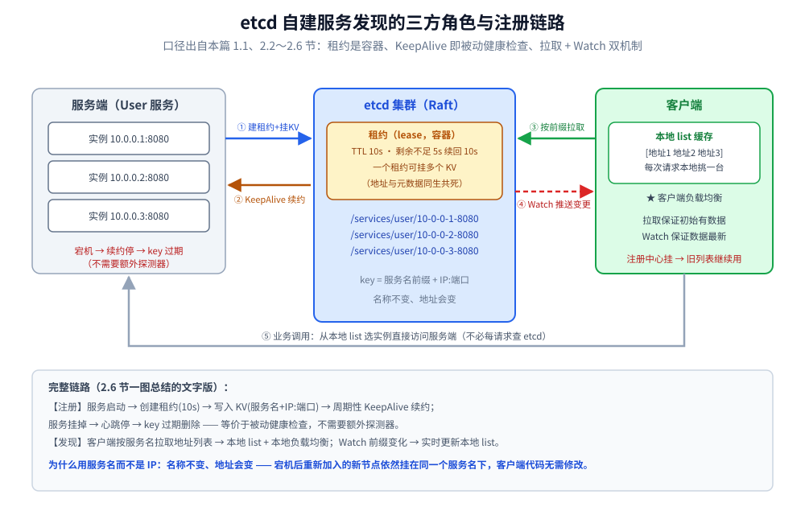
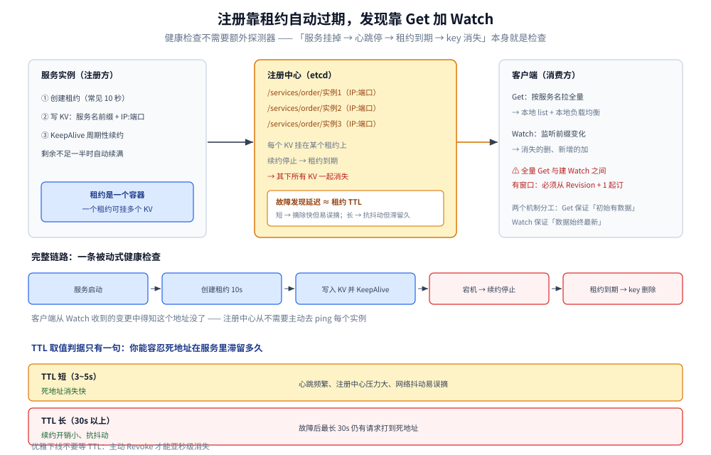

# 服务发现

> 覆盖：注册中心的动机（为什么不用配置文件）、注册 / 发现 / 健康检查的机制、etcd 租约与 Watch 的概念，以及注册中心的**选型判据**（先看环境、再看能力形态）。
>
> 不覆盖：**注册中心的产品级横向对比**（五种方案 × 九个维度、决策表、迁移与运维成本）以 [Nacos.md](../../../03-数据与中间件/中间件/注册与配置中心/Nacos.md) 第七节为单一来源；etcd 客户端代码、两种读法与三节点实验见 [接入etcd.md](../../../01-编程语言/go/工程实践/接入etcd.md)（Go）与 [接入etcd.md](../../../01-编程语言/java/工程实践/接入etcd.md)（Java）；注册 / 发现的完整 Go 封装见 [服务注册与发现的Go实现.md](../../../01-编程语言/go/工程实践/服务注册与发现的Go实现.md)；负载均衡见 [负载均衡.md](负载均衡.md)。
>
> 内容整理自个人学习笔记，并参考《大型网站技术架构：核心原理与案例分析》（李智慧）；参考资料与原始素材见 [素材清单](../../../素材清单.md)。

## 一、为什么用注册中心而不用配置文件？

**本节要点**：这是「为什么要有服务注册发现」的根问题。要能从**分布式部署**这个前提出发，推出「配置文件方案行不通」的具体痛点。

### 1.1 前提：一切都是因为「分布式部署」

> 同一个应用程序**通常有多份副本、多台节点**在跑。一旦有多个节点，就冒出两个必须解决的问题：

1. **配置文件如何在这多个节点之间同步、保持一致？**
2. **节点 / 地址发生变化时，如何通知到客户端？**

**配置文件方案在这两件事上都很难做好**，于是才需要注册中心。

### 1.2 配置文件方案的五个痛点

| 痛点 | 说明 |
|---|---|
| **① 无法动态感知变化** | 改完配置，运行中的服务**不知道**；只能重启或人工触发重载 |
| **② 扩缩容必须逐个改配置** | 加了两台机器 → **每台客户端节点的配置都得改一遍**；IP 变了更是灾难 |
| **③ 没有健康检查** | 配置文件里写着地址，但**服务挂了它照样写着**，客户端会一直往死地址发请求 |
| **④ 多节点维护成本高** | 2~3 台还能手改；**20~30 台时人工修改很难保证正确，回滚更麻烦** |
| **⑤ 没有统一治理入口** | 配置散在各机器上，**没法统一查看「现在有哪些实例在线」** |

**第 ④ 点的实际疼法**：

> 少量节点可以手改，也可以用脚本分发（改一台后执行脚本同步到其他机器）——
> 但**始终麻烦、容易出错**；**规模一大就失控，出了问题回滚也是麻烦事**。

### 1.3 注册中心到底解决什么

| 问题 | 实现 |
|---|---|
| **① 服务注册** | 服务端启动时向注册中心**写入自己的地址**（`服务名 + IP:端口`，以服务名为前缀） |
| **② 服务发现** | 客户端**按服务名**拉取该服务下的**全部地址清单**，并在**本地维护列表** |
| **③ 健康检查** | 靠 **KeepAlive（心跳续约）**：服务挂掉 → 心跳停 → **租约到期 → 记录自动过期** |

**三方角色**（说清这个才算真懂）：

```text
注册中心（如 etcd）  ←→  服务端（Server：写数据 + 保活）
        ↑
     客户端（Client：按名拉列表 + Watch 变更 + 本地列表 + 本地负载均衡）
```



三方角色一眼能看清的是「谁主动」：服务端主动建租约并续约，客户端主动拉取并监听，注册中心只做被动过期这一件事。这个方向关系直接决定了故障发现延迟由租约 TTL 决定，而不是由任何一方去探测——这也解释了为什么健康检查不需要额外的探测器。

### 1.4 用了注册中心，两个痛点怎么被消掉

**① 配置同步 → 监听 + 拉取**

> 配置统一更新到注册中心 / 配置中心，**每个应用只需实现「监听变化 + 拉取最新值」的逻辑**，
> 就能**非常方便地保证多节点配置一致**，不用再写同步脚本，也不怕回滚。

**② 服务地址变动的实时同步 → 注册 + 发现 + Watch**

> 服务端**注册**，客户端**按服务名发现**，节点增减由**注册中心监听并推送**——
> 客户端**不需要知道具体地址，也永远拿到最新的地址**。

### 1.5 和 K8s Service / DNS 方案的关系

| 方案 | 说明 |
|---|---|
| **自建注册中心** | 用 **etcd**（或 Zookeeper、Nacos、Consul）；<br>**单节点 Redis 也能凑合当注册中心用**（简单场景） |
| **K8s / Docker Swarm** | **本身就自带服务注册与发现，不需要额外部署注册中心**：<br>K8s 走 **Service + DNS**，调用方**直接把服务名传进去，地址完全不用管** |

> ⭐ 所以「要不要注册中心」本质是「**你的运行环境有没有提供这套能力**」：
> 用 K8s 就吃平台能力；自己管机器 / 容器就自己部署一套。

## 二、服务发现有哪些实现方案？

**本节要点**：只有两条路——**自己部署注册中心**，或者**吃平台内置能力**；不存在第三种「什么都不做还能动态发现」。

### 2.1 方案 A：自建注册中心

```text
① 部署注册中心集群（etcd / Zookeeper / Nacos / Consul）
        ↓
② 服务端启动时注册：写入「服务名 + IP:端口」
        ↓
③ 客户端按服务名前缀拉取实例列表，或订阅变更
        ↓
④ 客户端本地缓存列表，用它来访问服务端
```

⚠️ 关键细节 1：**注册必须带「租约 + 有效期」**

> 往 etcd 注册**不是写一次就完事**。服务端一旦中断，etcd 里的数据必须能自动过期，
> 否则客户端会拿到已挂掉的地址。做法是创建租约、设置有效期（通常 5~10 秒），
> 服务存活期间不断续租；服务一旦中断，租约到期、数据自动消失。

⚠️ 关键细节 2：**客户端用「监听 + 本地缓存」，而不是每次拉取**

> 客户端监听服务名前缀下的所有 key，key 一变化就同步更新本地缓存；
> 访问时从本地缓存取地址。这样就不必每次请求都去注册中心拿最新列表。

### 2.2 方案 B：云原生组件（内置服务发现）

> **Docker Swarm 和 Kubernetes 本身就自带服务注册发现，不需要额外做什么。**

| 编排平台 | 服务发现方式 |
|---|---|
| **Docker Swarm** | 内置服务发现 |
| **Kubernetes** | **DNS 发现**（默认），也支持**环境变量**方式 |

**使用体验**：调用时**直接把服务名传进去**即可，**地址完全不用考虑**。

### 2.3 两种方案怎么选

| 判据 | 选自建注册中心 | 选平台内置 |
|---|---|---|
| 运行环境 | 自管机器 / 容器，或跨 K8s 集群 | 单一 K8s 集群内 |
| 是否需要配置中心 | Nacos 可一体提供 | 另配 ConfigMap / 配置中心 |
| 是否需要跨机房 | Consul / Nacos 多数据中心 | 需要额外方案 |
| 运维成本 | 自己保集群（Raft 多数派） | 平台负责 |

## 三、注册、发现与健康检查是怎么自动生效的？

**本节要点**：核心只有两个机制——**租约（lease）负责「自动过期」**，**Get + Watch 负责「列表始终最新」**。把这两个机制讲清，这一题就讲完了。

### 3.1 租约：和 Redis 的 key TTL 差在哪

> **Redis**：给**每个 key** 单独设置有效时间（或者不设）。
>
> **etcd**：**租约是一个「容器」，一个租约下面可以挂多个 key-value。**

所以想给某个 KV 设置有效时间，**必须先创建租约**，再把 KV 挂到这个租约上。好处是**一组数据共享同一个生命周期**：实例地址、版本号、权重、可用区可以挂在同一个租约下，一起续期、一起消失。

### 3.2 注册三步

1. **创建租约**：通常 10 秒，目的是确保服务信息能过期。
2. **写入 KV**：`key = 服务名前缀 + IP:端口`，通过 `WithLease` 挂到租约上。
3. **KeepAlive 续约**：只要连接保持，租约不断续期；剩余不足一半时自动续回满值。

### 3.3 健康检查为什么不需要额外探测器

```text
KeepAlive 本质 = 服务端主动向注册中心发送「心跳」
        ↓
注册中心收到心跳 → 对该 key 的租约续期
        ↓
服务宕机 → 续约停止
        ↓
租约到期 → key 自动过期删除
        ↓
客户端从监听到的变更中得知：这个地址没了
```

> ⭐ 所以这是一条**被动式**健康检查链路：**「服务挂了 → 心跳停 → 租约过期 → key 自动消失」**，
> 不需要注册中心主动去 ping 每个实例。**故障发现延迟 ≈ 租约 TTL**。

### 3.4 发现的两个机制：Get + Watch

**机制 1：拉取列表（Get）**

```text
客户端按「服务名」前缀向注册中心发起请求
        ↓
拿到该服务下的全部地址列表
        ↓
在客户端本地构建一个 list
        ↓
每次请求时，客户端从本地 list 里选一个地址访问（★ 客户端负载均衡）
```

**机制 2：Watch 监听（保证本地列表实时）**

```text
注册中心前缀下有任何 key 发生变化
        ↓
通过「监听通道」把变更推送给客户端
        ↓
客户端据此更新本地 list：
   • 消失的地址 → 删掉
   • 新增的地址 → 加上
```

> **两个机制配合的效果**：**拉取列表保证「初始有数据」，Watch 保证「数据始终是最新的」**——
> 既避免了每次请求都拉全量（性能），又保证不会用过期地址（正确性）。
>
> ⚠️ 全量 Get 与建立 Watch 之间**有窗口**，必须以「全量那次 Get 的 Revision + 1」起订，
> 否则中间发生的变更会永久丢失。实现细节与四类常见坑见 [接入etcd.md](../../../01-编程语言/go/工程实践/接入etcd.md) 第九节。

### 3.5 完整链路一图总结

```text
【注册】
服务启动 → 创建租约(10s) → 写入 KV(服务名+IP:端口) → 周期性 KeepAlive 续约
                                                          ↓
                                              服务挂掉 → 心跳停 → key 过期删除
                                                          ↓
【发现】                                        （等价于被动健康检查）
客户端 → 按服务名拉取地址列表 → 本地 list + 本地负载均衡
       → Watch 监听前缀变化 → 实时更新本地 list
       → 用最新地址与服务端通信
```



图的上半部分是注册与发现两条方向相反的链路：左边不断续约，右边不断拉取与监听，中间那个租约容器是唯一把两边连起来的东西——它同时是「服务还活着」的凭证和「故障多久被发现」的计时器。所以 TTL 不是一个可以随便调大的性能参数，它就是故障摘除延迟本身。

### 3.6 参数怎么定：TTL 就是故障发现延迟

TTL 不是一个「越大越省」的参数，它同时是**故障摘除延迟**：

| 取值倾向 | 好处 | 代价 |
|---|---|---|
| TTL 短（如 3~5s） | 死地址消失快 | 心跳更频繁，注册中心压力大，网络抖动容易误摘 |
| TTL 长（如 30s+） | 续约开销小、抗抖动 | 故障后最长 30s 仍有请求打到死地址 |

> 取值判据只有一句：**「你能容忍死地址在服务里滞留多久」**。常见折中是 10 秒；
> 优雅下线要走主动 `Revoke`（亚秒级消失），不要等 TTL——具体代码与实测见
> [服务注册与发现的Go实现.md](../../../01-编程语言/go/工程实践/服务注册与发现的Go实现.md) 第二节。

## 四、注册中心怎么选？

### 4.1 先看能力形态，再看产品

| 组件 | 一致性模型 | 能力形态 | 边界 |
|---|---|---|---|
| **etcd** | CP（Raft） | 通用 KV + **租约 + Watch** + gRPC 接口，K8s 的底座 | **不是配置中心**：只有 KV，没有版本 / 灰度 / 回滚 / 审计 / 控制台 |
| **Consul** | CP（Raft）+ Gossip | 注册 + **主动健康检查** + KV + **多数据中心** + DNS 接口 | 配置能力弱，不能替代配置中心 |
| **Nacos** | 双模：AP（Distro）/ CP（JRaft） | **注册 + 配置中心一体** + 控制台 | 注册与配置共用一个集群，容量与升级互相影响 |
| **Eureka** | AP（无共识协议） | 纯注册 + 客户端缓存容错 | 已停止演进，只适合存量 Spring Cloud |

> **判断顺序**：先问运行环境有没有平台能力（K8s → 不引注册中心）→ 再问要不要配置中心
> （要 → Nacos）→ 再问是否多机房（要 → Consul / 多 DC 方案）→ 剩下「只要发现与选主」→ etcd。
> 各产品的完整对照、迁移成本与运维细节见
> [Nacos.md](../../../03-数据与中间件/中间件/注册与配置中心/Nacos.md) 第七节。

### 4.2 CP 还是 AP

- **etcd 是 CP**：丢了多数派就不可写、默认读也失败。换来的是实例列表不会脑裂出两个版本。
- **注册中心通常更偏好 AP**：列表旧几秒只是少量请求打到死地址（客户端能重试），
  而 CP 注册中心一旦不可写，**实例信息会冻结甚至不可用**，影响面更大。
- **Nacos 可按场景选 CP / AP**（临时实例走 Distro/AP，持久实例走 Raft/CP）。

### 4.3 健康检查语义：删除还是标记

| 语义 | 代表 | 恢复方式 | 影响 |
|---|---|---|---|
| **删除** | etcd / Zookeeper | 服务必须重新注册 | 列表干净，但恢复要等重新注册 |
| **标记不健康** | Consul / Nacos | 健康后自动回流 | 恢复快，但客户端要会过滤不健康实例 |

## 五、应用场景

**本节要点**：服务发现不是微服务专属——**只要有多副本、地址会变，就需要它**；差别只在「谁来提供」。

| 场景 | 用哪条路 | 本仓落点 |
|---|---|---|
| **Go 微服务 + 自管机器 / 容器** | etcd 租约注册 + Watch 增量 | [接入etcd.md](../../../01-编程语言/go/工程实践/接入etcd.md)、[服务注册与发现的Go实现.md](../../../01-编程语言/go/工程实践/服务注册与发现的Go实现.md) |
| **Java / Spring Cloud** | Nacos 注册 + `@LoadBalanced` 客户端 LB | [服务发现的Java实现.md](../../../01-编程语言/java/工程实践/服务发现的Java实现.md)、[Nacos.md](../../../03-数据与中间件/中间件/注册与配置中心/Nacos.md) |
| **K8s 内服务互调** | Service + DNS + Readiness Probe | [服务发现的Java实现.md](../../../01-编程语言/java/工程实践/服务发现的Java实现.md) 第五节 |
| **跨机房 / 多数据中心** | Consul 或 Nacos 多数据中心 | [跨地域多活.md](../../系统设计/IM系统/跨地域多活.md) |
| **消息队列 / 数据库选主** | 同一套租约 + 多数派思想 | [Raft协议.md](../共识协议/Raft协议.md) |
| **客户端负载均衡选实例** | 发现之后接 LB 策略 | [负载均衡.md](负载均衡.md)、[客户端负载均衡的Go实现.md](../../../01-编程语言/go/工程实践/客户端负载均衡的Go实现.md) |

## 六、具体使用

**本节要点**：原理篇只给「观察与验证」的最小命令；完整客户端代码在实现篇。

### 6.1 实现篇索引

| 要做的事 | 篇 |
|---|---|
| etcd 客户端单例、两种读法、Txn、选举、Watch、三节点实验 | [接入etcd.md](../../../01-编程语言/go/工程实践/接入etcd.md) |
| 租约注册 + KeepAlive + 优雅下线 + COW Resolver | [服务注册与发现的Go实现.md](../../../01-编程语言/go/工程实践/服务注册与发现的Go实现.md) |
| jetcd / Curator / ZooKeeper 对照 | [接入etcd.md](../../../01-编程语言/java/工程实践/接入etcd.md) |
| Spring Cloud + Nacos 与 K8s 分层 | [服务发现的Java实现.md](../../../01-编程语言/java/工程实践/服务发现的Java实现.md) |

### 6.2 用 etcdctl 观察注册表

```bash
export ETCDCTL_API=3
export ETCDCTL_ENDPOINTS=http://127.0.0.1:2379

# 看某个服务名下的全部实例
etcdctl get /services/order/ --prefix --keys-only

# 看实例的租约与 TTL（Lease 列）
etcdctl get /services/order/ --prefix -w table

# 持续观察变化：上线 / 下线各是什么事件
etcdctl watch /services/order/ --prefix --prev-kv
```

> 三节点集群的启动、四个故障实验（赶 leader / 任期递增 / 只剩一台 / 本地读）与生产四条排障，
> 见 [接入etcd.md](../../../01-编程语言/go/工程实践/接入etcd.md) 第十二节。

## 延伸追问

- **为什么租约设 10 秒？** → 是「**故障发现延迟**」与「**续约开销**」的折中：太长则服务挂了要很久才被发现；太短则心跳频繁、注册中心压力大。取值判据是「能容忍死地址滞留多久」，见 3.6。
- **etcd 和 Zookeeper 做注册中心的区别？** → etcd 基于 **Raft**（易理解、易运维），提供 **Watch + 租约**、有 gRPC 接口；ZK 基于 **ZAB**、需要自己实现会话超时语义。客户端 API 对照见 [接入etcd.md](../../../01-编程语言/java/工程实践/接入etcd.md) 第十一节。
- **和 K8s 的关系？** → K8s 内部**也是用 etcd 存服务与端点信息**，并提供 **Service + Endpoints + Readiness Probe**，相当于把这套机制做成了平台能力——所以用了 K8s 就不用自己实现。
- **单节点 Redis 也能当注册中心，为什么不用它？** → 简单场景够用，但**没有 Watch 的一致性语义与强一致保证**（主从切换可能丢注册信息），续约与过期还要自己做；**etcd 的租约 + Watch 是为这件事专门设计的**。
- **注册中心自己挂了怎么办？** → **客户端本地已有列表可继续用**（这正是本地缓存的容错价值），只是**无法感知新的变更**；所以注册中心本身要做**集群（Raft 多数派）**。
- **它和「配置中心」是一回事吗？** → 不完全。**服务发现关注「谁在线、地址是什么」**，配置中心关注「参数值是什么」；**Nacos 把两者做在一起**，etcd 也能兼做配置中心。
- **健康检查是主动还是被动？** → etcd 方案是**被动式**：不额外起探测器，靠「心跳停 → 租约到期 → key 消失」自然实现；Consul / Nacos 则会主动探测并标记不健康（见 4.3）。
- **服务名为什么必须是「名称」而不是 IP？** → **名称不变、地址会变**：宕机后重新加入的新节点依然挂在同一个服务名下，客户端代码因此无需修改。
- **客户端负载均衡和服务端负载均衡怎么选？** → 客户端 LB **少一跳、性能好**，但每个客户端都要实现服务发现逻辑；服务端 LB（K8s Service / Nginx）**对客户端透明**，运维更简单。详见 [负载均衡.md](负载均衡.md) 第二节。

## 关联

- **上游/总纲**：[README.md](README.md) — 四件事的分工与阅读顺序
- **对照/互补**：[负载均衡.md](负载均衡.md) — 拿到列表之后挑哪一台
- **下游机制**：[接入etcd.md](../../../01-编程语言/go/工程实践/接入etcd.md) — etcd 客户端机制、两种读法、三节点实验
- **语言实现**：[服务注册与发现的Go实现.md](../../../01-编程语言/go/工程实践/服务注册与发现的Go实现.md)、[服务发现的Java实现.md](../../../01-编程语言/java/工程实践/服务发现的Java实现.md)
- **共识基础**：[Raft协议.md](../共识协议/Raft协议.md) — etcd 为什么需要多数派
- **产品选型**：[Nacos.md](../../../03-数据与中间件/中间件/注册与配置中心/Nacos.md) — 注册中心产品对照
- **另一条健康信号链**：[节点级被动摘除.md](../稳定性/节点级被动摘除.md) — 判定节点不可用之后怎么摘
> 反向引用（本篇被下列文档引到）：[Eino框架.md](../../../01-编程语言/go/工程实践/框架/LLM应用/Eino框架.md)、[Kratos框架.md](../../../01-编程语言/go/工程实践/框架/微服务/Kratos框架.md)、[从零实现网关.md](../../../01-编程语言/go/网络编程/从零实现网关.md)、[接入etcd.md](../../../01-编程语言/java/工程实践/接入etcd.md)、[DNS解析.md](../../../02-计算机基础/网络/网络层与寻址/DNS解析.md)、[xxl-job.md](../../../03-数据与中间件/中间件/任务调度/xxl-job.md)、[OpenResty.md](../../../03-数据与中间件/中间件/网关与代理/OpenResty.md)、[网关选型对比.md](../../../03-数据与中间件/中间件/网关与代理/网关选型对比.md)、[Gossip协议.md](../共识协议/Gossip协议.md)、[分布式与微服务.md](../分布式与微服务.md)、[集群基础.md](../集群基础.md)、[跨地域多活.md](../../系统设计/IM系统/跨地域多活.md)

