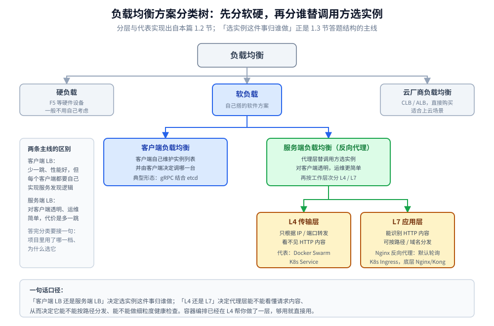
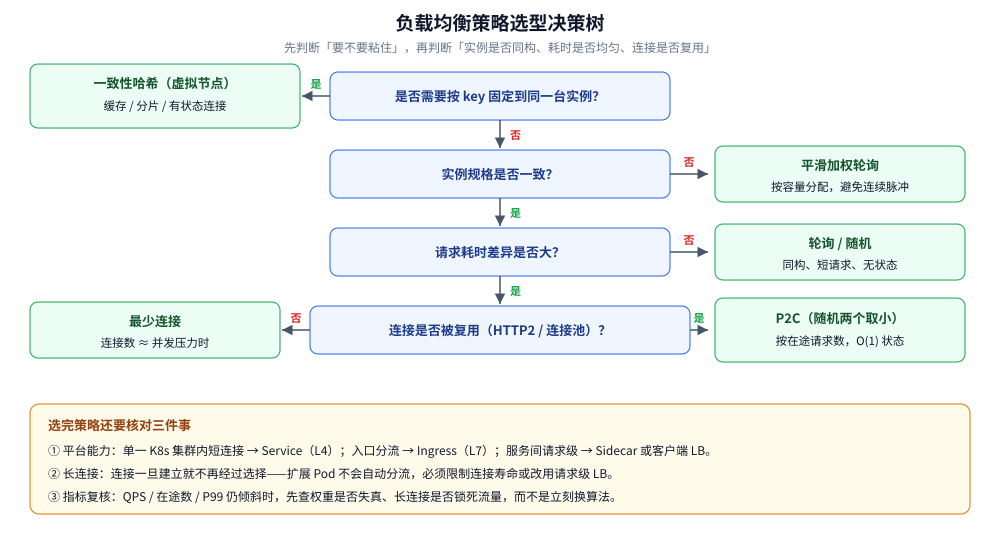
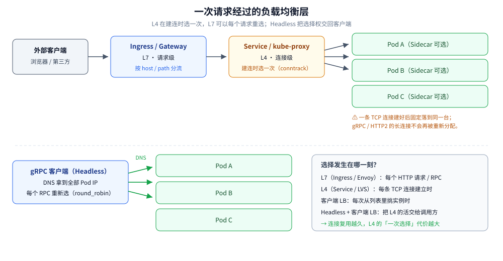

# 负载均衡

> 覆盖：负载均衡怎么分类（客户端 / 服务端、L4 / L7、代理 / 直连）、拿到实例列表后按什么策略挑一台、长连接为什么会绕开负载均衡，以及健康检查、会话保持、区域亲和与重试边界。
>
> 不覆盖：注册、发现与租约机制见 [服务发现.md](服务发现.md)；**LVS / HAProxy / 云 NLB 的具体转发模式（改哪个字段、回程是否经 LB）见 [网关选型对比.md](../../../03-数据与中间件/中间件/网关与代理/网关选型对比.md) 第 3.7 节**——本篇讲「L4 与 L7 各能看多深」，那里讲「具体产品怎么改包」；三个策略的 Go 实现与实测见 [客户端负载均衡的Go实现.md](../../../01-编程语言/go/工程实践/客户端负载均衡的Go实现.md)；哈希环本身见 [一致性哈希.md](../数据分布/一致性哈希.md)；重试预算与超时分配见 [重试与超时.md](../稳定性/重试与超时.md)。
>
> 内容整理自个人学习笔记，并参考《大型网站技术架构：核心原理与案例分析》（李智慧）；参考资料与原始素材见 [素材清单](../../../素材清单.md)。

---

## 一、负载均衡要先分成哪几类？

**本节要点**：不要一上来就说「用 Nginx」。负载均衡有三个**互相独立**的分类轴——**谁选**（客户端 / 服务端）、**看多深**（L4 / L7）、**是否经过代理**（直连 / 代理）。同一个系统往往在三根轴上各占一个位置。

### 1.1 三根分类轴

```text
① 谁来做选择
   ├── 客户端负载均衡：调用方持有实例列表，自己挑
   └── 服务端负载均衡：流量先到 LB，由 LB 转发

② 能看多深
   ├── L4：只看 IP / 端口 / 连接
   └── L7：能看 HTTP 方法、路径、Header、gRPC 方法

③ 是否多一跳
   ├── 直连：客户端直接连目标实例
   └── 代理：经过独立 LB 节点或 Sidecar
```



> 常说的「硬负载 / 软负载 / 云厂商 LB」是**部署形态**的分类，真正影响选型的是上面三根轴：
> **F5 和 Nginx 都可以做 L4/L7，云 LB 也分 CLB（L4）与 ALB（L7）**。

### 1.2 客户端负载均衡：把选择权交给调用方

> **客户端自己维护实例列表并选择目标**——客户端从注册中心拿到服务列表后，**由客户端决定调哪一台**。gRPC 结合 etcd / DNS 就是典型形态。

- **优点**：少一跳，没有额外转发延迟；策略最丰富（可以拿到实时 RTT、在途请求数）；失败后能立刻换一台重试。
- **代价**：**每个语言、每个客户端都要实现一遍**发现与选实例逻辑；列表和策略散落在各进程里，治理口径不容易统一。
- **关键前提**：客户端必须先拿到**足够新**的列表（[服务发现.md](服务发现.md) 的 Get + Watch），否则「选得再好」也是在过期集合里选。

### 1.3 服务端负载均衡：流量先到代理

| 层级 | 看什么 | 粒度 | 代表实现 |
|---|---|---|---|
| **L4 传输层** | 源 / 目的 IP、端口、协议 | **连接级**：一条 TCP 连接建立后固定落到一台后端 | F5、LVS、**K8s Service（kube-proxy）**、Docker Swarm |
| **L7 应用层** | HTTP 方法、Host、Path、Header、gRPC 方法 | **请求级**：同一连接上的不同请求可以发给不同后端 | **Nginx**、Envoy、HAProxy、**K8s Ingress**、云 ALB |

> ⭐ **L4 与 L7 的真正差别不是「四层快、七层慢」，而是「选择发生在连接的哪一刻」**：
> L4 在**建连时**选一次，之后所有请求共用这条连接；L7 可以**每个请求重新选**。
> 这一条直接决定了长连接场景下 L4 会不会失效（见第四节）。

### 1.4 代理与直连：Sidecar 是第三种形态

- **直连**：客户端选完地址后直接连实例，典型是客户端 LB。
- **集中代理**：所有流量先到一组 LB 节点，再转发给后端；LB 自己要做高可用与容量规划。
- **Sidecar 代理**：每个实例旁边挂一个 Envoy，**对应用透明**，但选实例、重试、熔断都发生在 Sidecar 里——Istio 就是这种形态。它把「服务端 LB 的透明性」和「客户端 LB 的请求级控制」合到了一起，代价是多一个进程、多一次本机转发和一套控制面。

### 1.5 云厂商负载均衡

> 直接购买云厂商的负载均衡服务，适合上云场景。选型时先分清它卖的是哪一层：

| 类型 | 层级 | 典型能力 |
|---|---|---|
| **CLB / NLB** | L4 | 保留源 IP、超高连接数、不过多解析应用协议 |
| **ALB / 应用型 LB** | L7 | 按域名 / 路径分流、灰度权重、WebSocket、WAF 联动 |

> 云 LB 的**健康检查与跨可用区转发**通常已经做好，但**跨可用区流量可能计费**，且安全组、证书、后端协议都要单独配置——「买了 LB」不等于「治理完成」。

---

## 二、客户端负载均衡和服务端负载均衡怎么选？

**本节要点**：判据不是「哪个性能好」，而是**你能不能改客户端**、**协议是不是长连接**、**治理策略要不要集中**。

| 维度 | 客户端 LB | 服务端 LB（集中代理） |
|---|---|---|
| 额外跳数 | **无** | 多一跳（Sidecar 是本机一跳） |
| 实例列表 | 每个客户端自己维护 | LB 维护，客户端只知道 LB 地址 |
| 客户端改造 | **必须实现**发现 + 选实例 | 不需要，传服务名或 LB 地址即可 |
| 策略能力 | 强（RTT、在途数、自定义） | 取决于代理（Nginx / Envoy 能力也很强） |
| 多语言支持 | 每种语言各写一套 | **天然统一** |
| 故障边界 | 列表过期只会「选错」，不会全线中断 | **LB 自身故障会影响全部流量** |
| 典型场景 | gRPC、Go 微服务、需要精细流控 | Web 入口、异构客户端、跨语言调用 |

**决策顺序**：

1. **能改客户端、且是 gRPC / 长连接** → 优先客户端 LB（配合 Headless Service 或注册中心）。
2. **客户端不可控（浏览器、第三方、老系统）** → 服务端 LB。
3. **既要透明又要请求级策略** → Sidecar（服务网格），但要接受运维复杂度。
4. **单一 K8s 集群内的短连接 HTTP** → 直接用 Service，不必自建。

> ⚠️ 两种模式**可以叠加**：外部流量经 Ingress（L7）进来，集群内服务之间再用客户端 LB 或 Sidecar。
> 叠加时每一层都要有自己的超时与重试预算，否则一次用户请求会在多层各放大一次（见 [重试与超时.md](../稳定性/重试与超时.md)）。

---

## 三、拿到实例列表后，怎么挑一台？

**本节要点**：策略没有绝对优劣，只有**它假设了什么**。选策略本质是回答三个问题——实例是否同构、请求耗时是否均匀、是否需要按 key 粘住。

### 3.1 六种常见策略

| 策略 | 怎么选 | 适合 | 盲区 |
|---|---|---|---|
| **轮询（Round Robin）** | 依次轮转 | 实例同构、请求短且均匀 | 不看负载；慢实例照样分到同样多 |
| **加权轮询（Weighted RR）** | 按权重分配次数 | 实例规格不同、需要灰度权重 | 权重是静态的，和真实负载会漂移 |
| **最少连接（Least Conn）** | 选当前连接数最少的 | 请求耗时差异大、连接数与压力相关 | 长连接 / HTTP2 复用会让计数失真 |
| **P2C（Power of Two Choices）** | 随机取两个，选负载低的 | 大规模集群、想要低开销的自适应 | 负载指标本身要准；只比较两个，不保证全局最优 |
| **一致性哈希（Ring Hash）** | 按 key 落环，找顺时针第一个节点 | 缓存、分片、需要同一 key 粘同一台 | 热点 key 仍会倾斜；扩缩容要虚拟节点 |
| **随机（Random）** | 随机挑一台 | 实例多、实现最简 | 小集群容易短期不均；不看负载 |

### 3.2 加权要「平滑」，否则会打出脉冲

朴素的加权轮询是「按权重把实例重复放进列表」：权重 `5:1:1` 会排成 `a a a a a b c`，**同一台机器被连续打五次**。

**平滑加权轮询**（Nginx 的算法）改成每轮给所有实例的 `current` 加上自身权重，选 `current` 最大的，再把它减去总权重——总比例不变，但序列变成 `a a b a c a a`，脉冲被摊开。实现见 [客户端负载均衡的Go实现.md](../../../01-编程语言/go/工程实践/客户端负载均衡的Go实现.md) 第一节。

### 3.3 「最少连接」在 HTTP/2 下会失明

最少连接统计的是**连接数**，不是**在途请求数**：

- HTTP/1.1 + `Connection: close`：一个请求一条连接，连接数 ≈ 并发数，最少连接基本准确。
- **HTTP/2 / gRPC**：一条连接上可以跑成百上千个 stream，**连接数只有 1，但在途请求可能差几个数量级**。此时「最少连接」会把新请求继续压到已经最忙的那条连接上。

> 这就是 Envoy 的 `least_request`、gRPC 生态里的「按在途请求数选实例」存在的原因：
> **要在「请求」维度做均衡，就不能用「连接」维度的指标**。
> 「在途数」本身怎么限制，见 [并发限制器.md](../稳定性/并发限制器.md)。

### 3.4 P2C：用两个样本换掉全局状态

P2C（Power of Two Choices）每次**随机取两个实例，选负载较低的那个**：

- 不需要维护全局最小堆，**O(1) 状态**，适合上千实例；
- 数学上「两个随机样本取小」已经能把最大负载从 `O(log n / log log n)` 降到 `O(log log n)` 量级，效果接近全局最优；
- Envoy 的 `least_request` 默认 `choice_count = 2`，就是这个思路的工程化。

> P2C 的前提是**负载指标可信**。如果指标是「连接数」，它同样会在 HTTP/2 下失明；换成「在途请求数」或「加权 RTT」才有意义。

### 3.5 一致性哈希：为「粘住」而不是为「均匀」

一致性哈希解决的是**同一个 key 每次都落到同一台**：缓存命中、分片路由、有状态连接都靠它。代价是**均匀性让位于稳定性**——扩缩容时只搬迁相邻区间，但热点 key 仍然会压死一台。

> 环的构造、虚拟节点数量、增删节点的搬迁比例与实测，见 [一致性哈希.md](../数据分布/一致性哈希.md) 与 [客户端负载均衡的Go实现.md](../../../01-编程语言/go/工程实践/客户端负载均衡的Go实现.md) 第一、二节。**不要在负载均衡篇里重复推导哈希环**。

### 3.6 选型决策树



> 决策树只能给默认答案，**最终要看指标**：拿到各实例的 QPS、在途数、P99 之后，
> 如果分布仍然倾斜，问题通常不在策略，而在**实例权重不准**或**长连接把流量锁死了**。

---

## 四、为什么长连接会让负载均衡失效？

**本节要点**：负载均衡只在**做选择的那一刻**生效。连接一旦建立并长期复用，后面的请求就**不再经过选择**——这就是「扩了 Pod，新 Pod 却没流量」的根因。

### 4.1 一次选择，长期复用

```text
短连接（HTTP/1.1 close）：
  请求 1 → 选 A → 建连 → 用完关闭
  请求 2 → 选 B → 建连 → 用完关闭        ← 每次请求都重新选

长连接（gRPC / HTTP2 / 连接池）：
  请求 1 → 选 A → 建连 ────────────────┐
  请求 2 ──────────────────────────────┤ 全部复用同一条连接
  请求 3 ──────────────────────────────┘ 新实例 B 永远分不到
```

**K8s Service 是 L4、连接级**：kube-proxy 在**建连时**做一次 DNAT，之后的包都走同一条 conntrack 记录。
所以 **Service 对短连接 HTTP 够用，对 gRPC / 数据库长连接等效于没做负载均衡**。

### 4.2 三种解法

| 解法 | 做法 | 代价 |
|---|---|---|
| **客户端按请求选** | Headless Service + 客户端 LB（gRPC `round_robin`） | 客户端要实现发现；连接数变多 |
| **L7 代理按请求转发** | Envoy / Nginx / Istio Sidecar 解析 HTTP2，每个 stream 重新选 | 多一跳；代理要支持协议 |
| **限制连接寿命** | 服务端 `MAX_CONNECTION_AGE`、客户端定期重建连接 + 抖动 | 重建瞬间有抖动；参数要小于扩缩容周期 |

> ⭐ 还有一个常被忽略的因素：**DNS 缓存**。K8s 的 Service 名解析到 ClusterIP 后，客户端会缓存；
> 扩缩容后即使 Endpoints 变了，**ClusterIP 本身不变**，所以「换 DNS」并不能让长连接重新分配。
> 只有 Headless Service（DNS 直接返回 Pod IP）才需要关心 DNS TTL。

### 4.3 连接池也是长连接

数据库连接池、Redis 客户端、HTTP 客户端的 `MaxIdleConns` 都会把连接长期挂住：

- 连接池**不是越大越好**：池里的连接会各自绑定一台后端，池越大，后端之间的分布反而越难均匀；
- 滚动发布时，旧连接会继续打到旧实例，直到连接被回收——**「服务已下线」不等于「流量已停止」**；
- 需要配合**优雅下线**（先从注册中心摘除，再等待在途请求结束）才能平滑。

---

## 五、会话保持、区域亲和与重试边界怎么定？

**本节要点**：这三件事都在「选哪台」之上加约束，但约束的代价不同——会话保持牺牲均匀性，区域亲和牺牲故障冗余，重试牺牲下游容量。

### 5.1 会话保持：能不做就不做

| 方式 | 原理 | 问题 |
|---|---|---|
| **Cookie 粘滞** | LB 写入后端标识，后续请求按 Cookie 转发 | 客户端禁用 Cookie 就失效；扩缩容时会话丢失 |
| **源 IP 哈希** | 按客户端 IP 取模 | NAT 后大量用户共享一个出口，分布严重倾斜 |
| **一致性哈希** | 按 session id / 用户 id 落环 | 相对均匀，但仍有热点；节点变更会迁移一部分会话 |

> **首选方案是把服务做成无状态**：会话放 Redis / Token，任何实例都能处理。
> 只有存量系统改不动时，才用「一致性哈希 + 较短 TTL」兜底，并且要接受**扩缩容时会话迁移**。

### 5.2 区域亲和：先同区，再跨区

- **默认同可用区优先**：同区 RTT 更低、跨区流量可能计费；
- **必须有跨区兜底**：本区实例全挂时要能打到其他区，否则「亲和」变成「单区故障即全挂」；
- **容量要留余量**：如果每个区只按 `1/3` 容量部署，一个区挂掉后剩下两个区要扛 `100%`，必然过载；
- K8s 用 `topologySpreadConstraints` 打散 Pod，Istio 用 `localityLbSetting` 做同区优先 + 跨区兜底。

> ⭐ 区域亲和的本质是**在延迟和可用性之间做取舍**：同区优先省下的是毫秒，跨区兜底买回的是「一个区挂掉仍然可用」。两者必须同时配置，只配前者等于给自己埋雷。

### 5.3 健康检查：三层信号，别混为一谈

| 层 | 回答的问题 | 时间尺度 | 落点 |
|---|---|---|---|
| **注册中心租约** | 这个实例还活着吗？ | ≈ TTL（秒级） | [服务发现.md](服务发现.md) 第三节 |
| **ReadinessProbe** | 这个 Pod 现在能接流量吗？ | 秒级，连续失败才摘 | K8s Endpoints |
| **LB 被动摘除** | 最近调用它是不是一直失败？ | 滑动窗口，秒级 | [节点级被动摘除.md](../稳定性/节点级被动摘除.md) |

> 三者是**串联**的：注册中心决定「在不在列表里」，Readiness 决定「进不进 Endpoints」，被动摘除决定「这次选不选它」。
> 任何一层缺失，都会表现为「请求打到一台明明已经坏了的机器上」。

### 5.4 重试边界：只重试「确定没被处理」的请求

负载均衡器换一台重试看起来很自然，但必须先回答：**第一次请求到底有没有到达后端？**

| 情况 | 能不能重试 | 原因 |
|---|---|---|
| **连接被拒绝 / DNS 失败** | ✅ 可以 | 请求肯定没发出去 |
| **建连超时** | ✅ 通常可以 | 大概率没建立会话 |
| **读超时** | ⚠️ 仅幂等请求 | 后端可能已经处理完，只是响应慢 |
| **收到 5xx** | ⚠️ 看语义 | 可能是后端已产生副作用 |
| **收到 4xx** | ❌ 不要 | 重试不会改变结果（429 除外） |

> 重试还要有**预算**（通常 ≤ 10% 流量）和**退避 + 抖动**，否则一次下游抖动会被多层重试放大成风暴。
> 具体算法与四层链路实测见 [重试与超时.md](../稳定性/重试与超时.md)；
> Go 客户端里「请求有没有发出去」的判定见 [客户端负载均衡的Go实现.md](../../../01-编程语言/go/工程实践/客户端负载均衡的Go实现.md) 第三节。

---

## 六、K8s / Ingress / Istio 各在哪一层？

**本节要点**：K8s 自带的能力覆盖了「发现 + L4 转发 + 入口 L7」，但**没有覆盖请求级的服务间负载均衡**；Istio 补的正是这一块。

| 层 | 组件 | 层级 | 粒度 | 典型坑 |
|---|---|---|---|---|
| 服务名解析 | **CoreDNS** | — | 域名 → ClusterIP | `ndots:5` 导致多次查询；DNS 有缓存，扩缩容后不立刻生效 |
| 集群内转发 | **kube-proxy**（Service） | **L4** | **连接级**（iptables / IPVS） | 长连接会一直打到同一台 Pod；新 Pod 分不到流量 |
| 七层入口 | **Ingress** / Gateway API | **L7** | **请求级**，按 host / path 分流 | 只对**入口流量**生效，服务间调用不经过它 |
| 无平台 LB | **Headless Service**（`clusterIP: None`） | — | DNS 返回所有 Pod IP | 把选择交回客户端，适合 gRPC `round_robin` |
| 摘除时机 | **ReadinessProbe** | — | 决定 Pod 是否进 Endpoints | 没配 = 容器一起来就接满流量，JVM 预热期必超时 |
| 服务间 L7 | **Istio Sidecar（Envoy）** | **L7** | **请求级**，支持重试、超时、熔断、区域亲和 | Sidecar 增加一跳与资源开销；控制面（istiod）也要高可用 |



**用了 K8s 还要不要 Nacos？**

| 问题 | 谁来做 |
|---|---|
| 实例地址同步、扩缩容 | **K8s Service + Endpoints 足够**，不用再注册一遍 |
| 配置中心 | ConfigMap 可存配置，但热更新、灰度、监听推送还是 Nacos / Apollo 顺手 |
| 跨集群 / 混合云（服务在 K8s 外） | K8s Service **出不了集群**，需要 Nacos / Consul 统一注册 |
| 权重灰度、按 zone 路由 | K8s 原生没有，需要 **Istio VirtualService** 或 Nacos 权重 |

> **一句话**：**同集群内的东西交给 K8s；跨环境、需要流量治理时才引入注册中心**。
> 两套并存时，**必须以一边为唯一事实来源**，否则两边的实例列表会互相打架。

---

## 七、应用场景

**本节要点**：负载均衡不是只有「网站入口」一个场景；**只要有多实例且流量需要分配，就有一层 LB**。

| 场景 | 用哪条路 | 本仓落点 |
|---|---|---|
| **Web / API 入口** | Nginx / 云 ALB 做 L7，按域名与路径分流 | [OpenResty.md](../../../03-数据与中间件/中间件/网关与代理/OpenResty.md)、[网关选型对比.md](../../../03-数据与中间件/中间件/网关与代理/网关选型对比.md) |
| **K8s 集群内短连接** | Service（L4）+ Ingress（入口 L7） | 本篇第六节 |
| **Go 微服务 / gRPC** | 客户端 LB（轮询 / P2C）+ Headless Service | [客户端负载均衡的Go实现.md](../../../01-编程语言/go/工程实践/客户端负载均衡的Go实现.md) |
| **Spring Cloud** | `@LoadBalanced` + Nacos 实例列表 | [服务发现的Java实现.md](../../../01-编程语言/java/工程实践/服务发现的Java实现.md) |
| **缓存 / 分片存储** | 一致性哈希把 key 固定到节点 | [一致性哈希.md](../数据分布/一致性哈希.md) |
| **多机房** | 区域亲和 + 跨区兜底 | [跨地域多活.md](../../系统设计/IM系统/跨地域多活.md) |
| **服务网格** | Sidecar 做请求级 LB、重试与摘除 | 本篇第六节 |

---

## 八、具体使用

**本节要点**：原理篇只给「能直接抄的配置骨架」，并标出每条配置对应的正文结论；完整代码在语言实现篇。

### 8.1 Nginx：L7 + 被动健康检查

```nginx
upstream order_api {
    least_conn;                 # 请求耗时差异大时优于轮询
    server 10.0.0.11:8080 weight=5 max_fails=3 fail_timeout=10s;
    server 10.0.0.12:8080 weight=1 max_fails=3 fail_timeout=10s;

    keepalive 32;               # 与后端复用连接，降低建连开销
}

server {
    listen 80;
    location /api/order/ {
        proxy_http_version 1.1;
        proxy_set_header Connection "";
        proxy_pass http://order_api;

        # 只对「确定没被处理」的失败换一台；non_idempotent 默认不重试
        proxy_next_upstream error timeout;
        proxy_next_upstream_tries 2;
    }
}
```

> `max_fails` / `fail_timeout` 就是**被动摘除**：`fail_timeout` 内失败 `max_fails` 次，实例被暂时移出；
> 到时间后再放回来试探。它与注册中心租约是**两套独立信号**，不要只配一边。

### 8.2 K8s：Service 与 Headless

```yaml
apiVersion: v1
kind: Service
metadata:
  name: order-api
spec:
  clusterIP: None          # Headless：DNS 直接返回 Pod IP，交给客户端 LB
  selector:
    app: order-api
  ports:
    - port: 8080
      targetPort: 8080
---
apiVersion: networking.k8s.io/v1
kind: Ingress
metadata:
  name: order-api
spec:
  rules:
    - host: api.example.com
      http:
        paths:
          - path: /api/order
            pathType: Prefix
            backend:
              service:
                name: order-api
                port:
                  number: 8080
```

> 普通 Service（不写 `clusterIP: None`）是 **L4 连接级**；要请求级分流，必须走 Ingress / Gateway / Sidecar。
> Headless Service 只负责「返回全部 Pod IP」，**真正的选择仍在客户端**。

### 8.3 gRPC：把策略交给客户端

```go
conn, err := grpc.NewClient(
    "dns:///order-api:8080",
    grpc.WithDefaultServiceConfig(`{"loadBalancingConfig":[{"round_robin":{}}]}`),
)
```

> gRPC 默认 `pick_first`（只连一个地址）。**不显式切换成 `round_robin`，多实例等于没用**。
> 连接建立后仍是一条长连接，扩缩容要靠「定期重建连接」或 L7 代理才能重新分配（见第四节）。

> 以上 Nginx / K8s / gRPC 片段是**配置骨架，未在本机集群实测**；
> 已验证的算法与实测读数在 [客户端负载均衡的Go实现.md](../../../01-编程语言/go/工程实践/客户端负载均衡的Go实现.md)。

---

## 延伸追问

- **L4 和 L7 到底怎么选？** → 短连接 HTTP、需要按路径 / Header 分流、需要请求级重试 → L7；追求极致吞吐、协议不固定、只做四元组转发 → L4。**长连接场景下 L4 等效于连接级粘滞**，这是最常见的坑。
- **K8s Service 为什么对 gRPC 不管用？** → Service 是 L4，kube-proxy 在**建连时**选一次；gRPC 一条连接跑到底，后续 RPC 不再经过选择。解法是 Headless + 客户端 LB，或 L7 Sidecar。
- **为什么不能只靠 DNS 做负载均衡？** → DNS 只返回地址，**不感知负载与健康**；客户端和中间 Resolver 会缓存，TTL 内扩缩容不生效；且无法做请求级重试与摘除。
- **最少连接和 P2C 怎么选？** → 连接数与压力强相关（短连接、每请求一连接）时用最少连接；连接被复用（HTTP2 / 连接池）时改用**按在途请求数**的 P2C，否则指标本身失真。
- **一致性哈希会不会导致热点？** → 会。它优化的是「同一个 key 稳定落同一台」，不是「均匀」。热点 key 需要拆分、加副本或本地缓存，不能指望换哈希算法解决。
- **权重应该按什么定？** → 按**实测容量**（同压测下的 QPS / P99），不是按核数拍脑袋；权重和真实能力漂移时，表现就是「加了机器仍然倾斜」。
- **会话保持一定要做吗？** → 优先把服务改成无状态；确实要粘滞时用一致性哈希 + 短 TTL，并接受扩缩容时的会话迁移。
- **区域亲和会不会降低可用性？** → 只配「同区优先」会。必须同时配跨区兜底，并给每个区留出承接全量的容量余量。
- **重试应该放在负载均衡层还是业务层？** → 放在**知道请求是否已发出、是否幂等**的那一层；LB 层只做「连接失败换一台」，业务语义的重试交给调用方并受预算约束。
- **Sidecar 和客户端 LB 怎么选？** → 多语言、要统一治理 → Sidecar；单一语言、追求极致延迟、能改客户端 → 客户端 LB。两者都能做请求级选择，差别在**控制面位置与运维成本**。

## 关联

- **上游/总纲**：[README.md](README.md) — 服务治理四件事与阅读顺序
- **对照/互补**：[服务发现.md](服务发现.md) — 实例列表从哪来、健康检查怎么自动生效
- **下游实现**：[客户端负载均衡的Go实现.md](../../../01-编程语言/go/工程实践/客户端负载均衡的Go实现.md) — 轮询 / 平滑加权 / 一致性哈希与实测
- **下游实现**：[服务发现的Java实现.md](../../../01-编程语言/java/工程实践/服务发现的Java实现.md) — Spring Cloud、K8s 分层与注册中心健康检查语义
- **算法底座**：[一致性哈希.md](../数据分布/一致性哈希.md) — 哈希环、虚拟节点与搬迁比例
- **交界机制**：[节点级被动摘除.md](../稳定性/节点级被动摘除.md) — 失败多少次之后不再被选中
- **下游约束**：[重试与超时.md](../稳定性/重试与超时.md) — 重试预算、退避与超时分配
- **指标口径**：[并发限制器.md](../稳定性/并发限制器.md) — 「在途数」为什么比 QPS 更适合做负载信号
- **产品实现**：[网关选型对比.md](../../../03-数据与中间件/中间件/网关与代理/网关选型对比.md)、[OpenResty.md](../../../03-数据与中间件/中间件/网关与代理/OpenResty.md)
- **多机房**：[跨地域多活.md](../../系统设计/IM系统/跨地域多活.md) — 区域亲和与跨区兜底的系统级设计

> 反向引用（本篇被下列文档引到）：[服务注册与发现的Go实现.md](../../../01-编程语言/go/工程实践/服务注册与发现的Go实现.md)、[从零实现网关.md](../../../01-编程语言/go/网络编程/从零实现网关.md)、[DNS解析.md](../../../02-计算机基础/网络/网络层与寻址/DNS解析.md)、[分布式与微服务.md](../分布式与微服务.md)、[集群基础.md](../集群基础.md)

