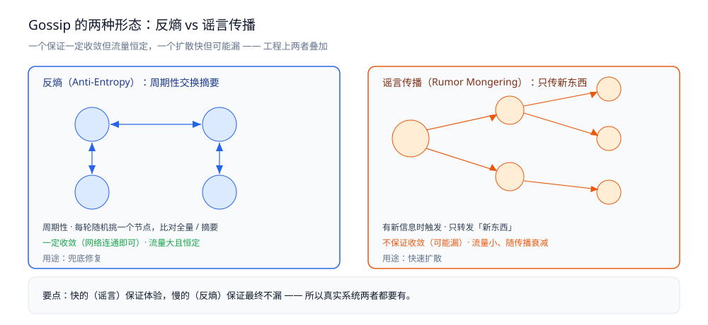
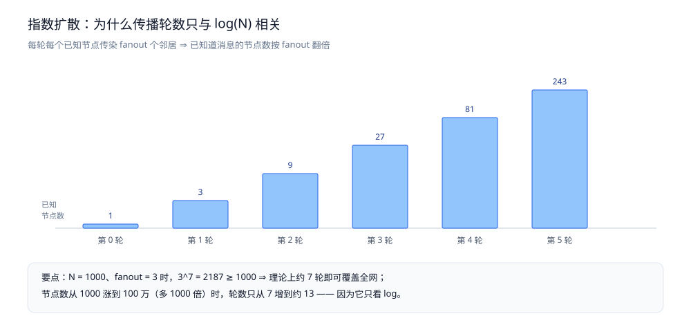

# Gossip 协议

> Gossip（流行病 / 谣言）协议的两种形态——**反熵**与**谣言传播**，用 Gossip 做成员管理与故障探测（**SWIM**）、
> 收敛性与传播轮数，以及它在 Redis Cluster / Nacos / Consul 里的落地。
>
> 内容整理自个人学习笔记，并参考《凤凰架构：构建可靠的大型分布式系统》（周志明）；参考资料与原始素材见 [素材清单](../../../素材清单.md)。

---

## 一、Gossip 是什么，它和共识协议是什么关系？

**本节要点**：Gossip 的核心是**去中心化的信息扩散** —— 每个节点周期性随机挑几个节点交换信息，像谣言一样传遍全网。它**不追求「某一刻全体一致」，只追求「最终全员知晓」**。

### 1.1 一句话定义

> **每个节点周期性地随机挑若干邻居，交换「我知道的节点状态 / 数据摘要」，差异在交换中被逐步抹平。**

三个要素缺一不可：

| 要素 | 含义 |
|---|---|
| **周期性** | 不是事件驱动，而是**每隔一段时间主动做一次**（后台流量） |
| **随机挑邻居** | 不按固定拓扑传，避免热点与单点依赖 |
| **交换摘要而非命令** | 传的是「我这边长这样」，让对方自己比对修正 |

### 1.2 它和共识协议的分工

Gossip 常与 [Paxos协议.md](Paxos协议.md) / [Raft协议.md](Raft协议.md) 一起被提起，但两者解决的是**不同的问题**：

| | 共识协议（Paxos / Raft） | Gossip |
|---|---|---|
| 目标 | 对某个值做出**唯一**决定 | 让信息**扩散**到所有节点 |
| 时间性 | 有明确的「已提交」时刻 | 没有，只有「最终传遍」 |
| 一致性强度 | 强一致（线性化） | 最终一致 |
| 代价 | 多数派往返（同步、有延迟） | 周期性后台流量（异步、低延迟） |
| 典型用途 | 配置、元数据、日志复制 | 成员管理、拓扑与状态传播 |

⭐ 判据：**「要不要对『谁赢』做一个唯一裁决？」** —— 要，就必须共识；如果只是「让大家都知道」，Gossip 更划算。

> ⚠️ 常见误解：「Gossip 也是一种共识算法」。**不是** —— 它给不了「唯一裁决」和「确定时刻」，所以**不能用来选主或提交事务**。

### 1.3 为什么「去中心化」在这里反而更好

| 好处 | 说明 |
|---|---|
| **没有单点** | 不需要一个中心节点汇总，任一台挂了都不影响其他节点继续交换 |
| **不需要选主** | 省掉了共识协议最重的那部分开销 |
| **天然容忍节点频繁上下线** | 成员管理正是要处理「谁在、谁走了」，Gossip 本身就是干这个的 |
| **对网络抖动不敏感** | 一次交换失败没关系，下一轮再来 |

代价：**收敛需要时间**，且**任何一个时刻都不能宣称「全网一致」**。

---

## 二、两种形态：反熵与谣言传播怎么选？

**本节要点**：Gossip 有两种截然不同的实现思路 —— **反熵**保证最终一定收敛但流量大，**谣言传播**扩散快但可能有人永远收不到。工程上通常**两者结合**。

### 2.1 反熵（Anti-Entropy）：周期性比对全量

**做法**：每隔一段时间，随机挑一个节点，**交换各自持有的「全量数据 / 摘要」，把差异补上**。

- 传的可以是全量，也可以是**摘要**（如 Merkle 树、版本向量、有向图摘要）—— 摘要越大越省流量。
- **只要网络图是连通的，最终一定收敛**（没有节点会永远漏掉）。

⚠️ 代价：**流量大且恒定** —— 哪怕没有变化，也要周期性比对，这在节点多、数据大时很贵。

### 2.2 谣言传播（Rumor Mongering）：只传「新东西」

**做法**：一旦拿到**新信息**，就**立刻**转发给随机邻居；收到「已经知道」的节点**以某个概率停止转发**（否则会无限传下去）。

- 扩散是**指数级**的：一轮翻 fanout 倍。
- **流量小、传播快**，适合「赶紧让大家都知道」。

⚠️ 代价：**不保证收敛** —— 转发概率衰减后，可能有个别节点**永远收不到**。

### 2.3 对照表

| 维度 | **反熵** | **谣言传播** |
|---|---|---|
| 触发 | 周期性 | 有新信息时 |
| 传什么 | 全量 / 摘要比对 | 只传「新东西」 |
| 收敛保证 | ✅ 一定收敛 | ❌ 概率性，可能漏 |
| 流量 | 大且恒定 | 小、随传播衰减 |
| 延迟 | 慢（等下一轮） | 快（指数扩散） |
| 典型用途 | 兜底修复 | 快速扩散 |

⭐ 工程上的常见组合：**谣言传播负责「快速扩散」，反熵负责「周期性兜底」** —— 快的保证体验，慢的保证最终不漏。

### 2.4 两种形态



---

## 三、怎么用 Gossip 做成员管理与故障探测？

**本节要点**：成员管理是 Gossip 最经典的应用 —— **心跳信息直接「捎带」在 Gossip 消息里**，不用单独发。难点不在传播，而在**故障探测怎么不误判**，SWIM 用「间接探测 + 怀疑」解决了它。

### 3.1 心跳「捎带」在 Gossip 上

每个节点在周期性交换时，顺手带上「我还活着、我看到谁活着」：

```text
A → B 的一次 Gossip：
  { 我(A)的状态：alive, 心跳序号: 17
    B 的状态：alive
    C 的状态：alive }
```

- **不需要单独的心跳通道**：Gossip 消息本身就是心跳。
- **信息是二阶的**：A 会把自己对 C 的观察**转告** B，于是「C 是不是活着」由多台节点**交叉验证**。

### 3.2 SWIM 的三个机制

SWIM（Scalable Weakly-consistent Infection-style Membership）是成员管理的经典协议，核心是三个动作：

| 机制 | 做什么 | 解决什么 |
|---|---|---|
| **Ping** | 直接探测某节点：「你在吗？」 | 常规探测 |
| **PingReq** | 让**另外 k 个节点**替我去探测：「帮我问问他」 | 避免「我跟他之间的网络有问题」导致的误判 |
| **Suspicion** | 不直接判死，而是**标记为「可疑」并广播** | 给被怀疑者一个**自证的机会** |

### 3.3 为什么要「怀疑」而不是直接判死

⭐ 关键工程细节：**「超时」不等于「挂了」**。

```text
A ping C 超时 —— 可能是三种情况：
  ① C 真的挂了
  ② C 活着，但**A 到 C 的网络**有问题
  ③ C 太忙，回复迟了

直接判死 → 情况②③会**误杀**一个健康节点
```

**SWIM 的做法**：

1. A 直接 Ping C 不成功 → 请 B、D **代为 Ping**（PingReq）；
2. 若代为探测也不成功 → A 宣布 C 为 **Suspicion（可疑）**并广播；
3. **C 自己收到「你被怀疑了」的消息后，可以主动反驳**（我把心跳发给你看）；
4. 若在怀疑超时内没有反驳 → 才判定为故障并广播。

> ⭐ 一句话：**用「间接探测」排除自身网络问题，用「怀疑 + 自证」排除临时抖动** —— 这两条把误判率压到很低，代价是多一轮消息。

---

## 四、收敛性：多久传遍全网？

**本节要点**：谣言传播的扩散是**指数级**的，所以传播轮数只与节点数的**对数**有关；而真实延迟还受 fanout、丢包、节点上下线影响，反熵是在这里兜底的。

### 4.1 指数扩散：为什么是 O(log N) 轮

假设每轮每个「已知道」的节点传染 `fanout` 个邻居：

```text
第 0 轮：1 台知道
第 1 轮：≤ 1 × fanout
第 2 轮：≤ 1 × fanout²
...
第 k 轮：≤ fanout^k

要让 fanout^k ≥ N  →  k ≥ log_fanout(N)
```

举例（**结构性推导，非实测**）：`N = 1000`、`fanout = 3` 时，`3^7 = 2187 ≥ 1000`，即**理论上约 7 轮**就能覆盖全网。

⭐ 结论：**节点数从 1000 涨到 100 万（多 1000 倍），轮数只从 7 涨到约 13**（`log₃(10⁶) ≈ 12.6`）。这就是 Gossip 能扩展到大规模的原因。

### 4.2 影响收敛的三个因素

| 因素 | 影响 |
|---|---|
| **fanout** | 越大收敛越快，但**每轮流量线性上升**（大 fanout = 大开销） |
| **节点数 N** | 只影响轮数的**对数**，因此可扩展性好 |
| **丢包 / 节点上下线** | 拖慢收敛；谣言传播本身不保证收敛，**靠反熵兜底** |

> ⚠️ **未实测**：本节只给**结构性**结论（指数扩散 → O(log N) 轮），**不给任何具体轮数或秒数读数**。
> 原因：真实收敛速度取决于网络拓扑、丢包率与 fanout 配置，本机单进程模拟给不出可推广的数字。

### 4.3 指数扩散的直观形状



---

## 五、谁在用 Gossip？

**本节要点**：Gossip 很少作为「产品名」出现，但它藏在几乎所有**去中心化集群**的成员管理里。

### 5.1 四类典型落地

| 系统 | 用 Gossip 传什么 | 顺带解决 |
|---|---|---|
| **Redis Cluster** | 节点状态、槽位（slot）归属、故障标记 | 无中心选主，cluster bus 上传播 |
| **Nacos（Distro 协议）** | 临时实例的变更 | 去中心化的最终一致 |
| **Consul / Serf** | 成员列表与健康状况 | 故障探测（SWIM） |
| **Cassandra** | 拓扑、schema 版本 | 节点发现与 seed 传播 |

### 5.2 逐个看

**Redis Cluster**：集群里没有中心节点，节点之间靠 **cluster bus**（独立端口，二进制协议）跑 Gossip，交换「谁是主、槽位怎么分、谁可能故障」。**故障标记（FAIL）也是通过 Gossip 达成共识的**——但要凑够多数主节点确认，这一点又与共识协议呼应。

> 见 [高可用.md](../../../03-数据与中间件/数据存储/NoSQL/Redis/高可用.md)。

**Nacos（Distro 协议）**：Nacos 对**临时实例**采用 Distro 协议，思路与 Gossip 同源 —— **每个节点只负责一部分数据，变更在节点间异步同步，最终一致**；永久实例才走 Raft。

> 见 [Nacos.md](../../../03-数据与中间件/中间件/注册与配置中心/Nacos.md)。

**Consul / Serf**：成员管理与故障探测基于 **SWIM**，是最「正统」的 Gossip 应用。

**Cassandra**：每个节点周期性与其他节点 Gossip，交换拓扑与 schema 版本，用于**节点发现**与**集群状态收敛**。

### 5.3 一句话收口

> ⭐ **「要唯一裁决」的用共识（Paxos / Raft），「要大家最终都知道」的用 Gossip** —— 而现实里一个系统往往两者都有：
> **用 Raft 定「谁是主」，用 Gossip 传播「谁在哪、谁挂了」。**

---

## 使用：一个最小的 Gossip 传播骨架（Go）

> ⚠️ **未实测**：本节代码**按 Gossip 的公开语义书写，未在本机编译运行**。
> 原因：真正的收敛速度与「会不会漏」需要在多机、有丢包的环境里观察，单进程骨架只能表达**传播逻辑**，给不出收敛读数。
> 下面省略了网络与定时器，只保留「一轮传播」的核心 —— 读懂它，反熵与谣言传播的区别就看得很清楚。

### 1. 一个节点的「已知视图」

```go
package gossip

// Known 是「我当前知道的成员状态」。
// 反熵与谣言传播的差别，全在 Merge 的**取舍策略**上（见下）。
type Known struct {
	Members map[string]uint64 // 节点 ID -> 心跳序号（越大越新）
}

// Merge 把一个远端视图并进来。
// 规则：**同 ID 取心跳序号更大者** —— 这就是「收敛」的具体含义：
// 只要反复交换，两边的视图最终会一模一样。
func (k *Known) Merge(remote Known) (changed bool) {
	for id, seq := range remote.Members {
		if cur, ok := k.Members[id]; !ok || seq > cur {
			k.Members[id] = seq
			changed = true
		}
	}
	return changed
}
```

### 2. 一轮 Gossip：随机挑 fanout 个邻居交换

```go
// GossipRound 演示「一轮传播」：
//   - 反熵：**无论有没有变化**都交换（周期性）
//   - 谣言传播：只有 changed == true 才继续扩散（否则停手）
// 工程上把两者叠加：平时跑反熵，一旦有变更叠加谣言传播加速。
func GossipRound(me *Known, peers []Peer, fanout int, rnd *rand.Rand, rumor bool) {
	targets := pickRandom(peers, fanout, rnd) // ★ 随机挑，不按固定拓扑
	for _, p := range targets {
		remote, err := p.Exchange(*me) // 把「我的视图」发过去，换回「他的视图」
		if err != nil {
			continue // 一次失败不影响下一轮 —— 这是 Gossip 抗抖动的来源
		}
		changed := me.Merge(remote)
		if rumor && !changed {
			return // 谣言传播：没新东西就不传了，靠概率衰减停下来
		}
	}
}
```

> ⭐ 看清这两行就够：**反熵不判断 `changed`（每轮都交换，保证不漏）；谣言传播判断 `changed`（只为新信息扩散）**。
> 而 `pickRandom` 的**随机性**，正是「没有中心、不会热点」的全部来源。

---

## 延伸追问

- **Gossip 能当共识用吗？** → 不能。Gossip 给的是**最终一致**，既没有「唯一裁决」也没有「确定的提交时刻」；要选主、要提交事务，仍然得上 [Paxos协议.md](Paxos协议.md) / [Raft协议.md](Raft协议.md)。
- **反熵那么贵，为什么还要它？** → 因为谣言传播**不保证收敛**。反熵是「兜底」——平时看着多余，一旦有节点因为丢包漏掉了消息，就是它把差异抹平的。
- **fanout 取多大合适？** → 越大越快但每轮流量线性上升；工程上一般取**很小的常数**（几个），因为收敛轮数只与 `log(N)` 相关，**把 fanout 调大收益递减、开销却线性增长**。
- **为什么一定要「随机」挑邻居？** → 固定拓扑会让某些节点成为热点（所有人都在问它），也会因为固定链路抖动而卡住；随机化把负载摊平，也让传播路径天然多样。
- **「超时」为什么不能直接判节点死亡？** → 可能只是**我这台到他那台**的网络有问题。SWIM 用「让别人代为探测 + 标记可疑 + 允许自证」三步，把误判压下去。
- **Gossip 和「最终一致」是一回事吗？** → 不是。Gossip 是**实现最终一致的一种手段**；最终一致还可以用异步复制、定期对账等实现。

## 关联

- [Paxos协议.md](Paxos协议.md) — 需要「唯一裁决」时的另一类协议（共识），与 Gossip 正好分工
- [Raft协议.md](Raft协议.md) — 共识协议的工程主流形态；成员变更走联合共识而非 Gossip
- [一致性与CAP.md](一致性与CAP.md) — 最终一致到底是什么强度，Gossip 落在哪一档
- [集群基础.md](../集群基础.md) — 集群形态与故障转移；「共识 ≠ 复制」的分野
- [服务发现与负载均衡.md](../服务治理/服务发现与负载均衡.md) — 成员列表从哪来、怎么被用掉
- [Nacos.md](../../../03-数据与中间件/中间件/注册与配置中心/Nacos.md) — Distro 协议：去中心化的临时实例同步
- [高可用.md](../../../03-数据与中间件/数据存储/NoSQL/Redis/高可用.md) — Redis Cluster 的 cluster bus 与故障标记
