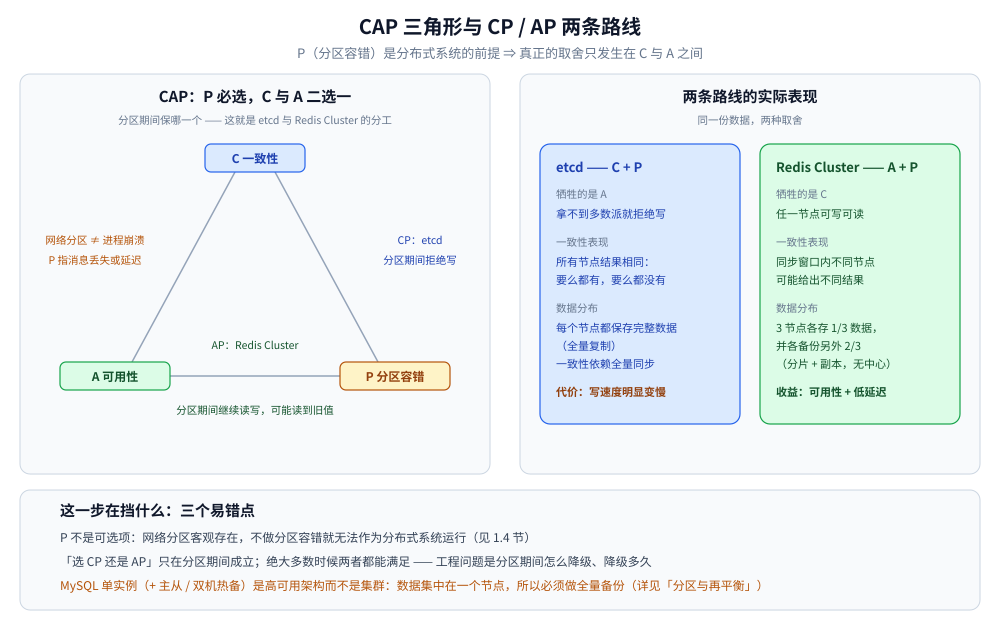
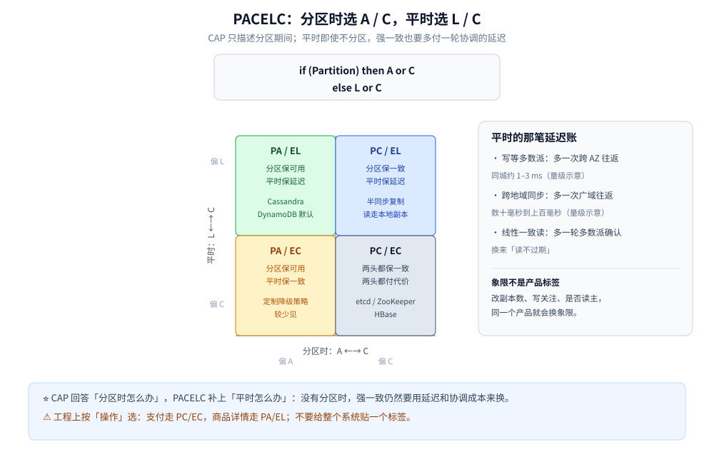

# CAP 与 PACELC

> 覆盖：CAP 的精确含义与常见误读、分区期间 CP / AP 两条路线、PACELC 把「平时」的延迟也纳入权衡，以及怎么按操作选一致性。
>
> 不覆盖：一致性模型的强度阶梯与会话保证见 [一致性模型.md](一致性模型.md)；Quorum 的读写交集与复制拓扑见 [复制与Quorum.md](../数据分布/复制与Quorum.md)；集群形态与故障转移见 [集群基础.md](../集群基础.md)。
>
> 内容整理自个人学习笔记，并参考《大型网站技术架构：核心原理与案例分析》（李智慧）；参考资料与原始素材见 [素材清单](../../../素材清单.md)。本篇的 etcd 代码为语义示例，未在本轮重新运行。

---

## 一、CAP 到底在说什么？

**本节要点**：CAP 是一个**分区期间**的定理，不是「三个里挑两个」的产品分类法。C 指线性一致，A 指每个未故障节点都能在有限时间内返回非错误响应，P 指网络分区。

| 字母 | 精确含义 | 容易误解成 |
|---|---|---|
| **C**（Consistency） | **线性一致**：读总能看到最近一次已完成的写 | 「所有副本数据一样」或「事务 ACID 的 C」 |
| **A**（Availability） | **每个未故障节点**都能在**有限时间**内返回**非错误**响应 | 「系统一直能用」或「不丢请求」 |
| **P**（Partition tolerance） | 网络分区（消息丢失或延迟）时系统仍能继续运行 | 「节点不崩」或「有副本」 |

**定理的内容**：

> 当网络发生分区时，一个分布式系统**不可能同时**保证线性一致（C）与每个节点都可用（A）。
> 要么让拿不到多数派的一侧拒绝服务（保 C），要么让它继续用旧数据服务（保 A）。

### 1.1 为什么说「CA 系统」在分布式语境下不存在

- 单机系统没有「节点之间通信」这回事，谈不上 P，也谈不上分布式；
- 只要有两个及以上节点通过网络协作，**分区就是网络的事实**，不是配置项；
- 所以真实选择只在「**分区时保 C**」与「**分区时保 A**」之间，而不是「放弃 P」。

> ⚠️ 一个常见口误：「一个节点挂了，数据就写不进去」。
> **3 节点集群挂 1 台仍然可写**（2/3 依旧过半）；写不进去发生在**挂 ≥ 半数**、或分区后某一侧不构成多数派时。
> 把「节点故障」和「网络分区」混为一谈，是 CAP 讨论里最常见的偏差。

### 1.2 「三选二」为什么是误读

| 误读 | 实际情况 |
|---|---|
| 「分布式系统必须放弃 C、A、P 中的一个」 | P 不是可放弃项；只在**分区发生的那段时间**里，C 与 A 二选一 |
| 「选了 CP 就永远不可用」 | 不分区时 CP 系统通常既一致又可用；代价是分区期间少数派拒绝服务 |
| 「选了 AP 就永远不一致」 | 不分区时 AP 系统通常也能读到最新值；代价是分区期间可能旧读、事后要收敛 |
| 「CAP 能指导所有选型」 | CAP 只覆盖分区期间；平时的延迟与一致性权衡由 PACELC 补充（见第三节） |

> ⭐ 工程上真正要回答的是：**分区可能持续多久、这期间业务允许降级到什么程度、恢复后怎么收敛**。
> 只说「我们选 AP」而不说降级与收敛策略，等于没做设计。

---

## 二、分区发生时 CP 与 AP 各是什么表现？

**本节要点**：CP 用「少数派拒绝服务」换一致；AP 用「可能旧读、事后合并」换持续可用。两条路线没有高下，只有业务匹配。



图怎么读：左侧把 P 画成前提，C 与 A 是分区期间的二选一；右侧对比两条路线的实际表现 —— CP 侧「拿不到多数派就拒绝写」，AP 侧「任一节点可读写、但窗口内可能不一致」。<br>
⚠️ 图里「3 节点各存 1/3」是分片 + 副本的示意，不代表所有 AP 系统都必须分片。

| 系统 | 典型归类 | 分区期间的表现 | 代价 |
|---|---|---|---|
| **etcd / ZooKeeper** | CP | 少数派一侧无法提交写，读也可能被拒绝 | 分区期间部分节点不可用 |
| **MongoDB 副本集** | CP | 旧主在多数派侧才保住主位，否则降级 | 选举期间短暂不可写 |
| **Cassandra / DynamoDB / Riak** | AP | 各侧继续读写，事后读修复 / 合并 | 旧读、冲突合并、业务要能容忍 |
| **Redis 主从（异步复制）** | 偏 AP | 主节点继续写，故障切换可能丢一段 | 丢写窗口取决于复制延迟 |
| **Redis Cluster** | 不宜简单贴标签 | 按槽分片；故障转移需要多数主节点同意，少数派一侧会停止写入 | 既有可用性损失，也有旧读风险 |
| **MySQL 异步主从** | 偏 AP | 主库继续写，从库可能落后 | 主库故障时可能丢未复制的写 |

> ⚠️ **不要把产品硬塞进 CP / AP 的抽屉**。很多系统的行为取决于配置（副本数、写关注、是否强制读主），
> 同一个产品在「读主 + 半同步」与「读从 + 异步」下，分区表现完全不同。

---

## 三、PACELC 补上了什么？

**本节要点**：CAP 只描述**分区时**；PACELC 补上**平时**的权衡 —— 即使没有分区，强一致也要付出**延迟**（Latency）。

**PACELC 的写法**：

```text
if (Partition)  then  A or C
else            then  L or C
```

- 分区时：在可用性（A）与一致性（C）之间选；
- 平时：在延迟（L）与一致性（C）之间选 —— 要强一致就得多等一轮复制或协调。



图怎么读：上半部分是分区时的 A/C 轴，下半部分是平时的 L/C 轴。四个象限对应 PC/EC、PA/EL、PC/EL、PA/EC 四类组合；大多数产品的默认配置落在 **PA/EL**（平时低延迟、分区时保可用）或 **PC/EC**（两头都保一致、两头都付代价）。<br>
⚠️ 象限归类是「默认配置的倾向」，改副本数与写关注就能让同一个产品换象限。

### 3.1 四类组合与代表系统

| 组合 | 分区时 | 平时 | 代表 | 说明 |
|---|---|---|---|---|
| **PC/EC** | 保一致 | 保一致 | etcd、ZooKeeper、HBase | 每次写都过多数派，读也可能要确认；延迟最高 |
| **PA/EL** | 保可用 | 保延迟 | Cassandra、DynamoDB（默认）、Redis 异步复制 | 默认快、可能旧读；靠 Quorum 或强读按需加强 |
| **PC/EL** | 保一致 | 保延迟 | 半同步复制、部分配置下的 MongoDB | 写等多数派，但读可走本地；延迟与一致性的折中 |
| **PA/EC** | 保可用 | 保一致 | 较少见，通常是「平时强一致、分区时降级」的定制策略 | 需要显式设计降级路径 |

> ⭐ PACELC 的价值在于提醒：**强一致的代价不只在分区时**。平时每一次写要多等一轮网络往返、每一次读可能要多一次确认 —— 这些都会体现在 P99 延迟上。

### 3.2 延迟账怎么算

| 选择 | 多付的成本 | 典型量级 |
|---|---|---|
| 写等多数派（同城三副本） | 一次跨 AZ 往返 | 同城约 1–3 ms，取决于拓扑 |
| 跨地域同步复制 | 一次跨地域往返 | 数十毫秒到上百毫秒 |
| 线性一致读（ReadIndex） | 一轮多数派确认 | 一次多数派往返 |
| 从本地副本读 | 无额外往返 | 但可能旧读 |

> ⚠️ 上表是量级示意，不是实测数据。真实延迟必须按自己的网络拓扑测，不能照抄。

---

## 四、为什么「选 CP 还是 AP」不是一个产品级问题？

**本节要点**：CAP 的取舍可以**按操作**做。同一个系统里，支付路径走强一致，商品详情走最终一致，是完全正常的架构。

| 操作 | 需要的保证 | 做法 |
|---|---|---|
| 扣款、扣库存、抢锁 | 线性一致 / 可串行化 | 写主库、过多数派、事务 |
| 读自己的订单状态 | 读己之写 | 写后读主、带版本号 |
| 商品详情、推荐、评论列表 | 最终一致 | 读从库 / 缓存，接受旧值 |
| 配置变更 | 线性一致 | 走 etcd / 配置中心的一致性读 |
| 日志、行为埋点 | 最终一致 | 先落队列，异步消费 |

**按操作切换的四个旋钮**：

1. **读写走哪个副本**：主库 / 多数派 / 任意副本；
2. **写等几个确认**：`acks=1` / `acks=all` / `W=QUORUM`；
3. **读等几个副本**：`R=1` / `R=QUORUM`；
4. **是否强制读己之写**：会话粘滞 / 写后读主 / 版本号校验。

> ⭐ 判据只有一句：**这次读写读到旧值，会不会造成不可逆的业务损失？**
> 会 → 走强一致；不会 → 走低延迟路径，并把「能旧多久」写成可监控的指标。

---

## 五、分区期间怎么做降级？

**本节要点**：CP 与 AP 不是二选一的口号，而是**降级策略**。分区发生时，系统要在「拒绝」「旧读」「排队」「降功能」之间做明确选择。

| 策略 | 行为 | 适用 | 风险 |
|---|---|---|---|
| **快速失败**（fail-fast） | 拿不到多数派立即报错 | 支付、扣款、抢锁 | 用户看到错误，但不会产生错账 |
| **只读降级** | 拒绝写，允许旧读 | 内容、配置查看 | 读到旧值 |
| **排队等待** | 写请求暂存，恢复后重放 | 可延迟的异步任务 | 队列积压、重放要幂等 |
| **关闭非核心功能** | 保住主链路，停掉推荐 / 统计 | 大促、故障期 | 功能缺失 |
| **fail-open** | 校验服务不可用时默认放行 | 风控的非核心规则 | 安全风险，必须限范围 |
| **fail-closed** | 校验服务不可用时默认拒绝 | 鉴权、支付 | 可用性下降，但不会越权 |

> ⚠️ **fail-open / fail-closed 必须按接口逐个定**，不能全局一刀切。
> 把鉴权做成 fail-open，等于把「依赖挂了」变成「安全边界挂了」。

---

## 六、应用场景

**本节要点**：CAP / PACELC 的落点，是给每类业务选一条**分区时的默认行为**，并把它写进设计文档与监控。

| 场景 | 分区时优先 | 理由 |
|---|---|---|
| 注册中心、配置中心、选主 | C | 旧配置 / 双主会造成错误决策 |
| 支付、账务、库存 | C | 宁可不可用，不可错账 |
| 社交动态、商品浏览、搜索 | A | 短暂旧值不影响成交，停服影响更大 |
| 购物车 | A + 冲突合并 | 加购不能失败，合并规则由业务定义 |
| 会话与消息 | A + 会话内保序 | 跨地域时优先保住可写，顺序按会话约束 |
| 监控与日志 | A | 丢少量数据可接受，但不能阻塞主链路 |

---

## 七、具体使用

**本节要点**：CAP 的取舍落到 etcd 上，就是**同一个 `Get` 传不传 `WithSerializable()`** —— 不是换数据库，而是换一次读的语义。

| 读法 | etcd 默认？ | 要不要过 quorum | 能读到旧数据吗 | 谁在扛压力 |
|---|---|---|---|---|
| **linearizable 读**（默认） | ✅ | **要**（ReadIndex 一轮多数派确认） | **不能**（保证不过期） | **还是 Leader 为主** |
| **serializable 读**（`WithSerializable()`） | ❌ 要显式开 | 不要 | **可能读到旧值** | 真正落到 Follower |

```go
resp, err := cli.Get(ctx, key)                               // linearizable：默认
resp, err := cli.Get(ctx, key, clientv3.WithSerializable())  // serializable：本地读
```

| 场景 | 选哪个 | 原因 |
|---|---|---|
| 抢锁、读配置后马上执行、「读己之写」 | linearizable | 旧值会直接导致业务错误 |
| 高频只读的列表 / 状态页、能容忍几十毫秒陈旧 | serializable | 省一轮 quorum 往返，Leader 压力显著下降 |
| 缓存回填、限流计数 | 都行，但**要写明容忍度** | 拿不准就用默认，别为了性能偷偷改语义 |

> 完整实现（客户端单例、两种读法、Txn / Watch / 选举、租约与三节点实验）见
> [接入etcd.md](../../../01-编程语言/go/工程实践/接入etcd.md)；Java 侧见
> [接入etcd.md](../../../01-编程语言/java/工程实践/接入etcd.md)。

---

## 延伸追问

- **CAP 里的 P 到底指什么？** → 指**网络分区**（节点间消息丢失或延迟），不是进程崩溃、也不是磁盘损坏。分区是客观会发生的，所以 C 与 A 只能在**分区期间**二选一。
- **系统一定要「选 CP 或 AP」吗？** → 不必。分区只占少数时间，绝大多数时候两者都能满足；工程问题是「分区期间怎么降级、降级多久、恢复后怎么收敛」。
- **PACELC 里的 L 是延迟还是吞吐？** → 主要是**延迟**（每次操作多等几轮协调），但它也会间接影响吞吐与成本；讨论时要把「多一轮往返」和「多一份副本」分开算。
- **「最终一致」到底是多久？** → 没有普适答案，必须给出**可度量的收敛窗口**（如 P99 < 1s）并配监控；说不出窗口的「最终」等于「不知道」。
- **为什么说 Redis Cluster 不能简单归为 AP？** → 它的故障转移需要多数主节点同意，分区后少数派一侧会停止写入；同时异步复制又允许旧读。它同时带有两种路线的特征，按「槽」和「配置」分别看才准确。
- **「半数以上同步成功就返回」准确含义是什么？** → 指已提交（多数派落盘），不代表已应用到某个特定节点；所以 linearizable 读还要额外一轮确认。
- **CAP 能解释跨地域多活吗？** → 只能解释一半。跨地域的写延迟（PACELC 的 L）往往比分区更常见，很多多活方案是「同城强一致 + 异地异步」，见 [跨地域多活.md](../../系统设计/IM系统/跨地域多活.md)。

## 关联

- **上游/总纲**：[README.md](../README.md) — 分布式目录的阅读顺序与理论线定位
- **对照/互补**：[一致性模型.md](一致性模型.md) — 线性一致、因果一致、最终一致的强度阶梯
- **下游机制**：[复制与Quorum.md](../数据分布/复制与Quorum.md) — `W + R > N` 怎么把 CAP 的取舍落成参数
- **下游机制**：[Raft协议.md](../共识协议/Raft协议.md) — 多数派提交与选举：CP 路线的机制底座
- **对照/互补**：[集群基础.md](../集群基础.md) — 集群形态、故障转移与脑裂
- **实现**：[接入etcd.md](../../../01-编程语言/go/工程实践/接入etcd.md) — Go 客户端把一致性等级落成代码
- **实现**：[接入etcd.md](../../../01-编程语言/java/工程实践/接入etcd.md) — Java 侧同一套语义
- **案例**：[分布式锁.md](../../../03-数据与中间件/数据存储/NoSQL/Redis/分布式锁.md) — 「主从切换丢锁」是 AP 取舍的具体代价
- **案例**：[跨地域多活.md](../../系统设计/IM系统/跨地域多活.md) — 跨地域场景下 CAP 与延迟的共同约束
> 反向引用（本篇被下列文档引到）：[中间件选型.md](../../../03-数据与中间件/中间件/中间件选型.md)、[分布式协调选型对比.md](../../../03-数据与中间件/中间件/分布式协调/分布式协调选型对比.md)、[Nacos.md](../../../03-数据与中间件/中间件/注册与配置中心/Nacos.md)、[副本集与选举.md](../../../03-数据与中间件/数据存储/NoSQL/MongoDB/副本集与选举.md)、[NoSQL选型对比.md](../../../03-数据与中间件/数据存储/NoSQL/NoSQL选型对比.md)、[复制与高可用.md](../../../03-数据与中间件/数据存储/关系型/MySQL/复制与高可用.md)、[Paxos协议.md](../共识协议/Paxos协议.md)、[号段模式与Leaf.md](../分布式ID/号段模式与Leaf.md)、[故障模型与分布式谬误.md](故障模型与分布式谬误.md)
