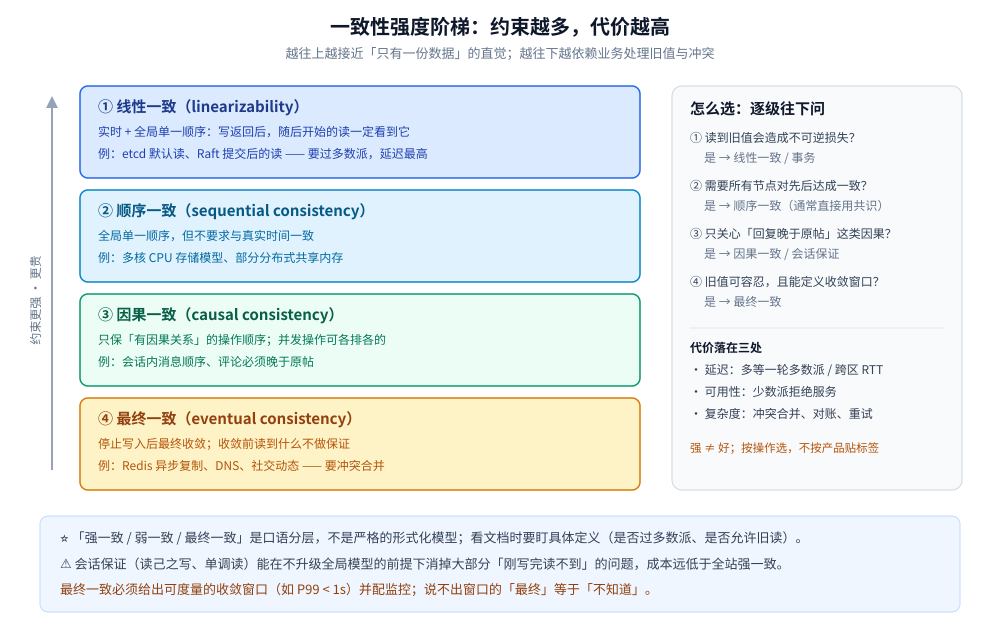
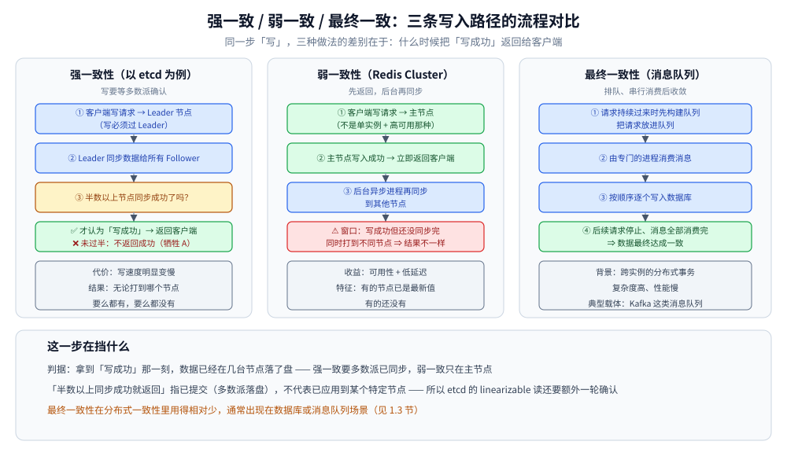

# 一致性模型

> 覆盖：分布式系统里「一致性」到底在说什么 —— 从线性一致到最终一致的强度阶梯、客户端能要求的会话保证，以及冲突怎么收敛。
>
> 不覆盖：CAP 与 PACELC 的取舍见 [CAP与PACELC.md](CAP与PACELC.md)；副本怎么抄数据、Quorum 怎么算见 [复制与Quorum.md](../数据分布/复制与Quorum.md)；跨服务的写入一致性见 [README.md](../分布式事务/README.md)。
>
> 内容整理自个人学习笔记，并参考《大型网站技术架构：核心原理与案例分析》（李智慧）；参考资料与原始素材见 [素材清单](../../../素材清单.md)。本篇不涉及需要运行验证的实测。

---

## 一、一致性、共识、事务隔离说的是同一件事吗？

**本节要点**：不是。三者作用在不同层面 —— **一致性模型管「读写能看到什么」，共识管「多个节点怎么对同一件事达成一致」，事务隔离管「并发事务之间互相看不看得见」**。混用这三个词，后面的讨论一定跑偏。

| 概念 | 回答的问题 | 作用面 | 典型载体 |
|---|---|---|---|
| **一致性模型** | 一个写完成之后，别的客户端读的时候**能看到什么** | 读写的可见性 | linearizable、causal、eventual |
| **共识（Consensus）** | 多个节点怎么对**同一个值 / 同一条日志的顺序**达成一致 | 决策与定序 | Raft、Paxos、ZAB |
| **事务隔离** | 并发事务之间**能互相看到哪些中间状态** | 单机 / 单库的并发控制 | 读已提交、可重复读、快照隔离 |

> ⭐ 三者的关系是「**共识常常被用来实现强一致，强一致又常常被事务隔离借用**」，但它们是三个独立的坐标。
> 一个系统可以「单机事务隔离很强，但副本之间是异步复制」—— 此时本地可重复读，跨副本仍可能读到旧值。

### 1.1 「分布式一致性」的最小定义

> **分布式一致性 = 分布式系统下，多个节点对同一份数据呈现给客户端的结果是否一致。**

具体到一个 3 节点集群：客户端写完之后，无论读请求落到哪个节点，**是否都能得到符合某个约定规则的结果** —— 这个「约定规则」就是一致性模型。

---

## 二、一致性模型可以排成一条怎样的强度阶梯？

**本节要点**：强度阶梯的主线是「**对顺序和实时性的约束越来越多**」。越往上越好用、越贵；越往下越便宜、越需要业务自己处理旧值和冲突。



图怎么读：从上到下约束依次放松 —— 线性一致要求「实时 + 全局单一顺序」，顺序一致只要求「全局单一顺序」，因果一致只要求「有因果关系的操作保序」，最终一致只要求「最终收敛」。<br>
⚠️ 阶梯不是严格的全序：不同教材的层级划分略有差异（例如 causal+ 与 session guarantees 的归位），工程上按「需要多强的保证」取用即可。

### 2.1 线性一致性（linearizability）

**直觉**：整个系统看起来像**只有一份数据、所有操作按真实时间一个接一个执行**。一个写操作返回之后，任何客户端**随后开始**的读都必须看到它（或更新的值）。

**以 etcd 为例的写入过程**：

```text
客户端写请求 → Leader 节点 → Leader 同步日志给所有 Follower
    → 多数派落盘并提交后，才认为"写成功" → 才返回给客户端
```

**代价**：**写速度明显变慢** —— 必须等集群中多数节点确认；分区期间拿不到多数派的一侧只能拒绝服务。

**结果特征**：

> 无论请求打到哪个节点，都会得到**相同的结果** ——
> **要么都有，要么都没有**。
> 不会出现「访问 1 号节点有、2 号节点没有、3 号节点有」这种中间状态。

> ⚠️ 「要么都有，要么都没有」描述的是**原子可见性**，严格说还差一点：线性一致还要求**尊重真实时间顺序**。
> 一个只保证原子可见、但不保证实时顺序的模型是**顺序一致**，见 2.2。

### 2.2 顺序一致性（sequential consistency）

**直觉**：所有客户端看到的操作顺序是**同一个全局顺序**，且每个客户端自己的操作保持程序顺序；但这个全局顺序**不必与真实时间一致**。

- 比线性一致弱：允许「写已经返回，但读还看到旧值」；
- 比因果一致强：即使两个操作没有因果关系，所有节点也必须对它们的先后达成一致。

**典型场景**：多核 CPU 的存储模型、部分分布式共享内存。多数业务系统不会刻意选择它，理解它是为了区分「有全局顺序」和「有实时顺序」。

### 2.3 因果一致性（causal consistency）

**直觉**：只保证**有因果关系的操作**按顺序被看到；并发（无因果关系）的操作，不同节点可以有不同的排列。

因果关系的三个来源：

1. **程序顺序**：同一客户端先写 A 再写 B，任何节点不能先看到 B 再看到 A；
2. **读后写**：读到 A 之后写 B，B 因果依赖 A；
3. **消息传递**：发送消息前发生的事，因果先于消息被接收后发生的事。

**为什么它好用**：社交场景里「评论必须出现在它回复的帖子之后」是因果关系，而「两个用户各自发帖谁先谁后」通常无所谓 —— 因果一致正好覆盖前者，又不用为后者付全局定序的成本。

**常见增强：causal+**。在因果一致基础上要求「所有副本最终都收敛到同一个状态」，否则因果顺序保住了，数据却可能永久分叉。

### 2.4 最终一致性（eventual consistency）

**直觉**：停止写入之后，只要给足够长的时间，所有副本**最终会收敛到同一个值**。它**不约束收敛前读到什么**，也不保证收敛过程中读到的顺序。

**以 Redis Cluster 为例的写入过程**：

```text
客户端写请求 → 主节点写入成功 → 立即返回给客户端
    → 后台异步进程再把数据同步到其他副本
```

**结果特征**：

> 在「**写成功但还没同步完成**」这个时间窗口内，
> 同一时刻访问不同节点的请求，**可能得到不一样的结果** ——
> 有的节点返回了最新数据，有的还没有。

**这就是弱一致性的典型形态：牺牲一致性，换取可用性和低延迟。**

**典型载体：消息队列驱动的最终一致**。跨实例的分布式事务复杂、性能慢，常见做法是：

1. 请求持续过来时，先把写操作**放进队列**；
2. 由专门的消费者**按顺序逐个写入数据库**；
3. 请求停止、消息全部消费完之后，数据**最终达成一致**。

> ⚠️ 「最终」不是一个可以糊弄过去的词。**说不出收敛窗口（例如 P99 < 1s）的「最终一致」，等于「不知道什么时候一致」**。
> 对账、扣款、库存扣减这类场景，不能只靠最终一致，必须叠加补偿、对账或强一致路径。



图怎么读：关键看**服务端在哪个位置给客户端回 OK**。强一致要等多数派提交后才回；弱一致写完主节点就回、后台再同步；最终一致把「写入数据库」这件事推到队列消费端，客户端先拿到「已受理」。<br>
⚠️ 「弱一致」是口语统称，不是某个形式化模型的名字；工程上说「弱一致」通常指「比线性一致弱、又没有明确收敛保证」的一类做法。

---

## 三、客户端能要求哪些「会话保证」？

**本节要点**：即使底层只给了最终一致，客户端也可以要求一组**以自己为视角**的保证。这组保证不改变副本之间的模型，但能消掉大部分「刚写完就读不到」的坑。

| 保证 | 含义 | 不满足时会怎样 | 常见实现 |
|---|---|---|---|
| **读己之写**（read-your-writes） | 自己写完后，自己后续的读能看到这次写 | 用户改完资料刷新又变回旧值 | 写后一段时间读主、会话粘滞、携带版本号 |
| **单调读**（monotonic reads） | 自己不会先读到新值、再读到旧值 | 刷新页面数据「倒退」 | 固定读同一副本、按版本号拒绝回退 |
| **单调写**（monotonic writes） | 同一客户端的多个写，按发出顺序生效 | 后发的写被先发的覆盖 | 单写者 / 会话路由到同一分片 |
| **读后写**（writes-follow-reads） | 读到某个值之后的写，建立在它之上 | 回复了旧帖子，却挂到新帖下 | 因果一致、携带读到的版本号 |

> ⭐ 会话保证是**成本最低的一致性修补**：不需要把整个系统升级成强一致，只要把「同一个用户」路由稳定、把版本号带在请求上。
> 代价是它只对**单个客户端会话**成立，跨用户的可见性仍取决于底层模型。

**三种落地的成本顺序**（从低到高）：

1. **会话粘滞**：同一用户的读全打到同一副本（缓解，不保证）；
2. **写后读主**：刚写过的那段时间（比如 1 秒）强制读主；
3. **记录位点**：客户端带上「我至少需要看到哪个位点 / 事务号」，副本跟不上就等或转主库。

---

## 四、最终一致的系统怎么处理冲突？

**本节要点**：最终一致只是「最终会收敛」，**没有说收敛到哪一个值**。两个副本各自接受了并发写之后，必须有明确的冲突解决规则，否则「最终一致」会变成「最终随机」。

| 策略 | 怎么收敛 | 代价 / 风险 | 典型使用 |
|---|---|---|---|
| **最后写入获胜（LWW）** | 比较时间戳，保留最大的那个 | ⭐ 依赖物理时钟；时钟回拨或偏差会**静默丢写** | Cassandra 默认、DNS、部分缓存 |
| **版本向量 / 向量时钟** | 检测出「并发」而非「先后」，把冲突交给上层 | 元数据随节点数增长；上层必须能合并 | Dynamo、Riak |
| **CRDT** | 用可交换、可合并的数据结构自动收敛 | 只适用于特定数据类型（计数器、集合、文本） | Redis CRDT、协作编辑 |
| **业务合并** | 把两个版本都留给业务规则处理 | 需要业务定义「合并」语义 | 购物车、工单、地址簿 |
| **单写者 / 主副本** | 让同一份数据只有一个写入方，从根上避免并发写 | 写入方成为瓶颈或单点 | 大多数主从系统 |

> ⚠️ **LWW 的「最后」是各自本地时钟的最后**。两台机器差 500ms，就可能让「先发生的写」赢掉「后发生的写」。
> 用 LWW 时要么保证时钟同步（见 [时钟与顺序.md](时钟与顺序.md)），要么接受「偶尔丢写」并把它写进业务假设。

---

## 五、同一个产品为什么能给出多种一致性？

**本节要点**：一致性不是产品的固定标签，而是**每次操作可以选的参数**。同一个库，读主和读从、`acks=all` 和 `acks=1`，给出的保证完全不同。

| 产品 | 弱的一端 | 强的一端 | 切换手段 |
|---|---|---|---|
| **etcd** | serializable 本地读（可能旧） | linearizable 读（默认，过多数派） | `WithSerializable()` |
| **Cassandra / DynamoDB** | `CL=ONE` / 最终一致读 | `CL=QUORUM` / `CL=ALL`、强一致读 | 读写一致性级别 |
| **Kafka** | `acks=1`、从 follower 读 | `acks=all` + `min.insync.replicas` | 生产者 / 消费者配置 |
| **MongoDB** | `w=1`、`readPreference=secondary` | `w=majority` + `readConcern=majority` | 写关注 / 读关注 |
| **MySQL** | 异步复制 + 读从库 | 半同步 + 强读主库 | 复制模式 + 路由 |
| **Redis** | 异步复制、读写任意节点 | `WAIT` 等待副本确认（有限保证） | 命令参数 |

> ⭐ 所以正确的问法不是「这个产品是强一致还是最终一致」，而是「**这条业务路径上的这次读写，需要什么保证**」。
> 把一致性写成**按操作选择**，才不会为了 5% 的强一致需求把 95% 的读都拖慢。

---

## 六、怎么验证系统真的给了你声称的一致性？

**本节要点**：一致性是**可被证伪的断言**，不能靠读文档确认。验证手段是「注入故障 + 记录历史 + 检查是否等价于某个合法顺序」。

| 手段 | 做什么 | 能发现什么 |
|---|---|---|
| **历史记录 + 线性一致性检查** | 记录所有操作的调用/返回时间，用 Knossos、Porcupine 等检查器验证 | 是否出现过「写已返回、读仍看不到」的非法历史 |
| **故障注入** | 分区、杀进程、暂停进程（模拟 GC）、改时钟、丢包 | 故障路径上的保证是否成立 |
| **不变量检查** | 断言「余额不为负」「同一会话 seq 递增」等业务不变量 | 冲突合并、重试导致的重复或丢失 |
| **Jepsen 式测试** | 上述三者的组合，针对具体数据库跑 | 产品在分区与故障下的真实行为 |

> ⚠️ 只测「正常网络下读写一致」说明不了任何问题 —— **一致性模型的差异只在故障和并发下暴露**。
> 一个系统在实验室里从不分区，不代表它在生产里不会分区。

---

## 七、应用场景

**本节要点**：选一致性模型的判据不是「越强越好」，而是「**读到旧值会不会真的出事、能容忍多久**」。

| 场景 | 需要的最低保证 | 理由 |
|---|---|---|
| 配置中心、抢锁、选主 | 线性一致 | 读到旧配置 / 旧锁主会直接导致错误决策 |
| 支付、账务、库存扣减 | 线性一致或可串行化事务 | 余额与库存不能基于旧值计算 |
| 用户资料修改后立刻回显 | 读己之写 | 只影响本人体验，不必全局强一致 |
| 会话内的消息顺序 | 因果一致 + 会话内单调 | 回复不能早于原消息，跨会话顺序无所谓 |
| 社交动态、推荐、搜索索引 | 最终一致 | 短暂旧值可接受，可用性与延迟优先 |
| 跨服务订单状态 | 最终一致 + 对账 / 补偿 | 见 [最终一致方案.md](../分布式事务/最终一致方案.md) |

---

## 八、具体使用

**本节要点**：把「一致性等级」落成代码，最直接的例子是 etcd 的两种读。**同一个 `Get`，传不传 `WithSerializable()`，语义就变了**。

| 读法 | etcd 默认？ | 要不要过 quorum | 能读到旧数据吗 | 谁在扛压力 |
|---|---|---|---|---|
| **linearizable 读**（默认） | ✅ | **要**（ReadIndex 一轮多数派确认） | **不能**（保证不过期） | **还是 Leader 为主** |
| **serializable 读**（`WithSerializable()`） | ❌ 要显式开 | 不要 | **可能读到旧值** | 真正落到 Follower |

```go
resp, err := cli.Get(ctx, key)                               // linearizable：默认
resp, err := cli.Get(ctx, key, clientv3.WithSerializable())  // serializable：本地读
```

| 场景 | 选哪个 | 原因 |
|---|---|---|
| 抢锁、读配置后马上执行、「读己之写」 | linearizable | 旧值会直接导致业务错误 |
| 高频只读的列表 / 状态页、能容忍几十毫秒陈旧 | serializable | 省一轮 quorum 往返，Leader 压力显著下降 |
| 缓存回填、限流计数 | 都行，但**要写明容忍度** | 拿不准就用默认，别为了性能偷偷改语义 |

> ⚠️ 一个常见口误：「一个节点挂了，数据就写不进去」并不准确。
> **3 节点集群挂 1 台仍然可写**（2/3 依旧过半）；写不进去发生在**挂 ≥ 半数**时。
>
> 完整实现（客户端单例、Txn / Watch / 选举、租约与三节点实验）见
> [接入etcd.md](../../../01-编程语言/go/工程实践/接入etcd.md)；Java 侧见
> [接入etcd.md](../../../01-编程语言/java/工程实践/接入etcd.md)。

---

## 延伸追问

- **线性一致和可串行化是一回事吗？** → 不是。线性一致是**单对象**的实时性保证；可串行化是**多对象事务**等价于某个串行顺序，但不含实时约束；两者叠加才是 strict serializability。
- **「强一致」到底指哪个模型？** → 口语里通常指线性一致，但不同产品文档的用法不一致。看文档时盯住它给的具体定义（是否过多数派、是否允许旧读），不要只看「强」这个字。
- **最终一致和弱一致有什么区别？** → 最终一致**承诺收敛**；弱一致只是「不保证强」，不承诺什么时候收敛。工程上把两者混用很常见，但排障时要分清「会不会收敛」。
- **因果一致为什么不能自动保证收敛？** → 它只约束有因果关系的操作顺序，并发写的冲突仍需 LWW、版本向量或 CRDT 来定胜负，所以才有 causal+ 这类补丁。
- **「读己之写」需要强一致吗？** → 不一定。会话粘滞、写后读主、带版本号都能在不升级全局模型的前提下满足它，成本低得多。
- **怎么判断一个系统的一致性宣传是否可信？** → 看它有没有公开的故障测试（Jepsen 类）、有没有明确说明分区期间的行为、有没有给出旧读的窗口指标；只写「强一致」而不说条件的，基本不可信。

## 关联

- **上游/总纲**：[README.md](../README.md) — 分布式目录的阅读顺序与理论线定位
- **对照/互补**：[CAP与PACELC.md](CAP与PACELC.md) — 分区期间在 C 与 A 之间怎么选，以及 PACELC 的平时权衡
- **下游机制**：[复制与Quorum.md](../数据分布/复制与Quorum.md) — 一致性模型在副本与 Quorum 上的具体实现
- **下游机制**：[Raft协议.md](../共识协议/Raft协议.md) — 多数派提交与选举：线性一致的机制底座
- **下游机制**：[时钟与顺序.md](时钟与顺序.md) — 因果、版本向量与 LWW 依赖的时间基础
- **对照/互补**：[README.md](../分布式事务/README.md) — 跨服务写入的一致性，与「副本之间的一致性」是两回事
- **实现**：[接入etcd.md](../../../01-编程语言/go/工程实践/接入etcd.md) — Go 客户端把一致性等级落成代码
- **实现**：[接入etcd.md](../../../01-编程语言/java/工程实践/接入etcd.md) — Java 侧同一套语义
- **对照/互补**：[MVCC多版本并发控制.md](../../../03-数据与中间件/数据存储/并发控制/MVCC多版本并发控制.md) — 单机侧的读写一致
- **案例**：[分布式锁.md](../../../03-数据与中间件/数据存储/NoSQL/Redis/分布式锁.md) — 「主从切换丢锁」是这个取舍的一个具体例子
- **案例**：[跨地域多活.md](../../系统设计/IM系统/跨地域多活.md) — 会话内顺序与跨地域复制的一致性取舍
> 反向引用（本篇被下列文档引到）：[因果集群与高可用.md](../../../03-数据与中间件/数据存储/图数据库/Neo4j/因果集群与高可用.md)、[Gossip协议.md](../共识协议/Gossip协议.md)、[Paxos协议.md](../共识协议/Paxos协议.md)、[ZAB协议.md](../共识协议/ZAB协议.md)、[雪花算法.md](../分布式ID/雪花算法.md)、[Saga.md](../分布式事务/Saga.md)、[TCC.md](../分布式事务/TCC.md)、[最终一致方案.md](../分布式事务/最终一致方案.md)、[集群基础.md](../集群基础.md)
