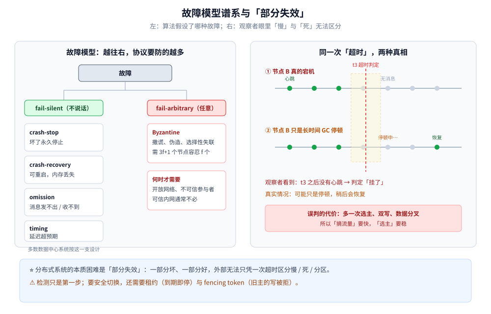
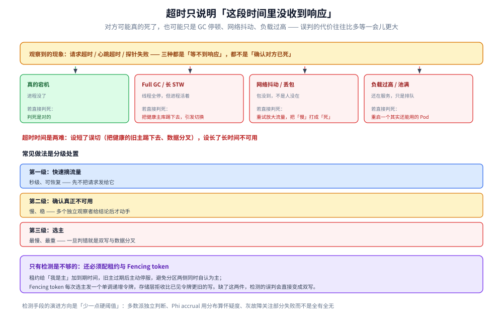
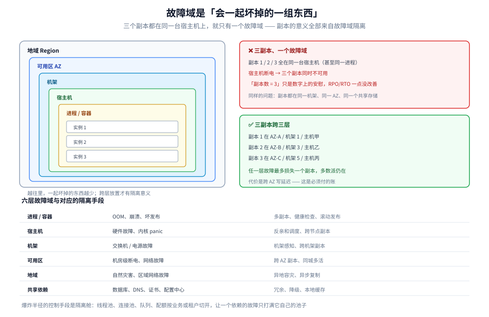

# 故障模型与分布式谬误

> 覆盖：分布式系统里「故障」有哪些形态、为什么超时不能直接判死、网络分区有哪些不对称形态、故障域与爆炸半径怎么划。
>
> 不覆盖：故障转移的选主与脑裂处置见 [集群基础.md](../集群基础.md) 第五节；副本复制与 Quorum 见 [复制与Quorum.md](../数据分布/复制与Quorum.md)；时钟问题见 [时钟与顺序.md](时钟与顺序.md)。
>
> 内容整理自个人学习笔记；参考资料与原始素材见 [素材清单](../../../素材清单.md)。本篇的探针与租约示例只作配置说明，未在本轮启动集群实测。

---

## 一、分布式计算的八个谬误是什么？

**本节要点**：这八条是「按单机直觉写分布式代码」时最容易默认成立的假设。每一条在真实网络里都不成立，而且**违反时往往不报错，只表现为偶发的超时、重复与数据错乱**。

| # | 谬误 | 现实 | 后果 |
|---|---|---|---|
| 1 | 网络是可靠的 | 会丢包、会重置连接、会短暂黑洞 | 没重试的请求永久丢失；没幂等的重试产生重复 |
| 2 | 延迟为零 | 同机房也有几十微秒到毫秒，跨地域几十毫秒 | 串行调用叠加后超时；超时预算算错 |
| 3 | 带宽是无限的 | 复制、备份、大对象会挤占带宽 | 复制延迟飙升，故障切换时雪崩 |
| 4 | 网络是安全的 | 内网也会被横向移动、被误配置暴露 | 明文传输、无鉴权、任意来源可写 |
| 5 | 拓扑不会变 | 扩缩容、发布、迁移、云厂商调度一直在改 | 写死 IP、假设固定跳数、缓存路由过期 |
| 6 | 只有一个管理员 | 多团队、多集群、多套配置各管一段 | 变更冲突、证书与版本不一致 |
| 7 | 传输成本为零 | 序列化、加密、跨 AZ 流量都要钱和时间 | 大对象频繁跨区，账单和延迟一起涨 |
| 8 | 网络是同质的 | 容器网、物理网、跨云链路的 MTU 与策略都不同 | 本机通、容器间不通；大包被分片或丢弃 |

> ⭐ 八条谬误的共同根因是：**把「本地函数调用」的心智模型套到了「跨网络调用」上**。
> 本地调用只有成功或抛异常；跨网络调用还有第三种状态 —— **不知道成没成功**。

---

## 二、故障可以分成哪些模型？

**本节要点**：故障模型是算法的**前提假设**。选了一个模型，就等于声明「我假设故障长什么样」；假设之外的故障，协议不负责。



图怎么读：左侧从「崩溃即停」到「任意作恶」排列，越往右协议要处理的可能行为越多、代价越大；右侧是同一个观察者视角下的两条时间线 —— 节点 B 要么真的宕机，要么只是长时间停顿，**在没有额外证据时两者看起来完全一样**。<br>
⚠️ 图中「超时」是观察者本地的时间判断，不代表被观察节点的真实状态。

| 模型 | 节点可能怎么坏 | 典型算法 / 系统 | 代价 |
|---|---|---|---|
| **崩溃即停**（crash-stop） | 坏掉后永久不再发消息 | 多数共识协议的理论前提 | 最简单，但不覆盖「重启后继续」 |
| **崩溃恢复**（crash-recovery） | 可能重启，内存丢失、持久化数据保留 | Raft、Paxos 的工程实现、数据库 | 要处理日志恢复与重复提交 |
| **遗漏故障**（omission） | 消息可能发不出或收不到 | 重传、超时、Quorum | 要区分「丢消息」与「节点慢」 |
| **时序故障**（timing） | 消息延迟超出预期 | 同步 / 部分同步模型 | 异步模型下无法用超时判死 |
| **拜占庭故障**（Byzantine） | 任意行为，包括撒谎、伪造 | PBFT、区块链共识 | 需要 `3f+1` 个节点才能容忍 `f` 个作恶 |

### 2.1 fail-silent 与 fail-arbitrary

- **fail-silent**：坏了就不说话（崩溃、断网）。多数数据中心系统按这一类设计；
- **fail-arbitrary**：坏了可能返回错误结果、伪造消息、选择性失联。只有明确存在作恶或严重硬件故障风险时才需要拜占庭容错。

> ⚠️ 拜占庭容错不是「更高级所以更好」。它要多得多的节点与通信轮次；
> 在可信内网里，用 `3f+1` 的成本去防一个不存在的威胁，通常是过度设计。

### 2.2 部分失效（partial failure）

分布式系统最本质的特征不是「机器多」，而是**部分失效**：

- 一部分节点坏了，另一部分还在工作；
- 从外部看，系统既不是「完全正常」也不是「完全不可用」，而是**部分功能降级**；
- 更麻烦的是，**观察者无法仅凭一次超时判断对方是慢、是死、还是网络不通**。

> ⭐ 单机程序的故障是「全有或全无」；分布式系统的故障是**连续谱**。
> 所有重试、超时、熔断、选主、对账机制，本质上都在处理这个连续谱。

---

## 三、为什么「超时」不能直接等于「宕机」？

**本节要点**：超时只是「在我等待的这段时间里没收到响应」，原因可能是对方死了，也可能只是 GC 停顿、网络抖动、负载过高、时钟跳变。**误判的代价往往比多等一会儿更大**。

### 3.1 常见误判来源

| 现象 | 真实原因 | 如果直接判死会怎样 |
|---|---|---|
| 心跳超时 | 对端 Full GC / 长时间 STW | 把健康主库踢下去，引发不必要的切换 |
| 请求超时 | 网络抖动、丢包、重传 | 重试放大流量，把「慢」打成「死」 |
| 探针失败 | 进程忙、线程池满、依赖慢 | K8s 重启一个其实还能服务的 Pod |
| 间歇失联 | 链路 flapping、非对称分区 | 反复选主，集群持续抖动 |



四种情况在「等不到响应」这个观测上是完全一样的，只有第一种判死是对的。图下半部分的三级处置是工程上的折中：先做秒级、可恢复的摘流量动作，确认之后才走选主这种一旦判错就会双写的重动作——把「判断错了要不要付代价」作为分级的依据，而不是按动作的轻重排序。

### 3.2 故障检测的手段与风险

| 手段 | 说明 | 风险 |
|---|---|---|
| **心跳 + 超时** | 超过 `timeout` 没收到心跳即判死 | ⭐ **误判**：对方只是慢（GC 停顿、网络抖动、负载高），不是死 |
| **主动探测**（TCP / 健康检查接口） | 比心跳更接近真实可用性 | 探测本身也可能超时；探测成功不等于业务可用 |
| **多数派的独立判断** | 由多数节点分别给出结论，避免单个观察者的偏差 | 需要更多往返 |
| **Phi accrual 故障检测** | 用心跳间隔的分布算「怀疑度」，而不是硬阈值 | 参数要按网络分布调；仍有误判 |
| **灰故障（gray failure）** | 关注「部分请求失败 / 延迟升高」而非全有全无 | 需要细粒度指标，定位成本高 |

> ⭐ **超时时间是两难**：设短了误切（把健康的旧主踢下去、数据分叉），设长了长时间不可用。
> 工程上的常见做法是**分级**：先用心跳快速摘流量（秒级、可恢复），
> 确认真正不可用之后再走选主（这个动作要慢、要稳）。

### 3.3 检测之外还必须有的两件东西

1. **租约（lease）**：给「我是主」加一个到期时间，旧主在租约过期后**主动停止服务**，避免分区两侧同时自认为主；
2. **Fencing token**：每次选主发一个单调递增的令牌，存储层拒收比已见令牌更旧的写。

> 只有检测、没有租约与 fencing，检测的误判就会直接变成双写。两者的配合见
> [集群基础.md](../集群基础.md) 第五节的脑裂防护表。

---

## 四、网络分区有哪些不对称形态？

**本节要点**：分区不是「网线一拔，两边干净地断开」。真实分区常常是**单向的、部分的、时断时续的**，这会让心跳与选主做出相互矛盾的判断。

| 形态 | 表现 | 为什么难处理 |
|---|---|---|
| **对称分区** | A 与 B 互相都收不到对方消息 | 相对容易识别，多数派机制可处理 |
| **非对称分区** | A 能发给 B，B 发不回 A | 一侧认为对方活着，另一侧认为对方死了 |
| **部分分区** | 只有部分节点之间不通 | 集群可能被切成三片以上，多数派定义要按连通分量算 |
| **抖动分区** | 时通时断，持续数秒到数分钟 | 选主反复触发，日志不断截断 / 追赶 |
| **慢链路** | 消息能到但延迟极高 | 看起来像分区，实际只是超时阈值不合适 |

> ⚠️ **非对称分区是脑裂的温床**：A 觉得自己能联系 B，于是继续当主；B 收不到 A 的心跳，于是选出新主。
> 只靠「互相 ping」无法发现这种问题，必须让**写入路径**也过多数派或 fencing 校验。

---

## 五、故障域与爆炸半径怎么划？

**本节要点**：故障域是「会一起坏掉的一组东西」。副本、实例、依赖都必须**跨故障域放置**，否则副本数只是数字上的安慰。

| 层级 | 一起坏掉的典型原因 | 隔离手段 |
|---|---|---|
| **进程 / 容器** | OOM、崩溃、坏发布 | 多副本、健康检查、滚动发布 |
| **宿主机** | 硬件故障、内核 panic | 反亲和调度、跨节点副本 |
| **机架** | 交换机 / 电源故障 | 机架感知、跨机架副本 |
| **可用区（AZ）** | 机房级断电、网络故障 | 跨 AZ 副本、同城多活 |
| **地域（Region）** | 自然灾害、区域级网络故障 | 异地容灾、异步复制 |
| **共享依赖** | 数据库、DNS、证书、配置中心 | 冗余、降级、缓存 |

> ⚠️ 「三副本」不等于安全：**三个副本都在同一台宿主机 / 同一个机架 / 同一个 AZ 上，就只有一个故障域**。
> 副本的意义全部来自**故障域隔离**。
>
> ⭐ 爆炸半径的控制手段是**隔离舱（bulkhead）**：线程池、连接池、队列、配额按业务或租户切开，
> 让一个依赖的故障只打满它自己的池子，而不是拖垮整个进程。



左边那组同心框就是「一起坏掉」的边界：越往外一层，一次故障带走的东西越多。右边两个方框是本篇最重要的一组对照——同样是三副本，放在同一台宿主机上只是数字上的安慰，因为断电时三个一起没；跨三层放置才能做到「任一层故障最多损失一个副本」。副本数从来不是安全指标，副本跨了几个故障域才是。

---

## 六、故障模型怎么影响设计？

**本节要点**：每一种故障，都要在代码或架构里有一个明确的应对动作；没有应对动作的故障，就是等着发生的线上事故。

| 故障 | 应对动作 | 关键细节 |
|---|---|---|
| 请求可能丢 | 超时 + 重试 | 重试要有上限、退避和 jitter，避免重试风暴 |
| 响应可能丢（结果未知） | **幂等** + 去重键 | 重试前先能判断「上次到底成没成」 |
| 节点可能慢 | 超时预算、熔断、隔离舱 | 区分「慢」与「死」，别让慢节点拖垮调用方 |
| 节点可能死 | 健康检查、摘流量、选主 | 摘流量要快，选主要稳 |
| 网络可能分区 | 多数派、租约、fencing | 少数派必须停止写入 |
| 时钟可能不准 | 逻辑时钟、版本号、不依赖本地时间 | 见 [时钟与顺序.md](时钟与顺序.md) |
| 依赖可能整体挂 | 降级、缓存、fail-open / fail-closed | 按接口定默认行为 |
| 故障可能复发 | 混沌演练、故障注入 | 不演练的预案等于没有 |

> ⭐ 最容易被漏掉的是**「结果未知」**：超时不代表失败，请求可能已经在服务端执行成功。
> 所以跨网络写操作的第一原则不是「重试」，而是「**先让重试是安全的**」。

---

## 七、应用场景

**本节要点**：故障模型不是理论摆设，K8s 探针、etcd 租约、注册中心心跳、数据库主从切换，都是它在具体系统里的投影。

| 场景 | 用到的故障假设 | 落点 |
|---|---|---|
| K8s 存活 / 就绪探针 | 进程可能崩溃、可能暂时不可用 | 见第八节的探针配置 |
| etcd 租约与选主 | 节点可能崩溃、网络可能分区 | 租约到期即失去主身份 |
| 注册中心心跳 | 实例可能崩溃或网络不通 | 超时摘除，恢复后重新注册 |
| 数据库主从切换 | 主库可能崩溃、复制可能延迟 | 选主 + 位点对齐 + fencing |
| 熔断与隔离舱 | 下游可能慢或整体挂 | 按依赖切开资源池 |
| 跨 AZ 部署 | 机房可能整体故障 | 副本跨故障域 |

---

## 八、具体使用

**本节要点**：探针要区分「活着」与「能接流量」；租约要把「我还持有主身份」变成一个有期限、可续期的断言。

### 8.1 K8s 三类探针

```yaml
livenessProbe:            # 失败 → 重启容器：只查「进程是否卡死」
  httpGet: { path: /healthz, port: 8080 }
  periodSeconds: 10
  failureThreshold: 3
readinessProbe:           # 失败 → 摘流量：查「依赖是否就绪、能否服务」
  httpGet: { path: /readyz, port: 8080 }
  periodSeconds: 5
  failureThreshold: 2
startupProbe:             # 启动慢时先屏蔽上面两个探针
  httpGet: { path: /healthz, port: 8080 }
  failureThreshold: 30
  periodSeconds: 2
```

| 探针 | 失败后的动作 | 常见误用 |
|---|---|---|
| **liveness** | 重启容器 | 把依赖检查放进来 → 下游一抖，全部 Pod 被重启 |
| **readiness** | 从 Service 摘除 | 只检查进程端口，不检查依赖 → 流量打到未就绪实例 |
| **startup** | 重启容器（启动阶段） | 启动慢但不配 startup → 被 liveness 反复杀死 |

> ⭐ 判据：**liveness 只回答「重启能不能救」；readiness 回答「现在能不能接流量」**。
> 依赖故障应该让 Pod 变「未就绪」，而不是变「该重启」。

### 8.2 etcd 租约

```bash
etcdctl lease grant 10                      # 申请 10 秒租约，返回 lease ID
etcdctl put /lock/order --lease=<lease-id>  # 带着租约写 key
etcdctl lease keep-alive <lease-id>         # 持续续期；进程挂掉后租约到期，key 自动删除
```

租约把「我还活着 / 我还是主」变成一个**有期限的声明**：进程崩溃或分区后无法续期，key 自动失效，其他节点才能安全接管。

---

## 延伸追问

- **超时设多长才合理？** → 没有万能值。按「正常延迟分布的高分位 + 余量」设，并区分「摘流量」与「选主」两档；跨地域调用要单独算预算。
- **心跳和健康检查有什么区别？** → 心跳是节点间「我还活着」的周期性信号，健康检查是外部对「能不能服务」的主动探测；前者适合成员管理，后者适合流量摘除，不能互相替代。
- **为什么说「分布式系统最本质的问题是部分失效」？** → 因为观察者无法区分慢、死、分区，任何判断都带概率；协议与工程手段都在把「不确定」收敛成「可安全行动」。
- **拜占庭容错什么时候才需要？** → 存在不可信参与者或严重硬件/软件错误风险时（如开放网络、区块链）；可信内网通常按崩溃恢复模型设计即可。
- **非对称分区怎么发现？** → 单靠双向心跳很难；要靠写路径的多数派确认、租约到期、fencing token，以及两侧各自的日志对比。
- **混沌工程和故障注入会不会把系统搞坏？** → 会，所以要在受控环境、有中止条件、有观测的前提下做；它的价值是把「以为不会发生」的故障提前变成「演练过」。

## 关联

- **上游/总纲**：[README.md](../README.md) — 分布式目录的阅读顺序与理论线定位
- **对照/互补**：[CAP与PACELC.md](CAP与PACELC.md) — 分区期间在 C 与 A 之间怎么选
- **对照/互补**：[时钟与顺序.md](时钟与顺序.md) — 超时、租约与 LWW 依赖的时间假设
- **下游机制**：[集群基础.md](../集群基础.md) — 故障转移、选主与脑裂防护
- **下游机制**：[复制与Quorum.md](../数据分布/复制与Quorum.md) — 多数派如何把分区变成可判定的状态
- **下游机制**：[Raft协议.md](../共识协议/Raft协议.md) — 崩溃恢复模型下的选举与日志复制
- **运维/配置**：[多副本共享状态.md](../稳定性/多副本共享状态.md) — 多副本下阈值被放大 `副本数` 倍的陷阱
- **运维/配置**：[K8s部署流程.md](../../../06-工程实践/部署/k8s/K8s部署流程.md) — 探针、调度与故障域
> 反向引用（本篇被下列文档引到）：[ZAB协议.md](../共识协议/ZAB协议.md)
