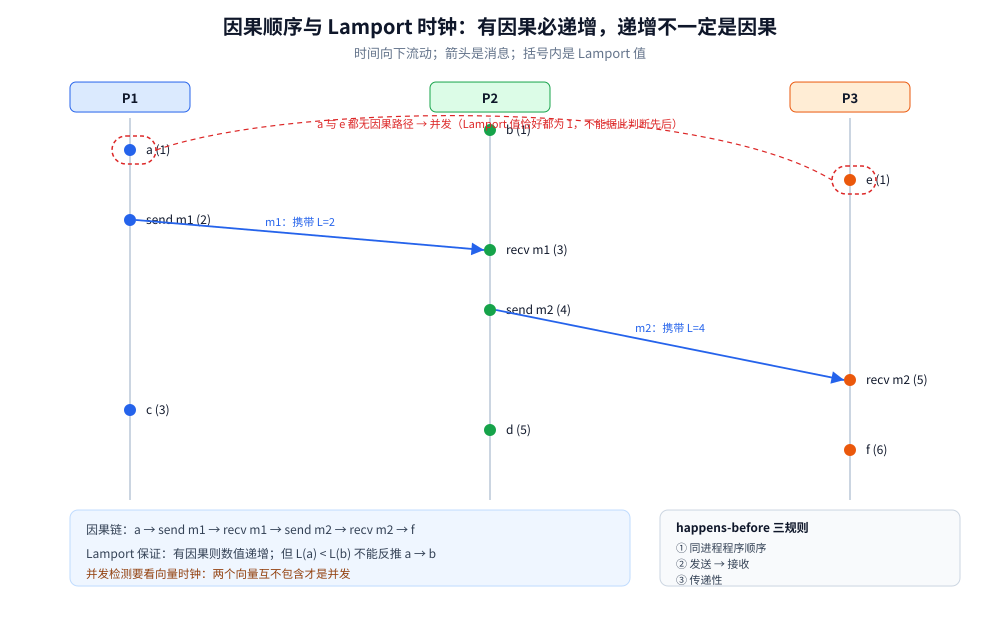
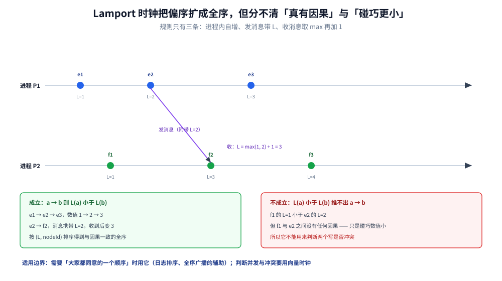

# 时钟与顺序

> 覆盖：物理时钟为什么不可靠、happens-before 与逻辑时钟怎么给事件定序、向量时钟怎么识别并发、TrueTime / TSO 怎么给分布式事务发时间，以及时钟错了会坏哪些判断。
>
> 不覆盖：一致性模型的强度阶梯见 [一致性模型.md](一致性模型.md)；雪花算法的位分配与回拨处理见 [雪花算法.md](../分布式ID/雪花算法.md)；租约与选主见 [集群基础.md](../集群基础.md)。
>
> 内容整理自个人学习笔记；参考资料与原始素材见 [素材清单](../../../素材清单.md)。本篇代码为语义示例，未在本轮运行实测。

---

## 一、为什么两台机器的时钟不能直接比较？

**本节要点**：物理时钟有**偏差（skew）**、会**漂移（drift）**、会被 NTP **跳变或平滑调整**，还会因为虚拟机暂停而停顿。两个事件的时间戳谁大谁小，**不能推出**谁先发生。

### 1.1 物理时钟的四个误差来源

| 来源 | 表现 | 影响 |
|---|---|---|
| **晶振漂移** | 不同机器的秒长略有差异，每天可能差几十毫秒 | 长时间运行后偏差累积 |
| **NTP 校正** | 小幅偏差用「平滑」调整，大偏差直接「跳变」 | 时间可能倒退或突然前跳 |
| **虚拟机暂停 / 迁移** | vCPU 被调度走，时钟读数与实际经过时间不一致 | 超时、租约判断失真 |
| **闰秒 / 时区配置** | 时间出现 23:59:60 或重复小时 | 依赖本地时间的逻辑出错 |

### 1.2 墙上时钟与单调时钟

- **墙上时钟（wall clock）**：`time.Now()` 的日历时间，会被 NTP 调整，**可能倒退**；
- **单调时钟（monotonic clock）**：只保证「一直向前」，适合测经过时间、算超时。

```go
start := time.Now()
// ... 业务逻辑 ...
elapsed := time.Since(start)   // 使用单调时钟读数，不受 NTP 跳变影响

deadline := time.Now().Add(3 * time.Second)
if time.Now().After(deadline) { // 墙上时钟比较：NTP 回拨时可能永远不到期
    // ...
}
```

> ⚠️ **用墙上时钟做「过了多久」的判断是常见 bug**：NTP 回拨后，`now.After(deadline)` 可能长时间为 false。
> 测时长用单调时钟；只有需要「人类可读的日期时间」时才用墙上时钟。

### 1.3 时钟偏差会直接破坏什么

- **LWW（最后写入获胜）**：时钟快的节点总赢，慢节点的写被静默覆盖；
- **租约**：时钟快的节点可能提前认为租约到期，出现双主；
- **TTL / 缓存过期**：时钟偏差导致提前失效或过期不删；
- **日志时间线**：跨机器按时间戳排序，得到的事件顺序可能是错的。

> ⭐ 结论：**时间戳适合做「近似排序」和「展示」，不适合单独做「因果判断」和「唯一胜负裁决」**。
> 需要因果，用逻辑时钟；需要唯一顺序，用共识或中心发号器。

---

## 二、happens-before 是什么？

**本节要点**：happens-before 是分布式系统的「因果顺序」定义。它不依赖物理时间，只依赖**程序顺序**与**消息传递**。



图怎么读：横向是三条进程的时间线，箭头是消息。沿程序顺序和消息箭头能走到的两个事件，就有 happens-before 关系；走不到的两个事件是**并发**的（例如 P1 的 `a` 与 P3 的 `e`）。<br>
⚠️ 图中数字是 Lamport 时钟值，只保证「有因果则递增」，**不能反推因果**；物理时间轴只画了大致先后，不代表可比较。

**三条规则**（Lamport, 1978）：

1. **程序顺序**：同一进程内，先发生的事件 → 后发生的事件；
2. **消息传递**：发送事件 → 接收该消息的事件；
3. **传递性**：若 `a → b` 且 `b → c`，则 `a → c`。

若两个事件既没有 `a → b` 也没有 `b → a`，它们就是**并发（concurrent）**的 —— 注意这里的「并发」是**因果上的不可比**，不是「同时发生」。

> ⭐ happens-before 是**偏序**：不是所有事件都能比较。分布式系统的很多难题，本质就是「如何在没有全序的情况下做安全决策」。

---

## 三、Lamport 逻辑时钟怎么给事件排序？

**本节要点**：Lamport 时钟给每个事件一个整数，保证「有因果则数值递增」，从而把偏序**扩展**成一个全序；代价是**无法区分「真有因果」与「碰巧数值小」**。

**规则**：

```text
进程内每发生一个事件：      L = L + 1
发送消息时：                把当前的 L 附在消息上
接收消息时：                L = max(L, L_msg) + 1
```

**性质**：

- 若 `a → b`，则 `L(a) < L(b)`；
- 反之不成立：`L(a) < L(b)` **不能推出** `a → b`（可能只是两个并发事件碰巧数值不同）。

**得到全序**：按 `(L, nodeId)` 排序。这个全序**与因果一致**，但会给并发事件强加一个任意顺序。

> ⚠️ 所以 Lamport 时钟适合「需要一个大家都同意的顺序」的场景（如日志排序的辅助），
> **不适合**「判断两个写是否冲突」—— 那需要向量时钟。



两条时间轴上每个事件旁边的数字就是 L 值，紫色那条斜线是唯一一次消息传递：发送时附带 `L=2`，接收方取 `max(1, 2) + 1 = 3`，于是因果被编码进了数值。但下面那两个框对照着看才是重点——`L(a)` 小于 `L(b)` 只说明数字小，不说明有因果，所以它只能给出「一个大家都同意的顺序」，不能用来判冲突。

---

## 四、向量时钟怎么判断并发？

**本节要点**：向量时钟给每个节点维护一个向量，记录「我知道每个节点各发生了多少事件」。比较两个向量，就能判断**因果先后**还是**并发**。

**规则**（节点 `i` 维护 `V_i[1..N]`）：

```text
进程内事件：   V_i[i] = V_i[i] + 1
发送消息时：   把整个 V_i 附在消息上
接收消息时：   V_i[j] = max(V_i[j], V_msg[j])  （对所有 j）
              V_i[i] = V_i[i] + 1
```

**比较**：

| 关系 | 条件 | 含义 |
|---|---|---|
| `V(a) ≤ V(b)` 且至少一维严格小于 | 所有分量 ≤，且有分量 < | `a → b` |
| `V(b) ≤ V(a)` 且至少一维严格小于 | 对称 | `b → a` |
| 两个方向都不满足 | 各有分量更大 | `a` 与 `b` **并发** |

**例子**：`V(a) = [2,0,0]`，`V(b) = [1,1,0]` —— 第一维 `2 > 1`，第二维 `0 < 1`，互不包含，因此并发。这正是 LWW 会丢写、而版本向量能发现冲突的原因。

> ⚠️ 向量时钟的代价是**元数据随节点数线性增长**（`O(N)`）。节点很多时，实际系统会用版本向量（只记录写过的节点）、 dotted version vector 或混合逻辑时钟来压缩。

![向量时钟的并发判定：三条比较规则，以及 V(a)=[2,0,0] 与 V(b)=[1,1,0] 互不包含因此并发](images/向量时钟的并发判定.svg)

判定逻辑其实只有一句：把两个向量逐维比，如果「所有维都 ≤ 且至少一维严格小于」就有因果，两个方向都不满足就是并发。下面那个 `[2,0,0]` 与 `[1,1,0]` 的例子值得记住——第一维它更大、第二维更小，所以谁也不是谁的前驱。这正是 LWW 会丢写而版本向量能发现冲突的根本差别。

---

## 五、混合逻辑时钟（HLC）解决了什么？

**本节要点**：Lamport 时钟丢失了物理时间信息，物理时钟又不可靠；HLC 把两者结合 —— **既保持因果顺序，又让时间戳尽量接近物理时间**。

**结构**：`HLC = (physical, logical)`。

- 发送 / 本地事件时：取 `max(本地物理时间, 上次 HLC 的 physical)`；若相同则 `logical + 1`，否则 `logical = 0`；
- 接收消息时：把消息里的 HLC 也纳入 `max`，再递增 logical。

**性质**：

- 若 `a → b`，则 `HLC(a) < HLC(b)`（因果一致）；
- HLC 与物理时间的偏差有上界（只要时钟漂移有界）；
- **不能单独判断并发**，但能给出一个「近似物理时间、且不违反因果」的全序。

**典型使用**：CockroachDB 的事务时间戳、部分分布式数据库的 MVCC 版本号。

---

## 六、TrueTime 与 TSO 是怎么给分布式事务发时间的？

**本节要点**：强一致事务需要一个**全局可比、单调递增**的时间戳。两条路线：TrueTime 用硬件把「不确定区间」压到很小并**等它过去**；TSO 用**中心发号器**直接分配单调时间戳。

### 6.1 TrueTime（Spanner）

- 机房部署 GPS 与原子钟，`TT.now()` 返回一个区间 `[earliest, latest]`，而不是一个点；
- 事务提交时取时间戳 `s`，然后 **commit-wait**：等到 `TT.now().earliest > s` 才对外承诺提交成功；
- 代价：要等不确定区间（通常几毫秒），并依赖专用硬件。

> ⭐ TrueTime 的关键不是「时钟很准」，而是**承认时钟有误差，并把误差显式地等掉**。
> 这保证了「提交时间戳之后的读一定能看到该事务」。

### 6.2 TSO（中心时间戳服务）

- 由一个中心组件（如 TiDB 的 PD）分配单调递增的时间戳，通常**批量取号**以降低 RPC 开销；
- 事务开始时拿 `start_ts`，提交时拿 `commit_ts`，MVCC 按时间戳判断可见性；
- 代价：TSO 是逻辑单点，必须做高可用；跨地域部署时延会限制吞吐。

| 方案 | 时间来源 | 误差处理 | 单点风险 |
|---|---|---|---|
| **TrueTime** | GPS + 原子钟 | 显式等待不确定区间 | 依赖硬件与多机房部署 |
| **TSO** | 中心服务 | 不依赖物理时钟精度，直接发单调号 | 中心服务要 HA |
| **HLC** | 本地物理时钟 + 逻辑计数 | 保证因果、近似物理 | 无中心，但不能单独判并发 |

---

## 七、时钟在系统里具体影响哪些判断？

**本节要点**：列出「用了时间」的判断，并逐条问：**时钟错了，这个判断会怎样错？**

| 场景 | 用了什么时间 | 时钟错了会怎样 | 正确做法 |
|---|---|---|---|
| **雪花 ID** | 本地墙上时间 | 回拨导致重号 | 回拨等待 / 拒绝 / 换 worker，见 [雪花算法.md](../分布式ID/雪花算法.md) |
| **租约** | 本地单调 / 墙上时间 + 安全余量 | 提前到期 → 双主 | 留足漂移余量；写路径加 fencing |
| **LWW 冲突解决** | 物理时间戳 | 慢时钟的写被静默覆盖 | 版本向量 / 业务合并；接受丢写要写明 |
| **MVCC 快照** | TSO / HLC 时间戳 | 快照顺序错乱 → 读到未来或丢失 | 用中心发号或 HLC，不直接用本地时间 |
| **日志排序** | 时间戳 | 跨节点顺序错 | 用日志索引 / term（Raft 不依赖时钟） |
| **缓存 TTL** | 本地时间 | 提前过期或过期不删 | 容忍偏差；关键数据不靠 TTL 保证正确性 |
| **分布式锁** | 租约时间 | 锁提前失效 → 双持有 | 租约 + fencing token，见 [分布式锁.md](../../../03-数据与中间件/数据存储/NoSQL/Redis/分布式锁.md) |

> ⭐ **Raft / Paxos 不靠时钟排序**，这是它们比「按时间戳定序」更可靠的根本原因：
> 顺序由日志索引与任期决定，时钟只用于选举超时这类「可以误判」的辅助判断。

---

## 八、应用场景

**本节要点**：需要「因果」时用逻辑时钟；需要「全局唯一顺序」时用共识或中心发号；只有「近似展示」才直接用物理时间。

| 场景 | 选什么 | 理由 |
|---|---|---|
| 分布式 ID | 物理时间 + 逻辑序列（Snowflake）或中心发号 | 需要趋势递增与唯一性 |
| 分布式事务快照 | TSO / TrueTime / HLC | 需要全局可比的时间戳 |
| 冲突检测（多主） | 向量时钟 / 版本向量 | 需要识别并发写 |
| 日志复制 | 日志索引 + term | 不依赖时钟，避免偏差 |
| 租约与选主 | 本地单调时钟 + 安全余量 + fencing | 时钟只用于「到期」判断，安全靠令牌 |
| 事件展示与排查 | 墙上时间 | 只用于人看，不用于正确性判断 |

---

## 九、具体使用

**本节要点**：工程上先分清「测经过时间」与「记录发生时刻」，再把「需要因果」的地方换成逻辑时钟或版本号。

### 9.1 单调时钟测超时

```go
ctx, cancel := context.WithTimeout(context.Background(), 2*time.Second)
defer cancel()

start := time.Now()
doWork(ctx)
elapsed := time.Since(start) // 单调时钟：不受 NTP 回拨影响
```

### 9.2 Lamport 时钟的最小实现

```go
type Lamport struct {
    mu sync.Mutex
    n  uint64
}

func (l *Lamport) Tick() uint64 {
    l.mu.Lock()
    defer l.mu.Unlock()
    l.n++
    return l.n
}

func (l *Lamport) Observe(remote uint64) uint64 {
    l.mu.Lock()
    defer l.mu.Unlock()
    if remote > l.n {
        l.n = remote
    }
    l.n++
    return l.n
}
```

发送时把 `Tick()` 的返回值附在消息上；接收时调用 `Observe(msg.Counter)`。这样得到的是**因果一致的全序**，不是物理时间。

### 9.3 fencing token 的思路

```text
选主成功 → 向存储申请一个单调递增的 token（如 7）
旧主（token=6）恢复后继续写 → 存储发现 6 < 7，拒绝
新主（token=7）的写 → 正常接受
```

> ⭐ token 必须由**存储侧**校验并持久化，不能只在客户端比较；否则旧主可以绕过。

---

## 延伸追问

- **NTP 同步了，为什么还不能直接用时间戳排序？** → NTP 只把偏差压小，不保证单调、不保证无跳变；而且同步误差在毫秒级，足以让并发写产生错误顺序。因果判断要靠逻辑时钟。
- **Lamport 时钟和向量时钟怎么选？** → 只需要「大家同意的顺序」用 Lamport（`O(1)` 元数据）；需要「识别并发写」用向量时钟（`O(N)` 元数据）。
- **HLC 能替代向量时钟吗？** → 不能。HLC 给的是因果一致的全序，不能单独判断两个事件是否并发；冲突检测仍需要版本向量或业务规则。
- **TrueTime 的本质是什么？** → 把「时钟不确定区间」显式暴露出来，并用 commit-wait 把区间等掉；不是让时钟变成绝对准确。
- **为什么 Raft 不用时间戳定序？** → 时间戳在分布式环境不可靠；Raft 用日志索引与任期建立顺序，时钟只用于选举超时，误判由多数派机制兜底。
- **雪花算法的时钟回拨为什么要单独处理？** → 它把时间戳直接编进 ID，回拨会生成重复 ID；处理方式包括等待、拒绝、切换 worker 或使用逻辑时间，见 [雪花算法.md](../分布式ID/雪花算法.md)。

## 关联

- **上游/总纲**：[README.md](../README.md) — 分布式目录的阅读顺序与理论线定位
- **对照/互补**：[一致性模型.md](一致性模型.md) — 因果一致、线性一致与版本号的关系
- **对照/互补**：[故障模型与分布式谬误.md](故障模型与分布式谬误.md) — 超时、租约与部分失效
- **下游机制**：[雪花算法.md](../分布式ID/雪花算法.md) — 物理时间进入 ID 后的回拨问题
- **下游机制**：[Raft协议.md](../共识协议/Raft协议.md) — 不依赖时钟的定序方式
- **下游机制**：[MVCC多版本并发控制.md](../../../03-数据与中间件/数据存储/并发控制/MVCC多版本并发控制.md) — 事务快照的时间戳
- **案例**：[分布式锁.md](../../../03-数据与中间件/数据存储/NoSQL/Redis/分布式锁.md) — 租约 + fencing 的工程落地
- **案例**：[跨地域多活.md](../../系统设计/IM系统/跨地域多活.md) — 跨地域时间与顺序约束
> 反向引用（本篇被下列文档引到）：[集群基础.md](../集群基础.md)
