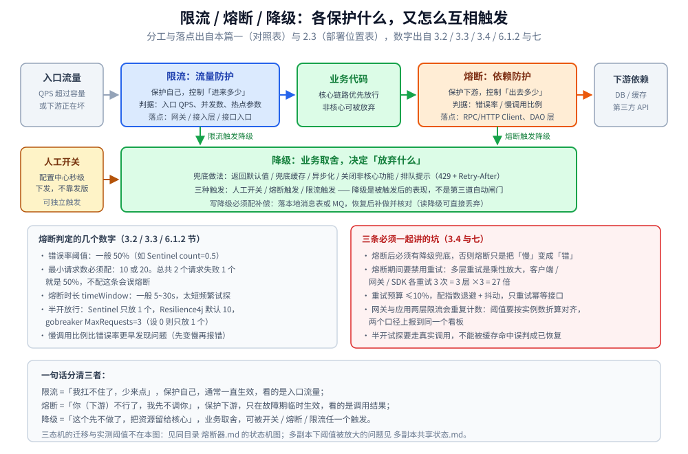
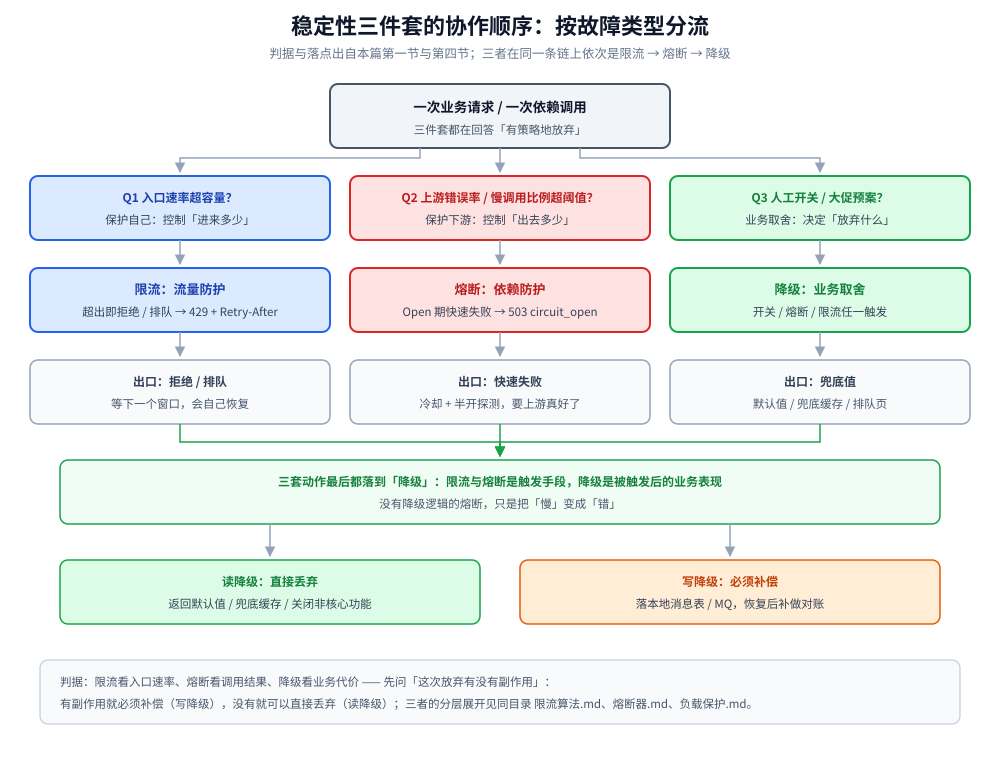

# 稳定性

> 本目录回答「**系统在过载、依赖故障、流量突增时，怎么有策略地放弃，而不是整体崩溃**」。
> 九篇零件分别讲清一条防线上的一个位置：限流、并发、熔断、降级、重试与超时、节点摘除、负载保护、多副本共享状态、幂等。
>
> 不覆盖：服务注册 / 发现见 [服务发现.md](../服务治理/服务发现.md)、负载均衡见 [负载均衡.md](../服务治理/负载均衡.md)；分布式事务与全局 ID 见 [README.md](../分布式事务/README.md)、[README.md](../分布式ID/README.md)；一致性、复制与共识见 [一致性模型.md](../理论基础/一致性模型.md)、[CAP与PACELC.md](../理论基础/CAP与PACELC.md)、[复制与Quorum.md](../数据分布/复制与Quorum.md)、[一致性哈希.md](../数据分布/一致性哈希.md)、[Raft协议.md](../共识协议/Raft协议.md)。
>
> 内容整理自个人学习笔记，并参考《大型网站技术架构：核心原理与案例分析》（李智慧），素材见 [素材清单](../../../素材清单.md)。
>
> 📎 **实测口径**：本目录的限流放行、熔断闭环、并发限制、摘除回列、负载闸门、重试放大、幂等裁决与重放扣款、共享状态均有本机 Docker 实测，各篇引语里注明环境与版本；本文件只做导读，**不重复读数**。

---

## 一、稳定性防线由哪几层组成？

**本节要点**：稳定性不是一个开关，而是一条**按故障类型分流**的链。先看「哪里出了问题」，再决定由谁出手。

| 手段 | 保护对象 | 触发信号 | 直接后果 | 所在篇 |
| --- | --- | --- | --- | --- |
| **限流** | 自己（防过载） | 入口流量超过容量 | 拒绝 / 排队 / 等待 | [限流算法.md](限流算法.md) |
| **并发限制 / 负载保护** | 自己（防慢请求堆积） | 在途数超过容量 | 拒绝 / 有界排队 | [并发限制器.md](并发限制器.md)、[负载保护.md](负载保护.md) |
| **熔断** | 自己（防被下游拖死） | 依赖错误率 / 慢调用比例超阈值 | 一段时间内快速失败 | [熔断器.md](熔断器.md) |
| **节点摘除** | 自己（别被单个坏节点拖住） | 单节点连续失败 | 摘掉节点，冷却后探测回列 | [节点级被动摘除.md](节点级被动摘除.md) |
| **重试 / 超时** | 调用链（控制失败代价） | 瞬时失败 / 调用过久 | 有限次重试、超时释放资源 | [重试与超时.md](重试与超时.md) |
| **降级** | 业务（保住核心链路） | 人工开关 / 熔断 / 限流触发 | 非核心功能关闭，返回兜底结果 | [降级.md](降级.md) |
| **幂等** | 业务数据（防重复生效） | 重复请求（重试 / MQ 重投 / 回调重推） | 同一个请求只生效一次 | [幂等设计.md](幂等设计.md) |

⭐ 一句话区分：

- **限流 / 并发限制**是「我扛不住了，少来点」；
- **熔断**是「你（下游）不行了，我先不调你」；
- **重试**是「也许再试一次就好了」，但必须被熔断和预算约束；
- **降级**是「这个先不做了，把资源留给核心」；
- **幂等**是「再来一次也不怕」，是重试能安全发生的前提。

> 熔断和限流是**触发手段**，降级是**被触发后的业务表现**。熔断后没有降级逻辑，只会把「慢」变成「错」。

| 容易混淆的点 | 澄清 |
| --- | --- |
| 熔断 vs 降级 | 熔断是框架层的自动保护（打开后快速失败）；降级是业务层的兜底方案（返回什么）。熔断常常触发降级，但降级也可由开关或限流独立触发 |
| 限流 vs 熔断 | 限流看**自身入口流量**，熔断看**调用结果**；限流通常长期生效，熔断是故障期的临时状态 |
| 限流 vs 并发限制 | 限流限**速率**（进多快），并发限制限**在途数**（积多少）。上游变慢时，QPS 限流救不了堆积 |
| 降级 vs 快速失败 | 快速失败只是降级策略之一；还包括默认值、兜底缓存、异步化、关闭非核心功能 |
| 幂等 vs 去重 | 去重是「同一个键只处理一次」且通常有窗口（Redis TTL）；幂等是「执行多次与执行一次结果相同」且要永久成立。窗口一过就放行的，只是去重 |



## 二、故障来了按什么顺序分流？

**本节要点**：不是「三道开关都要配」，而是先问「这次故障是什么类型」，再决定由谁出手。



⭐ 三条分工判据（把图读成一串 if）：

1. **看信号定手段**：限流看**入口速率**、熔断看**调用结果**、降级看**业务代价** —— 信号不同，出手的机制就不同。
2. **顺序是「限流 → 熔断 → 降级」**：前两者是触发手段，降级才是被触发后的业务表现。
3. **最后都收敛到降级**：所以要回答「被拒之后返回什么」——读降级可直接丢弃，写降级必须补偿（落本地消息表 / MQ，恢复后对账）。

## 三、本目录各篇怎么分工？

| 篇 | 回答什么 | 一句话 |
| --- | --- | --- |
| [限流算法.md](限流算法.md) | 进多快 | 六种算法 + 令牌桶 / 漏桶模型 + Redis 分布式限流与限流维度 |
| [并发限制器.md](并发限制器.md) | 积多少 | Little 定律、信号量、AIMD / Vegas / Gradient2 三种自适应算法 |
| [负载保护.md](负载保护.md) | 入口闸门怎么开 | 有界队列、排队超时、准入顺序、503 + `Retry-After` |
| [熔断器.md](熔断器.md) | 依赖坏了怎么办 | 三态机、滑动窗口、最小请求数、五个参数相互牵制 |
| [节点级被动摘除.md](节点级被动摘除.md) | 坏了一个节点怎么办 | 连续失败、冷却 + 探测租约、全摘 fail-open |
| [重试与超时.md](重试与超时.md) | 失败之后怎么再试 | 放大链、重试层级、退避抖动、重试预算、超时预算与 deadline |
| [降级.md](降级.md) | 放弃什么 | 三种触发、五种策略、读 / 写降级、预案与演练 |
| [多副本共享状态.md](多副本共享状态.md) | 多副本下阈值怎么统一 | 限流阈值 × 副本数、共享状态协议、退回本地 vs fail-open |
| [幂等设计.md](幂等设计.md) | 重试凭什么可以安全发生 | 重放的四个来源、唯一索引 vs `FOR UPDATE`（100 并发 99 死锁）、幂等键怎么选、做在哪一层、返回什么 |

## 四、按什么顺序读？

```text
① 限流算法            ← 先懂「速率」这个坐标轴
      ↓
② 并发限制器          ← 再懂「在途数」这个坐标轴（上游变慢时它才是主防线）
      ↓
③ 负载保护            ← 把前两者落成网关入口的一道闸门（排队与准入）
      ↓
④ 熔断器              ← 从「限自己」转向「判断下游是否已经坏了」
      ↓
⑤ 节点级被动摘除      ← 熔断的粒度细化：先摘坏节点，整片不行才熔断服务
      ↓
⑥ 幂等设计            ← 先有幂等，重试才是安全的（否则重试 = 重复扣款）
      ↓
⑦ 重试与超时          ← 失败后的再试与时间预算；重试必须被熔断短路
      ↓
⑧ 降级                ← 所有拒绝与失败最终要给业务一个答案
      ↓
⑨ 多副本共享状态      ← 以上判定在多副本下怎么不被放大 / 稀释
```

| 本篇 | 建议先读 | 为什么 |
| --- | --- | --- |
| [并发限制器.md](并发限制器.md) | [限流算法.md](限流算法.md) | 先有「限速率」的模型，才看得出「限在途数」差在哪 |
| [负载保护.md](负载保护.md) | [并发限制器.md](并发限制器.md) | 那篇讲在途数的理论与自适应，这篇讲入口闸门的实现 |
| [熔断器.md](熔断器.md) | [限流算法.md](限流算法.md) | 熔断的滑动窗口与限流同源；先懂窗口统计 |
| [节点级被动摘除.md](节点级被动摘除.md) | [熔断器.md](熔断器.md) | 先有「服务级熔断粒度太粗」的认知，才看得出摘除补了什么 |
| [重试与超时.md](重试与超时.md) | [熔断器.md](熔断器.md)、[幂等设计.md](幂等设计.md) | 重试必须包在熔断内部，否则会放大故障；而「哪些请求可以重试」的前提是幂等 |
| [降级.md](降级.md) | [熔断器.md](熔断器.md)、[限流算法.md](限流算法.md) | 两类触发源决定降级什么时候发生 |
| [多副本共享状态.md](多副本共享状态.md) | [熔断器.md](熔断器.md)、[限流算法.md](限流算法.md) | 先有单副本判定，才谈得上多副本怎么统一 |
| [幂等设计.md](幂等设计.md) | 可独立阅读 | 它管的是数据正确性，不依赖限流 / 熔断的判定；但与重试强相关，建议排在那篇之前 |

## 五、应用场景

**本节要点**：这条防线几乎在每一个「有流量、有依赖」的系统里都会出现，只是落地位置和由谁实现不同。

| 场景 | 主用的手段 | 本仓落点 |
| --- | --- | --- |
| **秒杀 / 大促**（瞬时洪峰 + 非核心功能可关） | 限流 + 降级（排队页、关推荐/广告） | [总体设计.md](../../系统设计/秒杀系统/总体设计.md)、[支付系统设计.md](../../系统设计/秒杀系统/支付系统设计.md) |
| **IM 接入层**（按用户 / IP / 设备限流防刷） | 限流（多维） + 降级（非核心功能） | [限流与防刷.md](../../系统设计/IM系统/限流与防刷.md) |
| **跨地域多活**（机房级故障切换） | 熔断 + 降级（切流到备用机房） | [跨地域多活.md](../../系统设计/IM系统/跨地域多活.md) |
| **网关 / RPC 客户端**（依赖一多，雪崩风险就高） | 熔断 + 重试预算 | [从零实现网关.md](../../../01-编程语言/go/网络编程/从零实现网关.md)、[网关选型对比.md](../../../03-数据与中间件/中间件/网关与代理/网关选型对比.md) |
| **分布式限流**（跨机总量控制） | Redis + Lua 原子计数 | [限流算法.md](限流算法.md)、[多副本共享状态.md](多副本共享状态.md) |
| **消息 / 异步链路的重复投递** | 幂等 + 有限重试（熔断保护重试） | [幂等设计.md](幂等设计.md)、[消息可靠性.md](../../../03-数据与中间件/中间件/消息队列/RocketMQ/消息可靠性.md) |
| **支付 / 订单回调重推**（第三方持续重推） | 幂等键 + 状态机条件更新 | [幂等设计.md](幂等设计.md)、[支付系统设计.md](../../系统设计/秒杀系统/支付系统设计.md) |
| **微服务治理总纲** | 三者的关系与上线顺序 | [分布式与微服务.md](../分布式与微服务.md)、[分布式/README.md](../README.md) |

⭐ 三条判据（把上表读薄）：

1. **先分清「保护自己」还是「保护下游」**：限流与负载保护保护自己不被流量压垮，熔断保护自己不被下游拖死，降级是业务取舍。
2. **有触发就必须有承接**：限流和熔断都会拒请求，拒完返回什么由降级决定 —— 没有降级的限流 / 熔断只完成了半个动作。
3. **别在错误的坐标轴上使劲**：速率限流挡不住「请求数不变、上游变慢」（[负载保护.md](负载保护.md)）；错误率熔断挡不住「上游没报错但吞吐塌了」（[并发限制器.md](并发限制器.md)）。

## 六、上线时先配哪一个？

**本节要点**：不要一上来把八个组件全打开。先压测拿到容量，再按「观察 → 小流量 → 全量」的顺序开，且每个阈值都要有指标能解释。

| 主题 | 口径 |
| --- | --- |
| **阈值怎么定** | ① 单机压测拿到容量（QPS 拐点、P99 RT）；② 线上按 `单机阈值 = 容量 × 安全系数（0.6~0.8）` 配置；③ **渐进式**上线：先只监控不拦截，再小流量放开，再全量；④ 集群阈值 = 单机阈值 × 实例数，但要考虑流量倾斜打折 |
| **上线顺序** | 先超时（没有超时，后面的机制都不成立）→ 并发 / 负载保护 → 熔断 → 幂等（重试的前提）→ 重试预算 → 降级兜底 → 多副本共享状态 |
| **观测先行** | 每个组件至少要有：放行 / 拒绝数、当前阈值、状态变化次数；没有指标的保护等于没有保护 |
| **演练** | 阈值不是配完就结束：定期 kill 下游、注入延迟，验证熔断真的打开、降级真的生效 |

## 延伸追问

- **限流、熔断、降级到底怎么区分？** → 限流看**入口速率**并拒绝超额请求；熔断看**调用结果**并在故障期短路；降级是前两者（或人工开关）触发后的**业务兜底**。前两者是手段，降级是表现。
- **为什么有了限流还需要并发限制？** → 限流限的是速率，挡不住「请求数不变、每个请求变慢」导致的堆积；并发限制 / 负载保护限的是在途数。详见 [并发限制器.md](并发限制器.md) 第一节。
- **熔断和节点摘除是什么关系？** → 服务级熔断管「整片下游不可用」，节点摘除管「多个等价节点里坏了一个」。先摘点、再熔服务，是两级防线。
- **重试应该配在哪一层？** → 一条链路只让一层重试，优先放在最靠近下游的客户端 / SDK，并包在熔断内部；网关重试最容易放大。
- **降级应该做成什么粒度？** → 至少全局 / 服务 / 接口三级，热点场景加参数级；粒度越细误伤越小，但配置与演练成本越高。
- **多副本之后最容易被忽略的是什么？** → 限流阈值被放大 `副本数` 倍且没有任何报错；熔断样本被稀释、各副本各自重新发现同一个坏上游。见 [多副本共享状态.md](多副本共享状态.md)。

## 关联

- **上游/总纲**：[分布式/README.md](../README.md) — 分布式目录七层结构与阅读顺序
- **上游/总纲**：[分布式与微服务.md](../分布式与微服务.md) — 微服务治理的整体地图
- **对照/互补**：[服务发现.md](../服务治理/服务发现.md)、[负载均衡.md](../服务治理/负载均衡.md) — 稳定性只管「怎么不被打垮」，服务治理管「怎么找到对方、怎么分流」
- **实现/落地**：[稳定性组件的Go实现.md](../../../01-编程语言/go/工程实践/稳定性组件的Go实现.md) — Go 侧 Sentinel / gobreaker / Redis 限流 / 手写三件套
- **实现/落地**：[稳定性组件的Java实现.md](../../../01-编程语言/java/工程实践/稳定性组件的Java实现.md) — Java 侧 Sentinel / Resilience4j / 手写三件套

> 反向引用（本篇被下列文档引到）：
