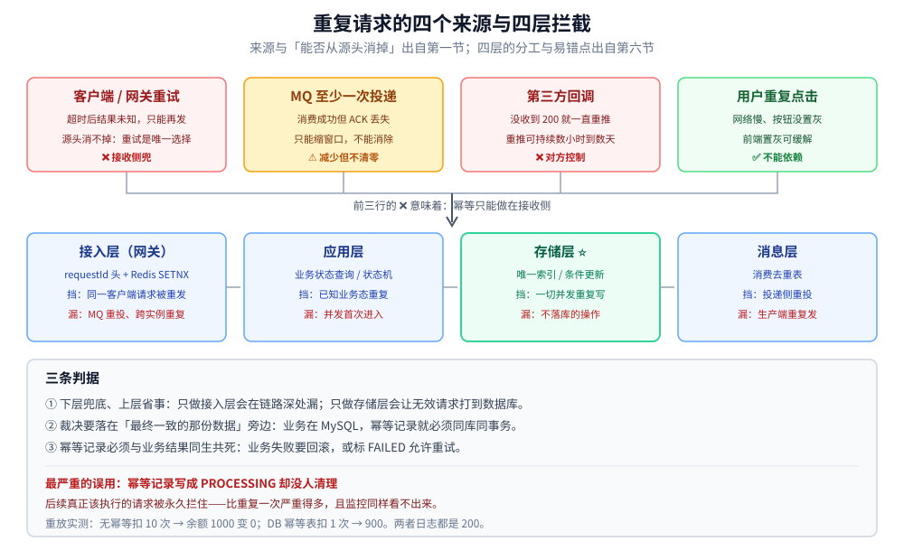
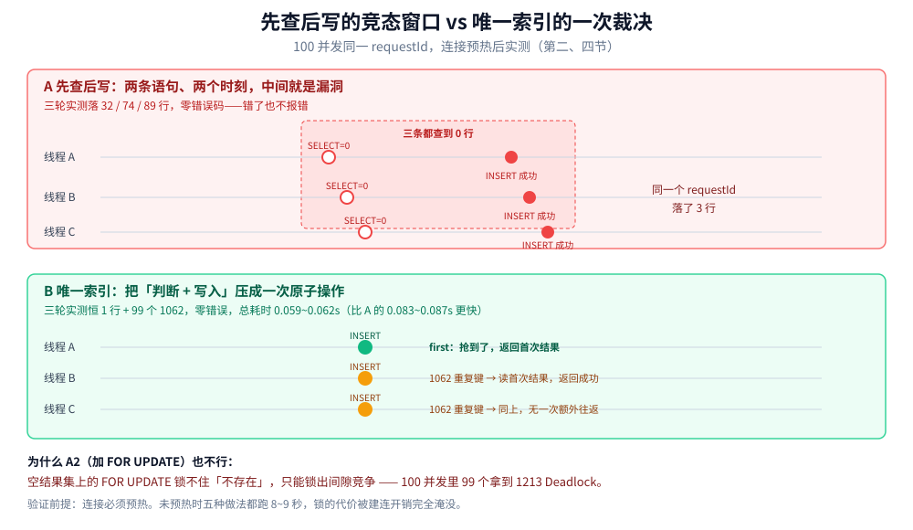
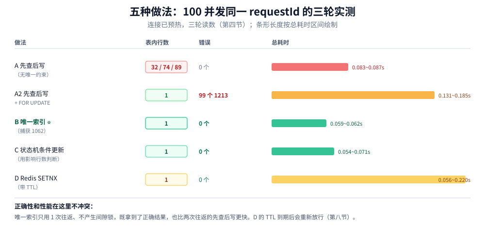
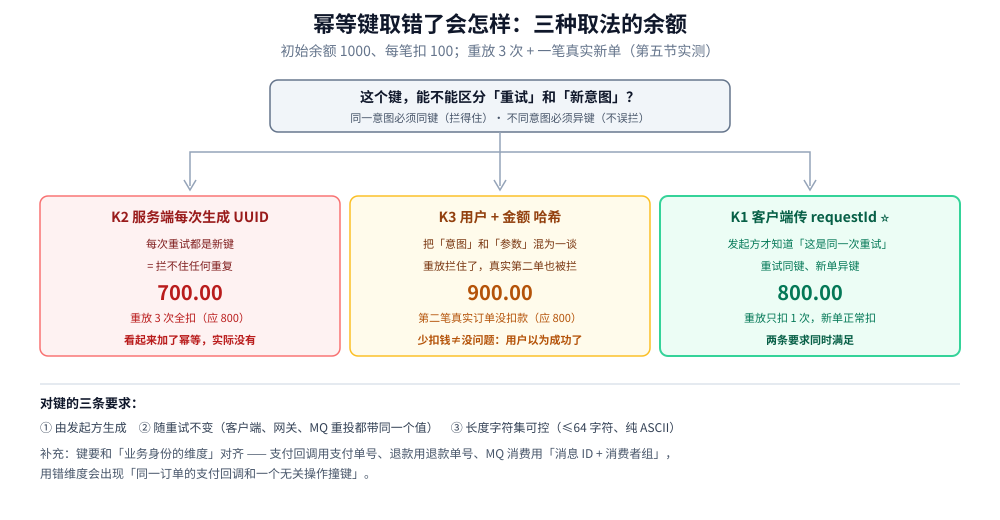
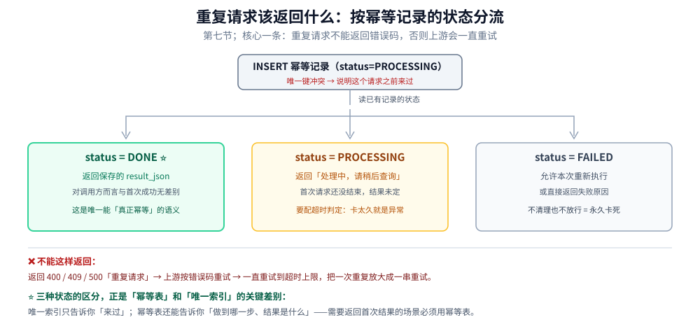

# 幂等设计

> 覆盖：重复请求从哪里来、为什么「先查后写」在并发下必然漏、唯一索引与条件更新为什么是正确解、`FOR UPDATE` 的真实代价、幂等键怎么选才既不漏也不误拦、幂等该做在哪一层、重复请求该返回什么、幂等记录保留多久。含 100 并发 × 五种做法的三轮对照读数与重放扣款读数。
>
> 不覆盖：重试该放哪一层、退避抖动与重试预算见 [重试与超时.md](重试与超时.md)；MQ 消费端的 `consumed_event` 表结构与 ACK 顺序见 [最终一致方案.md](../分布式事务/最终一致方案.md) 第六节；写冲突的通用控制手段见 [写冲突控制的Go落地.md](../../../01-编程语言/go/工程实践/写冲突控制的Go落地.md)。
>
> 内容整理自个人学习笔记，素材见 [素材清单](../../../素材清单.md)。
>
> 📎 **实测口径**：`mysql:8.0`（事务隔离级别 REPEATABLE-READ）+ `redis:8-alpine`，客户端为 Python 3.13 的 pymysql。第一节的重放扣款读数是确定性的、可逐轮复现；第二节的并发读数**故意不可复现**——「先查后写」三轮分别落了 32 / 74 / 89 行，这正是它的病症。**未实测**：MySQL 之外（PostgreSQL 的 `ON CONFLICT`、Redis 集群模式的 `SETNX`）只按文档陈述，未跑读数。

---

## 一、重复请求到底从哪里来？

**本节要点**：幂等不是「防止用户点两次按钮」这种边缘需求，而是**分布式下每一条写路径的默认前提**——因为「至少一次」是投递语义的常态，「恰好一次」只在特定条件下才成立。

四条来源，前三条是系统制造出来的，第四条才是用户制造出来的：

| 来源 | 为什么会重复 | 有没有办法从源头消掉 |
| --- | --- | --- |
| **客户端 / 网关重试** | 超时后不知道对面执行没执行，只能再发一次 | ❌ 超时本身就是「结果未知」，重试是唯一可行选择 |
| **MQ 至少一次投递** | 消费完成但 ACK 丢失 → broker 重投 | ⚠️ 只能减少窗口，不能消除（见 [消息可靠性.md](../../../03-数据与中间件/中间件/消息队列/RocketMQ/消息可靠性.md)） |
| **第三方回调** | 支付 / 物流回调没收到 200 就一直重推，重推间隔可达数小时到数天 | ❌ 由对方控制，我方只能扛 |
| **用户重复点击** | 网络慢、按钮没禁用 | ✅ 前端置灰即可缓解，但不能依赖 |

⭐ 关键推导：**前三行的「❌」意味着幂等只能做在接收侧**。你不能要求上游「别重复发」，只能要求自己「重复收到也只生效一次」。

用重放实验把代价量化——同一笔 100 元的支付回调重放 10 次，初始余额 1000：

```text
S0 无幂等            : 重放 10 次 → 余额 0.00（多扣 1000.00）
S1 DB 幂等表(唯一索引): 重放 10 次 → 余额 900.00  charged=1 replayed=9
S2 Redis SETNX(TTL=2s): 窗口内 5 次 → 900.00；TTL 过期后再 5 次 → 800.00（多扣 100）
```

S0 那行就是「没做幂等」的全部后果：**钱扣光了，日志一片 200，监控看不出任何异常**。这也是幂等 bug 最难发现的地方——它不报错。



四条来源里前三条都消不掉，所以幂等只能做在接收侧；四层拦截各有盲区，最可靠的裁决仍然落在存储层的唯一约束或条件更新上。

## 二、为什么「先查后写」在并发下一定会漏？

**本节要点**：`SELECT` 和 `INSERT` 是两条语句、两个时刻，中间那段窗口就是漏洞。100 并发打同一个 `request_id`，三轮分别落了 **32 / 74 / 89** 行——不是「偶尔漏一个」，是漏一大半，而且每轮数字都不同。

| 轮次 | 表内行数 | 总耗时 | p50 | p99 |
| --- | --- | --- | --- | --- |
| 轮 1 | **32** 行 | 0.085s | 39ms | 57ms |
| 轮 2 | **74** 行 | 0.087s | 46ms | 60ms |
| 轮 3 | **89** 行 | 0.083s | 51ms | 61ms |

三轮读数不一致这件事本身就是判据：**确定性 bug 会稳定复现，竞态 bug 只会给你一个「有时候对」的假象**。测试环境跑一次看到 1 行，就以为没问题；生产环境并发一上来，行数就取决于调度顺序。

竞态窗口长这样：

```text
线程 A: SELECT → 0 行 ─────────────────┐
线程 B:      SELECT → 0 行 ────────────┼──┐
线程 C:           SELECT → 0 行 ───────┼──┼──┐
                                       ↓  ↓  ↓
                 INSERT × 3（三条都认为自己该插入）
```

⭐ 为什么「平时测不出来」：漏不漏取决于两个 `SELECT` 之间能不能插进另一个线程的执行。单机低并发、网络延迟大、日志打印多，都会把窗口撑开或挤扁——你看到的结果和线上完全不是一回事。



上半是三条线程都读到 0 行再各自插入的那个窗口，下半是唯一索引把「判断 + 写入」压成一次原子操作后，同一时刻只可能有一条成功。

## 三、`FOR UPDATE` 为什么会让 99% 的请求死锁？

**本节要点**：给 `SELECT` 加 `FOR UPDATE` 是「先查后写」派最自然的补丁，它确实能让表里只有 1 行——但 100 个并发里 **99 个拿到的是 `1213 Deadlock found`**。

实测原文：

```text
总耗时 0.139s
结果分布: {'op1213': 99, 'inserted': 1}
错误码与原文:
  1213: Deadlock found when trying to get lock; try restarting transaction
表内行数: 1
隔离级别: ('transaction_isolation', 'REPEATABLE-READ')
锁等待超时: ('innodb_lock_wait_timeout', '50')
```

「表内 1 行」这个结果看着对，但它是靠**死锁回滚**换来的：99 个事务被 InnoDB 主动杀掉了。如果没有重试兜底，这 99 个请求就是 99 个 500。

### 3.1 为什么会死锁

在 RR 隔离级别下，`SELECT ... WHERE request_id = ? FOR UPDATE` 查一个**不存在的键**时，InnoDB 锁的不是「某一行」，而是索引上的**间隙（gap）**——因为锁一行不存在的记录没有意义，只能锁住「这里不许插」。

100 个事务同时拿到同一段间隙的**共享型间隙锁**，每个都想往间隙里插一条独占记录 → 共享锁互相等着对方释放，谁也无法升级 → 环形等待 → 死锁检测触发，回滚掉 99 个。

⭐ 一句话：**空结果集上的 `FOR UPDATE` 锁不住「不存在」，只能锁出死锁**。

### 3.2 加了重试就能用吗

能跑通，但要接受两个代价：

| 代价 | 读数 |
| --- | --- |
| 每个请求最多重试到成功 | 100 个并发里 99 个要重试，重试次数取决于并发度 |
| 有效吞吐被压到 1 | 同一 `request_id` 天然串行——这本来是对的，但串行的代价由一个共享间隙锁承担，而不是由一把明确的锁承担 |

真要用悲观锁，正确形态是**锁一个确定存在的行**（如账户行、订单行），而不是锁「可能不存在的幂等记录」。锁存在的行是行锁，不会退化成间隙锁竞争。

## 四、唯一索引为什么既正确又最快？

**本节要点**：把判断权交给数据库的唯一约束——`INSERT` 成功的就是第一次，抛 `1062` 的就是重复。它只用一次往返、不产生间隙锁，实测**比「先查后写」还快**。

| 做法 | 表内行数 | 错误数 | 总耗时 | p50 | p99 |
| --- | --- | --- | --- | --- | --- |
| A 先查后写（无唯一约束） | 32 / 74 / 89 | 0 | 0.083~0.087s | 39~51ms | 57~61ms |
| A2 先查后写 + `FOR UPDATE` | 1 | **99 个 1213** | 0.131~0.185s | 75~109ms | 103~163ms |
| **B 唯一索引 + 捕获 1062** | **1** | **0** | **0.059~0.062s** | **27~32ms** | **38~41ms** |
| C 状态机条件更新 | 1 | 0 | 0.054~0.071s | 21~29ms | 32~43ms |
| D Redis `SETNX` | 1 | 0 | 0.056~0.220s | 22~115ms | 35~195ms |

⚠️ 这张表有个前提必须说清：**连接是预热过的**。第一版实验没预热，五种做法全跑出 8~9 秒，一度让人以为「唯一索引把并发串行化了」——补了基线才发现，100 个线程各自建连就要 7.8~9.5 秒，锁的代价完全被淹没了。



唯一索引与状态机条件更新既拿到了正确结果，耗时也低于两次往返的先查后写；Redis 那条的区间跨度最大，波动来自首次连接与线程调度，不是去重逻辑本身。

```text
基线1 只建连 + SELECT 1        : 7.83s / 8.00s / 9.46s
基线2 建连 + INSERT(不冲突键)  : 7.78s / 8.20s / 8.56s
对照  建连 + INSERT(同键 1062) : 7.90s / 7.91s / 8.62s
```

⭐ 这是本篇最该记住的一条实验纪律：**测锁的代价，必须先把连接开销移出计时区**。否则得出的结论会是「用唯一索引更慢，还是先查后写吧」——正好反了。

### 4.1 为什么它更快

| 维度 | 先查后写 | 唯一索引 |
| --- | --- | --- |
| 往返次数 | 2 次（SELECT + INSERT） | 1 次（INSERT） |
| 加锁 | 普通 SELECT 不加锁 | 插入时加唯一键的锁，冲突立即失败 |
| 判断权 | 应用层（有窗口） | 存储引擎（原子） |
| 失败路径 | 无 | `IntegrityError` / `1062` |

正确性和性能在这里**不冲突**，是因为唯一索引把「检查 + 写入」压成了同一个原子操作。所有需要「先检查再动作」的地方，都应该先问一句：**这个检查能不能变成一个约束**。

### 4.2 状态机条件更新是同一个思路

条件更新把「判断」写进了 `WHERE`：

```sql
UPDATE orders SET status = 'PAID'
WHERE order_no = ? AND status = 'PENDING';
-- 影响行数 = 1 → 本次生效；= 0 → 已经处理过
```

它和唯一索引是同一类解：**用一条语句同时完成「判断」和「动作」，让数据库的影响行数充当裁决结果**。实测 affected=1 恰好 1 次、affected=0 恰好 99 次，零错误。它适合「状态只会单向流转」的场景，不适合「同一状态可以重复执行」的场景（那种要用唯一键）。

## 五、幂等键怎么选才既不漏也不误拦？

**本节要点**：幂等键要同时满足两条互相拉扯的要求——**同一意图的重试必须同键**（否则拦不住），**不同意图的新请求必须异键**（否则误拦）。只有「客户端生成的意图 ID」能同时满足。

用同一张幂等表、同一个扣款接口，只换取键方式，初始余额都是 1000、每笔扣 100：

| 取键方式 | 重放 3 次的结果 | 真实第二笔订单 | 余额 | 判定 |
| --- | --- | --- | --- | --- |
| **K1 客户端传 `requestId`** | `charged` / `blocked` / `blocked` | `charged` ✅ | **800.00** | 正确 |
| K2 服务端每次生成 UUID | `charged` / `charged` / `charged` | `charged` | 700.00 | 幂等形同虚设 |
| K3 用户 + 金额 哈希 | `charged` / `blocked` / — | `blocked` ❌ | 900.00 | 误拦真实订单 |

### 5.1 三种取键方式错在哪

| 方式 | 错在哪 | 症状 |
| --- | --- | --- |
| **服务端生成** | 键在服务端生成，每次重试都是新值 | 拦不住任何重复，但**看起来「加了幂等」**，代码里有幂等表、有唯一索引，指标也正常 |
| **业务参数哈希** | 用「用户 + 金额 + 商品」这类参数算键，把「意图」和「参数」混为一谈 | 用户真的想下两笔一样的单时被拦——投诉「付款了但没订单」 |
| **客户端 `requestId`** | 需要客户端配合（生成、透传、重试时复用同一个） | 无；这是唯一正确解 |

K3 那一行的余额 900 是最有说服力的：**少扣了钱不等于没问题**——用户下了两笔、只成了一笔，第二笔的请求收到「已处理」，钱没扣、单没建，但用户以为成功了。



三种取法在同一张幂等表、同一个扣款接口上跑出的余额差：服务端生成键一次都没拦住，参数哈希拦住了重放但误拦了真实第二单。

### 5.2 幂等键的三条要求

| 要求 | 说明 | 反面例子 |
| --- | --- | --- |
| **由发起方生成** | 只有发起方知道「这是同一个意图的重试」 | 服务端生成 UUID |
| **随重试不变** | 客户端重试、网关重试、MQ 重投都必须带同一个值 | 每次重试重新生成 |
| **长度与字符集可控** | 通常 ≤64 字符、仅 ASCII，进唯一索引不走前缀长度 | 拼 JSON / 带中文 / 超长 URL |

⭐ 补充一条常被忽略的：**幂等键要和「业务身份的维度」对齐**。支付回调用「支付单号」，退款用「退款单号」，MQ 消费用「消息 ID + 消费者组」。用错了维度，会出现「同一个订单的支付回调和一个无关操作撞键」。

## 六、幂等应该做在哪一层？

**本节要点**：四层各有分工，**下层兜底、上层省事**；只做上层会在链路深处漏，只做下层会让大量无效请求打到数据库。

| 层 | 靠什么 | 能挡住 | 挡不住 |
| --- | --- | --- | --- |
| **接入层（网关）** | `requestId` 头 + Redis `SETNX` | 同一个客户端请求被重发 | MQ 重投、跨实例的重复（除非用共享存储） |
| **应用层** | 业务状态查询 / 状态机 | 「这个订单已经付过了」这类**已知业务态** | 并发首次进入（两个都没查到） |
| **存储层** | 唯一索引 / 条件更新 | 一切并发重复写 | 不落库的操作（缓存、外部调用） |
| **消息层** | 消费端去重表 | MQ 至少一次投递导致的重投 | 生产端重复发（那是生产端的幂等） |

### 6.1 一个请求会穿过几层

```text
客户端 ──(1 接入层 requestId)──→ 网关 ──→ 应用服务 ──(2 状态机)──→ DB ──(3 唯一索引)──→ 落库
                                              │
                                              └──(4 发 MQ)──→ 消费端 ──(5 消费去重表)──→ 落库
```

⭐ 判据：**幂等的最终裁决必须落在「最终一致的那份数据」旁边**。业务数据在 MySQL，幂等记录就必须在同一个库、同一个事务里；只放在 Redis 里的，一旦 Redis 挂掉或过期，裁决就失效了（见第八节）。

| 易错点 | 后果 |
| --- | --- |
| 幂等表在 A 库、业务表在 B 库 | 两个库无法同事务，中间崩溃就出现「幂等记录有、业务没做」或反之 |
| 只在网关做幂等 | MQ 重投、服务间调用重复全部穿透 |
| 只在应用层「查一下状态」 | 并发首次进入时两个都查到「未处理」 |
| 幂等记录写完、业务失败不清理 | 后续**真正该执行**的请求被永久拦住（比重复更严重） |

最后一行是真正的事故级问题：幂等记录必须与业务结果**同生共死**。业务失败要回滚幂等记录，或者把幂等记录标成 `FAILED` 允许重试——不能留一条「处理中」在那里卡死。

## 七、重复请求应该返回什么？

**本节要点**：重复请求**不能返回错误**。返回 4xx / 5xx 会触发上游再重试，把「已经处理过」变成「一直重试到超时」。

| 返回语义 | 适用 | 风险 |
| --- | --- | --- |
| **返回第一次的结果**（推荐） | 绝大多数场景，尤其是「查询型」写操作（下单、扣款） | 需要把首次结果存下来（幂等表存 `result_json`） |
| 返回「处理中，请稍后查询」 | 首次请求还没结束、结果未定 | 客户端需要轮询，语义变复杂 |
| 返回成功但空响应 | 不关心结果的通知 / 回调 | 客户端拿不到单号等信息 |
| 返回「重复请求」错误 | ❌ 不推荐 | 上游会继续重试，形成死循环 |

### 7.1 用 status 区分「处理中」与「已完成」

```text
INSERT 幂等记录 (status='PROCESSING')
  ├─ 唯一键冲突 → 读已有记录
  │     ├─ status='DONE'      → 返回保存的 result_json（幂等成功）
  │     ├─ status='PROCESSING' → 返回「处理中」，让客户端稍后查
  │     └─ status='FAILED'    → 允许本次重新执行（或直接返回失败原因）
  ├─ 执行业务
  └─ UPDATE status='DONE', result_json=...
```

⭐ 这三种状态的区分是「幂等表」和「唯一索引」的关键差别：唯一索引只告诉你「来过」，幂等表还能告诉你「做到哪一步、结果是什么」。所以**需要返回首次结果的场景必须用幂等表**，不能只靠业务表的唯一键。



PROCESSING 要配超时判定、DONE 返回首次结果、FAILED 必须放行或清理，三者缺任何一个都会把「已经处理过」变成永久卡死或重复执行。

## 八、Redis 去重能当幂等用吗？

**本节要点**：Redis `SETNX` 给的是**一个时间窗口**，不是幂等。窗口一过，同一个请求就会被当成新请求再执行一遍——实测 TTL=2s，过期后重放又扣了一次。

```text
S2 Redis SETNX(TTL=2s): 2 秒内重放 5 次 → 余额 900.00  charged=1 rejected=4
   ...等待 3 秒让 TTL 过期...
S2 TTL 过期后再重放 5 次 → 余额 800.00  charged=1 rejected=4
```

| 维度 | Redis `SETNX + TTL` | 数据库幂等 |
| --- | --- | --- |
| 语义 | 窗口内去重 | 永久（或按业务保留期）幂等 |
| 崩溃后 | 数据可能丢（除非开 AOF `always`） | 跟业务数据同生共死 |
| 能否返回首次结果 | 要额外存 value | 幂等表天然可存 |
| 成本 | 低（一次内存操作） | 一次插入 + 一次更新 |
| 适用 | 高频、可容忍极小概率重复（如展示类接口防抖） | 资金、订单、库存等**不可重复**的操作 |

⭐ 判据只有一句：**这次重复的代价，能不能被「极小概率」兜住？** 资金链路不能，所以必须落库；「记录一次浏览」可以，Redis 足够。

> 一个常见误用：把 Redis 去重**当成幂等**，还在 TTL 上写 `ex=86400` 觉得「一天够了」。实际上支付回调的重推可以跨天，客户端重试也可能在次日上班后重发——**TTL 的长度是猜的，而重复的代价是真的**。

## 九、幂等记录该保留多久、怎么清理？

**本节要点**：保留期不能拍脑袋，要取「重放可能性的时间上界」——取所有上游里**最长的那个重试窗口**，再留一轮余量。

| 上游 | 重试窗口（口径） | 对保留期的要求 |
| --- | --- | --- |
| 客户端 / App | 用户可能次日重试，或离线队列延迟上报 | 至少数天 |
| MQ 至少一次投递 | 由消息保留期决定（如 Kafka 默认 7 天） | ≥ 消息保留期 |
| 第三方支付回调 | 通常按小时递减重推、持续 24 小时以上 | ≥ 24 小时，建议 3~7 天 |
| 网关 / 服务间重试 | 秒级到分钟级 | 分钟级即可 |

清理的三条纪律：

| 纪律 | 做法 | 不这么做的后果 |
| --- | --- | --- |
| **按时间分区** | 按天建分区，过期 `DROP PARTITION` | `DELETE` 大批量会锁表、拖慢主库 |
| **清理任务独立** | 低峰期跑、限速、可暂停 | 清理与业务抢 IO，引发超时 |
| **不要清得比保留期短** | 保留期 = 最长重试窗口 × 安全系数 | 记录被清了、旧请求又来了 → 重复执行 |

⭐ 幂等表是**只增不减**的表，它的增长速度等于业务写 QPS。一笔 1000 QPS 的业务，一天就是 8600 万行——所以「分区 + 定期 DROP」不是优化项，是上线前就必须设计好的。

## 十、应用场景

**本节要点**：幂等几乎出现在每一条「写」的路径上，只是载体不同：有的靠唯一索引，有的靠状态机，有的靠去重表。

| 场景 | 幂等键 | 载体 | 本仓落点 |
| --- | --- | --- | --- |
| **创建订单** | 客户端 `requestId` | 幂等表 / 订单号唯一索引 | [订单系统设计.md](../../系统设计/秒杀系统/订单系统设计.md) |
| **支付回调** | 支付单号（渠道返回） | 支付单状态机条件更新 | [支付系统设计.md](../../系统设计/秒杀系统/支付系统设计.md) |
| **库存扣减** | 订单号 | `UPDATE ... WHERE stock >= n` 影响行数 | [库存系统设计.md](../../系统设计/秒杀系统/库存系统设计.md) |
| **MQ 消费** | 消息 ID + 消费者组 | 消费去重表 | [最终一致方案.md](../分布式事务/最终一致方案.md)、[消息可靠性.md](../../../03-数据与中间件/中间件/消息队列/RocketMQ/消息可靠性.md) |
| **优惠券领取** | 用户 + 活动 + 券模板 | 唯一索引 | [优惠券系统设计.md](../../系统设计/秒杀系统/优惠券系统设计.md) |
| **重试与超时后的补偿** | 沿用原请求的键 | 状态查询 + 唯一索引 | [重试与超时.md](重试与超时.md) |
| **多副本 / 主从切换后的重放** | 同上 | 落库，不能只靠本地内存 | [多副本共享状态.md](多副本共享状态.md) |

⭐ 三条判据（把上表读薄）：

1. **有天然单号就用单号，没有就让客户端生成**——不要用参数哈希，也不要服务端生成。
2. **能落成约束就不要写成判断**——唯一索引、条件更新都属于「让数据库一次裁决」。
3. **能不重复就不要重复**——幂等是兜底，不是许可证；上游该做的前端置灰、消息不重发，一样不能省。

## 十一、具体使用

**本节要点**：三种形态各给一个最小可跑的样子——业务唯一键、幂等表、状态机条件更新。三种都遵循同一条：**判断与写入在同一条语句 / 同一个事务里**。

### 11.1 业务唯一键 + 捕获重复

```go
func CreateOrder(ctx context.Context, req *CreateOrderReq) (*Order, error) {
    order := &Order{RequestID: req.RequestID, OrderNo: newOrderNo(), Amount: req.Amount}

    err := db.WithContext(ctx).Create(order).Error
    if err == nil {
        return order, nil
    }

    // 1062 / 23505：唯一键冲突 = 这个请求之前已经成功过
    if isDuplicateKey(err) {
        var existing Order
        if e := db.WithContext(ctx).
            Where("request_id = ?", req.RequestID).
            First(&existing).Error; e != nil {
            return nil, e
        }
        return &existing, nil   // 返回首次结果，不是返回错误
    }
    return nil, err
}
```

### 11.2 幂等表：同事务、带状态、存结果

```go
func HandlePayCallback(ctx context.Context, cb *Callback) error {
    return db.WithContext(ctx).Transaction(func(tx *gorm.DB) error {
        rec := &IdemRecord{Key: cb.PayNo, Status: "PROCESSING"}
        if err := tx.Create(rec).Error; err != nil {
            if !isDuplicateKey(err) {
                return err
            }
            // 已存在：按状态决定后续动作
            var old IdemRecord
            if e := tx.Where("idem_key = ?", cb.PayNo).First(&old).Error; e != nil {
                return e
            }
            switch old.Status {
            case "DONE":
                return nil              // 幂等成功，直接返回
            case "PROCESSING":
                return ErrProcessing    // 让上游稍后查，不要返回 5xx
            default:
                return fmt.Errorf("previous attempt failed: %s", old.Status)
            }
        }

        if err := applyPayment(tx, cb); err != nil {
            return err                  // 回滚，幂等记录一起消失
        }
        return tx.Model(rec).Updates(map[string]any{
            "status": "DONE", "result_json": cb.PayNo,
        }).Error
    })
}
```

⭐ 注意 `applyPayment` 失败时**直接 return err 让事务回滚**——幂等记录不能留着，否则这笔支付永远做不成。

### 11.3 状态机条件更新：用影响行数裁决

```go
func MarkPaid(ctx context.Context, orderNo string) (bool, error) {
    res := db.WithContext(ctx).Model(&Order{}).
        Where("order_no = ? AND status = ?", orderNo, "PENDING").
        Update("status", "PAID")
    if res.Error != nil {
        return false, res.Error
    }
    // 1 = 本次生效；0 = 已经被处理过（幂等成功，不是错误）
    return res.RowsAffected == 1, nil
}
```

### 11.4 表结构

```sql
-- 幂等表：key 与业务表同库，PRIMARY KEY 充当唯一约束
CREATE TABLE idem_record (
  idem_key    VARCHAR(128) NOT NULL,
  status      VARCHAR(16)  NOT NULL,        -- PROCESSING / DONE / FAILED
  result_json JSON         NULL,            -- 首次结果，供重放返回
  created_at  DATETIME(3)  NOT NULL DEFAULT CURRENT_TIMESTAMP(3),
  updated_at  DATETIME(3)  NOT NULL DEFAULT CURRENT_TIMESTAMP(3)
                           ON UPDATE CURRENT_TIMESTAMP(3),
  PRIMARY KEY (idem_key),
  KEY idx_created (created_at)              -- 清理任务按时间扫
) ENGINE=InnoDB DEFAULT CHARSET=utf8mb4;
```

## 延伸追问

- **幂等和去重是一回事吗？** → 不是。去重是「同一个键只处理一次」，幂等是「同一个请求执行多次，结果与执行一次相同」。Redis `SETNX + TTL` 是去重（窗口内），唯一索引才是幂等（永久）。
- **为什么不能用「先查后写」加事务？** → 事务不改变可见性窗口。RR 隔离级别下两个事务都读到「不存在」，因为对方未提交；只有把判断压进唯一约束（插入冲突）或条件更新（`WHERE status = 旧值`）才有原子性。
- **`FOR UPDATE` 加了重试能用吗？** → 能跑通，但 100 并发里 99 个要重试，等于把正确性押在重试预算上。真要用悲观锁，锁一个**确定存在的行**（账户、订单），不要锁「可能不存在的幂等记录」。
- **幂等键能不能用 URL + body 的哈希？** → 不能。重试时 body 里常带时间戳、随机数、签名，同一个意图算出来的哈希每次不同，等于服务端生成 UUID。要用客户端显式传的 `requestId`。
- **重复请求要不要返回同一个订单号？** → 要。返回首次结果才能让调用方当成成功（第七节）；返回「已处理」而不带结果，调用方拿不到订单号，只能再查一次，等于把幂等变成两次请求。
- **幂等记录一定要和业务表同库吗？** → 要。跨库就不能同事务，中间崩溃会出现「幂等记录有、业务没做」，后续重试被拦住，这笔业务永远做不成。
- **Redis 挂了，幂等会失效吗？** → 只靠 Redis 的会。所以资金链路必须落库；Redis 可以做第一层加速，但不能是唯一裁决。
- **MQ 消费的幂等键用消息 ID 够吗？** → 够，但要带消费者组：`(consumer, event_id)` 双主键。同一个消息被两个不同的消费者组消费是正常的，不算重复。见 [最终一致方案.md](../分布式事务/最终一致方案.md) 第六节。
- **幂等表越来越大会不会拖慢写入？** → 会。它是只增不减的表，增长速度等于写 QPS。按天分区 + 定期 `DROP PARTITION` 要在上线前设计好，不能靠上线后 `DELETE` 补救。

## 关联

- **上游/总纲**：[README.md](README.md) — 稳定性目录导读：幂等是「重试能否安全发生」的前提
- **上游/总纲**：[分布式与微服务.md](../分布式与微服务.md) — 微服务治理的整体地图与各防线的位置
- **对照/互补**：[重试与超时.md](重试与超时.md) — 重试该放在哪一层、退避与预算；本篇回答「凭什么可以重试」
- **对照/互补**：[最终一致方案.md](../分布式事务/最终一致方案.md) — 第六节是消费端特化版：`consumed_event` 表结构与 ACK 顺序；本篇是通用机制：键怎么定、做在哪层、返回什么
- **对照/互补**：[多副本共享状态.md](多副本共享状态.md) — 多副本下去重状态不能只存在本机内存，否则每个副本各放行一次
- **对照/互补**：[降级.md](降级.md) — 幂等记录卡在 `PROCESSING` 时的兜底与人工介入
- **下游机制**：[消息可靠性.md](../../../03-数据与中间件/中间件/消息队列/RocketMQ/消息可靠性.md) — 至少一次投递是重复的主要来源，幂等是消费端的兜底
- **实现/落地**：[写冲突控制的Go落地.md](../../../01-编程语言/go/工程实践/写冲突控制的Go落地.md) — 并发写的通用控制手段（乐观锁、条件更新、唯一约束）
- **实现/落地**：[稳定性组件的Go实现.md](../../../01-编程语言/go/工程实践/稳定性组件的Go实现.md) — 重试与熔断的封装，重试的前置条件就是幂等
- **运维/配置**：[支付系统设计.md](../../系统设计/秒杀系统/支付系统设计.md) — 支付回调重推的幂等落地

