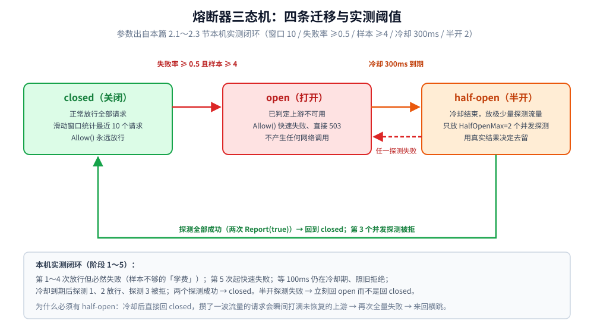
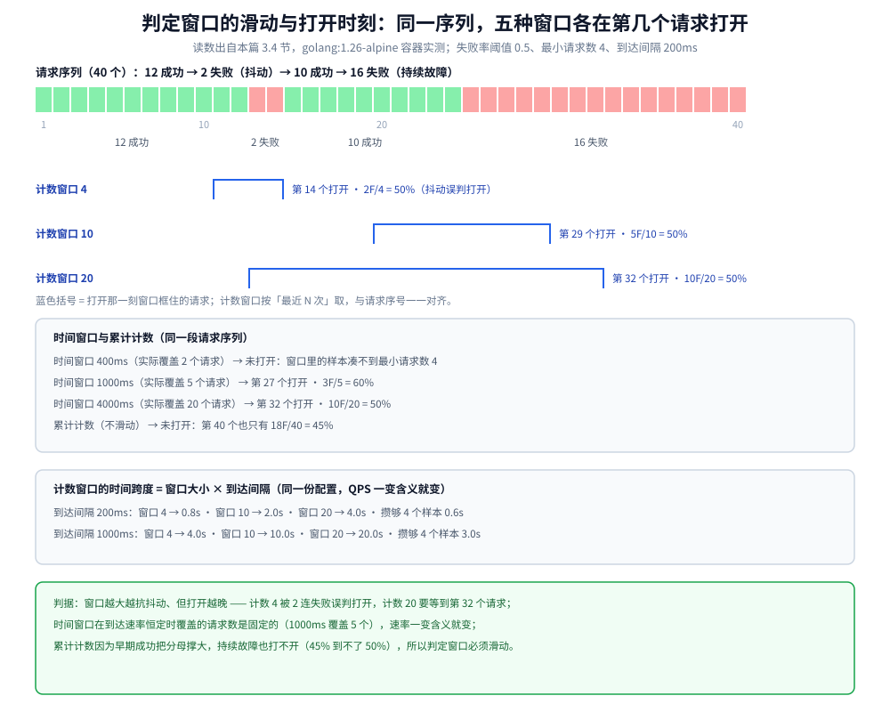
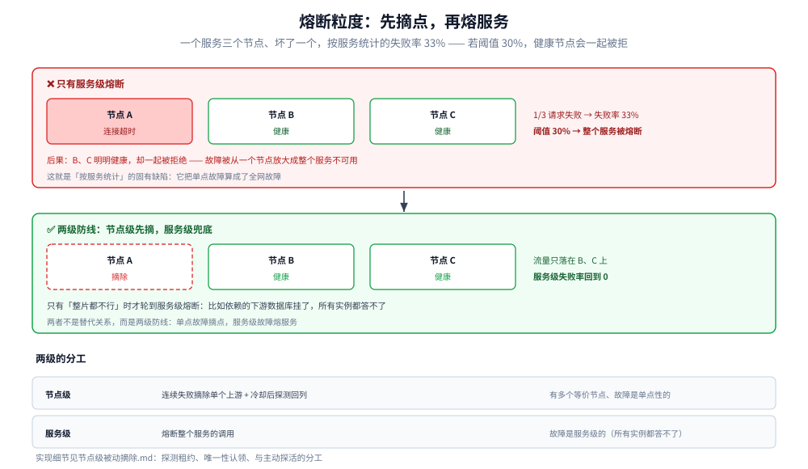

# 熔断器

> 覆盖：熔断器（Circuit Breaker）**这一个组件**的机制 —— 三态机为什么必须有 half-open、
> 判定窗口该用滑动窗口还是累计计数、`WindowSize` / `FailRatio` / `MinRequests` / `OpenFor` /
> `HalfOpenMax` 五个参数怎么互相牵制，以及它和限流、重试、节点摘除的边界。
> 它回答的是「**上游已经不行了，我还要不要继续调用它**」：价值不在「让请求成功」，
> 而在**把「等超时」换成「立刻失败」**，让上游有机会恢复、让自己不把线程和连接堆在一个已经死掉的服务上。
>
> 不覆盖：稳定性各篇的分工与阅读顺序见 [README.md](README.md)；
> 熔断与重试的放大链、重试预算见 [重试与超时.md](重试与超时.md)；
> 熔断后的业务兜底见 [降级.md](降级.md)；
> 熔断状态在多副本之间怎么共享见 [多副本共享状态.md](多副本共享状态.md)；
> 「按节点摘除」这个更细粒度的机制见 [节点级被动摘除.md](节点级被动摘除.md)；
> 限流侧的窗口与算法见 [限流算法.md](限流算法.md)。
>
> 内容整理自个人学习笔记，素材见 [素材清单](../../../素材清单.md)。
>
> 📎 **实测口径**：机制与参数读数基于自研网关项目 [gateway](https://github.com/Eleven-26/gateway)
> （module `gwlab`，Go 1.26.5 windows/amd64）的 `internal/breaker/`，本篇所有 `text` 块都是
> **本机真实运行结果**；3.4 节的判定窗口实验在 `golang:1.26-alpine` 容器（`go1.26.8 linux/amd64`）里独立重跑，
> 连跑 3 次输出逐字一致。⚠️ 需要真实上游实例才能观察的部分，已逐处标注。

---

## 一、熔断器和限流器到底在保护谁？

**本节要点**：这两个机制经常被放在一起说，但它们**看的信号、保护的对象、失败后的行为**全都不一样。
混着理解，就会出现「限流阈值调得很严，上游一慢系统照样雪崩」这种怎么查都查不到原因的局面。

| | 限流器 | 熔断器 |
|---|---|---|
| 看什么信号 | **入口速率**（每秒进来多少） | **上游错误率**（调出去的结果怎么样） |
| 保护谁 | 保护**自己**不被流量压垮 | 保护**自己**不被上游拖死 |
| 触发后的行为 | 拒绝**新来的**请求（429） | 停止**调用上游**，直接返回 503 |
| 恢复方式 | 等下一个时间窗口，自动恢复 | 冷却 + **半开探测**，要上游真的好了才恢复 |
| 典型调参 | `rate` / `burst` | `窗口大小` / `失败率阈值` / `冷却时长` |

⭐ **一句话区分**：限流是「**我不让你进来**」，熔断是「**我不去调用他了**」。

这带来一个容易忽略的推论：**熔断打开后，请求根本不会到达上游**。
如果打开后还继续调用、只是把 500 改写成 503，那除了多一次无用的等待之外，什么都没省下 ——
所以「快速失败」不是实现细节，而是熔断的定义的一部分。

## 二、三态机：每一条迁移为什么必须这样？

**本节要点**：三态机本身只有三个状态、四条迁移，背下来不难。
难的是**每一条迁移为什么必须这样**——尤其是 `half-open` 存在的理由，以及「探测失败该回哪个状态」。

### 2.1 三个状态、四条迁移

```text
                   失败率超过阈值
        ┌──────────────────────────────┐
        ▼                              │
     closed ──────────────────────► open
        ▲                              │
        │                              │ 冷却时间到
        │  探测全部成功                  ▼
        └─────────────────────────  half-open
                                       │
                                       └── 任一探测失败 ──► open
```

| 状态 | 含义 | `Allow()` 的行为 |
|---|---|---|
| `closed` | 正常放行，同时统计成功率 | 永远放行 |
| `open` | 已判定上游不可用 | **直接返回错误**，不发起调用 |
| `half-open` | 冷却结束，放极少量流量试探 | 只放 `HalfOpenMax` 个，其余拒绝 |



四条迁移里只有 half-open 回到 open 这一条是「探测失败再关回去」，其余三条都由计数器或计时器触发。图上标的就是第三节那组参数的实测值：状态机决定「什么时候可以变」，窗口参数决定「变的条件有多敏感」，两者要对着看。

### 2.2 为什么必须有 half-open？

如果冷却到期后直接回 `closed`，会发生这样的事：

```text
上游抖动 30 秒 → 熔断打开 → 冷却 3 秒到 → 直接 closed
   → 上游其实还没恢复 → 全量流量瞬间打上去 → 再次全量失败
   → 再次熔断打开 → 再冷却 → 再全量打上去 …… 来回横跳
```

**冷却期内上游攒了一波流量，一放开就是全量冲击**，这恰恰是熔断想避免的事。
`half-open` 的作用就是**只放极少量流量去试探**（本例 `HalfOpenMax=2`），
用真实结果决定去留 —— 注意这是**用探测代替计时**：不是「等了 3 秒就算好了」，
而是「等了 3 秒后放 2 个真的请求出去，成功了才算好了」。

### 2.3 本机实测：一条完整的熔断闭环

配置：窗口 10 / 失败率 ≥0.5 / 样本 ≥4 / 冷却 300ms / 半开 2。

```text
=== ② 熔断器状态机（窗口 10 / 失败率 ≥0.5 / 样本 ≥4 / 冷却 300ms / 半开 2）===

阶段 1：连续 8 次失败，每次打印 Allow 判定与状态
  第 1 次: 放行             state=closed    failures=0/0
  第 2 次: 放行             state=closed    failures=1/1
  第 3 次: 放行             state=closed    failures=2/2
  第 4 次: 放行             state=closed    failures=3/3
  第 5 次: 快速失败(熔断器打开，快速失败)   state=open      failures=4/4  ← 第 4 次已 Report，样本刚够 MinRequests=4，此刻打开
  第 6 次: 快速失败(熔断器打开，快速失败)   state=open      failures=5/5
  第 7 次: 快速失败(熔断器打开，快速失败)   state=open      failures=6/6
  第 8 次: 快速失败(熔断器打开，快速失败)   state=open      failures=7/7

阶段 2：冷却 300ms 内仍然快速失败
  等 100ms 后 Allow → 熔断器打开，快速失败（state=open）

阶段 3：冷却到期 → 半开只放 HalfOpenMax=2 个，第 3 个被拒
  探测 1: 放行(探测)         state=half-open
  探测 2: 放行(探测)         state=half-open
  探测 3: 拒绝(熔断器打开，快速失败)   state=half-open

阶段 4：两个探测都成功 → 回到 closed
  两次 Report(true) 后 state=closed

阶段 5：半开探测失败 → 立刻回 open（而不是回 closed）
  半开中 state=half-open
  探测失败后 state=open（预期 open）
```

⭐ 三处值得注意的读数：

1. **前 4 个请求是「学费」**：第 1~4 次都放行了（样本不够，不能打开），它们必然失败给用户。
   熔断无法避免这一点，只能靠调小 `MinRequests` 减小代价 —— 但调太小又会被一次抖动误伤（见 3.2）。
2. **`Allow()` 在 open 状态下不产生任何网络调用**：第 5~8 次的耗时与成功率无关，这才是「快速失败」的兑现。
3. **半开状态的第 3 个请求被拒**：`HalfOpenMax=2` 是**并发上限**而不是「累计放 2 个」，
   这点容易看错 —— 它限制的是**同时在飞的探测数**。

## 三、判定窗口怎么设计？

### 3.1 滑动窗口，而不是累计计数

用「累计失败数 / 累计请求数」判定会出现一个长期运行的陷阱：
**历史失败永远留在分母里**，一个跑了一周的节点累积了上千次失败之后，
即使现在完全健康，失败率也降不回阈值以下 —— 于是它**永远打不开也关不上**，或者在边界上来回抖。

正确做法是**只统计最近 `WindowSize` 个请求**（滑动窗口 / 环形数组）。

```text
阶段 6：WindowSize 是滑动窗口 —— 老失败会被挤出去
  序列 FFFSSSS → failures=0/4 state=open（3 个 F 已被 4 个 S 挤出窗口）
```

⭐ 注意 `state=open`：**这 7 个请求里，第 4 个 `S` 之前窗口里 3F+1S = 失败率 0.75 ≥ 0.5 且样本已够 4**，
**所以打开了**。打开之后后续请求根本不会再走到 `Report`（因为不发调用了），
所以窗口里那个「变干净」的状态只是内部计数，不改变已经打开的结论 ——
**这正是熔断的语义：一旦判定不可用，就不再靠新样本自我修复，必须等冷却后由探测决定**。

### 3.2 MinRequests 是防抖闸门

**本节要点**：只看失败率是不够的 —— 样本太少时，1 个失败就是 100%。

```text
阶段 7：MinRequests 是防抖闸门 —— 窗口 10 但只要 2 个失败就够失败率，仍不打开
  2 次失败: failures=2/2 state=closed（样本不足，不打开）
```

如果没有 `MinRequests`：服务刚启动、第一个请求超时 → 失败率 100% → 立刻熔断打开。
**这在「滚动发布」时特别致命**：每次发新实例都会先被自己熔断一次。

🔧 **反过来看**：`MinRequests` 也是「学费」的来源 —— 阈值 4 就意味着**最多 3 个真实用户**要替系统探路。
两个方向的值：

| 取值 | 效果 | 风险 |
|---|---|---|
| `MinRequests` 小（1~2） | 打开快，损失小 | 一次抖动就误判，误伤面大 |
| `MinRequests` 大（≥20） | 判定稳 | 前期用户代价大；低 QPS 的服务可能**永远攒不够样本** |

⚠️ **低 QPS 服务的特例**：如果某个上游每分钟只有几个请求，`MinRequests` 设成 20 意味着
熔断**永远不会触发**。这类服务要么调小阈值 + 加长窗口（提高时间覆盖），
要么改用「时间窗口」而不是「计数窗口」——这是计数窗口的固有盲区。

### 3.3 四个参数的作用与相互牵制

| 参数 | 作用 | 调大 | 调小 |
|---|---|---|---|
| `WindowSize` | 统计多少个请求 | 判定更平滑，对突发不敏感 | 反应快，容易误判 |
| `FailRatio` | 失败率阈值 | 容忍度高，熔断少 | 敏感，可能被正常抖动触发 |
| `MinRequests` | 最少样本数 | 判定稳，学费高 | 学费低，易误判 |
| `OpenFor` | 冷却时长 | 给上游更多恢复时间，但恢复慢 | 恢复快，但可能反复回 open |
| `HalfOpenMax` | 半开并发探测数 | 判定快，但探测流量大 | 冲击小，但判定慢 |

⭐ **两个必须一起看的组合**：

- `FailRatio` × `MinRequests`：前者决定「多差算差」，后者决定「什么时候有资格评价」。
- `OpenFor` × `HalfOpenMax`：前者的倒数 × 后者 ≈ 上游每秒受到的探测压力。
  `OpenFor=3s` + `HalfOpenMax=2` 意味着上游最坏情况每 3 秒被探 2 次 —— 对已经过载的上游不是小数目。

> ⚠️ **`OpenFor` 必须显著大于上游的恢复时间**。若上游恢复要 30 秒而 `OpenFor` 只有 3 秒，
> 就会退化成 2.2 描述的「打开—探测—失败—再打开」高频横跳，探测流量反而成了持续负载。

### 3.4 五种窗口在同一序列上的打开时刻（实测）

**本节要点**：3.1～3.3 说的是「窗口该用哪一种、参数各管什么」，这一节把**同一段请求序列**喂给
计数窗口、时间窗口、累计计数三种判据，看它们各自**在第几个请求才打开**、以及抖动型故障会不会被误判。

实测环境：`golang:1.26-alpine` 容器（`go1.26.8 linux/amd64`）。固定失败率阈值 0.5、最小请求数 4，
请求按固定间隔到达；序列是「12 成功 → 2 失败（抖动）→ 10 成功 → 16 失败（持续故障）」共 40 个。
连跑 3 次，输出逐字一致（全是确定性计数，不受调度波动影响）。

```text
=== 判定窗口实验：同一段请求序列，五种窗口各在什么时候打开 ===
参数：失败率阈值 0.5 · 最小请求数 4 · 到达间隔 200ms
请求序列（40 个）：12 成功 → 2 失败（抖动）→ 10 成功 → 16 失败（持续故障）

 配置                                 打开时刻   打开阶段    打开时窗口内
 计数窗口  4                          第 14 个   抖动     2F/4  = 50%
 计数窗口 10                          第 29 个   持续故障 5F/10 = 50%
 计数窗口 20                          第 32 个   持续故障 10F/20 = 50%
 时间窗口 400ms（实际覆盖 2 个请求）  未打开     —           2个样本里最多 2F/2 = 100%
 时间窗口 1000ms（实际覆盖 5 个请求） 第 27 个   持续故障 3F/5  = 60%
 时间窗口 4000ms（实际覆盖 20 个请求） 第 32 个   持续故障 10F/20 = 50%
 累计计数（不滑动）                   未打开     —           40个样本里最多 18F/40 = 45%

=== 计数窗口的时间跨度 = 窗口大小 × 到达间隔（同一份配置，QPS 一变含义就变）===
 到达间隔  200ms：  窗口  4 → 0.8s  窗口 10 → 2.0s  窗口 20 → 4.0s   · 攒够 4 个样本要 3 个间隔 = 0.6s
 到达间隔 1000ms：  窗口  4 → 4.0s  窗口 10 → 10.0s  窗口 20 → 20.0s   · 攒够 4 个样本要 3 个间隔 = 3.0s

=== 两类故障的分辨能力（由上面同一张表读出来）===
 抖动（2 连失败）：计数窗口 4 在第 14 个请求误判打开；计数窗口 10/20、时间窗口 1000ms/4000ms 都不打开
 持续故障：窗口越小打开越早（计数 4 已提前被抖动打开；计数 10 第 29 个；计数 20 第 32 个；时间 1000ms 第 27 个）
 累计计数：到第 40 个请求也只有 18F/40 = 45%，始终打不开（早期成功把分母撑大了）
```



⭐ 四个读数各说明一件事，请对照上面那张图按顺序看：

| 读数 | 说明了 |
|---|---|
| 计数窗口 4 在第 **14** 个请求就打开 | ⚠️ 抖动（2 连失败 = 2F/4 = 50%）就能把它打开 —— **窗口越小越容易被一次抖动误伤**，这正是 3.2 那个「防抖闸门」要挡的事 |
| 计数窗口 10 / 20 分别在 **第 29 / 32 个**打开 | 同样的 2 连失败它们都**不打开**（样本不足），要等持续故障段把样本攒够才触发；窗口越大打开越晚、但越抗抖 |
| 时间窗口 400ms **未打开**、1000ms 第 **27** 个打开 | ⚠️ 时间窗口的「样本数」由到达速率决定：400ms 里最多只有 2 个样本，永远凑不到最小请求数 4 → **低 QPS 下的计数窗口盲区，时间窗口同样有** |
| 累计计数到第 **40** 个也只有 18F/40 = **45%** | 早期那 12 个成功把分母撑大了，**持续故障也打不开** —— 这就是 3.1 说的「必须滑动」的实证 |

⚠️ 那张「时间跨度」表还给出一个容易忽略的换算：**计数窗口的时间跨度 = 窗口大小 × 到达间隔**。
同一份 `WindowSize = 4` 的配置，请求 200ms 一个时只覆盖 0.8s，1000ms 一个时就覆盖 4.0s ——
所以「窗口 4」不是一个时间承诺，QPS 一变它的含义就变（3.2 结尾那条低 QPS 特例的量化版）。

## 四、熔断的粒度：服务级，还是节点级？

**本节要点**：熔断器按「服务」判定（一个服务一个熔断器），
但一个服务通常有多个上游节点 —— 于是「坏了一个节点」会被放大成「整个服务不可用」。

```text
服务 svc 有 3 个节点，其中 A 挂了（连接超时）
   → 请求有 1/3 的概率打到 A、失败
   → 按服务统计的失败率 = 33% → 若阈值设成 30%，整个服务被熔断
   → B、C 明明健康，却一起被拒绝了
```

**这就是「节点级被动摘除」要解决的问题**：先在节点这一层把坏的摘掉，
让流量在剩下的健康节点上继续跑；只有**整片都不行**时才轮到服务级熔断。

| 粒度 | 机制 | 适合的情况 |
|---|---|---|
| 节点级 | 连续失败摘除单个上游 + 冷却后探测回列 | 有多个等价节点、故障是单点性的 |
| 服务级 | 熔断整个服务的调用 | 故障是服务级的（如依赖的下游数据库挂了，所有实例都答不了） |

两者**不是替代关系而是两级防线**：先摘点、再熔服务。
实现细节见 [节点级被动摘除.md](节点级被动摘除.md)。



上面那个方框算的是一次典型的误伤：三个节点坏一个，按服务统计的失败率就是 33%，阈值设 30% 的话整个服务被熔断，B 和 C 明明健康也被一起拒绝。下面那个方框是同样场景加上节点级摘除之后的结果——失败被限制在 A 这一格，服务级失败率回到 0。所以两者的分工是「单点故障摘点、服务级故障熔服务」，顺序不能反。

## 五、熔断和重试会互相抵消吗？

**本节要点**：熔断和重试是**方向相反**的两个机制，配错了会互相抵消。

| 组合 | 结果 |
|---|---|
| 熔断 + **不重试** | 正确。快速失败 → 上游喘息 → 冷却后探测 |
| 熔断 + **无脑重试** | ⚠️ 重试会**在熔断打开前**把失败请求翻倍，让失败率更快达标；熔断打开后重试又会撞上快速失败，白跑 |
| 熔断 + **重试别的节点** | 合理。这其实是「节点级摘除 + 重试」的组合，比整个服务熔断更精细 |

⭐ 一条实用口径：**熔断器统计的应该是「最终结果」，不是「每次尝试」**。
如果一个请求重试 3 次才成功，它应该只上报一次「成功」——
否则重试期间上报的中间失败会污染失败率判定，让熔断提前触发。

🔗 「熔断 + 重试」到底放大多少倍、上报粒度选错的代价有多大，四层链路的实测与图由
[重试与超时.md](重试与超时.md) 第六节持有（三层重试 = 27 倍、每次尝试都上报会让 96 个本可成功的请求被误拒）：
[重试风暴的层数放大与熔断短路.svg](images/重试风暴的层数放大与熔断短路.svg)

## 六、应用场景

**本节要点**：熔断器不是只有「网关里那一颗」——凡是**「调用别的服务、而调用会失败」**的地方都需要它，
差别只在**谁来做判定、判定什么信号、粒度有多细**。

| 场景 | 谁做判定 | 判什么信号 | 本仓落点 |
|---|---|---|---|
| **网关 / 反向代理** | 网关的熔断模块（本篇这一颗） | 转发到上游的错误率 / 超时 | [从零实现网关.md](../../../01-编程语言/go/网络编程/从零实现网关.md)、[网关选型对比.md](../../../03-数据与中间件/中间件/网关与代理/网关选型对比.md) |
| **RPC / HTTP 客户端** | SDK 内按「某个下游服务」维度的熔断器 | 方法级错误率、慢调用比例 | [稳定性组件的Go实现.md](../../../01-编程语言/go/工程实践/稳定性组件的Go实现.md)、[稳定性组件的Java实现.md](../../../01-编程语言/java/工程实践/稳定性组件的Java实现.md) |
| **框架切面 / 微服务内部** | 注解式（Sentinel `@SentinelResource`、Resilience4j `@CircuitBreaker`） | 切面拦截到的异常与 RT | [稳定性组件的Java实现.md](../../../01-编程语言/java/工程实践/稳定性组件的Java实现.md) |
| **上游有多个等价节点** | 节点级摘除，先摘坏节点再谈服务级熔断 | 单节点连续失败 | [节点级被动摘除.md](节点级被动摘除.md) |
| **多副本部署** | 共享状态服务汇总各副本的判定 | 跨副本的错误率快照 | [多副本共享状态.md](多副本共享状态.md) |
| **上游只是变慢、还没失败** | 过载闸门 / 并发限制器（另一条轴） | **在途数**而不是错误率 | [负载保护.md](负载保护.md)、[并发限制器.md](并发限制器.md) |
| **限流侧对照**（窗口与熔断同源） | 限流器按入口速率 | 每秒进来多少 | [限流算法.md](限流算法.md) |
| **开关与阈值的动态下发** | 配置中心热更新熔断开关 / 阈值 | 配置快照整体切换 | [配置热重载与快照.md](../../../01-编程语言/go/工程实践/配置热重载与快照.md) |

⭐ 三条把上表读薄的判据：

1. **只要「调用会失败、且失败会拖住自己」，就需要熔断** —— 它保护的是**自己不被上游拖死**，与「上游是谁」无关。
2. **判定的粒度决定它有没有用**：一个服务一颗熔断器会把「坏了一个节点」放大成「整个服务不可用」（第四节），
   所以落地时通常要和节点级摘除搭配。
3. **熔断只解决「怎么止损」**，解决不了「止损后给用户什么」 —— 那一步是降级
   （[降级.md](降级.md)），没有降级逻辑的熔断只是把「慢」变成「错」。

## 七、具体使用

**本节要点**：配置只有 5 个字段，但**接的位置**和**上报的粒度**决定了它有没有用。

### 7.1 配置（gateway 的 `services[].breaker`）

```json
{
  "services": {
    "order-svc": {
      "balance": "round_robin", // 负载均衡策略：轮询。其他可选值如 least_conn、consistent_hash
      "upstreams": [{ "addr": "127.0.0.1:19001" }],
      "breaker": {
        "window_size": 10, // 统计窗口大小，这里是最近 10 次调用
        "fail_ratio": 0.5, // 失败率阈值：达到 50% 就触发熔断
        "min_requests": 4, // 最小请求数：窗口内请求数少于 4 时不计算失败率，避免样本太少误熔断
        "open_for": "3s", // 熔断持续时间：熔断后 3 秒内所有请求快速失败
        "half_open_max": 2 // 半开状态允许的试探请求数：3 秒后进入半开，最多放行 2 个请求探测下游是否恢复
      }
    }
  }
}
```

### 7.2 在流水线里的位置：**熔断必须在选节点之前**

```text
鉴权 → 限流 → 【熔断检查】 → 选节点 → 转发 → 上报结果
```

> 顺序反了（先选节点再熔断）会白算一次负载均衡，更糟的是**可能已经建立了到已挂上游的连接**，
> 把「快速失败」拖成「连接超时」。

🔗 这条完整流水线（`self 路由 → 负载保护闸门 → 鉴权 → 限流 → 熔断 → 选节点 → 转发`）的图由
[负载保护.md](负载保护.md) 第四节持有，本篇不重复画同型图：
[限流熔断降级与负载保护防线链全景.svg](images/限流熔断降级与负载保护防线链全景.svg)

### 7.3 上报的粒度：一次业务请求只报一次

```go
// 熔断器只看「这次业务调用成没成」，5xx 视为上游不健康
if err := cb.Allow(); err != nil {
    // 快速失败：不发起调用，直接 503
    fail(w, 503, "circuit_open", "上游熔断中，请稍后重试")
    return
}
up, _ := lb.Pick(key)
err := forward(up)
cb.Report(err == nil && status < 500)   // ← 重试要在这里合并成一次结果
```

### 7.4 三个必踩的坑

| 情况 | 现象 | 判定 |
|---|---|---|
| **零值 `FailRatio`** | 失败率阈值 0 → 出现 1 次失败就 ≥ 阈值 | 配置缺省时必须给非零默认值；`FailRatio=0` 要显式报错而不是静默生效 |
| **`MinRequests > WindowSize`** | 永远攒不够样本 → 熔断永不触发 | 启动期校验直接拒绝 |
| **5xx 之外还统计 4xx** | 客户端的参数错误（400）被算成上游故障 → 误熔断 | 只统计 5xx 与超时；4xx 是「调用成功但业务拒绝」 |

⭐ 本项目里这三条都由启动期校验 + 单元测试钉住（`TestValidate/Breaker.MinRequests_>_WindowSize`、
`TestValidate/Breaker.FailRatio_>_1`、`TestMinRequestsSampleGate`）。

⭐⭐ **状态变化必须告警，且要演练**：从 `Closed → Open` 是故障已经发生的信号，
配置 `OnStateChange` 回调打点并在监控上告警；只配阈值不接告警，熔断就成了「静默止损」。
同时定期做故障注入（kill 下游、注入延迟），验证熔断真的打开、半开真的探测、降级真的生效。

## 延伸追问

- **熔断打开后，请求去哪了？** → **不会到达上游**，在网关内直接返回 503。
  这也是熔断的收益来源：省掉的是**已经注定失败的那次调用的全部等待时间**。
- **为什么不干脆把超时调短一点，而要熔断？** → 超时和熔断解决的不是同一件事：
  超时限制**单个**请求的等待，熔断限制**一段时间内所有**请求的尝试。
  上游彻底挂了时，短超时意味着每个请求都还要等满那个「短」超时 —— 一万个并发就是一万份浪费。
- **半开探测失败为什么要回 `open`，不能回 `closed`？** → 探测失败说明上游没恢复。
  回 `closed` 等于把刚探过的坏上游重新当成健康节点，会立刻引发全量失败。
- **熔断器为什么不能用「累计失败数」判定？** → 累计值只增不减，长期运行的节点会被历史失败拖住，
  失败率永远降不下来。必须用「最近 N 次」的滑动窗口。
- **一个服务有 3 个节点，坏了 1 个，该熔断服务还是摘节点？** → 先摘节点。
  按服务熔断会把 2/3 的健康容量一起放弃，粒度太粗。见 [节点级被动摘除.md](节点级被动摘除.md)。
- **熔断和重试能一起用吗？** → 能，但重试必须**有界**且**区分「请求有没有发出去」**；
  并且上报给熔断器的应该是**重试合并后的最终结果**，否则中间失败会污染失败率。
- **多副本部署时，每个副本各算各的熔断率有什么问题？** → 低流量时每个副本样本都不够，
  谁都攒不到 `MinRequests`；同一个坏上游会被每个副本「分别重新发现一遍」。
  解法是共享状态，见 [多副本共享状态.md](多副本共享状态.md)。
- **半开状态放行的是「累计 N 个」还是「并发 N 个」？** → **并发**。
  本机实测：`HalfOpenMax=2` 时放行 2 个之后，第 3 个探测请求立刻被拒（哪怕前两个还没结算）。

## 关联

- **上游/总纲**：[README.md](README.md) — 稳定性目录导读：熔断在整条防线里的位置与阅读顺序
- **上游/总纲**：[分布式/README.md](../README.md) — 分布式目录七层结构
- **对照/互补**：[重试与超时.md](重试与超时.md) — 重试如何被熔断短路、上报粒度为什么会导致误熔断
- **下游机制**：[降级.md](降级.md) — 熔断打开后的业务兜底：返回什么、读写降级怎么分
- **下游机制**：[节点级被动摘除.md](节点级被动摘除.md) — 比熔断更细的一级：先摘坏节点，再考虑熔断整个服务
- **下游机制**：[多副本共享状态.md](多副本共享状态.md) — 熔断状态在多个网关副本之间怎么共享
- **下游机制**：[从零实现网关.md](../../../01-编程语言/go/网络编程/从零实现网关.md) — 熔断器在网关流水线里的位置与一节简版实现
- **对照/互补**：[并发限制器.md](并发限制器.md) — 另一条过载防线：限「在途数」而不是看错误率
- **对照/互补**：[限流算法.md](限流算法.md) — 令牌桶 / 漏桶 / 滑动窗口的模型（熔断的窗口也是同一类滑动统计）
- **运维/配置**：[网关选型对比.md](../../../03-数据与中间件/中间件/网关与代理/网关选型对比.md) — 各家网关的熔断能力对照与上线检查单
- **运维/配置**：[配置热重载与快照.md](../../../01-编程语言/go/工程实践/配置热重载与快照.md) — 熔断开关与阈值的热更新：为什么必须整体替换快照
> 反向引用（本篇被下列文档引到）：[稳定性组件的Go实现.md](../../../01-编程语言/go/工程实践/稳定性组件的Go实现.md)、[atomic操作.md](../../../01-编程语言/go/并发编程/atomic操作.md)、[稳定性组件的Java实现.md](../../../01-编程语言/java/工程实践/稳定性组件的Java实现.md)、[负载保护.md](负载保护.md)、[灰度发布与流量路由.md](../../../06-工程实践/部署/灰度发布与流量路由.md)
