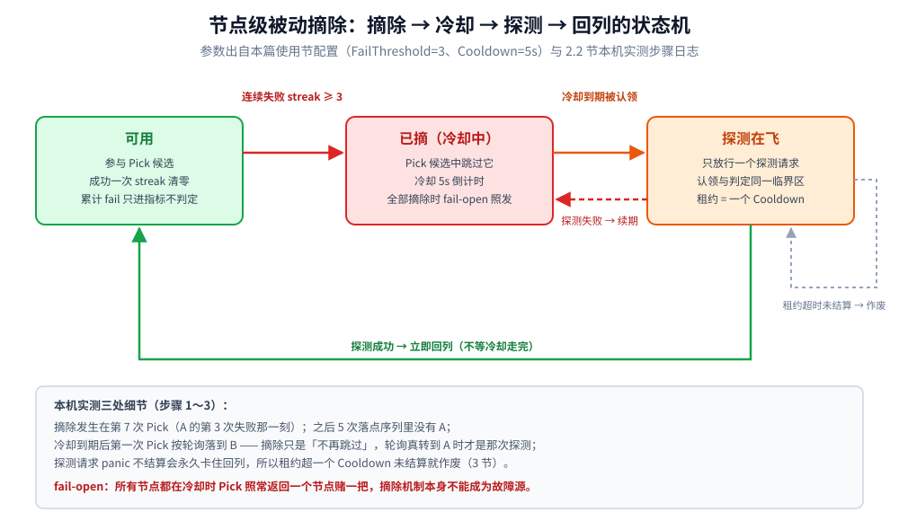
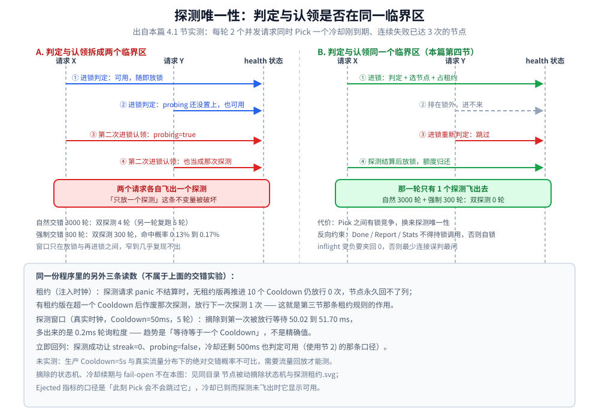
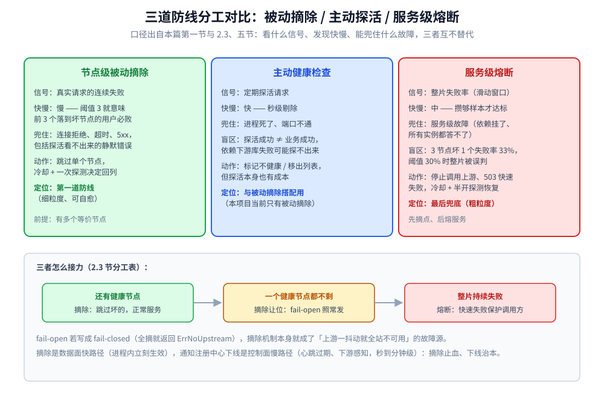

# 节点级被动摘除

> 服务级熔断只能回答「**这个服务**还能不能用」，答不了「这个服务里**哪个节点**坏了」。
> 一个服务有 3 个等价节点、挂了 1 个，按服务统计的失败率就是 33% —— 熔断阈值稍紧一点，
> 整个服务就被判死，另外 2/3 的健康容量白白丢弃。
> 节点级被动摘除补的就是这一层：**连续失败的节点先摘掉，冷却后用一次探测决定要不要放回来**。
>
> 内容整理自个人学习笔记，实测基于自研网关项目 [gateway](https://github.com/Eleven-26/gateway)（module `gwlab`，Go 1.26.5）的
> `internal/balancer/health.go` 与 `balancer.go`。
>
> ⭐ **分工**：本篇只讲**被动摘除**（靠真实流量的结果判定）；
> 服务级熔断的判定与调参见 [熔断器.md](熔断器.md)；
> 上游列表从哪来、注册与发现的机制见 [服务发现.md](../服务治理/服务发现.md)。

---

## 一、为什么需要节点级摘除？

**本节要点**：摘除要解决的是**粒度**问题 —— 服务级熔断的粒度太粗，一个坏节点会拖垮整片。

```text
服务 svc 有 A / B / C 三个等价节点，A 因为磁盘满了连接超时
   请求按轮询落到 A 的概率 = 1/3 → 失败率 33%
   若熔断阈值 = 30%  →  整个 svc 被熔断
   结果：B 和 C 明明是健康的，也一起被拒绝了
```

⭐ 关键在于**两种故障要分开处理**：

| 故障形态 | 正确响应 | 用错机制的后果 |
|---|---|---|
| **单个节点坏**（A 磁盘满 / 进程僵死） | 摘掉 A，流量走 B、C | 按服务熔断 → 放弃全部容量 |
| **整个服务坏**（依赖的数据库挂了，所有实例都答不了） | 熔断整个服务，快速失败 | 只摘节点 → 摘到全摘，最后还得靠 fail-open 硬撑 |

所以两者是**两级防线**：节点级摘除在前（细粒度、可自愈），服务级熔断在后（粗粒度、兜底）。

## 二、三条最容易做错的规则

### 2.1 计数要按「连续」失败，不是累计

**本节要点**：累计失败数只增不减，一个长期运行的节点迟早会被历史失败摘掉。

```go
// failures 只进指标，不参与判定
failures atomic.Int64
// streak 才是判定依据：成功一次立刻清零
streak int
```

本机实测（`FailThreshold=0` 表示不启用，此时只累计）：

```text
步骤 5：FailThreshold=0 → 摘除整体不启用（只累计失败）
  节点: A:19001[可用,fail=5] B:19002[可用,fail=5]
```

⭐ 注意 `fail=5` 但**状态仍是「可用」** —— 累计值再高也不摘。
若拿累计值判定，一个跑了三天、失败 200 次的节点会被永久摘掉，而它可能只是每天抖一下。

### 2.2 摘了必须有冷却 + 探测

**本节要点**：摘除**不能是单向操作**。摘了不放回 = 把一次网络抖动放大成永久的容量损失。

规则是「**冷却期内跳过 → 冷却到期只放行一个探测 → 探测成功才回列，失败则续期冷却**」。

```text
步骤 1：让 A 连续失败 3 次（其余请求打到谁就成功）
  第 1 次 Pick → A:19001  report=false   节点: A:19001[可用,fail=1] B:19002[可用,fail=0] C:19003[可用,fail=0]
  第 2 次 Pick → B:19002  report=true    节点: A:19001[可用,fail=1] B:19002[可用,fail=0] C:19003[可用,fail=0]
  第 3 次 Pick → C:19003  report=true    节点: A:19001[可用,fail=1] B:19002[可用,fail=0] C:19003[可用,fail=0]
  第 4 次 Pick → A:19001  report=false   节点: A:19001[可用,fail=2] B:19002[可用,fail=0] C:19003[可用,fail=0]
  第 5 次 Pick → B:19002  report=true    节点: A:19001[可用,fail=2] B:19002[可用,fail=0] C:19003[可用,fail=0]
  第 6 次 Pick → C:19003  report=true    节点: A:19001[可用,fail=2] B:19002[可用,fail=0] C:19003[可用,fail=0]
  第 7 次 Pick → A:19001  report=false   节点: A:19001[已摘,fail=3] B:19002[可用,fail=0] C:19003[可用,fail=0]
  第 8 次 Pick → B:19002  report=true    节点: A:19001[已摘,fail=3] B:19002[可用,fail=0] C:19003[可用,fail=0]

步骤 2：再 Pick 5 次 —— A 应完全不被选中
  落点序列: [C:19003 B:19002 B:19002 C:19003 B:19002]
  节点: A:19001[已摘,fail=3] B:19002[可用,fail=0] C:19003[可用,fail=0]

步骤 3：冷却到期 → 放行一个探测；探测成功 → 回列
  冷却后的第 1 次 Pick → B:19002
  节点: A:19001[可用,fail=3] B:19002[可用,fail=0] C:19003[可用,fail=0]
```

⭐ 三处细节：

1. **摘除发生在第 7 次**（第 3 次失败的那一刻），之后 A 立刻从候选里消失 —— 步骤 2 的 5 次落点里没有 A；
2. **探测是「轮到它的时候」才发生的**：步骤 3 里冷却到期后的第一次 Pick 按轮询落到 B，
   所以 B 被正常调用；A 此时的状态是「不再被跳过」（`availableLocked` 返回 true），
   等轮询真的转到 A 时才成为那次探测；
3. ⚠️ **`Ejected` 这个指标的口径是「此刻 Pick 会不会跳过它」**，不是「这个节点被标记为坏」。
   冷却已到、探测还没飞出去时它显示「可用」——这正是判定的原意（它即将被放出去探测）。



### 2.3 全摘必须 fail-open

**本节要点**：如果**所有**节点都在冷却，摘除机制不能把服务打死 ——
此时「把请求发出去赌一把」永远好过「就地返回 503」。

```text
步骤 4：全部节点都摘掉 → fail-open（照常返回一个，而不是 ErrNoUpstream）
  全摘后 Pick → A:19001 ✅（fail-open，仍有节点可用）
  节点: A:19001[已摘,fail=6] B:19002[已摘,fail=6]
```

⭐ 这是摘除与熔断**最重要的分工**：

| 情形 | 谁负责 | 行为 |
|---|---|---|
| 还有健康节点 | 摘除 | 跳过坏的，正常服务 |
| 一个都不剩 | 摘除**让位** | fail-open，照常发请求（赌一把） |
| 整片持续失败 | **熔断** | 快速失败，保护调用方 |

如果 fail-open 写成 fail-closed（全摘就返回 `ErrNoUpstream`），
摘除机制本身就成了「上游一抖动就全站不可用」的故障源 —— 比不做摘除更糟。

## 三、探测租约：一个 panic 就能让节点永远回不了列

**本节要点**：「只放一个探测」这个约束要**防自己卡死**。

设想这个时序：

```text
冷却到期 → 请求 X 被认领为探测 → X 内部 panic → 编码时忘了 recover
   → 这次探测永远不 Report → 探测标记（probing）一直是 true
   → 后续所有请求都以为「探测还在飞」→ 这个节点再也回不了列
```

修法是给探测加**租约**：探测超过一个 `Cooldown` 仍未结算，就视为「那次探测丢了」，作废它、放行下一个。

```go
// 冷却已到，但上一个探测的租约还在有效期内 → 依然跳过
return !(n.probing && now.Sub(n.probeStart) < h.cooldown)
```

⭐ 两条经验：

- **任何「只允许一个 X」的机制，都要有超时作废**，否则一次异常就永久失效；
- **租约时长取 `Cooldown`** 是一个自洽的选择：既然冷却期都能忍，再多等一个冷却期也无妨。

## 四、并发口径：为什么这三步必须是一个原子动作

**本节要点**：「查健康 → 选节点 → 占用探测租约」必须在**同一个临界区**里完成。

```go
// 调用方必须持有 h.mu —— 认领必须与 availableLocked 的判定在同一个临界区里
func (h *health) acquireLocked(addr string) { ... }
```

不做成一个原子动作会怎样：

```text
两个并发请求同时到达
   A 判定「冷却已到、没有探测在飞」→ 可以选
   B 判定「冷却已到、没有探测在飞」→ 可以选
   → 两个都被当成「那唯一一个探测」放出去
   → 探测从 1 个变成 2 个，失去「极少量试探」的意义
```

所以 `health.mu` **同时是各算法 `Pick` 的临界区** —— 这不是偷懒，而是必需。
代价是 `Pick` 之间有锁竞争，换来的是「探测唯一性」这条不变量。

> ⚠️ **反向约束**：`Done` / `Report` / `Stats` 自己处理同步，**不得在持有 `h.mu` 时调用**（会自锁死）。

还有一个相关的防御值得一提：

```go
if n.inflight.Add(-1) < 0 {
    n.inflight.Store(0)   // 在 0 处夹住
}
```

配置热重载会重建均衡器（见 [配置热重载与快照.md](../../../01-编程语言/go/工程实践/配置热重载与快照.md)），
**重建前被 `Pick` 走的请求会回到新实例上 `Done`** —— 新实例没记过那次 `+1`，
于是计数被多减一次。计数变负会让「最少连接」把这个节点误判成最闲的，所以宁可少算也不能为负。

### 4.1 本机实测：拆开「判定」与「认领」会漏出多少探测

**本节要点**：把判定与认领拆成两个临界区之后，双探测在**自然调度**下 3000 轮只出现 4~5 轮（0.13%~0.17%），
但把交错**强制**出来就是 300 轮全中。概率低不等于不存在 —— 这类 bug 上线后表现为偶发的重复探测，
事后几乎复现不出来，所以只能靠「同一临界区」这条结构性约束钉死。

实测环境：`golang:1.26-bookworm` 容器（带 `-race`，`go1.26.8 linux/amd64`），
每轮起 2 个 goroutine 同时对**一个冷却刚到期**的已摘节点做 `Pick`；
「拆开版」判定与认领各进一次锁（中间留一个可插入观察点的位置），「合并版」两步共用一次加锁。
`FailThreshold=3`、`Cooldown=50ms`（用 50ms 小档位是为了让等待窗口可测，配置语义与 5s 相同）。

**第 1 轮**：

```text
=== B1 判定与认领拆成两个临界区（每轮 2 个并发请求，冷却刚到期）===
  自然交错 3000 轮：双探测 4 轮 · 单探测 2996 轮
  强制交错 300 轮：双探测 300 轮 · 单探测 0 轮

=== B2 判定与认领在同一个临界区（正文 §四 的做法）===
  自然交错 3000 轮：双探测 0 轮 · 单探测 3000 轮
  强制交错 300 轮：双探测 0 轮 · 单探测 300 轮

=== B3 探测请求 panic 不结算（注入时钟，每步推进一个 Cooldown）===
  无租约（probing 没人清）：摘除后继续推进 10 个 Cooldown，放行下一次探测的次数 = 0
  有租约（超一个 Cooldown 作废）：摘除后继续推进 10 个 Cooldown，放行下一次探测的次数 = 1

=== B4 摘除到第一次被放行的等待（真实时钟，Cooldown=50ms，连跑 5 轮）===
  第 1 轮：等待  50.91 ms 后放行探测
  第 2 轮：等待  51.70 ms 后放行探测
  第 3 轮：等待  50.87 ms 后放行探测
  第 4 轮：等待  51.08 ms 后放行探测
  第 5 轮：等待  51.18 ms 后放行探测

=== B5 探测成功后是否立刻回列（不等冷却走完）===
  探测成功 → streak=0、probing=false、冷却还剩 500ms 也放行：available=true
```

**第 2 轮**（独立复跑，只列会波动的两项；B1 强制交错与 B2、B3、B5 的结论与第 1 轮逐行一致）：

```text
  自然交错 3000 轮：双探测 5 轮 · 单探测 2995 轮
  B4 五轮等待：50.02 / 50.51 / 50.86 / 50.21 / 50.81 ms
```

| 读数 | 证明了 |
|---|---|
| B1 强制交错 300/300 | 判定与认领之间有窗口时，两个请求都自认是「那唯一一个探测」，探测数从 1 变 2 |
| B1 自然交错 4~5 / 3000 | 窗口只有 0.13%~0.17% 的命中概率 —— **偶发**正是它难查的原因 |
| B2 双探测 0/3300 | 「查健康 → 选节点 → 占租约」合进一个临界区后，探测唯一性成立 |
| B3：0 次 vs 1 次 | 租约超一个 `Cooldown` 作废，才是第三节「一次 panic 永久回不了列」的解药 |
| B4：50.02~51.70ms | 摘除到第一次放行的等待 = **一个 Cooldown**（多出来的是 0.2ms 轮询粒度）；只断言趋势 |
| B5：`available=true` | 成功立即回列，**不等冷却走完**（使用节 2) 的那条口径） |



> ⚠️ **本轮实测的边界**：进程内 2 个并发、`Cooldown=50ms` 档位的交错概率，
> 换成生产 `Cooldown=5s` 与真实流量分布后**绝对概率不可比**（需要流量回放才能测），本篇未实测；
> 可迁移的只有趋势 —— 拆开就漏、合上就 0，以及等待等于一个 `Cooldown`。

## 五、和主动健康检查、服务级熔断怎么分工？

**本节要点**：这三种机制互相不能替代。

| 机制 | 判定依据 | 发现快慢 | 能发现什么故障 |
|---|---|---|---|
| **节点级被动摘除** | 真实请求的失败 | 慢（要等真实请求失败 N 次） | 影响业务的故障（连接拒绝、超时、5xx） |
| **主动健康检查** | 定期探活请求 | 快 | 进程死了、端口不通；**但对「静默错误」可能探不出来** |
| **服务级熔断** | 整片失败率 | 中 | 服务级故障（依赖挂了、整片不可用） |

⭐ **被动摘除的固有代价**：它**必须等到真实请求失败**才能判定 ——
`FailThreshold=3` 就意味着**前 3 个落到那个坏节点上的用户必然失败**。
主动健康检查能把「进程已经死了」这类故障的窗口压到秒级，但探活本身也有成本，
而且探活成功不代表业务请求能成功（例如依赖的下游库连不上）。

**实践做法是两者都上**：主动探活负责快速剔除「死掉」的节点，
被动摘除负责兜住「探活看不出来、但业务确实在失败」的节点。

> ⚠️ 本项目当前**只有被动摘除**（没有主动探活），这是刻意的取舍：
> 教学重点在「怎么用真实结果判定」。生产上两者通常并存。



## 使用：给一个多节点服务开摘除

**本节要点**：配置只有 2 个字段，但「阈值取多少」取决于你对**失败代价**的判断。

### 1) 配置

```json
{
  "services": {
    "order-svc": {
      "balance": "round_robin",
      "upstreams": [
        { "addr": "127.0.0.1:19001" },
        { "addr": "127.0.0.1:19002" },
        { "addr": "127.0.0.1:19003" }
      ],
      "ejection": { "fail_threshold": 3, "cooldown": "5s" }
    }
  }
}
```

### 2) 判定规则（一条完整路径）

```text
一次请求结束
 ├─ 成功 → streak = 0、立即回列（不必等冷却走完）
 └─ 失败 → 累计 fail+1（只进指标）、streak+1
        └─ streak ≥ FailThreshold → 摘到 now + Cooldown
              └─ 冷却期内再失败 → 续期（streak 不清零，所以必然 ≥ 阈值）
```

⚠️ **成功是「立即回列」而不是「等冷却走完」**：既然探测已经成功了，就没有理由再让它等。

### 3) 两个参数怎么取

| 参数 | 作用 | 取大 | 取小 |
|---|---|---|---|
| `FailThreshold` | 连续失败几次摘除 | 摘得稳，但坏节点多吃流量 | 摘得快，一次抖动就误伤 |
| `Cooldown` | 摘多久 | 坏节点不会反复被探；但真恢复了也回不来 | 恢复快；若上游恢复比它慢，会反复「探测—失败—续期」 |

⭐ 一条组合口径：**`Cooldown` 应 ≥ 上游典型故障的恢复时间**。
若上游重启要 20 秒而 `Cooldown=5s`，就会每 5 秒探一次、每次都失败续期 ——
上游重启期间持续被探测流量骚扰。

### 4) 三个必踩的坑

| 情况 | 现象 | 判定 |
|---|---|---|
| **`FailThreshold` 配了 0** | 摘除整体不启用（fail-open 永真） | 可以接受，但要在日志里说清楚 —— 否则运维以为摘除开着 |
| **`FailThreshold` 配了但 `Cooldown` 是 0** | 「摘除到期」与「摘除瞬间」同一时刻 → 立刻被当成探测放行 → **摘除静默失效** | 必须兜底一个非零默认值（本项目兜底 1s）；静默失效比保守默认值危险得多 |
| **只 `Pick` 不 `Done`** | 在途计数只增不减 → 最少连接永久判定该节点最忙 | `Pick`/`Done` 必须成对；本项目用测试钉住（`TestLeastConnPickDonePaired`） |

## 延伸追问

- **节点摘除了，为什么不直接告诉注册中心把它下线？** → 可以，但那是**控制面**的慢路径
  （要经过注册中心的健康检查、心跳过期、下游客户端感知，通常秒到分钟级）。
  摘除是**数据面**的快路径，在进程内立刻生效。两者是互补的：摘除止血，下线治本。
- **摘除计数为什么要「成功一次就清零」，而不是「成功率低于多少才恢复」？** →
  恢复的判据越复杂，越容易出现「永远不满足恢复条件」的僵局。
  「连续失败」的对偶就是「一次成功」，规则简单且必然可达。
- **`Ejected` 指标显示「可用」但流量还是在失败，怎么排查？** →
  先确认它是**服务级熔断**还是**节点级摘除**在生效（看 `circuit_open` 与摘除指标）；
  再看 `FailThreshold` 是不是配成了 0（摘除根本没开）。
- **探测流量会不会把正在恢复的上游再打死？** → 会，所以 `HalfOpenMax` / 「只放一个探测」
  这类上限是必需的；同时 `Cooldown` 不能太短，否则探测本身变成持续负载。
- **为什么不做「摘除后按失败次数递减权重」这种渐进方案？** →
  权重递减是**灰度**，不是**止损**：坏节点仍然会分到流量、继续失败。
  摘除的目标是「立刻把已知坏的节点移出候选集」，要的就是非黑即白。
- **`Done` 里那个「负数夹紧」会不会掩盖真的 bug？** → 会掩盖「多还一次」这类计数错误，
  但代价可控（少算在途 → 最坏情况是调度略偏）；而负数会**直接破坏调度语义**（节点被永久判为最闲）。
  两害相权取其轻。

## 关联

- [熔断器.md](熔断器.md) — 服务级熔断：粗粒度、兜底；与摘除是两级防线
- [服务发现.md](../服务治理/服务发现.md) — 上游列表从哪来、注册 / 发现 / 健康检查的分工
- [README.md](README.md) — 稳定性目录导读：节点摘除在整条防线里的位置
- [降级.md](降级.md) — 整片下游不可用时的业务兜底
- [从零实现网关.md](../../../01-编程语言/go/网络编程/从零实现网关.md) — 四种负载均衡算法的实现（摘除状态在它们之间是共享的）
- [配置热重载与快照.md](../../../01-编程语言/go/工程实践/配置热重载与快照.md) — 重建均衡器时摘除计数为什么会丢、为什么可以接受
- [网关选型对比.md](../../../03-数据与中间件/中间件/网关与代理/网关选型对比.md) — 各家网关的健康检查能力对照
> 反向引用（本篇被下列文档引到）：[负载均衡.md](../服务治理/负载均衡.md)、[多副本共享状态.md](多副本共享状态.md)、[负载保护.md](负载保护.md)
