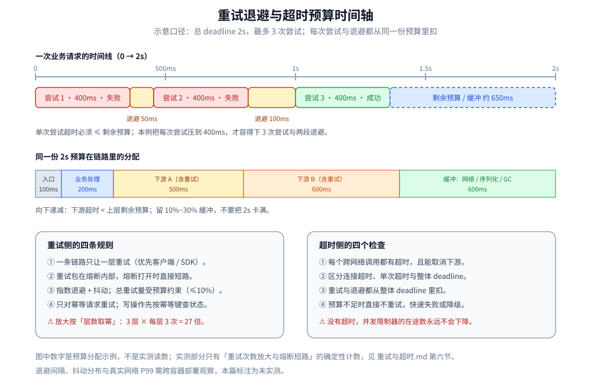
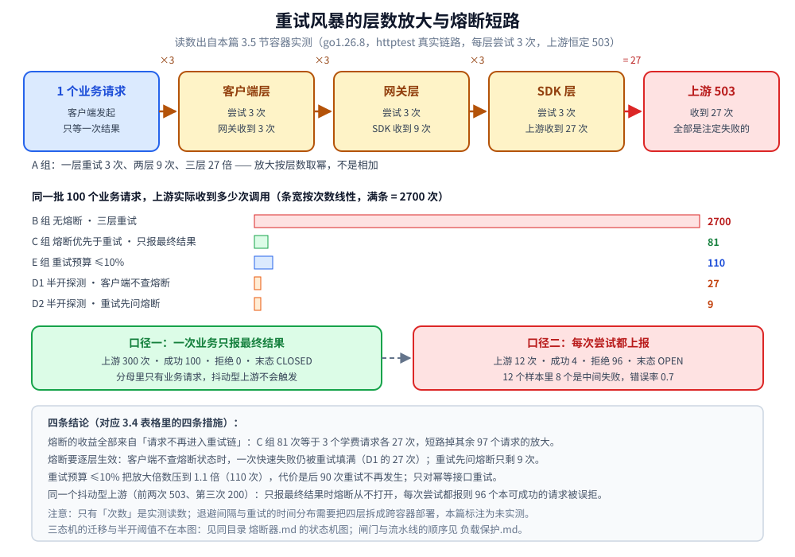

# 重试与超时

> 覆盖：重试为什么会把故障放大、应该放在哪一层、退避与抖动怎么设计、重试预算与幂等边界；超时的预算分配、deadline 传播，以及超时与重试 / 熔断 / 并发限制的配合。含四层重试链路的实测读数。
>
> 不覆盖：限流与并发闸门见 [限流算法.md](限流算法.md)、[并发限制器.md](并发限制器.md)、[负载保护.md](负载保护.md)；熔断三态机与参数见 [熔断器.md](熔断器.md)；降级策略见 [降级.md](降级.md)；四者的整体分工见 [README.md](README.md)。
>
> 内容整理自个人学习笔记，并参考 Google SRE 与 Envoy 的重试 / 超时实践，素材见 [素材清单](../../../素材清单.md)。
>
> 📎 **实测口径**：第六节的 A～F 六组读数在 `golang:1.26-alpine` 容器（`go1.26.8`）里用四条真实 HTTP 链路测得，上游恒定返回 503，连跑 3 轮输出逐行一致（计数是确定性的）。**时间维度未实测**：退避间隔、抖动分布与真实网络下的 P99 变化需要跨容器部署，本篇只给设计口径。

---

## 一、为什么重试会把小故障放大成雪崩？

**本节要点**：重试的代价不是「多一次请求」，而是**按层数取幂**。一层 3 倍，三层就是 27 倍。

```text
下游故障 → 调用失败 → 重试 3 次 → 流量放大 3 倍
        → 下游更慢 → 更多失败 → 更多重试 = 重试风暴
```

| 参与重试的层数 | 上游实际收到的请求（每次业务调用） | 放大倍数 |
| --- | --- | --- |
| 1 层（只有客户端） | 3 | 3 |
| 2 层（客户端 + SDK） | 9 | 9 |
| 3 层（客户端 + SDK + 网关） | 27 | 27 |

⭐ 关键结论：

1. **放大看的是「有几层在重试」，不是「每层重试几次」**——减少一层，比把每层从 3 次降到 2 次更有效。
2. **下游越慢，重试越糟**：超时触发重试，重试又占用下游资源，把「慢」推成「不可用」。
3. **重试必须被熔断短路**：熔断打开后，请求根本不应进入重试链。

## 二、重试应该放在哪一层，包在谁里面？

**本节要点**：一条链路上只让**一层**做重试，并且重试要包在熔断器**内部**、每一层都要先问熔断状态。

| 放置位置 | 适合重试的情况 | 不适合 | 说明 |
| --- | --- | --- | --- |
| **客户端 / SDK（最靠近下游）** | ⭐ 默认选择 | 非幂等写操作 | 最了解下游拓扑，能区分「请求没发出去」与「发出去了但没响应」 |
| **网关** | 只对幂等请求、且下游明确支持 | 全量兜底重试 | 网关重试会乘以所有调用方，最容易放大 |
| **服务端内部** | 本地可重试的操作（如 DB 死锁） | 已经跨网络调用的下游 | 必须有次数上限与退避 |
| **消息消费者** | 消费失败重投 | 毒消息无限重投 | 要配重试上限 + 死信队列 |

⭐ 两条硬规矩：

1. **重试包在熔断器内部**：重试的每次尝试都算熔断统计的一次调用；熔断打开时直接短路，不再重试。
2. **上报熔断的是「最终结果」**：一次业务请求重试 3 次才成功，只上报一次成功；中间失败也上报会把错误率推高，导致误熔断。

> ⚠️ 「客户端不感知熔断、仍然重试 3 次」与「重试前先问熔断」的差别是实测过的：前者上游仍收到 27 次调用，后者只有 9 次，见第六节 D 组。

## 三、退避与抖动怎么设计？

**本节要点**：重试间隔必须**递增**且**带随机抖动**，否则所有失败请求会在同一时刻再次聚集，形成第二波洪峰。

| 策略 | 间隔公式 | 特点 | 适用 |
| --- | --- | --- | --- |
| **固定间隔** | `interval` | 最简单，但会在同一时刻聚集 | 几乎不推荐 |
| **线性退避** | `base × n` | 比固定好，仍可能同步 | 低频、少量重试 |
| **指数退避** | `base × 2^n` | ⭐ 常用，快速拉开间隔 | RPC / HTTP 调用 |
| **全抖动（Full Jitter）** | `random(0, base × 2^n)` | ⭐ 打散最彻底 | 高并发客户端 |
| **等抖动（Equal Jitter）** | `base × 2^n / 2 + random(0, base × 2^n / 2)` | 保留最小等待，又有随机性 | 需要保底间隔 |
| **去相关抖动（Decorrelated Jitter）** | `random(base, 上次间隔 × 3)` | 避免多客户端同步，间隔有上界 | AWS 推荐 |

⭐ 三个参数：

| 参数 | 怎么定 |
| --- | --- |
| `base` | 从下游 P99 的量级起步（如 50~200ms），不要从 1s 起 |
| `max` | 通常 1~10s；必须小于整体超时预算 |
| `maxAttempts` | 2~3 次足够；次数越多，放大越严重 |

> ⚠️ 抖动不能替代限流：抖动只是把重试**摊开**，重试总量仍然会放大。总量要靠重试预算（第四节）约束。



## 四、重试预算怎么定？

**本节要点**：重试预算（retry budget）限制的是**重试请求占总请求的比例**，而不是单次请求的重试次数；它给整个系统一个重试总量的上限。

| 口径 | 做法 | 效果 |
| --- | --- | --- |
| **按请求次数** | 每次业务请求最多重试 N 次 | 单请求可控，但层数多时仍会乘性放大 |
| **按比例（retry budget）** | 重试数 ≤ 总请求数 × 10% | ⭐ 系统级封顶，放大倍数 ≤ 1.1 |
| **按令牌桶** | 重试消耗独立令牌，桶空即不重试 | 平滑、可跨实例共享 |

⭐ 推荐组合：**每请求限次数 + 系统级重试预算 + 指数退避抖动**。

> 📌 10% 是常见起点（Envoy / Google SRE 实践），不是固定答案：读多写少、下游冗余度高的系统可以放宽；写链路、资金链路应更保守甚至不自动重试。

## 五、哪些请求可以重试？

**本节要点**：重试的前提是**幂等**。非幂等写操作的重试会造成重复扣款、重复下单，比失败本身更糟。

| 请求类型 | 能不能重试 | 条件 |
| --- | --- | --- |
| `GET` / 查询 | ✅ 可以 | 无副作用 |
| `PUT` / `DELETE`（幂等语义） | ✅ 可以 | 服务端真的实现了幂等 |
| `POST` 创建订单 / 支付 | ⚠️ 谨慎 | 必须带幂等键（订单号 / requestId）+ 唯一索引 |
| 库存扣减 | ⚠️ 谨慎 | 条件更新 + 幂等键；不能盲目重试 |
| 4xx 参数错误 / 业务拒绝 | ❌ 不要重试 | 重试结果不会变 |
| 5xx / 连接失败 / 超时 | ✅ 通常可以 | 先区分「请求有没有发出去」；超时可能已成功 |

⭐ 超时是最难的一类：**请求可能已经到了下游并执行成功，只是响应没回来**。所以：

1. 写操作超时后，先查状态（按幂等键 / 业务单号），确认没成功再重试。
2. 不能查状态的写操作，宁可不重试，交给对账或人工处理。
3. 重试与补偿都必须幂等：唯一索引是最后一道闸门。

## 六、四层链路的放大与短路实测

**本节要点**：第一节的放大链不是修辞。把「客户端 → 网关 → SDK → 上游」四层真实 HTTP 链路跑起来、数每一层实际收到的调用次数，放大倍数是**层数的幂**而不是相加；而熔断能省下多少，取决于**重试有没有被熔断短路**和**上报的是最终结果还是每次尝试**。

实测环境：`golang:1.26-alpine` 容器（`go1.26.8 linux/amd64`），四层服务用 `httptest` 跑在同一进程内、之间走 `127.0.0.1` 的真实请求与响应；上游恒定返回 503，每一层的策略都是「失败就重试，最多尝试 3 次」。连跑 3 轮，输出逐行一致（计数是确定性的，不受调度波动影响）。

```text
=== A. 一次业务调用的放大链（每层尝试 3 次，上游恒定 503）===
  参与重试的层数 1 → 上游  3 次 · SDK  0 次 · 网关  0 次
  参与重试的层数 2 → 上游  9 次 · SDK  3 次 · 网关  0 次
  参与重试的层数 3 → 上游 27 次 · SDK  9 次 · 网关  3 次

=== B. 100 个业务请求，三层重试，无熔断 ===
  业务 100 → 上游 2700 次 · SDK 900 次 · 网关 300 次（3^3 = 27 倍）

=== C. 同样 100 个请求，网关侧加熔断（重试包在熔断内部，只报最终结果）===
  第 3 个业务请求后熔断打开 → 累计上游 81 次 · SDK 27 次
  100 个请求跑完：上游共 81 次（对照 B 的 2700 次，短路掉 97 个请求的 27 倍放大）

=== D. 熔断打开时「重试有没有被短路」===
  D1 客户端不感知熔断（仍重试 3 次）→ 上游 27 次 · SDK 9 次 · 网关 3 次
      第 2 次重试被熔断短路（OPEN，快速失败）
  D2 重试先问熔断（熔断优先于重试）→ 上游 9 次 · SDK 3 次 · 网关 1 次

=== E. 重试预算 ≤10%：100 个业务请求，重试总次数封顶 10 ===
  上游共 110 次（100 首次 + 10 次重试 = 110，放大倍数只有 1.1 倍）

=== F. 上报粒度：中间失败也计入，会不会误熔断？===
    熔断按 3.2 节的比率口径：窗口 20、错误率阈值 50%、最小请求数 10
  口径一（报最终结果）  ：上游 300 次 · 业务成功 100 · 被熔断拒绝   0 · 末态 CLOSED
      第 4 个业务请求后熔断打开（累计上报 12 次尝试）
  口径二（每次尝试都报）：上游 12 次 · 业务成功   4 · 被熔断拒绝  96 · 末态 OPEN
  同一个上游、同一批请求：口径二一共上报 12 次，其中 8 次是同一业务里的中间失败
  差异：口径一从不打开（每个业务的最终结果都是成功），口径二在攒够 10 个样本后打开，96 个本可成功的请求被误拒
```

F 组换了一个**抖动型上游**：同一个业务请求的前两次调用返回 503、第三次返回 200 —— 只要重试到位，业务其实都能成功。这正是「中间失败该不该进分母」最难受的场景。

| 读数 | 证明了 | 对应哪条措施 |
|---|---|---|
| A：3 / 9 / 27 | 放大按**层数取幂**，一层 3 倍、三层 27 倍 | 层数比次数更要紧，指数退避救不了多层重试 |
| C 对 B：81 次 vs 2700 次 | 熔断打开后请求根本进不了重试链，省掉的正是那 27 倍 | **熔断优先于重试** |
| D1 vs D2：27 次 vs 9 次 | 客户端不查熔断状态时，「快速失败」又被重试填满了 | 重试包在熔断器**内部**，且每一层都要问熔断 |
| E：110 次 | 预算封顶后放大倍数只有 1.1，代价是后 90 次不再重试 | **重试预算 ≤10%** |
| F：96 个误拒 vs 0 个 | 中间失败进分母会把错误率从 0 推到 0.7，越过 50% 阈值 | 上报**最终结果**而不是每次尝试 |



⚠️ **本轮只实测了「次数」这一维**：放大倍数与上报粒度都是确定性计数，可以精确比较；而重试的**时间**行为（退避间隔、加抖动后的重试分布、真实网络下 P99 怎么变）需要把四层拆成跨容器部署才能观察，本篇**未实测**。熔断自身的阈值触发与半开恢复实测见 [熔断器.md](熔断器.md) 2.3 节。

## 七、超时应该加在哪一步，预算怎么分配？

**本节要点**：超时不是「随便配个 3 秒」，而是一条**从入口向下递减、且要扣掉重试消耗**的时间预算。

### 7.1 三种超时不要混

| 超时 | 管什么 | 典型位置 |
| --- | --- | --- |
| **连接超时** | 建连阶段最长等多久 | HTTP Client / DB 连接池 |
| **单次请求超时（read / total） | 一次调用的总时长 | RPC / HTTP Client |
| **整体 deadline** | 整个业务请求（含重试、排队、下游多跳）的总预算 | 入口 / 上层调用方 |

⭐ 前两者是**手段**，整体 deadline 才是**对用户的承诺**。没有整体 deadline，单次超时会随着重试次数累加，最终远超用户能接受的时间。

### 7.2 预算怎么分

```text
用户可接受的总时长（如 2s）
  ├─ 入口排队 / 鉴权 / 限流：100ms
  ├─ 业务处理：200ms
  ├─ 下游调用 A：500ms（含最多 2 次重试）
  ├─ 下游调用 B：600ms
  └─ 缓冲：600ms（序列化、网络抖动、GC）
```

| 原则 | 说明 |
| --- | --- |
| **向下递减** | 下层超时必须小于上层的剩余预算，否则上层已经超时，下层还在干活 |
| **留缓冲** | 预算不要卡到 100%，给网络与调度留 10%~30% |
| **重试扣预算** | 每次重试都从剩余预算里扣；预算不足时直接不重试 |
| **超时要能取消下游** | deadline 通过 `context` / gRPC deadline / 请求头传播，调用方超时后下游应停止无意义的工作 |

### 7.3 没有超时会发生什么？

| 缺失 | 后果 |
| --- | --- |
| 调用下游没超时 | 下游 hang 住 → 连接与线程/协程被永久占用 → 连接池耗尽 |
| 并发限制器没超时 | 在途数永不下降，闸门永久占满（见 [并发限制器.md](并发限制器.md) 5.4） |
| 重试没有总预算 | 单次超时 × 重试次数，用户等待时间成倍增长 |
| 下游没有接收 deadline | 上游已经放弃，下游还在继续执行，浪费资源甚至产生重复写 |

> ⚠️ 「超时」与「取消」是两件事：超时只是调用方不再等；只有把取消信号传下去，下游才会真的停下来。

## 八、超时、重试、熔断、并发限制怎么配合？

**本节要点**：四者是一条接力链，**超时是所有机制的前提**——没有超时，在途数不会下降，熔断统计也永远等不到失败。

| 顺序 | 组件 | 作用 |
| --- | --- | --- |
| ① | **超时** | 给每次调用一个上界，释放连接 / 线程 / 在途名额 |
| ② | **重试** | 对可恢复的瞬时失败再试，受次数、退避、预算约束 |
| ③ | **熔断** | 下游持续失败时直接短路，**短路重试** |
| ④ | **降级** | 熔断 / 限流 / 重试耗尽后，给业务一个兜底结果 |
| ⑤ | **并发限制 / 负载保护** | 控制同时在途的数量，防止慢请求堆积 |

⭐ 四条配合规则：

1. **重试包在熔断内部**，熔断打开时不再重试。
2. **重试必须在整体 deadline 内**，预算不够就不重试。
3. **超时是并发限制器的回收条件**：没有超时，acquire 的许可永远不会 release。
4. **重试耗尽后才降级**，且降级返回要能区分「临时失败」与「业务拒绝」。

## 九、应用场景

**本节要点**：重试与超时不是「基础设施统一配一下」就完事——不同链路的幂等性、用户等待意愿和故障形态不同，策略必须分场景。

| 场景 | 重试策略 | 超时策略 | 本仓落点 |
| --- | --- | --- | --- |
| **网关 / RPC 客户端** | 只对幂等请求重试；指数退避 + 抖动 + 预算 | 每次调用有超时，整体 deadline 向下传播 | [从零实现网关.md](../../../01-编程语言/go/网络编程/从零实现网关.md)、[HTTP客户端与连接池.md](../../../01-编程语言/go/网络编程/HTTP客户端与连接池.md) |
| **支付回调 / 通知** | 固定或指数退避多次重投，必须幂等 | 单次通知超时短，重投周期可长 | [支付系统设计.md](../../系统设计/秒杀系统/支付系统设计.md) |
| **消息消费** | 有限次重投 + 死信队列 | 消费超时要小于可见性超时，避免重复消费 | [消息可靠性.md](../../../03-数据与中间件/中间件/消息队列/RocketMQ/消息可靠性.md) |
| **秒杀 / 库存扣减** | ⚠️ 不盲目重试；先按幂等键查结果 | 快速失败，避免请求堆积 | [库存系统设计.md](../../系统设计/秒杀系统/库存系统设计.md) |
| **数据库死锁 / 乐观锁冲突** | 有限次重试 + 退避，重试放在事务边界之外 | 单次事务超时，避免长事务 | [写冲突控制的Go落地.md](../../../01-编程语言/go/工程实践/写冲突控制的Go落地.md) |
| **移动端 / 浏览器** | 尊重 `Retry-After`，加抖动，限制次数 | 用户可感知的总时长优先 | [限流算法.md](限流算法.md) |

## 十、具体使用

**本节要点**：落地时先定**整体 deadline**，再倒推每跳超时与重试次数；配置项要能表达「次数、退避、预算、哪些错误可重试」。

### 10.1 一份可抄的超时预算

| 层级 | 超时 | 重试 | 说明 |
| --- | --- | --- | --- |
| 入口（网关） | 2s | 不重试 | 用户可接受的上限 |
| 业务服务 A | 1.5s | 只读接口最多 2 次 | 留 500ms 给上层返回 |
| 下游服务 B | 800ms | 最多 2 次，指数退避 50ms 起 | 总重试时间不超过剩余预算 |
| 数据库 | 300ms | 死锁重试 1 次 | 长事务另设上限 |

### 10.2 配置里必须有的字段

```yaml
retry:
  max_attempts: 2          # 首次之外最多再试 2 次
  backoff: exponential     # fixed / linear / exponential
  base_interval: 50ms
  max_interval: 1s
  jitter: full             # none / full / equal
  retry_budget_ratio: 0.1  # 重试数不超过总请求数的 10%
  retry_on: [connect_failure, timeout, 503]
  do_not_retry_on: [400, 401, 403, 404, 409, 422]

timeout:
  connect: 200ms
  per_attempt: 500ms
  overall_deadline: 2s
```

### 10.3 上线检查清单

```text
1. 每个跨网络调用都有超时，且超时能取消下游
2. 一条链路只有一层重试，重试在熔断内部
3. 只对幂等请求重试；写操作有幂等键或状态查询
4. 重试有次数上限、退避、抖动、系统级预算
5. 超时预算向下递减，整体 deadline 覆盖重试总耗时
6. 重试与超时都有指标：重试次数、超时次数、重试成功率、预算耗尽次数
```

## 延伸追问

- **为什么重试会放大 27 倍而不是 9 倍？** → 放大按**参与重试的层数取幂**：每层 3 次，三层就是 `3³ = 27`。减少一层重试比降低单层次数更有效。
- **重试应该放在客户端还是网关？** → 优先放在最靠近下游的客户端 / SDK，并只让一层重试；网关重试会乘以所有调用方，最容易放大。
- **熔断和重试谁先谁后？** → 重试包在熔断内部，熔断打开时直接短路重试；熔断统计上报「最终结果」，不是每次尝试。
- **重试预算 10% 是硬规定吗？** → 不是。10% 是常见起点，读多写少可放宽，写链路 / 资金链路应更保守甚至不自动重试。
- **超时和重试怎么配合？** → 先有整体 deadline，再倒推每跳超时与重试次数；每次重试都扣总预算，预算不足就不重试。
- **为什么没设超时会让并发限制器失效？** → 下游 hang 住时在途数永不下降，许可永远不释放，闸门会被永久占满。
- **超时后能直接重试写请求吗？** → 不能直接重试。超时可能意味着下游已经执行成功，只是响应丢了；先按幂等键查状态，确认没成功再重试。
- **抖动解决的是放大还是同步？** → 抖动只解决「重试请求在同一时刻聚集」，不减少重试总量；总量要靠重试预算约束。

## 关联

- **上游/总纲**：[README.md](README.md) — 稳定性目录导读：重试超时在防线里的位置
- **对照/互补**：[熔断器.md](熔断器.md) — 熔断如何短路重试，以及为什么上报粒度会误熔断
- **对照/互补**：[降级.md](降级.md) — 重试耗尽后的业务兜底与写降级补偿
- **对照/互补**：[并发限制器.md](并发限制器.md) — 超时是并发许可回收的前提；在途数限制与重试的相互作用
- **对照/互补**：[负载保护.md](负载保护.md) — 队列超时、准入失败与 `Retry-After` 的配合
- **实现/落地**：[稳定性组件的Go实现.md](../../../01-编程语言/go/工程实践/稳定性组件的Go实现.md) — Go 侧 breaker / limiter 的封装与超时接入
- **实现/落地**：[稳定性组件的Java实现.md](../../../01-编程语言/java/工程实践/稳定性组件的Java实现.md) — Java 侧 Resilience4j `Retry` / `TimeLimiter` 的配置
- **运维/配置**：[context.md](../../../01-编程语言/go/工程实践/context.md) — Go 的链路超时预算与级联取消

> 反向引用（本篇被下列文档引到）：[客户端负载均衡的Go实现.md](../../../01-编程语言/go/工程实践/客户端负载均衡的Go实现.md)、[消息可靠性.md](../../../03-数据与中间件/中间件/消息队列/RocketMQ/消息可靠性.md)、[负载均衡.md](../服务治理/负载均衡.md)
