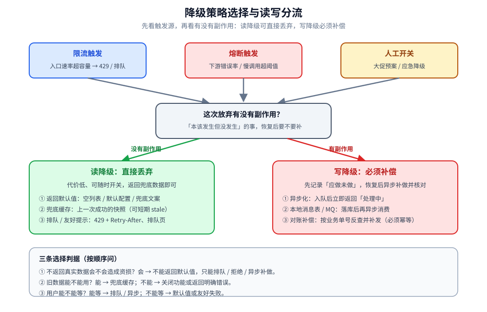

# 降级

> 覆盖：降级在稳定性防线里的定位、三种触发方式、五种降级策略、读降级与写降级的分界、预案设计与演练，以及生产上最容易踩的坑。
>
> 不覆盖：限流算法的原理与实测见 [限流算法.md](限流算法.md)；熔断器的三态机与参数怎么互相牵制见 [熔断器.md](熔断器.md)；重试与超时的配合见 [重试与超时.md](重试与超时.md)；四者在一条防线里的分工见 [README.md](README.md)。
>
> 内容整理自个人学习笔记，并参考《大型网站技术架构：核心原理与案例分析》（李智慧），素材见 [素材清单](../../../素材清单.md)。
>
> 📎 **实测口径**：本篇讲的是机制与方案取舍，**没有新的运行时实验**；引用的阈值与故障链来自同目录各篇已有的实测。需要跑起来观察的行为（熔断闭环、重试放大、并发闸门）分别见 [熔断器.md](熔断器.md)、[重试与超时.md](重试与超时.md)、[负载保护.md](负载保护.md)。

---

## 一、降级和限流、熔断到底是什么关系？

**本节要点**：降级不是第三道并列的开关，而是**前两道开关拒掉请求之后的业务答案** —— 限流和熔断决定「要不要放弃」，降级决定「放弃什么、返回什么」。

| 手段 | 保护对象 | 触发信号 | 直接后果 | 本质 |
| --- | --- | --- | --- | --- |
| **限流** | 自己（防过载） | 入口流量超过容量 | 多余请求被拒绝 / 排队 | 控制「进来多少」 |
| **熔断** | 自己（防被下游拖死） | 依赖的错误率 / 慢调用比例超阈值 | 一段时间内对该依赖直接快速失败 | 控制「出去多少」 |
| **降级** | 业务（保住核心链路） | 人工开关 / 熔断触发 / 限流触发 | 非核心功能关闭，返回兜底结果 | 决定「放弃什么」 |

> ⭐ 一句话区分：**限流是「我扛不住了，少来点」；熔断是「你不行了，我先不调你」；降级是「这个先不做了，把资源留给核心」。**
>
> 熔断和限流是**触发手段**，降级是**被触发后的业务表现**。熔断后没有降级逻辑，只会把「慢」变成「错」——用户从等很久变成立刻收到 500，体验并没有变好。

| 容易混淆的点 | 澄清 |
| --- | --- |
| 熔断 vs 降级 | 熔断是**框架层**的自动保护（打开后直接抛异常或快速失败）；降级是**业务层**的兜底方案（返回什么）。熔断常常**触发**降级，但降级也可由开关或限流独立触发 |
| 限流 vs 熔断 | 限流看**自身入口流量**；熔断看**调用结果**。限流通常长期生效，熔断是故障期的临时状态 |
| 降级 vs 快速失败 | 快速失败只是降级策略之一；降级还包括返回默认值、兜底缓存、异步化、关闭非核心功能等 |



## 二、降级由谁触发，什么时候该降？

**本节要点**：降级有三类触发源 —— **人、熔断器、限流器**。它们的差别不在「降不降」，而在**反应速度与可控性**。

| 触发方式 | 谁触发 | 典型时机 | 优点 | 缺点 |
| --- | --- | --- | --- | --- |
| **开关降级** | 人（配置中心 / 运维平台手动） | 大促前预防性降级、故障时应急 | ⭐ 最可控、可提前演练 | 依赖人的响应速度 |
| **熔断降级** | 熔断器自动（依赖故障） | 下游错误率 / 慢调用比例超阈值 | 全自动、反应快 | 只对「依赖调用」生效 |
| **限流降级** | 限流器自动（超阈值） | 入口 QPS 超容量 | 保护自身 | 被拒绝的请求仍需友好处理 |

⭐ 选择口径：

1. **可预见的容量问题用开关**：大促、活动、已知的洪峰，提前把推荐、广告、排行榜关掉，比等系统自己熔断更稳。
2. **不可预见的依赖故障用熔断**：下游什么时候坏无法预演，必须让框架自动判定。
3. **自身被打满用限流 + 降级**：限流负责挡住超额请求，降级负责给被挡的请求一个可接受的返回。

> ⚠️ 超时耗尽与重试耗尽最终也会走到降级，只是它们没有独立的「降级开关」——它们是调用链走到尽头后的兜底，见 [重试与超时.md](重试与超时.md) 第八节。

## 三、降成什么样：五种策略怎么选？

**本节要点**：降级策略的选择只看两件事 —— **这个功能是不是核心**、**返回旧数据 / 默认值业务能不能接受**。

| 策略 | 做法 | 适用 | 注意 |
| --- | --- | --- | --- |
| **返回默认值** | 返回空结果 / 默认配置 / 兜底文案 | 推荐位、评价数、个性化 | ⚠️ 默认值要业务可接受，不能是空指针或非法值 |
| **兜底缓存** | 返回上一次成功的缓存快照（可设计成短期 stale 缓存） | 商品详情、价格、配置 | 要有缓存更新与过期策略，并标明数据可能陈旧 |
| **异步化** | 同步改异步：请求入队，立即返回「处理中」 | 非实时流程（发券、通知） | 需要结果查询入口与最终一致性保障 |
| **关闭非核心功能** | 停掉推荐、广告、埋点、排行榜 | ⭐ 大促最常用，资源让给交易链路 | 必须提前梳理「哪些能关、关了谁受影响」 |
| **排队 / 友好提示** | 返回排队页、「稍后再试」、429 状态码 | 抢购、秒杀 | ⭐ 比白屏或 500 的体验好得多 |

⭐ 三条选择判据：

1. **先问「不返回真实数据会不会造成资损」**：会 → 不能返回默认值，只能排队、拒绝或异步补做。
2. **再问「旧数据能不能用」**：能 → 兜底缓存；不能 → 关闭功能或返回明确错误。
3. **最后问「用户能不能等」**：能等 → 排队 / 异步；不能等 → 默认值或友好失败。

## 四、读降级和写降级的界线在哪？

**本节要点**：判断标准只有一条 —— **降级后有没有产生「本该发生但没发生」的副作用**。有副作用就必须补偿，没有就可以直接丢弃。

- **读降级**：代价低、可随时开关，直接返回兜底数据即可，是最常见的降级。
- **写降级**：⚠️ 必须配合补偿机制 —— 请求落本地消息表 / MQ，降级期间异步补做，恢复后对账。

| 例子 | 降级动作 | 要不要补偿 | 为什么 |
| --- | --- | --- | --- |
| 商品详情页推荐位 | 返回空列表或热门兜底 | 不需要 | 少一条推荐不产生业务副作用 |
| 下单时积分服务不可用 | 先落「待发放积分」记录 | ⭐ 需要 | 积分是用户应得的，恢复后必须补发 |
| 支付回调通知失败 | 落重试表 / MQ，延迟重投 | ⭐ 需要 | 通知不到会导致订单状态与支付状态不一致 |
| 发券活动 | 请求入队，返回「发放中」 | ⭐ 需要 | 券是稀缺资源，必须有最终发放结果与对账 |

> ⚠️ 写降级的补偿必须**幂等**：补偿可能重复执行，落库要有唯一键或幂等表，否则会把「少发」变成「多发」。

## 五、降级预案怎么设计才真的能用？

**本节要点**：预案的价值不在「写了多少条」，而在**故障当晚能不能被找到、被打开、被验证**。

1. **先识别核心链路**：画出「用户能完成主流程的最短路径」（如 加购 → 下单 → 支付），路径外的都是可降级项。
2. **开关粒度要分层 + 可动态下发**：全局 / 服务 / 接口 / 参数级开关（如「只降级 skuId=X 的推荐」），配置中心推送、秒级生效，不能靠发版。
3. **⭐ 定期演练**：预案没演练过等于没有。大促前做一次全链路降级演练 + 故障注入，验证开关真的生效、业务真的可用。
4. **降级要有监控和告警**：降级开关被打开、熔断状态变化必须告警，否则「静默降级」会掩盖真实故障。

⭐ **静默降级是最危险的降级**：降级逻辑生效了、系统看起来正常、但业务能力已经缺失，却没有任何指标能看出来。至少要有三类信号：

| 信号 | 说明 |
| --- | --- |
| 降级开关状态 | 哪个开关、什么时候、被谁打开 |
| 降级命中次数 | 每个兜底分支各被走了多少次 |
| 核心业务指标 | 下单成功率、支付成功率是否同步下降 |

## 六、应用场景

**本节要点**：降级几乎出现在每一个「有流量、有依赖、有非核心功能」的系统里，差别只在**降什么**和**由谁触发**。

| 场景 | 降级对象 | 触发方式 | 本仓落点 |
| --- | --- | --- | --- |
| **秒杀 / 大促** | 推荐、广告、排行榜等非核心功能 | 人工开关 + 限流触发 | [总体设计.md](../../系统设计/秒杀系统/总体设计.md)、[支付系统设计.md](../../系统设计/秒杀系统/支付系统设计.md) |
| **IM 接入层** | 非核心消息类型、富媒体能力 | 限流触发 + 开关 | [限流与防刷.md](../../系统设计/IM系统/限流与防刷.md) |
| **跨地域多活** | 切流到备用机房，关闭跨机房非核心调用 | 机房级故障开关 | [跨地域多活.md](../../系统设计/IM系统/跨地域多活.md) |
| **网关 / RPC 客户端** | 对故障下游返回兜底结果 | 熔断 + 超时触发 | [熔断器.md](熔断器.md)、[负载保护.md](负载保护.md) |
| **消息 / 异步链路** | 重复投递时的幂等兜底与补偿 | 重试耗尽 | [消息可靠性.md](../../../03-数据与中间件/中间件/消息队列/RocketMQ/消息可靠性.md) |
| **多副本共享状态不可用** | 限流 / 熔断退回本地判定 | 状态服务故障 | [多副本共享状态.md](多副本共享状态.md) |

⭐ 把上表读薄：**核心链路保正确，非核心链路保可用**。降级的本质是资源不够时的优先级排序，而不是「随便返回点什么」。

## 七、具体使用

**本节要点**：落地时只需要把三件事定义清楚 —— **开关怎么下发、兜底返回什么、怎么验证它真的生效**。

### 7.1 开关的分层与下发

```yaml
degrade:
  # 全局总开关：人工应急时一键关掉所有非核心能力
  global: false
  services:
    product-detail:
      # 服务级：关闭推荐模块，详情主信息照常返回
      recommend: false
      # 接口级：只对指定接口降级
      apis:
        GetRecommendV2: true
      # 参数级：仅对热点商品降级，避免误伤长尾
      params:
        skuId: ["1001", "1002"]
```

| 层级 | 适用 | 代价 |
| --- | --- | --- |
| 全局 | 全站故障应急 | 影响面最大，必须双人确认 |
| 服务 | 某个业务整体降级 | 中等，需评估上下游 |
| 接口 | 单个接口兜底 | 小，最常用 |
| 参数 | 热点参数定向降级 | 最小，但配置与维护成本高 |

### 7.2 兜底返回的契约

| 元素 | 必须写清楚 |
| --- | --- |
| 状态码 | 是 200 + 空数据，还是 429 / 503？调用方要能区分「正常空」与「降级」 |
| 响应标记 | 建议带 `degraded: true` 或专用错误码，便于调用方与监控识别 |
| 数据含义 | 兜底缓存要标明可能陈旧；默认值要标明「不是真实结果」 |
| 重试语义 | 告诉调用方能不能稍后重试、隔多久重试（`Retry-After`） |

### 7.3 演练清单

```text
1. 列出核心链路：哪些功能停了用户仍然能完成主流程
2. 逐个打开降级开关，确认：接口返回符合契约、核心链路不受影响
3. 注入依赖故障：kill 下游 / 加延迟，确认熔断触发后走到正确兜底
4. 检查监控：降级命中数、核心业务指标、告警是否按预期出现
5. 关闭开关，确认恢复路径没有残留状态（缓存 / 队列 / 幂等表）
```

## 延伸追问

- **熔断和降级的区别？** → 熔断是框架层的自动保护（打开后快速失败），降级是业务层的兜底方案（返回什么）。熔断通常触发降级，但降级还可由限流或人工开关触发。没有降级逻辑的熔断只是把「慢」变成「错」。
- **快速失败算降级吗？** → 算，但只是降级策略之一。降级还包括返回默认值、兜底缓存、异步化、关闭非核心功能、排队提示等。
- **读降级和写降级怎么分？** → 看降级后有没有「本该发生但没发生」的副作用：没有 → 读降级，可直接丢弃；有 → 写降级，必须落消息表 / MQ 并补偿对账。
- **降级开关应该做多细？** → 至少分全局 / 服务 / 接口三级；热点场景再加参数级。粒度越细误伤越小，但配置和演练成本越高。
- **为什么说静默降级最危险？** → 系统看起来正常，但业务能力已经缺失，没有指标能发现。必须暴露开关状态、降级命中次数和核心业务指标。
- **降级之后数据不一致怎么办？** → 写降级必须有补偿路径（本地消息表 / MQ）和恢复后对账；补偿要幂等，否则会把少发变成多发。
- **大促前应该先降级还是先扩容？** → 先评估容量拐点：扩容能解决且来得及就扩容；来不及或成本过高，先关非核心功能，把资源确定性留给核心链路。

## 关联

- **上游/总纲**：[README.md](README.md) — 稳定性目录导读：限流 / 熔断 / 降级 / 重试超时 / 并发闸门在一条防线上的分工
- **上游/总纲**：[分布式与微服务.md](../分布式与微服务.md) — 微服务治理的整体地图（稳定性是其中一层）
- **对照/互补**：[熔断器.md](熔断器.md) — 熔断是降级最常见的自动触发源；三态机与参数怎么定
- **对照/互补**：[限流算法.md](限流算法.md) — 限流是另一类触发源；限速率而不是限在途数
- **对照/互补**：[重试与超时.md](重试与超时.md) — 超时与重试耗尽后也需要兜底，且重试会放大故障
- **下游机制**：[多副本共享状态.md](多副本共享状态.md) — 多副本下共享状态服务故障时的降级档位（退回本地 / fail-open / fail-closed）
- **实现/落地**：[稳定性组件的Go实现.md](../../../01-编程语言/go/工程实践/稳定性组件的Go实现.md) — Go 侧 Sentinel / gobreaker 的 `blockHandler` / fallback 与全局规则
- **实现/落地**：[稳定性组件的Java实现.md](../../../01-编程语言/java/工程实践/稳定性组件的Java实现.md) — Java 侧 `@SentinelResource` / Resilience4j fallback 的写法

> 反向引用（本篇被下列文档引到）：[摩尔投票.md](../../../02-计算机基础/算法/基础算法/数组与序列技巧/摩尔投票.md)、[消息可靠性.md](../../../03-数据与中间件/中间件/消息队列/RocketMQ/消息可靠性.md)、[运维与排障.md](../../../03-数据与中间件/中间件/消息队列/RocketMQ/运维与排障.md)、[节点级被动摘除.md](节点级被动摘除.md)
