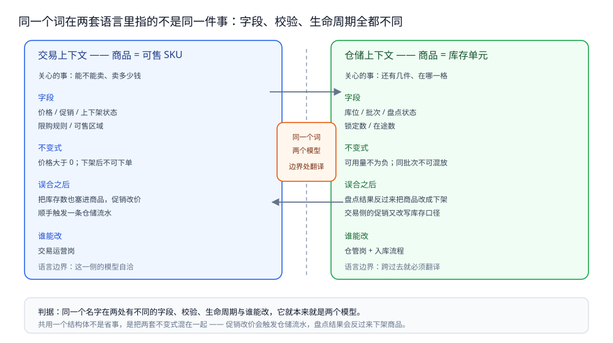
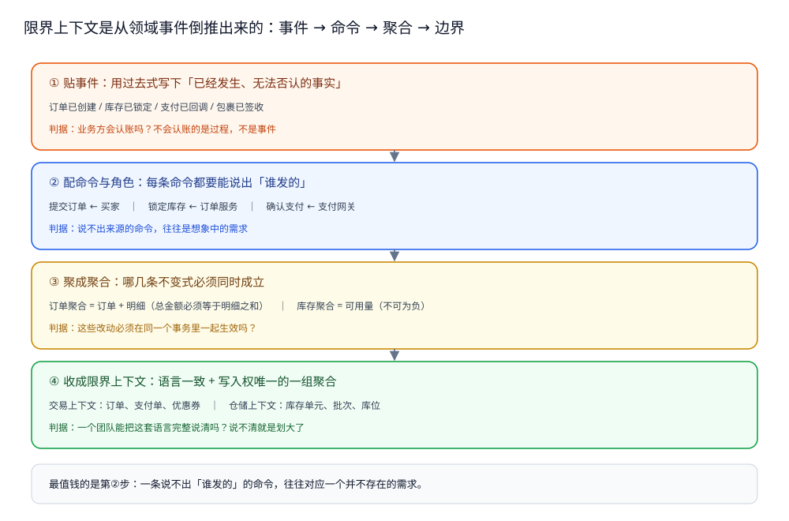
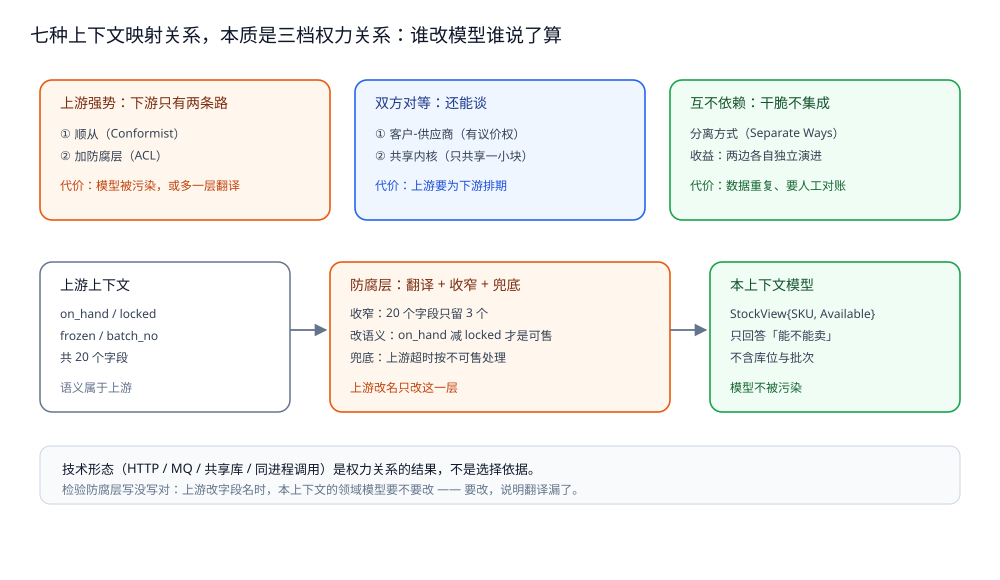

# 领域驱动设计

> 覆盖：为什么「按表拆」「按技术分层拆」必然失败、限界上下文怎么用事件风暴划出来、上下文映射七种关系怎么按权力关系选、聚合根为什么等于事务边界、DDD 各部分与表 / 模块 / 服务边界的对应关系、以及「什么时候不该上 DDD」的成本判据。
>
> 不覆盖：该不该拆微服务、拆完多出哪些问题见 [分布式与微服务.md](分布式与微服务.md) 第二节的拆分判据；跨服务的最终一致怎么做见 [最终一致方案.md](分布式事务/最终一致方案.md)；领域事件在 MQ 里怎么切 Topic 见 [Topic切分与事件设计.md](../../03-数据与中间件/中间件/消息队列/Topic切分与事件设计.md)；表结构与范式见 [数据建模.md](../../03-数据与中间件/数据存储/关系型/MySQL/数据建模.md)。
>
> 内容整理自个人学习笔记，素材见 [素材清单](../../素材清单.md)。
>
> 📎 **校验口径**：本篇是方法论篇，**不含任何本机实测读数**——DDD 的产出是边界与模型，没有「跑一遍看输出」这回事，任何号称实测的 DDD 读数都只能测它落地后的副产品（事务耗时、锁冲突），而那些已经有专篇在测。文中的判据来自原书与工程实践；第七节的 Go 代码是**结构骨架**（语法自洽、未编译成可运行系统，因为聚合本身不是一个可运行组件），凡涉及具体产品行为的地方（事件表、消息投递、事务隔离）都指到有实测的篇目。

---

## 一、为什么「按表拆、按技术分层拆」必然失败？

**本节要点**：两种错拆的病灶是同一个——**边界画在数据结构或技术角色上，而业务语言里真实存在的分界没有被表达出来**。结果是「代码里的边界」与「业务上的边界」错位，任何一次业务变更都要同时改好几处。

| 错拆方式 | 长什么样 | 半年后的症状 |
| --- | --- | --- |
| **按表拆** | `order` 表一个服务、`order_item` 表一个服务、`user` 表一个服务 | 下单要跨三个服务、三次写入，没有本地事务可用；每次加字段三边都要发版 |
| **按技术分层拆** | 所有 DAO 一个服务、所有 Controller 一个服务、所有定时任务一个服务 | 改一个业务需求要横穿所有服务；这叫「分布式单体」，见 [分布式与微服务.md](分布式与微服务.md) 2.2 |
| **按页面拆** | 「商品详情页服务」「购物车页服务」 | 页面改版就重构服务；两个页面用同一份数据时互相抢写入权 |
| **按部门拆** | 组织架构一变，服务边界跟着重画 | 康威定律被当成设计方法用——它描述的是「会发生什么」，不是「该怎么切」 |

真正的分界线藏在语言里：**同一个词，在两个地方指的不是同一件事**。

| 词 | 上下文 A 里的含义 | 上下文 B 里的含义 | 硬合并成一个类的后果 |
| --- | --- | --- | --- |
| **商品** | 交易上下文：可售 SKU（价格、促销、上下架状态） | 仓储上下文：库存单元（库位、批次、盘点、锁定数） | 促销改价触发仓储流水；盘点结果反过来把商品下架 |
| **用户** | C 端上下文：账号、手机号、偏好 | 后台上下文：操作员、角色、权限 | 加一个「备注」字段，两边都当成自己的，互相覆盖 |
| **订单** | 交易上下文：金额、优惠、支付状态 | 履约上下文：包裹、承运商、签收状态 | 发货回写把交易单改成「已支付」；支付回调把履约单改成「已签收」 |
| **账户** | 资金上下文：余额、冻结额 | 积分上下文：累计值、等级、有效期 | 一个 `balance` 字段被两边写，对账永远差几分钱 |

⭐ 判据一句话：**同一个名字在两处有不同的不变式**（字段不同、校验不同、生命周期不同、谁能改不同），就说明它们本来就是两个模型，只是碰巧共用一个中文词。



左右两边对同一个词关心的事完全不同：交易侧关心「能不能卖、卖多少钱」，仓储侧关心「还有几件、在哪一格」，中间那条边界上必须有一次显式翻译，而不是共用一个结构体。

DDD 把这件事拆成三个产出，本节之后逐个展开：

| 产出 | 回答什么 | 落到代码里是什么 |
| --- | --- | --- |
| **通用语言**（Ubiquitous Language） | 这个上下文里，每个词只有一种含义 | 包名、类型名、方法名、字段名与业务方嘴里的话一致 |
| **限界上下文**（Bounded Context） | 这套语言管到哪儿为止 | 一个包 / 一个模块 / 一个服务，边界内模型自洽，边界外一律翻译 |
| **上下文映射**（Context Map） | 两个上下文之间谁说了算、怎么对接 | 防腐层、共享内核、客户-供应商等具体对接方式（第三节） |

> 与 [分布式与微服务.md](分布式与微服务.md) 2.1 的关系：那里给的是**三条拆分判据**（业务能力 / 限界上下文 / 康威定律），其中「限界上下文」这一条只说了一句。本篇补的就是这一条的上游——**上下文是怎么被划出来的、划完之后两边怎么接**。

## 二、限界上下文到底怎么划？

**本节要点**：从**领域事件**倒推，而不是从表或页面正推。事件是业务里已经发生、无法否认的事实（「订单已支付」「库存已锁定」），它天然带着「谁在什么时候改变了什么」，顺着事件能把命令、聚合、边界一起收出来。

### 2.1 三个划界信号

三个信号命中任意一个，就说明这里有一条边界；三个都不命中，说明你把一件事拆成了两半：

| 信号 | 具体表现 | 结论 |
| --- | --- | --- |
| **含义冲突** | 同一个词两边的字段、校验、生命周期不同（第一节那张表） | 两个上下文，各自建模 |
| **写入权冲突** | 同一份数据被两个角色或两个流程修改 | 划开并指定唯一写入方；划不开就必须合并成一个上下文 |
| **事务边界** | 这两处改动必须同时生效吗？ | 必须 → 同一个聚合内；不必 → 两个上下文，用事件最终一致 |

⚠️ 第三个信号最容易被忽略：很多人把「必须同时生效」当成默认要求，于是把订单、库存、账户做成一个聚合，锁范围瞬间覆盖三个业务对象（见第四节）。

### 2.2 事件风暴的四步收敛

事件风暴（Event Storming）看着像贴便签的游戏，实际是一条**从事实倒推结构的流水线**。四步各有一道判据，跑偏都发生在跳过判据的地方：

```text
① 贴事件（橙色，过去式）      「订单已创建」「库存已锁定」「支付已回调」
        ↓ 判据：这件事发生过之后，业务方会认账吗？不会认账的是过程不是事件
② 配命令与角色（蓝色）        「提交订单」由「买家」发出，「锁定库存」由「订单服务」发出
        ↓ 判据：一条命令必须来自一个明确的角色／系统，说不出来源的命令是臆想的
③ 聚成聚合（黄色）            「订单」「库存」各自是一组必须同时成立的不变式
        ↓ 判据：这些事件是否必须在同一个事务里一起成立？
④ 收成上下文（边界框）        语言一致、写入权唯一的一组聚合 = 一个限界上下文
        ↓ 判据：一个团队能把这套语言完整说清吗？
```



四步里最值钱的是第二步：**命令说不出来源的事件，往往是想象出来的需求**。而第三步把「必须同时成立」的那组事件圈在一起，聚合边界与事务边界就是同一个圈——这也是第四节「聚合根等于事务边界」的来源。

### 2.3 粒度的两个反向判据

划大了和划碎了都会出问题，两个反向判据可以互相夹住：

| 判据 | 划**碎**了的信号 | 划**大**了的信号 |
| --- | --- | --- |
| 一个团队能否完整维护这套语言 | 两个上下文由同一个团队维护，且改一处总是一起动 | 一个上下文里塞了 30 个聚合、5 个团队各管一块 |
| 一次业务变更动几个上下文 | 改一个需求要动 3 个以上上下文 | 任何需求都落在同一个上下文里，等于没划 |

⭐ 常用起点：**先按「一个团队 + 一次业务变更」划粗，再按「不变式」拆细**。反过来做（先拆细再合并）几乎总会留下跨上下文的共享表。

## 三、上下文之间怎么映射？七种关系怎么选？

**本节要点**：映射关系的本质是**权力关系**——谁改模型谁说了算、下游有没有议价权。技术形态（HTTP、MQ、共享库、同进程调用）是权力关系的**结果**，不是选择依据。

### 3.1 七种关系与它们的代价

| 关系 | 谁说了算 | 什么时候用 | 代价 |
| --- | --- | --- | --- |
| **合作关系**（Partnership） | 双方共同 | 两个上下文的交付必须同时上线、失败一起失败 | 强耦合，任何一方改模型都要协商；只适合同一团队的相邻边界 |
| **共享内核**（Shared Kernel） | 双方共同 | 确实有一小块模型两边语义完全相同（如统一的「金额」「单位」） | 共享的那块改动要双方同意，且会逐渐膨胀成第二个大泥球 |
| **客户-供应商**（Customer/Supplier） | 上游 | 上游有能力也有意愿照顾下游，下游有测试话语权 | 上游要为下游排期；上游一旦不守承诺就退化成「顺从者」 |
| **顺从者**（Conformist） | 上游 | 下游没有议价权（外部 SaaS、公司级主数据） | 下游模型被上游污染，上游改名下游跟着改 |
| **防腐层**（Anticorruption Layer） | 下游自己 | 上游模型与本上下文语义差得远，或上游不稳定 | 多一层翻译代码与一次转换开销，但**唯一**能保住本上下文模型纯度的手段 |
| **分离方式**（Separate Ways） | 各自 | 两边集成的收益小于成本 | 数据重复、口径不一致，需要人工对账 |
| **大泥球**（Big Ball of Mud） | 没人 | 不是选择，是现状 | 只能先加防腐层把它围起来，再逐步切 |

### 3.2 三种权力关系与防腐层的位置



上游强势时下游只有两条路：顺从（模型被污染）或加防腐层（自己翻译）；下游强势时才谈得上客户-供应商，双方都强势时只能靠共享内核或干脆分离。

⭐ 防腐层做的不是「转发」，是**翻译 + 收窄**：上游返回 20 个字段，本上下文只取 3 个并翻译成自己的语言（上游叫 `on_hand` / `locked`，本上下文叫「可售」）。判断一个防腐层写没写对，看一件事——**上游改字段名时，本上下文的领域模型要不要改**；要改，说明翻译层漏了。

⚠️ 最常见的错法：把上游的 DTO 直接当成本上下文的实体用（`type Order = upstream.OrderDTO`）。这在编译期看起来最省事，但上游加一个字段，你的领域模型就多一个不该有的概念。

## 四、聚合根为什么就是事务边界？

**本节要点**：聚合的定义不是「一组有关联的对象」，而是「**必须在同一个事务里同时成立的一组不变式**」。聚合根是这组不变式唯一的入口，也是外部唯一允许持有的引用。

### 4.1 三条判据

| 判据 | 问法 | 结论 |
| --- | --- | --- |
| 是否要**立刻**一致 | 这两个改动中间有 100ms 不一致，业务能接受吗？ | 不能 → 同一聚合；能 → 两个聚合，用领域事件补齐 |
| 谁会**并发**改它 | 两个请求会不会同时改这两部分？ | 会 → 同一聚合（靠聚合内的串行化或乐观锁）；不会 → 可以拆开 |
| 冲突范围多大 | 锁住这个聚合，会挡住哪些无关的写？ | 挡住很多 → 聚合划大了 |

### 4.2 大聚合的代价

把「订单 + 明细 + 用户 + 库存」做成一个聚合，看起来「数据都在一起，事务最安全」，实际代价是：

- 任何一次下单都要锁住用户与库存的写入，**无关请求被串行化**；
- 用户改昵称与下单争同一把锁；
- 库存扣减失败会把整笔订单回滚，而业务上「先下单、后扣库存（预占）」才是常态。

正确的切法是：订单是一个聚合（订单 + 明细，因为「总金额 = 明细之和」必须立刻成立），库存是另一个聚合（「可用量不为负」必须立刻成立），两者之间用**预占 + 确认**的领域事件对接，最终一致，细节见 [最终一致方案.md](分布式事务/最终一致方案.md)。

### 4.3 聚合边界、服务边界、表边界是三件事

| 关系 | 允许吗 | 说明 |
| --- | --- | --- |
| 一个服务 = 多个聚合 | ✅ 常态 | 一个限界上下文里通常有 3~10 个聚合，共用一个部署单元 |
| 一个聚合跨两个服务 | ❌ 禁止 | 跨服务就没有本地事务，「同时成立」无从保证 |
| 一个聚合 = 一张表 | ⚠️ 巧合 | 聚合常落 2~3 张表（主表 + 明细 + 状态流水） |
| 一张表 = 一个聚合 | ⚠️ 巧合 | 读模型表、投影表往往是多个聚合的拼接，**不属于任何聚合** |

⚠️ 最隐蔽的一种错：为了让列表页少一次 JOIN，把两个聚合的字段冗余进同一张「大宽表」，然后让写入方直接写这张表。表本身没错（读模型就该这么建，见 [数据建模.md](../../03-数据与中间件/数据存储/关系型/MySQL/数据建模.md)），错的是**让宽表成为写入入口**——写入必须回到各自的聚合，宽表只由事件投影出来。

## 五、什么时候不该上 DDD？

**本节要点**：DDD 的收益来自「领域复杂 + 长期演进」，成本落在建模时间与跨边界查询上。领域逻辑薄、三个月就重写、团队不熟的系统上全套 DDD 是负收益，不是「更专业」。

| 判据 | 该上 | 不该上 |
| --- | --- | --- |
| 领域逻辑厚度 | 一个业务动作有 5 条以上规则、多个状态与例外 | 增删改查 + 一两个校验 |
| 变更频率与寿命 | 会持续演进 2 年以上，规则还在长 | 一次性工具、活动页、内部小系统 |
| 团队 | 有人能持续维护模型，业务方能参与语言对齐 | 团队流动大、没有业务方参与渠道 |
| 一致性要求 | 需要明确说清「哪部分强一致、哪部分最终一致」 | 单库单表就够，事务天然成立 |

**最小用法**（成本约等于零，收益最大）：只取两件事——**通用语言**（命名与业务对齐）与**边界**（谁写这份数据）。不做四层分层、不做聚合、不做领域事件，也能拿到 DDD 七成的收益。

全套 DDD 的账要算清：

| 成本项 | 具体表现 |
| --- | --- |
| 建模时间 | 事件风暴 + 语言对齐通常按周计，而不是按天 |
| 防腐层代码量 | 每个上游一个翻译层，字段越多越厚 |
| 查询变复杂 | 跨上下文不能 JOIN，只能组装或建投影（第一节「按表拆」的病症会换一种形式回来） |
| 事务变复杂 | 聚合之间只能最终一致，要引入 outbox / 消息 / 对账 |
| 团队成本 | 语言与边界是**共识**，不是文档；人换了要重新对齐 |

## 六、应用场景

同一个方法在不同业务里的划法不一样，下面这张表给的是「上下文与聚合各自落在哪」，不是标准答案：

| 场景 | 限界上下文怎么分 | 其中的聚合 | 对应篇目 |
| --- | --- | --- | --- |
| **电商交易** | 交易（下单、支付状态）、库存（可售量、预占）、履约（包裹、签收）、结算（账单、分账） | 订单（订单 + 明细）、库存单元、包裹 | [秒杀系统](../系统设计/秒杀系统/总体设计.md) 的库存扣减与订单创建分属两个上下文 |
| **秒杀** | 活动（资格、限购）、库存（扣减）、订单（下单） | 活动资格、库存分桶、订单 | 同上；库存聚合被拆成分桶正是为了缩小锁范围 |
| **SaaS 多租户** | 租户（开户、套餐）、身份（账号、角色）、业务域（各自独立） | 租户、订阅、账号 | 隔离层位见 [授权模型与越权防护.md](../../06-工程实践/安全/身份与访问/授权模型与越权防护.md) 第六节 |
| **摄影 SaaS** | 客户（客资、跟进）、订单（合同、收款）、交付（选片、成片）、存储（原片、缩略图） | 客户、订单、交付单 | 同一客户在「客资」与「订单」两个上下文里的字段与生命周期不同 |
| **IM** | 会话（成员、已读位点）、消息（存储、撤回）、关系链（好友、黑名单） | 会话、消息批次、关系 | [IM系统](../系统设计/IM系统/README.md) 的「会话与消息分表」正是两个上下文 |
| **支付** | 支付单（渠道、状态机）、账单（记账）、对账（差异） | 支付单、账单批次 | [最终一致方案.md](分布式事务/最终一致方案.md) 的补偿与对账 |

⭐ 读这张表的方法：**先看「同一个词在哪两个上下文里含义不同」**（第一节那张表），再看「哪两处必须同时成立」（第四节三条判据），顺序反了就会照抄别人的划法。

## 七、具体使用

以下代码只示范**结构边界**，不是可运行系统：真正跑起来还需要仓储实现、事务管理器、HTTP 层，那些与 DDD 的边界无关。

### 7.1 目录按上下文分包，不按技术分层

```text
internal/
├── order/                    ← 限界上下文：交易
│   ├── domain/               ← 聚合、值对象、领域事件、仓储接口
│   │   ├── order.go          ← 聚合根：不变式只在这里校验
│   │   ├── item.go           ← 值对象：无身份，整体替换
│   │   ├── events.go         ← 领域事件：过去式命名
│   │   └── repository.go     ← 仓储接口（定义在领域层，实现在 infra）
│   ├── app/                  ← 应用服务：编排用例与事务边界
│   └── infra/                ← 仓储实现、防腐层、outbox
├── inventory/                ← 限界上下文：库存（另一个语言边界）
│   └── ...
└── shared/                   ← 只有真正双方同意的极小内核（金额、单位）
```

⚠️ 反面骨架是 `controller/`、`service/`、`dao/` 三个顶层目录——那是按技术角色分包，任何一次业务变更都要横穿三层（第一节第二种错拆的代码形态）。

### 7.2 聚合根：不变式只有一个入口

```go
package domain

import (
	"errors"
	"time"
)

var (
	ErrEmptyItems  = errors.New("order must have at least one item")
	ErrAlreadyPaid = errors.New("order already paid")
)

type OrderID string

// Item 是值对象：没有身份标识，改数量就是换一个 Item
type Item struct {
	SKU      string
	Price    int64 // 分
	Quantity int
}

// Order 是聚合根：外部只能通过它改内部状态
type Order struct {
	id     OrderID
	items  []Item
	status string
	paidAt time.Time
}

func NewOrder(id OrderID, items []Item) (*Order, error) {
	if len(items) == 0 {
		return nil, ErrEmptyItems
	}
	return &Order{id: id, items: items, status: "PENDING"}, nil
}

// Pay 是唯一能改支付状态的入口：状态机与不变式都在聚合内部
func (o *Order) Pay(at time.Time) error {
	if o.status == "PAID" {
		return ErrAlreadyPaid
	}
	o.status = "PAID"
	o.paidAt = at
	return nil
}

// Total 是聚合自己算出来的：不让外部按明细自己算，避免两处口径
func (o *Order) Total() int64 {
	var sum int64
	for _, it := range o.items {
		sum += it.Price * int64(it.Quantity)
	}
	return sum
}
```

⭐ 判据：**把 `Pay` 挪到 service 层写（`if order.Status == "PAID" { ... }`）就说明聚合被掏空了**——状态判断一旦散到应用层，同一个不变式会在三个用例里各写一遍，且总有一次写漏。

### 7.3 防腐层：把上游模型挡在边界外

```go
package infra

import "net/http"

// StockView 是本上下文自己的语言：只有「能不能卖」
type StockView struct {
	SKU       string
	Available bool
}

// InventoryACL 是防腐层：上游字段改名时，改这里，不改 domain
type InventoryACL struct {
	cli  *http.Client
	base string
}

type upstreamStock struct { // 上游契约：字段名与语义都属于上游
	Code   int  `json:"code"`
	OnHand int  `json:"on_hand"`
	Locked int  `json:"locked"`
	Frozen bool `json:"frozen"`
}

func (a *InventoryACL) CanSell(sku string) (StockView, error) {
	// 真实实现：GET {base}/stock?sku=... 并 json 解码到 upstreamStock
	var up upstreamStock
	_ = up
	return StockView{SKU: sku, Available: up.OnHand-up.Locked > 0 && !up.Frozen}, nil
}
```

翻译层要做的三件事：**收窄**（上游 20 个字段只留 3 个）、**改语义**（`on_hand - locked` 才是本上下文的「可售」）、**兜底**（上游超时按不可售处理，还是按有货处理，必须在边界上说清）。

### 7.4 领域事件：与业务同事务写入，提交后再派发

```sql
-- outbox：与业务表同库同事务，保证「事件一定发出去」
CREATE TABLE outbox (
  id          BIGINT       NOT NULL AUTO_INCREMENT,
  aggregate   VARCHAR(64)  NOT NULL,        -- order / inventory
  event_type  VARCHAR(64)  NOT NULL,        -- order.paid
  payload     JSON         NOT NULL,
  created_at  DATETIME(3)  NOT NULL DEFAULT CURRENT_TIMESTAMP(3),
  sent_at     DATETIME(3)  NULL,            -- NULL = 待派发
  PRIMARY KEY (id),
  KEY idx_pending (sent_at, id)
) ENGINE=InnoDB DEFAULT CHARSET=utf8mb4;
```

```go
package app

import "context"

// Pay 在一个本地事务里完成：改聚合 → 存聚合 → 写 outbox
func (s *Service) Pay(ctx context.Context, id OrderID) error {
	return s.tx.Within(ctx, func(tx Tx) error {
		o, err := s.repo.Get(ctx, tx, id)
		if err != nil {
			return err
		}
		if err := o.Pay(s.clock.Now()); err != nil {
			return err
		}
		if err := s.repo.Save(ctx, tx, o); err != nil {
			return err
		}
		// 事件与业务同事务，事务提交后由独立协程派发（先落库再发，不反过来）
		return s.outbox.Append(ctx, tx, "order.paid", Paid{OrderID: string(id)})
	})
}
```

⭐ 顺序不能反：**先发消息再写库**会出现「消息发出去了、事务回滚了」，下游收到一个并不存在的事件。outbox 表与派发器怎么保证不重不漏、消费端怎么幂等，见 [最终一致方案.md](分布式事务/最终一致方案.md) 与 [幂等设计.md](稳定性/幂等设计.md)。

## 延伸追问

- **DDD 和微服务是什么关系？** → DDD 先于微服务，且不依赖微服务。限界上下文是**模型单位**，微服务是**部署单位**；一个上下文可以先是一个模块，等团队与流量到了再拆成服务。反过来「先拆服务再补模型」几乎总会拆错。
- **一个限界上下文就是一个微服务吗？** → 不是。一个上下文可以是多个服务（按读写或按子域再分），多个小上下文也可以先放在一个服务里（模块化单体）。强行一对一，往往把服务拆得比团队还细。
- **通用语言是不是就是一份术语表？** → 不是。术语表是文档，通用语言是**代码里的命名与业务方嘴里的词完全一致**：业务方说「预占」，代码里就该是 `Reserve` 而不是 `LockStock` 或 `PreDeduct`。文档会过期，命名不会。
- **事件风暴一定要业务方在场吗？** → 要。没有业务方，贴出来的事件是技术流程（「调用了库存接口」），不是业务事实（「库存已预占」）。前者划不出上下文。
- **实体和值对象怎么分？** → 看有没有身份：改一个字段之后，它还是「同一个东西」的是实体（订单改金额还是这张订单）；不是同一个东西的是值对象（100 元改 200 元就是另一个金额）。值对象不可变，整体替换。
- **聚合根能不能直接持有另一个聚合的对象？** → 不能，只能持有对方的 ID。持有对象就等于可以跨聚合改状态，事务边界立刻失效，而且加载一个聚合会级联加载半个库。
- **领域事件一定要走 MQ 吗？** → 不一定。同一进程内可以用进程内事件总线（同步或异步），跨上下文才需要 MQ。判断依据是**下游是否需要在另一个进程里活着**，而不是「事件听起来像消息」。
- **贫血模型一定错吗？** → 不一定。逻辑薄、以查询为主的模块（后台管理、报表）用贫血模型更直接；错的是**在逻辑厚的核心域里用贫血模型**，导致不变式散落在 service 层各处。
- **上下文之间能不能共享数据库？** → 技术上能，架构上不行。共享库等于共享写入权，两个上下文会被同一张表的 schema 变更绑在一起，最终退化成分布式单体（见 [分布式与微服务.md](分布式与微服务.md) 2.2）。

## 关联

- **上游/总纲**：[分布式与微服务.md](分布式与微服务.md) — 拆分的三条判据与零件清单；本篇补第 2.1 节「限界上下文」这一条的上游方法论
- **上游/总纲**：[README.md](README.md) — 本目录导读：为什么方法论篇排在「理论基础」之前读
- **对照/互补**：[数据建模.md](../../03-数据与中间件/数据存储/关系型/MySQL/数据建模.md) — 表怎么建（范式、索引、宽表）；本篇讲边界怎么划，两者是「先划边界再建表」的顺序
- **对照/互补**：[Topic切分与事件设计.md](../../03-数据与中间件/中间件/消息队列/Topic切分与事件设计.md) — 领域事件怎么落成 Topic 与分区键；本篇只到「事件是什么」
- **下游机制**：[最终一致方案.md](分布式事务/最终一致方案.md) — 聚合之间只能最终一致：outbox、事务消息、CDC 与补偿的具体做法
- **下游机制**：[幂等设计.md](稳定性/幂等设计.md) — 领域事件重复投递时，消费端凭什么只生效一次
- **下游机制**：[授权模型与越权防护.md](../../06-工程实践/安全/身份与访问/授权模型与越权防护.md) — 多租户场景里「租户」作为一个上下文后的隔离层位
