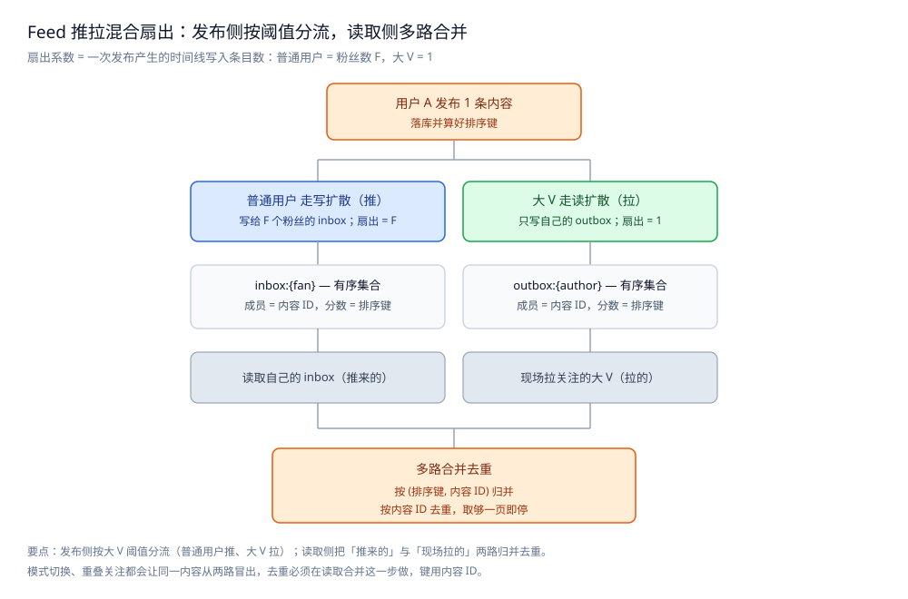

# Feed 流系统

> 本目录收**通用 Feed 流**这道系统设计题：一篇**总体设计** + 三篇零件篇 + 一篇存储横切篇。
> 本篇是目录导读，只给「这个系统有哪几个核心问题、有哪些零件、怎么读」三件事，
> 每个问题的解法在零件篇里；本篇不重述具体方案。
>
> 内容整理自个人学习笔记，素材见 [素材清单](../../../素材清单.md)。

---

## 一、这个系统有哪几个核心问题？

**本节要点**：Feed 不是"把内容按时间排一排"这么简单 —— 它的全部工程难点收敛成**三个互相牵制的问题**，改一个会牵动另外两个。

| # | 问题 | 一句话 |
|---|---|---|
| ① | **拉取模型** | 发布时就把内容写进每个粉丝的时间线（推 / 写扩散），还是等用户来读时才去聚合关注对象（拉 / 读扩散）？ |
| ② | **时间线存储与分页** | 这份"某人的 Feed 长什么样"存在哪、用什么结构、怎么从任意位置继续往下翻？ |
| ③ | **排序与去重** | 按什么排？多个来源合并时按什么去重？翻页过程中有新内容进来，顺序会不会乱？ |

⭐ 判断顺序很重要：**先定拉取模型，再定存储，最后定排序**。⭐ 三个问题**互相牵制** —— 改分页方式会反过来约束排序键，改拉取模型会改变存储的形态；为什么牵制、怎么来回收敛，见 [总体设计.md](总体设计.md) 第三节。



图怎么读：左半边是发布侧，同一条内容按作者类型走两条路——普通用户写扩散（扇出 = 粉丝数 F，写进 F 个 `inbox` 有序集合），大 V 读扩散（扇出 = 1，只写自己的 `outbox`）；右半边是读取侧，把「推来的 inbox」与「现场拉的大 V」两路按 (排序键, 内容 ID) 归并、按内容 ID 去重，取够一页即停。底部那行点出接缝所在：模式切换与重叠关注会让同一内容从两路同时冒出，所以**去重只能放在读取合并这一步**，键用内容 ID。

---

## 二、这套笔记有哪些零件？

**本节要点**：一篇总体设计先给出"整体分几部分、核心取舍在哪"，三篇零件篇按关注层切（模型 / 结构 / 顺序），最后一篇存储全景是横切收口。

| 篇 | 回答什么问题 | 关键词 |
|---|---|---|
| [总体设计.md](总体设计.md) | 整体分几个部分、三个核心取舍、一次刷屏走哪几步 | 整体形态 / 核心取舍 / 全链路 / 前提与边界 |
| [写扩散与读扩散.md](写扩散与读扩散.md) | 内容怎么送到用户面前、成本落在写侧还是读侧 | 推拉代价 / 混合模式 / 大 V 阈值 |
| [时间线存储与分页.md](时间线存储与分页.md) | 这条时间线存在哪、怎么从任意位置继续往下翻 | 存储选型 / 游标分页 / 多路合并 / 缓存分层 |
| [排序与去重.md](排序与去重.md) | 按什么排、多路合并怎么去重、翻页中途插入怎么办 | 排序键 / 合并去重 / 兜底默认序 |
| [存储全景.md](存储全景.md) | 这个系统的数据都存哪 | 数据角色 / 载体 / 读写路径 / 与其它系统的差异 |

⭐ 前四篇是设计篇（总体设计 + 三零件）；[存储全景.md](存储全景.md) 是横切篇（跨零件看"数据存哪"）。

### 2.1 三个问题与三篇零件的对应

```text
问题① 拉取模型        → 写扩散与读扩散.md（推、拉、混合与大 V）
问题② 存储与分页      → 时间线存储与分页.md（存哪 + 怎么翻 + 多路怎么合）
问题③ 排序与去重      → 排序与去重.md（合并去重、稳定键、兜底序）
```

> 注意 **"多路合并去重"同时属于问题②和③** —— 它是三个问题的**接缝**，所以同时被两篇引用；各部分的职责与判据见 [总体设计.md](总体设计.md) 第一节，三个问题怎么牵制、接缝在哪见其 3.2。

---

## 三、按什么顺序读？

**本节要点**：先看**总体设计**（整体分几部分、核心取舍在哪、一次刷屏走哪几步），再定**模型**（内容怎么到用户面前），然后把**结构**立起来（存在哪、怎么翻），接着定**顺序**（按什么排、怎么去重），最后用存储全景收口。

### 3.1 推荐顺序

```text
① 总体设计.md            ← 总体设计：整体形态、三个核心取舍、一次刷屏走哪几步
        ↓
② 写扩散与读扩散.md      ← 模型层：内容怎么送到用户面前，成本落在写侧还是读侧
        ↓
③ 时间线存储与分页.md    ← 结构层：这条时间线存在哪、怎么翻页
        ↓
④ 排序与去重.md          ← 顺序层：按什么排、多路怎么去重
        ↓
⑤ 存储全景.md            ← 横切收口：以上几篇的数据分别落在哪、怎么同步
```

**反过来也成立**：如果只关心"多路来源怎么合并去重"，可以跳过推拉模型，
直接从 [排序与去重.md](排序与去重.md) 第三节读起 —— 那一节不依赖任何扇出实现。

### 3.2 依赖关系

| 本篇 | 建议先读 | 为什么 |
|---|---|---|
| [写扩散与读扩散.md](写扩散与读扩散.md) | [总体设计.md](总体设计.md) | 先有"三问题怎么互相牵制"的地图，才知道模型这一步会牵动存储与排序 |
| [时间线存储与分页.md](时间线存储与分页.md) | [写扩散与读扩散.md](写扩散与读扩散.md) | 先决定"推的单条时间线"还是"拉的多路发件箱"，才知道要存几个结构 |
| [排序与去重.md](排序与去重.md) | [时间线存储与分页.md](时间线存储与分页.md) | 分页用的游标就是排序键的取值，分页方式先约束了排序键必须唯一且单调 |
| [存储全景.md](存储全景.md) | 前三篇任意 | 它是横切收口，先理解零件再看数据落点更顺 |

⭐ 一条记忆线：**"发一条写给谁"看拉取模型，"这份存在哪"看时间线结构，"按什么排"看排序键** —— 三者对不上，用户看到的就是"刷不出新内容"或"翻页重复"。

### 3.3 三种常见的读错顺序

| 读法 | 后果 |
|---|---|
| 先读排序、后读拉取模型 | 排序键讲得通，但"为什么这一列必须全局唯一"体会不到——因为没先理解多路合并从哪来 |
| 只读存储与分页、跳过推拉模型 | 游标分页记住了，但"要不要现场合并大 V 发件箱"完全接不上 |
| 四篇各读一半 | 模型、结构、顺序、数据落点各一条线，在"一次刷新的生命周期"上对不齐 |

---

## 四、与其它目录怎么分工？

**本节要点**：Feed 是**把分布式零件拼成系统**的场景题，但比"朋友圈"这类**具体场景**更抽象一层 —— 本目录只讲**通用 Feed 的工程零件**，场景要素与关系链存储都在别处。

| 相关目录 | 分工 |
|---|---|
| [朋友圈设计.md](../社交互动系统/朋友圈设计.md) | 那边是**具体场景**（朋友圈）的要素分析与推拉分层；本目录讲**跨场景**的工程零件（存储、分页、排序） |
| [关注粉丝设计.md](../社交互动系统/关注粉丝设计.md) | 那边讲**关系链怎么存、怎么分片**；本目录只讲**时间线扇出**，不重讲边怎么存 |
| [排行榜设计.md](../社交互动系统/排行榜设计.md) | 同样用有序集合，游标分页与分数更新的写法可对照 |
| [README.md](../社交互动系统/README.md) | 社交互动系统目录导读（互动数据视角），与本目录互为应用面 |
| [存储选型与组合.md](../../../03-数据与中间件/数据存储/存储架构与场景/存储选型与组合.md) | 通用判据（角色 / 同步 / 冷热）；本篇的 [存储全景.md](存储全景.md) 是它在 Feed 上的落地 |
| [README.md](../README.md) | 系统设计分区导读，本目录是其下的一个主题目录 |

**本目录收什么、不收什么**：

| 收 | 不收（在哪） |
|---|---|
| 拉取模型、时间线存储与分页、排序与去重 的工程判据 | 朋友圈的场景要素与 ER 表 → [朋友圈设计.md](../社交互动系统/朋友圈设计.md) |
| 时间线扇出的代价结构（写放大 / 读放大） | 关注关系的存储与分片 → [关注粉丝设计.md](../社交互动系统/关注粉丝设计.md) |
| 数据角色与冷热分层（存储全景） | 通用存储判据 → [存储选型与组合.md](../../../03-数据与中间件/数据存储/存储架构与场景/存储选型与组合.md) |

> 引用关系上，本目录与朋友圈那篇**互引**：朋友圈篇讲"为什么朋友圈可以推"，到了需要展开通用分页与排序键时，就指向本目录。

## 延伸追问

- **通用 Feed 和朋友圈，能不能合成一篇？** → 不建议。朋友圈那篇的价值在**具体场景的要素推演**（哪些数据、怎么分层），本目录的价值在**跨场景的工程零件**（存储、分页、排序）。合成一篇会两头不讨好：讲通用零件时被场景细节打断，讲场景时又被泛化判据稀释。
- **这三篇需要依赖关系链的存储吗？** → 不需要。时间线扇出只关心"**我要写给哪些人**"，不关心"这段关系在库里怎么分片"。所以本目录可以独立于 [关注粉丝设计.md](../社交互动系统/关注粉丝设计.md) 阅读，只在"粉丝数变化时怎么切模式"处引用它。
- **这套笔记有实测数字吗？** → 本目录几篇的主体仍是**设计讲解与骨架**，凡涉及线上量级的读数均不编造，只给**判据与量级方向**。已有的是零件级容器实测——[排序与去重.md](排序与去重.md) 第六节（同秒碰撞与游标漂移，`redis:7-alpine` 7.4.11 + `golang:1.26-alpine` go1.26.8）与[存储全景.md](存储全景.md) 第五节（时间线副本重建两条路径，另含 `mysql:8.0` 8.0.46）；这些跑的是正文自造的固定样本、连跑多轮只断言趋势与相对差，不背书任何生产量级。
- **读完能回答的最小闭环是什么？** → "一次发布怎么变成一屏刷新"：落库 → 判推/拉 → 算排序键 → 写有序集合；读取则取游标 → 读时间线（+ 拉大 V）→ 归并去重 → 截断一页 → 回带游标 —— 展开见 [总体设计.md](总体设计.md) 第四节。

## 关联

- [总体设计.md](总体设计.md) — 总体设计：整体形态 / 核心取舍 / 一次刷屏走哪几步 / 前提与边界。
- [写扩散与读扩散.md](写扩散与读扩散.md) — 推拉代价结构、混合模式与大 V 阈值、扇出放大。
- [时间线存储与分页.md](时间线存储与分页.md) — 存哪、游标分页、多路合并、缓存分层与冷热数据。
- [排序与去重.md](排序与去重.md) — 时间倒序 vs 兴趣排序、稳定排序键、合并去重、兜底默认序。
- [存储全景.md](存储全景.md) — 横切篇：Feed 的数据都存哪、谁是权威源、怎么同步。
- [朋友圈设计.md](../社交互动系统/朋友圈设计.md) — 具体场景（朋友圈）的要素分析与推拉分层，本目录与之互引。
- [关注粉丝设计.md](../社交互动系统/关注粉丝设计.md) — 关系链的存储与分片；本目录只讲时间线扇出，不重讲边怎么存。
- [排行榜设计.md](../社交互动系统/排行榜设计.md) — 同样用有序集合，游标分页与分数更新的写法可对照。
- [README.md](../README.md) — 系统设计分区导读，本目录是其下的一个主题目录。
- [存储选型与组合.md](../../../03-数据与中间件/数据存储/存储架构与场景/存储选型与组合.md) — 通用视角：数据角色、权威源与副本、冷热分层与多存储同步。
