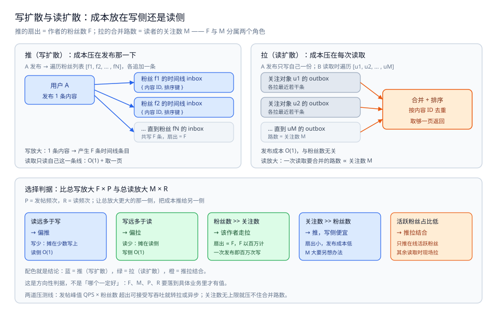
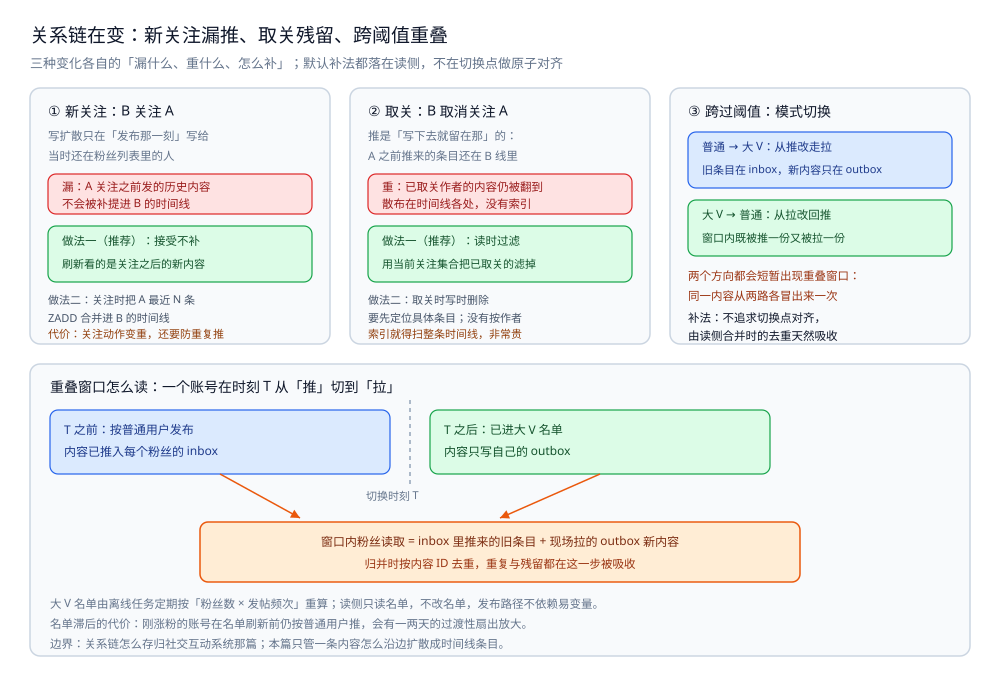

# 写扩散与读扩散

> 一条内容发布后怎么"到"用户面前：是**发布时写给每个人**（推 / 写扩散），还是**读取时现场聚合**（拉 / 读扩散）。
> 本篇讲两者的代价结构、混合模式与"大 V 阈值"怎么定、扇出放大怎么量、粉丝数与关注数变化时怎么切换。
>
> 内容整理自个人学习笔记，素材见 [素材清单](../../../素材清单.md)。

---

## 一、推和拉，代价到底差在哪？

**本节要点**：推和拉不是"哪个更好"的问题，而是**把发帖的成本放在写侧还是读侧**的问题。推把成本压在发布那一下（写放大），拉把成本压到每次读取（读放大）。判断取舍的唯一依据是四个量：粉丝数、关注数、发帖频次、读频次。

### 1.1 推（写扩散）：发布时写给每个粉丝

**做法**：用户 A 发布一条内容后，系统立刻把这条内容**写进 A 的每一个粉丝各自的时间线**（也常叫"收件箱"）。粉丝来看 Feed 时，只需要读**自己**这一条时间线，不需要做任何聚合。

```text
A 发布 → 遍历 A 的粉丝列表 [f1, f2, ..., fN]
        → 向每个粉丝的时间线追加一条 { 内容ID, 排序键 }
读取   → 直接读自己这条时间线，取一页返回
```

**代价结构**：

| 环节 | 成本 | 说明 |
|---|---|---|
| **发布** | ∝ **粉丝数** | 粉丝越多，一次发布要写的条目越多 |
| **读取** | O(1) + O(取一页) | 不需要聚合，读自己的线即可 |

⭐ 推的直觉：**读的人远多于发的人时，把成本摊在少数几次写上，比摊在每一次读上都便宜**。这也是"读多写少"场景下推模式更常见的原因。

### 1.2 拉（读扩散）：读取时聚合关注对象的发件箱

**做法**：用户 A 发布时，**只写一份**到自己的"发件箱"（就是自己的内容列表）。用户 B 来读时，现场遍历 B 关注的每个人，各拉一段，再合并排序。

```text
A 发布 → 只写 A 自己的发件箱 { 内容ID, 排序键 }
B 读取 → 遍历 B 的关注列表 [u1, u2, ..., uM]
        → 从每个 u 的发件箱各拉最近若干条
        → 合并 + 去重 + 排序，取一页返回
```

**代价结构**：

| 环节 | 成本 | 说明 |
|---|---|---|
| **发布** | O(1) | 只写自己一份，与粉丝数无关 |
| **读取** | ∝ **关注数** | 关注越多，一次读取要合并的路数越多 |

⭐ 拉的直觉：**写的人远多于读的人时**，或者**粉丝数根本不可控**（如某人被百万人关注），把发布成本压到 O(1) 才可行；代价是每次读都要现场做一次归并。

### 1.3 四个量决定取舍

推拉谁划算，取决于下面四个量的大小关系。但先注意一点：**这四个量分属两个不同的角色**，不能拿"同一个人粉丝多还是关注多"直接下结论。

| 量 | 符号 | 属于谁 | 影响谁 |
|---|---|---|---|
| 粉丝数 | F | 发布者 | 推的发布成本 ∝ F |
| 关注数 | M | 读者 | 拉的读取成本 ∝ M |
| 发帖频次 | P | 发布者 | 推的总写量 ∝ F × P |
| 读频次 | R | 读者 | 拉的总读量 ∝ M × R |

**粗判据**：比较 **`F × P`（推一侧的总写放大）** 与 **`M × R`（拉一侧的总读放大）**，让**总放大更大的那一侧把成本推给另一侧**。换成更直白的说法就是看**读写比**：

- **读远多于写** → 偏**推**：写本来就少，摊在写侧总成本低；读虽多，但读侧 O(1)。
- **写远多于读** → 偏**拉**：读本来就少，摊在读侧总成本低；写虽多，但写侧 O(1)。

⚠️ 最容易搞错的一点：**推的成本由"作者的粉丝数 F"决定，拉的成本由"读者的关注数 M"决定**，两者不是同一个人的两个量。所以"某人粉丝多还是关注多"本身**推不出该用推还是拉** —— 粉丝多只说明一件事：**推这个作者很贵**（扇出 ∝ F）。

| 现象 | 更适合 | 理由 |
|---|---|---|
| 系统**读远多于写** | 偏**推** | 写少，摊在少数几次写上；读侧 O(1) |
| 系统**写远多于读** | 偏**拉** | 读少，摊在读侧；写侧 O(1) |
| 某账号**粉丝数 >> 关注数**（明星、大 V） | **拉**（不能纯推） | 推的扇出 ∝ 粉丝数 F，F 以百万计时一次发布就是百万次写，写侧先爆；第二节的大 V 走读扩散正是这一档 |
| 某账号**关注数 >> 粉丝数**（重度读者、信息聚合） | **推**（写侧便宜） | 粉丝少 → 扇出小，发布成本低；代价是他读时要合并很多路（M 大），读侧得另想办法 |
| 僵尸粉多、活跃粉丝少 | **推拉结合** —— 只推给在线/活跃的，其余拉 | 扇出花在读不到的人身上纯属白写；只推活跃粉丝把 `F` 压到"真会读的那部分"，其余人读时再现场拉 |

> ⚠️ 上表是**方向性判据**，不是"哪个一定好"。`F`、`M`、`P`、`R` 只有落到具体业务里才有值；脱离数据的"推更好/拉更好"都是空话。



图怎么读：上半区左面板是「推（写扩散）：成本压在发布那一下」—— 用户 A 发布 1 条内容后遍历粉丝列表 `[f1, f2, ... , fN]`，各追加一条 `{ 内容 ID, 排序键 }`，于是写放大等于「1 条内容 → 产生 F 条时间线条目」，而读取只读自己这一条线：`O(1)` + 取一页；右面板是「拉（读扩散）：成本压在每次读取」—— A 发布只写自己一份（发布成本 `O(1)`，与粉丝数无关），B 读取时遍历 `[u1, u2, ... , uM]` 各路 outbox「各拉最近若干条」，再合并 + 排序、按内容 ID 去重、取够一页返回，读放大等于「一次读取要合并的路数 ∝ 关注数 M」。下半区是选择判据：比「总写放大 `F × P`」与「总读放大 `M × R`」，五格结论依次是 读远多于写 → 偏推、写远多于读 → 偏拉、粉丝数 >> 关注数 → 该作者走拉、关注数 >> 粉丝数 → 推（写侧便宜）、活跃粉丝占比低 → 推拉结合；配色就是结论（蓝 = 推、绿 = 拉、橙 = 推拉结合）。图内没有任何读数，`F`、`M`、`P`、`R` 都是符号而非实测值。

### 1.4 判据小结

| 问题 | 判据 |
|---|---|
| 该用推还是拉？ | 比 `F × P` 与 `M × R` 哪个大；只凭"社交系统一般用推"就下结论，是错的 |
| 推的发布延迟会不会成问题？ | 看"发帖峰值 QPS × 粉丝数"是否超出可接受的写吞吐；超了就得转拉或异步 |
| 拉的读延迟会不会成问题？ | 看"关注数"有没有上限；关注数不可控时，读合并的路数就会不可控 |

---

## 二、混合模式怎么定"大 V 阈值"？

**本节要点**：纯推写不动大 V，纯拉又让普通用户读变慢。混合模式的做法是**按一个阈值把用户分两类**：普通用户走推，大 V 走拉。关键是**阈值怎么定**——它不是拍脑袋，而是从"扇出放大"这个量反推出来的。

### 2.1 什么是混合模式

**做法**：给每个用户打一个"是否大 V"的标记。发布时：

- **普通用户**：走写扩散，把内容写进每个粉丝的时间线。
- **大 V**：走读扩散，只写自己的发件箱，**不推**。

读取时，粉丝除了读自己时间线里"推来的"那部分，还要**从关注列表里挑出大 V，现场拉他们的最新内容**，两路合并。

```text
发布：普通用户 → 写给粉丝（写扩散）
      大 V       → 只写自己发件箱（读扩散）
读取：自己的时间线（推来的）
      + 关注的大 V 的发件箱（现场拉的）
      → 合并去重 → 取一页
```

🔗 同型不重画：这张扇出形态图的图片行只在 [README.md](README.md) 第一节保留 —— [Feed推拉混合扇出.svg](images/Feed推拉混合扇出.svg)

图怎么读：这张图是本目录共用的扇出形态图（目录导读 `README.md` 第一节与本目录 [总体设计.md](总体设计.md) 第一节也引用了同一张）。顶部是「用户 A 发布 1 条内容 / 落库并算好排序键」，往下按阈值分成两支：左支「普通用户 走写扩散（推）」写给 F 个粉丝的 inbox，扇出 = F；右支「大 V 走读扩散（拉）」只写自己的 outbox，扇出 = 1。两支各自落到有序集合 —— `inbox:{fan}` 与 `outbox:{author}`，成员 = 内容 ID，分数 = 排序键。读取时一路「读取自己的 inbox（推来的）」、一路「现场拉关注的大 V（拉的）」，两路汇进「多路合并去重」：按 (排序键, 内容 ID) 归并、按内容 ID 去重、取够一页即停。看图要注意别把两支的扇出系数混成一个数：同一时刻不同账号的扇出分别是 F 和 1。

### 2.2 扇出放大：一次发布到底写了几份

**扇出放大系数**，指的是**一次发布产生的写入条目数**：

```text
写扩散：扇出 = 粉丝数 F                （写 1 条内容 → 产生 F 条时间线条目）
读扩散：扇出 = 1                       （写 1 条内容 → 只写 1 条发件箱条目）
混合  ：扇出 = F（普通用户）或 1（大 V）
```

⭐ 关键直觉：**扇出是"写放大"的直接度量**。一条内容被 10 个人看到和被 1000 万人看到，如果都走推，写入量差了六个量级。大 V 的问题本质上是**扇出系数太大**。

> ⚠️ 未实测：本篇不提供具体耗时读数。扇出放大是**结构性的量**（写入条目数），它随 F 线性增长；至于"F 到多少时写不动"，取决于存储的写吞吐与可接受的发布延迟，需按实际压测确定，不能套用别处的数字。

### 2.3 阈值怎么估

阈值 = **"多大扇出还算划算"** 的分界点。估算思路：

1. **定一个可接受的发布写放大上限**。比如"一次发布最多接受产生 X 条时间线写入"。
2. **反解阈值**：`阈值 ≈ X`（因为扇出 = F）。粉丝数超过 X 的用户，就是"大 V"。
3. **用发帖频次修正**：发布成本是 `F × P`。可以换成"单用户单位时间内产生的总扇出"来定阈值，避免漏掉"粉丝不算极多但发帖极频繁"的账号。

| 判据 | 说明 |
|---|---|
| 阈值按什么定？ | 按**可接受的扇出系数**，即一次发布最多写多少条时间线条目 |
| 只看粉丝数够吗？ | 不够；要用 `粉丝数 × 发帖频次` 综合看，发帖频繁的账号即便粉丝中等也可能写爆 |
| 阈值要实时算吗？ | 不要。粉丝数会涨落，实时判定会让发布路径依赖一个易变的量；通常由离线任务定期刷新名单 |
| 阈值是固定值吗？ | 不是。它是**当前存储能力下的分界点**，能力变了（扩容、换存储）阈值也跟着变 |

> 一句话：**阈值不是"多少粉算大 V"的常识数字，而是"多大扇出还在预算内"的工程反推**。

### 2.4 混合的代价

混合看起来完美，但要付出三样东西：

1. **读路径变复杂**：要合并"推来的"和"现场拉的"两份数据，还要**去重**（大 V 也可能早先被推过历史内容）、排序、分页。读逻辑从"读一条线"变成"读一条线 + 打若干路 + 归并"。
2. **阈值要随能力调整**：存储扩容或降级时，阈值都要跟着变；维护一份大 V 名单本身也是一项运维成本。
3. **名单滞后**：离线刷新意味着"今天刚涨粉成大 V 的账号"在名单更新前还按普通用户推，会产生一两天的过渡性扇出放大。这通常可接受，但要心里有数。

### 2.5 判据小结

| 问题 | 判据 |
|---|---|
| 谁算大 V？ | 按"发帖时的写放大"定：`粉丝数 × 发帖频次` 超过可接受扇出的就是 |
| 大 V 判定要实时吗？ | 不要。离线定期算，在线按名单走 |
| 混合的读合并怎么保证不重不漏？ | 用"内容 ID + 排序键"做归并键，去重按内容 ID；分页必须走**游标**（见 [时间线存储与分页.md](时间线存储与分页.md) 二） |

---

## 三、粉丝数 / 关注数变了，模式怎么切？

**本节要点**：推拉模式不是一次性定死的。关系链一直在动（新关注、取关）、用户影响力一直在变（跨过阈值）。这一节讲**三种变化各自会漏什么、重什么，以及怎么补**。

### 3.1 三个变化源

| 变化 | 现象 | 会出什么问题 |
|---|---|---|
| **新关注** | B 关注了 A | B 错过 A 在关注之前发的历史内容（推模式不会补历史） |
| **取关** | B 取消关注 A | B 时间线里还残留 A 之前推来的内容 |
| **跨过阈值** | A 的粉丝数涨过/跌破阈值 | 模式切换的一瞬间，可能重复推或漏推 |

### 3.2 新关注与取关

**新关注**：写扩散是"**发布那一刻**"写给当时的粉丝的。B 关注 A 之后，A 之前发的内容不会被补提到 B 的时间线里。

- **做法一（推荐）**：接受这个行为 —— 用户刷新 Feed 看的是"我关注之后的新内容"，历史内容本来就不该刷屏。
- **做法二**：关注时把 A 最近的 N 条**合并进** B 的时间线（`ZADD` 若干条）。代价是关注这个动作变重，且要处理"B 时间线里已经有的别的不推"。

**取关**：B 取消关注 A 后，B 时间线里 A 之前推来的条目还在。

- **做法一（推荐）**：**读时过滤** —— 读自己的时间线时，用当前关注关系把"已取关的人"的内容滤掉。这要求读侧能拿到一份关注集合（见 [关注粉丝设计.md](../社交互动系统/关注粉丝设计.md) 里对"谁关注了谁"的存储）。
- **做法二**：取关时主动去删 B 时间线里的相关条目。代价是删操作要**定位到具体条目**，如果条目没有按作者建索引，就得扫整条时间线，非常贵。

> ⭐ 一句话：**取关的清理，绝大多数系统选"读时过滤"而不是"写时删除"** —— 因为删除要精确找到散布在时间线各处的旧条目，成本远高于读时顺带过一遍。

### 3.3 跨过阈值

当一个账号从普通用户变成大 V（或反过来），模式会切换：

| 方向 | 切换动作 | 风险 |
|---|---|---|
| **普通 → 大 V**（涨粉） | 从"推"改走"拉" | 切换前已推给老粉丝的条目仍在；切换后新内容只在自己发件箱。粉丝读时两路都要看，靠**内容 ID 去重** |
| **大 V → 普通**（掉粉） | 从"拉"改回"推" | 切换瞬间可能既推了一份、粉丝又还在现场拉一份 → **重复**，同样靠去重兜底 |

⭐ 关键：**模式切换一定会短暂出现"既推又拉"的重叠窗口**，这个窗口不该靠"切换时精确对齐"来消除，而应靠读侧的**去重**天然吸收（见 [排序与去重.md](排序与去重.md) 三）。这也是为什么去重必须做在合并这一步，而不是只做在写入时。



图怎么读：上排三格对应 3.1 的三个变化源 —— ①「新关注：B 关注 A」，写扩散只在「发布那一刻」写给当时还在粉丝列表里的人，所以「漏：A 关注之前发的历史内容不会被补提进 B 的时间线」，推荐做法一是接受不补，做法二才把 A 最近 N 条用 `ZADD` 合并进 B 的时间线（代价：关注动作变重，还要防重复推）；②「取关：B 取消关注 A」，A 之前推来的条目还散在 B 线里，推荐做法一是读时过滤（用当前关注集合把已取关的滤掉），做法二的写时删除要先定位具体条目，没有按作者索引就得扫整条时间线，非常贵；③「跨过阈值：模式切换」，普通 → 大 V 是旧条目在 inbox、新内容只在 outbox，大 V → 普通是窗口内既被推一份又被拉一份。下半区把 ③ 摊成时刻 T 的窗口：T 之前按普通用户发布（内容已推入每个粉丝的 inbox），T 之后已进大 V 名单（内容只写自己的 outbox），窗口内粉丝读取 = inbox 里推来的旧条目 + 现场拉的 outbox 新内容，归并时按内容 ID 去重。底部两行是名单口径：离线任务定期按「粉丝数 × 发帖频次」重算、读侧只读名单不改名单，以及刚涨粉账号在名单刷新前仍按普通用户推、会有一两天的过渡性扇出放大。全图只有结构与口径，没有实测读数。

### 3.4 与关系链存储的分工

本节的"新关注漏推、取关残留"，都需要读侧知道"**当前**关注了谁"或"谁是当前的大 V"。这份数据属于**关系链**，不属于时间线：

| 问题 | 归属 |
|---|---|
| 关注关系怎么存、怎么分片 | [关注粉丝设计.md](../社交互动系统/关注粉丝设计.md) |
| 一条内容怎么扇出成 N 条时间线条目 | 本篇（写扩散与读扩散） |
| 读时怎么用关系做过滤/合并 | [时间线存储与分页.md](时间线存储与分页.md)、[排序与去重.md](排序与去重.md) |

> ⭐ 边界一句话：**那边讲"边怎么存"，这边讲"内容怎么沿边扩散成时间线"**。两篇的"推拉"是同一组概念的两个应用面 —— 关系链那篇讲推拉在"关注型关系"下的代价结构，本篇讲推拉落到"时间线条目"上怎么实现。

### 3.5 判据小结

| 问题 | 判据 |
|---|---|
| 新关注要补历史内容吗？ | 默认不补；除非产品明确要求"关注即看历史"，才在关注时合并最近 N 条 |
| 取关怎么清理？ | 默认读时按当前关注关系过滤；写时删除只在前者成本不可接受时才考虑 |
| 模式切换的重复怎么处理？ | 靠读侧合并时的**内容 ID 去重**吸收，不要试图在切换点做原子对齐 |
| 大 V 名单从哪来？ | 离线任务定期按 `粉丝数 × 发帖频次` 重算，读侧只**读名单**不改名单 |

---

## 使用：扇出与合并读的 Go 骨架

> ⚠️ 下面三段是**可编译骨架的示意**（省略了 import、类型定义与错误包装），本轮**未做实测**。`inbox:` / `outbox:` 都是按"内容 ID 为成员、排序键为分数"的有序集合约定写的语义示意。

### 第一段：发布时的扇出（推 / 拉分流）

```go
// FanoutToInboxes 按"是否大 V"决定扇出方式。
// 普通用户：写扩散，把内容写进每个粉丝的时间线（inbox）。
// 大 V：读扩散，只写自己的发件箱（outbox），由粉丝读取时现场拉。
func FanoutToInboxes(ctx context.Context, rdb *redis.Client, author int64, item Item, followers []int64, isVIP bool) error {
	member := strconv.FormatInt(item.ID, 10)
	// 无论推拉，作者自己的发件箱都要有一份（供现场拉取 & 作者主页）
	if err := rdb.ZAdd(ctx, outboxKey(author), redis.Z{Score: item.Score, Member: member}).Err(); err != nil {
		return err
	}
	if isVIP {
		return nil // 大 V 到此为止：扇出系数 = 1
	}
	// 普通用户：分别写进每个粉丝的 inbox —— 这是"扇出放大"的来源，成本 ∝ len(followers)
	pipe := rdb.Pipeline()
	for _, f := range followers {
		pipe.ZAdd(ctx, inboxKey(f), redis.Z{Score: item.Score, Member: member})
	}
	_, err := pipe.Exec(ctx)
	return err
}
```

### 第二段：读取时合并推来的与拉来的

```go
// BuildTimeline 组装一页时间线：自己的 inbox（推来的）+ 关注里大 V 的 outbox（现场拉的）。
func BuildTimeline(ctx context.Context, rdb *redis.Client, me int64, vipFollowees []int64, cursor float64, pageSize int) ([]Item, error) {
	// ① 推来的：直接读自己的 inbox，游标 = 上一页最后一个排序键
	pushed, err := zRevRangeByScore(ctx, rdb, inboxKey(me), cursor, pageSize)
	if err != nil {
		return nil, err
	}
	// ② 现场拉的：只对"关注里的大 V"逐路拉，路数 = len(vipFollowees)
	pulled := make([]Item, 0, pageSize)
	for _, v := range vipFollowees {
		zs, err := zRevRangeByScore(ctx, rdb, outboxKey(v), cursor, pageSize)
		if err != nil {
			return nil, err
		}
		pulled = append(pulled, zs...)
	}
	// ③ 合并去重：两路都可能含同一内容（模式切换窗口、重叠关注），按内容 ID 去重
	return mergeDedup(pushed, pulled, pageSize), nil
}
```

### 第三段：取关的读时过滤

```go
// filterUnfollowed 在读取结果里滤掉"已取关作者"的内容。
// 选读时过滤而非写时删除：删除要精确定位时间线各处旧条目，成本远高于读时过一遍。
func filterUnfollowed(items []Item, stillFollowing map[int64]bool) []Item {
	out := items[:0]
	for _, it := range items {
		if stillFollowing[it.Author] {
			out = append(out, it)
		}
	}
	return out
}
```

> 三段骨架都**未实测**：本轮不做新实测，故不给出任何耗时或吞吐读数；仅标注结构（扇出 ∝ 粉丝数、合并路数 ∝ 关注里的大 V 数）。

---

## 延伸追问

- **为什么不能所有用户都走读扩散，一劳永逸？** → 读扩散把成本压到读侧，读的合并路数 ∝ 关注数。对"关注几千人"的重度用户，每次刷新都要合并几千路，读延迟不可控。所以纯拉只适合关注数有上限或写远多于读的场景。
- **为什么不能所有用户都走写扩散，简单统一？** → 写扩散的发布成本 ∝ 粉丝数。一个千万粉账号发一条就是千万次写，发布峰值直接打满存储。扇出系数太大是写扩散的硬上限。
- **大 V 阈值能不能用"绝对粉丝数"一刀切？** → 可以作为一个**初始近似**，但要意识到它忽略了发帖频次。更稳的是用"单位时间内的总扇出"来定，这样"粉丝中等但日更几十条"的账号也不会被漏掉。
- **混合模式下，读侧怎么知道哪些关注是大 V？** → 读侧只读**一份维护好的名单**（关注集合 ∩ 大 V 集合），不自己实时计算。名单由离线任务维护，见 [关注粉丝设计.md](../社交互动系统/关注粉丝设计.md) 里对关系数据离线刷新的做法。
- **扇出写到一半失败怎么办？** → 扇出是"一个发布动作 → N 次写入"，不可能原子。通常做法是：先写内容本体与发件箱（保证作者自己是完整的），再**异步**扇出到粉丝 inbox；失败的重试。允许个别粉丝短暂漏推，靠"读时若发现关注的作者有更新可主动补拉"兜底。
- **推模式的时间线会不会无限膨胀？** → 会。所以 inbox 通常只保留**最近 N 条**（有界时间线），更早的内容读时回源或直接不展示。这就是 [时间线存储与分页.md](时间线存储与分页.md) 第四节讲的"冷热数据"问题。

## 关联

- [总体设计.md](总体设计.md) — 本目录总体设计：整体形态、核心取舍（写侧 / 读侧 · 大 V 阈值）、一次刷屏走哪几步。
- [时间线存储与分页.md](时间线存储与分页.md) — 推来的那条线（inbox）存哪、怎么翻页、怎么合并多路。
- [排序与去重.md](排序与去重.md) — 多路合并时按什么排序、按什么去重，切换窗口的重复怎么吸收。
- [关注粉丝设计.md](../社交互动系统/关注粉丝设计.md) — 关系链的存储与分片；本目录只讲时间线扇出，不重讲边怎么存。
- [朋友圈设计.md](../社交互动系统/朋友圈设计.md) — 具体场景（朋友圈）的要素分析与推拉分层；本篇把它抽出为通用代价结构。
- [排行榜设计.md](../社交互动系统/排行榜设计.md) — 同样依赖"有序集合 + 分数"，分数更新的写法可对照。
- [README.md](../社交互动系统/README.md) — 社交互动系统目录导读（互动数据视角）。
- [深分页与索引变更.md](../../../03-数据与中间件/数据存储/关系型/MySQL/深分页与索引变更.md) — 时间线下沉到 DB 后，翻页与索引变更带来的深分页代价。
> 反向引用（本篇被下列文档引到）：[存储全景.md](存储全景.md)
