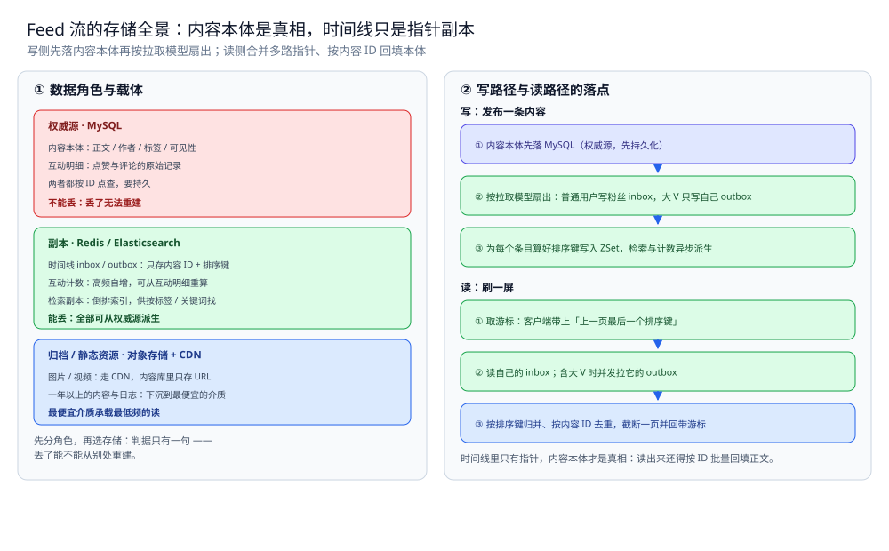
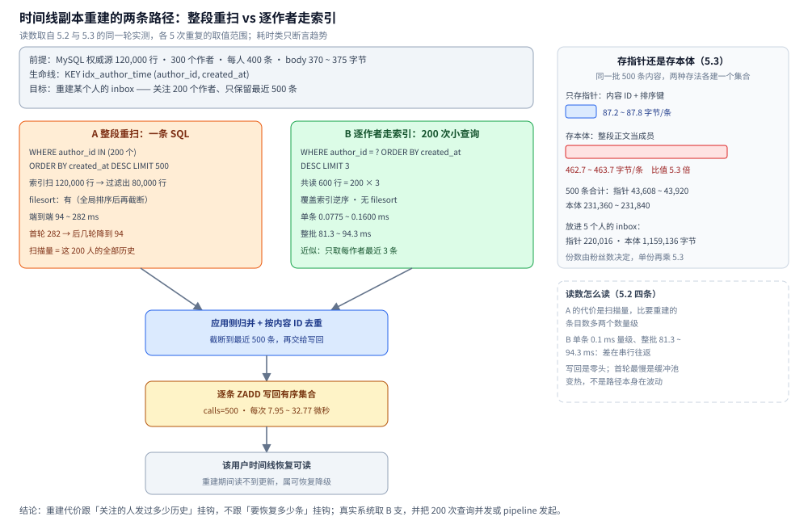

# 存储全景

> Feed 流的数据都存哪：内容本体、时间线指针、检索副本、互动计数、冷归档各是什么角色、放哪个载体。
> 本篇只回答「这份数据放哪」——通用判据（角色 / 同步 / 冷热）见 [存储选型与组合.md](../../../03-数据与中间件/数据存储/存储架构与场景/存储选型与组合.md)，
> 本篇不重复判据，只把判据落到 Feed 流上。
>
> 内容整理自个人学习笔记，素材见 [素材清单](../../../素材清单.md)。
>
> **实测口径**（2026-10-15 补）：第五节的重建路径与体积差在 Docker Desktop 实测跑通 ——`mysql:8.0`（8.0.46，容器 `w4s4-mysql`）+ `redis:7-alpine`（Redis 7.4.11，容器 `w4s4-redis`），脚本 `.workbuddy/tmp/round495/w4s4_final.py`，读数为同一轮 5 次重复的取值范围。本篇其余章节仍是设计讲解，未做实测；一、二、三、四 节与 使用 节的表格不含任何性能读数。

---

## 一、Feed 流里数据扮演哪几种角色？

**本节要点**：Feed 的存储有一个必须先认清的分工——**内容本体是唯一真相，时间线只是指向它的指针**。两者角色不同，载体与生命周期就都不同。

| 数据 | 角色 | 载体 | 理由 |
|---|---|---|---|
| 内容本体（正文、作者、标签、可见性） | 权威源 | MySQL | 唯一真相，按 ID 点查，要持久 |
| 互动明细（谁赞了、谁评论了） | 权威源 | MySQL | 计数的原始依据，本身是事实记录 |
| 时间线（inbox / outbox：内容 ID + 排序键） | 副本 | Redis ZSet | 只存指针；可从内容 + 关注关系重建 |
| 互动计数（点赞 / 评论数） | 副本 | Redis 计数（定期落库） | 高频自增，可从互动明细重算 |
| 检索（按标签 / 关键词找内容） | 检索副本 | Elasticsearch | 从内容本体同步，供搜索用 |
| 图片 / 视频 | 归档 / 静态资源 | 对象存储 + CDN | 体积大、走 CDN，库里只存 URL |
| 冷归档（一年以上的内容与日志） | 归档 | 对象存储 + 列存文件 | 极低频，用最便宜的介质 |

⭐ 判据：**内容本体与互动明细不能重建 → 权威源**；时间线、计数、检索、冷归档都能从它们派生，可丢。**时间线里只有指针、内容本体才是真相**，两者不该放同一种存储、也不该有同一个生命周期。

## 二、读和写的路径分别走哪条链？

**本节要点**：Feed 的写路径是「先落真相、再按拉取模型扇出指针」，读路径是「取多路指针、归并去重、按 ID 回填本体」。

### 2.1 写路径

```text
发布一条内容
│
├─ ① 内容本体落 MySQL（权威源，先持久化）
├─ ② 按拉取模型扇出：普通用户写粉丝 inbox，大 V 只写自己 outbox
├─ ③ 为每个条目算好排序键，写入 ZSet（inbox / outbox）
└─ ④ 异步派生：检索副本（ES）、互动计数（Redis）
```

### 2.2 读路径

```text
刷一屏
│
├─ ① 取游标：客户端带上「上一页最后一个排序键」
├─ ② 读自己的 inbox；含大 V 时并发拉它的 outbox
├─ ③ 按排序键归并、按内容 ID 去重，截断一页并回带游标
└─ ④ 按内容 ID 批量回填正文（命中缓存 / 回源 MySQL）
```

⭐ 判据：**写侧只写指针，读侧才回填本体**；合并与去重必须发生在读取这一段，因为推来的与现场拉的会重叠。



图怎么读：左栏先分角色——红色是权威源（MySQL，存内容本体与互动明细），绿色是副本（Redis 的时间线 inbox / outbox、互动计数，以及 Elasticsearch 的检索副本），蓝色是归档与静态资源（对象存储 + CDN，存图片视频与一年以上的冷数据）。右栏是两条链：写路径先把内容本体落 MySQL，再按拉取模型决定扇出——普通用户写进粉丝的 inbox，大 V 只写自己的 outbox，并为每个条目算好排序键；读路径先取游标，读自己的 inbox（含大 V 时并发拉它的 outbox），按排序键归并、按内容 ID 去重后截断一页，最后按 ID 批量回填正文。整张图的判据是：**时间线里只有指针，内容本体才是真相**。图为存储落点示意，不含任何性能读数。

## 三、为什么这样分配？

**本节要点**：每个角色选中它的载体，都有结构上的理由，不是拍脑袋。

| 数据 | 为什么是它 |
|---|---|
| 内容本体落 MySQL | 唯一真相，按 ID 点查、要事务与持久化；时间线崩了也能靠它重算 |
| 互动明细也落 MySQL | 计数是派生量，明细才是事实；有明细才能对账出正确的计数 |
| 时间线放 Redis ZSet | 按分数取一段是它的强项；内容 ID + 排序键极小，且**可重建** |
| 计数放 Redis、定期落库 | 高频自增不能被行锁拖住；计数可由明细重算，落库只是给冷启动兜底 |
| 检索集放 Elasticsearch | 「按标签 / 关键词找」是倒排的活，关系库的 `LIKE` 用不上索引 |
| 图片视频走对象存储 + CDN | 大文件不进关系库；分发压力交给 CDN，库里只留 URL |

⭐ 一条贯穿全篇的判据：**指针与本体分离**——时间线是「谁该看到什么」的索引，本体是「内容到底是什么」的事实，两者的读写模式、容量、生命周期都不一样。

## 四、Feed 流的特殊性在哪？

**本节要点**：Feed 与 IM / 推荐最大的差别是「**时间线副本可丢、内容本体不可丢**」——这一条决定了它能用最轻的推拉混合方案。

| 对比项 | Feed 流 | IM | 推荐 |
|---|---|---|---|
| 能不能丢 | ⚠️ 时间线副本可丢，内容本体不可丢 | ❌ 消息不能丢，必须落库 + ACK + 补拉 | ✅ 候选列表可丢，下次重算即可 |
| 权威源 | MySQL（内容本体） | MySQL（会话 + 消息） | 离线数仓（样本与特征） |
| 热副本 | Redis ZSet（时间线） | Redis（近期消息） | Redis（在线特征、候选缓存） |
| 同步方式 | 写扩散 / 读扩散（推拉结合） | 写时同步扇出 + 断线补拉 | 离线批量 + 近线增量 |
| 需要补拉吗 | 按需（翻页时回源本体） | ⭐ 必须（按 lastSeq 补） | 不需要（重算即可） |

⭐ 一句话：**Feed 丢的是索引、IM 丢的是事实、推荐丢的是猜想**——所以 Feed 敢把时间线放在可丢的 Redis 里，IM 不敢。

## 五、时间线副本丢了怎么重建？要扫多少？

**本节要点**：本篇说时间线「可丢」，完整含义是「**可重建**」——副本丢了不补，该用户就刷不出内容。重建只有两条路：**整段重扫权威源**（简单，代价是扫描量随关注作者的历史线性增长）和**逐作者走索引取最近若干条再归并**（扫描量只跟关注数挂钩，但要多做一次归并，且结果成了近似）。两条都在本机跑过，读数见 5.2。

### 5.1 先准备一份能被重扫的权威源

按 2.1 的写路径把内容本体落库，并**按作者 + 时间建索引**——这个索引就是重建时的生命线：

```sql
CREATE TABLE feed_content (
  id BIGINT PRIMARY KEY,
  author_id BIGINT NOT NULL,
  created_at BIGINT NOT NULL,
  body VARCHAR(512) NOT NULL,
  KEY idx_author_time (author_id, created_at)
) ENGINE = InnoDB DEFAULT CHARSET = utf8mb4;
```

**实测环境**：`mysql:8.0`（8.0.46，容器 `w4s4-mysql`，本机 `127.0.0.1:24502`）配 `redis:7-alpine`（Redis 7.4.11，容器 `w4s4-redis`，本机 `127.0.0.1:24501`）。表内 120,000 行、300 个作者、每人 400 条，`body` 实际字节 370 ~ 375。要重建的目标是「关注了 200 个作者、只保留最近 500 条」的某一个人 inbox。

### 5.2 两条路径的实测代价

| 路径 | SQL 形态 | 扫描行数 | filesort | 5 次读数 |
|---|---|---|---|---|
| A 整段重扫 | `WHERE author_id IN (200 个) ORDER BY created_at DESC LIMIT 500` | 索引扫 120,000 行 → 过滤出 80,000 行 | 有 | 端到端 94 ~ 282 ms |
| B 逐作者走索引 | `WHERE author_id = ? ORDER BY created_at DESC LIMIT 3`，跑 200 次 | 共读 600 行 | 无（覆盖索引逆序） | 单条 0.0775 ~ 0.1600 ms；整批 81.3 ~ 94.3 ms |

读数怎么读（A、B 各连跑 5 次取同一轮；耗时类只断言趋势，不写严格单调）：

- **A 的扫描量等于「这 200 个作者的全部历史内容」**：80,000 行被读出来、排序、再截断成 500 条 —— 比要重建的条目数多两个数量级。**重建的代价是扫描量**，跟"关注的人发过多少历史"挂钩，而不是跟"要恢复多少条"挂钩。首轮最慢（282 ms）、后面几轮降到 94 ms，是缓冲池变热的趋势，不代表路径本身有波动。
- **B 把扫描量压到 `关注数 × 每作者取几条` = 600 行**，走 `(author_id, created_at)` 索引逆序取，服务端不需要排序。代价是它**只取每个作者最近 3 条**：更新极密集的作者，其较旧条目会被截掉。重建"最近 500 条"这个目标下可以接受，但它确实是近似 —— 要更准就调大每作者取的根数，或者再回扫一轮。
- **B 的瓶颈换成了语句次数**：200 个作者的整批耗时 81.3 ~ 94.3 ms，而服务端单条执行只有 0.1 ms 量级 —— 差三个数量级，多出来的是串行往返。真实系统这段要并发或 pipeline 发起，别写串行 for 循环。
- **写回有序集合不是瓶颈**：500 条逐条 `ZADD`，`INFO commandstats` 读到 `cmdstat_zadd:calls=500`、`usec_per_call` 在 7.95 ~ 32.77 微秒之间波动；相对前面几十到几百毫秒的扫描，写回是零头。

### 5.3 顺带量一件事：线里存指针比存本体省 5.3 倍

三 说"时间线放 Redis ZSet，内容 ID + 排序键极小"，这条本机也量了。同一批 500 条内容，两种存法建两个有序集合（成员分别放内容 ID 与整段正文），用 `MEMORY USAGE key SAMPLES 0` 读数：

| 存法 | 500 条合计 | 每条 | 比值 |
|---|---|---|---|
| 只存指针（内容 ID + 排序键） | 43,608 ~ 43,920 字节 | 87.2 ~ 87.8 字节 | 1 |
| 直接存本体（正文当成员） | 231,360 ~ 231,840 字节 | 462.7 ~ 463.7 字节 | 5.3 |

把同一批 500 条放进 5 个人的 inbox，指针层合计 220,016 字节、本体层合计 1,159,136 字节，比值仍是 5.3 倍，而正文本体在 MySQL 里始终只有一份 —— 这就是 延伸追问 里「存本体等于把一份内容复制成千上万份」的量级：复制份数由粉丝数决定，单份体积又比指针大 5.3 倍，两个因子是相乘的。



图怎么读：左上是前提 —— 权威源 120,000 行、300 作者、每人 400 条，靠 `idx_author_time (author_id, created_at)` 这个索引才谈得上重建；要恢复的是"关注 200 个作者、保留最近 500 条"的一条 inbox。左中是两条路径的对照：A 支（橙）画的是 `IN (200) + 全局排序`，实测索引扫 120,000 行、过滤出 80,000 行、带 filesort、端到端 94 ~ 282 ms；B 支（绿）画的是逐作者 `LIMIT 3`，实测共读 600 行、覆盖索引逆序、无 filesort、整批 81.3 ~ 94.3 ms，旁边那行小字写的是 B 的代价 —— 只取每作者最近 3 条，属近似。两支汇合到「应用侧归并并截断 500 条」，再到「逐条 ZADD 写回：`usec_per_call` 7.95 ~ 32.77 微秒」，最后落到「该用户恢复可读」；B 支框最后一行那句小字写的是它的代价 —— 只取每作者最近 3 条，属近似。右栏上半是 5.3 的两条横条：同一页 500 条，指针 87.2 ~ 87.8 字节/条、本体 462.7 ~ 463.7 字节/条，横条长度按同比例画，比值 5.3 倍；下面两行是 500 条的合计与 5 份 inbox 的合计 220,016 与 1,159,136 字节。右栏下半的虚线小面板把 5.2 那四条读数怎么读浓缩成三行（扫描量多两个数量级、B 差在串行往返、写回是零头且首轮最慢只是缓冲池变热）。底部一行是取舍：真实系统取 B 支，并且别把 200 次查询写成串行 for 循环。图里的数字全部来自 5.2 与 5.3 的同一轮实测，没有推算值。

## 使用：从一次发布到一屏刷新的存储落点

**本节要点**：把「发布一条内容」到「用户刷出一屏」的全过程，标出每一步的存储落点。

| 步骤 | 数据 | 落在哪 |
|---|---|---|
| ① 发布内容 | 内容本体 | MySQL（权威源） |
| ② 判断推还是拉 | 粉丝数 / 阈值 | 无（读关注关系与配置） |
| ③ 写扩散 | 粉丝 inbox 条目 | Redis ZSet（副本） |
| ④ 读扩散 | 自己的 outbox 条目 | Redis ZSet（副本） |
| ⑤ 算排序键 | 分数（时间戳或综合分） | 随条目一起写进 ZSet |
| ⑥ 异步派生检索 | 倒排文档 | Elasticsearch（检索副本） |
| ⑦ 刷屏取游标 | 上一页最后一个排序键 | 客户端持有 |
| ⑧ 读多路指针 | inbox + 大 V outbox | Redis ZSet |
| ⑨ 归并去重 | 内容 ID 列表 | 服务端内存 |
| ⑩ 回填本体 | 正文 / 图片 URL | MySQL + 对象存储（命中缓存则免回源） |
| ⑪ 记互动 | 点赞 / 评论明细 | MySQL（权威源） |
| ⑫ 更新计数 | 点赞数 / 评论数 | Redis 计数（副本，定期落库） |

⭐ 四个关键落点：**本体与互动明细在 MySQL**；**时间线指针与计数在 Redis**；**检索在 Elasticsearch**；**冷数据在对象存储**——只有第一类是丢了就找不回来的。

## 延伸追问

- **为什么时间线不直接存内容本体，省掉一次回填？** → 因为同一条内容要出现在成千上万条时间线里，存本体等于把一份内容复制成千上万份；存指针则一份本体对应 N 个极小的条目，本体改动（如置顶、可见性变更、删除）也只需要改一处。
- **时间线副本丢了会怎样？** → 不会丢数据，只会丢"顺序"：从内容本体按作者与时间重扫一遍就能重建某条时间线；代价是重建期间该用户可能读不到自己关注的更新，属可恢复的降级。
- **互动计数既然能重算，为什么还落库？** → 冷启动与对账。计数靠明细重算的代价是扫描量，定期落库保存的是"某个时刻的正确值"，用于快速恢复与发现漂移。
- **检索副本的延迟能接受吗？** → 能。Feed 的搜索是"找历史内容"，不是"实时消费"，秒级延迟不影响体验；换来的是不把倒排索引的写入压到在线库上。路线选型见 [数据同步方式选型对比.md](../../../03-数据与中间件/数据存储/数据同步/数据同步方式选型对比.md)。
- **这套看法和 IM 的存储有什么区别？** → IM 的权威源里装的是**消息事实**，丢了补不回来；Feed 的权威源里装的是**内容事实**，时间线只是索引，所以 Feed 可以把索引放在最便宜的地方、丢了重建。

## 关联

- [存储选型与组合.md](../../../03-数据与中间件/数据存储/存储架构与场景/存储选型与组合.md) — 通用判据：五种角色、同步三路线、冷热三层——本篇是它在 Feed 流上的落地。
- [时间线存储与分页.md](时间线存储与分页.md) — 时间线存哪、游标分页、多路合并、缓存分层与冷热数据。
- [写扩散与读扩散.md](写扩散与读扩散.md) — 写侧到底写几份、大 V 阈值怎么定，直接决定时间线的载体形态。
- [排序与去重.md](排序与去重.md) — 排序键就是写入 ZSet 的分数，也是去重与游标的依据。
- [README.md](README.md) — 本目录导读：三个核心问题与零件清单。
- [数据同步方式选型对比.md](../../../03-数据与中间件/数据存储/数据同步/数据同步方式选型对比.md) — 通用篇的同步路线：CDC / 双写 / 定时全量怎么选。
> 反向引用（本篇被下列文档引到）：[总体设计.md](总体设计.md)
