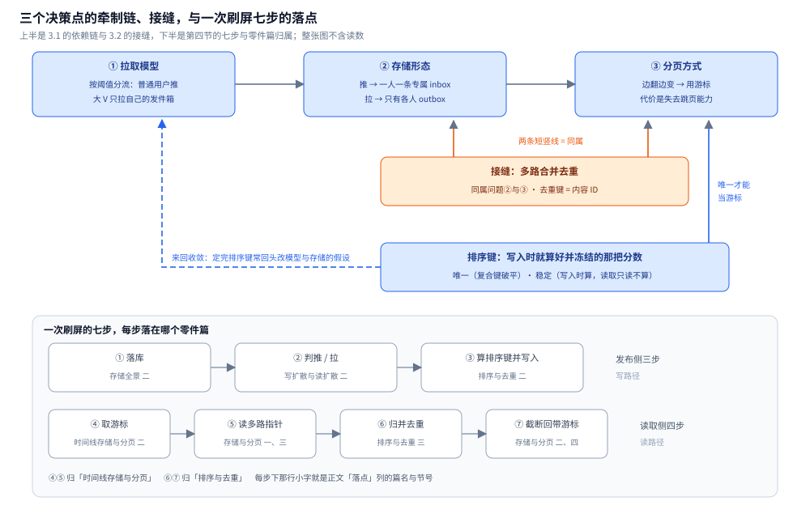

# 总体设计

> 本系统**整体方案**：分几层 / 几部分、各干什么、怎么配合、核心取舍在哪。
> **各部分的细节**在零件篇里；**数据落点**在存储全景里；**篇目清单与阅读顺序**在 README 里。
>
> 本目录收**通用 Feed 流**这道场景题：本篇是**总体设计**（整体形态 + 核心取舍 + 一次刷屏走哪几步），
> 篇目清单与阅读顺序见 [README.md](README.md)，数据落点见 [存储全景.md](存储全景.md)；三篇零件各自成篇 ——
> [写扩散与读扩散.md](写扩散与读扩散.md)（推拉代价 / 混合模式 / 大 V 阈值 / 模式切换）、
> [时间线存储与分页.md](时间线存储与分页.md)（存储选型 / 游标分页 / 多路合并 / 缓存分层与冷热）、
> [排序与去重.md](排序与去重.md)（时间倒序 vs 综合分 / 稳定排序键 / 合并去重 / 兜底默认序）。
>
> 内容整理自个人学习笔记，素材见 [素材清单](../../../素材清单.md)。
> ⚠️ 本目录几篇均为**设计讲解与骨架**，未做本机实测；正文凡涉及读数的均**不编造**，确需数字的地方只给**判据与量级方向**。
>
> **实测口径补充**（2026-10-15）：上面那句"本目录未做本机实测"现在只适用于**本篇**。零件篇里 [排序与去重.md](排序与去重.md) 第六节（Redis 7.4.11 + go1.26.8 实测同秒碰撞漏条数与每页重算的重复/漏条数）、[存储全景.md](存储全景.md) 第五节（MySQL 8.0.46 + Redis 7.4.11 实测重建扫描量与指针/本体内存比）已补 Docker 实测读数。本篇仍是纯设计讲解，全文不含任何性能读数。

---

## 一、系统的整体形态是什么？

**本节要点**：Feed 的整体形态是一条**两段链** —— **发布侧决定"这条内容送给谁"（推还是拉），读取侧决定"把多路指针怎么拼成一屏"（归并、去重、翻页）**。两端之间靠一份"指向内容本体的有序指针列表"（时间线）衔接，这就是全系统唯一的一处共享状态。

一句话概括：**发布时按扇出系数决定写给谁，读取时把多路指针归并去重成一屏。**

🔗 同型不重画：这张两段链全景图的图片行只在 [README.md](README.md) 第一节保留，本目录其余篇一律用链接指过去 —— [Feed推拉混合扇出.svg](images/Feed推拉混合扇出.svg)

图怎么读：这张图是本目录共用的扇出形态图，但这里要当**两段链的纵切面**看，按"发布 → 存储 → 读取"三段往下走，而不是只盯两支的扇出系数。发布侧只有一次决定「这条内容送给谁」——普通用户走推、写给 F 个粉丝的 `inbox`，大 V 走拉、只写自己的 `outbox`；中间那层是**事实与索引的分工**，内容本体落在 MySQL（唯一真相），进有序集合的每个条目都只是「内容 ID + 排序键」这样一个**指针**（`inbox:{fan}` / `outbox:{author}` 里成员是内容 ID、分数是排序键）；读取侧把「推来的 inbox」与「现场拉的大 V」两路**按排序键归并、按内容 ID 去重、截断一页、回带游标**。读这张图只需记住一件事：**端到端只有一个地方能同时看见两路，就是读取侧的合并那一步**，所以去重只能做在那里。

按数据流，整个系统分**两个部分、三个决策点**，每一格只干一件事：

| 部分 | 干什么 | 关键判据 | 细节在哪 |
|---|---|---|---|
| **发布侧 · 拉取模型** | 决定一条内容发布时**写给谁**（推 / 拉 / 混合） | 比总写放大 `F × P` 与总读放大 `M × R` | [写扩散与读扩散.md](写扩散与读扩散.md) 一 |
| **发布侧 · 扇出** | 内容本体落库、把指针按模型写进 inbox / outbox | 扇出系数 = 粉丝数 F（推）或 1（拉） | [写扩散与读扩散.md](写扩散与读扩散.md) 二 |
| **读取侧 · 存储与分页** | 这份「某人的 Feed」存在哪、怎么从任意位置往下翻 | 边翻边变 → 必须**游标**分页 | [时间线存储与分页.md](时间线存储与分页.md) 一、二 |
| **读取侧 · 归并去重** | 多路指针按排序键归并、按内容 ID 去重 | 归并按排序键，去重按内容 ID，用堆做 k 路归并 | [时间线存储与分页.md](时间线存储与分页.md) 三 |
| **读取侧 · 排序键** | 把多个信号折成**一个唯一且冻结的分数** | 唯一（可当游标）+ 稳定（读取只读不算） | [排序与去重.md](排序与去重.md) 二 |
| **横切 · 数据落点** | 本体 / 指针 / 计数 / 检索 / 冷归档各放哪 | 指针与本体分离，时间线可丢、本体不可丢 | [存储全景.md](存储全景.md) |

⭐ 两段的分工不是随意的：**发布侧做的是"一份内容 → N 个指针"的复制（写放大），读取侧做的是"多份指针 → 一屏内容"的收敛（读收敛）**。整条链的全部工程量，本质就是在这两端之间**选一个把总代价摊薄的地方**。

⭐ 判断顺序锁死：**先定拉取模型，再定存储，最后定排序** —— 因为模型决定了"送到读侧的是已经排好的一份，还是需要现场合并的几份"，存储和排序都得跟着它走。为什么牵制、怎么来回收敛，见第三节。

---

## 二、核心取舍在哪？

**本节要点**：三个取舍决定了这套方案的长相 —— **成本压在写侧还是读侧、分页用游标还是 offset、排序用时间倒序还是综合分**。三者的方向都不是"谁更先进"，而是"**代价落在哪一侧可以接受**"。

### 2.1 取舍一：成本压在写侧还是读侧

推和拉不是"哪个更好"，而是**把发帖的成本放在写侧还是读侧**：推把成本压在发布那一下（**写放大 ∝ 粉丝数 F**），拉把成本压到每次读取（**读放大 ∝ 关注数 M**）。

```text
推（写扩散）：发布 O(F)  ── 发布时写给每个粉丝   → 扇出 = F
拉（读扩散）：发布 O(1)  ── 读取时聚合关注对象   → 扇出 = 1
混合        ：普通用户走推、大 V 走拉           → 扇出 = F 或 1
```

判据是四个量：**比总写放大 `F × P` 与总读放大 `M × R`**，让总放大更大的那一侧把成本推给另一侧。但两端各有一个硬上限：**纯推写不动大 V**（扇出 ∝ F，F 以百万计时一次发布就是百万次写，写侧先爆），**纯拉让重度用户读变慢**（合并路数 ∝ M，关注几千人时首屏要被拖死）。所以方向是**混合** —— 按一个阈值把用户分两类，普通用户推、大 V 拉。

⭐ 最值钱的一点：**阈值不是"多少粉算大 V"的常识数字，而是"多大扇出还在预算内"的工程反推** —— 按可接受的扇出系数反解，再用 `粉丝数 × 发帖频次` 修正（避免漏掉"粉丝中等但日更几十条"的账号），由离线任务定期刷新，不在发布路径上实时算。

**代价**：① 读路径变复杂（要合并"推来的"和"现场拉的"，还要去重、排序、分页）；② 阈值要随存储能力调整，维护大 V 名单本身是运维成本；③ 名单滞后 —— 刚涨粉成大 V 的账号在名单刷新前仍按普通用户推，会有一两天的过渡性扇出放大。细节与判据表见 [写扩散与读扩散.md](写扩散与读扩散.md) 二。

### 2.2 取舍二：分页用游标还是 offset

时间线是**边翻边变**的 —— 翻页的同时可能有人发布、有人删除。用"跳过前 K 条"（offset）分页会出两种错：

```text
插入新内容 → 原来的第 10 项被挤到第 11 位 → 第 2 页从新的第 11 项开始 → 第 10 项被跳过（漂移）
删除内容   → 后面整体前移 → 原本第 11 项变成第 10 项 → 第 1 页末尾与第 2 页开头都出现（重复）
```

根因是一句话：**offset 假设"集合是静止的"，而时间线是活的**。游标分页改用"**从上一页最后一个排序键之后继续**"当锚点，中间增删都不影响位置。它的**硬前提**是排序键必须**能唯一定位** —— 纯时间戳在同秒会碰撞，要用发号器 ID（雪花 ID）或"(综合分, 内容 ID)"复合键破平。

⭐ 这笔交易非常划算：**游标换来了翻页一致性，代价是失去"跳到任意页"的能力**；而 Feed 是"一路往下刷"的形态，几乎不需要跳页。若要"跳到第 N 页"，得改用快照等其他手段，别硬套游标。对比表见 [时间线存储与分页.md](时间线存储与分页.md) 二。

### 2.3 取舍三：排序用时间倒序还是综合分

| 维度 | 时间倒序 | 兴趣/热度综合分 |
|---|---|---|
| 排序键 | 时间戳 / 发号器 ID | 综合分（时间 + 热度 + 亲密度 + 兴趣） |
| 唯一性与单调性 | 天然唯一、天然单调 | 需复合键破平；**不单调且会漂移** |
| 可解释性 | 高（最新的在最上面） | 低（用户会问"这条为什么在这"） |
| 游标分页 | 直接可用 | 要额外防漂移 |
| 实现成本 | 低 | 高（要算分、要防漂移） |

⭐ 一句话：**时间倒序是"地基"，兴趣排序是"装修"** —— 先有稳定的时间倒序基线，再往上叠信号；不要一上来就做个性化，否则连"翻页会不会重复"都没解决。

**把综合分做稳的关键**是两条：**唯一**（用"(综合分, 内容 ID)"复合键破平）与**稳定**（分数在**写入时算好并冻结**，读取只读不算）。如果每次翻页都重算，`now` 变了分数必然漂移，游标立刻失效。**兜底**则永远回到时间倒序 —— 它唯一、单调、可游标，且依赖最少（只要有发布时间/发号器 ID），所以在个性化服务超时或冷启动时，它是唯一永远可用的默认序。细节见 [排序与去重.md](排序与去重.md) 二、五。

这三个取舍各自都已有同型图，本篇不重画，只按取舍指过去：取舍一（成本压在写侧还是读侧，含推与拉的存储形态对照与选型判定分支）见 🔗 [Feed推拉代价结构与选型判据.svg](images/Feed推拉代价结构与选型判据.svg)；取舍二（游标还是 offset，含一条时间线被游标切成两页的分数轴）见 🔗 [时间线存储与游标分页.svg](images/时间线存储与游标分页.svg)；取舍三（时间倒序还是综合分，含冻结键与漂移后果的会话时序）见 🔗 [Feed排序与去重流水线.svg](images/Feed排序与去重流水线.svg) 与 🔗 [Feed翻页会话插入与降级兜底时序.svg](images/Feed翻页会话插入与降级兜底时序.svg)；取舍一、二被实测打出来的条数（同秒碰撞漏 1 / 3 / 4 条、每页重算重复与漏 5 / 10 / 29 条）画在 🔗 [排序键碰撞与漂移实测.svg](images/排序键碰撞与漂移实测.svg)。

---

## 三、各部分怎么配合？

**本节要点**：三个决策点**互相牵制**，不能各定各的；它们之间有一条确定的依赖链，还有一处必须两边都认的接缝。

### 3.1 三个问题的依赖链

```text
拉取模型 ──► 存储形态 ──► 分页方式
    └────────► 排序键 ◄────────┘   （排序键同时是游标与去重键，反过来约束前两者）
```

- **模型 → 存储**：写扩散下每个用户有一条**自己专属**的时间线（inbox），写入方要定位到这条线；读扩散下没有"专属时间线"，只有每个发布者的**发件箱**（outbox），读侧要现场合并多个发件箱。
- **存储 → 分页**：按分数存在有序集合里，翻页天然可以按分数做游标；存成普通列表靠下标翻，就会撞上 2.2 说的漂移与重复。
- **排序键 → 去重与游标**：排序键必须**全局唯一且稳定**，否则同一内容在两路合并里会被当成两条，游标也无法唯一定位。

⭐ 所以真设计的过程是**一个来回收敛，不是单向流水线**：定完排序键常常会发现"这一步本该在写入时就算完"，于是回头改模型与存储的假设。

🔗 3.1 这条依赖链与 3.2 那个接缝已经画成图，图片行落在本篇第四节末尾：[三个决策点的牵制链与七步落点.svg](images/三个决策点的牵制链与七步落点.svg) —— 它的上半栏就是这两小节的展开（①→②→③ 三个决策点各写结论形态、中下橙格是「多路合并去重」同属②与③、绕回①的折线就是上面这句来回收敛），同型不重画。

### 3.2 三个问题的接缝：多路合并去重

```text
问题① 拉取模型      → 零件 1 / 2 / 3（推、拉、混合与大 V）
问题② 存储与分页    → 零件 4（存哪 + 怎么翻）与 零件 5（多路怎么合）
问题③ 排序与去重    → 零件 5 / 6（合并去重、稳定键、兜底序）
```

注意 **「多路合并去重」同时属于问题②和③** —— 它是三个问题的**接缝**。凡是"多路来源"的 Feed（推来的收件箱 + 现场拉的大 V + 广告/推荐插入），合并这一步都躲不掉。这也是为什么**模式切换窗口的重叠（既推又拉）不靠"切换点原子对齐"消除，而靠读侧去重天然吸收** —— 去重必须做在合并这一步，而不是只做在写入时。

### 3.3 与关系链存储的分工

本系统需要读侧知道"**当前**关注了谁""谁是当前的大 V"，这份数据属于**关系链**，不属于时间线：

| 问题 | 归属 |
|---|---|
| 关注关系怎么存、怎么分片 | [关注粉丝设计.md](../社交互动系统/关注粉丝设计.md) |
| 一条内容怎么扇出成 N 条时间线条目 | [写扩散与读扩散.md](写扩散与读扩散.md) |
| 读时怎么用关系做过滤 / 挑路 / 合并 | [时间线存储与分页.md](时间线存储与分页.md)、[排序与去重.md](排序与去重.md) |

> ⭐ 边界一句话：**那边讲"边怎么存"，这边讲"内容怎么沿边扩散成时间线"** —— 所以本目录可以独立于关系链存储阅读，只在"粉丝数变化时怎么切模式""合并时怎么用当前关注关系挑路"处引用它。

---

## 四、一次完整刷屏走哪几步？

**本节要点**：把三个决策点串成一条端到端链路，帮助定位"某一步该看哪一节"。发布侧三步、读取侧四步，每一步都落在具体零件篇上。

| # | 步骤 | 做什么 | 落点 |
|---|---|---|---|
| ① | 发布内容 | 内容本体落 MySQL（权威源，先持久化） | [存储全景.md](存储全景.md) 二 |
| ② | 判推 / 拉 | 普通用户写扩散、大 V 只写自己发件箱 | [写扩散与读扩散.md](写扩散与读扩散.md) 二 |
| ③ | 算排序键并写入 | 为每个条目算好排序键（冻结），写进 inbox / outbox 有序集合 | [排序与去重.md](排序与去重.md) 二 |
| ④ | 取游标 | 客户端带上"上一页最后一个排序键"，没有就是首页 | [时间线存储与分页.md](时间线存储与分页.md) 二 |
| ⑤ | 读多路指针 | 读自己的 inbox；关注里含大 V 时并发拉它的 outbox | [时间线存储与分页.md](时间线存储与分页.md) 一、三 |
| ⑥ | 归并 + 去重 | 按排序键 k 路归并（堆、取够即停），按内容 ID 去重 | [排序与去重.md](排序与去重.md) 三 |
| ⑦ | 截断一页并回带游标 | 按稳定排序键截断，回带新游标；按 ID 批量回填正文 | [时间线存储与分页.md](时间线存储与分页.md) 二、四 |

```text
发布：落库 → 判推/拉 → 算排序键 → 写有序集合
读取：取游标 → 读 inbox(+拉大V) → 归并去重 → 截断一页 → 回带游标
        └─ 存储与分页 ─┘   └──── 排序与去重 ────┘
```

⚠️ 三个常见误区：① 以为"写入时判重就够了" —— 跨路重复只能靠读取合并时去重；② 以为"排序键时间戳天然能当游标" —— 同秒会碰撞，得用发号器或复合键；③ 以为"多路就是各自取满一页再排" —— 某一路可能独占整页，其余白读。



图怎么读：上栏是 3.1 那条依赖链的展开 —— 三个决策点按 ①拉取模型 → ②存储形态 → ③分页方式 单向排开，每格里写的是它各自的**结论形态**（①：按阈值分流，普通用户推、大 V 拉；②：推 → 一人一条 inbox，拉 → 只有各人 outbox；③：边翻边变 → 游标，代价是失去跳页）。②与③中间下方挂着的橙格是 3.2 说的**接缝** ——「多路合并去重」同时属于问题②和问题③，两条短竖线就是"同属"的意思：它既是取几路指针的存储问题，也是按什么键判留的顺序问题，去重键固定为内容 ID。蓝格是排序键，向上那条竖线表示它直接决定分页能不能用（唯一才能当游标），绕回①的那条折线表示 3.1 末尾说的**来回收敛** —— 定完排序键常回头改模型与存储的假设，不是单向流水线。下栏是第四节的七步：发布侧三步（① 落库 → ② 判推/拉 → ③ 算排序键并写入）与读取侧四步（④ 取游标 → ⑤ 读多路指针 → ⑥ 归并去重 → ⑦ 截断一页回带游标）分两行排，每步下面那行小字就是正文「落点」列里的零件篇与节号；下栏最底那行括号对应正文那个 text 图 —— ④⑤ 归「时间线存储与分页」、⑥⑦ 归「排序与去重」。整张图只有步骤名、归属和判据，不含任何读数。

---

## 五、这套方案的前提与边界是什么？

**本节要点**：这套推拉混合方案的成立，依赖几个前提；跳出这些前提，答案要换。

| 场景 | 这套方案 | 为什么 |
|---|---|---|
| **读远多于写**（典型 Feed） | ✅ 适用 | 写本来就少，摊在少数几次写上（偏推）；读虽多但读侧 O(1) |
| **关注数有上限**、或写远多于读 | ✅ 适用 | 读合并路数可控（偏拉）；写侧 O(1) |
| **一路往下刷、不需要跳页** | ✅ 适用 | 游标换来翻页一致性，代价（不能跳页）在这里不成问题 |
| **需要"跳到第 N 页"** | ❌ 不适用 | 游标不支持跳跃，得改用快照 / offset + 静态集合 |
| **粉丝数不可估、关注数不可控** | ❌ 不适用 | `F`、`M` 算不出，混合阈值与合并路数上限都无处安放 |
| **数据"不能丢"（消息类）** | ❌ 不适用 | 那是 [IM 系统](../IM系统/README.md) 的领域：消息是**事实**，丢了补不回来；Feed 的时间线只是**索引** |

依赖的外部条件：

- **可估的扇出**：作者粉丝数 / 发帖频次可统计，才能反推大 V 阈值。
- **可离线维护的大 V 名单**：名单由定期任务刷新，读侧只读不改（见 [关注粉丝设计.md](../社交互动系统/关注粉丝设计.md)）。
- **排序键全局唯一且可冻结**：发号器（雪花 ID）或"(综合分, 内容 ID)"复合键。
- **有权威源可回填**：内容本体在 MySQL / MongoDB，时间线只存指针、丢了能重建。
- **有界时间线**：inbox 只保留最近 N 条，超出部分回源或"到底了"（N 按产品翻页深度与内存预算定）。

> ⚠️ **读数口径**：本目录为设计讲解与骨架，**未做本机实测** —— `F`、`M`、`P`、`R`、阈值、`N` 都是符号或产品水位参数，不套用别处的数字；凡需要压测标定的量，本篇只给判据与量级方向。

> 2026-10-15 补记：上面这句对本篇依然成立 —— 本篇全文没有读数。目录范围内的口径已更新：[排序与去重.md](排序与去重.md) 第六节与 [存储全景.md](存储全景.md) 第五节已补 Docker 实测（条数、扫描行数、耗时范围、内存比），本篇 2.2 与 延伸追问 里"同秒碰撞""重建代价是扫描量"这两处判据可以直接引到那两节，不必再当成未验证的说法。

---

## 使用：本方案的组件清单

**本节要点**：把上述方案落成组件，各自承担什么角色、以什么形态部署。

| 组件 | 承担什么 | 部署形态 | 数据角色 |
|---|---|---|---|
| **Redis ZSet** | 时间线（inbox / outbox）+ 互动计数 | 单实例起步；生产按用户 hash 分片 + 副本 | **副本** —— 可从内容本体重建，可丢 |
| **MySQL** | 内容本体 + 互动明细 | 主从；本体按作者 + 时间建索引 | **权威源** —— 丢了补不回来 |
| **Elasticsearch** | 按标签 / 关键词找内容的检索副本 | 集群，从本体异步同步 | 检索副本 —— 可重建 |
| **对象存储 + CDN** | 图片 / 视频与一年以上的冷归档 | 对象存储 + CDN 分发 | 静态资源 / 归档 —— 库里只存 URL |
| **Go（骨架）** | 扇出、游标分页、k 路归并去重的示意实现 | 无状态服务，可水平扩 | 无（业务逻辑） |

⭐ 这套清单的判据只有一条：**指针与本体分离** —— 时间线是「谁该看到什么」的索引，本体是「内容到底是什么」的事实，两者的读写模式、容量、生命周期都不一样。各角色的完整落点见 [存储全景.md](存储全景.md)。

## 延伸追问

- **为什么不能所有用户都走读扩散，一劳永逸？** → 读扩散把成本压到读侧，读的合并路数 ∝ 关注数。对"关注几千人"的重度用户，每次刷新都要合并几千路，读延迟不可控。所以纯拉只适合关注数有上限或写远多于读的场景（见 [写扩散与读扩散.md](写扩散与读扩散.md) 一）。
- **为什么不能所有用户都走写扩散，简单统一？** → 写扩散的发布成本 ∝ 粉丝数，一个千万粉账号发一条就是千万次写，发布峰值直接打满存储。扇出系数太大是写扩散的硬上限，这正是 2.1 要引入大 V 阈值的原因。
- **模式切换的一瞬间会不会重复推 / 漏推？** → 一定会短暂出现"既推又拉"的重叠窗口，但它**不该靠切换时精确对齐来消除**，而应靠读侧合并时的**内容 ID 去重**天然吸收（见 3.2）。
- **游标分页能不能换成 offset？** → 只有在"翻页过程中集合静止"时才勉强可以；Feed 边翻边变，offset 会漂移漏条或翻页重复，所以必须游标（见 2.2）。
- **时间线副本丢了怎么办？** → 不会丢数据，只会丢"顺序"：从内容本体按作者与时间重扫一遍就能重建某条时间线。所以时间线**可以不持久**，关键是把"重建"路径准备好（见 [存储全景.md](存储全景.md)）。
- **这套方案和朋友圈那种具体场景差在哪？** → 朋友圈篇的价值在**具体场景的要素推演**，本目录的价值在**跨场景的工程零件**（存储、分页、排序键）。二者互引：朋友圈讲"为什么可以推"，到了要展开通用分页与排序键时指向本目录。

## 关联

- [README.md](README.md) — 目录导读：核心问题 / 篇目清单 / 阅读顺序 / 目录分工。
- [存储全景.md](存储全景.md) — 横切篇：Feed 的数据都存哪、谁是权威源、怎么同步。
- [写扩散与读扩散.md](写扩散与读扩散.md) — 推拉代价结构、混合模式与大 V 阈值、扇出放大、模式切换。
- [时间线存储与分页.md](时间线存储与分页.md) — 存哪、游标分页、多路合并、缓存分层与冷热数据。
- [排序与去重.md](排序与去重.md) — 时间倒序 vs 兴趣排序、稳定排序键、合并去重、兜底默认序。
- [朋友圈设计.md](../社交互动系统/朋友圈设计.md) — 具体场景（朋友圈）的要素分析与推拉分层，本目录与之互引。
- [关注粉丝设计.md](../社交互动系统/关注粉丝设计.md) — 关系链的存储与分片；本目录只讲时间线扇出，不重讲边怎么存。
- [排行榜设计.md](../社交互动系统/排行榜设计.md) — 同样用有序集合，游标分页与分数更新的写法可对照。
- [总体设计.md](../秒杀系统/总体设计.md) — 另一类高并发场景（稀缺资源扣减），同样面临"削峰与原子性"的取舍，可对照阅读。
- [README.md](../README.md) — 系统设计分区导读，本目录是其下的一个主题目录。
- [存储选型与组合.md](../../../03-数据与中间件/数据存储/存储架构与场景/存储选型与组合.md) — 通用视角：数据角色、权威源与副本、冷热分层与多存储同步。
> 反向引用（本篇被下列文档引到）：[总体设计.md](../推荐系统/总体设计.md)
