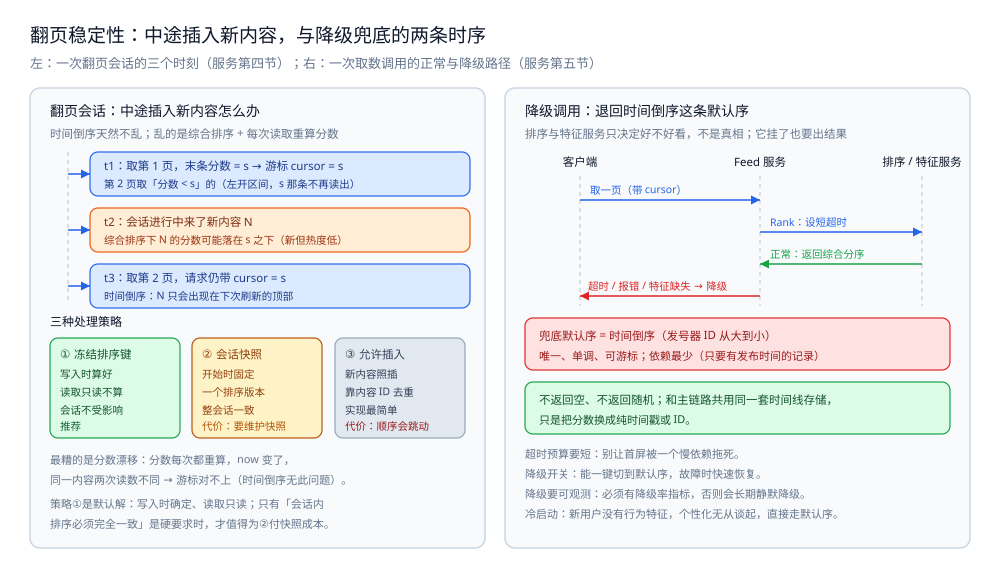
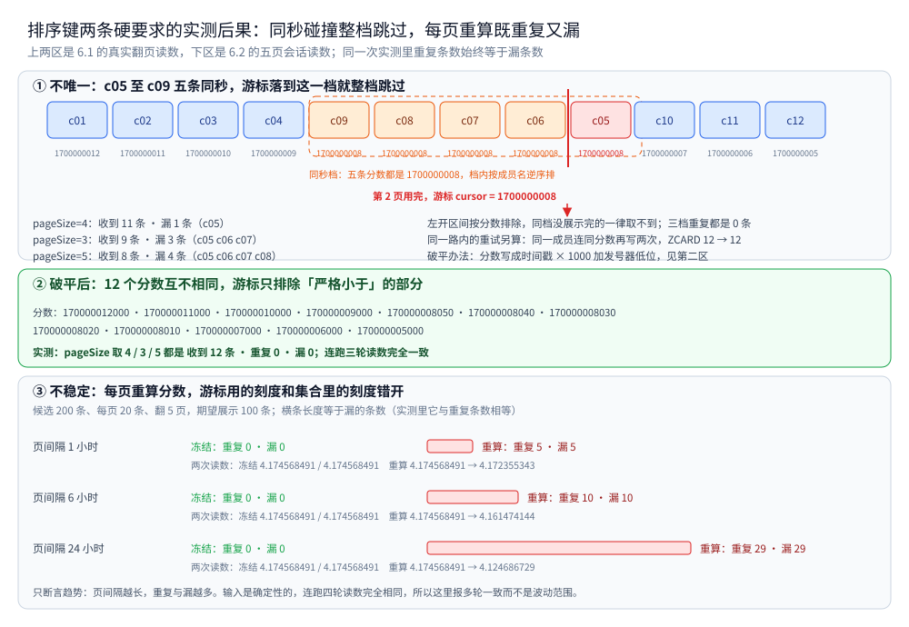

# 排序与去重

> Feed 取出来的那一屏，按什么顺序摆、多条来源里重复的怎么去掉、翻页翻到一半又来了新内容怎么办。
> 本篇讲时间倒序与兴趣排序的取舍、把多个信号折成一个**稳定排序键**、多路合并去重、分页中途插入的处理、以及无个性化时的兜底默认序。
>
> 内容整理自个人学习笔记，素材见 [素材清单](../../../素材清单.md)。

---

## 一、时间倒序还是兴趣/热度排序？

**本节要点**：排序方式决定了整条 Feed 的"味道"。时间倒序**简单、稳定、可解释**，用户知道"越往下越旧"；兴趣/热度排序**更抓注意力**，但代价是**可解释性变差、排序键变复杂、翻页更难做稳**。选哪个，取决于产品对"确定感"和"停留时长"的偏好。

### 1.1 时间倒序：最简单也最稳

**做法**：按内容的发布时间（或其等价的发号器 ID）从新到旧排。

| 优点 | 说明 |
|---|---|
| **排序键就是一个时间戳/ID** | 天然唯一（配合发号器）、天然单调、天然可做游标 |
| **可解释** | "最新的在最上面"，用户不会有"这条为什么在这"的疑问 |
| **翻页稳定** | 新内容只会出现在**顶部**，不会插到已翻过的地方（配合游标，见 [时间线存储与分页.md](时间线存储与分页.md) 二） |

⭐ 时间倒序之所以是**大多数 Feed 的默认基线**：它把"排序"这件事的复杂度压到了最低，而且它天然满足游标分页对"排序键唯一且单调"的要求。

### 1.2 兴趣/热度排序：把多个信号折进来

**做法**：不只看时间，还看**互动量、内容质量、作者亲密度、用户兴趣匹配**等信号，算一个综合分来排。常见的有两类：

- **热度排序**：热度 = 互动量的函数（点赞、评论、转发的加权），再**除以时间衰减**，让"新且热"的浮上来。
- **个性化排序**：在热度基础上再叠加"用户与作者的亲密度""用户对这类内容的偏好""历史点击率预估"等个性化信号。

| 优点 | 代价 |
|---|---|
| 提升相关性与停留时长 | 排序键不再唯一、不再单调 → **游标语义变复杂** |
| 能把高价值内容顶上来 | **可解释性差**，用户会疑惑"为什么这条在这" |
| — | 分数会**随时间漂移**（同一内容昨天分数和今天不同）→ 翻页一致性难保证 |

### 1.3 两者的对比

| 维度 | 时间倒序 | 兴趣/热度排序 |
|---|---|---|
| 排序键 | 时间戳 / 发号器 ID | 综合分（时间 + 互动 + 个性化） |
| 唯一性 | 天然唯一（发号器） | 需复合键破平 |
| 单调性 | 天然单调 | 不单调，且会漂移 |
| 可解释性 | 高 | 低 |
| 游标分页 | 直接可用 | 要处理漂移 |
| 实现成本 | 低 | 高（要算分、要防漂移） |

⭐ 一句话：**时间倒序是"地基"，兴趣排序是"装修"**。先有稳定的时间倒序基线，再往上叠信号；不要一上来就做个性化，否则连"翻页会不会重复"都没解决。

### 1.4 判据小结

| 问题 | 判据 |
|---|---|
| 该用时间倒序还是兴趣排序？ | 问"产品要的是**确定感**还是**停留时长**" → 前者用时间倒序，后者才引入综合分 |
| 能不能两种混用？ | 可以，且常见：**主时间线用时间倒序**（保证可翻页、可解释），**插播位用兴趣排序**（推荐/广告）按位次插入 |
| 引入兴趣分之前要先想清楚什么？ | 想清楚"排序键还唯不唯一、还单不单调"——这直接决定游标分页还能不能用 |

---

## 二、怎么把多个信号折成一个稳定排序键？

**本节要点**：无论时间倒序还是综合排序，最后都要落到**一个可比较的排序键**上（因为时间线存储用的是"按分数排序"，见 [时间线存储与分页.md](时间线存储与分页.md) 一）。关键要求两条：**唯一**（能当游标）和**稳定**（同一条件算出来一样）。

### 2.1 为什么非要"一个键"

时间线存储在有序集合里，有序集合的排序依据是**单个分数**。多个信号（时间、热度、亲密度、兴趣）不能各占一个字段让它自己排，必须**先合成一个可比较的标量**。

```text
原始：时间 t、热度 h（点赞+评论+转发）、亲密度 a、兴趣匹配 i ...
目标：一个 score，使"越大越该靠前"
```

### 2.2 score 怎么组成

**常见做法**：把信号折成一个数，量纲对齐后加权求和：

```text
score = w_time · f_time(t)          （时间项：越新越大；常做对数或衰减）
      + w_hot  · f_hot(h)           （热度项：互动量，常取对数压量纲）
      + w_aff  · f_aff(a)           （亲密度：与作者的互动频率等）
      + w_int  · f_int(i)           （兴趣匹配：预估点击率等）

其中，时间项通常带衰减，让"旧的热内容"逐渐沉下去：
      f_time(t) = 1 / (1 + α·(now - t))   或   e^(-λ·(now - t))
```

要点：

- **量纲对齐**：不同信号量纲差异巨大（互动量可能上千，亲密度是 0~1），直接相加会让大数信号淹没小数信号。所以要**先各自归一化/取对数**再加权。
- **权重 w**：由离线效果实验或业务经验决定；权重的微调会让排序整体偏移，所以**要有离线评估与灰度**。
- **衰减**：时间项的衰减速率决定了"热点能热多久"，是综合排序里最敏感的参数之一。

> ⚠️ 未实测：本目录不提供任何具体的权重或衰减系数。这些参数**必须由数据决定**（离线评估 + 线上灰度），套用别处的数字只会得到一个不好用的排序。

### 2.3 唯一与稳定

一个"可当游标的排序键"要满足两件事：

| 要求 | 含义 | 怎么做到 |
|---|---|---|
| **唯一** | 任意两条内容分数不同 | 综合分是浮点数，易碰撞 → 用"**(score, 内容 ID)** 复合键"破平；比较时按 score 降序、ID 升序（或降序） |
| **稳定** | 同样的输入算出来一样 | 分数一旦算好就**冻结**在时间线条目里；不要每次读取时重算（否则同一条内容两次读到的分数不同，翻页就会乱） |

⭐ 关键直觉：**"稳定"意味着分数在写入时确定，读取时只读不算**。如果每次翻页都重算综合分，那时间本身就是输入（`now` 变了），分数必然漂移 → 游标失效。这也是为什么综合排序比时间倒序"更难做稳"。

### 2.4 分页中途插入新内容怎么办？

（这个问题在综合排序下尤为突出，详见第四节。）

**核心思路**：让"新算出的分"**不打断已有页的游标**。做法是把分数**冻结在写入时刻**，翻页一律用冻结的分数 —— 新内容带着它自己（更高的）分数进入，只会出现在**未来重新刷新时**的顶部，不会插进当前正在翻的会话里。

### 2.5 判据小结

| 问题 | 判据 |
|---|---|
| 多信号怎么合？ | 先量纲对齐（归一化/取对数），再加权求和；别让大数信号淹没小数信号 |
| 权重怎么定？ | 离线评估 + 线上灰度；不拍脑袋 |
| 排序键怎么保唯一？ | 用"(综合分, 内容 ID)"复合键破平 |
| 排序键怎么保稳定？ | 分数**写入时算好并冻结**，读取只读不算 |
| 时间项要不要衰减？ | 要（对热度类）；衰减速率是敏感参数，需实验确定 |

---

## 三、多路合并怎么去重？

**本节要点**：Feed 一旦有多路来源（推来的 + 现场拉的 + 推荐插入），**同一内容就可能从两路冒出来**。去重必须在**合并这一步**做，键用**内容 ID**，而不是排序键。

### 3.1 重复从哪来

| 来源 | 说明 |
|---|---|
| **混合模式** | 大 V 的内容可能既被历史推过、又被现场拉过（模式切换窗口） |
| **重叠关注** | 同一条内容被不同关注对象分别带来（如被转发、被多人@） |
| **推荐插入** | 推荐命中主时间线里已有的内容 |
| **重试** | 扇出的某次重试导致同一时间线条目被写两次（用 `ZADD` 幂等可避免，但跨路防不了） |

### 3.2 去重的键与时机

| 项 | 选择 | 理由 |
|---|---|---|
| **去重键** | **内容 ID** | 全局唯一；排序键会因信号不同而变，不能拿去重 |
| **去重时机** | **读取合并时** | 写入时判重只能防"同一路内重复"，防不了"跨路重复" |
| **去重范围** | 当前一页（必要时带上一页边界） | 全量去重成本高；Feed 关心的是"这一屏别出现重复" |

```text
多路 → 按 (score, ID) 归并 → 逐条检查 ID 是否已见过 → 未见过才收下
                                └ seen 集合只在"当前这一页"的生命周期内有效
```

### 3.3 去重与排序键的关系

- 归并**按排序键**（决定顺序），去重**按内容 ID**（决定去留）—— 两者用**不同的键**，别混。
- 复合键 `(score, 内容 ID)` 里的内容 ID 有两个作用：**破平**（让排序唯一）和**去重**（认同一内容）。所以复合键天然兼顾了这两个需求。

### 3.4 判据小结

| 问题 | 判据 |
|---|---|
| 按什么去重？ | 内容 ID；不要用排序键 |
| 去重放写入还是读取？ | 只要有多路来源，就必须在读取合并时去一次 |
| 去重要不要跨多页？ | 通常只需覆盖"当前一页"及必要的边界；全量去重不值当 |
| 去重会不会误杀？ | 不会误杀，但要小心"同内容不同 ID"（转载、多版本）；这类靠**内容层面的收敛**（如统一到原帖 ID）解决 |


图怎么读：① 段画的是排序键的成形过程 —— 四路信号「时间衰减（越新越大）」「热度（互动量）取对数压量纲」「亲密度（归一化到 0~1）」「兴趣匹配（预估点击率）」汇入「加权求和，写入时算好并冻结」，落到「排序键 = (score, 内容 ID) 复合键」。② 段画的是三路来源：自己的 inbox（推来的）、关注大 V 的 outbox（现场拉的）、推荐 / 广告插入，三路进「惰性 k 路归并：每路只取当前头部，堆顶取最大」，取够一页即停（避免某一路先取满整页再被丢弃），再走「按内容 ID 去重：跨路同一内容只留一条」，最后「返回一页，并回带新游标」。要盯住的是两个键分工不同：归并按排序键、去重按内容 ID。底部三行注记分别服务第四节（插入新内容靠冻结键 + 游标左开区间）、第五节（兜底退回时间倒序）与第二节的唯一 / 稳定要求；图内没有任何实测读数。

---

## 四、分页中途插入了新内容怎么办？

**本节要点**：这是"排序 + 分页"合起来才会暴露的问题。用户翻到第 2 页时，顶部来了新内容。**如果新内容插进了当前游标之后的位置，用户就会看到"越翻越新"的错乱**。处理它的关键是**排序键冻结 + 游标左开区间**。

### 4.1 问题到底是什么

**时间倒序 + 游标**下，新内容的时间戳一定**大于**当前游标（它是最新的），所以它天然只会出现在**顶部**，**不会插入已经翻过的位置** → **时间倒序天然不会乱**。

**综合排序**下就不一定了：一条新内容算出来的综合分，**可能落在当前游标的"下方"**（比如它虽然新，但热度低），于是它会出现在你还没翻到的位置 —— 这不是错，但用户会觉得"顺序怪"。更糟的是**分数漂移**：如果分数每次读取都重算，同一条内容的分数在两次请求间变了，游标就对不上了。

### 4.2 三种处理策略

| 策略 | 做法 | 效果 | 代价 |
|---|---|---|---|
| **冻结排序键**（推荐） | 分数在写入时算好、存进时间线，读取只读不算 | 新内容只会带自己的分数进入，翻页会话不受影响 | 分数不能反映"最新热度"（但对翻页稳定性是好事） |
| **会话快照** | 一次翻页会话开始时，固定一个排序版本/快照 | 整个会话完全一致 | 要维护快照，存储成本与复杂度上升 |
| **允许插入 + 去重兜底** | 新内容照插，靠内容 ID 去重 | 实现简单 | 用户可能看到顺序跳动；必须配合去重 |

### 4.3 游标的左开区间

无论哪种策略，游标取"上一页最后一名"时要用**左开区间** `(cursor`（严格小于），把游标那条**排除**在下一页之外：

```text
第 1 页最后一条分数 = s
第 2 页：取"分数 < s"的（ZREVRANGEBYSCORE max=(s）← 左开，避免把 s 这条重复读出
```

如果用了**复合键**（分数 + ID）破平，则要按复合键做严格比较，确保边界唯一。

### 4.4 判据小结

| 问题 | 判据 |
|---|---|
| 时间倒序会不会被新内容插乱？ | 不会（新内容分数恒在顶部）；**乱的是综合排序** |
| 综合排序怎么防乱？ | **冻结排序键**（写入算好、读取只读）+ 游标左开区间 |
| 要不要快照？ | 只有当"翻页过程中排序必须完全一致"是硬要求时才做快照，否则冻结键足够 |
| 新内容到底该不该出现在当前会话里？ | 产品问题：多数 Feed 让它下次刷新时出现即可，不强求实时插入 |



图怎么读：左半区把一次翻页会话拆成三个时刻 —— `t1：取第 1 页，末条分数 = s → 游标 cursor = s`，下一页取『`分数 < s`』的（左开区间，s 那条不再读出）；`t2：会话进行中来了新内容 N`，综合排序下 N 的分数可能落在 s 之下（新但热度低）；`t3：取第 2 页，请求仍带 cursor = s`，而时间倒序下 N 只会出现在下次刷新的顶部。下方三格就是 4.2 的三种策略：① 冻结排序键（写入时算好、读取只读不算 → 会话不受影响，推荐）、② 会话快照（开始时固定一个排序版本 → 整会话一致，代价是要维护快照）、③ 允许插入（新内容照插、靠内容 ID 去重 → 实现最简单，代价是顺序会跳动）。右半区是第五节的那条调用链：客户端 → Feed 服务 → 排序 / 特征服务（Rank：设短超时），正常返回综合分序；超时 / 报错 / 特征缺失 → 降级，落点是「兜底默认序 = 时间倒序（发号器 ID 从大到小）」。`t1~t3` 只是会话先后顺序的示意，图内不含任何耗时或命中率读数。

---

## 五、没有个性化时，兜底默认序该是什么？

**本节要点**：个性化排序会失败（模型挂了、特征缺失、冷启动用户）。这时候**不能返回空**，也不能返回"随机顺序"——必须有一个**确定、可解释、可翻页**的兜底默认序。默认序就是**时间倒序**。

### 5.1 兜底为什么重要

- **冷启动**：新用户没有行为特征，个性化无从谈起。
- **降级**：排序服务/特征服务故障时，主链路要能退回一个稳定的序。
- **可解释与可测试**：有默认序，才能回答"没有个性化时 Feed 长什么样"，也才好做对照实验。

### 5.2 默认序 = 时间倒序

**做法**：兜底时直接按**时间戳 / 发号器 ID 倒序**，也就是回到第一节的基线排序。

- 它**唯一、单调、可游标**，不需要任何额外信号；
- 它**永远可用**（只要有发布时间的记录）；
- 它**和主链路共用同一套时间线存储**，只是分数换成纯时间戳/ID。

```text
个性化可用：score = 综合分（时间 + 热度 + 个性化）
个性化不可用：score = 发号器 ID（或时间戳）      ← 兜底，永远可用
```

### 5.3 降级要"事先设计"

- **超时预算**：调用排序/特征服务要设**短超时**，超时就降级，别让首屏被一个慢依赖拖死。
- **降级开关**：能一键切到默认序，便于故障时快速恢复。
- **降级要可观测**：记录降级率，否则"一直在悄悄降级、没人发现"。
- ⚠️ 未实测：超时预算与降级阈值需按实际链路耗时确定，本篇不给数字。

### 5.4 判据小结

| 问题 | 判据 |
|---|---|
| 兜底返回什么？ | **时间倒序**（发号器 ID 倒序）；不返回空、不返回随机 |
| 兜底要单独一套存储吗？ | 不要。共用时间线存储，只把分数换成纯时间戳/ID |
| 降级怎么触发？ | 依赖服务超时 / 报错 / 特征缺失 → 自动降级；同时提供手动开关 |
| 怎么知道在降级？ | 必须有降级率指标；否则降级会长期静默存在 |

---

## 六、唯一与稳定这两条要求能跑出后果吗？

**本节要点**：2.3 的两条要求不是形式洁癖 —— 不唯一会**按分数整档吞掉条目**，不稳定会**边翻边漏**。两条本机各跑了一份完整可运行的程序，把后果的条数量了出来。

### 6.1 不唯一：同秒碰撞让左开区间整档跳过

**实测环境**：`redis:7-alpine`（Redis 7.4.11，容器 `w4s4-redis`，本机 `127.0.0.1:24501`）。一条时间线灌 12 条内容，分数直接用秒级时间戳，其中 c05~c09 **五条发布在同一秒**（分数同为 1700000008）：

```text
ZADD w4s4:inbox:tied 1700000012 c01 1700000011 c02 1700000010 c03 1700000009 c04 1700000008 c05 1700000008 c06 1700000008 c07 1700000008 c08 1700000008 c09 1700000007 c10 1700000006 c11 1700000005 c12
```

按 4.3 的游标语义连翻三页 —— 每页执行 `ZREVRANGEBYSCORE key (cursor -inf LIMIT 0 pageSize`，游标取本页最后一条的分数：

| pageSize | 收到条目 | 重复 | 漏 | 被跳过的成员 |
|---|---|---|---|---|
| 4 | 11 | 0 | 1 | c05 |
| 3 | 9 | 0 | 3 | c05 c06 c07 |
| 5 | 8 | 0 | 4 | c05 c06 c07 c08 |

为什么跳掉的总是同分组里"排在后面"的那几条：分数相同的成员在有序集合里按成员名逆序排，而 `(cursor` 是**按分数**排除的 —— 游标一旦落在同分那一档，这一档里本页没展示完的成员就整批跳过，后面的页再也取不到它们。同分组横跨页边界越深，被吞掉的越多（pageSize 从 4 变 5，漏 1 条变 4 条）。

把分数改成全局唯一（时间戳 × 1000 + 发号器低位，等价于 2.3 的复合键破平）后重跑，三种 pageSize 都是**收到 12 / 重复 0 / 漏 0**。这组读数连跑三轮完全一致，属确定性结果，不涉及时序波动。破平后的那把分数就是同一批 12 条内容换一套写法灌进另一个 key：

```text
ZADD w4s4:inbox:uniq 170000012000 c01 170000011000 c02 170000010000 c03 170000009000 c04 170000008050 c05 170000008040 c06 170000008030 c07 170000008020 c08 170000008010 c09 170000007000 c10 170000006000 c11 170000005000 c12
```

同秒的那五条（c05~c09）拿到了 170000008050 ~ 170000008010 五个互不相同的分数，其余七条只是把原秒级时间戳乘了 1000。

顺带验了 3.1 表里「用 `ZADD` 幂等可避免」那一条：同一个成员连同分数再写两次，`ZCARD` 保持 12 → 12，同一路内的重复确实防得住；跨路的重复它防不了，那要靠 3.2 在读取合并时去重。

### 6.2 不稳定：每页重算分数，五页会话既重复又漏条

**实测环境**：`golang:1.26-alpine`（go1.26.8），程序 `.workbuddy/tmp/round495/w4s4_drift.go`，`gofmt` 与 `go vet` 通过。候选 200 条，相邻发布差 2 小时（跨度 400 小时），热度 = `(i × 7919) % 1000`；分数就是 2.2 的结构 —— 时间项 `1/(1+α·(now-t))`（α=1e-6）加热度项 `0.5 × log1p(hot)`，再加 `ID × 1e-9` 破平以保证分数唯一（先满足 6.1 的唯一性，这一节才能单独观察稳定性）。每页 20 条、翻 5 页，每翻完一页把 `now` 往后推一格。

| 页间隔 | 冻结分数：重复 / 漏 | 每页重算：重复 / 漏 | 重算时同一条内容的两次读数 |
|---|---|---|---|
| 1 小时 | 0 / 0 | 5 / 5 | 4.174568491 → 4.172355343 |
| 6 小时 | 0 / 0 | 10 / 10 | 4.174568491 → 4.161474144 |
| 24 小时 | 0 / 0 | 29 / 29 | 4.174568491 → 4.124686729 |

读数怎么读：

- 期望展示 100 条（20 × 5）。**冻结**一栏恒为 0 / 0 —— 分数写在条目里、读取只读，游标和集合里的分数始终是同一套刻度。
- **重算**一栏同一条内容两次读数已经不同（`now` 进了输入），下一页拿着"上一套刻度上的位置"去比"这一套刻度上的分数"，边界附近就既重复又漏。
- 只断言趋势：**页间隔越长，重复与漏的条数越多**（1 小时 5 条、6 小时 10 条、24 小时 29 条）；输入是确定性的（热度由 `i` 生成、时间按固定步长推进），连跑四轮读数完全相同，所以这里报"多轮一致"而不是波动范围。
- 24 小时那一档漏了 29 条，是期望展示 100 条里的 29 条 —— 也就是说这不是"顺序难看"的问题，是真的**有内容永远刷不出来**。



图怎么读：上半区是 6.1 的分数轴 —— 12 条内容按分数从新到旧横排，c05~c09 五条同秒（分数都是 1700000008）被画进同一个橙色档位；虚线是某页用完后落到这一档的游标，`(cursor` 的左开区间把**整个档位**划到"不再读取"一侧，于是本页没展示完的 c05（或 c05~c08）永远取不到，右侧三行就是 pageSize 取 4 / 3 / 5 时的实测漏条数 1 / 3 / 4。中间区是破平后的同一条轴：分数写成时间戳 × 1000 + 发号器低位，12 档各占一格，游标无论落在哪都只排除"严格小于"的部分，实测三种 pageSize 都是 12 收到 / 0 重复 / 0 漏。下半区是 6.2 的漂移：横条长度 = 漏的条数（实测里它与重复条数相等），左列冻结、右列重算，页间隔 1 / 6 / 24 小时对应的读数分别是 5、10、29 条，旁边标出同一条内容的两次读数。图内没有任何推测值，四舍五入一位都没有。

---

## 使用：稳定排序键与合并去重的 Go 骨架

> ⚠️ 下面三段是**可编译骨架的示意**（省略了 import、类型定义与错误包装），本轮**未做实测**。分数组成与去重口径按正文书写。

### 第一段：写入时算好并冻结排序键

```go
// BuildSortKey 把多个信号折成一个可比较、可当游标的排序键。
// 关键：分数在"写入时"算好并冻结，读取时只读不算 —— 否则 now 变化会让分数漂移、游标失效。
func BuildSortKey(item Item, now int64, w Weights) float64 {
	// ① 时间项：越新越大，带衰减让旧内容下沉
	dt := float64(now - item.CreatedAt)
	timeTerm := 1.0 / (1.0 + w.Decay*dt)
	// ② 热度项：取对数压量纲，避免大数信号淹没小数信号
	hotTerm := math.Log1p(float64(item.Likes + item.Comments + item.Shares))
	// ③ 亲密度与兴趣项：各自已归一化到 0~1
	affTerm := item.Affinity
	intTerm := item.Interest
	// 各项权重由离线评估 + 线上灰度决定，此处只体现"加权求和"的结构
	return w.Time*timeTerm + w.Hot*hotTerm + w.Aff*affTerm + w.Int*intTerm
}
```

### 第二段：复合键比较（破平 + 去重靠同一字段）

```go
// lessBySortKey 定义"谁更靠前"：先比 score 降序，score 相同再比内容 ID（破平，保证唯一）。
// 内容 ID 同时是去重键 —— 复合键天然兼顾"排序唯一"与"同内容识别"。
func lessBySortKey(a, b Item) bool {
	if a.Score != b.Score {
		return a.Score > b.Score // 分数大者靠前
	}
	return a.ID < b.ID // 分数相同 → ID 小者靠前，保证全序
}

// mergeDedup 把多路已按 lessBySortKey 排好的流归并成一页，按内容 ID 去重。
func mergeDedup(streams [][]Item, pageSize int) []Item {
	seen := make(map[int64]bool, pageSize)
	out := make([]Item, 0, pageSize)
	// 示意：真实实现用堆做 k 路归并，这里用简单的多路游标轮取表达语义
	cursors := make([]int, len(streams))
	for len(out) < pageSize {
		best, bi := -1, -1
		for i, s := range streams {
			if cursors[i] < len(s) {
				if best == -1 || lessBySortKey(s[cursors[i]], streams[best][cursors[bi]]) {
					best, bi = i, cursors[i]
				}
			}
		}
		if best == -1 {
			break // 所有路都取完
		}
		it := streams[best][cursors[best]]
		cursors[best]++
		if !seen[it.ID] { // 内容 ID 去重：跨路可能重复
			seen[it.ID] = true
			out = append(out, it)
		}
	}
	return out
}
```

### 第三段：兜底默认序（降级）

```go
// RankWithFallback 先试个性化排序；依赖超时或报错时，退回时间倒序（发号器 ID 倒序）。
// 默认序永远可用、可解释、可游标，是降级的稳定落点。
func RankWithFallback(ctx context.Context, ranker Ranker, items []Item, timeout time.Duration) ([]Item, bool) {
	cctx, cancel := context.WithTimeout(ctx, timeout)
	defer cancel()
	ranked, err := ranker.Rank(cctx, items)
	if err != nil || len(ranked) == 0 {
		return sortBySequenceDesc(items), true // 降级：按发号器 ID 倒序
	}
	return ranked, false
}

// sortBySequenceDesc 时间倒序基线：按发号器 ID（单调递增）从大到小。
func sortBySequenceDesc(items []Item) []Item {
	out := append([]Item(nil), items...)
	sort.SliceStable(out, func(i, j int) bool { return out[i].Seq > out[j].Seq })
	return out
}
```

> 三段骨架都**未实测**：本轮不做新实测，故不给出任何排序效果、命中率或耗时读数；仅标注结构与判据（分数写入时冻结、复合键破平、合并按 ID 去重、降级回时间倒序）。

> 2026-10-15 补记：上面这三段骨架仍是**结构示意**（省略 import 与错误包装，未单独编译）。本节之外的第六节是另写的两份**完整可运行程序**，已在容器里跑通并给出读数：6.1 用 `redis:7-alpine`（Redis 7.4.11）实测同秒碰撞下的漏条数，6.2 用 `golang:1.26-alpine`（go1.26.8）实测每页重算分数下的重复与漏条数；脚本落在 `.workbuddy/tmp/round495/`（`w4s4_cursor_collide.py`、`w4s4_drift.go`）。这两项是本篇的实测口径，与上面那句"本轮不做新实测"所指的范围不同。

---

## 延伸追问

- **个性化排序为什么不能每次都实时算分？** → 因为时间本身就是输入（`now` 每次变），重算会让同一条内容的分数在两次读取间漂移，游标就对不上了。正确做法是**写入时算好、读取时只读**。
- **综合分里时间项为什么常带衰减？** → 不带衰减的话，一条历史高热度内容会永远霸榜；衰减让"新且热"的浮上来、旧内容自然下沉。衰减速率决定热点"能热多久"，是敏感参数。
- **热度为什么常取对数？** → 互动量是长尾分布（少数内容上千、多数只有几个），直接和亲密度（0~1）相加，大数信号会淹没小数信号。取对数把量纲压到可比范围。
- **多路合并为什么不用"先各取一页再排"？** → 某一路可能独占整页，其余路取的一页全被丢弃，白读。用堆做 k 路归并、每路只取当前位置，取够就停，才不浪费。见 [时间线存储与分页.md](时间线存储与分页.md) 三。
- **去重会不会和"同一条内容被多人转发"冲突？** → 会。多条转发是**不同的内容 ID**（转发本身是一条新内容），去重只处理"同一条内容"的重复。若产品希望"同一原帖只出现一次"，要在**内容层面**收敛到原帖 ID，而不是靠去重。
- **兜底序为什么不直接用"最热"？** → 最热需要算热度，而热度依赖互动数据与特征，恰恰是降级时可能拿不到的东西。时间倒序只需要发布时间/发号器 ID，**依赖最少、永远可用**，才是合格兜底。
- **游标左开区间 `(cursor` 会不会漏掉一条？** → 不会。游标那条**已经在上页展示过**了，下一页从"严格小于它"的第一条开始，正好衔接、不重不漏。

## 关联

- [总体设计.md](总体设计.md) — 本目录总体设计：整体形态、核心取舍（时间倒序 / 综合分）、一次刷屏走哪几步。
- [时间线存储与分页.md](时间线存储与分页.md) — 本篇算出的排序键就存在那篇的有序集合里；游标分页的前提是排序键唯一稳定。
- [写扩散与读扩散.md](写扩散与读扩散.md) — 多路来源（推 + 拉）从哪来，重复窗口怎么产生。
- [排行榜设计.md](../社交互动系统/排行榜设计.md) — 同样把信号折成"分数 + 成员"的复合键，分数更新与排名读取的写法可对照。
- [朋友圈设计.md](../社交互动系统/朋友圈设计.md) — 具体场景下的"时间倒序 + 发号器"约定，与本篇的兜底默认序一致。
- [关注粉丝设计.md](../社交互动系统/关注粉丝设计.md) — 亲密度等信号依赖的关系数据来源。
- [深分页与索引变更.md](../../../03-数据与中间件/数据存储/关系型/MySQL/深分页与索引变更.md) — 排序与翻页下沉到 DB 后，深分页与排序索引的代价。
- [数据类型.md](../../../03-数据与中间件/数据存储/NoSQL/Redis/数据类型.md) — 有序集合按分数排序与范围读取的基础用法。
