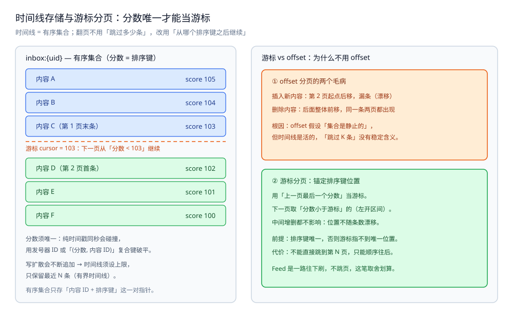
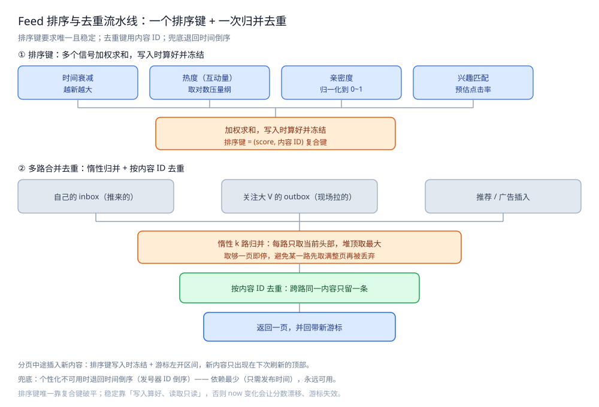
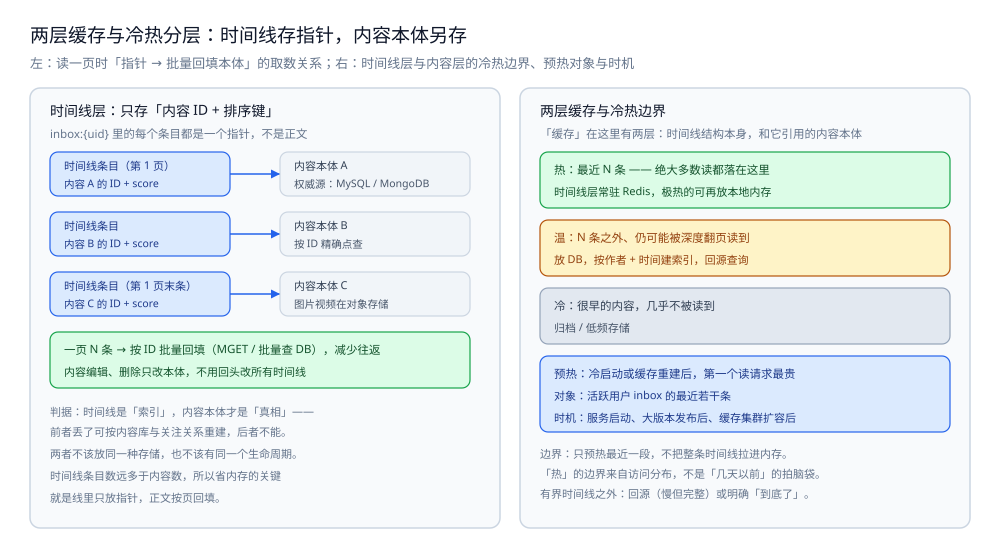

# 时间线存储与分页

> Feed 的"结果"——某个人打开 App 会看到的那串内容——存在哪、用什么结构、怎么从任意位置继续往下翻。
> 本篇讲存储选型、为什么用游标分页而不是 offset、多路时间线怎么合并去重、缓存怎么分层与预热、冷热数据怎么分。
>
> 内容整理自个人学习笔记，素材见 [素材清单](../../../素材清单.md)。

---

## 一、时间线到底存在哪？

**本节要点**：时间线是一份"**有序的、可范围读取的、会被频繁更新的短列表**"。选存储就是看哪个载体最贴合这三个特征。常见的三种载体是 Redis 有序集合、本地内存、数据库表；各自适合的层不同。

### 1.1 三种载体

| 载体 | 结构 | 适合 | 不适合 |
|---|---|---|---|
| **Redis ZSET** | 哈希表 + 跳表 | 按分数范围读、按分数插入、有界保留最近 N 条 | 内存成本；要自己管一致性 |
| **本地内存** | 进程内有序容器 | 极热的个人时间线、超低延迟、可容忍重启丢失 | 多实例共享、持久化、容量受限 |
| **DB 表** | 关系表 + 索引 | 需要持久、需要按属性过滤、需要事务 | 写入密集；深分页代价高 |

**为什么有序集合是时间线的默认选择**：时间线要支持三个动作 —— **按分数插入一条**、**按分数从某点往回取一页**、**只保留最近 N 条（截断头部）**。有序集合把这三件事都做成了对数复杂度（跳表定位 + 范围扫描），正好贴合。

```text
inbox:{uid}  = ZSET
   成员(member) = 内容 ID
   分数(score)  = 排序键（时间戳或综合分）
读取：ZREVRANGEBYSCORE inbox:{uid} (cursor -inf LIMIT 0 pageSize
写入：ZADD inbox:{uid} score member
截断：ZREMRANGEBYRANK inbox:{uid} 0 -N-1   ← 只保留最近 N 条
```

### 1.2 为什么要"有界时间线"

写扩散会不断往 inbox 里追加条目，如果不加限制，一个人的 inbox 会随时间和粉丝活跃度**无限膨胀**。

- **做法**：每次写入后，按排名删掉最老的部分，**只保留最近 N 条**（N 是一个与产品"最多翻多少页"相匹配的数）。
- **代价**：翻到超过 N 条之外时，"时间线里没有"了，需要**回源**（从 DB 按作者+时间重查）或直接"到底了"。
- ⚠️ 未实测：N 的具体取值取决于产品翻页深度与内存预算，需按实际水位确定，不套用别处的数字。

### 1.3 选型判据

| 问题 | 判据 |
|---|---|
| 用有序集合还是普通列表？ | 问"要不要**从中间某个位置**开始取" → 要按分数/时间翻页，就必须有序集合；只会从头顺序消费才用列表 |
| 用 Redis 还是 DB？ | 问"读的 QPS 与延迟要求" → 读多、要低延迟就放 Redis；持久与属性过滤放 DB；两者常常**分层共存** |
| 用不用本地内存？ | 问"能不能容忍实例重启丢数据、能不能容忍多实例不一致" → 能，且该时间线极热，才放本地 |
| 时间线要不要设上限？ | 必须设。写扩散天然无限增长，有界是它的前提假设，不是优化项 |

### 1.4 内容本体存哪？

时间线里只存「内容 ID + 排序键」这个**指针**，内容本体（正文、图片、作者）另存。分工如下：

| 数据 | 存储 | 角色 | 理由 |
|---|---|---|---|
| 内容本体（正文、标签） | MySQL / MongoDB | 权威源 | 要持久化、按 ID 精确查，可能还要全文 / 标签过滤 |
| 图片 / 视频 | 对象存储 | 静态资源 | 体积大、走 CDN 分发，不进业务库 |
| 时间线（内容 ID + 排序键） | Redis ZSet | 派生副本 | 高频读、按分数翻页；可从内容库重建 |

⭐ 判据：**时间线是「索引」，内容本体是「真相」** —— 前者丢了能重建，后者不能。两者不该放同一种存储，也不该有同一个生命周期。

完整的分工视角见 [存储选型与组合.md](../../../03-数据与中间件/数据存储/存储架构与场景/存储选型与组合.md)。

---

## 二、为什么分页要用游标而不是 offset？

**本节要点**：时间线是**边翻边变**的——翻页的同时可能有人发布、有人删除。这时候用"跳过前 K 条"（offset）分页会出两种错：**翻页漂移**和**条目重复**。游标分页用"上一页最后一个位置"当锚点，天然免疫漂移。

### 2.1 offset 分页的两个毛病

假设客户端按 `offset=0, size=10`、`offset=10, size=10`、`offset=20, size=10` 翻页：

| 毛病 | 现象 | 原因 |
|---|---|---|
| **漂移** | 同一页看到了不同时期的内容，翻着翻着"跳"了 | 翻第 2 页**之前**顶部插入了新内容，原来的第 10 项被挤到了第 11 位 → 第 2 页从新的第 11 项开始，**原来的第 10 项被跳过、没被任何一页展示** |
| **重复** | 同一条内容在两页都出现 | 翻第 2 页**之前**有内容被删除，后面的整体**前移** → 原本第 11 项变成了第 10 项，在第 1 页末尾和第 2 页开头都出现 |

⭐ 直觉：**offset 假设"集合是静止的"**，但时间线是活的。只要读取的过程中集合在变，`跳过 K 条` 这个动作就没有稳定含义。

### 2.2 游标分页怎么工作

**做法**：不用"跳过多少条"，改用"**从哪个位置之后继续**"。用上一页**最后一个条目的排序键**作为游标：

```text
第 1 页：按分数从大到小取 10 条，记下第 10 条的分数 cursor = s10
第 2 页：从"分数 < s10"的位置继续取 10 条（ZREVRANGEBYSCORE max=(s10)
第 3 页：cursor = s20，以此类推
```

这样无论中间插入还是删除，翻页始终**锚定在同一个排序键的位置**上：

- 中间**插入**了新内容：只有分数高于当前游标的才会出现，而它们本该出现在**已经翻过的前面**（或首次刷新时才可见）→ 不会挤掉当前页。
- 中间**删除**了内容：游标锚定的位置不依赖"第几条"，后续页照常从该位置往回取 → 不会重复。

### 2.3 游标的前提：排序键必须唯一

游标分页有一个**硬前提**：排序键必须**能唯一定位**。如果两三条内容分数完全相同，光凭一个分数无法确定"下一页从哪里开始"。

- 纯时间戳排序时，**同一秒**内多条内容分数相同 → 游标不唯一。解决：用**有序发号器**（如雪花 ID）当排序键，天然唯一且单调。
- 综合分排序时，分数是浮点数，碰撞更常见 → 解决：用"**(综合分, 内容ID)** 复合键"当排序键，综合分相同时用内容 ID 破平。

> ⭐ 一句话：**游标分页和唯一排序键是一对**。想用游标，就必须先保证排序键唯一 —— 这也是 [排序与去重.md](排序与去重.md) 第二节"稳定排序键"的直接约束。



图怎么读：左面板是一条 `inbox:{uid}` 有序集合的形态 —— 成员是内容 ID、分数是排序键，内容 A、B、C（第 1 页末条）依次排在上面，橙色虚线处写着「游标 cursor = 103：下一页从『`分数 < 103`』继续」，虚线以下是第 2 页首条 D 与 E、F。右面板上半是 offset 的两个毛病：插入新内容让第 2 页起点后移而漏条（漂移），删除内容让后面整体前移而同一条在两页都出现，根因是「offset 假设集合是静止的」；下半是游标的解法 —— 用上一页最后一个分数当游标、取分数小于它的左开区间，中间增删都不影响位置，代价是不能直接跳到第 N 页。看图注意：面板里的 105～100 只是把六个条目排好序的示意分数，不是实测读数；底部两行还提醒分数须唯一（纯时间戳同秒会碰撞）与时间线必须设上限（只保留最近 N 条）。

### 2.4 游标 vs offset 对比

| 维度 | offset 分页 | 游标分页 |
|---|---|---|
| 翻页参数 | "跳过 K 条" | "从某个排序键之后继续" |
| 中途插入新内容 | 漂移（漏条） | 不受影响 |
| 中途删除内容 | 重复 | 不受影响 |
| 能否直接跳到第 N 页 | 能 | 不能（只能顺序往后） |
| 前提 | 无 | 排序键唯一 |

⭐ 取舍：**游标换来了翻页一致性，代价是失去了"跳到任意页"的能力**。Feed 是"一路往下刷"的形态，几乎不需要跳页，所以这笔交易非常划算。

### 2.5 判据小结

| 问题 | 判据 |
|---|---|
| 用 offset 还是游标？ | 问"翻页时集合会不会变" → 会变，就必须游标；静态列表才可以用 offset |
| 游标用什么值？ | **上一页最后一个排序键**；不要用"页码"或"已展示条数" |
| 排序键会碰撞吗？ | 纯时间戳会（同秒）；用发号器或"综合分 + 内容 ID"复合键消除碰撞 |
| 需不需要跳页？ | Feed 通常不需要；若产品要"跳到第 N 页"，得改用快照等其他手段，别硬套游标 |

---

## 三、多路时间线怎么合并去重？

**本节要点**：一旦用了混合模式（推 + 拉），或者 Feed 里要插广告/推荐，读取时就有**多路来源**。多路合并要做两件事：**按排序键归并**、**按内容 ID 去重**。归并要一次到位，不能"先各自取满再拼"。

### 3.1 什么场景会有多路

- **混合模式**：自己的 inbox（推来的）+ 关注里大 V 的 outbox（现场拉的）。
- **推荐/广告插入**：主时间线 + 推荐流，按位次混排。
- **多设备/多来源**：本地缓存的旧页 + 服务端的新页。

### 3.2 归并：每路取一点，用堆合并

**错误做法**：把每一路都取满一页（pageSize 条），拼起来排序再取前 pageSize。

- 问题：如果第 1 路就贡献了整页，第 2 路取的那些全被丢弃，**白白多读**了；反过来也浪费。

**正确做法**：每路都当作一个"有序的游标流"，用**最小/最大堆**做 k 路归并，每次只从堆顶取一条，取够 pageSize 就停：

```text
每路一个游标，初始都在该路当前位置
循环 pageSize 次：
    取"当前排序键最大"的那一路的头部（堆顶）
    若该条未见过（内容 ID 不在 seen 集合）→ 收下，seen 记录
    推进该路游标，把下一个头部重新入堆
```

- **复杂度**：取一页 = `O(pageSize × log k)`（k 是路数），而不是"每路取一页再排"。
- **路数 k 的来源**：混合模式里 k = 关注里的大 V 数；k 太大会拖慢首屏，通常设一个上限（只合并排序靠前的若干个活跃大 V）。

### 3.3 去重：按内容 ID

- **为什么会有重复**：同一内容可能既被推过、又被现场拉过（模式切换窗口、历史重叠）；推荐流也可能命中主时间线已有的内容。
- **去重键**：**内容 ID**（全局唯一），不是排序键（合并后排序键可能因不同信号而变化）。
- **判重位置**：**合并这一步**。写入时判重只能防"同一路里重复"，防不了"多路之间重复"。

### 3.4 判据小结

| 问题 | 判据 |
|---|---|
| 每路先各取一页吗？ | **不要**。用堆做 k 路归并，每路只取"当前头部"，取够就停，避免某一路被整页吃掉 |
| 按什么去重？ | **内容 ID**。排序键会变，不能拿去重 |
| 去重放在写入还是读取？ | 只要存在多路来源，就必须在**读取合并**时再去一次重 |
| k 路太大怎么办？ | 设上限：只合并排序靠前的若干路；其余留到翻得更深时再拉 |



图怎么读：这幅流水线图是本目录共用的「多路合并去重」零件图，同一张文件也挂在 [排序与去重.md](排序与去重.md) 第三节末尾，本篇按单一来源原则不重画。对照本节只看两件事：三路来源（自己的 inbox 推来的、关注大 V 的 outbox 现场拉的、推荐 / 广告插入）先进「惰性 k 路归并：每路只取当前头部，堆顶取最大」，下面一行写的正是 3.2 的错误做法 ——「取够一页即停，避免某一路先取满整页再被丢弃」；再进「按内容 ID 去重：跨路同一内容只留一条」，最后「返回一页，并回带新游标」。图上方那一段四信号加权求和的排序键属于 [排序与去重.md](排序与去重.md) 第二节的口径，本节不需要它，看图时跳过即可。

---

## 四、缓存怎么分层与预热？冷热数据怎么分？

**本节要点**：时间线本身就是"热数据"，所以"缓存"这个词在这里有两层含义 —— 一是**时间线结构本身存在哪**（热层），二是**时间线里引用的内容本体**缓存在哪。把这两层分开，才不会把"存时间线"和"缓存内容"混为一谈。

### 4.1 两层缓存

| 层 | 缓存什么 | 典型载体 | 说明 |
|---|---|---|---|
| **时间线层** | 时间线条目（内容 ID + 排序键） | Redis 有序集合 | 就是第一节的存储；它**本身就是**热层 |
| **内容层** | 内容本体（正文、图片、作者信息） | Redis / 本地缓存 | 时间线只存"指针"，回填时按 ID 批量取内容 |

⭐ 关键：**时间线里只存"指针"（内容 ID + 排序键），不存内容正文**。这样：
- 时间线结构紧凑，内存占用可控；
- 内容更新（编辑、删除）只需改内容本体，不用动所有时间线；
- 一页内容可以**批量回填**（`MGET` / 批量查 DB），减少往返。

### 4.2 预热

**问题**：冷启动或缓存失效后，第一个读请求会"冷"，要现场回源逐条查，延迟高。

**做法**：对**已知会热**的时间线（活跃用户的 inbox）在服务启动或缓存重建时**预加载**最近的若干条到内存。

- **预热的边界**：只预热**最近一段**（对应有界时间线的前 N 条），不要把整条线全拉进内存。
- **预热的时机**：服务启动、大版本发布后、缓存集群扩容后。
- ⚠️ 未实测：预热条数与命中率的关系需按实际访问分布压测，本篇不给具体数字。

### 4.3 冷热数据

| 数据 | 特征 | 处理 |
|---|---|---|
| **热**（最近 N 条） | 绝大多数读都落在这里 | 常驻 Redis / 本地内存 |
| **温**（N 条之外、仍可能被翻到） | 少数深度翻页会读到 | 放 DB，按作者+时间建索引，回源查询 |
| **冷**（很早的内容） | 几乎不被读到 | 归档 / 低频存储 |

⭐ 判据：**"热"的定义来自访问分布，不是来自时间远近的拍脑袋**。通常是"绝大多数读集中在最近一小段"这一长尾特征决定了热边界。

### 4.4 判据小结

| 问题 | 判据 |
|---|---|
| 时间线和内容该不该分开存？ | 该。时间线存指针，内容本体另存一层，便于批量回填和内容更新 |
| 要不要预热？ | 问"冷启动的首屏延迟能不能接受" → 不能就预热活跃用户的最近若干条 |
| 冷热边界怎么定？ | 按**访问分布**定，不按"几天以前"拍脑袋；看读请求落在哪一段 |
| 冷数据回源会不会拖慢？ | 会。所以有界时间线之外要么回源、要么直接"到底"，两者都要有明确策略 |



图怎么读：左半区对应 4.1 与 1.4 —— `inbox:{uid}` 里每个条目都只是「内容 X 的 ID + score」这样一个指针，箭头指向右侧的内容本体（权威源：MySQL / MongoDB，按 ID 精确点查，图片视频在对象存储）；绿色框写的是读一页的动作「一页 N 条 → 按 ID 批量回填（MGET / 批量查 DB），减少往返」，以及「内容编辑、删除只改本体，不用回头改所有时间线」。右半区对应 4.3 与 4.2 的三条带：热（最近 N 条，绝大多数读都落在这里，时间线层常驻 Redis，极热的可再放本地内存）、温（N 条之外、仍可能被深度翻页读到，放 DB 按作者 + 时间建索引回源查询）、冷（很早的内容，几乎不被读到，归档 / 低频存储），蓝框是预热的对象（活跃用户 inbox 的最近若干条）与时机（服务启动、大版本发布后、缓存集群扩容后）。图里的 N、「最近若干条」都是产品水位参数，正文 1.2 与 4.2 已注明需按实际压测确定，本图不给具体数值、也没有实测读数。

---

## 使用：时间线读写与游标分页的 Go 骨架

> ⚠️ 下面三段是**可编译骨架的示意**（省略了 import、类型定义与错误包装），本轮**未做实测**。有序集合键名与游标语义按正文约定书写。

### 第一段：写入并截断（有界时间线）

```go
// PushToTimeline 向某人的时间线写入一条，并只保留最近 keep 条。
// 截断用 ZREMRANGEBYRANK 按下标删最老的：这是"有界时间线"的落地。
func PushToTimeline(ctx context.Context, rdb *redis.Client, uid int64, item Item, keep int) error {
	pipe := rdb.Pipeline()
	pipe.ZAdd(ctx, inboxKey(uid), redis.Z{
		Score:  item.Score,
		Member: strconv.FormatInt(item.ID, 10),
	})
	// 分数从大到小保留 keep 条 → 删掉排名第 keep 位及之后的（下标从 0 开始，升序排名）
	pipe.ZRemRangeByRank(ctx, inboxKey(uid), 0, int64(-keep-1))
	_, err := pipe.Exec(ctx)
	return err
}
```

### 第二段：游标分页读取

```go
// ReadPage 用"上一页最后一个排序键"当游标取一页。
// cursor 是上一页最后一名的分数；首页传 +inf。用左开区间 ( 避免把游标那条重复读进来。
func ReadPage(ctx context.Context, rdb *redis.Client, uid int64, cursor float64, pageSize int) ([]redis.Z, error) {
	max := "+inf"
	if !math.IsInf(cursor, 1) {
		max = "(" + strconv.FormatFloat(cursor, 'f', -1, 64)
	}
	return rdb.ZRevRangeByScoreWithScores(ctx, inboxKey(uid), &redis.ZRangeBy{
		Min:   "-inf",
		Max:   max,
		Count: int64(pageSize),
	}).Result()
}
```

### 第三段：k 路归并 + 内容 ID 去重

```go
// MergeStreams 把多路已按 score 降序排好的流，归并成有序的一页。
// 每路只取"当前头部"，取够 pageSize 就停；按内容 ID 去重，避免某路先取满一页再被丢弃。
func MergeStreams(streams [][]Item, pageSize int) []Item {
	h := newMaxHeapByScore() // 堆顶 = 各路当前头部里 score 最大者
	for _, s := range streams {
		if len(s) > 0 {
			h.push(s[0]) // 记录该条来自哪一路，便于推进
		}
	}
	seen := make(map[int64]bool, pageSize)
	out := make([]Item, 0, pageSize)
	for len(out) < pageSize && h.len() > 0 {
		top := h.pop()
		if !seen[top.ID] { // 跨路去重：同一内容可能既被推过又被现场拉过
			seen[top.ID] = true
			out = append(out, top)
		}
		if next := nextOf(top.stream); next != nil { // 推进该路游标
			h.push(*next)
		}
	}
	return out
}
```

> 三段骨架都**未实测**：本轮不做新实测，故不给出任何延迟或内存读数；仅标注结构（截断保留最近 keep 条、游标左开区间、k 路归并复杂度 `O(pageSize × log k)`）。

---

## 延伸追问

- **为什么游标不能直接用"第几页"换算？** → 因为页与页之间的边界会随内容增删而移动，"第 2 页"没有稳定含义。游标锚定的是**排序键位置**，与页号无关，才不受增删影响。
- **游标用时间戳行不行？** → 行，但要解决同秒碰撞。若同一秒有多条，游标不唯一就会漏读或重复。用发号器 ID，或"（时间戳，内容 ID）"复合键，才能唯一定位。
- **有界时间线被截断后，用户想一直往下翻怎么办？** → 要么回源 DB（按作者+时间重查），要么明确"到底了"。前者慢但完整，后者快但翻不深；产品要选一个。
- **为什么时间线只存指针不存正文？** → 一是省内存（时间线条目数远多于内容数，每条还要在多个 inbox 里出现），二是内容更新/删除时不用动所有时间线。回填时按 ID 批量取即可。
- **多路合并时 k 路太多怎么办？** → 给 k 设上限，只合并排序靠前的若干活跃大 V；翻得更深时再补拉。否则首屏延迟随关注的大 V 数线性增长。
- **Redis 挂了时间线怎么办？** → 时间线是可重建的派生数据（从内容库按关注关系重新扇出/重算），所以它**可以不持久**；关键是把"重建"路径准备好，别把它当唯一数据源。

## 关联

- [总体设计.md](总体设计.md) — 本目录总体设计：整体形态、核心取舍（游标 / offset · 存储形态）、一次刷屏走哪几步。
- [写扩散与读扩散.md](写扩散与读扩散.md) — 推来的 inbox 与拉取的 outbox 是怎么产生的；本篇讲它们怎么存、怎么翻。
- [排序与去重.md](排序与去重.md) — 游标锚定的"排序键"从哪来、怎么保证唯一稳定，去重的完整口径。
- [排行榜设计.md](../社交互动系统/排行榜设计.md) — 同样以有序集合为底座，分页与分数读取的写法可直接对照。
- [朋友圈设计.md](../社交互动系统/朋友圈设计.md) — 具体场景下的数据分层与分页条数约定，与本篇的通用分页对照。
- [关注粉丝设计.md](../社交互动系统/关注粉丝设计.md) — 合并多路时"要用当前关注关系过滤/挑路"，关系数据从这来。
- [深分页与索引变更.md](../../../03-数据与中间件/数据存储/关系型/MySQL/深分页与索引变更.md) — 时间线回源到 DB 时，深分页与索引变更的代价。
- [数据类型.md](../../../03-数据与中间件/数据存储/NoSQL/Redis/数据类型.md) — 有序集合的范围读取与排名删除命令。
- [底层结构.md](../../../03-数据与中间件/数据存储/NoSQL/Redis/底层结构.md) — 有序集合背后的跳表：为什么插入与范围读是对数复杂度。
- [存储选型与组合.md](../../../03-数据与中间件/数据存储/存储架构与场景/存储选型与组合.md) — 通用视角：数据角色、权威源与副本、冷热分层与多存储同步。
> 反向引用（本篇被下列文档引到）：[时序数据存储.md](../../../03-数据与中间件/数据存储/存储架构与场景/形态篇/时序数据存储.md)、[冷热数据分层.md](../../../03-数据与中间件/数据存储/存储架构与场景/横切篇/冷热数据分层.md)、[存储全景.md](存储全景.md)
