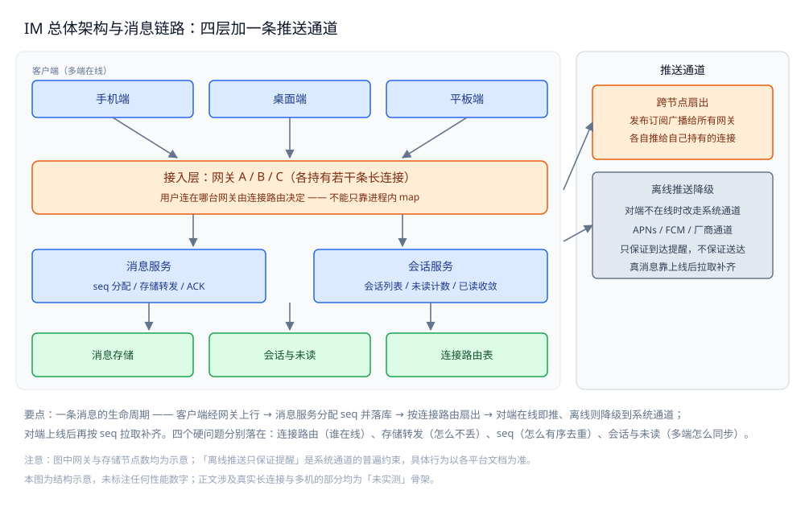

# IM 系统

> 本目录收**即时通讯（IM）**这道场景题的完整链路：本篇是**入口总纲**，先把四个硬问题摆清楚，
> 再给出零件清单与阅读顺序；另有**一篇分层总纲 + 四个零件篇** ——
> [通信链路与协议栈.md](通信链路与协议栈.md)（三条路径 / 各自协议栈 / 跨路径衔接）、
> [协议设计.md](协议设计.md)（帧格式 / 报文类型 / 粘包半包 / 版本演进 / 能力协商）、
> [消息可靠投递.md](消息可靠投递.md)（seq / ACK / 写扩散与读扩散 / 幂等 / 投递语义）、
> [会话与未读.md](会话与未读.md)（会话模型 / 会话列表 / 未读数 / 多端同步 / 游标分页）、
> [在线状态与推送.md](在线状态与推送.md)（长连接 / 连接路由 / 心跳重连 / 多端在线 / 离线推送降级）。
>
> 另有**十篇业务能力篇**：[消息类型与业务语义.md](消息类型与业务语义.md)（消息类型 / 撤回 / 编辑 / 引用 / 转发 / @）、[群聊.md](群聊.md)（成员 / 权限 / 大群）、[富媒体消息.md](富媒体消息.md)（上传 / 秒传 / 断点续传）、[搜索与历史.md](搜索与历史.md)（全文检索 / 冷热分层）、[端到端加密.md](端到端加密.md)、[内容审核与合规.md](内容审核与合规.md)、[限流与防刷.md](限流与防刷.md)、[跨地域多活.md](跨地域多活.md)、[音视频信令.md](音视频信令.md)、[机器人与开放平台.md](机器人与开放平台.md)，清单与优先级见第二节。
>
> 内容整理自个人学习笔记，素材见 [素材清单](../../../素材清单.md)。

---

## 一、IM 系统难在哪四个地方？

**本节要点**：IM 的难点不在"发一条消息"这步，而在**长连接是不稳定的、消息是要按序去重的、状态是被多端共享的**——四个硬问题都从这里长出来。

**① 长连接与在线状态**：HTTP 是"一问一答"的短连接，服务器**不知道谁在线、也没法主动推**。
IM 必须维持一条**长连接**（WebSocket / 自定义 TCP），于是立刻带来三个新问题：
连接**落在哪台网关**上不确定、断线**要在多快内被发现**、用户**同时在几台设备**上在线。

**② 消息可靠投递**：一条消息从发送方到接收方，中间要经过**服务端存储转发**。
任意一跳都可能丢——发送方发出去没收到服务端确认、服务端存了没推给接收方、接收方在线但漏收。
"可靠"要回答的不是"有没有丢"，而是**丢了之后谁来补、补的时候会不会补多**。

**③ 顺序与去重**：同一会话里的消息**必须有序**，否则读起来是乱的；而重传、多端、网络乱序
又会让接收方**收到重复或错序**的消息。做法是给每条消息一个**会话内单调递增的 seq**，
接收方按 seq 排序、按消息 ID 去重——**顺序与去重是同一套编号系统解决的两件事**。

**④ 多端同步与未读**：一个用户可能手机、桌面、平板同时在线，**已读状态是一份共享可变状态**。
在 A 端读了，B 端的未读数要跟着变；离线期间的消息要在上线后**漫游补齐**。
这是 IM 里最像"分布式一致性问题"的一块——不能强一致就退到**最终一致 + 收敛规则**。

> ⚠️ 这四个问题**互相咬合**：seq 既用于排序，也用于"断线后从哪补"；
> 连接路由既决定推送往哪发，也决定多端在线怎么扇出。所以本目录五篇不能拆开乱读。



图怎么读：从上往下是一条消息的真实走向——多端客户端经**接入层**（网关 A/B/C，各持有若干长连接）上行到**消息服务**分配 seq 并存储转发，会话与未读落在**存储层**，再由**推送通道**跨节点扇出：发布订阅广播给所有网关，各自推给自己持有的连接；对端不在线时降级到 APNs / FCM 等系统通道，那类通道只保证「到达提醒」，真消息要等上线后按 seq 拉取补齐。图最下面那行注意是本目录的口吻基线：**网关与存储节点数均为示意，不标任何性能数字**。上面四个硬问题分别落在连接路由（谁在线）、存储转发（怎么不丢）、seq（怎么有序去重）、会话与未读（多端怎么同步），下一节的零件篇就按这四条分。

## 二、这套笔记有哪些零件？

**本节要点**：本目录分两段——**分层主线**（总纲 + 四层零件）回答「一条消息怎么走」，**业务能力篇**（十篇）回答「一整套 IM 产品还要解决什么」。

### 2.1 分层主线：总纲 + 四层零件

**本节要点**：一篇**分层总纲**先定出「一条消息跨哪三条路径」，四篇零件**按关注层切**——报文格式、连接与推送、投递协议、会话状态是四块代价结构完全不同的东西。

| 篇 | 回答什么问题 | 关键词 |
|---|---|---|
| [通信链路与协议栈.md](通信链路与协议栈.md) | 一条消息跨哪**三条路径**、各自协议栈长什么样、跨路径怎么衔接 | 三条路径 / 协议栈分层 / 谁已给你什么 / 上下文与超时预算 / 降级 |
| [协议设计.md](协议设计.md) | 报文在线上长什么样、怎么切边界、怎么兼容老端 | 帧格式 / 报文类型 / 粘包半包 / 版本演进 / 能力协商 / 可选特性 |
| [消息可靠投递.md](消息可靠投递.md) | 消息怎么**不丢、不重、有序**地送到对端 | seq / 消息 ID / ACK / 存储转发 / 写扩散 vs 读扩散 / 幂等去重 / 投递语义 / 离线补偿 |
| [会话与未读.md](会话与未读.md) | 会话与未读这份**共享状态**怎么存、怎么同步 | 会话模型 / 会话列表排序 / 未读计数 / 已读收敛 / 消息漫游 / 游标分页 |
| [在线状态与推送.md](在线状态与推送.md) | **谁在线、消息往哪推**、推不到怎么办 | 长连接选型 / 连接路由 / 心跳重连 / 多端在线 / 离线推送降级 / 发布订阅扇出 |

**五篇各自的第一性问题**：

- 分层篇的第一性问题：**一条消息要跨的三段各有各的「最难」，硬合成一根管子就要用最严的约束去限制另外两段**。
  所以协议栈要分层看——哪一层已经替你做了、哪一层必须自己来，不能从头到尾自研一遍。

- 报文篇的第一性问题：**协议一经发布就要陪着老客户端走**。所以帧必须能自描述、未知内容必须能被忽略——
  否则任何新功能的上线都会变成老端事故。

- 投递篇的第一性问题：**"可靠"是端到端的，不是单跳的**。链路上任何一跳都不能单方面保证，
  只能靠**编号 + 确认 + 去重**三件套把不确定性夹起来。
- 会话篇的第一性问题：**"未读数"是派生数据，不是一个真实的计数**。它能被算出来，
  也就能被算错；一旦多端同时改，就要选**以哪一份为准**。
- 在线篇的第一性问题：**连接状态是"有状态"的，而业务节点要无状态**。
  矛盾就落在"这份状态放进程内 map 还是放共享存储"这一个决定上。

### 2.2 业务能力篇：从「一条消息」扩展到「一整套 IM 产品」

**本节要点**：分层主线解决的是「消息怎么可靠走完」，但一个能上线的 IM 还要回答：**消息除了文本还有什么**、**群怎么管**、**大文件怎么传**、**怎么找得到历史**、**怎么加密与合规**、**怎么防垃圾**、**怎么跨地域**、**怎么接音视频与第三方**。十篇按 P0→P2 分级。

| 优先级 | 篇 | 回答什么问题 |
|---|---|---|
| P0 | [消息类型与业务语义.md](消息类型与业务语义.md) | 消息除了文本还有什么类型；撤回 / 编辑 / 引用 / 转发 / @ 怎么落进协议 |
| P0 | [群聊.md](群聊.md) | 群成员怎么管、群权限怎么分层、**大群**为什么要特殊处理 |
| P0 | [富媒体消息.md](富媒体消息.md) | 图片 / 语音 / 视频 / 文件的上传、秒传、断点续传、CDN |
| P0 | [搜索与历史.md](搜索与历史.md) | 全文搜索 / 按会话搜 / 按人搜 / 结果高亮；历史冷热分层 |
| P1 | [端到端加密.md](端到端加密.md) | E2EE 密钥体系、群组密钥管理、与服务器功能的冲突 |
| P1 | [内容审核与合规.md](内容审核与合规.md) | 敏感词 / 机审人审 / 举报处置 / 合规留存 |
| P1 | [限流与防刷.md](限流与防刷.md) | 消息频率、群发限制、防垃圾与黑产 |
| P2 | [跨地域多活.md](跨地域多活.md) | 异地多活、长连接跨地域、多活下 seq 唯一性与故障切换 |
| P2 | [音视频信令.md](音视频信令.md) | WebRTC 信令走 IM 通道、呼叫状态机、多人通话 |
| P2 | [机器人与开放平台.md](机器人与开放平台.md) | Bot / Webhook / 开放 API、回调可靠性与鉴权 |

> ⚠️ 十篇都遵循同一条边界：**分层主线的细节不在这里重复** —— 群聊的「写扩散 vs 读扩散」在 [消息可靠投递.md](消息可靠投递.md)，富媒体的对象存储细节在 [文件存储与上传架构.md](../文件存储与上传架构.md)，搜索的引擎细节在 [Elasticsearch/README.md](../../../03-数据与中间件/数据存储/搜索与分析/Elasticsearch/README.md)，限流算法本体在 [限流算法.md](../../分布式/服务治理/限流算法.md)。

## 三、按什么顺序读？依赖关系是什么？

**本节要点**：先看**分层**（一条消息跨哪三条路径、各自协议栈是什么），再定**报文**（消息在线上长什么样），然后把**连接**立起来（不然消息没有投递路径），接着讲**投递**（怎么可靠走完这条路径），最后讲**会话与未读**（落地成用户看到的列表状态）。

### 3.1 推荐顺序

```text
① 通信链路与协议栈.md  ← 分层总纲：一条消息跨哪三条路径、各自协议栈长什么样
        ↓
② 协议设计.md          ← 报文层：一条消息在线上长什么样、怎么切边界
        ↓
③ 在线状态与推送.md    ← 地基：没有长连接与连接路由，后面都无从谈起
        ↓
④ 消息可靠投递.md      ← 在既有的帧格式与连接路由上，讲消息怎么不丢不重有序
        ↓
⑤ 会话与未读.md        ← 把投递结果落成会话列表与未读状态，并处理多端同步
```

**反过来也成立**：如果只关心"消息怎么存、未读怎么算"，可以跳过连接细节，
直接从投递篇第一节（seq 与消息 ID）读起——那节**不依赖任何连接实现**。

**十篇业务能力篇不在这条主线上**：它们都能直接读、按需选——`P0` 四篇是"上线前必备"，`P1` 是"合规与规模必需"，`P2` 是"特定形态才需要"。

### 3.2 依赖关系

| 本篇 | 建议先读 | 为什么 |
|---|---|---|
| [通信链路与协议栈.md](通信链路与协议栈.md) | [README.md](README.md) | 先有四个硬问题与零件清单的地图，再看三条路径怎么分层 |
| [协议设计.md](协议设计.md) | [通信链路与协议栈.md](通信链路与协议栈.md) | 先知道「报文在哪条路径上跑」，再定报文怎么切边界 |
| [消息可靠投递.md](消息可靠投递.md) | [协议设计.md](协议设计.md) + [在线状态与推送.md](在线状态与推送.md) | ACK 是一种**报文类型**、seq 要装进**帧**里，两者都得先立住 |
| [会话与未读.md](会话与未读.md) | [消息可靠投递.md](消息可靠投递.md) | 未读的收敛依赖投递侧的 seq 与已读回执 |
| [在线状态与推送.md](在线状态与推送.md) | [README.md](../弹幕系统/README.md) | 跨节点扇出与"连接不在本机"的坑，弹幕篇已经用发布订阅讲透 |

> ⭐ 四篇共用的一条记忆线：**"谁在线"靠连接路由，"消息在哪"靠 seq，"读没读"靠已读回执**。
> 只要有一个对不上，用户看到的就是"消息丢了"或"未读不清零"。

### 3.3 三种常见的读错顺序

| 读法 | 后果 |
|---|---|
| 先读投递、后读连接 | seq 与 ACK 讲得通，但"为什么必须按 seq 补"体会不到——因为没先理解连接会断 |
| 只读会话、跳过连接 | 未读收敛的规则记住了，但"推送不到时降级到哪"完全接不上 |
| 五篇各读一半 | 分层、帧、seq、未读、路由各一条线，几条线在「一条消息的生命周期」上对不齐 |
| 只读分层主线、不看能力篇 | 一条消息能可靠走通了，但"能上线"还差：消息类型、群、富媒体、搜索、加密、审核、防刷、多活 |

## 四、与其它目录怎么分工？

**本节要点**：IM 是**把分布式零件拼成系统**的场景题，所以零件的原理在别处，这里只讲"在这个场景里怎么用、代价落在哪"。

| 相关目录 | 分工 |
|---|---|
| [分布式/](../../分布式/README.md) | 那边讲**单点零件**（一致性、故障转移、负载均衡），这边把零件拼成"一条消息的完整生命周期" |
| [README.md](../弹幕系统/README.md) | 同为**长连接 + 扇出**场景，但弹幕**允许丢**、IM **不允许丢**，两篇对照着看取舍差在哪 |
| [README.md](../社交互动系统/README.md) | 那边的"未读数 / 计数 / 关系"与本篇"未读收敛"是同类共享状态问题 |
| [消息队列选型对比.md](../../../03-数据与中间件/中间件/消息队列/消息队列选型对比.md) | 离线消息、异步投递、写扩散常借 MQ 削峰，选型与语义在那边 |

**本目录收什么、不收什么**：

| 收 | 不收（在哪） |
|---|---|
| 消息的**编号、确认、去重、补偿**这套投递协议 | **TCP / WebSocket 协议栈原理** → [01-编程语言/](../../../01-编程语言/) 与网络篇 |
| 会话与未读的**数据模型与收敛规则** | **Redis / MySQL 本身的用法** → [03-数据与中间件/](../../../03-数据与中间件/) |
| 连接路由、心跳、多端在线的**设计判据** | **负载均衡 / 注册发现的算法层** → [分布式/](../../分布式/README.md) |
| 富媒体的**上传与发送解耦**判据 | **对象存储 / CDN 本身的用法** → [对象存储/README.md](../../../03-数据与中间件/中间件/对象存储/README.md) |
| 消息检索的**权限过滤与冷热分层** | **搜索引擎 / 分词 / DSL 细节** → [Elasticsearch/README.md](../../../03-数据与中间件/数据存储/搜索与分析/Elasticsearch/README.md) |
| 限流**在 IM 里怎么用**（键与降级） | **限流算法本体** → [限流算法.md](../../分布式/服务治理/限流算法.md) |

## 五、这套系统的数据存哪？

前四节讲的是「难在哪、有哪些零件、怎么读」，这一节补上**存储选型**的视角：把 IM 里每份数据按住**角色**归位 —— 谁能丢、谁是唯一真相、历史消息为什么分层。

| 数据 | 角色 | 存储 | 理由 |
|---|---|---|---|
| 会话与成员（会话表 / 成员表） | 权威源 | MySQL（分库分表） | 会话归属与成员是唯一真相，按会话 ID 分片 |
| 消息流（含会话内 seq） | 权威源 | MySQL 分库分表（按会话 ID） | 消息是唯一真相，要持久、按 seq 有序读 |
| 近期消息（热窗口） | 缓存 | Redis | 最近一段消息高频读，加速漫游与拉取 |
| 历史消息（长期） | 归档 / 冷数据 | 对象存储 + 列存文件 | 极少回读，按产品策略下沉到最便宜介质 |
| 在线状态与连接路由 | 缓存 | Redis（带 TTL） | 临时状态，连接断了就失效；丢了按重连重建 |
| 未读数 | 副本 | Redis 计数（定期落库） | 由消息与已读回执重算 |
| 图片 / 语音 / 文件 | 归档 / 静态资源 | 对象存储 + CDN | 体积大、走 CDN，消息库里只存 URL |

⭐ 判据：**「这份数据丢了能不能重建」** —— 会话与消息不能重建，是权威源；在线状态本就是**临时状态**（连接断了就该失效，重建即重连），未读可由回执重算；历史消息只是**按产品策略分层**下沉，并非删除。凡是能重算或本就短命的，都不该占用权威源的位置。

完整的分工视角见 [存储选型与组合.md](../存储选型与组合.md)。

## 延伸追问

- **为什么 IM 单独成目录，不和弹幕合并？** → 两篇都是长连接扇出，但**可靠性等级不同**：弹幕丢几条无所谓，可以走内存 Pub/Sub；IM 丢一条就是事故，必须落库、必须 ACK、必须可补齐。等级不同，方案就不同。
- **为什么单独有一篇「分层总纲」？** → 三条路径的网络环境、失败代价、演进节奏都不同，混成一根管子就要用最严的约束限制另外两段；先分层，后面的报文 / 连接 / 投递 / 会话才各有各的优化目标。
- **五篇里最难的是哪篇？** → 会话与未读篇的**多端已读收敛**：一份状态被多端同时改，又没法每次都强一致，只能定"以哪一份为准"的规则，再让它最终一致。
- **这套笔记有实测数字吗？** → 零件篇的投递骨架**只给可编译骨架**，涉及真实长连接与多机路由的部分**均标注「⚠️ 未实测」**，不编造吞吐或延迟数字。原因见各篇开头。
- **读完能回答的最小闭环是什么？** → 一条消息从"用户按下发送"到"三台设备都看到且未读正确清零"，每一步的编号、确认、去重、同步分别由哪篇负责。
- **十篇能力篇里哪几篇是「上线前必备」？** → P0 四篇：消息类型（不然只有文本）、群聊（多人群要用）、富媒体（发图发文件）、搜索（找到历史）。P1 三篇在"要合规 / 要上规模"时变成必备，P2 三篇按产品形态选。
- **能力篇会和分层主线重复吗？** → 不会：能力篇只讲"这个产品功能在 IM 里怎么落"，算法与中间件本体一律外链（对象存储 / Elasticsearch / 限流算法 / 加密算法）。

## 关联

- [通信链路与协议栈.md](通信链路与协议栈.md) — 分层总纲：三条路径 / 各自协议栈 / 跨路径衔接。
- [协议设计.md](协议设计.md) — 报文层：帧格式 / 报文类型 / 粘包半包 / 版本演进 / 能力协商。
- [消息可靠投递.md](消息可靠投递.md) — seq / ACK / 写扩散与读扩散 / 幂等 / 投递语义。
- [会话与未读.md](会话与未读.md) — 会话模型 / 未读数 / 多端同步 / 游标分页。
- [在线状态与推送.md](在线状态与推送.md) — 长连接 / 连接路由 / 心跳重连 / 离线推送降级。
- [README.md](../弹幕系统/README.md) — 同为长连接扇出的姊妹场景，可容忍丢失。
- [README.md](../社交互动系统/README.md) — 计数与关系类共享状态的另一套讲法。
- [README.md](../../分布式/README.md) — 本目录所用零件（一致性 / 故障转移 / 负载均衡）的原理线。
- [存储选型与组合.md](../存储选型与组合.md) — 通用视角：数据角色、权威源与副本、冷热分层与多存储同步。
- [消息类型与业务语义.md](消息类型与业务语义.md) — 消息类型 / 撤回 / 编辑 / 引用 / 转发 / @。
- [群聊.md](群聊.md) — 成员管理 / 群权限 / 大群特殊处理。
- [富媒体消息.md](富媒体消息.md) — 上传 / 秒传 / 断点续传 / CDN。
- [搜索与历史.md](搜索与历史.md) — 全文搜索 / 权限过滤 / 冷热分层。
- [端到端加密.md](端到端加密.md) — E2EE / 群组密钥 / 与服务器功能的冲突。
- [内容审核与合规.md](内容审核与合规.md) — 敏感词 / 机审人审 / 举报 / 留存。
- [限流与防刷.md](限流与防刷.md) — 消息频率 / 群发限制 / 防垃圾。
- [跨地域多活.md](跨地域多活.md) — 异地多活 / 连接迁移 / 故障切换。
- [音视频信令.md](音视频信令.md) — WebRTC 信令 / 呼叫状态机 / 多人通话。
- [机器人与开放平台.md](机器人与开放平台.md) — Bot / Webhook / 开放 API。
