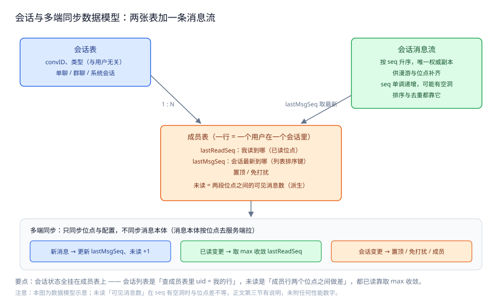

# 会话与未读

> 会话模型（单聊 / 群聊 / 系统会话）、会话列表与排序、未读数的两种算法与多端已读收敛、
> 消息漫游与多端同步，以及**为什么上下文分页必须用游标而不是 offset**。
>
> 内容整理自个人学习笔记，素材见 [素材清单](../../../素材清单.md)。

---

## 一、会话模型有哪几类，怎么建模？

**本节要点**：会话是 IM 里**用户看到的那一层抽象**——它不等于"两个人"，
而是"一段有时间线的消息集合 + 一组参与者 + 每人各自的位点"，三类会话只是参与者数不同。

### 1.1 三类会话

| 类型 | 参与者 | convID 怎么定 | 特殊之处 |
|---|---|---|---|
| **单聊** | 恰好 2 人 | 两个 uid **规范化排序**后生成（谁先谁后不影响结果） | 双方指向**同一个** convID，不是各存一份 |
| **群聊** | N 人（可变动） | 服务端统一分配 | 成员会增删；需要"入群看历史"的策略 |
| **系统会话** | 1 人 + 系统 | 服务端按"用户 + 系统类型"生成 | 无对端，只有一个读写方向（系统 → 用户） |

**单聊的 convID 为什么要规范化**：如果按"谁发起"生成，就会出现 A 发起一条会话、B 发起又是另一条，
同一段对话被拆成两条时间线。**用有序后的 uid 对生成 ID**（如 `hash(min(a,b) + max(a,b))`），
无论谁先发都落到同一个会话。

### 1.2 两张表建模

会话模型最小只需**两张表**：

| 表 | 一行代表 | 关键字段 |
|---|---|---|
| **会话表** | 一个会话 | `convID`、类型、创建时间、会话级配置 |
| **成员表** | 一个「用户在某个会话里」 | `convID`、`uid`、**`lastReadSeq`**、`lastMsgSeq`、置顶 / 免打扰、`updatedAt` |

⭐ 关键设计：**"这个用户在这个会话里的状态"全部挂在成员表上**，
会话表保持**与用户无关**。这样"会话列表"就是"查成员表里 uid = 我的那些行"，
"未读"就是拿成员行的两个位点做差——**一个用户的所有会话状态只在一张表里**。



### 1.3 会话是有序号的

会话内消息按 seq 排（见 [消息可靠投递.md](消息可靠投递.md)），
而**成员行上的 `lastMsgSeq` 就是这个会话的"最新到哪"**。
它是会话列表排序与未读计算的共同输入，是这套模型里的枢纽字段。

## 二、会话列表怎么排序、怎么更新？

**本节要点**：会话列表是**每个用户各自的一张列表**，排序键取自**成员行**而非会话表——
因为"谁的列表"决定了排序分写在谁身上。

### 2.1 排序键怎么选

| 候选排序键 | 问题 |
|---|---|
| 会话创建时间 | 老会话永远沉底，新消息**不会把它顶上来**——错 |
| 会话级 `lastMsgSeq` | 群聊里是**全群共享**的，无法表达"我这个用户看到的最新" |
| **成员行 `lastMsgSeq` / `updatedAt`** | ✅ 每个用户各有一份，新消息到达时更新它，会话被顶到顶部 |

**正确做法**：消息落库后，**更新每个相关成员的 `lastMsgSeq` 与排序分**，会话就浮到列表顶部。
这本质上是一次**写扩散**（见 [消息可靠投递.md](消息可靠投递.md) 第三节）——
列表排序要求"每条新消息都推动列表"，这个写放大是为了读侧 O(1)。

### 2.2 已读不回退排序

**已读只改未读，不改排序**：进入会话把 `lastReadSeq` 追到最新，未读归零，
但会话在列表里的位置**不动**——否则一点开会话，它就跳走了。

### 2.3 排序分放在哪

排序分既可以直接读成员行的 `LastMsgSeq`，也可以额外维护一份有序结构加速：

| 存法 | 读列表成本 | 写成本 | 适用 |
|---|---|---|---|
| 直接查成员行排序 | 每次列表都要排序 | 只更新一行 | 会话数不大，实现最简 |
| 额外维护有序结构（如 ZSET） | 按序取前 N，O(log N) | 每条新消息更新一次分数 | 列表页访问频繁，愿意换写放大 |

两者都属于"**用写换读**"：新消息到达时把排序分推上去，读列表时就只取前几页。

### 2.4 置顶与免打扰

- **置顶**：不改变 `lastMsgSeq`，只是加一个更高优先级的排序维度（置顶组内部再按时间排）；
- **免打扰**：**不影响排序，只影响未读的呈现**（角标变红点或不显数字）；
  消息照常更新 `lastMsgSeq`，会话照常上浮。

## 三、未读数用增量还是计数？

**本节要点**：未读数**不该当成一个独立维护的计数器**——它可以从两个位点**算**出来；
"增量式 +1" 的写法会在多端、重传、消息被过滤三种情况下漂移。

### 3.1 两种算法

| 算法 | 做法 | 问题 |
|---|---|---|
| **增量式** | 每来一条未读消息 `unread += 1`，进会话清零 | 丢一条推送就永远少数，重传就多半数，**不可自愈** |
| **派生式** | `unread = 可见消息( lastReadSeq 之后 ) 的条数` | ✅ 自愈：位点一变，未读自动跟着变 |

**结论**：**以派生式为准**。`lastReadSeq`（我读到哪）与 `lastMsgSeq`（最新到哪）都在成员行上，
未读就是这两个位点之间的**可见消息数**。

### 3.2 为什么"seq 差"不等于"消息条数"

直接算 `lastMsgSeq - lastReadSeq` **不一定等于真实条数**，因为：

- 会话内 seq 可能**有空洞**（分配失败留下的空号）；
- 有些消息**对我不可见**（我入群之前的历史、被清理的消息）。

所以可行的折中是：**以派生值为对口，用一个计数器承载读性能**——
计数器只负责"快速显示"，位点差负责"定期对账纠正"。两者对不上时**以位点差为准**。

> ⚠️ **未实测**：本节不给"未读误差率"或"对账频率"的具体数字。
> 原因：漂移量取决于重传率与消息清理策略，本机单进程跑不出真实分布。

## 四、多端已读之后未读怎么收敛？

**本节要点**：**已读位点是一份被多端共享改写的状态**，必须有明确的收敛规则；
最常用也最安全的一条是**单调不减（取最大值）**。

### 4.1 冲突长什么样

同一个用户在手机和桌面同时在线：

- 手机读到了 seq 100，上报 `lastReadSeq = 100`；
- 桌面只读到 seq 80，稍后上报 `lastReadSeq = 80`。

两条上报顺序不定。若直接**后写覆盖**，结果可能是 80——
桌面这个较旧的位点把手机已经读过的 20 条**重新标成了未读**。

### 4.2 收敛规则：已读单调不减

| 规则 | 做法 | 效果 |
|---|---|---|
| **取最大值（单调不减）** | `lastReadSeq = max(旧值, 上报值)` | 已读**只前进、不回退**，手机与桌面最终收敛到 100 |
| 后写覆盖 | 直接写入上报值 | 旧位点可能把新位点**冲掉**，未读反弹 |

**为什么"取 max"是对的**：已读的语义是"**至少读到哪**"，不是"这一刻读到哪"。
多端各自的进度不同，但"我已经读到 100"这个事实**不会因为另一台设备只读到 80 而失效**。

### 4.3 两种已读粒度的区别

- **会话级已读**（"打开会话即全部已读"）：位点用 `lastReadSeq`，收敛规则取 max —— 简单、够用；
- **单条已读**（"逐条标记已读"）：位点是**集合**而非标量，取 max 不成立，
  要改成**集合并集**。粒度越细，收敛成本越高——**默认用会话级**。

## 五、消息漫游与多端同步怎么做？

**本节要点**：漫游解决"**换设备还能看到历史**"，同步解决"**同一时刻多端状态一致**"；
两者共用同一份数据源——**会话的权威消息流 + 各端的位点**。

### 5.1 漫游：历史从哪来

漫游的消息来自**服务端的权威消息流**（[消息可靠投递.md](消息可靠投递.md) 里的"会话消息流"），
而不是本机缓存。这意味着：

- 换设备 / 重装后，**只要能带着自己的位点重新登入，就能往前翻历史**；
- 位点丢了（比如全新设备）时，以"**最近一次已知已读位点**"为起点拉一屏，再往后补。

### 5.2 多端同步：三种事件

服务端要把"别端发生的事"推给本端，只需三类**同步事件**：

| 事件 | 由什么触发 | 本端要更新什么 |
|---|---|---|
| **新消息** | 会话里来了新消息 | 追加消息、更新 `lastMsgSeq`、未读 +1（派生） |
| **已读变更** | 另一台设备上报了已读 | 用取 max 规则更新 `lastReadSeq`、重算未读 |
| **会话变更** | 置顶 / 免打扰 / 成员变动 / 新会话 | 更新成员行配置、必要时重排列表 |

⭐ 关键点：**多端同步不是"同步消息本体"，而是"同步位点与配置"**。
消息本体可以按位点去服务端拉；真正必须实时同步的是那几份**共享可变的位点与配置**。

### 5.3 每端位点独立、已读位点共享

- **各端各自的"拉到哪了"**（接收位点）**独立**：手机可能只拉到 seq 90，桌面拉到 120，互不影响；
- **已读位点 `lastReadSeq` 共享**：任一端上报都要广播给其他端，并按取 max 收敛。

一句话：**接收位点分端，已读位点合并**。

## 六、上下文分页为什么用游标不用 offset？

**本节要点**：消息流是**前插**的——新的消息插在最前面；
`offset` 分页假设"位置稳定"，而消息流的位置**每来一条就整体后移**，于是重复和跳漏必然发生。

### 6.1 offset 在两个维度上都错

| 问题 | 表现 | 根因 |
|---|---|---|
| **重复/跳过** | 翻第二页时，前面新插入一条，第二页又出现第一页末尾那条 | offset 的"第 N 条"在新数据插入后指向了不同消息 |
| **深分页变慢** | 翻到很后面时查询越来越慢 | `offset M` 要求先扫过 M 条 |

### 6.2 游标 = seq

**用 seq 当游标**：查"**seq < cursor 的最近 N 条，倒序**"，返回时把游标推进到本页最小 seq。

- 新消息前插**不影响**游标（它们 seq 更大，不在 `seq < cursor` 的范围内）；
- 深分页是"从某个 seq 往前扫 N 条"，**与已翻页数无关**，永远 O(N)。

### 6.3 上下文分页：先定锚点，再各取一屏

进入会话时往往要"**从某条消息往上翻历史、往下看新消息**"，做法是：

1. 客户端给出**锚点 seq**（点进来的那条，或"最新"）；
2. **往上**：查 `seq < 锚点` 的最近 N 条；
3. **往下**：查 `seq > 锚点` 的最近 N 条；
4. 两次都返回**有没有更多**的标记，用户继续翻时各自推进游标。

这就是"**双向游标分页**"，它天然适配"跳到某条历史消息再继续读"的交互。

## 使用：会话与未读的数据模型骨架

**本节要点**：把"成员行两个位点 + 派生未读 + 取 max 收敛 + 游标分页"落成**可编译的最小骨架**；
涉及多机与真实推送的部分标注未实测。

```go
package im

// Conversation 是会话本身（与用户无关）。
type Conversation struct {
	ConvID string
	Kind   string // "single" / "group" / "system"
}

// Member 是「一个用户在一个会话里」的状态，会话列表与未读都读它。
//
// LastReadSeq 是「我读到哪」，LastMsgSeq 是「这个会话最新到哪」；
// 未读 = 两者之间的可见消息数（派生，不单独维护计数器）。
type Member struct {
	ConvID      string
	UID         string
	LastReadSeq int64
	LastMsgSeq  int64
	Pinned      bool
	Muted       bool
}

// Unread 返回派生未读：可见消息里序号大于已读位点的条数。
//
// ⚠️ 未实测：需要真实会话消息流才能算出真实条数，这里只给算法骨架。
// 注意：seq 有空洞时，用 LastMsgSeq - LastReadSeq 只是「上限」，不是精确条数。
func (m Member) Unread(visibleSeqs []int64) int {
	n := 0
	for _, s := range visibleSeqs {
		if s > m.LastReadSeq {
			n++
		}
	}
	return n
}
```

已读上报必须走**单调不减**，这是多端收敛的核心规则。

```go
// MarkRead 按「单调不减」收敛已读位点。
//
// 规则：LastReadSeq = max(旧值, 上报值)。
// 这样手机读到 100、桌面稍后上报 80 时，收敛结果仍是 100，
// 旧位点不会把新位点冲掉、未读不会反弹。
func (m *Member) MarkRead(seq int64) {
	if seq > m.LastReadSeq {
		m.LastReadSeq = seq
	}
}
```

会话列表排序与游标分页：**排序读成员行，分页用 seq 当游标**。

```go
// LessForList 给出会话列表的排序判据：先置顶，再按会话最新位点倒序。
func LessForList(a, b Member) bool {
	if a.Pinned != b.Pinned {
		return a.Pinned // 置顶优先
	}
	return a.LastMsgSeq > b.LastMsgSeq
}

// Page 是上下文分页的一次请求：以 cursor 为锚点，向前（更旧）或向后（更新）取 limit 条。
//
// 游标用 seq，不用 offset：新消息前插时 seq 游标天然稳定，
// 不会出现 offset 分页那种「第二页重复第一页末尾」的问题。
type Page struct {
	ConvID string
	Cursor int64 // 锚点 seq
	Limit  int
	Newer  bool // true=取 seq > cursor 的更新消息；false=取 seq < cursor 的更旧消息
}
```

> ⚠️ **未实测**：以上代码只做静态编译校验（`gofmt` 通过）。
> 未运行 `go test` 的原因：未读正确性与多端收敛必须靠真实多端并发上报与推送才能验证，
> 本机单进程无法复现，给出运行结果即为编造。

## 延伸追问

- **未读数为什么不用一个字段直接存？** → 可以存，但只能是**对账用的派生值**，不能是唯一真相：一旦丢推送或重传就会漂移且**无法自愈**。以位点差为准、计数器为辅，才能在出错后自动纠正。
- **为什么"已读"要取 max，而"接收位点"要分端各存？** → 因为语义不同：已读是"**至少读到哪**"（单调事实，可合并），接收位点是"**这台设备拉到哪了**"（每台设备各自的事，不能合并）。合并错了会让慢设备把快设备的进度拖回去。
- **群聊里每个人看到的会话排序一样吗？** → 不一样。排序分挂在成员行上，"我被 @ 了"或"我最后读到的位置"都可能是 per-user 的；会话列表天然是**千人千面**的。
- **消息漫游和"入群看历史"是一回事吗？** → 不是。漫游是我自己的历史、按我的位点拉；入群看历史是新成员能看到**入群之前**别人发的消息，涉及"消息对谁可见"的策略，比漫游多一层权限裁剪。
- **上下文分页的"锚点"怎么定？** → 通常是"用户点进来的那条消息的 seq"或"最新 seq"；定完锚点后**双向各取一屏**，用户继续翻时分别推进各自的游标，两者互不影响。

## 关联

- [消息可靠投递.md](消息可靠投递.md) — 会话消息流的 seq 与位点从哪来，投递语义决定了位点怎么用。
- [在线状态与推送.md](在线状态与推送.md) — 新消息 / 已读变更 / 会话变更这三类同步事件靠什么通道送达。
- [README.md](README.md) — 本篇在 IM 四个硬问题里的位置与阅读顺序。
- [README.md](../社交互动系统/README.md) — 计数与关系类共享状态的同类收敛问题。
- [README.md](../../分布式/README.md) — 多端已读这类"共享可变状态"的一致性底座。
