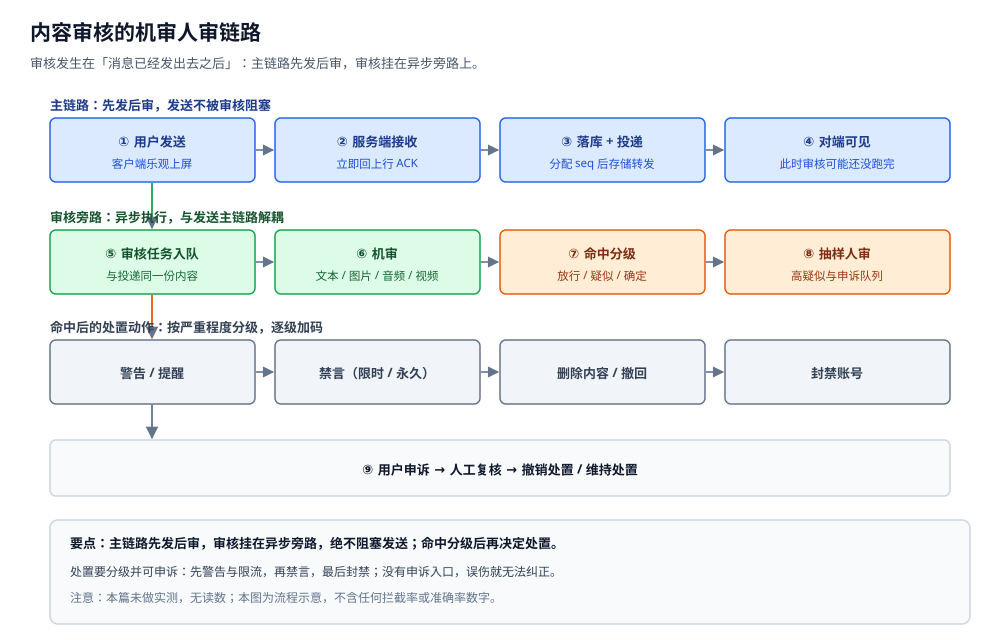
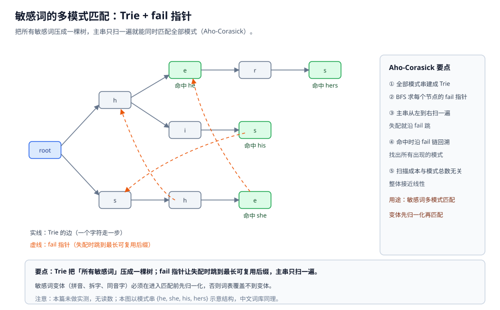

# 内容审核与合规

> 本篇讲 IM 的内容安全链路：**机审 + 人审 + 举报处置 + 合规留存**——
> 文本怎么用词表与规则机审、图片音视频为什么只能异步审、处置怎么分级、
> 留存与"用户删除 / 撤回"怎么冲突、以及审核与端到端加密的根本矛盾。
>
> 本篇是 IM 目录的**内容安全与合规层**：回答"消息发出去之后，平台怎么保证内容不出事"。
> 它消费的是投递产出的消息副本（见 [消息可靠投递.md](消息可靠投递.md)），
> 处置动作最终要靠协议下发（见 [协议设计.md](协议设计.md)）；
> 审核与端到端加密的冲突在 [端到端加密.md](端到端加密.md) 里展开，
> 审核依赖的"搜得到"能力与搜索同源，见 [搜索与历史.md](搜索与历史.md)。
>
> 内容整理自个人学习笔记，并参考内容安全与信息服务合规的公开资料，以及 Aho-Corasick 多模式匹配算法的公开文献；素材见 [素材清单](../../../素材清单.md)。
>
> ⚠️ 实测口径：**本篇未做实测**。原因：审核的效果（漏放、误伤、处置时效）
> 必须在真实内容分布与真实用户行为上观察，本机既没有内容样本也没有标注集，
> 任何"拦截率 / 准确率 / 召回率"的数字都只能是编造。所有代码块**只做静态编译校验**，
> 不附运行读数。

---

## 一、IM 为什么必须做内容审核？

**本节要点**：IM 的内容是**用户之间私发**的，一旦违规信息借平台扩散，平台要承担处置责任；
而审核最尴尬的地方在于——**它发生在"消息已经发出去之后"的实时链路里**，
既不能拖慢发送，又不能让违规内容长期留在线上。

### 1.1 IM 的内容为什么特别难审

| 特点 | 对审核的影响 |
|---|---|
| **私密** | 没有"公开帖子"这种天然的审核边界，内容在点对点与群内扩散 |
| **实时** | 消息发出即刻送达，"先审后发"会拖慢整条发送链路 |
| **多模态** | 文本、图片、语音、视频、文件、链接，每种要完全不同的审法 |
| **体量大** | 海量用户生成内容，人工不可能全量看 |

### 1.2 审核的目标不是"全拦"，而是"分级处置"

机审给出的是**疑似度**，不是一个真假判决。它的目标是把内容分成几档，
让稀缺的人工只花在最需要的地方：

| 机审结果 | 处置方式 |
|---|---|
| 高危（确定违规特征） | 立即处置：拦截 / 撤回 / 限权 |
| 中危（疑似） | 抽样人审，必要时回溯处置 |
| 低危 / 放行 | 不处置，但**留痕**以备追溯 |

⭐ 判据：**"拦住多少"不是唯一指标，"误伤多少"同样重要**——
审核的目标是最小化"漏放造成的危害 + 误伤造成的体验损失"之和，而不是单压一头。

### 1.3 审核挂在链路的哪个位置

审核**不在** [通信链路与协议栈.md](通信链路与协议栈.md) 说的三条路径的发送主链上，
它是**旁路**：消息照常投递，同时把一份内容副本投进审核流水线。

- **输入**：消息副本（内容 + 元数据）；
- **产出**：处置指令（警告 / 删除 / 禁言 / 封禁），再由别的链路下发给客户端；
- **关键约束**：审核链路再慢，也不该让"发送"这条链等它（见第三节）。



## 二、文本怎么机审？

**本节要点**：文本机审有两块——**词表 / 规则匹配**（抓固定词、变体、模式）与**模型判断**
（抓语义、上下文）；词表匹配的核心问题是"**一次扫描匹配成千上万个词**"，
这正是 Trie + 失败指针（Aho-Corasick）的用武之地。

### 2.1 为什么不能"一个词查一次"

朴素做法是拿词表里的每个词去文本里找一遍：

```text
代价 ≈ 词表规模 × 文本长度
```

敏感词表动辄成千上万条，文本又长，这个代价不可接受。
**Aho-Corasick** 把整个词表建成一棵 Trie，再给每个节点加一个 **fail 指针**，
于是**主串只需从左到右扫一遍**，就能同时找出所有命中的词。

- 数据结构本体（Trie 的存法 / 前缀共享 / 空间代价）见 [Trie.md](../../../02-计算机基础/数据结构/树/Trie.md)；
- 本篇只讲"在 IM 里怎么用它做敏感词匹配"。



### 2.2 变体绕过与归一化

这是敏感词匹配里最容易失效的一块：**真实用户不会老老实实打原词**。

| 变体手法 | 例子 | 对策 |
|---|---|---|
| 拼音 / 谐音 | 用拼音或同音字替代 | 拼音化 + 同音字字典映射 |
| 拆字 / 插符号 | 词中间插空格、符号、换行 | 去空白与标点后再匹配 |
| 大小写 / 全半角 | 大小写混写、全角字母 | 统一大小写与全半角 |
| 繁体 / 异体 | 用繁体或异体写法 | 繁简转换、异体字归一 |
| 火星文 | 形近字、符号组合 | 形近字表 + 归一化 |

⭐ 判据：**归一化必须在匹配之前**，否则词表再全也覆盖不到变体。
但归一化不能过头——把正常文本也压成"命中"，就是**误伤**的来源。
所以归一化要**可开关、可灰度**，并且归一化前后的文本都要留痕，便于事后复盘。

### 2.3 正则与规则库

词表擅长"固定词"，**正则**擅长"模式"，两者互补：

| 类型 | 抓什么 | 例子（形态示意） |
|---|---|---|
| 词表 | 固定敏感词及其变体 | 归一化后的词命中 |
| 正则 | 有模式的字符串 | 手机号、账号、链接、联系方式 |
| 组合规则 | 上下文组合 | "词 A 与 词 B 同时出现"才判疑似 |

规则库的工程要求：

- **服务端可配**：规则要能**热更新**，不能靠发客户端版本才能改；
- **灰度与回滚**：新规则先小流量试，误伤异常能立刻撤回；
- **留痕**：每条命中要记下"命中了哪条规则"，否则申诉时没法解释。

> ⚠️ 本篇不给任何"规则权重 / 命中阈值 / 分数"的具体数值。
> 原因：这些数值必须靠真实标注数据调出来，本机没有数据，写出来就是编造。

### 2.4 词表匹配的天然边界

词表匹配解决的是"**模式已知**"的违规内容，它有三个绕不过去的边界：

- **上下文敏感**：同一个词在不同语境下可能是正常表达，词表只看词、不看语境；
- **表达对抗**：只要表达方式足够新，词表就抓不住（所以需要模型兜底）；
- **误伤**：正常文本里可能恰好包含敏感子串，命中不等于违规。

**结论**：词表匹配是**高召回、低精度**的第一道筛子，它的产出是"疑似"，
真正的定性要靠模型 + 人审。把它当成"最终判决"是这套链路最常见的误用。

## 三、图片 / 音频 / 视频怎么审？

**本节要点**：富媒体审核**几乎不可能同步做完**——识别本身耗时，还要下载与解码；
所以只能"**先发后审 + 异步机审 + 抽样人审 + 命中后回溯处置**"，
并且绝不能把审核塞进发送主链路。

### 3.1 先发后审 vs 先审后发

| 维度 | **先审后发** | **先发后审** |
|---|---|---|
| 体验 | 每次发送都要等审核，延迟不可控 | 发送与审核并行，体验好 |
| 漏放窗口 | 基本没有 | **有一段"已送达但未审完"的窗口** |
| 可处置性 | 未通过就不发 | 命中后要**回溯**：撤回、删除、限权 |
| 适用 | 少量高风险场景（如陌生人首条消息） | 绝大多数常规聊天 |

⭐ 判据：**常规聊天走"先发后审 + 回溯处置"，高风险场景才局部用"先审后发"**。
把两者混成一套，要么拖慢所有消息，要么放过所有风险。

### 3.2 不同模态的审法

| 模态 | 机审怎么做 | 主要难点 |
|---|---|---|
| **图片** | 图像模型打分（涉黄、涉暴、二维码、文字水印） | 变体多、对抗样本、需下载解码 |
| **音频** | 先 ASR 转文本再走文本审核，叠加声学特征 | 转写有误差、方言与噪声、粤语/外语 |
| **视频** | 抽帧审画面 + 分离音轨审声音 + 必要时审文本字幕 | 数据量大、时序长、成本高 |
| **文件** | 解包后按内容类型分流 | 格式千奇百怪、可能恶意构造 |
| **链接** | 抓取落地页后审内容 | 落地页可变、短链跳转、需防 SSRF |

### 3.3 为什么绝对不能阻塞发送主链路

富媒体审核的每一步都是"慢操作"：下载、解码、推理、必要时还要人工。
如果把它同步塞进发送链路：

- 发送延迟**不可控**（取决于审核服务的负载），用户会以为"消息发不出去"；
- 审核服务抖动会**直接放大成发送故障**；
- 而且审核结果本来也**塞不进上行 ACK**——[消息可靠投递.md](消息可靠投递.md)
  里的 ACK 只表示"服务端已存"，它不承载"内容是否合规"。

**正确做法**：投递与审核**并行**，审核滞后命中就用**回溯处置**弥补窗口期。

> 富媒体本身怎么存、怎么上传、怎么走 CDN，见 [富媒体消息.md](富媒体消息.md) 与
> [文件存储与上传架构.md](../文件存储与上传架构.md)；审核只消费它们的产物。

## 四、举报与处置怎么做？

**本节要点**：举报是审核的**另一个入口**——机审看"内容特征"，举报看"用户诉求"；
处置是一组**分级动作**，而且必须配一条**申诉通道**，否则误伤永远无法纠正。

### 4.1 举报入口

三个粒度的举报入口，覆盖不同场景：

| 粒度 | 举报对象 | 典型诉求 |
|---|---|---|
| 单条消息 | 某一条内容 | "这条违规" |
| 会话 / 群 | 一段会话或整个群 | "这个群有问题" |
| 用户 | 某个账号 | "这个人在骚扰 / 诈骗" |

举报要能**定位到具体消息**，靠的是消息 ID 与会话 ID（字段形态见 [协议设计.md](协议设计.md)）；
否则复核时找不到原始内容，举报就变成一句无法验证的话。

**举报也要限流**：否则举报入口本身会被刷，把人工队列冲垮——见 [限流与防刷.md](限流与防刷.md)。

### 4.2 处置动作与分级

| 层级 | 动作 | 特点 |
|---|---|---|
| 内容级 | 删除 / 撤回 / 打码 / 限制转发 | 影响最小、**可逆** |
| 能力级 | 禁言（限时 / 永久）、禁止发图、禁止加好友 | 限制部分能力 |
| 账号级 | 封禁 | 影响最大，要慎重 |

⭐ 判据：**最小必要 + 可逆优先 + 全程留痕**。
能删一条内容解决的，不要直接封账号；能限时禁言的，不要直接永久。

### 4.3 时效与优先队列

处置不是"先进先出"，而是**按危害排序**：

- 高危（正在扩散的重大风险）走**优先队列**，先处置后复核；
- 一般举报按时间排队，批量处理；
- 处置时效是一个**承诺（SLO）**，不是一个固定值——⚠️ 本篇不给具体时限数字。

### 4.4 申诉

处置必须**可申诉**，理由有三：

1. 机审与规则都会误伤，没有申诉就无法纠正；
2. 申诉是**质量反馈信号**，能反过来指导规则与模型的调整；
3. 法理与体验上都要求"给一个说法"。

申诉流程：**用户申诉 → 人工复核 → 撤销处置 / 维持处置（并说明理由）**。
告知原因时只给"违规类别"，**不给具体词表细节**——否则等于把绕过规则的方法教给对方。

## 五、留存与合规怎么做？

**本节要点**：合规要求"可追溯 + 可取证"，这意味着内容与操作日志要**留一份**；
而产品又要求"用户可删除 / 可撤回"，两者天然冲突——
冲突只能**明确约定边界**，不能假装它不存在。

### 5.1 留什么、留多久

| 数据 | 留存目的 | 说明 |
|---|---|---|
| 消息内容 | 取证、复核申诉 | 通常按合规要求保留一段期限 |
| 审核记录 | 复盘、申诉依据 | 命中了哪条规则、给了什么处置 |
| 操作日志 | 追责、审计 | 谁在何时对谁做了什么处置 |
| 举报记录 | 复核、统计 | 举报人、被举报内容、处置结果 |

⭐ 判据：**留存期限由"合规要求"与"存储成本"共同决定**，不是拍脑袋定的；
超出必要期限的部分应当删除或去标识化。⚠️ 本篇不写具体天数。

### 5.2 取证导出

取证导出是一份**高权限、强审计**的操作：

- 导出内容要做**完整性证明**（哈希 / 签名），证明确实来自系统、未被篡改，
  机制见 [摘要与数字签名.md](../../../06-工程实践/安全/摘要与数字签名.md)；
- 导出必须**鉴权 + 审计**：谁导的、导了什么、什么时候导的，全部留痕，
  鉴权方式见 [JWT与APIKey鉴权.md](../../../06-工程实践/安全/JWT与APIKey鉴权.md)；
- 导出存储要做**静态加密**（算法见 [加密算法.md](../../../06-工程实践/安全/加密算法.md)）。

### 5.3 留存与用户删除 / 撤回的冲突

这是合规路上最容易被忽略的一处**显式冲突**：

| 用户操作 | 用户以为发生的 | 系统实际可能要做的 |
|---|---|---|
| **撤回**一条消息 | "这条没了" | 前台不再可见，但服务端按合规**保留存档** |
| **删除**某条消息 | "彻底删掉" | 用户侧不可见，服务端可能去标识化后保留 |
| **注销账号** | "全都清掉" | 部分内容去标识化保留，或按期限到期后清理 |

**处理原则**：这是**产品与合规之间的显式约定**，必须写进隐私政策、写清楚"保留什么、留多久、为什么"，
而不是悄悄地留、让用户以为已经删干净。**透明地冲突**远好过**隐瞒地保留**。

## 六、审核和 E2EE / 隐私怎么平衡？

**本节要点**：审核要**看明文**，端到端加密要**服务器看不到明文**，这是**根本矛盾**；
现实中只能在"牺牲 E2EE""牺牲服务端审核""客户端审核（可被绕过）"之间选，没有两全。

### 6.1 矛盾的本质

[端到端加密.md](端到端加密.md) 讲过：E2EE 之后服务器只知道密文与元数据。
而内容审核、服务端搜索、转码缩略图**都依赖明文**，
所以 E2EE 与"服务端内容审核"**不可能同时完整成立**。

```text
安全边界之争：
  审核要服务器"看得见内容"  ←→  E2EE 要服务器"看不见内容"
  两者都是正当诉求，冲突无法靠工程技巧消除，只能靠产品决策取舍。
```

### 6.2 几种折中及其代价

| 折中 | 做法 | 代价 |
|---|---|---|
| **客户端审核** | 在用户设备上做机审，结果上报 | 用户可绕过（改客户端），对抗刷机 / 魔改无从约束 |
| **只审元数据** | 服务器审链接、频次、举报、关系 | 看不到内容本身，抓不住纯文本违规 |
| **举报驱动解密** | 平时 E2EE，被举报时才要求交出明文 | 需要用户配合；配合机制本身可能被滥用 |
| **放弃 E2EE** | 部分会话 / 场景不加密 | 直接损失端到端加密带来的隐私保证 |

⭐ 判据：**先明确"这个会话要不要 E2EE"**，再决定审核能覆盖到哪一层；
把一个场景的审核能力"想当然地"套到另一个场景上，是设计里最容易出错的地方。

### 6.3 隐私边界要写清楚

无论选哪种折中，都要把下面三件事**明确告知用户**：

1. **审什么**：哪些会话、哪些内容类型会被审（以及为什么）；
2. **谁能看**：人工审核席位的权限范围与审计要求；
3. **用户能做什么**：申诉通道、以及"撤回 / 删除"的真实边界（见第五节）。

## 使用：Aho-Corasick 敏感词匹配的 Go 骨架

**本节要点**：把"建 Trie → BFS 求 fail 指针 → 一次扫描匹配"落成**可编译的最小骨架**；
只做静态编译校验，不做实测。

```go
package review

// node 是 Trie 的一个节点。
// next 是普通出边；fail 是失配指针；out 记录「以本节点结尾的模式」。
type node struct {
	next map[rune]int
	fail int
	out  []string
}

// Matcher 是 Aho-Corasick 自动机。
//
// ⚠️ 未实测：只保证可编译。真实系统里的词表规模、变体归一化、
// 规则热更新都不在这里，本骨架只证明「建树 + fail 指针 + 一次扫描」这条逻辑。
type Matcher struct {
	nodes []node
}

// NewMatcher 用全部模式串建树，并算好 fail 指针。
func NewMatcher(patterns []string) *Matcher {
	m := &Matcher{nodes: []node{{next: map[rune]int{}}}}
	for _, p := range patterns {
		m.insert(p)
	}
	m.buildFail()
	return m
}

func (m *Matcher) insert(p string) {
	cur := 0
	for _, r := range p {
		nx, ok := m.nodes[cur].next[r]
		if !ok {
			m.nodes = append(m.nodes, node{next: map[rune]int{}})
			nx = len(m.nodes) - 1
			m.nodes[cur].next[r] = nx
		}
		cur = nx
	}
	m.nodes[cur].out = append(m.nodes[cur].out, p)
}
```

fail 指针用 **BFS 按深度递增**求：子节点的 fail，从"父节点的 fail"出发沿 fail 链
找第一个"有该字符出边"的节点；找不到就落到根。

```go
// buildFail 用 BFS 按深度递增求 fail 指针。
// 命中要沿 fail 链汇总：某个模式是另一个模式的子串时，也要一并命中。
func (m *Matcher) buildFail() {
	queue := make([]int, 0, len(m.nodes))
	for _, c := range m.nodes[0].next {
		m.nodes[c].fail = 0
		queue = append(queue, c)
	}
	for len(queue) > 0 {
		cur := queue[0]
		queue = queue[1:]
		for r, nx := range m.nodes[cur].next {
			f := m.nodes[cur].fail
			for f != 0 {
				if to, ok := m.nodes[f].next[r]; ok {
					f = to
					break
				}
				f = m.nodes[f].fail
			}
			if to, ok := m.nodes[0].next[r]; ok && f == 0 {
				f = to
			}
			m.nodes[nx].fail = f
			m.nodes[nx].out = append(m.nodes[nx].out, m.nodes[f].out...)
			queue = append(queue, nx)
		}
	}
}
```

匹配时主串只扫一遍：能走下去就走，走不动就沿 fail 跳，每到一处就收下该节点的 `out`。

```go
// Match 返回所有命中的模式及其「首次出现的字节位置」。
//
// 注意：range 给出的 i 是字节位置，不是字符位置；
// 若需要字符位置，应先转成 []rune 再遍历。
func (m *Matcher) Match(text string) map[string]int {
	hits := map[string]int{}
	cur := 0
	for i, r := range text {
		for {
			if to, ok := m.nodes[cur].next[r]; ok {
				cur = to
				break
			}
			if cur == 0 {
				break
			}
			cur = m.nodes[cur].fail
		}
		for _, p := range m.nodes[cur].out {
			if _, seen := hits[p]; !seen {
				hits[p] = i
			}
		}
	}
	return hits
}
```

> ⚠️ **未实测**：以上代码**只做静态编译校验**（`gofmt` 通过），未运行 `go test`。
> 原因：真实审核效果依赖带标注的内容样本与真实词表，本机没有这两样；
> 运行一个玩具词表只能证明"逻辑能跑"，证明不了"审核有效"，那正是不能编造的部分。

## 延伸追问

- **为什么敏感词匹配不用 `strings.Contains` 循环？** → 因为那是"词数 × 文本长度"的代价，词表一大就不可接受；Aho-Corasick 用 Trie + fail 指针把主串扫描压到只走一遍，代价与词表规模基本无关。
- **归一化会不会把正常内容也判成违规？** → 会。归一化越激进，召回越高、误伤也越多；所以它必须可开关、可灰度，并且归一化前后的文本都要留痕，便于复盘误伤来源。
- **为什么富媒体不走"先审后发"？** → 因为下载、解码、推理都是慢操作，同步做会让发送延迟不可控，审核服务一抖动就放大成发送故障；常规场景只能"先发后审 + 命中回溯处置"。
- **审核命中后为什么还要人工？** → 机审给的是"疑似度"，判断不了语境与意图；人工负责定性，同时申诉队列也必须由人复核，否则误伤没有纠正路径。
- **"撤回"了消息，服务端到底还有没有？** → 前台不再可见，但服务端**可能按合规要求保留存档**。这是显式的产品与合规约定，必须写进隐私政策，而不是让用户误以为已经彻底删掉。
- **E2EE 的会话还能审核吗？** → 服务端看不到明文，只能退到客户端审核（可被绕过）、只审元数据，或在被举报时要求用户配合；每一条都有明确代价，没有"既加密又能服务端审"的方案。
- **举报为什么也要限流？** → 举报入口本身是资源，恶意刷举报会把人工队列冲垮、淹没真实举报；限流键与防刷手段见 [限流与防刷.md](限流与防刷.md)。

## 关联

- [端到端加密.md](端到端加密.md) — 审核要明文、E2EE 要服务器看不到明文，两者的根本矛盾与折中代价。
- [搜索与历史.md](搜索与历史.md) — 审核与搜索同源：都依赖"服务器能看见并索引内容"。
- [限流与防刷.md](限流与防刷.md) — 举报入口、发送频次的限流与反垃圾，防刷与防滥举报共用一套键设计。
- [消息可靠投递.md](消息可靠投递.md) — 审核消费的消息副本从哪来、处置指令怎么下发。
- [协议设计.md](协议设计.md) — 举报要定位的消息 ID / 会话 ID、处置指令的报文字段形态。
- [富媒体消息.md](富媒体消息.md) — 图片 / 音频 / 视频 / 文件的存储与上传，是异步机审的输入。
- [文件存储与上传架构.md](../文件存储与上传架构.md) — 文件上传的通用架构视角，审核链路消费它的产物。
- [群聊.md](群聊.md) — 群维度举报、群主与管理员处置权限的边界。
- [消息类型与业务语义.md](消息类型与业务语义.md) — 不同类型消息（文本 / 富媒体 / 系统消息）各自要审什么。
- [Trie.md](../../../02-计算机基础/数据结构/树/Trie.md) — 前缀树的结构、存法与空间代价，是 Aho-Corasick 的基础。
- [摘要与数字签名.md](../../../06-工程实践/安全/摘要与数字签名.md) — 取证导出要做的完整性证明。
- [JWT与APIKey鉴权.md](../../../06-工程实践/安全/JWT与APIKey鉴权.md) — 高权限的取证导出与管理接口怎么鉴权、怎么审计。
- [加密算法.md](../../../06-工程实践/安全/加密算法.md) — 留存与取证数据的静态加密用什么算法。
- [稳定性三件套.md](../../分布式/服务治理/稳定性三件套.md) — 审核服务自身的限流 / 熔断 / 降级，避免拖垮主链路。
- [README.md](README.md) — 本篇在 IM 目录里的位置与阅读顺序。
> 反向引用（本篇被下列文档引到）：[机器人与开放平台.md](机器人与开放平台.md)
