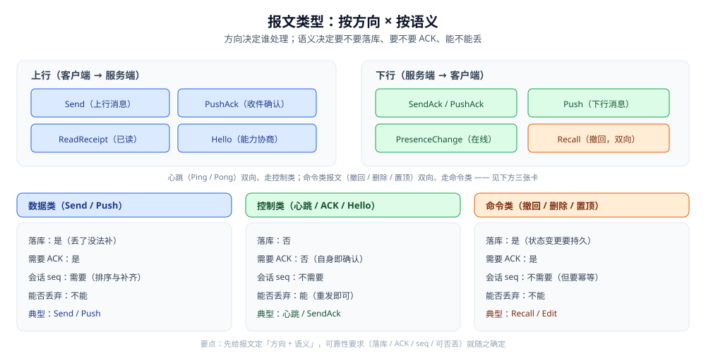
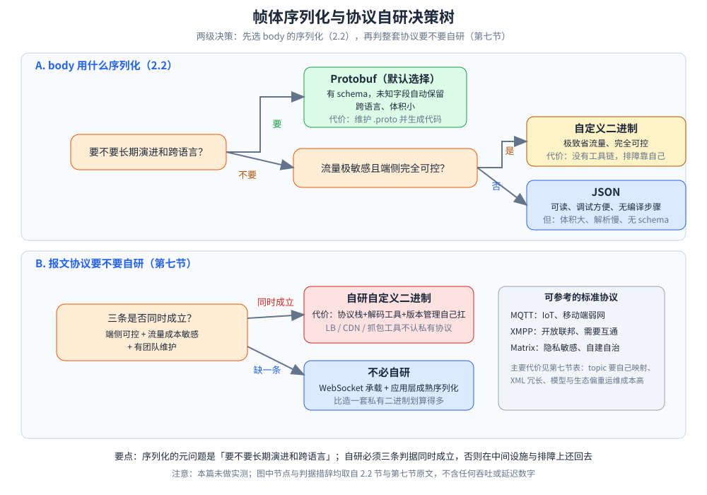

# 协议设计

> 长连接上的**应用层协议**怎么设计：帧格式、消息类型、粘包半包、版本演进、能力协商，以及已读回执 / 撤回 / 输入中这些可选特性怎么落进协议。
>
> 本篇是**报文层**：讲「一条消息在线上长什么样、怎么切边界、怎么兼容老客户端」。
> 投递语义（seq / ACK / 幂等 / 三种可达性）见 [消息可靠投递.md](消息可靠投递.md)；
> 长连接该选 WebSocket 还是自定义二进制见 [在线状态与推送.md](在线状态与推送.md) 第一节；
> 已读与未读的收敛规则见 [会话与未读.md](会话与未读.md)。
>
> 内容整理自个人学习笔记，并参考 MQTT / XMPP / Matrix 与 Protobuf 官方文档；素材见 [素材清单](../../../素材清单.md)。
>
> ⚠️ 实测口径：**本篇未做容器实测**。「使用」节的 Go 骨架是**可编译示例**，未在本仓运行；
> 原因：跑通一个真实的帧编解码需要**两端（客户端 + 服务端）同时在线**并制造粘包/半包/超大帧等对抗场景，
> 单进程环境测不出有意义的结果。文中不引用任何第三方吞吐或延迟数字。

---

## 一、IM 协议要解决哪些问题？

**本节要点**：普通 HTTP 是一问一答、由 HTTP 库帮你切好报文边界；到了长连接，**帧怎么切、类型怎么分发、版本怎么演进、对端支持什么**全都要自己定义。这六件事就是应用层协议的全部骨架。

| # | 要解决的问题 | 不解决会怎样 | 本篇在哪 |
|---|---|---|---|
| ① | **帧定界**：一条消息到哪结束 | 读到的字节拼不成完整消息（粘包 / 半包） | 第四节 |
| ② | **类型分发**：这串字节是什么消息 | 不知道 body 该用什么结构解 | 第三节 |
| ③ | **心跳保活**：连接还活着吗 | 断线靠 TCP 超时才发现，可能几分钟 | 第三节 + [在线状态与推送.md](在线状态与推送.md) 第三节 |
| ④ | **版本演进**：协议怎么加字段、加类型 | 一升级就要求全量客户端同步发版 | 第五节 |
| ⑤ | **能力协商**：对端支持哪些特性 | 新特性推给不支持的客户端 → 报错或闪退 | 第五节 |
| ⑥ | **可选特性**：已读回执 / 撤回 / 输入中怎么表达 | 每个特性各写一套私有格式，无法复用 | 第六节 |

⭐ 一句话：**HTTP 把这些都藏在库里，长连接把它们全摊在你面前。** 这也是为什么「自定义协议」听起来自由，实际是接手了 HTTP 帮你干的那份活。

---

## 二、帧格式怎么设计？

**本节要点**：用**定长头 + 变长体**。头部字段固定宽度、可随机访问；`body` 长度由头部里的 **length** 字段唯一确定 —— **长度前缀是定界的关键**，没有它就无法从字节流里切出消息。


图怎么读：头部定长 13 字节——magic 2B、version 1B、type 1B、flags 1B、seq 4B、length 4B，之后接变长 body；`length` 是切出消息边界的唯一依据。下方的例子就是 2.4 节那条帧（type = 0x11、seq = 42、body 15 B）：读到 length = 15，就知道还要再收 15 字节才凑成一条完整帧。注意帧头 seq 是连接内报文序号（配对 ACK），与会话内消息 seq 不是一回事。

### 2.1 头部的六个字段

| 字段 | 建议宽度 | 作用 | 注意 |
|---|---|---|---|
| **magic** | 2 B | 声明「这是本协议」 | 抓包时一眼识别；也可用来做协议/版本探测 |
| **version** | 1 B | 协议版本 | 与「握手时协商的会话版本」分开看，见 5.1 |
| **type** | 1~2 B | 报文类型 | 决定 body 用什么结构解，见第三节 |
| **flags** | 1 B | 位标志：压缩 / 加密 / 分片 / 是否为响应 | **按位扩展**，用满也才 1 B，别用它存枚举 |
| **seq** | 4 B | 报文序号，用于**请求-响应配对** | ⚠️ **不是会话内消息 seq**，见下方注意 |
| **length** | 4 B | **body 的字节长度** | **定界的唯一依据**；必须先校验再分配，见 2.3 |
| **body** | 变长 | 序列化后的载荷 | 序列化方式由 type / 协商结果决定，见 2.2 |

> ⚠️ **两个 seq 不是一回事**（最容易搞混的一处）：
> 帧头的 `seq` 是**传输层报文序号**，只在本条连接内有效，用来把响应配回请求（ACK 匹配）；
> [消息可靠投递.md](消息可靠投递.md) 里的 `seq` 是**会话内消息序号**，跨连接、跨设备都有效，用来排序与断线补齐。
> 前者可以复用、可以重置；后者单调递增、永久有效。

### 2.2 body 用什么序列化

| 方式 | 优点 | 代价 | 什么时候用 |
|---|---|---|---|
| **Protobuf** | 有 schema、**演进友好**（未知字段自动保留）、跨语言、体积小 | 要维护 `.proto` 并生成代码，二进制不可读 | **默认选择**，尤其中大型系统 |
| **JSON** | 可读、调试方便、无编译步骤 | 体积大、解析慢、没有 schema 约束，字段拼错不报错 | 调试期、小流量、内部工具 |
| **自定义二进制** | 极致省流量、完全可控 | **没有工具链**，演进、排障全得自己造 | 端侧完全可控且流量成本极敏感 |

> ⭐ 判据：**先问「要不要长期演进和跨语言」** —— 要，就 Protobuf；不要且流量极敏感，再考虑自定义二进制。
> 别为了「省几字节」选自定义二进制，最后在**版本演进和抓包排障**上还回去。

### 2.3 帧大小上限

**必须有上限**，这不是优化项而是**安全项**：

- `length` 是**对端给的**。一个恶意的（或出 bug 的）对端报 `length = 2GB`，服务端若照着预分配 → 直接 OOM，这就是最廉价的 DoS。
- 正确顺序：**先校验 `length ≤ maxFrame`，再分配缓冲**；超限应当**立即断开并告警**，而不是「读一点丢一点」继续跑（后面全乱）。
- 大消息（长语音、大图片）**不要靠调大上限**解决，而是走**分片**（用 `flags` 标记）或**先上传拿 URL**（见 [存储选型与组合.md](../../../03-数据与中间件/数据存储/存储架构与场景/存储选型与组合.md) 的「大文件走对象存储」）。

### 2.4 一个具体的帧示例

设一条「上行消息」报文：魔数 `0x49 0x4D`（"IM"）、版本 `1`、类型 `0x11`、无标志位、连接内报文序号 `42`、body 长度 `15`：

```text
偏移  字节                        字段        值
0x00  49 4D                       magic       0x494D ("IM")
0x02  01                          version     1
0x03  11                          type        0x11 = 上行消息
0x04  00                          flags       无压缩 / 无加密 / 非分片 / 非响应
0x05  00 00 00 2A                 seq         42（本条连接内的报文序号）
0x09  00 00 00 0F                 length      15（body 15 字节）
0x0D  <15 字节>                   body        序列化后的消息载荷
```

**头长 = 13 字节，定长**；收到前 13 字节就能算出「还差多少字节才是一条完整消息」，这就是第四节循环读的依据。

---

## 三、报文里有哪些消息类型？

**本节要点**：报文按**方向**（上行 / 下行）与**语义**（数据 / 控制 / 命令）两个维度分类。方向决定谁处理，语义决定**要不要落库、要不要 ACK、能不能丢**。



| 报文 | 方向 | 语义类 | body 关键字段 | 落库 | 要 ACK |
|---|---|---|---|---|---|
| **心跳**（Ping / Pong） | 双向 | 控制 | 时间戳 | 否 | 否 |
| **上行消息**（Send） | 上行 | 数据 | convID、clientMsgID、内容 | 是 | 是（SendAck） |
| **上行 ACK**（SendAck） | 下行 | 控制 | clientMsgID、msgID、seq | 否 | 否 |
| **下行推送**（Push） | 下行 | 数据 | convID、msgID、seq、发送者、内容 | 是 | 是（PushAck） |
| **下行 ACK**（PushAck） | 上行 | 控制 | convID、已收位点 seq | 否 | 否 |
| **已读回执**（ReadReceipt） | 双向 | 控制 | convID、lastReadSeq | 是（可异步） | 否 |
| **会话同步**（ConvSync） | 双向 | 数据 | 游标、条数上限 | 否（读操作） | 否 |
| **在线变更**（PresenceChange） | 下行 | 数据 | userID、状态 | 否 | 否 |
| **命令**（撤回 / 删除 / 置顶） | 双向 | 命令 | 命令码、目标 msgID / convID | 是 | 是 |

### 3.1 数据类报文

**承载业务内容**：`Send` / `Push` / `ConvSync`。共同点：**必须可靠、可重放、带会话 seq**，因为丢了就是「用户看不到消息」。

- 有序：接收方按 `seq` 排序（见 [消息可靠投递.md](消息可靠投递.md) 第一节）。
- 可补：断线后按「已收位点 + 1」拉取。
- 可去重：按 `msgID` 幂等。

### 3.2 控制类报文（心跳、ACK、能力协商）

**为数据类服务，自己不重要**：`心跳` / `SendAck` / `PushAck` / `Hello`（能力协商）。

- **高频但不落库**：ACK 每条消息都可能有一次，落库会把存储打爆（ACK 的价值在于**即时**，不在于留存）。
- **丢了就重发**：控制类靠「重发」保证最终到位，而不是靠「确认」。
- **能力协商是控制类的特殊形态**：只在握手时交换一次，见 5.2。

### 3.3 命令类报文（撤回、删除、置顶）

**不承载内容，而是改变既有消息或会话的状态**：`Recall` / `Delete` / `Pin`。

两个必须处理的点：

- **幂等**：重复收到「撤回 msgID=X」应无副作用（撤回一条已撤回的消息 = 什么都不做）。
- **⚠️ 乱序容错**：撤回报文可能**先于**被撤回的消息到达（跨节点扇出顺序不保证）。接收方若收到「撤一个还没收到的消息」，**不能报错丢弃**，而是**打一个撤回标记**，等消息本体到了立刻标记为已撤回 —— 否则会看到一条本该被撤回的消息。

### 3.4 三种报文的字段差异

| 维度 | 数据类 | 控制类 | 命令类 |
|---|---|---|---|
| 是否落库 | **是**（丢了没法补） | 否 | 是（状态变更要持久） |
| 是否需要 ACK | 是 | 否（自身就是确认） | 是 |
| 是否需要会话 seq | **是**（排序与补齐） | 否 | 否（但需幂等） |
| 能否丢弃 | 不能 | **能**（重发即可） | 不能 |
| 典型报文 | Send / Push | 心跳 / ACK / Hello | 撤回 / 删除 |

> ⭐ 一句话判据：**「丢了会不会让用户看到错的东西」** —— 会，就是数据类或命令类；不会，就是控制类。这一步决定了它要不要落库、要不要 ACK。

---

## 四、粘包半包怎么处理？

**本节要点**：TCP 是**字节流**，没有消息边界 —— 一次 `read` 可能拿到半条、一条或三条消息，与对方 `write` 的次数**毫无对应关系**。IM 的做法是**长度前缀 + 两段读 + 循环**。

处理顺序（收到任意字节流都这么走）：

```text
① 读固定长帧头（13 B）      ← 必须先读满，因为 length 就在头里
        ↓
② 校验 magic / version / length ≤ maxFrame   ← 校验在「分配缓冲」之前
        ↓
③ 再读 length 字节 body     ← 第二段读，长度由上一段解出
        ↓
④ 交给类型分发（第三节）     ← 解码 + 处理
        ↓
⑤ 回到 ①，继续读下一条       ← 缓冲里可能还剩半条 / 多条
```

**IM 特有的三个注意点**（通用细节不在此重复）：

1. **帧头本身也会被拆**：不能假设「一次 read 就能拿到完整头」，必须按固定长度**读满**（`io.ReadFull` 之类）。这正是「两段读」的原因。
2. **上限校验必须在分配 body 缓冲之前**：否则一个超大 `length` 就能让你先 OOM 再校验（见 2.3）。
3. **缓冲复用与并发的矛盾**：为了不每条消息都 `alloc`，通常复用读缓冲；但若把「指向复用缓冲的切片」交给异步协程处理，缓冲会被下一条消息覆盖 → 要么**拷出来**，要么用引用计数。


图怎么读：左侧是字节流的两种畸形形态——半包连帧头都会被拆，必须 `io.ReadFull` 按固定长度读满；粘包一次 read 可能拿到半条、一条或三条消息。右侧是处理循环：① 读满定长帧头（13 B）→ ② 校验 magic / version / length ≤ maxFrame（校验在分配缓冲之前）→ ③ 再读 length 字节 body → ④ 交给类型分发（未知 type 忽略并继续）→ ⑤ 回到 ① 循环；超限则**立即断开并告警**，不能「读一点丢一点」。

> ⚠️ 通用网络编程细节（粘包拆包的三种解法、`deadline`、socket 选项默认值）见 [net包与TCP-UDP编程.md](../../../01-编程语言/go/网络编程/net包与TCP-UDP编程.md) 第四节，本篇不复述；这里只讲「IM 协议怎么用长度前缀把帧切开」。

---

## 五、协议怎么演进？

**本节要点**：协议一旦发布就**必须能陪着老客户端走**——不可能要求全量用户同步发版。三件工具：**版本号**、**未知内容容忍**、**能力协商**。

### 5.1 版本号怎么标

版本号其实有**三处**，别混为一谈：

| 位置 | 作用 | 何时变 |
|---|---|---|
| **帧头 version** | 每一帧自描述，便于抓包定位「这是哪个版本的帧」 | 协议**不兼容**变更时 |
| **握手协商版本** | 本次连接**用哪套语义**（服务端按它决定怎么解） | 每次连接建立时确定 |
| **协议文档版本** | 对外发布、给接入方看 | 每次发布 |

⭐ 原则：**能加字段就不升版本**。绝大多数需求（新增一个可选字段）用「同版本加字段」就能兼容，只有**语义不兼容**（如改了 length 的含义）才升 version。

### 5.2 客户端能力协商

握手时交换一次，之后按协商结果走：

```text
Client → Server   Hello   { protoVersion, capabilities(位图), 压缩算法, 序列化 }
Server → Client   HelloAck{ 协商后的 protoVersion, capabilities(交集), 心跳间隔 }
```

- **capabilities 用位图**：每一位代表一个可选特性（撤回 / 输入中 / 消息编辑 / 分片…）。
- **取交集**：只有**双方都支持**才启用该特性；否则退回旧行为（如不支持撤回的客户端 → 收到撤回命令时按「删除」处理，或直接忽略）。
- **心跳间隔在协商里下发**：让服务端能统一调参，不用让每个客户端自带常量。

### 5.3 向后兼容案例（新增字段 / 新增报文类型）

| 变更 | 怎么做 | 老客户端会怎样 |
|---|---|---|
| **新增字段** | Protobuf 加 `optional` 字段（未知字段自动保留） | 忽略它，读到默认值 ✅ |
| **新增报文类型** | 老客户端遇到**未知 type** 应**忽略并继续** | ⚠️ 若老客户端「遇到未知 type 就断开」，则**新功能上线 = 老端集体掉线** |
| **新增可选特性** | 能力位都置位才启用 | 不置位就不启用，行为不变 ✅ |
| **字段语义变更** | ❌ **不允许**：应**新增字段**代替 | 复用字段号 / 改语义会让老数据被解错 |

> ⚠️ 最容易被忽略的一条：**「未知报文类型必须优雅忽略」**。这条不做，协议就失去了向前兼容的能力 —— 任何新类型的灰度上线都会变成老客户端的掉线事故。

---

## 六、可选特性怎么落进协议？

**本节要点**：这些特性看起来各不相同，本质都是**「一个报文类型 + 几个字段」**的组合；差别只在**是否落库、是否幂等、能否丢**。

| 特性 | 报文类型 | 关键字段 | 可靠性要求 |
|---|---|---|---|
| 已读回执 | `ReadReceipt` | convID + lastReadSeq | 可合并、**单调不减**（见 [会话与未读.md](会话与未读.md) 第四节） |
| 撤回 | `Recall` | msgID + 撤回原因 | **幂等** + 乱序容错（见 3.3） |
| 输入中 | `Typing` | convID + 状态 | **高频、可丢、绝不落库**（丢了只是「输入中…」闪一下没显示） |
| 消息编辑 | `Edit` | msgID + 新内容 | 需带**编辑时间/版本**，避免乱序时旧编辑覆盖新编辑 |

⭐ 判据：**先给特性定可靠性等级，再决定它用哪一类报文（3.4 的表）**。
比如「输入中」如果错当成数据类去落库，会在群里几百人同时打字时把存储压垮 —— 而这种消息**丢了完全无感**。

---

## 七、有哪些标准协议可以直接参考？

**本节要点**：**不一定要自研**。自研的代价是「协议栈 + 解码工具 + 版本管理」全得自己扛，而且中间设施（LB / CDN / 抓包工具）普遍不认你的私有协议。先知道有哪些标准可参考。

| 协议 | 特点 | 适用 | 主要代价 |
|---|---|---|---|
| **MQTT** | 轻量、发布订阅、有 QoS 0/1/2 三档 | IoT、移动端弱网 | 消息模型是主题（topic），做「一对一/群聊」要自己映射 |
| **XMPP** | 老牌 IM 标准、基于 XML、支持服务端联邦 | 开放联邦、需要互通 | XML 冗长，移动端流量与电量不友好 |
| **Matrix** | 去中心化、房间 = 事件图、端到端加密 | 隐私敏感、需要自建自治 | 模型与生态偏重，运维成本高 |
| **自定义二进制** | 完全可控、省流量、可压到最小 | 大规模 IM（微信 / 钉钉这类） | 无标准工具链，排障与版本演进全靠自己 |

⭐ 判据：**「端侧可控 + 流量成本敏感 + 有团队维护」三条同时成立，才值得自研**；否则用 WebSocket 承载、应用层选一个成熟序列化，比造一套私有二进制划算得多。



图怎么读：上层（A）展开 2.2 的判据——「要不要长期演进和跨语言」，要就 Protobuf（默认选择）；不要，再问「流量极敏感且端侧完全可控」，是就自定义二进制，否就 JSON（调试期、小流量、内部工具）。下层（B）展开第七节的判据——三条同时成立才自研自定义二进制，否则 WebSocket 承载 + 应用层成熟序列化；右侧灰卡列出 MQTT / XMPP / Matrix 三个可参考标准协议及各自适用场景。两级决策的节点措辞全部是正文原句，图中不含任何吞吐或延迟数字。

---

## 使用：一个最小二进制帧协议的 Go 骨架

把上面的头布局、上限校验、两段读串成一个可编译示例。**⚠️ 未实测**（需要真实两端打通）。

```go
package im

import (
	"encoding/binary"
	"errors"
	"fmt"
	"io"
)

const (
	Magic     uint16 = 0x494D // "IM"
	HeaderLen        = 13     // magic2 + version1 + type1 + flags1 + seq4 + length4
	MaxFrame         = 1 << 20 // 1 MiB：body 上限，超过即视为异常/攻击
)

// Frame 是应用层的一帧；Seq 是「连接内报文序号」，不是会话内消息 seq。
type Frame struct {
	Version uint8
	Type    uint8
	Flags   uint8
	Seq     uint32
	Body    []byte
}

// WriteFrame 按 [头][body] 写出，length 由 body 长度自动填。
func WriteFrame(w io.Writer, f Frame) error {
	if len(f.Body) > MaxFrame {
		return fmt.Errorf("body too large: %d", len(f.Body))
	}
	buf := make([]byte, HeaderLen+len(f.Body))
	binary.BigEndian.PutUint16(buf[0:2], Magic)
	buf[2] = f.Version
	buf[3] = f.Type
	buf[4] = f.Flags
	binary.BigEndian.PutUint32(buf[5:9], f.Seq)
	binary.BigEndian.PutUint32(buf[9:13], uint32(len(f.Body)))
	copy(buf[HeaderLen:], f.Body)
	_, err := w.Write(buf)
	return err
}

// ReadFrame 两段读：先读满定长头，校验后再读 body。粘包/半包在本函数内被消化。
func ReadFrame(r io.Reader) (Frame, error) {
	var head [HeaderLen]byte
	if _, err := io.ReadFull(r, head[:]); err != nil { // 半包：这里会阻塞到读满
		return Frame{}, err
	}
	if binary.BigEndian.Uint16(head[0:2]) != Magic {
		return Frame{}, errors.New("bad magic") // 流已不可信，调用方应断开
	}
	bodyLen := binary.BigEndian.Uint32(head[9:13])
	if bodyLen > MaxFrame { // ★ 校验在分配之前，防止超大 length 打爆内存
		return Frame{}, fmt.Errorf("frame too large: %d", bodyLen)
	}
	body := make([]byte, bodyLen)
	if _, err := io.ReadFull(r, body); err != nil {
		return Frame{}, err
	}
	return Frame{
		Version: head[2],
		Type:    head[3],
		Flags:   head[4],
		Seq:     binary.BigEndian.Uint32(head[5:9]),
		Body:    body,
	}, nil
}

// Dispatch 按类型分发；⚠️ 未知类型必须「忽略并继续」，不能断开（见 5.3）。
func Dispatch(f Frame, h map[uint8]func([]byte)) error {
	if fn, ok := h[f.Type]; ok {
		return fn(f.Body)
	}
	return nil // 未知类型：静默忽略，保留向前兼容能力
}
```

**这段骨架显式省略的部分**（真实系统的工程量所在）：`flags` 的压缩 / 分片处理、`Seq` 与响应配对的超时重试、读缓冲复用与并发安全、`version` 不匹配时的握手降级、以及把 `Dispatch` 接到第三节那张报文表上。

---

## 延伸追问

- **帧头的 seq 和消息 seq 是一回事吗？** → 不是。帧头 seq 是**连接内**的报文序号，用于请求-响应配对，可复用、可重置；消息 seq 是**会话内**单调递增序号，跨连接跨设备有效，用于排序与断线补齐（见 [消息可靠投递.md](消息可靠投递.md) 第一节）。
- **为什么不能靠 TCP 保证消息边界？** → TCP 只保证**字节顺序**，不保证「一次 write 对应一次 read」。粘包半包是字节流的固有性质，只能靠应用层长度前缀自己切。
- **为什么未知报文类型必须忽略而不是断开？** → 因为协议要**向前兼容**：老客户端遇到新类型若直接断开，任何新类型的灰度上线都会让老端集体掉线（见 5.3）。
- **心跳为什么放在应用层，不用 TCP keepalive？** → keepalive 默认探测间隔极长（小时级），且只能判断「TCP 层没响应」，判不出「应用线程卡死」。业务级心跳的间隔和判定权必须在应用层，才能秒级发现断线。
- **自研二进制协议最大的代价是什么？** → 不是编解码，而是**中间设施不认它**：负载均衡、CDN、抓包工具都要额外适配，排障成本远高于报文省下的那点流量。

## 关联

- [通信链路与协议栈.md](通信链路与协议栈.md) — 分层总纲：一条消息跨哪三条路径、本篇在第几条路径上、跨路径怎么衔接。
- [消息可靠投递.md](消息可靠投递.md) — 投递语义：会话 seq、ACK、幂等、三种可达性（本篇的帧头 seq 与它的消息 seq 分属两层）
- [在线状态与推送.md](在线状态与推送.md) — 第一节讲长连接选型（WebSocket vs 自定义二进制），第三节讲心跳参数与断线重连
- [会话与未读.md](会话与未读.md) — 已读回执的收敛规则（ReadReceipt 的 lastReadSeq 在那里定义语义）
- [README.md](README.md) — 本目录导读：IM 的四个硬问题与阅读顺序
- [net包与TCP-UDP编程.md](../../../01-编程语言/go/网络编程/net包与TCP-UDP编程.md) — 粘包拆包的三种解法与 `deadline`（本篇第四节只讲 IM 特有的处理）
- [接入与推送.md](../弹幕系统/接入与推送.md) — 另一套长连接报文设计，可对照「可丢」与「不可丢」两类场景的协议取舍
- [README.md](../README.md) — 系统设计目录导读：本目录与其它专题的分工
> 反向引用（本篇被下列文档引到）：[内容审核与合规.md](内容审核与合规.md)、[富媒体消息.md](富媒体消息.md)、[机器人与开放平台.md](机器人与开放平台.md)、[消息类型与业务语义.md](消息类型与业务语义.md)、[端到端加密.md](端到端加密.md)、[限流与防刷.md](限流与防刷.md)、[音视频信令.md](音视频信令.md)
