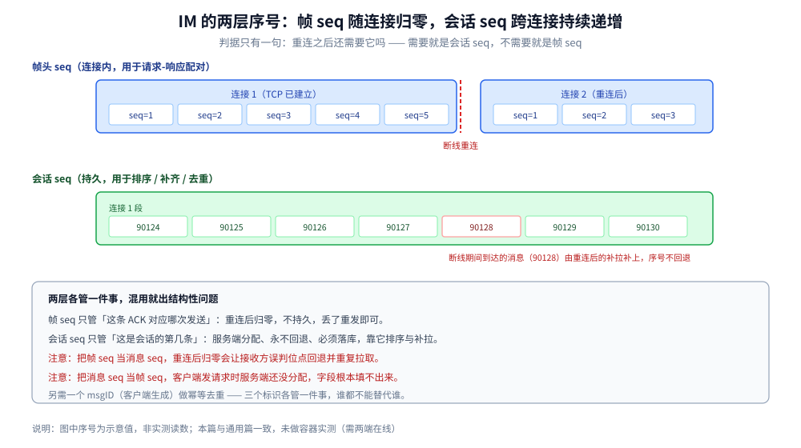

# 协议设计

> 覆盖：IM 场景对报文层的**额外要求**——两层序号为什么必须分开（连接内报文 seq vs 会话内消息 seq）、撤回为什么会先于消息本体到达以及怎么容错、已读回执与「输入中」这类可选特性的**可靠性定级**、以及一条 IM 消息的完整报文该带哪些字段。
>
> 不覆盖：帧格式怎么定、报文分几类、粘包半包怎么处理、版本怎么演进、能力怎么协商——这些**通用方法**见 [自定义协议设计.md](../../../02-计算机基础/网络/消息协议/自定义协议设计.md)；投递语义（会话 seq / ACK / 幂等 / 三种可达性）见 [消息可靠投递.md](消息可靠投递.md)；长连接该选 WebSocket 还是自定义二进制见 [在线状态与推送.md](在线状态与推送.md) 第一节。
>
> 内容整理自个人学习笔记，素材见 [素材清单](../../../素材清单.md)。⚠️ **本篇未做容器实测**：帧编解码的验证需要两端同时在线并制造粘包 / 半包 / 超大帧等对抗场景，与通用篇一致，本篇不引用任何吞吐或延迟数字。

---

## 一、IM 为什么要两套序号？

**本节要点**：IM 的序号有**两个互不相干的作用域**——帧头里的 `seq` 是「连接内的第几次请求」，用于把响应配对回请求；会话里的 `seq` 是「这个会话的第几条消息」，用于排序、补齐与去重。**混用会让断线重连后位点错乱**，这是 IM 协议设计里最常见的一个结构错误。



上图要读出的核心：帧 seq 的生命周期是**一条 TCP 连接**（重连从 0 或从 1 重新开始），会话 seq 的生命周期是**整个会话**（换设备、换连接都不变）。两者变化的原因完全不同，所以不能共用同一个字段。

| 维度 | 帧头 `seq`（连接内报文序号） | 会话 `seq`（消息序号） |
| --- | --- | --- |
| 作用 | 请求-响应**配对**（这条 ACK 对应哪次发送） | **排序、补齐、去重** |
| 作用域 | 一条连接 | 一个会话（跨连接、跨设备） |
| 生命周期 | 重连后归零 / 重新开始 | 持久，永不回退 |
| 持久化 | **不持久** | **必须持久**（落库） |
| 丢了会怎样 | 只是这次请求配不上响应，重发即可 | 用户看到消息缺失或乱序 |
| 谁来分配 | 客户端（或双向各自维护） | 服务端统一分配 |

> ⭐ **判据一句话**：**「重连之后还需要它吗？」** 需要 → 会话 seq；不需要 → 帧 seq。

**混用的两种典型后果**：

- **把帧 seq 当消息 seq**：重连后帧 seq 归零，接收方按它排序会把新消息排到历史消息前面，或者误判「位点回退」而重复拉取。
- **把消息 seq 当帧 seq**：帧头要带一个 64 位持久序号，帧体积变大，而且**服务端分配的消息 seq 在客户端发请求时还不存在**，根本填不进去。

## 二、撤回为什么会先到？怎么容错？

**本节要点**：撤回报文**不承载内容，而是改变一条既有消息的状态**。它和多端扇出走的是不同路径，**顺序不保证**——撤回报文完全可能先于被撤回的消息到达接收方。正确做法是「**先打标记，本体到了再应用**」，而不是报错丢弃。

### 2.1 为什么顺序不保证

一条消息从发送方到接收方要经过「存储 → 扇出到多个端 → 各端各自的推送队列」，而撤回是另一次独立的扇出。两条链路的路由、重试、队列长度都不同，**到达顺序没有任何协议约束**。所以：

```text
可能的到达顺序：
① 消息本体 → 撤回报文    （正常）
② 撤回报文 → 消息本体    （乱序，必须容错）
③ 只有撤回报文            （本体走了离线补拉，晚些才到）
```

### 2.2 三条处理规则

| 情况 | 错误做法 | 正确做法 |
| --- | --- | --- |
| 收到「撤回 msgID=X」但本地没有 X | 报错 / 丢弃撤回报文 | **打一个撤回标记**（内存或本地库），等 X 到达时立刻标记为已撤回 |
| 重复收到「撤回 msgID=X」 | 报错 / 重复写库 | **幂等**：已撤回的消息再撤一次，什么都不做 |
| 撤回后本地仍有原消息缓存 | 只删主表不删缓存 | 缓存也要失效，否则用户从别的入口还能看到原文 |

> ⚠️ **幂等在这里不是「优化」而是「必需」**：撤回是命令类报文，必须 ACK 与重试，重试就一定会重复投递。

### 2.3 撤回的可靠性等级

撤回属于**命令类**——丢了会让用户看到一条本该被撤回的消息，属于「看到错的东西」，所以必须：**落库 + ACK + 幂等**。这三件事的划分依据见下一节的表。

## 三、可选特性怎么定可靠性等级？

**本节要点**：每个可选特性（已读回执 / 输入中 / 置顶 / 撤回）都要先定**可靠性等级**，再决定它用哪一类报文、要不要落库。判据只有一句：**「丢了会不会让用户看到错的东西」**。

| 特性 | 丢了会怎样 | 等级 | 报文类型 | 落到哪 |
| --- | --- | --- | --- | --- |
| **输入中** | 完全无感（下次输入还有） | 最低 | 控制类 | **不落库**，直接转发；群里几百人同时打字也不压存储 |
| **已读回执** | 显示「未读」，但下次打开能重算 | 中（最终一致） | 控制类 | 可落库但可批量合并，靠周期重发兜底 |
| **置顶 / 删除** | 用户看到的状态不对 | 高 | 命令类 | 落库 + ACK + 幂等（与撤回同） |
| **撤回** | 看到一条本该消失的消息 | 高 | 命令类 | 落库 + ACK + 幂等 + **乱序容错**（见第二节） |
| **消息本体** | 消息丢了 | 最高 | 数据类 | 落库 + 会话 seq + ACK + 幂等 |

> ⭐ **最常见的过度设计**：把「输入中」当成数据类去落库。群里几百人同时打字时会把存储压垮，而这种消息**丢了完全无感**。

**三条定级理由**（决定一类报文该不该落库）：

- **数据类**：丢了没法补，必须有序（会话 seq）、可补（位点拉取）、可去重（msgID 幂等）。
- **控制类**：自身就是确认，**丢了就重发**，高频但不落库——ACK 每条消息都可能有一次，落库会把存储打爆，ACK 的价值在于**即时**不在于留存。
- **命令类**：不承载内容但改变状态，必须落库（状态变更要持久）+ ACK + 幂等。

## 四、具体使用：一条 IM 消息的报文字段

把上面三节的结论落到一条真实报文的字段上。**⚠️ 未实测**（字段设计示例，与通用篇的 Go 骨架同一套布局）：

```json
{
  "seq": 42,
  "type": "SEND",
  "msgID": "c-8f21a7",
  "convID": "conv-7781",
  "convSeq": 90127,
  "senderID": "u-1024",
  "sendTime": 1760000000123,
  "body": { "kind": "text", "text": "..." }
}
```

字段与前三节的对应关系：

| 字段 | 所属层 | 依据 |
| --- | --- | --- |
| `seq` | **帧层**（连接内） | 与 ACK 配对，重连后可归零 |
| `convSeq` | **会话层** | 服务端分配，用于排序与补拉，永不回退 |
| `msgID` | 消息层 | 客户端生成，用于**幂等去重**（跨连接、跨设备唯一） |
| `type` | 帧层 | 决定 body 怎么解（报文分类见通用篇第三节） |
| `body` | 消息层 | 序列化后的正文，与 `type` 对应 |

> ⚠️ `msgID` 与 `convSeq` **不能互相替代**：`msgID` 由客户端生成（去重要靠它），`convSeq` 由服务端分配（排序要它）。只有一个 `msgID` 时无法排序，只有一个 `convSeq` 时无法在客户端做幂等。

## 延伸追问

- **一条连接上并发发多条消息，帧 seq 怎么保证不乱？** 帧 seq 只解决「响应配对」，不解决「发送顺序」。并发的多次发送在服务端可能乱序处理，所以**会话内的最终顺序要靠服务端分配的 `convSeq` 定**，不能靠帧 seq 的先后。
- **撤回标记要存多久？** 至少存到「被撤回的消息本体确定不会再来」为止——通常取离线补拉窗口（消息保留期）的上限。存短了会出现「标记被清理 → 本体晚到 → 用户又看到原文」。
- **已读回执为什么可以不落库？** 因为它可以从「客户端上报的已读位点」重算。真正的状态是「这个会话我读到第几条」，回执只是通知，重算成本低。**判据是「能不能从别的地方重算」**，能就不必为通知单独建表。
- **多端同步需要额外的报文类型吗？** 不需要。多端同步的本质是「同一个会话的多条连接各自按 `convSeq` 补拉」，复用数据类的补齐路径即可；需要额外做的是「一端已读，通知其他端更新未读数」，这走控制类。
- **为什么通用篇把「报文分类」放在前面，而本篇放在后面？** 因为分类是通用框架（数据 / 控制 / 命令三类在任何长连接协议里都成立），而「哪些特性属于哪一类」是 IM 的业务判断。**先有框架，再定级**。

## 关联

- **上游/总纲**：[自定义协议设计.md](../../../02-计算机基础/网络/消息协议/自定义协议设计.md) — ⭐ 通用方法：帧格式、报文三分类、粘包半包、版本演进、能力协商（本篇原 §二~§六 已迁入该篇）
- **上游/总纲**：[通信链路与协议栈.md](通信链路与协议栈.md) — 一条消息跨哪三条路径、本篇在第几条路径上
- **上游/总纲**：[README.md](README.md) — 本目录导读：IM 的四个硬问题与阅读顺序
- **下游机制**：[消息可靠投递.md](消息可靠投递.md) — 投递语义：会话 seq、ACK、幂等、三种可达性（本篇只讲它们在报文里长什么样）
- **下游机制**：[会话与未读.md](会话与未读.md) — 已读回执的收敛规则（ReadReceipt 的 lastReadSeq 在那里定义语义）
- **下游机制**：[在线状态与推送.md](在线状态与推送.md) — 第一节长连接选型、第三节心跳参数与断线重连
- **对照/互补**：[XMPP.md](../../../02-计算机基础/网络/消息协议/XMPP.md) — 标准 IM 协议怎么组织 stanza，可与本篇的自定义报文对照
- **对照/互补**：[MQTT.md](../../../02-计算机基础/网络/消息协议/MQTT.md) — 发布订阅模型下的 QoS 分档，可与本篇的「可靠性定级」对照
